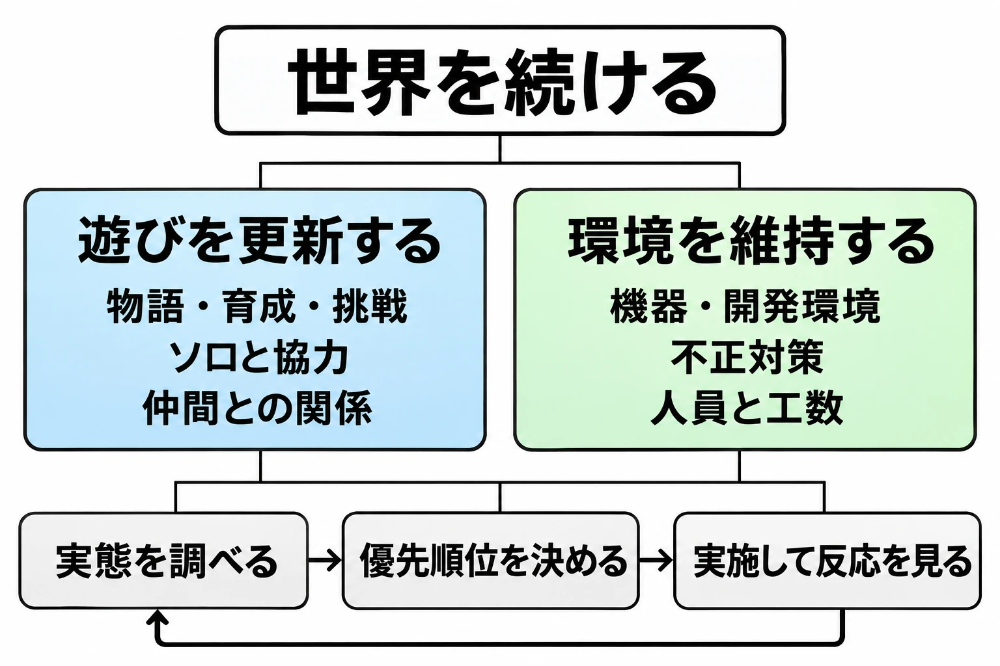

# 終わらなかったMMORPG――FFXIとドラゴンクエストXに学ぶ「続ける」運営

## はじめに――続けることも、運営の判断である

長く遊んだゲームへログインすると、いつもの街があり、育てたキャラクターがいて、誰かと過ごした記憶が残っている。その日常を明日も開けるために、運営はコンテンツ、設備、人員の配分を選び続けている。

「サービス終了・撤退」を考えるとき、今も続いているMMORPGは格好の比較対象になる。[サービス終了をどう設計するか](service-shutdown-design-and-practice.md)が畳む際の判断と実務を扱ったのに対し、本稿では『ファイナルファンタジーXI』（以下、FFXI）と『ドラゴンクエストX オンライン』（以下、DQX）を中心に、長く続けるための判断を読む。リネージュシリーズと『ラグナロクオンライン』も、その異なる側面を示す事例として取り上げる。

まず、日本国内での正式サービス開始年と、2026年11月4日時点で迎えた周年を並べよう。

| タイトル | 国内正式サービス開始年 | 記事時点で迎えた周年 | 本稿で見る点 |
|---|---|---|---|
| FFXI | 2002年 | 24周年 | 継続判断、設備と体制の更新、ソロ対応 |
| リネージュ | 2002年 | 24周年 | 血盟を通じた関係 |
| ラグナロクオンライン | 2002年 | 23周年 | 新規コンテンツと不正対策の人手 |
| リネージュ2 | 2004年 | 22周年 | 関係に加え、ゲーム内で得られる地位 |
| DQX | 2012年 | 14周年 | メインストーリー完結後の継続、ソロ活サーバー |

FFXIは2026年5月16日に24周年を迎えた。リネージュは同年2月12日に24周年、リネージュ2は6月25日に22周年を迎えた。両作の国内開始年はエヌシージャパンへの取材でも示されている。ラグナロクオンラインは2025年12月1日に23周年、DQXは2026年8月2日に14周年である。ラグナロクオンラインの24周年は記事時点ではまだ先にある。[[1](#ref-1)][[2](#ref-2)][[3](#ref-3)][[4](#ref-4)][[5](#ref-5)][[6](#ref-6)]

この年数が示すのは、サービスが続いてきた実績である。プレイヤー人口や収益の順位を示すものではない。売上、継続率、費用などの内部データを横断して比較できない以上、長寿の理由を断定することもできない。本稿では公開された施策と運営者の説明を紹介し、そこからの設計上の読み取りを分けて述べる。成功例をまねれば同じ年数だけ続けられる、という処方箋にはしない。

立ち上げ時の企画や運営全般については[MMORPG企画の基礎](mmorpg-planning-development-live-operations-basics.md)に譲り、ここでは、すでに長い歴史を持つ世界をどう続けるかに焦点を絞る。

***

## FFXI――物語を終え、終わりかけ、続けることを選んだ24年

### 物語と対応機種に、それぞれ区切りを付けた

FFXIは2002年、家庭用ゲーム機向けとして初のMMORPGとして運営を始めた。長期運営の中では、いくつもの区切りを経験している。[[1](#ref-1)]

2015年には最終章シナリオ「ヴァナ・ディールの星唄」を配信し、同年11月を最後の大型バージョンアップとする方針を告知した。PlayStation 2版とXbox 360版は2016年3月にサービスを終了し、Windows版で運営を継続した。発表当時には、家庭用ゲーム機のプレイヤーが登録コードを使ってPCへ移行できることも説明されていた。[[7](#ref-7)][[8](#ref-8)][[9](#ref-9)]

ここから読み取れるのは、物語、更新規模、対応機種、サービス全体には、それぞれ異なる区切りを設けられるということである。物語を締め、維持する機種を絞ったうえで、遊ぶ場所を残す選択がある。

### 継続を選ぶには、設備と人の条件を組み直す必要があった

FFXIのプロデューサー兼ディレクターである藤戸洋司氏は、2025年のインタビューで、2024年には更新を終えて保守だけを行う「メンテナンスモード」へ移る可能性も少なからずあったと振り返っている。20周年前後にはサーバーの機械的な寿命が迫り、機器を更新して続けるか、閉じる準備をするかを議論していた。[[9](#ref-9)]

継続を望む多くの声に加え、実際にログインして遊び続ける人がいた。その状況を受け、サーバーと開発機器の更新、スタッフのキャリアを考慮した兼任・移籍を前提に継続を決めた。藤戸氏は、後のシナリオ『蝕世のエンブリオ』の完結時に盛り上がりが下降し続けていれば終了準備に入る考えも持っていたが、そうはならなかったと説明する。2024年にはサーバーの入れ替えを進め、少人数のチームで実行できる仕事を洗い出した。[[9](#ref-9)]

本稿が注目するのは、継続への意思と、継続可能な条件を整える仕事が一緒に語られている点である。声援を受け止めるだけでなく、機器を買い替え、人の配置を変え、更新ごとの作業量と期間を確保する。継続するという決定は、その後の制作計画を作り直す決定でもある。

また、『蝕世のエンブリオ』完結時の反応を見るという考えは、判断の節目を持つ例として読める。公開発言には具体的な数値基準までは示されていないが、何を見て次を決めるかという観測対象はあった。

### 今いる冒険者の遊び方から、更新の優先順位を決める

2026年のインタビューで藤戸氏は、2024年11月の冒険者意識調査を重視し、アクティブ層の大半がソロで遊んでいる実態を踏まえて方針を決めていると説明した。フェイスというNPCの仲間の強化、デュナミス～ダイバージェンス～の共有エリア化、リンバスの全面改修は、その流れにある。リンバスは滞在時間や入場回数の制限をなくし、一人や少人数でも立ち寄って遊びやすい形へ変えた。[[1](#ref-1)]

その際の境界を、藤戸氏は次のように表現する。

> “ソロで遊びやすいこと≠ソロで何でもできる”だという点は、つねに意識しています。[[1](#ref-1)]

設計上は、参加できること、一定の範囲を遊べること、最後まで攻略できることを分けて考えられる。仲間が集まるまで入口で待たせる条件を緩めても、協力して挑む余地は残せる。ソロ対応を一律の難度低下として扱わず、どこまで体験の機会を広げるかという仕様にするのである。

### 更新する場所と、入口を残す

制作体制には制約もある。2026年5月時点で藤戸氏は、新しいストーリーには「ほとんど動きがない」と説明している。専任で担当できる人員がおらず、別タイトルに携わるスタッフに将来チームへ戻ってもらい、制作できないか計画している段階だった。少人数で優先順位を付けて更新する体制の中では、すべての期待へ同時に応えることは難しい。[[1](#ref-1)][[9](#ref-9)]

一方で、新規・復帰の入口にも施策を続けている。2025年5月にはウェルカムバックキャンペーンを実施した。フリートライアルも、2026年9月30日にプレイ期間を14日間から無期限へ、レベル上限を50から75へ拡張した。[[10](#ref-10)][[11](#ref-11)]

藤戸氏が掲げるのは「“続けられる限り続ける”という覚悟」であり、30周年へ向けた運営は努力目標である。周年を迎えたら終了するという区切り方は取らないという姿勢であって、30周年までの提供を保証する発表ではない。[[1](#ref-1)]

本稿の読み取りでは、FFXIの「続ける」は、今ある世界を維持する基盤、今の遊び方に合う更新、戻ってこられる入口を、現在の規模に合わせて組み直す営みである。

***

## ドラゴンクエストX――物語の完結の先を見据える、14周年の運営

### メインストーリーの区切りと、サービスの予定を分けて伝える

DQXは2026年6月25日に追加パッケージ『時空の迷い子たち』を発売し、バージョン8.0を実施した。同年8月2日にはサービス開始14周年を迎えている。[[6](#ref-6)]

2026年3月の告知では、メインストーリーの更新はバージョン8で終了するとされた。同時に、サービスは継続し、完結後もクエストなどのおはなし要素を含む各種コンテンツを配信していく予定が示された。バージョン8.0以降の大型アップデートは、約4か月ごとを予定している。[[12](#ref-12)][[13](#ref-13)]

この発表の読みどころは、物語に結末を用意しながら、その先も遊ぶ世界について説明している点にある。長期運営のRPGでは、次の物語を待つことがログインの目的の一つになる。だからこそ、メインストーリーが完結する範囲と、その後も続く配信を分けて伝えることが、プレイヤーが将来の遊び方を考える材料になる。

FFXIが物語の区切りの後に更新を重ねてきた事例なら、DQXはメインストーリーの完結へ向かう段階で、その先の継続を示した事例として読める。両者の体制や事業条件が同じだと考える必要はない。

### ソロ活サーバーは、得るものと手放すものが明確である

バージョン8.0で導入されたソロ活サーバーでは、他プレイヤーの姿と「まわりに」チャットが表示されず、モンスターの取り合いも発生しない。一方、他のプレイヤーとパーティを組むことはできない。サポート仲間となかまモンスターは利用できる。[[13](#ref-13)]

フィールドのドロップにも制限があり、宝珠、タロットメダルの破片、ゼルメアの聖紋、白宝箱は得られるが、素材や魔因細胞などは得られない。フィールド上の採集アイテムは拾える。[[13](#ref-13)]

仕様として得ているのは、周囲の存在や獲物の競合を気にせず、自分のペースで活動できる環境である。手放しているのは、そのサーバーで人と組む機会と、一部の報酬だ。プレイヤーは遊び方に合わせて、その条件を選ぶことになる。

これは本稿の分析だが、ソロ対応は「誰もが同じ場所で同じことをできるようにする」以外の形も取れる。FFXIがコンテンツへの参加条件やNPCの仲間を調整するのに対し、DQXはソロ活動に向くサーバーの条件を定めた。交流を求める時間と、一人で進めたい時間を、仕様としてどう受け止めるかという異なる回答である。

DQXは新人・カムバック向けの大型キャンペーンも実施した。[[6](#ref-6)] 既存プレイヤーの遊ぶ環境を変える施策と、新規・復帰の入口を用意する施策の両方が見えるが、それぞれが継続率へ与えた効果までは、この事実からは判断できない。

***

## リネージュ／リネージュ2――関係と地位が、続ける理由になる

リネージュシリーズを日本で提供するエヌシージャパンのユニットリーダー、三浦周氏は、2023年のインタビューで、血盟と呼ばれるプレイヤー組織について「家族のような単位での強固な絆」を形成するコンテンツを作っていると説明した。[[4](#ref-4)]

三浦氏は、プレイを続けることで得られる地位やランキングも挙げている。例に出したのは、リネージュ2のオリンピアードで勝者が英雄になる仕組みだ。継続的な改善にも触れながら、長く続けられる理由を、プレイヤーの支持とMMORPGの基礎部分の設計に見いだしている。これは運営者自身による評価である。[[4](#ref-4)]

本稿の分析としては、用意されたコンテンツを遊び終えた後にも、人との関係が次のログインの理由になり得る。昨日一緒に戦った仲間がいる、次の作戦を相談したい、自分の役割を果たしたい。その動機は、未読の物語や未入手の装備とは別に残る。

地位も同様である。強い装備を持つことに加え、その世界の人々に知られ、評価されることが続ける目的になる。ただし、強い関係があることと、運営の採算が成り立つことは別の問題だ。コミュニティは継続動機になり得るが、それだけで長寿を保証するものではない。

FFXIやDQXのソロ対応と、関係を重視する設計は両立し得る。一人で進めたい日にも遊べて、人と関わりたい場も残る。その境界を作品に合わせて設計することが、長期運営の課題となる。

***

## ラグナロクオンライン――新しい目標と、環境を守る仕事が同じ人手を取り合う

### 新しい目標を足し、積み重ねた世界を動かす

ガンホーが運営する『ラグナロクオンライン』（以下、RO）は、2025年12月1日に23周年を迎えた。2026年1月の運営インタビューでは、韓国で先行実装された新章を春に導入する計画と、変身を特徴とする新職業「ドルイド」が紹介された。[[5](#ref-5)]

その後、新章「Chapter1：世界樹の詩 ～序曲～」は3月に実装され、10月には拡張アップデートが行われた。ドルイド系職業も4月に実装され、人間の姿で魔法を使うほか、動物の姿へ変身して近接・遠距離の物理攻撃を行う遊び方が加わった。[[14](#ref-14)][[15](#ref-15)][[16](#ref-16)]

長年育てたキャラクターで新しい場所へ行くことと、新しい職業で育成を始めることは、異なる入口になる。蓄積した資産を使う目標と、育て直す目標の両方を用意する、と読むことができる。

### 守る仕事が増えると、作る仕事の予定も変わる

一方、2024年初めには露店代行の不具合を使って、ゲーム内通貨Zenyが不正に増やされる問題が起きた。ガンホーのRO運営に携わる山本兼寛氏は、2025年のインタビューで「丸々1年，不正対策やシステム改修などの案件を全部やっていたので」と述べ、予定したコンテンツへ手が回らなかったと説明した。Yggdrasillワールド関連の実装にも遅れが出た。[[17](#ref-17)]

同じく運営に携わる中村聡伸氏も、翌年のインタビューで、不正対策に人手を割くとコンテンツ実装のリソースが減ると振り返っている。山本氏は、不正の多くが、ゲーム内の通貨などを現実のお金で売買するRMTにつながると説明した。[[5](#ref-5)]

ここで見えるのは、新しい遊びを作る仕事と、安心して遊べる状態を守る仕事が、同じ人手を必要とする現実である。不正な通貨が流通すれば、正規のプレイで積み重ねた財産や取引への信頼に関わる。対策へ人を回すことは、更新予定を圧迫しても、遊ぶ土台を守るための選択になる。

中村氏は、運営が用意できるものを「遊びの舞台」と表現し、23年の継続はプレイヤーのおかげだと語っている。[[5](#ref-5)] 舞台を増やすことと、舞台を使える状態に保つこと。その両方が続いて初めて、プレイヤーが次の歴史を作れるのである。

***

## 共通して見えること――世界を続けるために、変える範囲を選ぶ

ここからは、各社の発言を踏まえた本稿の整理である。事例に共通して見えるのは、次の七つの判断だ。

- **物語と世界の時間を分ける**：物語に結末を用意した後にも、育成や挑戦、交流の場を残せるかを考える。
- **調査から更新対象を選ぶ**：FFXIのように、今いるプレイヤーの遊び方を把握し、限られた制作時間の使い道を決める。
- **交流を選べる範囲を作る**：一人で参加しやすい条件と、協力して到達する範囲を分ける。ソロの快適さと、何でも一人で達成できることを区別する。
- **関係が続く余地を残す**：次の物語を待つ以外にも、仲間や役割がログインの理由になる場を保つ。
- **保守の工数を計画に含める**：機器更新や不正対策も、世界を開け続けるための制作条件として扱う。
- **現在の規模で優先順位を付ける**：担当できる人と期間に合わせ、今回行う更新と、先へ送る更新を選ぶ。
- **継続判断の観測対象を持つ**：どの節目に、どの反応や事業条件を見て、続けるか終えるかを判断するかを持っておく。

これらは全作品に同じ比率で当てはまる要素ではない。ソロ対応を重くする作品も、集団での関係を強みにする作品もある。持ち帰るべきなのは、特定の施策の名前より、プレイヤーの実態と運営の制約に合わせて選択を変える姿勢である。

本稿の整理。矢印は運営判断の循環を示す。

***

## プランナーが持ち帰れること――「続ける」を確認できる計画へ落とす

### 判断の節目と、見直す条件を先に置く

FFXIの『蝕世のエンブリオ』完結時を見るという考え方は、大きな制作単位の終わりに判断の節目を設ける例になる。実務では、その節目に何を持ち寄るかまで決めておく必要がある。

たとえば、継続して遊ぶ人数とその推移、売上と継続費用、設備を更新できる期限、確保できる担当者、次の更新で提供できる価値を並べる。これらは本稿からの提案であり、FFXIの社内基準を示すものではない。続けるための投資を決めるのか、規模を変えるのか、終了準備へ入るのかを、同じ場で検討できる材料にするのである。

### ソロと協力の境界を、具体的な仕様にする

「ソロを重視する」という方針だけでは、担当者ごとに異なる解釈が生まれる。一人で入場できるのか、NPCの仲間を呼べるのか、どの報酬まで得られるのか、協力すると何が変わるのかを書く。

その優先順位は、利用実態から決めたい。ソロで遊ぶ時間、パーティを組めずに参加を諦める場面、復帰後に止まる場所などを調べる。人数を集める負担を減らすことと、攻略する楽しさを残すことを、別々の調整対象として扱えるようになる。

### 物語の後に残る循環と、それを守る工数を用意する

物語の更新を終えた後には、遊びの目的がどう残るだろうか。装備を育てて次の挑戦へ向かう、別の職業を試す、仲間と目標を作る。こうした循環が残るなら、それを支える報酬、難度、交流の仕組みも更新対象になる。

同時に、不正対策や機器更新が必要になれば、新規開発の予定も動く。保守に充てる時間と、問題が起きた際に延期する仕事を運営計画へ入れておく。担当者の頭の中だけにある知識を引き継ぎ、少人数でも判断と対応を続けられる状態を作ることも、その計画の一部である。

次の表は、継続の見直しに使う確認項目の例だ。各作品の内部資料ではなく、本稿の事例から作ったものになる。

| 確認すること | 判断のために用意する材料 | 計画・仕様へ書くこと |
|---|---|---|
| 何を見て継続を判断するか | 利用・収支の推移、更新後の反応、設備や契約の期限 | 判断する時期、責任者、見直す条件 |
| 今いる人はどう遊んでいるか | 調査、行動記録、参加を諦める場面、復帰時の停滞 | 更新の対象と優先順位 |
| 一人でどこまで遊べるか | 参加条件、NPC支援、難度、報酬、交流の希望 | ソロで遊べる範囲と協力を残す範囲 |
| 物語の完結後に何が残るか | 育成・挑戦の循環、プレイヤー同士の活動 | 維持・更新する遊びと、今後の案内 |
| 環境を守る仕事を誰が担うか | 不正対応、障害対応、機器更新、知識の引き継ぎ | 必要な工数と、問題発生時に延期する仕事 |
| 現在の体制で何を約束できるか | 担当者、兼任状況、制作期間、外部への依存 | 実施する範囲、先へ送る範囲、説明する時期 |

この確認は、「続ける」ための計画にも、「畳む」必要を判断するためにも使える。継続条件を満たせない場合には、[サービス終了をどう設計するか](service-shutdown-design-and-practice.md)で扱った終了側の準備へつなぐ。両方の材料を持つことが、選択肢と準備期間を確保する。

***

## おわりに――同じ世界を開けるために、判断を更新する

FFXIでは、物語や対応機種に区切りを付けた後も、設備と体制を組み直し、現在の冒険者に合わせた更新が続いてきた。DQXはメインストーリーの完結を予告し、その先も遊べる世界を示している。リネージュシリーズには関係と地位が生む継続動機があり、ROには新しい目標を作る仕事と環境を守る仕事の配分がある。

長く続くことの裏には、プレイヤーにとって変わらない世界の中で、何を変え、何を残し、何を諦めるかを選び続ける判断がある。プランナーが学べるのは、長寿を約束する一つの仕組みではなく、明日もその世界を開けるために、判断の根拠と計画を更新していく仕事である。

## References

1. [オポネ菊池・おしょう・心斎橋三郎「『FF11』24周年・藤戸洋司P/Dインタビュー。ソロプレイの強化を軸とした24年目の決意と“冒険者との絆”【ファイナルファンタジーXI】」][1] — ファミ通.com、2026年5月18日。調査結果、制作体制、今後の方針は取材時点の説明。

[1]: https://www.famitsu.com/article/202605/75074

2. [エヌシージャパン「『リネージュ』2026年2月12日で正式サービス開始から24周年！24周年特設サイト公開＆24周年記念イベント『魔馬の予兆』を開催！」][2] — NCSOFT、2026年2月12日。

[2]: https://about.ncsoft.com/jp/news/article/lineage_update_260212

3. [エヌシージャパン「『リネージュ2』サービス開始22周年を記念した特設サイトを公開！6月19日（金）20時より吉﨑智宏さんと田中音緒さんをお迎えして『りね2てれび22周年記念生放送』も決定！」][3] — NCSOFT、2026年6月18日。

[3]: https://about.ncsoft.com/jp/news/article/lineage2_update_20260618

4. [DENPA IS CRAZY「MMORPGはなぜ楽しいのか？ エヌシージャパン創立22周年記念インタビュー」][4] — GAME Watch、2023年11月16日。

[4]: https://game.watch.impress.co.jp/docs/interview/1546804.html

5. [山口和則「［インタビュー］新職業“ドルイド”の存在も明かされた『ラグナロクオンライン』。新たなストーリークエスト『世界樹の詩 序章（仮）』は春にスタート！」][5] — 4Gamer.net、2026年1月13日。取材は2025年12月8日。

[5]: https://www.4gamer.net/games/001/G000183/20251223042/

6. [スクウェア・エニックス「14周年特設サイトオープン！　（2026/7/15）」][6] — ドラゴンクエストX 目覚めし冒険者の広場、2026年7月15日。

[6]: https://hiroba.dqx.jp/sc/topics/detail/2bf7e9e8f3f3bce1ac5212f22414aa57/

7. [スクウェア・エニックス「『FFXI』，13周年を記念して『ヴァナ・ディール☆大感謝祭』を開催中」][7] — 4Gamer.net、2015年8月11日。同社の配信資料を掲載。

[7]: https://www.4gamer.net/games/005/G000546/20150811060/

8. [市塚正人「『FFXI』噂のネイティブアプリって？ 最終章の参加条件は？ “ヴァナ・ディールプロジェクト”メディア質疑応答報告」][8] — ファミ通.com、2015年3月20日。

[8]: https://www.famitsu.com/news/201503/20074476.html

9. [オポネ菊池・おしょう・心斎橋三郎「『FF11』23周年 藤戸洋司P/Dインタビュー。2025年はリンバスを完全リニューアルし、多人数でもソロでも遊べる場に【ファイナルファンタジーXI】」][9] — 電撃オンライン、2025年5月17日。

[9]: https://dengekionline.com/article/202505/42194

10. [スクウェア・エニックス「おかげさまで23周年！ 『ウェルカムバック＆ディスカウントキャンペーン』本日から！！」][10] — FFXI公式サイト、2025年5月16日。2025年5月のトピックスに収録。

[10]: https://www.playonline.com/ff11/topics/backnumber/202505/topics_all.html

11. [スクウェア・エニックス「フリートライアルのレベル上限が75に！ プレイ期間が無制限になりました！」][11] — FFXI公式サイト、2026年9月30日。

[11]: https://www.playonline.com/pcd2/topics/ff11/detail/40431/detail.html

12. [電撃オンライン「『ドラクエ10 オンライン』メインストーリーがバージョン8をもって完結。クエストなどの各種コンテンツ配信は今後も継続」][12] — 電撃オンライン、2026年3月21日。公式放送と公式Xの告知を掲載。

[12]: https://dengekionline.com/article/202603/69425

13. [ファミ通.com「『ドラクエ10 オンライン』ほかのプレイヤーが表示されない“ソロ活サーバー”が実装決定。モンスターの取り合いが発生しないためレベル上げに最適」][13] — ファミ通.com、2026年6月10日。個人の署名表示なし。公式発表の紹介と公式Xの告知を掲載。

[13]: https://www.famitsu.com/article/202606/77937

14. [ガンホー「『Chapter1：世界樹の詩 ～序曲～』実装記念イベント」][14] — ラグナロクオンライン公式サイト、2026年3月10日。

[14]: https://ragnarokonline.gungho.jp/cms/news/overture-event

15. [ガンホー「『Chapter1：世界樹の詩 ～序曲～』拡張アップデート本日実装！」][15] — ラグナロクオンライン公式サイト、2026年10月20日。

[15]: https://ragnarokonline.gungho.jp/cms/news/overture2-update

16. [ガンホー「新職業『ドルイド』～世界樹に選ばれし者～」][16] — ラグナロクオンライン公式サイト、2026年4月7日実装。

[16]: https://ragnarokonline-cf.gungho.jp/special/druid/

17. [山口和則「［インタビュー］『ラグナロクオンライン』の現行メインストーリーがついに完結？ 運営スタッフに2025年のロードマップを聞いた」][17] — 4Gamer.net、2025年1月14日。

[17]: https://www.4gamer.net/games/001/G000183/20250107040/

----

この文書は、Perplexity、Claude、ChatGPT の3つのAIの支援を受けて著述されたものです。引用画像を除き、MIT License にて提供されています。
