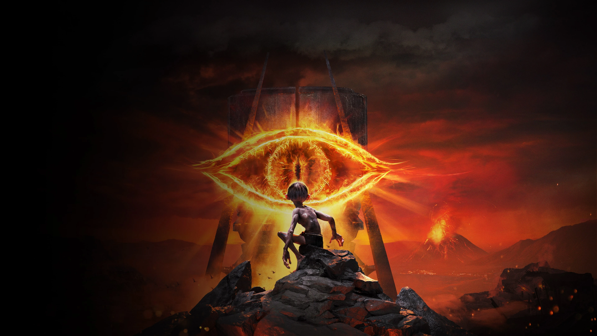
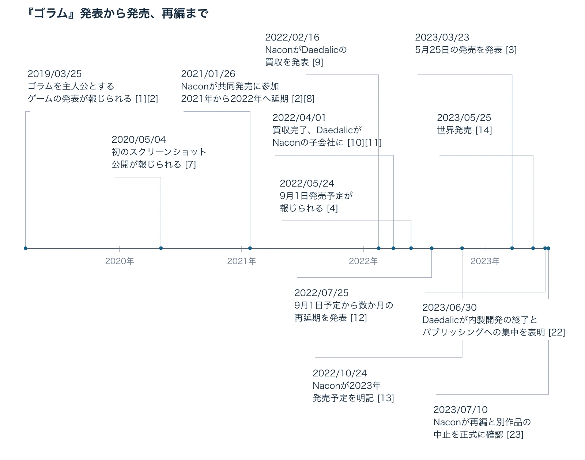

# 『ザ・ロード・オブ・ザ・リング：ゴラム』は、なぜIPの「独自解釈」をゲームの価値へ変えられなかったのか――適性、ライセンス、実行力から読む失敗事例

> 2026年11月26日改版：記事全体を全面的に書き直しました。内容の変更はGitの履歴から追えます。

2019年3月25日、『指輪物語』の「一つの指輪」を追うゴラムが、今度はゲームの主人公になると報じられた。Daedalic Entertainmentが描こうとしたのは、J.R.R.トールキンの構想に沿いながら、原作が詳しく語らなかったゴラムの旅をたどる物語だった。指輪を追う者の足で中つ国を歩くと、どんな旅になるのか。[[1](#ref-1)] [[2](#ref-2)]

発表から約4年でゲームは発売され、その約5週間後、Daedalicは内製開発を終える方針を示した。物語を得意とするスタジオは、ゴラムの身のこなしをどこまで遊びにできたのか。映画で知られた姿や声に代わって、何がプレイヤーを引き込むはずだったのか。そして、発売の日にプレイヤーはその旅をどこまで続けられたのか。

「他メディアIPのゲーム化 成功・失敗事例シリーズ」の第4回である。前回の[『鬼滅の刃 ヒノカミ血風譚』は、なぜ急拡大したアニメIPをゲームへ着地させられたのか――協働とタイミングの成功事例](demon-slayer-hinokami-keppuutan-cyberconnect2-ip-adaptation-success-case-study.md)では、アニメの表現を制作各社がどうゲームへ持ち込んだかを見た。今回は、書籍から独自のゴラムを作り起こした企画をたどる。

*画像出典（引用）：[PlayStation「The Lord of the Rings: Gollum™（ザ・ロード・オブ・ザ・リング：ゴラム）」](https://www.playstation.com/ja-jp/games/the-lord-of-the-rings-gollum/)掲載画像。本文の批評を補助する必要な範囲で表示し、画像内容は変更せず表示形式のみWebPへ変換した。©2023 Daedalic Entertainment and Nacon. All rights reserved. ©2023 Middle-earth Enterprises. All rights reserved.*

***

## 1. ポイント＆クリックのスタジオが、ゴラムを選んだ

『Deponia』や『Edna & Harvey』では、画面の中を調べ、会話を交わし、謎を解くと物語が先へ進む。調べたい場所や物を指して選ぶ、ポイント＆クリック型のアドベンチャーである。ドイツの開発・発売会社Daedalic Entertainmentは、こうした会話や謎、キャラクターの癖を場面の演出に結びつける作品で実績を積んだ。2023年の公式資料は、約100人の国際チームを擁する会社として同社を紹介し、『Silence』や『The Pillars of the Earth』も代表作に挙げている。[[3](#ref-3)]

ゴラムになったプレイヤーに約束されたのは、登る、跳ぶ、忍び寄るという三つの行為だった。[[3](#ref-3)]キャラクターの外からカメラで見ながら、敵に気づかれずに進む三人称ステルスでは、遮蔽物に身を寄せたときに見張りが見えること、足場に飛び移れる距離が読めること、見つかった理由が分かってすぐ試し直せることが、一続きの操作を支える。敵の反応を制御するAIや、映像の滑らかさを左右するフレームレートも、そこで初めてプレイヤーの手応えになる。

| 観測する領域 | アドベンチャー中心の主な観測点 | 三人称ステルス・アクションの主な観測点 |
| --- | --- | --- |
| 中核入力 | 選択肢、調査、謎の理解 | 移動、跳躍、潜伏、発見と回避 |
| 空間 | 情報を見つけ、物語を読む導線 | 視認、距離、垂直移動、逃走経路 |
| 失敗 | 詰まり、選択の分かりにくさ | 検知の納得感、即時復帰、再試行の速さ |
| 技術品質 | 会話遷移、セーブ、場面演出 | アニメーション、衝突、AI、カメラ、性能 |
| 最終テスト | 理解と感情の流れ | 手触り、可読性、安定性を反復計測するプレイテスト |

ここでいう適性とは、過去の制作でどんな失敗に繰り返し出会い、どの工程で何を測れば直せるかを組織として学んできた蓄積である。公表された代表作の一覧から読み取れるのは、物語主導のアドベンチャーの経験が厚いことまでだ。本作と同種の三人称ステルスを内製で出荷した実績や、本作で個々の担当者がどんな経験を持ち寄ったかは、公開資料からは確認できない。ゴラムらしい物語を作る経験と、その身体を毎秒操作できる形に仕上げる経験の距離が、企画の時点で見えてくる。[[3](#ref-3)]

***

## 2. 書籍から、ゲーム版のゴラムを作る

ゲーム版でゴラムを演じたのは、ゲームの吹き替えに携わってきたウェイン・フォレスター氏である。ドイツ・トールキン協会の取材で、開発側はピーター・ジャクソン氏、ラルフ・バクシ氏、ランキン／バスによる各映像作品や既存ゲームと接続しない独立した作品だと説明した。ジャクソン氏の映画で定着したアンディ・サーキス氏の声と身振りや、Wetaによる造形に代わり、ゲームは独自のゴラムを画面に立たせた。[[4](#ref-4)]

ドイツ・トールキン協会の記事は、プロジェクトで原作設定の監修（「Loremaster」）を務めたDamiri Knapheide氏を紹介したうえで、Daedalicが取得したのは書籍の権利のみで、映画を手本にすることはできなかったと伝えている。リードライターのTilman Schanen氏は、トールキンの記述を視覚表現の手がかりにし、書かれていない細部は、中つ国の文化やそこに暮らす人々への理解をもとに補ったと説明している。契約で使える素材の範囲が決まり、その範囲でどう見せるかに作り手の判断があった。[[5](#ref-5)] [[6](#ref-6)]

映画を知る人にとって、あの声や身振りは、ゴラムが何を恐れ、何をたくらんでいるかをすぐに読み取れる手がかりである。ゲーム版がそれに代わる入口として用意したのは、見張りをやり過ごし、危険な場所から逃げ、ゴラムとスメアゴルのどちらの考えを通すかを自分で選ぶ体験だった。正面から戦えば分が悪い人物だからこそ、敵から身を隠すこと自体に、その人物を演じる意味がある。プレイヤーが自分の手で切り抜けた場面は、この姿と声のゴラムを覚える理由になり得た。[[3](#ref-3)]

***

## 3. 四年と二度の延期

初報から1年余りたった2020年5月4日、初のスクリーンショットが報じられた。Unreal Engine 4で作られ、オークの見張りをすり抜けて車両の下に隠れるような、忍び寄ることを中心にしたゲームとして紹介された。当初の発売予定は2021年だった。[[1](#ref-1)] [[7](#ref-7)]

2021年1月26日、Naconが共同発売と流通に加わると発表し、発売予定は2022年に移った。両社は、『指輪物語』ファンの期待に応え、新世代機の性能を生かすために手を組んだと説明した。この発表で示されたのは提携の狙いで、Daedalicは延期自体の理由を明らかにしていない。[[2](#ref-2)] [[8](#ref-8)]

その翌年の2022年2月16日、NaconはDaedalicの全株式と議決権を取得すると発表した。対価は現金3,200万ユーロに、業績に応じた最大2,100万ユーロを加え、総額で最大5,300万ユーロとなる。4月1日付で買収が完了し、Naconは4月4日にその完了を発表した。共同発売元だった会社が、開発元の親会社になった。[[9](#ref-9)] [[10](#ref-10)] [[11](#ref-11)]

2022年5月24日には、PC・PlayStation・Xbox版の発売予定日として9月1日が伝えられた。だが7月25日、両社はより良い体験を届けるためとして、発売を数か月延期すると告知した。具体的な発売時期はその場では示されず、10月24日のNaconの売上発表で2023年予定と明記された。[[4](#ref-4)] [[12](#ref-12)] [[13](#ref-13)]

2023年3月23日、両社は5月25日の発売を発表した。初報から約4年。途中で発売予定は二度動き、Naconの立場も共同発売元から親会社へと変わった。その間に何がどこまで仕上がったかは、日程の発表からは分からない。5月25日、ゴラムを操作した人たちの記録が表に出た。[[3](#ref-3)]

***

## 4. 発売の日

2023年5月25日、PC・PlayStation・Xbox版が世界発売された。日本では株式会社3gooが同年6月22日にPS4／PS5版を発売した。世界発売日にGameSpotが記録したMetacriticの集計は、レビュー21件で38点だった。同記事には集計対象の機種の明記がない。2026年11月26日に確認したMetacriticのPS5版ページでは、批評レビュー56件で33点と表示されていた。OpenCriticの集計でも、評価は低い水準にある。[[14](#ref-14)] [[15](#ref-15)] [[16](#ref-16)] [[17](#ref-17)] [[18](#ref-18)]

GameSpotのサム・ペイプ氏は、PS5版を性能モードで約11時間プレイし、120回を超えるクラッシュを数えた。セーブデータが破損して進行が巻き戻り、護衛対象が繰り返し死亡して先へ進めず、チェックポイントから再開しても動けないことがあった。次のチェックポイントへ着くまでゲームがもたず、最初のプレイは進捗40％で断念した。これは一媒体の検証環境での記録であり、全プレイヤーの発生率を示す統計ではない。発売時のPS5向けパッチではクラッシュへの対応が行われ、その後の修正予定も伝えられた。[[19](#ref-19)] [[20](#ref-20)]

同じレビューには、ぼやけた環境表現や途中で切れるカットシーンへの批判と、ゴラム本人の造形や動きへの比較的好意的な記述が並ぶ。ゴラムとスメアゴルが互いを説き伏せようとする場面にも、人物の内面をのぞける面白さを見いだしている。PC版を評したThe Guardianもスメアゴルの動きを評価しつつ、ステルスの単調さや作りの粗さを指摘した。[[19](#ref-19)] [[21](#ref-21)]

ゴラムが壁に張りつく姿には、その数秒だけでも人物の特徴が出る。遊びとしては、そこから足場へ跳び、見張りをかわし、失敗したら戻って、もう一度先へ進むところまでが一つの場面である。途中で動けなくなったり、進んだ分が消えたりすれば、よくできた数秒があっても、プレイヤーの記憶に残るのは旅を繰り返し中断されたことになる。

***

## 5. 約5週間後、内製開発を終える

世界発売から約5週間後の2023年6月30日、Daedalicは内製ゲーム開発を終え、パブリッシング（ゲームの発売・流通を担う事業）へ集中する方針を示した。Gematsuは、90人超の従業員のうち25人が影響を受け、2022年から進めていた別の『ロード・オブ・ザ・リング』作品の開発も止まると報じた。[[22](#ref-22)]

7月10日、親会社のNaconが再編を正式に確認した。対象は主に開発チームの約25人で、もう一つの同フランチャイズ作品は初期構想段階で中止したという。再編の具体的な理由は公表されておらず、本作の評価だけで説明できる資料はない。発売から短い間に、同じIPで進めていた次の企画と、自社でゲームを作り続ける方針の両方が途切れた。[[22](#ref-22)] [[23](#ref-23)]

横軸は実際の経過日数に比例する。図中の番号は本稿のReferencesに対応する。

***

## 6. プランナーへの示唆

Daedalicが公表してきた代表作には、会話や謎を通じて物語を進める作品が並ぶ。『ゴラム』がプレイヤーに求めたのは、足場へ跳び移り、見張りの目をかいくぐることだった。発売時のレビューには、クラッシュや進行不能でその旅が途切れた記録も残っている。[『Marvel's Avengers』の回](marvel-avengers-crystal-dynamics-ip-adaptation-failure-case-study.md)では、三人称アクションの経験を持つ大手の座組みに、発売後も遊びを供給し続けるライブサービスの要件が加わった。『ゴラム』の企画で先に確かめたいのは、プレイヤーが何度も繰り返す行為と、チームが出荷作で磨いてきた行為の距離である。

### 最重要の動詞を、出荷実績で採点する

「登る、跳ぶ、忍び寄る」を、見張りの視線を避けながら次の足場へ渡る場面にしてみる。候補チームの出荷作に似た場面があれば、実際に遊んでいる映像を見ながら、カメラや敵の反応を誰が作り、どこまで繰り返し検証したかを確かめる。採点するなら、実績を確認できなければ0点、協力開発や限定的な実装なら2点、自社の出荷作で反復検証まで担ったなら4点とし、1点と3点は証拠のそろい方に応じて付ける。

| 評価軸 | 確認する証拠 | 配点例 |
| --- | --- | --- |
| 中核動詞 | 同じ操作を主役にした出荷作、実プレイ映像、担当範囲 | 0〜4 |
| 隣接システム | カメラ、敵AI、アニメーション、レベル設計、復帰設計の実績 | 0〜4 |
| 技術基盤 | 対象機種での性能計測、クラッシュ率、認証・パッチ運用の実績 | 0〜4 |
| 生産規模 | 同規模のアセット量、外部協力の管理、品質保証の体制 | 0〜4 |
| IP翻訳 | 監修を受けつつ、原作らしい行為をゲームの規則へ変えた実績 | 0〜4 |

中核動詞が0〜1点なら、合計点が高くても、そこを誰が出荷品質まで仕上げるかは契約前に詰めておきたい。共同開発先に中核部分を任せる手もあれば、垂直スライス（製品の一部を発売品質まで作る試作）の合格を次の投資の条件にする手もある。企画が約束する行為を、チームが磨いてきた遊びの形式に移すことも選択肢になる。

### 権利・認知・体験を、契約前の台帳に置く

映画で覚えたゴラムの声や身振りに代わって、ゲームを初めて触る人は何を手がかりにするだろうか。契約前のリスク台帳では、まず **権利** の欄で、書籍や映画の映像、俳優の肖像や声、音楽、固有の造形のうち、どれを使えるかを確かめる。 **認知** の欄には、プレイヤーが思い浮かべる顔や声、場所や台詞と、それに代わって最初の映像や試遊で見せるものを置く。 **体験** の欄では、新しい造形や演技が操作やカメラ、物語や報酬のどこで意味を持つかを考える。ゴラムとスメアゴルのやり取りなら、どちらの考えを通すかを選び、その選択が次の行動にどう返ってくるかまで試遊で確かめたい。権利元、発売元、開発元がこの台帳を共有すれば、造形の承認前から、遊びの中で新しい解釈がどう伝わるかを話し合える。

### 旅が途中で切れずに続くかを、発売前に測る

GameSpotのレビューでは、次のチェックポイントにたどり着けず、最初のプレイを進捗40％で断念した。垂直スライスの段階から、対象機種ごとに、初見の試遊者が区間の終点まで着けた割合を **完走率** として見ておきたい。見張りに気づかれたり、足場から落ちたりした場面では、もう一度操作できるまでの **再試行時間** を測り、試遊者が失敗の理由を読み取れたかも記録する。

跳躍や潜伏、敵の誘導を試みたうち、狙った行為が成立した割合が **中核行為の成功率** である。難しさが企画の想定に合っているかを、試遊映像と照らし合わせる。セーブの破損や進行不能、カメラや顔・音声の演出の破綻は、軽微な見た目の乱れと分け、どれだけの試遊で起きたかを **印象を壊す不具合の率** として残す。発売予定を引き直す場面でも、設計、実装、品質保証、発売判断を担う人が同じ映像と記録を見れば、旅がどこで途切れ、次の試遊で何を確かめるかを話し合える。

***

## 7. おわりに

ゴラムは、見張りを倒した数よりも、見つからずに抜けた道で語れる主人公だ。どの足場なら届くかを見極め、あと一歩のところで身を隠し、抜けた先でスメアゴルの声に耳を傾ける。その旅を自分で続けられたとき、初めてゲーム版の姿や声にも、その人だけの記憶が宿る。原作の余白に新しい解釈を描くとき、その解釈をプレイヤー自身のものにするのは、手を動かして最後までたどれる独自の体験である。

次回は[『ドラゴンボール ファイターズ』は、なぜ既存の表現基盤を大型IPの成功へ変えられたのか――技術転用と競技性から読む成功事例](dragon-ball-fighterz-arc-system-works-ip-adaptation-success-case-study.md)で、スタジオがすでに磨いてきた技術と、原作を遊ぶために必要な表現が重なった事例を扱う。

***

## References

1. [PC Gamer「Daedaelic tells us (a little) about The Lord of the Rings: Gollum」][1] — PC Gamer、2019年3月25日。

[1]: https://www.pcgamer.com/daedaelic-tells-us-a-little-about-the-lord-of-the-rings-gollum/

2. [Tom Ivan「The Lord of the Rings Gollum has been delayed to 2022」][2] — VGC、2021年1月26日。初報時の開発方針と初回の延期。

[2]: https://www.videogameschronicle.com/news/the-lord-of-the-rings-gollum-has-been-delayed-to-2022/

3. [Daedalic Entertainment・Nacon「The Lord of the Rings: Gollum™ Slinks Out of the Shadows on May 25th」][3] — Nacon公式プレスリリース、2023年3月23日。発売予定日とゲーム内容、Daedalicの代表作とチーム規模。

[3]: https://corporate.nacongaming.com/wp-content/uploads/2023/03/Gollum-RDA_EN.pdf

4. [Tobias M. Eckrich「Herr der Ringe: Gollum erscheint am 1. September」][4] — Deutsche Tolkien Gesellschaft e.V.、2022年5月24日。映画や既存ゲームとの関係、声優の起用、当初の発売日。

[4]: https://www.tolkiengesellschaft.de/48338/herr-der-ringe-gollum-erscheint-am-1-september/

5. [Tobias M. Eckrich「Blick ins Spiel: „Der Herr der Ringe: Gollum“」][5] — Deutsche Tolkien Gesellschaft e.V.、2023年3月23日。書籍のライセンス範囲に関する原作設定監修担当者の説明。

[5]: https://www.tolkiengesellschaft.de/51015/blick-ins-spiel-der-herr-der-ringe-gollum/

6. [Tilman Schanen「Recreating Tolkien’s world for The Lord of the Rings: Gollum, out May 25」][6] — PlayStation.Blog、2023年5月15日。Daedalicのリードライターによる視覚解釈の説明。

[6]: https://blog.playstation.com/2023/05/15/recreating-tolkiens-world-for-the-lord-of-the-rings-gollum-out-may-25/

7. [Andy Robinson「First screenshots of PS5 and Xbox Series X Lord of the Rings game published」][7] — VGC、2020年5月4日。初公開の画面とUnreal Engine 4での制作。

[7]: https://www.videogameschronicle.com/news/first-screenshots-of-ps5-and-xbox-series-x-lord-of-the-rings-game-published/

8. [Nacon・Daedalic Entertainment「NACON AND DAEDALIC ENTERTAINMENT ARE FORMING A FELLOWSHIP TO PUBLISH AND DISTRIBUTE THE HIGHLY-ANTICIPATED THE LORD OF THE RINGS: GOLLUM」][8] — GlobeNewswire、2021年1月26日。共同発売・流通契約の公式発表。

[8]: https://www.globenewswire.com/news-release/2021/01/26/2164555/0/en/PRESS-RELEASE-NACON-AND-DAEDALIC-ENTERTAINMENT-ARE-FORMING-A-FELLOWSHIP-TO-PUBLISH-AND-DISTRIBUTE-THE-HIGHLY-ANTICIPATED-THE-LORD-OF-THE-RINGS-GOLLUM.html

9. [Nacon「NACON ACQUIRES DAEDALIC ENTERTAINMENT, A LEADING VIDEO GAME PUBLISHER AND DEVELOPMENT STUDIO FOR 53 MILLION EUROS」][9] — GlobeNewswire、2022年2月16日。買収の発表と対価の内訳。

[9]: https://www.globenewswire.com/news-release/2022/02/16/2386541/0/en/PRESS-RELEASE-NACON-ACQUIRES-DAEDALIC-ENTERTAINMENT-A-LEADING-VIDEO-GAME-PUBLISHER-AND-DEVELOPMENT-STUDIO-FOR-53-MILLION-EUROS.html

10. [Nacon「INTERIM FINANCIAL REPORT」][10] — Nacon、2022年9月30日を期末とする半期報告書。企業結合の注記に取得日と対価を記載。

[10]: https://corporate.nacongaming.com/wp-content/uploads/2023/01/Rapport-financier-S1-Nacon-2022-23-Diffusion_English.pdf

11. [Nacon「DEFINITIVE ACQUISITION OF DAEDALIC ENTERTAINMENT」][11] — Nacon公式プレスリリース、2022年4月4日。買収の完了と連結範囲への組み入れ。

[11]: https://corporate.nacongaming.com/wp-content/uploads/2022/04/CP_Nacon_Acquisition_definive_Daedalic-Diffusion-ENG-1.pdf

12. [Tom Ivan「The Lord of the Rings: Gollum has been delayed by ‘a few months for polishing’」][12] — VGC、2022年7月25日。両社による再延期の公式声明を掲載。

[12]: https://www.videogameschronicle.com/news/the-lord-of-the-rings-gollum-has-been-delayed-by-a-few-months-for-polishing/

13. [Nacon「1st HALF 2022/23 SALES: 77.5 M€ (+6.2%)」][13] — Nacon公式プレスリリース、2022年10月24日。2023年発売予定と記載。

[13]: https://corporate.nacongaming.com/wp-content/uploads/2022/10/CP_Nacon_CA_T2-2022-23-ENG-Diffusion.pdf

14. [Daedalic Entertainment「The Lord of the Rings: Gollum™ Available Now!」][14] — Daedalic公式プレスリリース、2023年5月25日。PC・PlayStation・Xbox版の発売。

[14]: https://daedalic.prezly.com/the-lord-of-the-rings-gollum-available-now

15. [PlayStation「The Lord of the Rings: Gollum」][15] — PlayStation公式サイト、掲載日記載なし。国内発売日とゲーム内容。

[15]: https://www.playstation.com/ja-jp/games/the-lord-of-the-rings-gollum/

16. [Evan Campbell「Review Roundup For The Lord Of The Rings: Gollum」][16] — GameSpot、2023年5月25日。世界発売日に記録されたMetacriticの集計。

[16]: https://www.gamespot.com/articles/review-roundup-for-the-lord-of-the-rings-gollum/1100-6514556/

17. [Metacritic「The Lord of the Rings - Gollum」][17] — Metacritic、2026年11月26日確認。PS5版ページの見出し直下の批評レビュー集計。

[17]: https://www.metacritic.com/game/the-lord-of-the-rings-gollum/?platform=playstation-5

18. [OpenCritic「The Lord of the Rings: Gollum」][18] — OpenCritic、掲載日記載なし。批評レビューの集計。

[18]: https://opencritic.com/game/13215/the-lord-of-the-rings-gollum

19. [Sam Pape「The Lord Of The Rings: Gollum Review – We Don’t Wants It, We Don’t Needs It」][19] — GameSpot、2023年5月24日（米太平洋夏時間）。PS5版の検証記録。

[19]: https://www.gamespot.com/reviews/the-lord-of-the-rings-gollum-review-we-dont-wants-it-we-dont-needs-it/1900-6418070/

20. [Joseph Yaden「LOTR: Gollum Is Getting A Patch To Address Performance Issues」][20] — GameSpot、2023年5月26日。発売時のパッチと開発元の説明。

[20]: https://www.gamespot.com/articles/lotr-gollum-is-getting-a-patch-to-address-performance-issues/1100-6514601/

21. [Nic Reuben「The Lord of the Rings: Gollum review - boil it, mash it, stick it in the bin」][21] — The Guardian、2023年5月25日。PC版のレビュー。

[21]: https://www.theguardian.com/games/2023/may/25/the-lord-of-the-rings-gollum-daedalic-entertainment-nacon-video-game-review

22. [Sal Romano「Daedalic Entertainment shuts down internal game development to focus on publishing」][22] — Gematsu、2023年6月30日。Daedalicの方針と再編の対象人数。

[22]: https://www.gematsu.com/2023/06/daedalic-entertainment-shuts-down-internal-game-development-to-focus-on-publishing

23. [Nacon「NACON CONFIRMS DAEDALIC ENTERNAINMENT RESTRUCTURATION」][23] — GlobeNewswire、2023年7月10日。再編と別作品の中止を正式に確認。

[23]: https://www.globenewswire.com/news-release/2023/07/10/2701466/0/en/PRESS-RELEASE-NACON-CONFIRMS-DAEDALIC-ENTERTAINMENT-RESTRUCTURATION.html

----

この文書は、Perplexity、Claude、ChatGPT の3つのAIの支援を受けて著述されたものです。引用画像を除き、MIT License にて提供されています。
