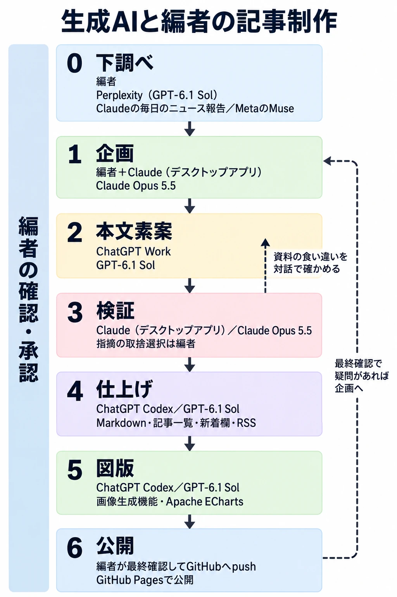

# 番外編：生成AIと一緒に、このブログを作るまで（四訂版）

このブログの記事は、工程ごとに生成AIを使い分け、各段階で人間が内容を確認して作っている。下調べ、企画、本文素案、検証、仕上げ、図版、公開という役割を分け、編者の判断を重ねながら一本の記事にまとめている。

生成AIを使えば、情報を集めて文章にする速度は大きく上がる。一方で、誤りまで素早く、もっともらしい形で混ざってしまう。ゲーム史や開発体制、売上、仕様変更、地域差などを扱うときは、作品名や年代が少しずれただけでも説明全体が崩れかねない。

そのため、このブログではAIを「完成原稿を出す箱」ではなく、それぞれ異なる役割を持つ共同作業者として使っている。現在の制作工程を、話題の種を集めるところから公開まで順に紹介する。

---

## 0. 下調べ：編者が話題の種を集める

記事作りの出発点は、編者が取り上げたい話題を下調べすることである。主に使うのは、検索と回答を組み合わせて情報を調べるPerplexityで、モデルはGPT-6.1 Solを選んでいる。GPT-6.1 SolはOpenAIが提供するモデルである。[[1](#ref-1)]

日々のゲームニュースは、Claude（デスクトップアプリ）から毎日受け取るニュース報告と、Meta社のエージェントAI「Muse」を使って集める。Museは、2026年9月8日に発表された個人向けAIエージェントである。AIエージェントとは、依頼に応じて情報収集や作業を進めるAIを指す。[[2](#ref-2)]

ここでは、気になったニュースやゲームの仕組みから、掘り下げたい問いを見つける。何を記事にしたいかを編者自身が考え、その種を次の企画へ持ち込む。

---

## 1. 企画：Claudeを「提案者AI」として記事原案を作る

企画では、Claude（デスクトップアプリ）と編者が共同で記事原案を作る。Claudeを「提案者AI」として使い、想定する読者、中心となる問い、取り上げたいゲームや事例、調査時に注意すべき論点まで整理する。使用モデルはClaude Opus 5.5である。[[3](#ref-3)]

以前はClaude Sonnet 5を使っていた。当時のOpusも試したが、編者の経験では、このブログの用途では精度に大きな差を感じず、コストは高かった。その後、世代が変わってOpus 5.5になると、Sonnetとコストがあまり変わらない感覚で、より強い性能を発揮するようになったため、Opus 5.5へ移った。これは、このブログを制作するうえでの使用感に基づく選択である。

Claudeは校閲役として、このブログのほぼすべての記事に目を通している。その蓄積を企画でも使えるよう、制作上の規範を記した `CLAUDE.md` と、記事候補や判断の履歴を残す `ARTICLES.md` を育ててきた。以前は二つの役割を一つのファイルにまとめていたが、内容が大きくなりすぎたため、AIが一度に扱う情報の負担を減らす目的で分けた。

公開済みの記事一覧は、2026年8月から、記事ファイルをもとに作るSQLiteのキャッシュで検索している。SQLiteは軽量なデータベースで、ここでいうキャッシュは、検索しやすいように記事情報をまとめ直したものだ。一方、`ARTICLES.md` は、記事候補、却下や見送りの判断、シリーズ各回の完成記録を残す場所である。提案者AIは候補を出す前に、キャッシュで既存記事との重なりを確かめ、`ARTICLES.md` の履歴とも照らし合わせる。

この二つのファイルは、このブログの制作における肝である。単に守るべき形式を並べるだけでなく、これまでの記事で得た判断や、記事同士のつながりを蓄えている。検索できる記事情報とあわせて、資料を制作とともに育てていくことが、提案の正確さと作業の効率化につながる。

提案者AIの見立てに編者が確認したい点があれば、Perplexityに通常の検索で調べさせる。この確認には、時間をかけて広く調査するDeep Researchを使わない。

多くの場合は提案者AIの見立てが正しい。しかし、Perplexityの検索が別の資料や観点をもたらし、企画を補強することもある。企画と確認を分けることで、一般論の中をさまようことを減らし、記事で本当に確かめたいことへ早く近づける。

---

## 2. 本文素案：ChatGPT Workに最初の原稿を書かせる

本文素案の出力は、ChatGPT Workに任せている。使用モデルはGPT-6.1 Solである。企画で整理した問いや論点を渡し、記事として読める最初の原稿を作る工程である。

以前は、Perplexityへ細かな条件を与えたうえでDeep Researchを依頼し、本文素案まで作らせることを試していた。しかし、この組み合わせでは出力がかなり崩れることがあった。調べる条件を細かく制御しながら、まとまった記事本文まで求める用途には向きにくいと判断した。

素案は、論旨の骨格をつくるものとして扱う。編者が目を通し、次の工程で根拠と表現を確認してから、公開原稿へ近づけていく。

---

## 3. 検証：Claudeに別の角度から疑わせる

本文素案をMarkdownにまとめたら、Claude（デスクトップアプリ）へ渡してファクトチェックと校閲を依頼する。Markdownは、見出しや箇条書きなどを簡単な記号で表す文章形式である。校閲にもClaude Opus 5.5を使う。基本の指示は、意外なほど短い。

```text
このテキストのファクトチェックと校閲を行ってください
```

検証は二段構えで進める。一段目では、誰が文章を作ったかをあえて伝えず、ひとつの原稿として距離を置いて読ませる。入力文の立場に引っ張られず、根拠と説明を確かめてもらうためだ。

本文素案と検証に異なるAIを使うのは、最初の出力に含まれる前提や誤りを、そのまま引き継ぎにくくするためでもある。同じAIに自己採点させるだけでは見落としやすい問題も、別の視点から読ませると表に出ることがある。

二段目は、校閲者AIが確かめた資料と、執筆者AIが使った資料に食い違いが見つかったときに行う。校閲者AIと執筆者AIが、参照した資料と指摘を互いに示して対話し、より正しい資料にあたり直して判断する。記述の時点や対象地域、仕様の違いなどを確かめ、食い違いが生じた理由を追っていく。

もちろん、校閲者AIの指摘も正解とは限らない。疑義が出た箇所は元の資料や公式情報へ戻り、修正するか、表現を弱めるか、段落ごと削るかを編者が決める。編者から、原稿に足したい項目を出すことも稀にある。

Claudeとは、文章だけでなく図版の必要性についても相談する。どの関係を視覚化すれば理解しやすくなるか、引用画像を使うべきか、使うなら何を示す画像が適切かを検討し、本文と図版の役割を分けていく。

---

## 4. 仕上げ：ChatGPT Codexで公開できるMarkdownに整える

検証を終えたMarkdownは、ChatGPT Codexへ渡し、このブログの形式へ仕上げる。仕上げAIの使用モデルもGPT-6.1 Solである。

ここでは、公開用Markdownを整えるとともに、図版の制作と画像引用の細かな確認・取得を行わせている。文章との対応を見ながら、どの関係を図にすれば理解しやすいか、画像引用は本文に必要か、出典と引用範囲は適切かを確認する。

さらに、日本語とMarkdownの相性から生じる表示上の問題も整える。強調記号の前後へ必要な空白を入れる、本文中の縦線が表として誤認されないようにする、数式をWebページで表示できる形にそろえる、といった作業である。

参考文献がある記事では、本文中の主張から出典へ移動できるよう、次の形式で参照番号を置く。

```markdown
本文の主張。[[1](#ref-1)]
```

記事末尾には、対応する参考文献を記載する。

```markdown
## References

<a id="ref-1"></a>1. [著者「記事・資料のタイトル」][1] — 媒体名、日付。参照した内容の補足。

[1]: https://example.com/reference
```

目次にあたる記事一覧と新着欄の更新、更新情報を購読するためのRSSの生成も、仕上げAIが担う。記事本文に加えて、読者が記事を見つけ、更新を追えるところまで整える工程である。

文章を読みやすくすること、根拠をたどりやすくすること、図版と画像引用を適切に置くことは、どれか一つを選ぶ話ではない。仕上げの工程では、そのすべてを満たす形を目指している。

---

## 5. 図版：文章だけでは伝わりにくい関係を見せる

ゲーム機やコントローラーの構造、UI（画面や操作の仕組み）の変遷、流通の仕組み、技術の比較などは、文章だけで説明すると長くなりやすい。そこで、読者が関係を一目で把握できる場合は、図解や比較画像を加える。

実例として、この記事で説明している制作工程を図にすると、次のようになる。



人間の確認と承認は、企画から公開までの各工程に置かれている。編者は本文や図版を読み、承認、却下、書き直しを決める。最終確認で疑問が生じたときは企画へ戻る。この往復を含めて示せることが、図版の利点である。

指定された図表のうち、概念図や工程図はCodexに内蔵された画像生成機能で実体化する。プロンプトに `$imagegen` と書けば、この機能を明示的に呼び出せる。自然言語で内容を伝え、生成後も修正を重ねられる機能である。[[4](#ref-4)] 数値を軸や系列で示すグラフにはApache EChartsを使う。こちらは多様なグラフを扱える可視化ライブラリで、値や軸、系列を指定して図にする。[[5](#ref-5)]

画像生成では、プロンプトの語句を短くする、レイアウトを固定する、図中の文字量を減らすといった調整を重ねる。正確な文字列や構造をどうしても制御できない場合に、拡大しても形が崩れにくいベクター画像形式のSVGを最後の手段として使う。

EChartsは、AIと外部ツールをつなぐ共通の仕組みであるMCP（Model Context Protocol）経由で使っている。実行環境であるNode.jsの更新でたまに動かなくなることはあるが、現在は問題なく動作している。

写真やスクリーンショットなど、外部から引用する画像も、Web向けの画像形式であるWebPへ変換し、引用元を明記する。画像は記事を飾るためではなく、文章を読む前後の負担を減らすためのものだ。図にした方が早く伝わる関係だけを図にし、本文と同じように内容を検証してから掲載する。

---

## 6. 公開：GitHubからWebへ

本文、図版、参考文献、記事一覧などの最終確認を終えたら、編者がGitHubへpushする。GitHubはファイルの変更履歴を管理・共有するサービスで、pushとは手元の変更を送る操作である。ここまでが、編者の手で記事を送り出す作業となる。

その後は、GitHub上のファイルからWebサイトを公開するGitHub Pagesの仕組みが働く。このブログでは、作業を自動実行するGitHub Actions上でビルドが動き、Markdownから静的なHTMLページを作る。[[6](#ref-6)] 変換には静的サイト生成ツールのJekyllを使っており、生成したページが公開されると、読者がブラウザーで読めるようになる。[[7](#ref-7)]

---

## まとめ：役割を分けても、判断は手放さない

現在の記事作りは、おおむね次の流れで進んでいる。

0. 編者がPerplexityで下調べし、Claudeの毎日のニュース報告とMuseでも話題の種を集める。
1. Claude（デスクトップアプリ）と編者が、既存記事や判断履歴を踏まえて記事原案を作る。確認が必要な点は、Perplexityの通常検索で調べる。
2. ChatGPT Workで本文素案を作り、編者が内容を確認する。
3. Claudeでファクトチェックと校閲を行う。資料が食い違えば執筆者AIと対話して調べ直し、指摘の取捨選択と図版の方針を編者が決める。
4. ChatGPT Codexで公開用Markdown、記事一覧、新着欄、RSSを整える。
5. ChatGPT Codexの画像生成機能とApache EChartsで図版を作り、引用画像とともに編者が確認する。
6. 編者が最終確認してGitHubへpushし、GitHub PagesでWebへ公開する。
{:start="0"}

生成AIは、調査や編集の手数を大きく増やしてくれる。しかし、使うAIを増やせば自動的に正確になるわけではない。複数のAIが同じ誤りをもっともらしく説明することもあれば、校閲の指摘そのものが間違っていることもある。

だからこそ、このブログでは、AIに役割を持たせながらも判断までは委ねない。何を信じるか、どこを疑うか、どの説明を読者に残すかを人間が決める。編者自身が技術書を通じて英文翻訳調の文体に慣れており、AIが書く文体と近いため、必要な人力編集も大きな違和感なく重ねられる。その往復によって、ゲームを深く知りたい読者にとって読みやすく、あとから根拠も確認できる記事を目指している。

## References

<a id="ref-1"></a>1. [OpenAI「GPT-6.1 Sol」][1] — OpenAI API公式ドキュメント、2026年10月30日確認。モデル名と位置づけを参照。

[1]: https://developers.openai.com/api/docs/models/gpt-6.1-sol

<a id="ref-2"></a>2. [Meta「Introducing Muse: The World’s First Personal AI Agent Built for Everyone」][2] — Meta Newsroom、2026年9月8日（9月30日更新）。個人向けAIエージェントとしての発表を参照。

[2]: https://about.fb.com/news/2026/09/introducing-muse-personal-ai-agent/

<a id="ref-3"></a>3. [Anthropic「Introducing Claude Opus 5.5」][3] — Anthropic、2026年9月22日。モデルの公式発表を参照。本文のモデル選択に関する評価は編者の使用感である。

[3]: https://www.anthropic.com/claude-opus-5-5

<a id="ref-4"></a>4. [OpenAI「Image generation」][4] — ChatGPT Learn、2026年10月30日確認。Codexに内蔵された画像生成・編集機能と、`$imagegen` による呼び出しの説明を参照。

[4]: https://learn.chatgpt.com/docs/image-generation

<a id="ref-5"></a>5. [Apache Software Foundation「Apache ECharts」][5] — Apache ECharts公式サイト、2026年10月30日確認。可視化ライブラリの機能を参照。

[5]: https://echarts.apache.org/en/

<a id="ref-6"></a>6. [GitHub「Configuring a publishing source for your GitHub Pages site」][6] — GitHub Docs、2026年10月30日確認。ブランチから公開する場合も、GitHub Pagesのサイトは常にGitHub Actionsのワークフローでデプロイされる旨を参照。

[6]: https://docs.github.com/en/pages/getting-started-with-github-pages/configuring-a-publishing-source-for-your-github-pages-site

<a id="ref-7"></a>7. [GitHub「About GitHub Pages and Jekyll」][7] — GitHub Docs、2026年10月30日確認。JekyllがMarkdownとHTMLから静的サイトを生成する旨を参照。

[7]: https://docs.github.com/en/pages/setting-up-a-github-pages-site-with-jekyll/about-github-pages-and-jekyll

----

この文書は、Perplexity、Claude、ChatGPT の3つのAIの支援を受けて著述されたものです。引用画像を除き、MIT License にて提供されています。
