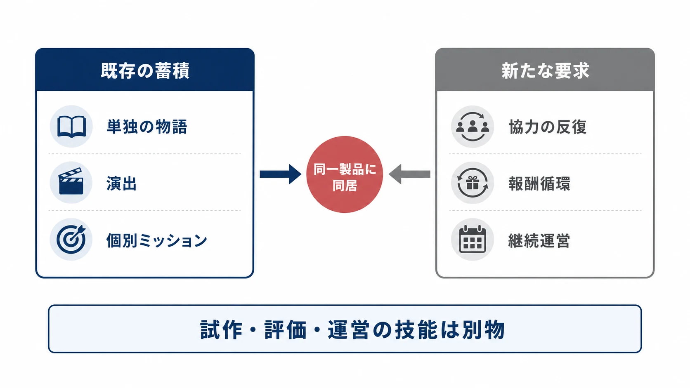
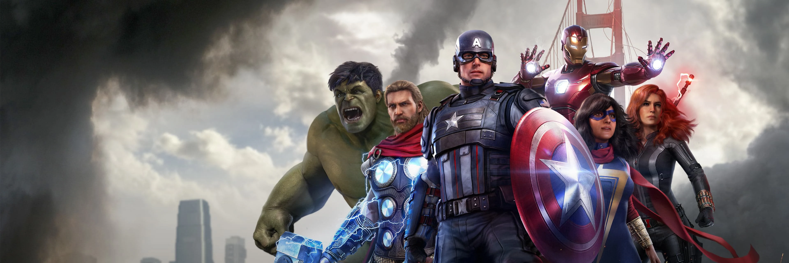
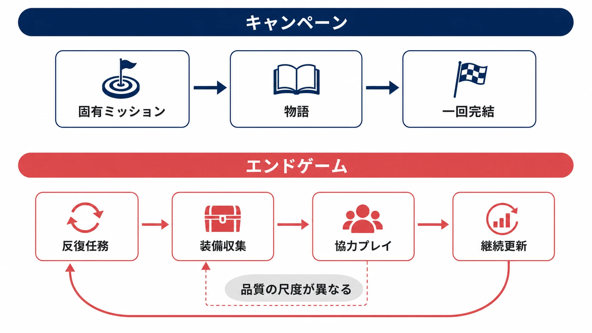
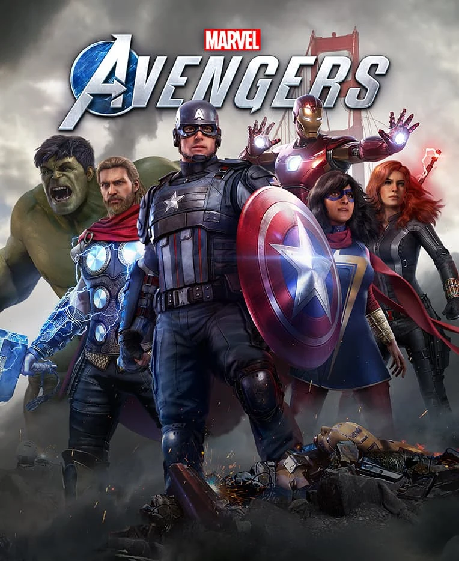
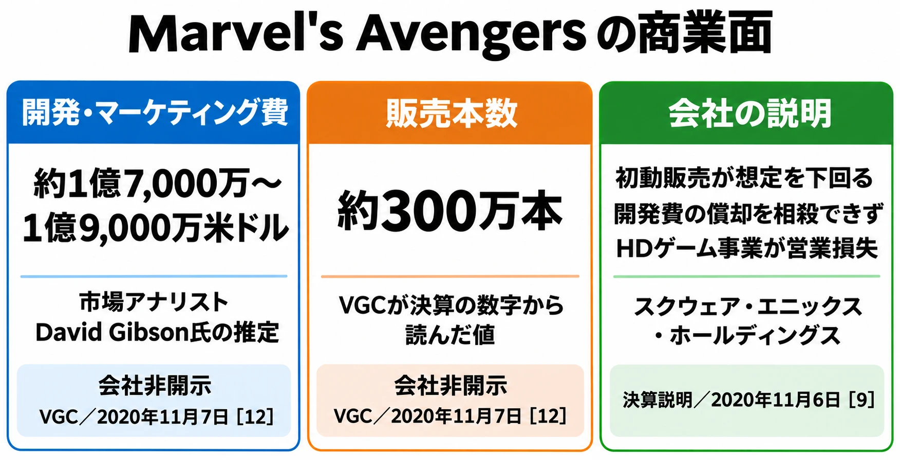
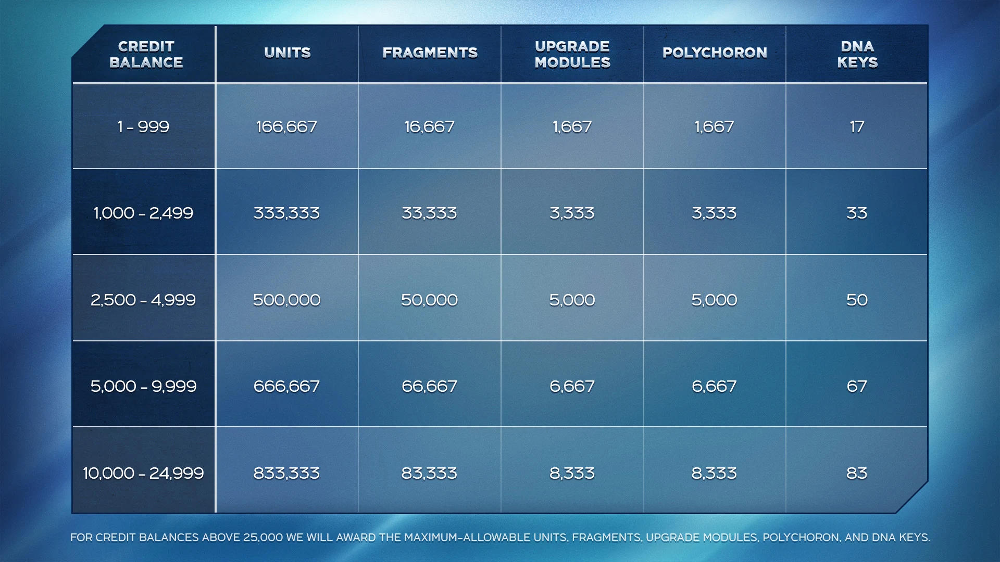

# 『Marvel's Avengers』は、なぜ大型IPをゲームとして定着させられなかったのか――座組みから読む失敗事例

> 2026年11月26日改版：2022年のスタジオ売却の経緯を加え、最新の情報に更新しました。内容の変更はGitの履歴から追えます。

アベンジャーズを自分の手で再結成したあと、プレイヤーは何を目当てに、もう一度ヒーローを選ぶのだろうか。Crystal Dynamicsが開発を主導し、スクウェア・エニックスが2020年に発売した『Marvel's Avengers』は、カマラ・カーンを軸にした再結成の物語と、仲間と何度も任務に挑む遊びを一つのゲームに収めた。「他メディアIPのゲーム化 成功・失敗事例シリーズ」の第2回では、その二つを支えようとした座組みから、更新が終わるまでをたどる。

まず、単独プレイの物語を主力にしてきた二つのスタジオに、協力プレイ、装備収集、継続的なコンテンツ供給がどんな仕事を求めたのかを見ていく。次に、映画で定着したヒーローの「顔」と比べられるなか、独自のデザインを選ぶ必然性を、遊びを通じてどこまで伝えられたのか。そして、物語の先で同じ任務へ戻る理由は、発売時点でどこまで用意できていたのか。この三つが、企画から運営までの経緯を読む手がかりになる。

第1回の[『Marvel's Spider-Man』は、なぜ「映画タイアップ」から離れて成功できたのか――大型IPゲーム化の成功事例](marvel-spider-man-insomniac-ip-adaptation-success-case-study.md)で扱った作品も、映画とは別の解釈でヒーローを描いた。街を糸で飛び回るうちに、プレイヤーはそのゲームならではのスパイダーマンを知っていく。『Marvel's Avengers』では、初披露で示した独自の姿と、プレイヤーが長く繰り返す行為はどこで結びついたのか。二作の分かれ目を、その体験のつながりから考えたい。

***

## 2017年に成立した座組み：物語型スタジオと継続運営型プロダクト

2017年1月、Marvel Entertainmentとスクウェア・エニックスは、マーベルのスーパーヒーローを題材にオリジナルゲームを開発・販売する、複数年・複数タイトルのライセンス提携を発表した。後のマーベル公式告知も、この提携を2017年のものとして位置づけている。[[1](#ref-1)] 第1弾となった『Marvel's Avengers』をCrystal Dynamicsが主導し、Eidos-Montréalが協力した。

Crystal Dynamicsは『トゥームレイダー』を2006年から担い、2013年のリブート以降もララ・クロフトの冒険を中心とした、演出とキャラクターの変化を軸にする三人称アクションを送り出してきた。[[2](#ref-2)] Eidos-Montréalも、『デウスエクス』を最初のプロジェクトに据え、プレイヤーの選択と物語を結びつける単独プレイ中心の作品を主力としてきた。[[3](#ref-3)] 両者の実績は、映画的な導入、主人公への感情移入、局面ごとに作り込んだミッションに強みがあることを示す。

2019年の公式インタビューで、Crystal Dynamicsのスタジオ責任者Scot Amos氏は、『Marvel's Avengers』を、キャラクター主導のキャンペーンに加え、最大4人のオンライン協力プレイと「長年にわたって拡張されるオンライン世界」を備える作品として紹介した。[[4](#ref-4)] キャンペーンと継続運営では、プレイヤーに次の任務へ進んでもらうために作り込むものが異なる。単独プレイの物語は、密度の高い一回限りの驚きや、決め打ちの演出へ資源を集められる。継続運営の協力プレイは、同じ任務を何度遊んでも役割、報酬、難度、仲間との組み合わせが変わる循環を、発売時点で成立させなければならない。

この座組みでは、物語を作る強みに加え、繰り返し遊ぶ協力プレイを運営する専門性が、製品の中核に必要になった。その専門性を生かすには、人員や予算の確保に加え、任務や報酬の設計、プレイテストで見る項目、更新時の優先順位まで決める必要があった。

***

## E3 2019：「顔」を自分たちの表現へ置き換える判断

2019年6月のE3で初披露された本作は、キャプテン・アメリカ、アイアンマン、ハルク、ブラック・ウィドウ、ソーを描くオリジナルの物語として発表された。マーベルは、単独プレイと協力プレイを組み合わせた独自の解釈による作品だと説明している。[[5](#ref-5)] 初披露の反応で話題をさらったのは、マーベルの映画シリーズ（MCU）で見慣れたヒーローたちの顔と衣装が変わったことだった。

開発側は、MCU俳優の肖像を用いず、別の声優と独自デザインを選んだ。批判を受けた後も、リードクリエイティブディレクターのShaun Escayg氏は、キャラクターデザインを変更する予定はないと説明した。[[6](#ref-6)] ゲーム独自の物語やデザインには、遊ぶことで見えてくる原作の魅力を引き出せる余地がある。

見慣れた顔には、購入を考えている人をひと目で既知の人物像へ引き戻す力がある。本作の実写風のモデルやチーム編成、衣装はMCUを思い起こさせたため、ゲーム独自の造形も映画版との比較のなかで受け取られた。比較の基準だけが最も強い映像シリーズに置かれ、ゲームはその比較を別の体験で上書きする必要を負った。

プランニング上は、これを「認知資産の置換」と考えるべきである。借用IPの既知の顔、声、色、衣装、名場面を変えるなら、何を代わりに覚えてほしいのかを発売前の映像と試遊で証明する必要がある。本作ではその置換先が、独自のストーリーなのか、各ヒーローの戦闘なのか、協力プレイの体験なのか、初披露の時点で焦点化されなかった。

*画像出典（引用）：マーベル, [Marvel's Avengers Game (2020)](https://www.marvel.com/games/marvel-s-avengers) 。ゲーム独自のキャラクターデザインを確認するための公式キービジュアルとして引用。© MARVEL. WebP変換。*

***

## 発売後に現れた二層構造：キャンペーンとエンドゲームは別の製品だった

『Marvel's Avengers』は2020年9月4日に発売された。公式ページは、Crystal DynamicsとEidos-Montréalを開発元、スクウェア・エニックスを発売元とし、単独プレイと最大4人のオンライン協力プレイを併記している。[[7](#ref-7)] 発売時の批評は一様ではなかった。カマラ・カーンを軸にアベンジャーズを再結成するキャンペーン、各ヒーローを操作する場面、声の演技には肯定的な評価があった。

一方、キャンペーン完了後に前面へ出るアベンジャーズ・イニシアティブは、別の評価を受けた。レビューは、より高い難度の任務が装備の必要パワーで段階的に開放される構造、装備掘りを継続動機にする設計、同じ種類の戦闘と任務の反復を指摘した。装備の特殊効果はあっても、取得と更新が戦い方を変える手応えへつながりにくく、技術的な不具合もプレイを妨げた。[[8](#ref-8)]

評価が分かれたのは、二つの遊びがそれぞれ別の理由でプレイヤーを引きつけるからだ。キャンペーンは、個別のミッション、演出、主人公の成長を一回通すことで満足を作れる。対してエンドゲームは、同じボス、敵、空間、報酬に戻る理由を、何十時間にもわたって作り続けなければならない。

装備の収集を遊びの軸にするなら、装備や能力の組み合わせ（ビルド）を変えるたびに、操作や役割、仲間と戦うときの判断がどう変わるかが問われる。装備を手に入れた瞬間に、次はどの任務でその変化を試そうかと考えられれば、次の更新を待つ間にも目標ができる。本作では、物語を終えた顧客へ「次は何を、なぜ、誰と繰り返すのか」を十分に渡せなかった。同じ任務でも、新しい装備や仲間との組み合わせで違う判断が生まれるかどうかが、繰り返す理由を左右する。

*画像出典（引用）：マーベル, [Marvel's Avengers Game (2020)](https://www.marvel.com/games/marvel-s-avengers) 。カマラ・カーンを含むゲーム版のヒーロー構成を示す公式キービジュアルとして引用。© MARVEL. WebP変換。*

***

## 商業面で露呈した、企画と採算のずれ

スクウェア・エニックスは2020年11月の決算説明で、本作の初動販売が想定を下回り、開発費の償却を完全には相殺できなかったため、HDゲーム事業が営業損失になったと説明した。[[9](#ref-9)] 同社は作品単位・スタジオ単位で開発と収益を管理しているとも説明しており、翌2021年の説明資料では、本作の販売実績を踏まえた懸念に触れている。[[10](#ref-10)]

VGCによれば、日本を拠点とする市場アナリストのDavid Gibson氏は、開発・マーケティング費を約1億7,000万〜1億9,000万米ドルと推定した。VGCは決算の数字から、販売本数を約300万本と読んでいる。費用と販売本数は、いずれも会社が開示していない。[[11](#ref-11)][[12](#ref-12)] 会社が説明した初動の落ち込みとあわせて読むと、複数スタジオでの開発と発売後の更新を前提にした企画が、費用を回収するうえでどれほど重い出足だったかが見えてくる。

さらにスクウェア・エニックスの2021年年次報告書で松田洋祐社長は、本作をGame as a Service（GaaS、発売後も更新を続ける運営型のゲーム）への挑戦作と位置づけたうえで、スタジオと開発チームの特性・嗜好に合うゲームデザインを選ぶ必要性が明らかになった、と総括した。[[13](#ref-13)] 問われたのは、スタジオの強みと、企画が求める仕事の組み合わせである。両者がかみ合うかを企画段階で見極める必要があった、という経営上の振り返りだ。

***

## 2023年の終了：更新を約束した製品が、更新を止めるまで

ヒーローや拡張の追加が続いていた2022年5月2日、スクウェア・エニックス・ホールディングスは、Crystal Dynamicsと、Eidos-MontréalやSquare Enix Montréalを擁するEidos Interactiveの株式、そして『トゥームレイダー』『デウスエクス』『Thief』などのIPを、総額3億米ドルでEmbracer Groupへ売却する契約を結んだと発表した。目的は「事業構造の最適化」に基づき、経営資源をより効率的に配分し、中核事業の成長と新規事業の立ち上げを加速させることだった。[[14](#ref-14)] Embracer Groupは、3スタジオで約1,100人が取引の対象となり、7〜9月の完了を見込むと発表した。[[15](#ref-15)] 取引は8月26日に完了し、本作の開発を支えたCrystal DynamicsとEidos-Montréalは、更新が続くなかでスクウェア・エニックス傘下を離れた。[[16](#ref-16)]

発売前の公式説明は、新ヒーローと地域を追加し、物語を複数年にわたって進める方針だった。[[4](#ref-4)] 発売後はキャラクター、拡張、調整が順次追加され、2023年3月31日のUpdate 2.8が新規コンテンツの最後の更新となった。同アップデートの告知では、公式サポートの終了日も同年9月30日と示された。[[17](#ref-17)]

9月30日には販売が終了し、所有者は再ダウンロードできる一方、単独プレイとマルチプレイは原則として継続可能と案内された。定期イベントも残り、顧客サポートは終了した。[[18](#ref-18)] 複数年提携の第一作は、新しいヒーローや任務を届ける段階を終え、すでに手に入れた人が持っている遊びを続けられる形へ移った。

*画像出典（引用）：Crystal Dynamics, [Final Update on the Future of Marvel’s Avengers](https://support.crystald.com/hc/en-us/articles/8943114650781-Final-Update-on-the-Future-of-Marvel-s-Avengers) 。2023年3月31日からのクレジット残高の変換を示す公式表として引用。© Crystal Dynamics. WebP変換。*

***

## プランナーへの示唆：選定、認知資産、運営を別々に検証する

第1回の『Marvel's Spider-Man』と比べると、どちらも広く知られたマーベルのヒーローに独自の物語を用意した。明暗を分けたのは、企画の中心にどんな行為を据え、それを作り込める座組みをどう組んだかである。

### 1. プレイヤーが繰り返す行為から、スタジオの適性を見極める

Crystal Dynamicsの蓄積を乱暴に要約すれば、最重要動詞は「単独プレイの物語を進める」である。キャラクターに感情移入し、作り込まれた局面を突破し、次のドラマへ進む行為だ。『Marvel's Avengers』の継続運営部分が必要とした動詞は、「仲間と繰り返し協力し、異なるビルドで更新された課題へ戻る」だった。両者は近接する三人称アクションでも、報酬設計、任務設計、テスト、運営の評価軸が異なる。

候補スタジオの実績を見るときは、プレイヤーが何を繰り返したくなるゲームなのかを一文にする。その行為を、操作、空間、報酬、失敗からの立て直しまで作り込んだ実績があるかを確認する。別の専門性が必要な領域は、誰と組むか、誰が判断を担うか、何を一緒に試作するかまで、企画に初めから組み込む。

### 2. 原作の「顔」を変えるなら、代替の認知資産を先に証明する

既知のキャラクター像は、広告や店頭、初見の映像で、プレイヤーが「これは自分の知っている作品だ」と認識する入口である。そこを変える判断には、二つの道がある。コミック、アニメ、ゲーム独自の美術として、ひと目で別の魅力を伝えるか。あるいは、顔の比較を忘れさせるほど強いプレイ体験を最初に見せるかである。

承認会議では、設定の正しさだけでなく、無音の静止画、30秒のトレーラー、初回試遊の各段階で何が記憶されるかを確認したい。独自の顔を選ぶなら、たとえば試遊後にどんな動きや姿が思い出されるかを先に仮説として置き、実際の反応と照らし合わせる。

### 3. ライブサービスは、発売時点で繰り返し遊べる土台を作る

発売後に足すヒーローや地域は、発売時点の繰り返し遊べる土台の上で力を発揮する。まず、発売時点の任務、報酬、協力関係が、物語を終えたプレイヤーを戻らせるかを検証する。次に、ヒーローや地域を加えたとき、既存のビルドと難度、マッチング、コミュニティがどう変わるかを試作する。最後に、修正と追加コンテンツを並行できるチーム編成と意思決定の速度を見積もる。

物語型スタジオがサービス型作品に挑むなら、物語の強みを生かしながら、繰り返し遊ぶ部分を誰が作り、どの予算と権限で更新するか、どの段階で遊びを検証するかまで決めておく。

***

## おわりに：遊びの約束を、座組みで支える

2018年の『Marvel's Spider-Man』と2020年の『Marvel's Avengers』は、同じマーベルという巨大IPを、隣接する三人称アクションの市場で扱った。前者は、Insomniac Gamesの高速移動の蓄積を「都市を糸で飛ぶ」という中核行為へ集中させた。後者は、強い物語型の蓄積を持つ座組みに、別種の継続運営型プロダクトを同居させた。同じマーベルのヒーローでも、プレイヤーが手にする体験は、開発チームが何に力を注いだかで変わった。

初披露で見せるヒーローの顔、プレイヤーが繰り返す行為、発売後にその遊びを支えるチームは、一つの体験を作るためにつながっている。借用IPの企画を立ち上げるときは、この三つを同じレビューで検証したい。

成功と失敗を並べて読むと、自社の座組みで何を約束し、何を見送り、どの能力を先に確保するかを考えやすくなる。第3回の[『鬼滅の刃 ヒノカミ血風譚』は、なぜ急拡大したアニメIPをゲームへ着地させられたのか――協働とタイミングの成功事例](demon-slayer-hinokami-keppuutan-cyberconnect2-ip-adaptation-success-case-study.md)では、アニメIPの広がりに、関係各社がどう足並みをそろえたかをたどる。

***

## References

1. [Marvel「Get Ready For The Worldwide Reveal of 'Marvel’s Avengers'」][1] — Marvel.com、2019年5月。2017年のMarvel Entertainmentとスクウェア・エニックスの複数年・複数タイトル提携、およびCrystal DynamicsとEidos-Montréalによる第1作を記したマーベル公式告知。

[1]: https://www.marvel.com/articles/games/get-ready-for-the-worldwide-reveal-of-marvel-s-avengers

2. [Crystal Dynamics「Projects」][2] — Crystal Dynamics公式サイト、日付記載なし。Crystal Dynamicsによる『トゥームレイダー』フランチャイズの継続的な担当を示す公式プロジェクト一覧。

[2]: https://www.crystaldynamics.com/projects

3. [Duncan Heaney「Eidos-Montréal looks back on 15 years of amazing games」][3] — Eidos-Montréal公式サイト、2022年。Eidos-Montréalが『デウスエクス』を最初のプロジェクトとして始めたことを振り返る公式記事。

[3]: https://www.eidosmontreal.com/news/eidos-montreal-looks-back-on-15-years-of-amazing-games/

4. [Matt Cabral「'Marvel's Avengers': An E3 2019 Interview with Crystal Dynamics' Studio Head Scot Amos」][4] — Marvel.com、2019年6月。単独プレイ、協力プレイ、長期拡張の方針を説明したE3 2019時点の公式インタビュー。

[4]: https://www.marvel.com/articles/games/marvels-avengers-e3-2019-interview-crystal-dynamics-studio-head-scot-amos

5. [Marvel「E3 2019: 'Marvel's Avengers' Begins at A-Day in Official Trailer Reveal」][5] — Marvel.com、2019年6月。E3初披露時のストーリー、キャラクター、単独プレイと協力プレイの公式説明。

[5]: https://www.marvel.com/articles/games/e3-2019-marvels-avengers-begins-at-a-day-in-official-trailer-reveal

6. [Eddie Makuch「E3 2019: Avengers Game’s Character Designs Won’t Change After Backlash, Dev Says」][6] — GameSpot、2019年6月18日。MCU俳優の肖像と異なるキャスト・デザイン、および開発側のデザイン維持方針を報じた当時の取材記事。

[6]: https://www.gamespot.com/articles/e3-2019-avengers-games-character-designs-wont-chan/1100-6467800/

7. [Marvel「Marvel's Avengers Game (2020)」][7] — Marvel.com、日付記載なし。開発元、発売元、発売日、最大4人のオンライン協力プレイを記したマーベル公式ページ。

[7]: https://www.marvel.com/games/marvel-s-avengers

8. [Phil Hornshaw「Marvel’s Avengers Review – Infinity War」][8] — GameSpot、2021年3月19日更新。2020年9月初出のレビューを参照。キャンペーンとエンドゲームの評価差、装備収集と反復任務、不具合への批評を具体的に扱った発売時レビュー。

[8]: https://www.gamespot.com/reviews/marvels-avengers-review/1900-6417560/

9. [スクウェア・エニックス・ホールディングス「2Q FY2021/3 Financial Results Briefing by SQUARE ENIX HOLDINGS held on Nov. 6, 2020」][9] — IR資料、2020年11月6日。初動販売が期待を下回り、開発費償却を相殺できなかったというスクウェア・エニックスの公式説明。

[9]: https://web.hd.square-enix.com/eng/ir/library/pdf/21q2outline.pdf

10. [スクウェア・エニックス・ホールディングス「Outline of Results Briefing held on May 13, 2021」][10] — IR資料、2021年5月13日開催。本作の販売実績を踏まえ、作品・スタジオ単位で開発と収益を管理するというスクウェア・エニックスの説明。

[10]: https://www.hd.square-enix.com/eng/ir/library/docs/210618/page03.html

11. [Tom Ivan「Square Enix confirms Marvel’s Avengers is yet to break even following ‘slow initial sales’」][11] — VGC、2020年11月25日。初動販売と開発費償却に関する決算説明、および市場アナリストによる費用・販売本数の推定を報じた記事。

[11]: https://www.videogameschronicle.com/news/square-enix-confirms-marvels-avengers-is-yet-to-break-even-following-slow-initial-sales/

12. [Andy Robinson「Marvel’s Avengers drives loss at Square Enix as it’s suggested the game ‘could have cost $190m’」][12] — VGC、2020年11月7日。David Gibson氏による費用の推定と、VGCによる販売本数の読みを報じた記事。

[12]: https://www.videogameschronicle.com/news/marvels-avengers-drives-loss-at-square-enix-as-its-suggested-the-game-could-have-cost-190m/

13. [スクウェア・エニックス・ホールディングス「Annual Report 2021」][13] — 年次報告書、2021年。GaaS化で露呈した、スタジオ／開発チームの特性とゲームデザインの適合に関する松田洋祐社長の総括。

[13]: https://web.hd.square-enix.com/eng/ir/library/pdf/ar_2021en.pdf

14. [スクウェア・エニックス・ホールディングス「特定子会社等の異動を伴う株式譲渡契約締結のお知らせ」][14] — IR資料、2022年5月2日。譲渡の目的、対象と譲渡価額。

[14]: https://www.hd.square-enix.com/jpn/ir/pdf/20220502%20A_Press%20Release_fin.pdf

15. [Embracer Group「Embracer Group enters into an agreement to acquire Eidos, Crystal Dynamics, and Square Enix Montréal amongst other assets」][15] — プレスリリース、2022年5月2日。対象の3スタジオとIP、従業員数、取引額、完了予定時期。

[15]: https://embracer.com/releases/embracer-group-enters-into-an-agreement-to-acquire-eidos-crystal-dynamics-and-square-enix-montreal-amongst-other-assets/

16. [Embracer Group「Embracer Group completes acquisition of Crystal Dynamics, Eidos-Montréal, Square Enix Montréal amongst other assets」][16] — プレスリリース、2022年8月26日。取引の完了を発表。

[16]: https://www.embracer.com/releases/embracer-group-completes-acquisition-of-crystal-dynamics-eidos-montreal-square-enix-montreal-amongst-other-assets/

17. [Crystal Dynamics「Patch Notes v2.8」][17] — Marvel’s Avengers公式サイト、2023年3月31日。2023年3月31日の最終コンテンツ更新の内容を記したCrystal Dynamics公式パッチノート。

[17]: https://avengers.crystald.com/en-us/patch-notes-v2-8/

18. [Crystal Dynamics「Final Update on the Future of Marvel’s Avengers」][18] — Crystal Dynamics公式サポート、2023年1月20日。2023年9月30日の公式サポート終了、およびそれ以降も単独・協力プレイを継続できることを説明したCrystal Dynamics公式サポート記事。

[18]: https://support.crystald.com/hc/en-us/articles/8943114650781-Final-Update-on-the-Future-of-Marvel-s-Avengers

----

この文書は、Perplexity、Claude、ChatGPT の3つのAIの支援を受けて著述されたものです。引用画像を除き、MIT License にて提供されています。
