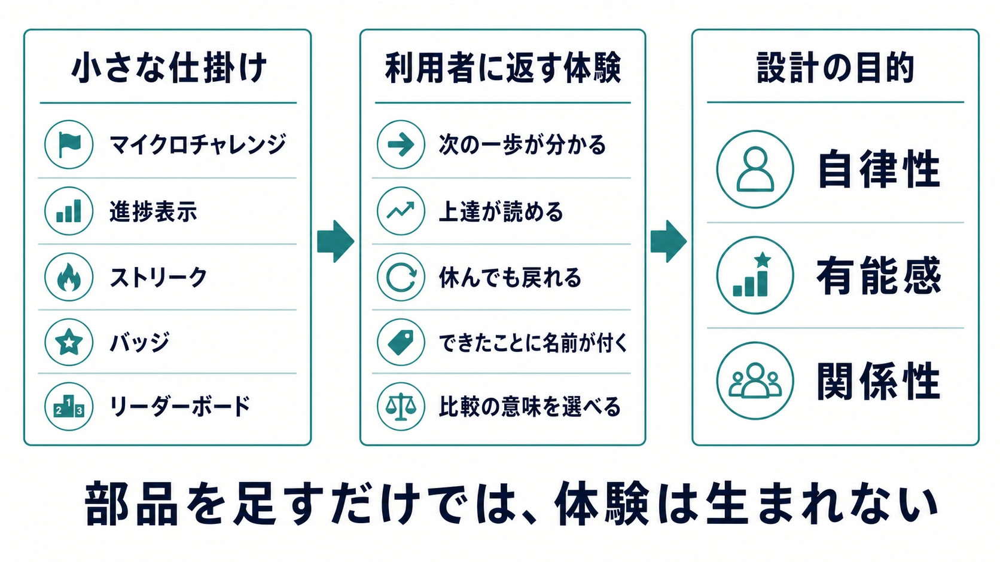
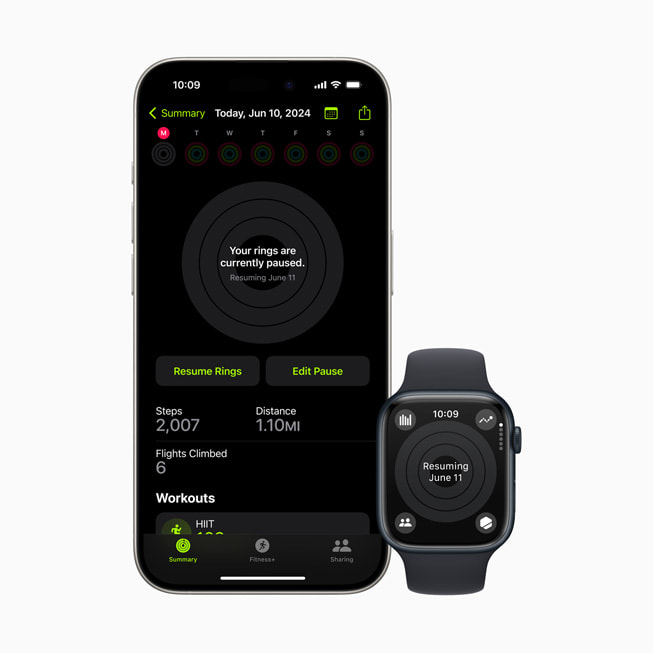
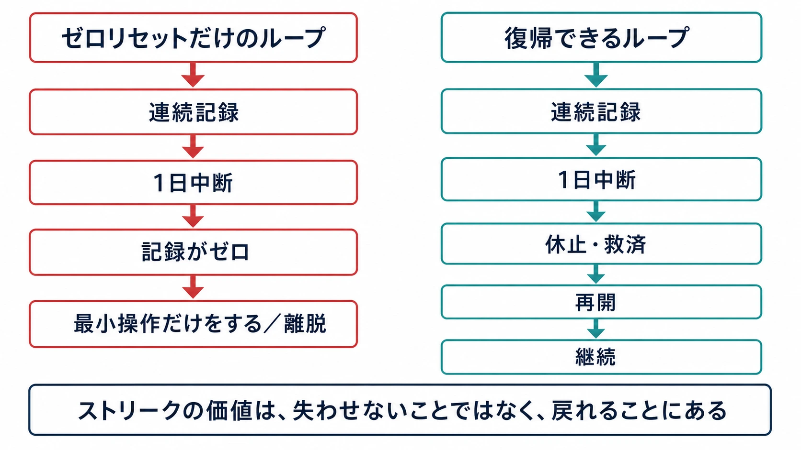

# 一分だけ立たせるゲームデザイン――Apple Watch、Duolingo、GitHubに見るマイクロゲーミフィケーションと、その限界

> 2026年11月26日改版：記事全体を全面的に書き直しました。内容の変更はGitの履歴から追えます。

手首が震える。Apple Watchが立つように促している。編者はふだんこの時計を着けていて、とりわけ青いスタンドリングが気になる。リマインダーをオンにしていると、ある時間の最初の50分を座ったまま過ごしたところで通知が来る。立って1分以上体を動かせば、その時間の分がスタンドリングに加わる。青い輪が数えているのは、一日のうちでそれができた時間帯の数だ。[[1](#ref-1)][[2](#ref-2)]

次の一分に何をすればいいかがわかり、動いた分だけ輪の続きが埋まる。時計の中の小さな仕掛けが、一日に何度も人を椅子から立たせる。その力はどこから来るのか。立てない日にまで輪が気になり始めたら、どこで人を追い詰めるのだろう。

***

## 運動を丸ごと遊びにするか、一分だけ生活に足すか

『リングフィット アドベンチャー』の試作には、きつい運動を集めた道場があった。本編には軽い動きが多く、道場では運動で疲れて、その先のゲーム操作を楽しむ余裕がなくなる。当初の狙いは、長続きしにくいフィットネスを、物語を進めたり経験値で成長したりするRPGの面白さで続けてもらうことだった。ところが試作では、運動と遊びが別々の場所に残っていた。任天堂の河本浩一氏と松永浩志氏は、CEDEC 2020でこの行き詰まりを振り返っている。[[3](#ref-3)][[4](#ref-4)]

解決の糸口は、バトルで攻撃を選んだあとにあった。攻撃中は敵を狙ったり避けたりする操作を挟まず、選んだ運動に集中できる。きつい運動をそこに割り当て、本編のあちこちで体を動かすようにした。運動負荷も5段階から30段階へ細かくした。どの技を出すか、どの負荷で続けるかがゲームの中でつながり、運動する時間そのものが遊びになった。[[4](#ref-4)]

編者も遊んでいたが、ストレッチなどができるのはリビングで、機材はそこになかった。マンションで近所に響く音も気になり、続けられなかった。遊びの中で運動を続けられることと、毎日の暮らしの中で遊ぶ場所と時間を確保できることは、別の難しさを持つ。

スタンドリングが求めるのは、いまいる場所で体を動かす一分だ。2011年にセバスチャン・ダーテリングらが示したゲーミフィケーションの定義は、ゲームデザインの要素をゲーム以外の文脈で使うこと。本稿ではそのうち、生活や仕事の流れに短い課題と小さな反応を重ねる設計を、マイクロゲーミフィケーションと呼ぶ。[[5](#ref-5)]

| 小さな仕掛け | 役割 | 設計上の問い |
| --- | --- | --- |
| 短い課題 | 次にやる行為を具体化する | 一回を終えると、何ができるようになるか |
| 進捗表示 | ゴールまでの距離を示す | 数字から実際の成果をどこまで読み取れるか |
| ストリーク（連続記録） | 今日の一回を昨日までの積み重ねにつなぐ | 休んだあと、どう戻れるか |
| バッジ | 達成した節目を残す | どんな行動や貢献が認められたのか |
| リーダーボード（順位表） | 比較する相手と目標を示す | 誰との比較が次の一歩につながるか |

***

## GitHubのプロフィールから連続日数が消えた日

コードを共同で開発するGitHubのプロフィールには、日ごとの貢献を色で示すグラフがある。かつてはそのそばに、貢献が続いている日数と、過去最長の日数が表示されていた。2016年5月、GitHubはこの二つのカウンターを外した。公式ブログでサラ・ヴェセルズは、簡素にした画面で、活動をどれだけ長く続けたかより、どんな仕事をしているかに焦点を当てると説明した。[[6](#ref-6)][[7](#ref-7)]

開発者の行動を前後で調べたルーカス・モルドンらの研究では、表示が消えたあと、長い連続記録が少なくなった。週末の活動も、貢献が一件だけの日も減った。一件だけの日がすべて記録を守るためだったかは、行動ログからはわからない。それでも、プロフィールの脇にあった数字が、何をするかに加えて、いつ仕事をするかにも関わっていたことがうかがえる。[[7](#ref-7)]

ゲームデザイナーのマーガレット・ロバートソンが2010年に「ポイント化（pointsification）」と呼んで批判したのは、ゲームの体験を点数やバッジの積み上げに縮めてしまうやり方だ。GitHubの数字は点数ではなく日数だが、同じ問いを突きつける。一件の貢献があれば一日つながる。すると、時間をかけて一つの変更を仕上げることと、今日の欄を埋めることが、別々の目標になりうる。[[8](#ref-8)]

***

## バッジを受け取ったあとも、描きたくなるか

絵を描くのが好きな子どもに、描いたら賞を渡すと先に伝える。レッパー、グリーン、ニスベットが1973年に報告した実験では、そうして賞を受け取った子どもは、後日、自由に遊べる時間に絵を描くことが少なくなった。もともと関心があった幼児の描画を調べた実験であり、報酬の効果を読むには、何が約束され、どんな活動で使われたかまで見る必要がある。[[9](#ref-9)]

Apple Watchにも、個人的な最高記録や連続達成記録、主な節目を達成したときに得られる「バッジ」がある。獲得したバッジを見返して、何を達成したのかを確かめられる。ここでは報酬が、終えた行動に名前を付けて返している。同じバッジでも、集めることが日課になれば、さきほどのGitHubと同じように、印を得るために何をするかが先に来ることがある。[[2](#ref-2)]

自分で選べること、できるようになったと感じること、人とつながれること。自己決定理論では、それぞれを自律性、有能感、関係性と呼ぶ。報酬を置く場所を考えるときは、バッジの価値を、この三つの体験から読み直せる。[[10](#ref-10)]

| 見るべき欲求 | 体験を支える設計 | 負担を生む設計 |
| --- | --- | --- |
| 自律性 | 課題や時間を選べる。通知を止められる。 | 決まった時刻に反応を求め、休むと大きく失う。 |
| 有能感 | できたことを具体的に返し、次の練習を示す。 | バッジを得ても、何が身についたかが見えない。 |
| 関係性 | 共通の目標があり、少人数で助け合える。 | 下位にいる人の名前が全員に見え続ける。 |

***

## 次のレッスンで、順位も上がるようにする

Duolingoでは日曜日に新しいリーグが始まり、その週に獲得したXP（経験値）で順位が動く。同社が2018年に順位表を試したところ、少しの競争が多くの学習者を動かしたという。毎週組まれるのは、学習の習慣が似ていて、近い時間帯に住む人の小集団だ。学んでいる言語は違う場合もある。学習のペースや生活時間が近い人を集めることで、同社は競争の条件をそろえようとしている。[[11](#ref-11)]

次に手を入れたのは、順位を決める点数のほうだ。順位表ではXPを効率よく稼ぐ「XP稼ぎ」が起こることがあり、内容に取り組む学習者には競争が不公平に感じられうる。そこでDuolingoは、労力と学習の成果に見合うよう、コースの道筋に沿ったレッスンのXPを増やした。次の単元へ進む一回が、順位を上げる一回にもなる配点である。XPは、どの練習を選ぶかを後押しする数字だ。語学力がどこまで伸びたかを確かめるには、学んだ言葉を使えるかを別に見る必要がある。[[12](#ref-12)]

高等教育での順位表を調べた系統的レビューでも、意欲や参加、成績に良い影響が出る場合があり、結果は順位表の設計に左右された。調べた事例の半数ほどは1時間以内の活動で、同じ効果が長く続くかには検討の余地がある。次の行動を選びやすくするには、似た目標を持つ小集団のほか、前週の自分や、仲間と目指す共通の到達点も比較の基準にできる。公開の順位表を置く前に残る問いは三つだ。[[13](#ref-13)]

1. 比較するのは他者か、過去の自分か。
2. 順位には、使える時間や環境など、本人が変えにくい条件がどれだけ混ざるか。
3. 下位になった人が次に取れる一手と、そこから戻れる機会はあるか。

***

## 休みを、記録の中に入れる

毎日三つの輪を閉じていると、休みたい日にも昨日までの記録が残っている。Appleは2024年6月に発表し、9月16日に提供を始めたwatchOS 11で、アクティビティリングを1日、1週間、1か月、またはそれ以上、一時停止できるようにした。その間もアワードの連続記録は途切れない。曜日ごとにゴールを変えられるようにもなり、休みを予定に織り込めるようになった。[[14](#ref-14)][[15](#ref-15)]

*画像出典（引用）：[Apple Newsroom「watchOS 11 brings powerful health and fitness insights, and even more personalization and connectivity」](https://www.apple.com/newsroom/2024/06/watchos-11-brings-powerful-health-and-fitness-insights/)／リングの一時停止と再開予定の表示例。© Apple。WebP変換。*

Duolingoは金曜日に、週末を休んでも連続記録を保てるアイテム「Weekend Amulet」を提示するA/Bテストを行った。提示された人は、提示されなかった人に比べて一週間後に戻ってくる割合が高く、記録も失いにくかった。学習に戻るきっかけを残しながら、週末を空けられる。連続フリーズ（Streak Freeze）の仕組みは、既刊の[明日も開く理由をどう作るか――ログインボーナスと、途切れたときに失われるもの](login-bonus-retention-tips.md)で扱っている。[[16](#ref-16)]

*画像出典（引用）：[Duolingo Blog『How we protect learner streaks from site issues』](https://blog.duolingo.com/protecting-streaks-from-site-issues/)／Streak Freezeによる連続記録の保護例として引用。WebP変換。*

一方、GitHubは連続日数の表示そのものを外した。これも、仕事をしない日を取り戻す道だった。記録を一時停止する、休んだ日を飛び越えられるようにする、公に掲げる日数をなくす。三つの変更は、翌日や翌週に戻ることと、毎日欠かさず続けることを切り離している。[[6](#ref-6)][[7](#ref-7)]

「習慣は21日で身につく」という話は、形成外科医マクスウェル・マルツが、手術後の外見や幻肢についての観察から、心の中のイメージが変わるまで最低でもおよそ21日かかると述べたことにさかのぼる。日常行動がどれくらい自然にできるようになるかを追ったラリーらの研究では、その所要日数の推定値は18日から254日まで開いた。一回できなかったことは、その過程を大きく損なわなかった。画面では連続日数が途切れても、再開する人は前回までに覚えたことを持って戻ってくる。[[17](#ref-17)][[18](#ref-18)]

***

## 高い目的を、ゲームレイヤーで覆い隠さない

たとえば、服薬を記録すると印が付くサービスで、薬の費用や受診のしにくさが続ける妨げになっていたとする。その人に必要なのは、相談先や薬を受け取る手段だ。バッジや進捗表示など、行動の上に重ねるゲームレイヤーが受け持てるのは、次にすることを思い出したり、済んだことを確かめたりするところまでである。

セキュリティ教育でも、研修画面が全員「完了」になった翌日に、怪しいメールを受け取る人はいる。研修の成果を確かめるなら、その場で何を手がかりに判断し、どこへ相談できるかを見る。相談できる窓口が現場にあって初めて、練習した判断を仕事に持ち帰れる。

***

## 生成AIは、設計の責任を代行しない

たとえばセキュリティ研修で判断を迷った人に、生成AIで似た場面の練習を一問用意できる。だが、クリック数や滞在時間を目標に据えれば、その人の役に立つ一問より、長く引き止める出題を選ぶ仕組みになりうる。UNESCOの教育・研究向けガイダンスは、データプライバシーを守り、人間の主体性を中心に据えるよう求めている。[[19](#ref-19)]

1. 利用者のために改善したい行為・判断は何か。
2. その改善を、完了率以外のどの観察で確かめるか。
3. どのデータを使い、本人は何を拒否・修正・削除できるか。
4. AIの提案が外れたとき、利用者はどこで自分の意図を取り戻せるか。

***

## ゲームプランナーのための設計レビュー

仕様書に「達成したら加点する」と書いたら、その前後を六つの問いで見直せる。

1. **目的は行動の外にあるか。** 利用者や現場にとって改善したい状態は何か。GitHubなら、貢献日数の先にどんな仕事があるか。
2. **最初の一手は十分に小さいか。** 迷わず手をつけられる単位に分けたか。スタンドリングなら、いま立って体を動かす一分だ。
3. **フィードバックは意味を返すか。** 何ができて、次に何を試せるかが伝わるか。リングフィットなら、選んだ運動が敵への攻撃として返る。
4. **失敗は復帰可能か。** 休止・再開・救済の道はあるか。Apple Watchのリングは、休んでもアワードの連続記録を保てる。
5. **比較の相手は適切か。** 他者と競う意味があるか。Duolingoのリーグは、まず学習の習慣と時間帯が近い人を組ませる。
6. **測るものは目的に近いか。** 完了や再訪の先に、実際の判断や上達を確かめられるか。DuolingoのXP配分は、新しい内容に進むレッスンへ点数を寄せた例だ。

***

## 明日も、一分を使えるように

リングフィットでは、体を動かした分だけバトルが進む。Apple Watchでは、一分動いた分だけ青い輪の続きが埋まる。片方は運動する時間を丸ごと遊びにし、もう片方は生活の途中に一分の課題を重ねる。

どちらを作るときも、この一回が何のためにあり、前よりできるようになったことがどう返り、休んだあとにどこから戻れるかを考えることになる。今日、輪を閉じなかった人が、明日も自分で使い道を決められる一分を持っている。その余地までが、手首に届く小さな仕掛けの設計である。

***

## References

1. [Tim Hardwick「How to Turn Off 'Time to Stand' Reminders on Apple Watch」][1] — MacRumors、2022年3月4日。スタンド通知が出る条件。

[1]: https://www.macrumors.com/how-to/turn-off-time-to-stand-reminders-apple-watch/

2. [Apple「Apple Watchで日々のアクティビティを追跡する」][2] — Appleサポート、watchOS 11ユーザガイド。リングの計測と、バッジの獲得・確認。

[2]: https://support.apple.com/ja-jp/guide/watch/apd3bf6d85a6/11.0/watchos/11.0

3. [任天堂「ひたすら考え、作っては試して」][3] — 任天堂 採用情報「仕事を読み解くキーワード」、公開日表記なし。

[3]: https://www.nintendo.co.jp/jobs/keyword/80.html

4. [村田征二朗「『リングフィット アドベンチャー』ゲームとフィットネス、混ぜるな危険のゲームデザインが成立するまでの苦労【CEDEC 2020】」][4] — ファミ通.com、2020年9月4日。

[4]: https://www.famitsu.com/news/202009/04205252.html

5. [Sebastian Deterding、Dan Dixon、Rilla Khaled、Lennart Nacke「From game design elements to gamefulness: defining “gamification”」][5] — Proceedings of the 15th International Academic MindTrek Conference、2011年。

[5]: https://doi.org/10.1145/2181037.2181040

6. [Sarah Vessels「More contributions on your profile」][6] — The GitHub Blog、2016年5月19日。

[6]: https://github.blog/news-insights/product-news/more-contributions-on-your-profile/

7. [Lukas Moldon、Markus Strohmaier、Johannes Wachs「How Gamification Affects Software Developers: Cautionary Evidence from a Natural Experiment on GitHub」][7] — 2021 IEEE/ACM 43rd International Conference on Software Engineering (ICSE)、2021年。DOI：10.1109/ICSE43902.2021.00058。リンク先は公開原稿。

[7]: https://arxiv.org/abs/2006.02371

8. [Ann-Sofie Hellberg、Jonas Moll「A point with pointsification? clarifying and separating pointsification from gamification in education」][8] — Frontiers in Education、2023年7月10日。「2. Gamification and pointsification」でRobertsonの批判を紹介。

[8]: https://www.frontiersin.org/journals/education/articles/10.3389/feduc.2023.1212994/full

9. [Mark R. Lepper、David Greene、Richard E. Nisbett「Undermining children's intrinsic interest with extrinsic reward: A test of the “overjustification” hypothesis.」][9] — Journal of Personality and Social Psychology、1973年、28巻1号。

[9]: https://cir.nii.ac.jp/crid/1362825894041392768

10. [Center for Self-Determination Theory「About the Theory」][10] — Self-Determination Theory、公開日表記なし。

[10]: https://selfdeterminationtheory.org/about-the-theory/

11. [Duolingo「How do Duolingo Leaderboards work?」][11] — Duolingo Blog、2023年5月3日。

[11]: https://blog.duolingo.com/duolingo-leagues-leaderboards/

12. [Duolingo「Behind the metric: how we developed “Time Spent Learning Well”」][12] — Duolingo Blog、2024年6月13日。コースの道筋に沿ったレッスンへのXP配分。

[12]: https://blog.duolingo.com/time-spent-learning-well/

13. [Chunqi Li、Lishi Liang、Luke K. Fryer、Alex Shum「The use of leaderboards in education: A systematic review of empirical evidence in higher education」][13] — Journal of Computer Assisted Learning、2024年12月、40巻6号。

[13]: https://doi.org/10.1111/jcal.13077

14. [Apple「watchOS 11 brings powerful health and fitness insights, and even more personalization and connectivity」][14] — Apple Newsroom、2024年6月10日。

[14]: https://www.apple.com/newsroom/2024/06/watchos-11-brings-powerful-health-and-fitness-insights/

15. [Apple「watchOS 11 is available today」][15] — Apple Newsroom、2024年9月16日。

[15]: https://www.apple.com/newsroom/2024/09/watchos-11-is-available-today/

16. [Kai Herng Loh「How streaks keep Duolingo learners committed to their language goals」][16] — Duolingo Blog、2017年5月10日。「Weekend Amulet A/B Test」を参照。

[16]: https://blog.duolingo.com/how-streaks-keep-duolingo-learners-committed-to-their-language-goals/

17. [Maxwell Maltz「Psycho-Cybernetics」][17] — Pocket Books、初刊1960年。書籍の冒頭で述べる「最低でもおよそ21日」は心的イメージの変化についての観察。

[17]: https://books.google.com/books?id=J8dqtO6XqPMC

18. [Phillippa Lally、Cornelia H. M. van Jaarsveld、Henry W. W. Potts、Jane Wardle「How are habits formed: Modelling habit formation in the real world」][18] — European Journal of Social Psychology、2010年、40巻6号。

[18]: https://doi.org/10.1002/ejsp.674

19. [Fengchun Miao、Wayne Holmes「Guidance for generative AI in education and research」][19] — UNESCO、2023年。

[19]: https://www.unesco.org/en/articles/guidance-generative-ai-education-and-research?hub=343

----

この文書は、Perplexity、Claude、ChatGPT の3つのAIの支援を受けて著述されたものです。引用画像を除き、MIT License にて提供されています。
