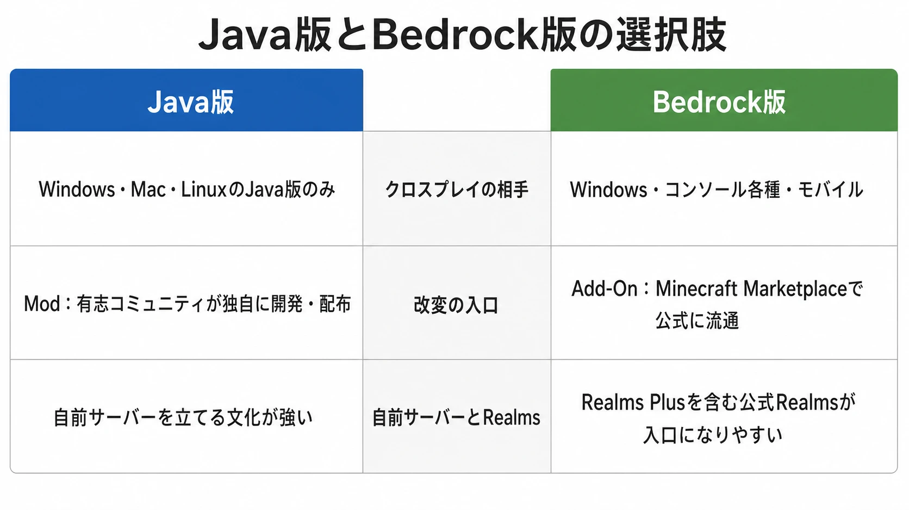

# 17年を経ても、続きを遊べる場所がある――Minecraftの更新と二つの版

> 2026年11月21日改版：シリーズ「Minecraft――一人の個人制作から世界最大級のIPへ」のまとめの回として、記事全体を全面的に書き直しました。内容の変更はGitの履歴から追えます。

2009年、Markus Persson氏（Notch）が一人で作り、掲示板に置いた試作が、17年あまりで累計4億2,500万本を超える販売を記録した。XboxのCEO、Asha Sharma氏は2026年9月26日、ふだんの日でも平均して1日に30万人以上が『Minecraft』を初めて遊んでいると明らかにした。[[1](#ref-1)]

その日に初めて木を切る人がいる一方で、何年も前に建てた家の続きを作る人もいる。この二人が、今も同じ作品から遊び始められる。シリーズ「Minecraft――一人の個人制作から世界最大級のIPへ」第9回は、八つの回を振り返りながら、遊びに終わりを決めず、遊ぶ場所を一つにまとめ切らなかった運営の判断をたどる。

***

## 八つの回で見てきたこと

### 作った人の手を離れていく

- 第1回 [掲示板に置かれた試作は、どうやって正式版になったか――Minecraftの起源（2009〜2011年）](minecraft-series-01-origins-2009-2011.md)では、掲示板で試作を遊んだ人の反応が開発に届き、作りかけの版を売りながら正式版へたどり着くまでを追った。
- 第2回 [一人の作品は、どうやって会社の事業になったか――Mojangの成長（2010〜2014年）](minecraft-series-02-becoming-a-company-2010-2014.md)では、スマートフォン版を社内で作り、家庭用ゲーム機への移植は外部と組んで進めるなど、一人が始めた仕事を会社が分担するようになった過程を見た。
- 第3回 [Microsoftは25億ドルで何を買ったのか――Minecraftの買収（2014年）](minecraft-series-03-microsoft-acquisition-2014.md)では、利用規約をめぐる騒動からMojangの買収、創業者の退社までを追い、作品を運営する責任が誰に渡ったかを見た。

2019年3月のスナップショット（正式配信前に試せる開発版）ではタイトル画面にランダムに出る一言メッセージからNotch氏への言及が外れ、クレジットには作った人として名が残り、Microsoftは10周年の催しに本人を含めず、本人の発言や意見はMicrosoftやMojangの見解を反映せず、作品を代表するものでもないと説明した。[[2](#ref-2)][[3](#ref-3)]

### 遊びの場所が広がる

- 第4回 [どの方向から近づいても、同じ世界が現れる――Minecraftの世界生成（2010〜2021年）](minecraft-series-04-world-generation-2010-2021.md)では、歩いた先に広がる世界が生まれ、後の更新で、すでに遊んでいた土地の隣に新しい地形をつなぐ工夫が重ねられたことを見た。
- 第5回 [公式が作らなかった遊びを、誰が作ったのか――MinecraftのModとサーバー（2010〜2025年）](minecraft-series-05-mods-and-servers-2010-2025.md)では、プレイヤーが作る改造「Mod」と、複数人が同じ世界に集まるための仕組み「サーバー」を通じて、遊ぶ人と運営する人が独自の遊び場を育てた経緯を追った。
- 第8回 [携帯機と店頭から広がった――Minecraftと日本（2014〜2026年）](minecraft-series-08-japan-2014-2026.md)では、携帯機と店頭のパッケージ、動画、日本の作品との組み合わせが、国内で『Minecraft』に出会う入口をどう増やしたかを見た。

### 作る人と使う人が増える

- 第6回 [遊びのゲームを、授業の道具にするには――Minecraftの教育版（2011〜2023年）](minecraft-series-06-education-2011-2023.md)では、先生たちが教室に持ち込んだゲームを、授業の進行や教材づくりに使えるよう作り変えた過程をたどった。
- 第7回 [作り手が売れる場所を、公式が開くとき――Minecraftのマーケットプレイス（2012〜2026年）](minecraft-series-07-marketplace-creators-2012-2026.md)では、着せ替えの販売から、外部の作り手が自作のワールドなどを公式の売り場に並べ、仕事として続けるまでを見た。

***

## 更新のたびに、自分の世界へ戻る理由が増える

エンダードラゴンを倒しても、自分の家には帰れる。『Minecraft』には公式に定められた終わりがなく、ドラゴンとの戦いも、自分で選べる一つの節目である。拠点に戻って建築を続けてもよいし、まだ知らない土地へ歩いていってもよい。[[4](#ref-4)]

その先に何を見つけられるかは、更新のたびに変わってきた。ワールドとは、建てたものや探索した土地が残る、自分や仲間の遊び場である。以下の更新は、そこから始められる遊びを増やしてきた。

| 時期 | 更新 | 広がった遊び |
| --- | --- | --- |
| 2020年6月 | 1.16 Nether Update | 危険な別世界「ネザー」で、地形を探索し、新しい資源を集めたり、拠点を構えたりできるようになった。[[5](#ref-5)] |
| 2021年6月・11月 | 1.17〜1.18 Caves & Cliffs | 二部に分けて新しいブロックや生き物、洞窟や山岳を加えた。後編では、より高い山や深い洞窟を探せるようになった。[[6](#ref-6)] |
| 2022年6月 | 1.19 Wild Update | 地下深くのディープダークやマングローブの湿地が加わり、カエルなどの生き物にも出会えるようになった。[[7](#ref-7)] |
| 2023年6月7日 | 1.20 Trails & Tales | 考古学で品物を掘り出し、見つけた模様で壺を飾るなど、探索の成果を建築に持ち帰れるようになった。[[8](#ref-8)] |
| 2024年6月13日 | 1.21 Tricky Trials | 地下の試練の間が加わり、一人でも仲間とでも、敵との戦いに挑める場所ができた。[[9](#ref-9)] |
| 2024年後半〜 | 年に数回の無料「ゲームドロップ」へ | 2024年に、夏に年1回まとめて出す形をやめ、年に何度か無料の「ゲームドロップ」を届けると発表した。2024年12月のThe Garden Awakensに続き、2025年にはSpring to Life、Chase the Skies、The Copper Age、Mounts of Mayhemが出た。[[10](#ref-10)][[11](#ref-11)] |
| 2026年〜 | 年を示す版番号へ | どちらの版も先頭の数字が年を示すようになった。2026年は「26」で始まり、Java版の「26.1」のように、後ろの数字でその年の更新を見分ける。[[11](#ref-11)] |

たとえば、建築を続けていた人なら、掘り出した模様で壺を飾り、前に建てた家に置ける。仲間と探索していた人なら、試練の間を探しに行く約束ができる。そこへ向かうかどうかは、遊ぶ人が決める。更新のたびに全員が同じ課題を済ませる必要がなければ、久しぶりに戻った人も、自分が中断したところから次にすることを選べる。更新ごとの継続率や売上への効果は公表されていないが、追加する内容と、それを遊ぶ順番を別々に考えるという設計上の判断は見て取れる。

***

## MicrosoftはXbox専用にしなかった

2014年、Microsoftは『Minecraft』を持つMojangを買収すると発表した。自社でXboxを展開する会社の作品になった後も、遊べる機種は広がった。[[12](#ref-12)]

2017年9月20日のBetter Together Updateで、Xbox One、スマートフォン、Windows 10などのプレイヤーが一緒に遊べるようになった。土台になったのは、多くの機種で同じように遊べるように作り直したBedrock版である。機種が違う人同士で遊ぶことを「クロスプレイ」と呼ぶ。2018年6月21日にはNintendo Switch向けのBedrock版が出て、2019年12月にはPlayStation 4も加わった。日本でのPS4版の更新は12月11日だった。[[13](#ref-13)][[14](#ref-14)][[15](#ref-15)][[16](#ref-16)]

2021年の『Minecraft』の機種別収益について、Xboxの財務責任者だったTim Stuart氏は、Nintendo Switch版がXbox版の約4倍だったと法廷で証言したと報じられている。この倍率は2021年の単年の収益額を機種別に比べたもので、販売本数や遊ぶ人の数の比ではない。[[17](#ref-17)]

2026年もこの入口は広がり、9月のMinecraft LIVEで告知されたNintendo Switch 2版は、米国では10月27日に発売された。日本の任天堂は10月28日付で発売開始を告知している。[[18](#ref-18)][[19](#ref-19)][[20](#ref-20)]

遊ぶ側から見れば、対応するBedrock版を持っていれば、どの機種の友達とも同じ世界に入れる。自分はNintendo Switch、友達はPlayStation、もう一人はスマートフォンという組み合わせでも、同じ場所に集まって家を建てられる。売り場が増えるたびに、一緒に遊べる相手も増えうるという判断である。[[13](#ref-13)][[15](#ref-15)]

***

## Java版には、PCで育った遊び方が残った

Better Togetherの発表で、公式はPCで育ったJava版も引き続き更新すると明言した。二つの版でできることは、誰と集まり、遊びに何を足すかを考えると分かりやすい。[[13](#ref-13)][[21](#ref-21)]

Java版では、Windows、Mac、LinuxのJava版同士で遊べる。仲間が作ったModを入れて遊びの仕組みを変えたり、自前のサーバーに独自のルールを設けたりする人たちがいる。その遊びがどう育ったかは、[公式が作らなかった遊びを、誰が作ったのか――MinecraftのModとサーバー（2010〜2025年）](minecraft-series-05-mods-and-servers-2010-2025.md)でたどった。Bedrock版では、Windows、家庭用ゲーム機、スマートフォンなどのBedrock版同士で集まれる。遊びや見た目を変える追加データ「Add-On」があり、公式の売り場「マーケットプレイス」からワールドや着せ替えなどを手に入れられる。[[21](#ref-21)][[22](#ref-22)]

*Java版とBedrock版では、一緒に遊べる相手や、遊びを作り変えるための入口が異なる。*

公式が月額で共有ワールドを預かる「Realms」は、どちらの版にも用意されている。自分でサーバーを用意する手間をかけず、同じ版を使う少人数の仲間と遊び続けたいときに使える。ルールを細かく決めたい仲間には、自前でサーバーを運営する道もある。[[21](#ref-21)]

2022年6月7日から、Windows向けのPC版は一度の購入で両方が手に入るようになり、すでに片方を持つ人も、もう片方を無料で受け取れるようになった。その際、公式は、Java版とBedrock版がそれぞれ固有の特徴を持つ別々のゲームであり続けると明記した。売り方はまとめ、中身は分けたままにした。[[23](#ref-23)]

二つの版は、公式の案内ではドロップや更新を同じ日に受け取る。例外が、光や影、水面の映り込みなどを変えるVibrant Visualsである。2025年6月にBedrock版で先行し、Java版では、遊びの動きを決める部分と画面に絵を出す部分を切り離し、後者を作り直してから新しい見た目を加える。改良はできたものからスナップショットで試し、正式版に取り込む方針だ。二つの版を残すという判断は、こうして更新を届ける順番にも表れている。[[10](#ref-10)][[24](#ref-24)]

***

## 編者の考察｜何をそろえ、何を選べるようにするか

自分の家に帰って建築を続ける人も、仲間を誘って初めて試練の間へ向かう人もいる。機種の違う友達とBedrock版で集まる人も、何年も使ってきたModを入れたJava版のサーバーへ戻る人もいる。遊びの終わりを決めないことと、二つの版を統合し切らないことには、遊ぶ人にとっての正解を一つに決めないという共通点がある。

シリーズを通して見ると、選べるものは遊び方だけではなかった。第5回では、Modの作者やサーバーの運営者が自分たちで遊ぶ場所を育てた。第6回では、先生たちが教室へ持ち込み、授業で使える道具にした。第7回では、公式の売り場に外部の作り手が加わり、作品づくりを仕事にした。最初の作り手の手を離れても続いた作品には、遊び方、遊ぶ場所、作り手を運営側が一つに絞らず、それぞれができることを増やしてきた歴史がある。

プランナーが更新を考えるときは、新しい遊びを何人に届けるかと一緒に、「今までの遊びに戻った人は、そこから何ができるか」を考えたい。版や仕組みをそろえるなら、誰が誘いやすくなり、誰が使い慣れた道具や居場所を手放すことになるのかも考える。ときには購入の入口だけを一つにすることで、その先にある複数の遊び方を残せる。

17年前、掲示板に置かれた試作を手に取った人は、そこから自分で何を作るかを決めた。その続きを遊べる場所は、いまや店頭で手にしたゲーム機にも、仲間が運営するサーバーにも、先生が開いた教室にもある。

## References

1. [Asha Sharma氏のXの投稿][1] — X、2026年9月26日。

[1]: https://x.com/asha_shar/status/2103898609393803471

2. [Imran Khan「Minecraft Removes Incidental Mentions Of Creator Markus Persson」][2] — Game Informer、2019年3月27日。

[2]: https://www.gameinformer.com/2019/03/27/minecraft-removes-incidental-mentions-of-creator-markus-persson

3. [Alissa McAloon「Microsoft distances itself from Minecraft creator Notch ahead of anniversary event」][3] — Game Developer、2019年4月29日。Microsoftの説明はVarietyへの回答を引用した同記事を参照。

[3]: https://www.gamedeveloper.com/game-platforms/microsoft-distances-itself-from-i-minecraft-i-creator-notch-ahead-of-anniversary-event

4. [Mojang Studios「What is Minecraft? Discover the World of Minecraft」][4] — Minecraft公式サイト、日付記載なし。「Can you beat Minecraft?」を参照。

[4]: https://www.minecraft.net/en-us/about-minecraft

5. [Mojang Studios「Minecraft - Nether Update - 1.16.0 (Bedrock)」][5] — Minecraft Feedback、2020年6月23日。

[5]: https://feedback.minecraft.net/hc/en-us/articles/360044928311-Minecraft-Nether-Update-1-16-0-Bedrock

6. [Mojang Studios「Minecraft - Caves & Cliffs: Part II - 1.18.0 (Bedrock)」][6] — Minecraft Feedback、2021年11月30日。Part Iは同年6月配信。

[6]: https://feedback.minecraft.net/hc/en-us/articles/4414284658701-Minecraft-Caves-Cliffs-Part-II-1-18-0-Bedrock

7. [Mojang Studios「Minecraft - The Wild Update - 1.19.0 (Bedrock)」][7] — Minecraft Feedback、2022年6月7日。

[7]: https://feedback.minecraft.net/hc/en-us/articles/6613754674829-Minecraft-The-Wild-Update-1-19-0-Bedrock

8. [Mojang Studios「Minecraft - Trails & Tales - 1.20.0 (Bedrock)」][8] — Minecraft Feedback、2023年6月7日。

[8]: https://feedback.minecraft.net/hc/en-us/articles/16421714461453-Minecraft-Trails-Tales-1-20-0-Bedrock

9. [Mojang Studios「Minecraft: Bedrock Edition - 1.21 (Tricky Trials)」][9] — Minecraft Feedback、2024年6月13日。

[9]: https://feedback.minecraft.net/hc/en-us/articles/27451789924237-Minecraft-Bedrock-Edition-1-21-Tricky-Trials

10. [Mojang Studios「History of Minecraft updates」][10] — Minecraft公式サイト、日付記載なし。更新の一覧とFAQを参照。

[10]: https://www.minecraft.net/en-us/updates

11. [Staff「Minecraft’s new version numbering system」][11] — Minecraft公式サイト、2025年12月2日。

[11]: https://www.minecraft.net/en-us/article/minecraft-new-version-numbering-system

12. [Microsoft「Minecraft to join Microsoft」][12] — Microsoft Source、2014年9月15日。

[12]: https://news.microsoft.com/source/2014/09/15/minecraft-to-join-microsoft/

13. [Staff「Better Together FAQ」][13] — Minecraft公式サイト、2017年9月20日。

[13]: https://www.minecraft.net/en-us/article/better-together-faq

14. [Will Tuttle「Minecraft’s Bedrock Update Coming to Nintendo Switch Digitally and in Retail on June 21」][14] — Xbox Wire、2018年5月10日。

[14]: https://news.xbox.com/en-us/2018/05/10/minecrafts-bedrock-update-coming-nintendo-switch-digitally-retail-june-21/

15. [Kelsey Howard「Bedrock is Coming to PS4」][15] — Minecraft公式サイト、2019年12月9日。

[15]: https://www.minecraft.net/en-us/article/ps4-news

16. [Taijiro Yamanaka「『マインクラフト』PS4版の『Bedrock Version』へのアップデートが決定、明日にも無料配信へ。他機種版とのクロスプレイが可能に」][16] — AUTOMATON、2019年12月10日。

[16]: https://automaton-media.com/articles/newsjp/20191210-108342/

17. [Chris Kerr「Minecraft earned four times as much revenue on Switch compared to Xbox」][17] — Game Developer、2023年7月3日。

[17]: https://www.gamedeveloper.com/business/minecraft-earned-four-times-as-much-revenue-on-switch-compared-to-xbox

18. [Sofia Dankis「Minecraft Live: September 2026 Recap」][18] — Minecraft公式サイト、2026年9月26日。

[18]: https://www.minecraft.net/en-us/article/mclive_sept2026_recap

19. [Nintendo「Experience Vibrant Visuals in Minecraft for Nintendo Switch 2!」][19] — Nintendo公式サイト（米国）、2026年10月27日。

[19]: https://www.nintendo.com/us/whatsnew/experience-vibrant-visuals-in-minecraft-for-nintendo-switch-2/

20. [任天堂「『Minecraft』が、より鮮やかなグラフィックにアップデートしてNintendo Switch 2 に登場。本日より発売開始。」][20] — 任天堂公式サイト（日本）、2026年10月28日。

[20]: https://www.nintendo.com/jp/topics/article/c8c6ed2b-cff7-4ff5-8953-32bd770e2537

21. [Cristina Anderca「The Difference between Java and Bedrock Editions」][21] — Minecraft公式サイト、2021年10月25日。

[21]: https://www.minecraft.net/en-us/article/java-or-bedrock-edition

22. [Mojang Studios「Learn about Minecraft: Bedrock Edition Add-Ons」][22] — Minecraft Help、日付記載なし。

[22]: https://help.minecraft.net/hc/en-us/articles/4409140076813

23. [Cristina Anderca「Java & Bedrock Edition for PC is out on June 7」][23] — Minecraft公式サイト、2022年6月4日。

[23]: https://www.minecraft.net/en-us/article/java---bedrock-edition-pc-out-june-7

24. [Staff「Vibrant Visuals on Java Edition」][24] — Minecraft公式サイト、2025年4月16日。

[24]: https://www.minecraft.net/en-us/article/vibrant-visuals-java-edition

----

この文書は、Perplexity、Claude、ChatGPT の3つのAIの支援を受けて著述されたものです。引用画像を除き、MIT License にて提供されています。
