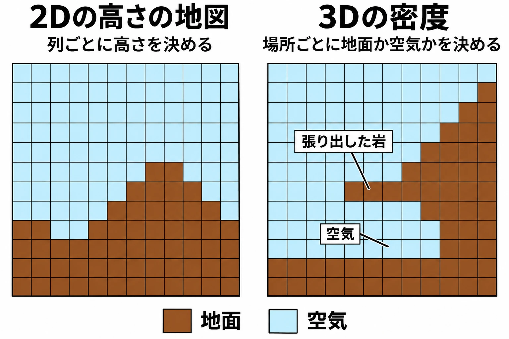

# どの方向から近づいても、同じ世界が現れる――Minecraftの世界生成（2010〜2021年）

北から歩いてきても、南から回り込んでも、同じ場所には同じ山が現れる。『Minecraft』を作ったMarkus “Notch” Persson氏は2011年3月9日、地図を無限に広がる形へ変えたとき、この条件を守る必要が生まれたとブログに書いた。世界はあらかじめ端まで作り置かず、プレイヤーが探索する先をその場で作る。それでも、どんな順番で歩いたかにかかわらず、同じ場所には同じ地形ができるようにする。これが、歩き続けられる世界を成り立たせる約束だった。[[1](#ref-1)]

[前回](minecraft-series-03-microsoft-acquisition-2014.md)は、MojangがMicrosoftに買収されるまでを追った。今回は2010年にさかのぼり、『Minecraft』が地形を作る規則をどう変えてきたかを見る。規則を更新すると、新しく冒険を始める人には新しい世界ができる。すでに家を建て、道を敷いた人には、家の先にできる新しい地形を、今まで遊んできたワールド（保存される一つひとつの世界）とどうつなぐかという問題が残る。

***

## 2010〜2011年｜歩いた先で地形を作る

2010年2月27日の開発版Infdevで、地図を探索に合わせて広げていく「無限」のワールドが登場した。未探索の場所へ踏み込むたびにその周辺を作るため、移動中に必要な処理をこなしながら、山や谷の形も決める必要があった。[[2](#ref-2)][[1](#ref-1)]

Notch氏が最初に使ったのは、2Dの「高さの地図」だった。真上から見た地図の各地点に地面の高さを一つずつ書き込み、その高さまでブロックを積むと考えると分かりやすい。山や谷は作れるが、頭上に岩がせり出し、その真下には空間がある崖は作れない。一つの列を途中だけ空けるには、高さ一つ分の情報では足りないからだ。[[1](#ref-1)]

そこで、上下も含めた3Dの位置ごとに「密度」を使う方式に変えた。ここでいう密度は、その場所を地面のブロックで埋めるか、空気にするかを決める目安である。同じ列の中でも高さによって判断を変えられるので、岩の下を空け、崖を張り出させられる。[[1](#ref-1)]

Notch氏「Terrain generation, Part 1」の説明をもとに作成した模式図。[[1](#ref-1)]

ところが、細かく計算するほど処理は重くなり、地形も細かくでこぼこして、平地やなだらかな丘がなくなった。そこで密度を直接計算する地点の間隔を広げ、その間の値は近くの地点からなめらかにつながるように補った。これが「補間」である。計算の回数を減らしながら、崖の張り出しを作れる方式で平地となだらかな丘も作れた。張り出しのある山を見つける楽しさと、家を建てやすい土地に出会う余地は、同じ調整から生まれた。[[1](#ref-1)]

初期の生成には、遠くまで進むと地形が崩れる「Far Lands」もあった。遠方で何が起きたかは、[ゲームの数値の限界を扱った既刊記事](game-numeric-limits-for-planners.md)を参照してほしい。[[1](#ref-1)]

***

## 2011年・2013年｜古い地図の隣に、新しい地図ができる

2011年9月14日のBeta 1.8（Adventure Update）では、地形の生成が大きく見直された。バイオームとは、森林、砂漠、湿地といった、風景や環境の特徴ごとに分かれた地域である。WIREDの体験記事によると、新しい地形では地域のつぎはぎ感が減り、一つひとつのバイオームが大きくなった。砂漠を横切るだけでも、食料や身を隠せる場所を見つけにくくなる。地域の広さを変えると、移動中にどれほど長く同じ条件で過ごすかも変わる。[[3](#ref-3)][[4](#ref-4)]

2013年10月25日の1.7.2は「The Update that Changed the World」と呼ばれた。開発者のNathan Adams氏によれば、ゲーム内のバイオームの種類は従来の2倍を超えた。巨大な海を減らし、隣り合うバイオームがなだらかに移り変わるようにもした。一方、あえて起伏の激しい地形で遊びたい人には、ワールドを作るときに「Amplified」を選べるようにした。2011年の話は一つの地域の広さ、2013年の「2倍」は地域の種類の数である。[[5](#ref-5)][[6](#ref-6)]

作り直した生成規則が使われるのは、まだ作られていない地形だけだ。たとえば旧版で平原の端まで歩いたワールドを新版で開き、その先へ進むと、初めて作られる地形には新版の規則が使われる。境目で片側が平地、もう片側が高台になれば、地図の区切りに沿って急な段差が現れる。こうした旧ワールドの境目に対し、1.18は新しく作る地形をなじませる処理を入れた。[[7](#ref-7)][[8](#ref-8)]

***

## 2011〜2014年｜機種によって違った「無限」

スマートフォン向けのPocket Editionでは、当初はワールドの広さが限られていた。2014年7月10日の0.9.0で、探索に合わせて広がる無限のワールドと洞窟が加わった。初期のPC版で地図を広げ続けられるようになってから、スマートフォン版にもこの遊び方が入るまでには4年以上かかっている。[[9](#ref-9)][[10](#ref-10)]

[第2回](minecraft-series-02-becoming-a-company-2010-2014.md)で取り上げた4J Studiosは、据え置き機への移植を担当した。Xbox 360版やPS3版のワールドには広さの上限があった。4J Studiosは2014年5月7日、Xbox One版とPS4版では従来機よりかなり広くなるものの、セーブデータの容量に上限があるため無限にはならないと、当時のTwitter（現X）で説明した。[[11](#ref-11)]

地形を必要なときに作る方式でも、作った地形やプレイヤーが加えた変更を保存する場所は要る。同じ『Minecraft』でも、どこまで歩き続けられるかは、移植先で使える保存容量によって変わった。[[11](#ref-11)]

***

## 2020〜2021年｜洞窟と山を作り直し、地続きにする

洞窟と山を一緒に作り直す更新「Caves & Cliffs」は、当初2021年夏に一度に出す予定だった。2021年4月14日、Mojang Studiosは夏に予定していた更新を二つに分け、世界生成の大幅な変更を後編に回すと発表した。理由の一つは、プレイヤーが大切に作ってきたワールドを不具合で壊す事態を避けるため、品質を確かめる時間が必要だったことだ。技術面でも、洞窟と山は世界生成全体に関わる。さらに、夏にすべてを出すには長時間の労働が必要で、それでも間に合う保証はなかった。チームの健康も、分割を決めた理由に挙げられた。[[12](#ref-12)]

### 正式公開の前に遊んでもらう

2021年7月13日、Mojang StudiosのMarcus Bodin氏は、Bedrock版で新しい世界生成を試せる実験機能を案内した。通常配信版でも設定を有効にすれば一部を試せ、試験版では通常配信版と異なる生成も試せた。8月25日の追記では、試験版で新しい地形などを試せることと、実験中のため動作の重さなどの問題が起こりうることを伝えた。Mojangは正式公開に向けて改善する意向を示し、プレイヤーに感想や報告を求めた。Java版でも、別途ダウンロードする実験用の試験版が公開された。[[13](#ref-13)][[14](#ref-14)]

### 1.18で、今あるワールドの先が変わる

2021年11月30日、1.18「Caves & Cliffs: Part II」が公開された。地形が作られ、建築できる範囲を上にも下にも広げ、縦全体で384ブロックになった。山や丘の形と高さはバイオームと別に決められるようになり、丘の上に砂漠を作るために専用のバイオームを用意する必要がなくなった。洞窟の生成も変わり、広い空洞から細長く曲がる通路まで、異なる形の洞窟が新しい深さに広がった。[[8](#ref-8)][[15](#ref-15)]

既存ワールドには、保存された地形の隣にできる地形をなじませる「World Blending」が加わった。たとえば、家の向こうに新しい丘ができるとき、境目が垂直な壁のように見えにくくなる。Java版の変更履歴では、地表の高さとバイオームはなじむ一方、洞窟がつながるかは場所によると説明している。既存ワールドの地下には、従来の底より深い場所に新しい地形が生成される場合もある。家からさらに歩く、新たに地下へ掘るという、今までの遊びの続きから新しい地形へ入れるようになった。[[7](#ref-7)][[8](#ref-8)][[15](#ref-15)]

### 同じシードを使うときは、版も見る

シードとは、新しいワールドを作るときに生成の出発点となる値である。保存したワールドを開く場合と、同じシードを入力して新しく作る場合では、結果が異なる。Bedrock版の公式告知では、以前のシードで1.18の新規ワールドを作ると、プレイヤーが現れる位置は以前と同じにならず、旧版に固定していれば、以前と同じ生成規則でワールドを作れると説明している。シードと版の関係や新旧の地形のつなぎ方については、[プロシージャル生成を扱った既刊記事](procedural-content-generation-history-and-design.md)で詳しく取り上げている。[[15](#ref-15)]

一方、同じ1.18世代のJava版とBedrock版では、同じシードを入れたときの地形やバイオームが近づいた。2021年10月のMinecraft Liveでその方針が紹介され、翌2022年1月のBedrock試験版1.18.20.21では、64ビットのシードを両版の間でコピーして使えるようになった。版をまたいで風景を共有しやすくすることと、以前の版の風景を再現することは、それぞれ別の条件である。[[16](#ref-16)][[7](#ref-7)][[17](#ref-17)]

***

## 世界生成の主な変更（2010〜2021年）

| 時期 | 版・発表 | 地形やワールドに関わる変更 |
| --- | --- | --- |
| 2010年2月27日 | Infdev | 探索に合わせて広がるワールドが登場。[[2](#ref-2)] |
| 2011年9月14日 | Beta 1.8 | 地形生成を見直し、一つひとつのバイオームが大きくなった。[[3](#ref-3)][[4](#ref-4)] |
| 2013年10月25日 | 1.7.2 | バイオームの種類が増え、巨大な海が減った。Amplifiedを追加。[[5](#ref-5)][[6](#ref-6)] |
| 2014年5月7日 | 4J Studiosによる説明 | Xbox One版とPS4版は従来機より広く、保存容量に合わせて上限を設けると説明。[[11](#ref-11)] |
| 2014年7月10日 | Pocket Edition 0.9.0 | 無限のワールドと洞窟を追加。[[9](#ref-9)][[10](#ref-10)] |
| 2021年4月14日 | Caves & Cliffsの分割告知 | 世界生成の大幅な変更を後編へ。[[12](#ref-12)] |
| 2021年7月 | Java版・Bedrock版の実験公開 | 新しい世界生成を先に試せるようになった。[[13](#ref-13)][[14](#ref-14)] |
| 2021年10月 | Minecraft Live 2021 | 同じシードを使ったときにJava版とBedrock版の地形が近づくことを紹介。[[16](#ref-16)] |
| 2021年11月30日 | 1.18「Caves & Cliffs: Part II」 | 縦384ブロックへの拡張、洞窟の刷新、既存ワールドと新しい地形をつなぐ処理。[[8](#ref-8)][[15](#ref-15)] |

***

## 編者の考察｜更新後、どこから遊び始めるか

**新規ワールドと既存ワールドで、公開前に見る場所を変える。** 新規ワールドなら、最初の探索で山や洞窟に出会えるかを確かめる。既存ワールドなら、そこに建てた家から未探索の方向に歩き、坂や川が境目でどう見えるかを確かめる。1.18のように地下へ広げるなら、既存の坑道から掘り進めたときに、どこまで自然につながるかも確認する。地表と洞窟で接続の扱いが違えば、その違いまで告知に書ける。

**試験版では、風景と動作の両方を見てもらう。** 山の眺めや洞窟の広さを見せるだけでなく、実際に長く歩いたり、慣れた端末で地形を読み込んだりしてもらう。ゲームが重くなるときに、どの機種で何をしていたかまで分かれば、地形の形を調整する話と、処理の負荷を下げる話を進めやすい。

**機種の制約は、遊べる範囲として伝える。** 4J Studiosの説明では、保存容量の上限がワールドの広さにどう現れるかが分かった。遊ぶ側が知りたいのは、容量の数字そのものより、どこまで探索し、どこまで作ったものを保存できるかである。同じ作品を別の機種で売るなら、機種ごとにその答えを出しておく。

第5回では、Modやサーバーを通じてプレイヤーが作った遊びが広がる過程を追い、第3回で予告した、何を売ってよいのか、運営者がどう事業を成り立たせていたのかを取り上げる。

## References

1. [Markus Persson「Terrain generation, Part 1」][1] — The Word of Notch、2011年3月9日。Internet Archive保存版。冒頭の説明は原文の要約。

[1]: http://web.archive.org/web/20210813083219/https://notch.tumblr.com/post/3746989361/terrain-generation-part-1

2. [Markus Persson「Here, try some infinite maps」][2] — The Word of Notch、2010年2月27日。Internet Archive保存版。開発版Infdevの公開を告げた投稿。

[2]: http://web.archive.org/web/20100304072703/http://notch.tumblr.com:80/post/415398931/here-try-some-infinite-maps

3. [Game Informer「Get Your Minecraft 1.8 While It's Hot」][3] — Game Informer、2011年9月14日。Beta 1.8の配信当日の報道。

[3]: https://gameinformer.com/b/news/archive/2011/09/14/get-your-minecraft-1-8-while-it-39-s-hot.aspx

4. [Duncan Geere「Hands-On: Digging Into Minecraft's New Adventure Mode」][4] — WIRED、2011年9月16日。

[4]: https://www.wired.com/2011/09/hands-on-minecraft-adventure/

5. [Phil Savage「Minecraft 1.7 gets pre-released, will change the world on Friday」][5] — PC Gamer、2013年10月23日。公開予定日と変更履歴を掲載。

[5]: https://www.pcgamer.com/minecraft-1-7-gets-pre-released-will-change-the-world-on-friday/

6. [Julian Benson「Minecraft 1.7 release set for this Friday. The game’s world will never be the same again」][6] — PCGamesN、2013年10月22日（2014年5月29日更新）。Nathan Adams氏によるバイオームの種類数の説明を掲載。

[6]: https://www.pcgamesn.com/minecraft/minecraft-17-release-set-friday-game-s-world-will-never-be-same-again

7. [Sarah James「Minecraft 1.18 update: Everything new in Caves & Cliffs part 2」][7] — PC Gamer、2021年12月1日。旧ワールドの境目と両版のシードについて参照。

[7]: https://www.pcgamer.com/minecraft-118-update-release-date-caves-and-cliffs-part-2/

8. [Adrian Östergård「Caves & Cliffs: Part II out today on Java」][8] — Minecraft公式サイト、2021年11月30日。「Overworld Generation」「Upgrading of Old Worlds」を参照。

[8]: https://www.minecraft.net/en-us/article/caves---cliffs--part-ii-out-today-java

9. [Mojang Studios「Old Worlds Types in Minecraft: Bedrock Edition - FAQ」][9] — Minecraft Feedback。初期のPocket Editionでワールドの広さに上限があったことを確認。

[9]: https://feedback.minecraft.net/hc/en-us/articles/4411688594317-Old-Worlds-Types-in-Minecraft-Bedrock-Edition-FAQ

10. [Juli Clover「'Minecraft' for iOS Gets Major Update With Infinite Worlds, New Blocks, and Tons of Other Content」][10] — MacRumors、2014年7月10日。配信当日の報道。変更履歴を掲載。

[10]: https://www.macrumors.com/2014/07/10/minecraft-pocket-update/

11. [Ben Reeves「Minecraft On Consoles Is Getting Bigger」][11] — Game Informer、2014年5月11日。4J Studiosの2014年5月7日の投稿を掲載。

[11]: https://gameinformer.com/b/news/archive/2014/05/11/minecraft-on-consoles-is-getting-bigger

12. [Mojang Studios「A Caves & Cliffs announcement」][12] — Minecraft公式サイト、2021年4月14日。

[12]: https://www.minecraft.net/en-us/article/a-caves---cliffs-announcement

13. [Marcus Bodin「New world generation in Bedrock available for testing」][13] — Minecraft公式サイト、2021年7月13日。8月25日の追記も参照。

[13]: https://www.minecraft.net/en-us/article/new-world-generation-bedrock-available-testing

14. [Mojang Studios「New World Generation in Java Available for Testing」][14] — Minecraft公式サイト、2021年7月13日。

[14]: https://www.minecraft.net/en-us/article/new-world-generation-java-available-testing

15. [Mojang Studios「Caves & Cliffs: Part II Out Today on Bedrock」][15] — Minecraft公式サイト、2021年11月30日。「World Blending」「Known Issues」を参照。

[15]: https://www.minecraft.net/en-us/article/caves---cliffs--part-ii-out-today-bedrock

16. [Zachary Boddy・Samuel Tolbert「Minecraft 'Caves and Cliffs Update' Part Two still releasing 2021, Deep Dark delayed」][16] — Windows Central、2021年10月16日。Minecraft Live 2021で紹介されたシードの共通化を参照。

[16]: https://www.windowscentral.com/minecraft-caves-cliffs-update-part-two-still-releasing

17. [Mojang Studios「Minecraft Beta - 1.18.20.21 (Xbox / Windows / Android)」][17] — Minecraft Feedback、2022年1月27日。64ビットのシードを共有できるようになった試験版の公式変更履歴。

[17]: https://feedback.minecraft.net/hc/en-us/articles/4423151445901-Minecraft-Beta-1-18-20-21-Xbox-Windows-Android

----

この文書は、Perplexity、Claude、ChatGPT の3つのAIの支援を受けて著述されたものです。引用画像を除き、MIT License にて提供されています。
