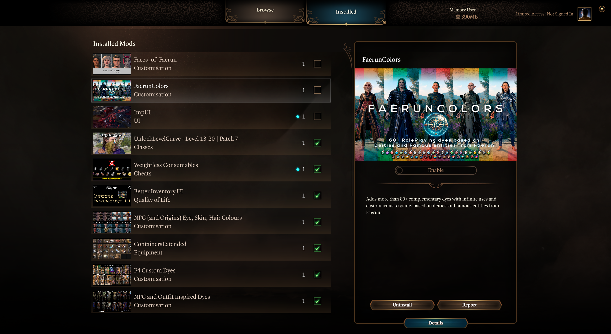

# Modを許すか、どこまで許すか——ゲーム文化、日米の法律、開発元の方針から読む線引き

> 2026年11月12日改版：記事全体を全面的に書き直しました。内容の変更はGitの履歴から追えます。

## はじめに

一人で遊ぶRPGで、移動速度を上げる。対戦ゲームで、ほかの参加者より速く動けるようにする。どちらもゲームの動きを変える行為だが、後者は対戦の公平を損ない、チートとして問題になる。

Mod（モッド）は、メーカー以外の第三者がゲームに加える改変データやプログラムである。衣装や画面表示を変えるものから、ステージやルールを加え、新しい遊び方を作るものまである。この記事の主題は、その改変をどこまで許すかである。プレイヤーの受け止め方、法律、開発元の方針という三つの観点から、誰が何を根拠に線を引いてきたのかを見ていく。

***

## Modはゲームに何をもたらしてきたか

『Quake』用のModとして作られた『Team Fortress』では、異なる役割を持つクラスを選び、チームで戦う。Valveは1998年にその開発チームを迎え入れた。『Half-Life』のエンジンで作り直した『Team Fortress Classic』は1999年に登場した。[[1](#ref-1)][[2](#ref-2)]

『Counter-Strike』は、Minh Le氏とJess Cliffe氏が1999年に公開した『Half-Life』用のModだった。Valveは2000年に権利を取得して2人を雇い、単体の製品として発売した。同じエンジンで動くゲームでも、チームで目標を達成する対戦ルールに作り替えれば、元の作品とは異なる遊びが成立する。[[3](#ref-3)]

『Warcraft III』用のカスタムマップ「DotA Allstars」は、プレイヤーがヒーローを操作し、チームで相手の本拠地を攻める遊びを広めた。Valveは、マップの開発を引き継いでいたIceFrog氏を2009年に雇い、2010年10月13日に『Dota 2』を発表した。同時代の専門メディアは、「DotA Allstars」を手がけたSteve “Guinsoo” Feak氏がRiot Gamesに加わり、同社がDotAの流れをくむ『League of Legends』を開発していたことも報じている。[[4](#ref-4)][[5](#ref-5)]

Modは、元の作品が長く遊ばれる理由にもなる。2024年12月のGameBusiness.jpの報道によれば、Nexus Modsで旧版『スカイリム』向けのModの累計ダウンロードが20億回を超えた。60億回を超えたSpecial Edition向けと合わせると80億回超である。これは利用者数ではなく、配布サイトで数えたダウンロード回数である。[[6](#ref-6)]

『スカイリム』では、プレイヤーが新しい遊び方を持ち寄ることで、発売から年月を経たゲームを遊び直す理由が増えた。Valveの事例では、遊び方そのものが製品になり、DotAの系譜は複数の作品へ広がった。開発元にとって、どこまで改変を開放するかは、作品の寿命や次の製品の可能性にも関わる経営判断である。

***

## 日本ではどう受け止められてきたか

2005年、4Gamerは『Half-Life 2』のModを扱う「XSI Mod Toolラウンドテーブル」を取材した。日本のゲームコミュニティや開発者教育にModを広めるためのセミナーで、Modが日本ではまだ十分に認知されていないという認識が、議論の出発点になっていた。[[7](#ref-7)]

2024年には、HD-2D版『ドラゴンクエストIII』のPC版で、移動を速くしたり、敵との遭遇率を変えたりするModが登場した。AUTOMATONの英語版は、日本のプレイヤーの間で反発が起き、他人の作品を気軽に変えることへの違和感を述べた投稿が議論を呼んだと伝えた。同誌によると、購入した製品を自分向けにカスタマイズする権利の延長としてModを捉える欧米の見方を挙げ、日本での捉え方との違いを指摘した返信にも多くの支持が集まった。この報道から見えるのは、同じ変更を「作品への介入」と受け取る人と「自分の遊び方の調整」と受け取る人がいたことである。[[8](#ref-8)]

日本の開発者の発言にも幅がある。『ファイナルファンタジーVII リバース』のディレクター、浜口直樹氏は、PC版についてのEpic Gamesのインタビューで、Modコミュニティへの敬意を示しつつ、不快・不適切なModの制作やダウンロードを控えるよう呼びかけた。後にAUTOMATON英語版の取材では、自身もModを使い、PC市場に活気をもたらすものとして肯定的に捉えていると語った。[[9](#ref-9)][[10](#ref-10)]

『ファイナルファンタジーXVI』のプロデューサー、吉田直樹氏も、2024年9月のPC版発売に際し、不快・不適切なModを作ったり導入したりすることを控えるよう呼びかけた。[[11](#ref-11)]

吉田氏は2025年8月28日、『ファイナルファンタジーXIV』の公式トピックスに、約5,000字の「MOD文化とMODツールの使用について」を公開した。オンラインゲームの運営者がModへの考えを自ら長文で説明した例である。文章はザ・ロードストーンの原文で読める。[[12](#ref-12)][[13](#ref-13)]

***

## 日本の法律はどこに線を引いたか——「ときめきメモリアル」事件

本章と次章は制度と判例の紹介であり、個別の事案への法的助言ではない。

**同一性保持権** は、著作者が自分の著作物を意に反して改変されない権利であり、著作者人格権の一つである。複製や配信などを許諾して対価を得ることに関わる著作権（財産権）とは別に、著作者に属する。財産権を譲渡しても、著作者人格権は著作者に残る。[[14](#ref-14)]

コナミの恋愛シミュレーションゲーム『ときめきメモリアル』では、主人公が日々何をするかによって能力値が変わり、その変化が物語の展開に関わる。ある業者が、通常のプレイでは到達できない高い能力値のデータを収めたメモリーカードを輸入し、販売した。カードを使えば、能力を上げるために本来必要な過程を経ずに、ゲームを進められた。[[15](#ref-15)][[16](#ref-16)][[17](#ref-17)]

1997年11月27日、大阪地裁は、カードのデータを読み込んでもゲームのプログラム自体は書き換わらず、本来予定されていた物語を変えたとする証拠もないことなどから、同一性保持権の侵害を認めなかった。[[15](#ref-15)][[16](#ref-16)] 1999年4月27日、控訴審の大阪高裁はこの判断を覆し、2001年2月13日、最高裁は販売業者の上告を退けた。[[15](#ref-15)][[17](#ref-17)][[18](#ref-18)]

最高裁は、能力値が主人公の人物像を表し、その変化に応じて物語が進むというゲームの作りに着目した。通常あり得ない値に置き換えることで人物像が変わり、物語が本来予定されていた範囲を超えて展開したため、同一性保持権の侵害を認めた。さらに、専らこの改変に使うカードを輸入・販売し、他人に使わせる意図で流通させた業者は、利用者による侵害を引き起こした者として、損害賠償責任を負うとした。[[17](#ref-17)][[18](#ref-18)]

一審と最高裁で違ったのは、ゲームのどこに改変を見たかである。一審がプログラムの書き換えの有無に着目したのに対し、最高裁は、能力値と物語の結び付きに踏み込んで、作品として予定された範囲を超えたかを判断した。外部データを読み込ませる改変を日本で論じる際にこの判決が参照されるのは、そのためである。現代のModに当てはめる場合も、改変対象の役割や作品への影響、配布者の関与など、事案ごとの事情を見る必要がある。

***

## 米国のフェアユースはどう判断してきたか

### 許可を取らずに使える場合を、どう判断するか

米国には、権利者の許可を得ずに著作物を使っても、一定の場合には著作権侵害にならない **フェアユース** の規定がある。批評、報道、教育などが条文に例示されている。19世紀にさかのぼる判例上の考え方で、1976年の著作権法で第107条に明文化された。[[19](#ref-19)][[20](#ref-20)]

たとえば、ゲームの画面を記事に載せるとする。画面表示の問題を批評するために必要な場面を示す場合と、読者がゲームを買わずに映像を楽しめるよう全編を見せる場合では、使う目的も、見せる量も、元の作品への影響も違う。裁判所はこうした違いを、次の四つの要素から総合して判断する。[[19](#ref-19)][[20](#ref-20)]

1. **使い方の目的と性格**。営利目的か、非営利の教育などに使うのか。元の作品に新しい意味や価値を加え、異なる目的で使うのか。非営利という事情は判断材料の一つである。
2. **元の作品の性質**。事実を伝える資料か、表現の工夫を重ねた創作物か。一般に、創作性の高い作品を使う場合はフェアユースの判断で不利になりやすい。
3. **使った量と、その部分の重要性**。全体のうちどれだけ使ったかと、使った箇所が作品にとってどれほど重要かを見る。短い抜粋でも作品の核心を使えば重く評価されうる。
4. **元の作品の市場や価値への影響**。その利用が元の作品の購入や、権利者が合理的に見込める関連商品の購入に取って代わるか。同様の利用が広がった場合の影響も考える。

使った割合や営利性だけで結論が決まる仕組みではなく、紛争になれば裁判所が具体的な事情に即して判断する。米国著作権局は判断の傾向を調べる手がかりとして判例を集めた「Fair Use Index」を公開し、法的助言の代わりにはならないと説明している。[[19](#ref-19)][[20](#ref-20)]

Modに関わる米国の判例では、著作権者が持つ **派生著作物を作る権利** が主に問題になる。派生著作物とは、元の著作物に基づいて作られる新たな作品である。小説をもとに映画を作る場合がその一例だ。以下の裁判では、改変によって派生著作物が作られたかと、仮にその権利が及ぶとしてもフェアユースが成立するかが、それぞれ検討された。[[20](#ref-20)][[21](#ref-21)][[22](#ref-22)]

### Game Genie——家庭で遊んでいる間だけ変わる

Game Genieは、米国版ファミコンに当たるNESで使う改造器具だった。ゲーム機とカートリッジの間に取り付けると、ゲームの数値などがプレイ中だけ変化する。任天堂は、その状態で画面に現れるゲームが、許諾を得ずに作られた派生著作物に当たると主張した。[[21](#ref-21)]

1992年、米国の第9巡回区控訴裁判所は、Game Genieが生み出す変更は一時的で、元のゲームとは別に、改変後の作品を具体的な形で取り出せるように記録しているわけでもないと判断した。したがって、問題となった画面表示は派生著作物に当たらないとした。[[21](#ref-21)]

裁判所はさらに、仮に派生著作物に当たるとしても、消費者が自分の持つゲームを家庭で非営利に楽しむ使い方はフェアユースに当たるとした。器具自体は売り物だったが、この検討で着目したのは、消費者が器具を使って何をしたかである。遊ぶには元のカートリッジが必要であり、その使い方によって任天堂のゲームや派生商品の市場が損なわれるという主張も、裁判所を納得させるには至らなかった。[[21](#ref-21)]

### Nuke It——追加ステージを集めて売る

『Duke Nukem 3D』のFormGenは、プレイヤーがステージを作れるエディターをゲームに付け、作ったステージをネットで共有することを勧めていた。Micro Starは、ユーザーが作った約300のステージを集め、市販のCD『Nuke It』に収録した。[[22](#ref-22)]

1998年、同じ第9巡回区控訴裁判所は、ステージファイルが、ゲーム本体の素材を使ってどの場面を表示するか具体的に記録している点に着目した。ファイル自体に元の画像が入っていなくても、ゲームと組み合わせて表示される新たなステージは、Duke Nukemを主人公とする新たな冒険を描く。裁判所は、その映像表現を元のゲームの派生著作物として扱った。[[22](#ref-22)]

フェアユースも認められなかった。ここで争われたのは家庭でのプレイではなく、Micro Starによるステージ集の販売である。裁判所は、販売が営利目的で、元のゲームの創作的な表現を利用し、権利者が追加ステージや続編を販売する市場にも影響すると判断した。判決は、販売の差し止めを求めた仮処分の段階で出されたものである。[[22](#ref-22)]

| 判例 | 年 | 対象 | 裁判所の判断 | 分かれ目 |
| --- | --- | --- | --- | --- |
| Galoob v. Nintendo [[21](#ref-21)] | 1992年 | NES用の改造器具Game Genie | 派生著作物に当たらず、仮に当たっても家庭での個人的・非営利の利用はフェアユース | 変更は一時的で、プレイには元のゲームが必要だった |
| Micro Star v. FormGen [[22](#ref-22)] | 1998年 | ユーザー制作の約300ステージを収めた市販CD『Nuke It』 | 派生著作物に当たり、フェアユースも成立しないと判断 | 新たなステージをデータとして記録し、権利者の追加コンテンツと競合しうる商品として販売した |

### 数値を変える二つの道具が、日米で別の結論になった

Game Genieと『ときめきメモリアル』のメモリーカードは、どちらもゲームの数値を書き換えて遊び方を変える道具だった。それでも米国の事件では著作権侵害が認められず、日本の事件では同一性保持権の侵害が認められた。[[17](#ref-17)][[21](#ref-21)]

米国の裁判で問われたのは、一時的に変わる画面が派生著作物に当たるか、家庭での利用がフェアユースに当たるかだった。日本の最高裁が問うたのは、主人公の人物像と物語の展開が、著作者の意に反して改変されたかである。同一性保持権は財産権とは別の人格権であり、米国で争われた派生著作物を作る権利とは、判断の軸が異なる。[[14](#ref-14)][[17](#ref-17)][[20](#ref-20)][[21](#ref-21)]

日本の著作権法は、権利を制限する場面を個別に定めている。2018年の改正では、作品の表現を鑑賞することを目的としない情報解析などを含め、権利者の利益への影響が小さい利用に対応するため、三つの柔軟な権利制限規定が設けられた。各規定には対象となる利用と条件があり、権利制限が適用されるかは、利用の目的や態様に照らして判断する。米国のように、さまざまな利用を共通の四要素で評価する一般規定とは制度の作りが異なる。[[20](#ref-20)][[23](#ref-23)]

米国の二件を見ても、家庭で個人が非営利で使うことが認められた例と、プレイヤーの作ったModを集めて商品として売ることが認められなかった例がある。何を変えたかに加え、誰がどの形で使い、どう流通させたかまで見ることで、判決の分かれ目が見えてくる。[[21](#ref-21)][[22](#ref-22)]

***

## 開発元はどう線を引いているか

Bethesdaは『スカイリム Special Edition』や『Fallout 4』向けにCreation Kitを公開している。開発元が制作ツールを提供すれば、プレイヤーは用意された仕組みの中で改変を作り始められる。[[24](#ref-24)]

Larian Studiosは『Baldur’s Gate 3』のPatch 7で、ゲーム内のMod管理機能と、PC向けの制作用ツールキットを導入した。PC版には2024年9月5日、PS5・Xbox Series X｜S・Mac版には10月1日に配信した。コンソール版で利用できるのは選別されたModで、基本的な安定性のテストも行われる。ゲーム内の管理画面では、導入したModを一覧から有効・無効にできる。制作を支援する範囲と、各機種で配布する範囲を別々に決めた例である。[[25](#ref-25)][[26](#ref-26)][[27](#ref-27)]

*画像出典（引用）：Larian Studios「[Patch 7 Now Live!](https://baldursgate3.game/news/patch-7-now-live_121)」（2024年9月5日）の「In-Game Mod Manager」節。導入済みModの一覧と有効・無効の切り替えを示す画面。*

カプコンは「CAPCOM Open Conference Professional RE:2023」の講演で、PCゲームの不正対策・海賊版対策という文脈において、公式サポートの対象を除き、すべてのModをチートと定義した。公式にサポートしていないModは実装上チートツールと区別できないことを理由に挙げ、悪質なModや不具合のあるModがサポートの負担を増やすことにも触れた。これは対策を実装する際に何を対象にするかという線引きである。[[28](#ref-28)]

スクウェア・エニックスの開発者がPC版の発売時に行った呼びかけは、作り手の立場からModを制作・導入する人に自制を求める型である。[[9](#ref-9)][[11](#ref-11)]

| 開発元 | 作品 | 方針の型 | 根拠 |
| --- | --- | --- | --- |
| Bethesda Game Studios | 『スカイリム Special Edition』『Fallout 4』 | 公式ツールで制作を支援 | Bethesda SupportのCreation Kit配布案内 [[24](#ref-24)] |
| Larian Studios | 『Baldur’s Gate 3』 | ゲーム内で管理できるようにし、コンソールには選別したModを配布 | Patch 7の告知と公式の利用案内、Xbox Wire寄稿 [[25](#ref-25)][[26](#ref-26)][[27](#ref-27)] |
| カプコン | PCゲーム全般（講演の対象） | 不正対策上、Modをチートと同列に扱う | 開発者向けカンファレンスの公式講演資料 [[28](#ref-28)] |
| スクウェア・エニックスの開発者 | 『ファイナルファンタジーVII リバース』『ファイナルファンタジーXVI』 | 不快・不適切なModの制作・導入を控えるよう呼びかける | 浜口直樹氏、吉田直樹氏へのインタビュー [[9](#ref-9)][[11](#ref-11)] |

配布の場にも独自の線引きがある。Nexus Modsは2025年7月、英国とEUの法令への対応として、成人向けコンテンツの大半へのアクセスに年齢確認を導入する方針を示した。[[29](#ref-29)]

オンラインの不正対策の設計は[オンラインゲームのアンチチート技術：歴史・現状・開発者の判断軸](online-game-anti-cheat-technology-history.md)で扱っている。配布の場が悪用された事例は[『めっちゃカメレオン』の悪性ModマップとDiscord乗っ取り――「技術的な連鎖」と「同一犯」を混同しないために](meccha-chameleon-workshop-malware-discord-incident.md)を参照されたい。

***

## お金とModの失敗——2015年の有料Mod

2015年4月23日、ValveはSteamワークショップで、『スカイリム』向けのModを作者が有料で販売できる仕組みを始めた。Bethesdaは、作者が制作の対価を得られ、ファンが好きな作者を支えられる仕組みとして紹介していた。[[30](#ref-30)]

ところが、導入は強い反発を受けた。ValveのAlden Kroll氏は4月27日、同作のワークショップから支払い機能を外し、購入者に全額を返金すると発表した。Bethesdaも公式ブログの追記で、コミュニティが望んでいた機能ではなかったと認めた。[[31](#ref-31)][[32](#ref-32)][[33](#ref-33)]

無償で共有されてきた場に販売の仕組みを加えると、作者への対価に加え、購入者が何を期待できるかも決める必要がある。たとえば、ある有料Modが別の作者の無償Modを必要とするとき、その無償Modの更新が止まって動かなくなったら、購入者は誰に問い合わせるのか。価格を付けるだけで始められるように見えても、売買を継続できる場を作るには、作者どうしや購入者との関係まで設計する必要がある。

***

## むすび——プランナーが決めること

プランナーが決める最初の線は、どこを変えられるようにするかである。見た目だけを開くのか、ルールやステージの追加まで認めるのか。その次に、変更が誰に及ぶかを考える。一人用のセーブデータ、参加者が同じ変更に合意できる協力プレイ、全員が共通の条件で競う対戦では、許容できる変更も異なる。

公式にModを扱うなら、サポートの範囲も決めておく。たとえば、Modを外した状態で再現する不具合は開発元が調べ、個別のModでだけ起きる不具合は作者に報告する、というように窓口を明示できる。利用者が導入前に判断できるよう、許容する改変、モード別の条件、困ったときの窓口を言葉にして公開する。黙認のまま運用する場合の論点は[黙認という法的・商慣習的グレーゾーン――版元はなぜルールを明文化しないのか](tacit-tolerance-doujin-ip-enforcement.md)で扱っている。

プレイヤーに新しい遊び方を作ってもらうことが企画の目的なら、ゲーム内の制作機能や公開の仕組みを、公式のUGC（ユーザー生成コンテンツ）として設計する道もある。[ゲームにおけるUGC――Fortnite・Roblox・原神の設計と運営の比較](ugc-in-games-fortnite-roblox-genshin.md)では、そのために必要な機能と運営の設計を比較している。

## References

1. [Valve「Handbook for New Employees」][1] — Valve、2012年。社史年表。

[1]: https://media.steampowered.com/apps/valve/Valve_Handbook_LowRes.pdf

2. [Jeff Dunn「Full Steam ahead: The History of Valve」][2] — GamesRadar+、2013年10月4日。

[2]: https://www.gamesradar.com/history-of-valve/

3. [Rich Stanton「Counter-Strike 1.0 is 20 years old」][3] — PC Gamer、2020年11月9日。

[3]: https://www.pcgamer.com/counter-strike-10-was-released-20-years-ago-today/

4. [Chris Remo「Defense Of The Ancients Lead Developer Joins Valve」][4] — Game Developer、2009年10月7日。

[4]: https://www.gamedeveloper.com/game-platforms/-i-defense-of-the-ancients-i-lead-developer-joins-valve

5. [Valve「Valve Announces Dota 2」][5] — Steam、2010年10月13日。

[5]: https://store.steampowered.com/oldnews/4487

6. [ずんこ。@Game*Spark「『スカイリム』無印のModがNexus20億ダウンロードを達成！現在Steamで配信中の『Special Edition』向けModと合算すると累計80億ダウンロードに」][6] — GameBusiness.jp、2024年12月23日。

[6]: https://www.gamebusiness.jp/article/2024/12/23/23755.html

7. [4Gamer「XSI Mod Toolセミナーと，日本発のHalf-Life 2 MODプロジェクト」][7] — 4Gamer.net、2005年10月26日。

[7]: https://www.4gamer.net/games/008/G000811/20051027004153/

8. [Amber V「Mods for Dragon Quest III HD-2D Remake receive backlash in Japan, highlighting a large cultural gap in how mods are viewed」][8] — AUTOMATON WEST、2024年11月25日。

[8]: https://automaton-media.com/en/news/mods-for-dragon-quest-iii-hd-2d-remake-prompt-backlash-in-japan-highlighting-a-large-cultural-gap-in-how-mods-are-viewed/

9. [Ayuo Kawase「『ファイナルファンタジーVII リバース』開発者、PC版リリースに際して『不適切なModを作成・DLしないでね』とお願い。Modコミュニティを尊重しつつ」][9] — AUTOMATON、2024年12月18日。Epic Gamesのインタビューを紹介。

[9]: https://automaton-media.com/articles/newsjp/ff7rebirthpc-20241218-322292/

10. [Amber V「“I respect mods. They breathe life into the PC market” Final Fantasy VII Rebirth director Naoki Hamaguchi reveals a more personal perspective on mods」][10] — AUTOMATON WEST、2025年1月24日。

[10]: https://automaton-media.com/en/news/i-respect-mods-they-breathe-life-into-the-pc-market-final-fantasy-vii-rebirth-director-naoki-hamaguchi-reveals-a-more-personal-perspective-on-mods/

11. [Mollie Taylor「Final Fantasy 16 producer Naoki Yoshida asks that modders please don't run amok with 'offensive or inappropriate' shenanigans now the game's on PC」][11] — PC Gamer、2024年9月16日。

[11]: https://www.pcgamer.com/games/rpg/final-fantasy-16-director-naoki-yoshida-asks-that-modders-please-dont-run-amok-with-offensive-or-inappropriate-shenanigans-now-the-games-on-pc/

12. [吉田直樹「MOD文化とMODツールの使用について」][12] — ザ・ロードストーン、2025年8月28日。

[12]: https://jp.finalfantasyxiv.com/lodestone/topics/detail/05b39a26f9740ef1bc2baa91ec3a661a2d2802c9

13. [電ファミニコゲーマー「『FF14』吉田直樹氏が『MOD文化とMODツール』に関するメッセージを掲載」][13] — 電ファミニコゲーマー、2025年8月28日。

[13]: https://news.denfaminicogamer.jp/news/250828u

14. [著作権情報センター「著作者にはどんな権利がある？」][14] — 著作権Q&A、公開日記載なし。

[14]: https://www.cric.or.jp/qa/hajime/hajime2.html

15. [大阪地方裁判所「平成8年（ワ）第12221号判決」][15] — 裁判所ウェブサイト、1997年11月27日。

[15]: https://www.courts.go.jp/assets/hanrei/hanrei-pdf-13764.pdf

16. [ソフトウェア情報センター「ビデオゲームにおけるパラメータの変更と同一性保持権 『ときめきメモリアル』事件」][16] — SOFTIC LAW NEWS No.74、1998年1月26日。一審判決の解説。

[16]: https://www.softic.or.jp/application/files/7417/0003/0276/SLN-No74.pdf

17. [最高裁判所第三小法廷「平成11年（受）第955号 損害賠償等請求事件」][17] — 裁判所ウェブサイト、2001年2月13日。民集55巻1号87頁。

[17]: https://www.courts.go.jp/assets/hanrei/hanrei-pdf-52268.pdf

18. [渡邉修「ゲームソフト用メモリーカードの輸入・販売と同一性保持権 『ときめきメモリアル』事件最高裁判決」][18] — ソフトウェア情報センター、SOFTIC LAW NEWS No.90、2001年7月31日。

[18]: https://www.softic.or.jp/application/files/5217/0003/0277/SLN-No90.pdf

19. [U.S. Copyright Office「U.S. Copyright Office Fair Use Index」][19] — 米国著作権局、随時更新。

[19]: https://www.copyright.gov/fair-use/

20. [U.S. Copyright Office「Copyright Law of the United States, Chapter 1」][20] — 米国著作権局、Circular 92。第101条、第106条、第107条を参照。

[20]: https://www.copyright.gov/title17/92chap1.html

21. [米国第9巡回区控訴裁判所「Lewis Galoob Toys, Inc. v. Nintendo of America, Inc., 964 F.2d 965」][21] — Justia掲載の判決文、1992年5月21日（同年8月5日修正）。

[21]: https://law.justia.com/cases/federal/appellate-courts/F2/964/965/341457/

22. [米国第9巡回区控訴裁判所「Micro Star v. FormGen Inc., 154 F.3d 1107」][22] — Justia掲載の判決文、1998年9月11日。Alex Kozinski判事執筆。

[22]: https://law.justia.com/cases/federal/appellate-courts/F3/154/1107/625110/

23. [文化庁「デジタル化・ネットワーク化の進展に対応した柔軟な権利制限規定に関する基本的な考え方」][23] — 文化庁、2019年10月24日。著作権法第30条の4、第47条の4、第47条の5の解説。

[23]: https://www.bunka.go.jp/seisaku/chosakuken/hokaisei/h30_hokaisei/pdf/r1406693_17.pdf

24. [Bethesda「Will the Creation Kit for Fallout 4 and Skyrim be available on Steam?」][24] — Bethesda Support、公開日記載なし。

[24]: https://help.bethesda.net/app/answers/detail/a_id/55366/

25. [Larian Studios「Patch 7 Now Live!」][25] — Baldur’s Gate 3公式サイト、2024年9月5日。

[25]: https://baldursgate3.game/news/patch-7-now-live_121

26. [Larian Studios「Community Update #29 – Playing With Mods」][26] — Baldur’s Gate 3公式サイト、2024年10月1日。

[26]: https://baldursgate3.game/news/community-update-29-playing-with-mods_124

27. [Luke Karmali「Baldur’s Gate 3 Gets New Evil Endings, Mods and More on Xbox」][27] — Xbox Wire、2024年10月2日。Larian Studiosの担当者による寄稿。

[27]: https://news.xbox.com/en-us/2024/10/02/baldurs-gate-3-mods-evil-endings-dynamic-split-screen-xbox/

28. [カプコン「PCゲームにおけるチート・海賊版対策 内製化のススメ」][28] — CAPCOM Open Conference Professional RE:2023、2023年11月27日スライド公開。Modの定義とサポート負担を扱う箇所を参照。

[28]: https://docswell.com/s/CAPCOM_RandD/58GQE1-RE2023

29. [SlugGirl「The Law and Adult Content」][29] — Nexus Mods、2025年7月1日。

[29]: https://www.nexusmods.com/news/15319

30. [Bethesda Game Studios「Skyrim Workshop Now Supports Paid Mods」][30] — Steam、2015年4月23日。

[30]: https://store.steampowered.com/news/posts/?appids=72850&enddate=1429866337

31. [Alden Kroll「Removing Payment Feature From Skyrim Workshop」][31] — Steam Workshop、2015年4月27日。

[31]: https://steamcommunity.com/games/SteamWorkshop/announcements/detail/208632365253244218

32. [PC Gamer「Valve has removed paid mods functionality from Steam Workshop」][32] — PC Gamer、2015年4月27日。Valveの撤回声明を紹介。

[32]: https://www.pcgamer.com/valve-has-removed-paid-mods-functionality-from-steam-workshop/

33. [Eddie Makuch「Skyrim Paid Mods Not What the Community Wanted, Bethesda Says」][33] — GameSpot、2015年4月28日。Bethesda公式ブログの撤回声明を紹介。

[33]: https://www.gamespot.com/articles/skyrim-paid-mods-not-what-the-community-wanted-bet/1100-6426940/

----

この文書は、Perplexity、Claude、ChatGPT の3つのAIの支援を受けて著述されたものです。引用画像を除き、MIT License にて提供されています。
