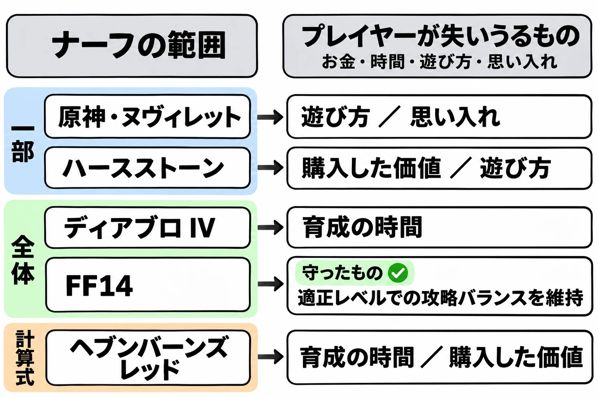

# 強さを下げるとき、プレイヤーは何を失うのか――ナーフで守るもの、返すもの

## はじめに――2024年7月17日と18日

2024年7月17日、『原神』の更新Ver.4.8が入ると、ヌヴィレットはそれまでと同じ速さで振り向けなくなった。彼の重撃は、前方に水の奔流を放ち続ける攻撃だ。放っている間に素早く向きを変えれば、周りの敵をまとめてなぎ払える。更新で修正されたのは、その異常な回転速度だった。翌18日、HoYoverseは修正を取り消して以前の挙動に戻すと告知し、条件を満たすプレイヤーにガチャなどに使う原石1,600個を補填すると発表した。[[1](#ref-1)][[2](#ref-2)]

キャラクターは手元にいる。攻撃も撃てる。それでも、昨日までできた戦い方が今日はできない。運営が返すと決めたのも二つだった。原石と、以前の操作である。強さを下げるとき、プレイヤーは何を失うのか。

***

## 1. ナーフが書き換えるもの

ナーフとは、更新でキャラクターや装備などの性能を下げることだ。変更は一部のキャラクターやカードに限ることもあれば、広くプレイヤー側の性能を下げることもある。ダメージの計算そのものに手を入れれば、同じキャラクターを使っていても、装備や仲間との組み合わせによって影響は違ってくる。

編者は、その変更範囲と、プレイヤーが積み上げてきたものを重ねて考えたい。手に入れるのに使ったお金、育成に費やした時間、試行錯誤で身につけた攻略の知識、好きなキャラクターを使い続けてきた思い入れである。攻撃力の変更が小さくても、いつもの手順で敵を倒しきれなくなれば、影響は大きい。逆に、数字が大幅に下がっても、同じ相手を同じように倒せるなら、手元に残るものは多い。

[大規模なゲームバランスを継続して調整する仕組み](scaling-game-balance-operations-three-layers.md)では、どうすれば運営が調整を続けられるかを扱った。ここからは、強さを下げたあと、プレイヤーと運営のあいだで起きたことを追う。

***

## 2. 遊び方を失わせた修正――ヌヴィレット

ビームを撃ちながらカメラを回す。その動きが十分に速ければ、ヌヴィレットは周囲360度の敵にダメージを与えられた。HoYoverseの説明では、操作感度やマウスのDPI（マウスを動かした距離に対する入力の細かさ）の設定によって、特定の条件でこの高速回転が起きていた。修正の狙いは、回転速度を妥当な範囲に収め、異なる機器でも一貫した操作体験にすることだった。[[1](#ref-1)][[3](#ref-3)]

GamesRadar+は、PCのマウスで最も簡単にできた一方、入力感度を調整すればほとんどの機種で同様の動きが可能だったと伝えている。Destructoidも、特別な機器やソフトを用意する必要はなく、使っている操作方法でカメラをできるだけ速く回せばよかったと説明する。やりやすさには差があったが、入力感度の設定で、マウス以外でも近い操作ができた。[[4](#ref-4)][[5](#ref-5)]

2023年9月の実装から修正まで約10か月。その途中の2024年4月には、ヌヴィレットを再び入手できる復刻ガチャが開かれた。インサイドが報じた反発には、登場から1年近く経ち、復刻も挟んでから修正するのか、という声があった。運営も、実装後にキャラクターへ手を入れることがプレイヤーの信頼を損なうと認め、今後は慎重に判断する姿勢を示した。[[1](#ref-1)][[6](#ref-6)]

機器による操作差を抑える理由はある。それでも、編者が考える「不具合修正」と「ナーフ」の境目は、プレイヤーがその挙動を遊び方として受け入れてきた時間にある。開発側には仕様から外れた動きでも、プレイヤーには練習して身につけ、次の戦いでも使えると思っていた技になっていた。

同じ境目は、2018年6月8日付のPC Gamerが報じた『ハースストーン』のテス・グレイメインにも見える。テスは、その対戦中に使った別クラスのカードを再び発動する。更新後は、その途中でテスが倒されたり能力を封じられたりすると、残りの発動が止まるようになった。運営は一連の変更を不具合修正やゲームプレイの改善と扱い、弱体化時に通常行う作成素材の全額返還を設けなかった。テスを使うプレイヤーから以前の挙動を求める声が上がり、運営は素材を返す案も検討したうえで、テスが盤面を離れるなどしても再発動が続く挙動を復活させた。撤回したのは変更のうちこの部分だ。[[7](#ref-7)]

***

## 3. 時間を失わせたナーフ――ディアブロ IV 1.1.0

武器を拾い、その武器に合う技を選ぶ。敵を倒しながら装備を更新し、ようやく狙った戦い方が形になる。『ディアブロ IV』では、こうした技能や装備の組み合わせをビルドと呼ぶ。ビルドが形になった手応えは、それまで苦戦した相手を倒して初めて分かることもある。

2023年7月18日、シーズン1の開幕に先立つパッチ1.1.0で、多くのビルドの攻撃力と生存力が大きく下がった。7月21日の配信で、Blizzardの開発チームは、プレイヤーの力を落とす更新が楽しい体験をもたらさなかったと認め、同じようなパッチを繰り返さない方針を示した。強い選択肢を下げるときに、ほかに使える選択肢も用意するという考えを説明している。[[8](#ref-8)][[9](#ref-9)]

買い切りのゲームでも、手元の装備で挑めた相手が遠のけば、育成に使った時間の価値は下がる。次に何を育てれば以前の手応えを取り戻せるのか。その道筋まで見えなくなると、プレイヤーは新しいビルドを探す前に、もう一度同じだけ時間をかけるかを考えることになる。

***

## 4. 計算式ごと変えた――ヘブンバーンズレッド

『ヘブンバーンズレッド』でガチャから手に入る「スタイル」には、同じキャラクターでも異なる技や役割がある。誰に味方の攻撃を強めさせ、誰に敵の防御を崩させ、誰の一撃で決めるか。スタイルの価値は、単体の性能に加えて、その一手を任せられることにもある。

2025年7月18日に実施されたVer.5.11.0では、味方を強めるバフや敵を弱めるデバフの分類とダメージへの効き方を見直し、敵味方の能力値の差がダメージに与える影響も大きくした。電撃オンラインは7月17日の公式放送を受けて変更内容を報じた。恩恵を受ける組み合わせがある一方、共通の計算ルールが動けば、ガチャで引いて育てたスタイルも、同じ編成で以前と同じ仕事を果たせるか分からなくなる。更新後には、ダメージ計算や、割り込みでターンを得る「オーバードライブ」の仕様変更などにプレイヤーから意見が寄せられた。[[10](#ref-10)][[11](#ref-11)]

7月25日、運営はオーバードライブの発動方法を見直し、その仕様変更とダメージ計算の変更に合わせて、オーブボスと異時層のボスのDP・HPを引き下げる方針を示した。DPは先に削る防御のゲージ、HPはその先にある体力だ。味方の出す数字が変わっても、敵の側を調整すれば、その編成で再び勝てる余地を作れる。ここで埋め合わせようとしたのは、ダメージの表示以上に、手持ちのスタイルで攻略を続けられることだった。運営はあわせて、ガチャなどに使うクォーツ10,000個やスタイルの育成素材も配布した。[[11](#ref-11)]

***

## 5. 全員を一緒に縮めた――FF14のパッチ6.0

『ファイナルファンタジーXIV』（FF14）の拡張『暁月のフィナーレ』が出る前、開発側が示した例に、HPが4億4,000万に達するボスがいた。成長するたびに大きくなってきた数字は、やがて一目で読み取りにくくなる。計算で扱える上限を超えるオーバーフローや、敵が誰を狙うかを決める「敵視」（ヘイト）の計算が難しくなることも問題になった。[[12](#ref-12)]

2021年12月のパッチ6.0では、プレイヤーの能力値や与えるダメージに加え、敵のHPなども大幅に小さくした。これが「デノミネーション」と呼ばれた調整だ。公式は、適正レベルで挑む場合のバランスは更新前と大きく変わらないと説明している。攻撃の数字とともに削るべきHPも小さくすることで、一撃で敵の体力をどれだけ削れるかという関係を保つ設計だ。レベル制限を外して過去の戦闘に挑むときには、別途、能力を引き上げる「超える力」が用意された。[[13](#ref-13)][[14](#ref-14)]

大型の数字には、育ててきた実感も宿る。先行試遊でタンクを使ったGAME Watchの記者は、以前は20万を超えた自分のHPが、試遊時の条件では約5万になり、寂しさも覚えたと記している。それでも、適正レベルで敵との力関係を保てば、攻略の手応えは持ち越せる。FF14はその意味で「ナーフに見えないナーフ」だった。数字が上限に近づくと何が起きるかは、[ゲームの数値上限を扱った既刊記事](game-numeric-limits-for-planners.md)で掘り下げている。[[15](#ref-15)]

***

## 6. 失った分を返す――ハースストーン

『ハースストーン』では、カードを作成するために「魔素」という素材を使う。作ったカードが弱体化されたとき、対象となるカードはパッチ後の2週間、分解すれば作成時と同量の魔素に戻せる。愛用してきたカードを手元に置くか、別のカードを作ってデッキを組み直すか。期限つきでも、その選択をプレイヤーに渡す仕組みである。[[16](#ref-16)]

2022年5月19日のパッチ23.2.2では、ドレクサー（Drek’Thar）が、条件を満たすとデッキから仲間を2体呼び出すカードから、1体を呼び出すカードになった。同年4月には、通常版と同じ性能で外見の異なるダイヤモンド版が単品で販売されていた。PC Gamerによれば、価格は25米ドルまたはゲーム内の3,000ゴールドだった。Blizzardはパッチ適用時点のダイヤモンド版所持者に、次のログイン時に3,000ゴールドを自動で付与した。ゲーム内販売価格の全額に当たる額で、カード本体は手元に残った。現金で購入した場合も、付与されたのは同じ3,000ゴールドだった。[[16](#ref-16)][[17](#ref-17)]

返す仕組みが先に示されていれば、プレイヤーはカードを作るときから、弱体化された場合に手持ちを組み直せると見通せる。魔素が戻れば別のカードを選び直せる。ダイヤモンド版のケースでは、ゴールドが次の購入に使える。返すものの使い道まで決まっていると、変更後にプレイヤーが取れる行動も具体的になる。

***

## 7. 有償のものを変えるとき

販売時に何を見せたかは、購入後の変更を考える出発点になる。攻撃の数値、商品ページの説明、紹介映像で見せた使い方を並べ、変更前後で何ができるかを確かめる。性能変更の可能性を知らせていても、それとは別に、実際に何が変わり、購入者にどんな選択肢があるのかを伝える必要がある。

販売後の変更をどう扱うかは[デジタルコンテンツの変更リスク](snowbreak-collaboration-risk-digital-content-changes.md)、対象者や返すものの決め方は[ライブサービスの補填基準](live-service-game-incident-compensation-framework.md)、制度全体の見取り図は[ゲームプランナー向けの法令ガイド](game-planner-japanese-law-guide.md)につながる。

突出したキャラクターを下げる前に、出番を失った側を上方修正する道もある。[物語と課金の記事で扱った『崩壊：スターレイル』の既存キャラクター強化](story-driven-f2p-monetization.md)は、すでに迎えた仲間に再び出番を作る例だ。一方、上方修正で全体の火力が上がれば、敵のHPや戦闘時間の前提も動く。[割合ダメージから考えるRPGの戦闘設計](rpg-battle-design-pitfalls-percentage-damage.md)が扱うように、調整後もどの攻略が成り立つかは、敵側と合わせて考える必要がある。

***

## 8. ナーフの前に決めること

まず、変更後もできるようにしておきたいことを決める。ほかのキャラクターに対する相対的な強さなのか、昨日まで勝てたボスへの挑戦なのか、購入時に気に入った操作なのか。適用前に告知するなら、プレイヤーが変更を知ってから適用までにどれだけ時間を取れるかも設計の一部になる。その間に購入を見送ったり、育成の行き先を変えたりできるからだ。

返すものは、失われるものから考える。カードを作るために使ったなら素材、単品購入に使ったなら同じ用途に回せる通貨が候補になる。育成に使った時間は、育成素材の引き継ぎや再育成の短縮で、その一部を取り戻せる。攻略の手順や愛用してきた操作を残したいなら、敵の調整や挙動の復元も選択肢になる。

7月18日の『原神』の告知には、原石1,600個と、ヌヴィレットの回転を元に戻すという二つの対応があった。原石は次に迎える仲間のために使える。水の奔流で周囲をなぎ払う遊びは、ヌヴィレットがもう一度、以前のように振り向けることで戻る。

***

## References

1. [Keiichi Yokoyama「『原神』、「ヌヴィレットの高速回転」を不具合として修正するも批判受け“修正前に巻き戻しへ”。原石1600個配布とあわせて謝罪」][1] — AUTOMATON、2024年7月18日。

[1]: https://automaton-media.com/articles/newsjp/genshin-20240718-302103/

2. [HoYoverse「【キャラクター「告諭の潮騒・ヌヴィレット（水）」の高速回転に伴う不具合修正のロールバックについてのご説明】」][2] — 原神公式サイト、2024年7月18日。

[2]: https://genshin.hoyoverse.com/ja/news/detail/124901

3. [HoYoverse「Rollback: Fix to Abnormal Rotation Speed for Neuvillette's Charged Attack」][3] — X、2024年7月18日。

[3]: https://x.com/GenshinImpact/status/1813625290855530516

4. [Austin Wood「Genshin Impact players get 1,600 Primogems for free thanks to a rare bug fix rollback after update 4.8 made the game's best DPS character feel worse to play」][4] — GamesRadar+、2024年7月18日。

[4]: https://www.gamesradar.com/games/rpg/genshin-impact-players-get-1600-primogems-for-free-thanks-to-a-rare-bug-fix-rollback-after-update-48-made-the-games-best-dps-character-feel-worse-to-play/

5. [Christine Choi「Genshin Impact backpedals on Neuvillette “bug fix” after backlash, offers 10 pulls as apology」][5] — Destructoid、2024年7月17日。

[5]: https://www.destructoid.com/genshin-impact-reverses-neuvillette-bug-fix-apologizes-with-free-primogems/

6. [茶っプリン「『原神』修正された「ヌヴィレット」の高速回転バグ、批判続出でロールバックへ―「登場後のキャラ修正は、どのような意図でもユーザーを傷つけてしまう」」][6] — インサイド、2024年7月18日。

[6]: https://www.inside-games.jp/article/2024/07/18/157509.html

7. [Austin Wood「Blizzard walks back Hearthstone update following fan backlash (Updated)」][7] — PC Gamer、2018年6月8日。

[7]: https://www.pcgamer.com/hearthstones-latest-nerf-has-players-feeling-short-changed/

8. [Blizzard Entertainment「Catch Up on the Season of the Malignant Campfire Chat」][8] — Blizzard News、2023年7月21日。

[8]: https://news.blizzard.com/en-gb/article/23985148/catch-up-on-the-season-of-the-malignant-campfire-chat

9. [Tyler Colp、Tyler Wilde「Blizzard on this week's Diablo 4 nerfs: 'We know it is not fun ... we don't plan on doing a patch like this ever again'」][9] — PC Gamer、2023年7月21日。

[9]: https://www.pcgamer.com/diablo-4-nerfs-patch-1-1-campfire-chat-livestream/

10. [電撃オンライン「『ヘブバン』蒼井えりかが水着＆新レアリティ・SS＜レゾナンス＞で登場、さらにガチャ100連無料！ ダメージ計算調整などバトルのアップデートも〖7/17新情報まとめ〗」][10] — 電撃オンライン、2025年7月17日。

[10]: https://dengekionline.com/article/202507/47551

11. [電撃オンライン「〖ヘブバン〗オーバードライブ仕様変更やSS＜レゾナンス＞などについて今後の対応方針を発表。7月29日の生放送では開発陣が説明」][11] — 電撃オンライン、2025年7月26日。

[11]: https://dengekionline.com/article/202507/48235

12. [ファミ通.com「『FF14』新情報発表会まとめ。『暁月のフィナーレ』＆新ジョブ“賢者”発表、PS5版ベータテストなど、新情報満載」][12] — ファミ通.com、2021年2月6日。参照した節は「計算式のデノミネーション」。

[12]: https://www.famitsu.com/news/202102/06214060.html

13. [スクウェア・エニックス「パッチ6.0における各種デノミネーションと経験値のリセットについて」][13] — The Lodestone、2021年11月。

[13]: https://jp.finalfantasyxiv.com/lodestone/topics/detail/a4c4778fb725c0d1c5ff2cd821fea61cf387403e

14. [スクウェア・エニックス「6.0パッチノート公開！」][14] — The Lodestone、2021年12月（2022年1月5日更新）。

[14]: https://jp.finalfantasyxiv.com/lodestone/topics/detail/29c4dea51ae1e60c53d2c42df29c8b9c8d88aa69/

15. [GAME Watch「〖特集〗「FFXIV: 暁月のフィナーレ」新ID試遊レポート」][15] — GAME Watch、2021年10月。

[15]: https://game.watch.impress.co.jp/docs/feature/1357804.html

16. [Blizzard Entertainment「23.2.2 Patch Notes」][16] — Hearthstone公式サイト、2022年5月19日。

[16]: https://hearthstone.blizzard.com/en-us/news/23797162/23-2-2-patch-notes

17. [Andy Chalk「Blizzard nerfs $25 Hearthstone card」][17] — PC Gamer、2022年5月19日。

[17]: https://www.pcgamer.com/blizzard-nerfs-dollar25-hearthstone-card/

----

この文書は、Perplexity、Claude、ChatGPT の3つのAIの支援を受けて著述されたものです。引用画像を除き、MIT License にて提供されています。
