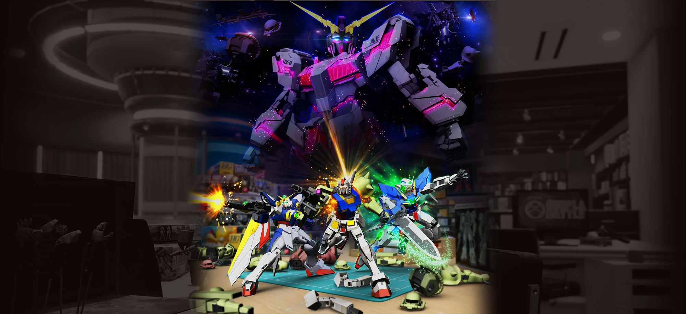
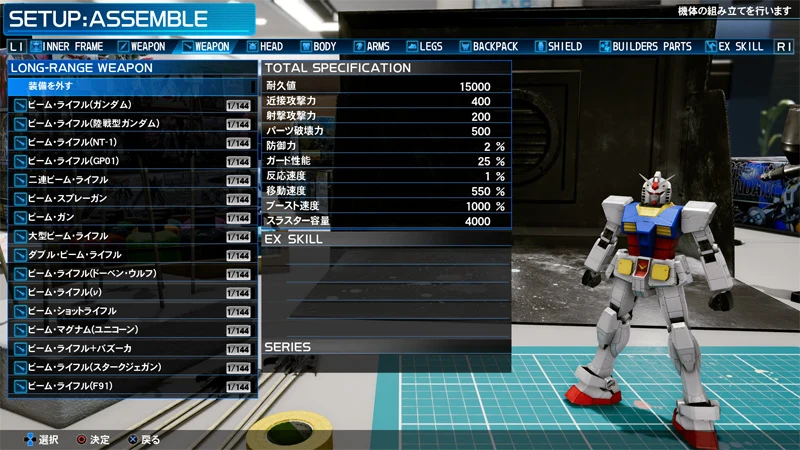
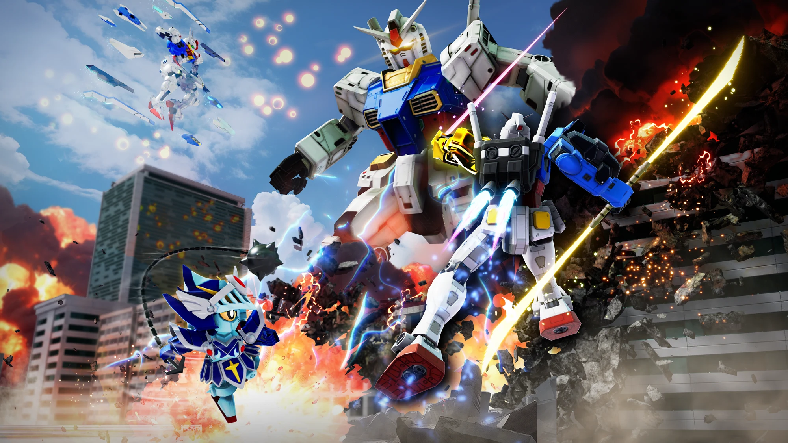
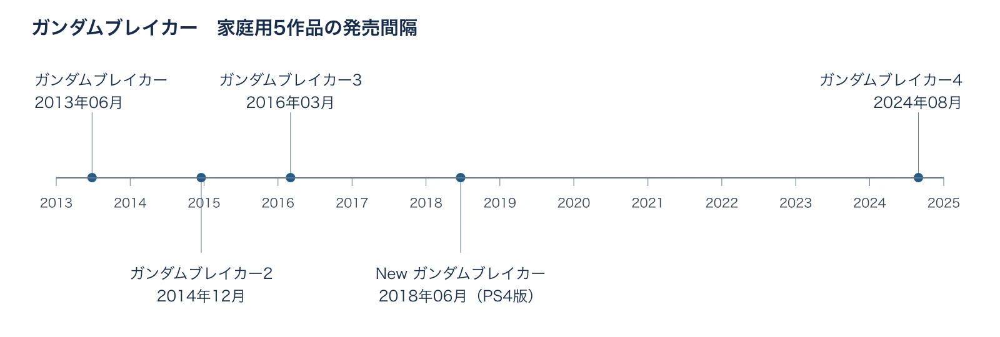

# 『New ガンダムブレイカー』は、なぜ「ユーザーの声に応える刷新」を前作からの後退にしてしまったのか

> 2026年11月27日改版：記事全体を全面的に書き直しました。内容の変更はGitの履歴から追えます。

敵のガンプラの腕を壊し、外れたパーツを拾う。頭も手に入れたら、戦いを終えて組み立て画面へ戻る。ガンダムの頭にザクの胴をつなぎ、拾った腕を付ける。そうして組んだ自分だけの「俺ガンプラ」で、また次の戦いに出る。『ガンダムブレイカー』では、敵を一体倒すたびに、次はどんな機体を作ろうかと考える楽しみがある。[[1](#ref-1)]

「他メディアIPのゲーム化 成功・失敗事例シリーズ」の第6回である。前回の[『ドラゴンボール ファイターズ』は、なぜ既存の表現基盤を大型IPの成功へ変えられたのか――技術転用と競技性から読む成功事例](dragon-ball-fighterz-arc-system-works-ip-adaptation-success-case-study.md)では、アークシステムワークスが自社の格闘ゲームで磨いた表現の基盤を、原作の戦いへ持ち込んだ成功を見た。

今回の『New ガンダムブレイカー』は、創通・サンライズが権利を持つ『ガンダム』のプラモデルを題材に、バンダイナムコエンターテインメントとクラフト＆マイスターが続けてきたシリーズの続編である。ユーザーの声に応えようとした刷新が、なぜ前作からの後退と受け止められ、6年後の続編で何が戻されたのかをたどる。

*画像出典（引用）：バンダイナムコエンターテインメント「[New ガンダムブレイカー 公式サイト](https://gb.ggame.jp/2018/)」トップページ。本作がガンプラを組み替えて戦う作品であることを示す資料として引用。©創通・サンライズ、©創通・サンライズ・MBS、©創通・サンライズ・テレビ東京。WebP変換。*

***

## 拾ったパーツで次の戦いへ（2013〜2016年）

初代『ガンダムブレイカー』は2013年6月27日に登場した。『ガンダムブレイカー2』が2014年12月18日、『ガンダムブレイカー3』が2016年3月3日と、初代から3年足らずで3作がそろった。バンダイナムコエンターテインメントのプロデューサー・薄井宏太郎氏と、クラフト＆マイスターのディレクター・福川大輔氏は、第1作から制作の中心にいた。[[1](#ref-1)] [[2](#ref-2)] [[3](#ref-3)] [[4](#ref-4)]

戦いに出す機体を、敵から拾った部品で自分の手で組めるのが、このシリーズの持ち味だ。腕や脚を入れ替え、色を塗り、戦いに出て動かしてみる。そこで見つけたパーツが、次の組み替えのきっかけになる。[[1](#ref-1)]

『3』では参戦機体が150機を超え、拾ったパーツを素材にして手持ちの部位を強くする「合成」や、組んだ機体を投稿する機能も用意された。気に入った腕を使い続けることも、完成した姿を人に見せることもできる。ファミ通のレビューでは、ステップやブースト、必殺技にあたるEXアクションを使う戦闘のテンポと、性能が異なるパーツを次々に集める楽しさが評価された。[[5](#ref-5)] [[6](#ref-6)]

*画像出典（引用）：バンダイナムコエンターテインメント「[New ガンダムブレイカー｜ガンプラカスタマイズ](https://gb.ggame.jp/2018/system/customize.php)」。部位・武器を選び、作った機体を使う循環を説明する資料として引用。©創通・サンライズ、©創通・サンライズ・MBS、©創通・サンライズ・テレビ東京。WebP変換。*

***

## 「New」が持ち込んだ運動会（2018年）

「機体を増やしてほしい」「カスタマイズの幅を広げてほしい」。福川氏が『3』のユーザーから多く受け取ったのは、そうした声だった。次の作品では、パーツごとにEXスキルという技や能力を結びつけた。組み合わせを変えれば、見た目や性能に加え、戦いに持ち込める技も変わる。増やしたパーツの一つひとつに、戦い方を広げる役割を持たせる発想だった。[[4](#ref-4)]

さらに、敵から外したパーツはその場で自分の機体に取り付けられるようにした。強敵の部位を外せば相手を弱らせながら自分を強くできる。戦闘が終わってから組み替えていた従来作の遊びを、その場で形勢を変える手段にしたのである。組んだ機体で戦い続けたい人に向けて、部位を外れにくくする補強や、覚醒すると出撃時の姿に戻る仕組みも用意した。[[4](#ref-4)] [[7](#ref-7)]

その舞台が、最大6人の3対3だった。コンテナを壊す、第三勢力の敵を倒すといったお題をこなし、制限時間内に多くの点を取ったチームが勝つ。薄井氏の言葉では「運動会のような」対戦である。誰がお題を追い、誰が敵を止めるか。拾ったパーツで何ができるかをその場で考えることが、役割分担にもつながる企画だった。[[4](#ref-4)] [[7](#ref-7)]

タイトルの「New」には、この遊び方の変更と、欧米を含む世界へ届けるという二つの意味があった。シリーズ初のグローバル発売に向け、初めて遊ぶ人にシリーズを紹介する一戦が、従来のファンにとっても新しいルールを覚える一戦になった。日本のPS4版は2018年6月21日発売。Steam版は5月時点で6月22日発売予定と報じられたが、6月12日に、最高品質の体験を届けるためにさらに作業が必要だとして夏へ延期され、9月25日に配信された。[[4](#ref-4)] [[8](#ref-8)] [[9](#ref-9)] [[10](#ref-10)] [[11](#ref-11)]

***

## 組んだ機体で出撃した先にあったもの

RPG Siteのレビューでは、ほぼすべてのミッションで3対3の得点競争が待っていた。コンテナを壊したり敵を撃破したりと、試合中のお題には幅がある。その一方で、同サイトは前作譲りの細かなカスタマイズを評価しつつ、競争に合わせたミッションの枠が自由な創作を狭めたと評した。友人と組んだ機体を持ち寄ってストーリーを進める協力プレイもなく、Shacknewsも戦闘の繰り返しを短所に挙げた。[[8](#ref-8)] [[12](#ref-12)]

物語の舞台は、ガンプラバトルを教える学園である。誰のルートに進むかで物語は枝分かれするものの、RPG Siteによれば、たどり着く戦闘ではおおむね同じステージを繰り返す。次の話へ進んでも、組んだ機体を試す場面は似通っていた。[[4](#ref-4)] [[8](#ref-8)]

敵の一撃で自分の腕が外れれば、拾った別の腕で戦いをつなぐことになる。拾う楽しさが、その場で失った部位を埋める仕事にもなった。敵の部位を狙って奪うには、まず狙った相手を画面に捉え、思った瞬間に攻撃を出せることが要る。各媒体のレビュー環境では、RPG Siteが通常のPS4で入力の遅れやカメラとロックオンの問題、低いフレームレートや停止を報告し、Push SquareもPS4 Proで操作への反応の悪さやフレームレートの変動、数秒の停止を記録した。[[8](#ref-8)] [[13](#ref-13)]

MetacriticのPS4版は批評家22件で43点、ユーザー57件で3.2点だった（2026年11月27日確認）。[[14](#ref-14)]

***

## 発売後、壊して拾う手順に手が入る

PS4版発売から6日後の6月27日、公式はボタン入力への反応や動作の安定性、カメラとロックオン、第三勢力の攻撃による部位の外れ、パーツの並べ替えなどの改善予定を公表した。7月の更新では入力を受け付ける処理やロックオンに手が入り、第三勢力の攻撃では自機のパーツが外れなくなった。マルチプレイで回収したパーツを仲間と共有する変更も加わった。9月の更新では、機体を組む画面での並べ替えや、動作の安定性にも手が入った。[[15](#ref-15)]

狙った敵に目を向け、ボタンを押して部位を壊し、拾ったパーツを持ち帰って次の機体に使う。その順に更新内容を読むと、修正の対象が遊びの真ん中に集まっていたことが分かる。第三勢力から攻撃を受けても部位が残る変更は、組んできた機体をそのまま動かせる場面を増やすものでもあった。

***

## 『4』で、もう一度自分の機体を出撃させる

次の家庭用タイトルの開発が始まったのは2019年ごろだ。2024年2月にファミ通が掲載したインタビューで、プロデューサーの田中聖憲氏は、『3』から『New』へと形を変えてきたあと、ナンバリングの続編を望む声を多く受け、もう一度挑戦することになったと振り返った。ディレクターは引き続き福川大輔氏。福川氏は、過去作では組み替えの最適解が出やすかったと振り返り、思い描いた俺ガンプラで自由に遊べることを意識したと語った。[[16](#ref-16)]

田中氏はIGNのインタビューでも、『New』に寄せられた多くの意見を『4』に生かし、PvE、つまりゲーム側が動かす敵との戦いに再び力を注ぐ方針を語った。この発言を紹介したAUTOMATONは、『New』への批判として、ボス戦のようなミッションが姿を消したこと、戦闘中にパーツを集める必要があったこと、出撃中に機体の部位が変わることで組み立ての楽しさが薄れたことを挙げている。[[17](#ref-17)]

発売直前の電撃オンラインのインタビューで、田中氏は『4』という数字を、初代から『3』までの遊び方と仕組みを受け継ぎ、そこに新要素を加えるというメッセージにしたと説明した。力を入れたのは、作った機体を「魅せる」遊びだ。ジオラマモードでは相手の機体や爆発のエフェクトなどを用意し、いろいろな表現でガンプラを見せられるようにした。『New』では拾った部位が目の前の戦況を変える手段になり、『4』では組み上げた姿を見せる場所が増えた。同じパーツの組み替えでも、開発が広げようとした楽しみの違いがここに表れている。[[18](#ref-18)]

『ガンダムブレイカー4』は2024年8月29日に発売された。オフラインは1人、オンラインは1〜3人で、仲間と協力して敵と戦える。パーツの元になる機体は250機以上あり、サイズの違うボスに挑んでパーツを手に入れ、組み直した機体でまた出撃できる。家庭用としては『New』から約6年、ナンバリングとしては『3』から約8年ぶりだった。[[16](#ref-16)] [[19](#ref-19)] [[20](#ref-20)]

*画像出典（引用）：バンダイナムコエンターテインメント「[ガンダムブレイカー4 公式サイト](https://gb.ggame.jp/2024/)」トップページ。仕切り直し後のシリーズの姿を示す資料として引用。©創通・サンライズ、©創通・サンライズ・MBS。WebP変換。*

出典：各作品の発売情報。[[1](#ref-1)] [[2](#ref-2)] [[3](#ref-3)] [[9](#ref-9)] [[20](#ref-20)]

***

## 作った機体で、何をしたかったのか

「機体を増やしてほしい」という声を受け取ったら、増えた機体を手に入れたあと、プレイヤーが何をしたいのかまで聞いてみたい。好きな作品の腕を探し、今の機体に取り付け、次の戦いでも使いたい人にとっては、拾った腕の種類が増えることと、その腕を付けたまま戦えることがつながっている。そのつながりが見えれば、戦闘中の換装を試すときにも、拾った部位で形勢を変えられる面白さと、出撃前に選んだ部位を使いこなす面白さを、実際の一戦の中で確かめられる。

新しい市場へ届ける一作で遊び方も変えるなら、最初の一戦で何を覚えて帰るかにも目を向けたい。お題をこなして得点することを覚えたあと、プレイヤーは拾った部位を持ち帰り、次はどう組もうかと思えるだろうか。その問いは、初めて触る人にも、前作から遊んできた人にも通じる。『4』で作り手がもう一度前に出したのは、自分でつないだ頭と胴と腕を、次の戦いで動かす時間だった。

シリーズのまとめは[IPゲーム化は「知名度の借用」ではない――成功・失敗6事例から読む期待値の循環](media-ip-game-adaptation-case-study-series-conclusion.md)へ続く。

***

## References

1. [GUNDAM.INFO「ガンダムブレイカー [PS3]」][1] — GUNDAM.INFO、2013年6月27日発売の製品情報。

[1]: https://www.gundam.info/product/game/product_game_20130627_1437p.html

2. [バンダイナムコゲームス「ガンダムブレイカー2｜バンダイナムコゲームス公式サイト」][2] — 公式サイト、2014年12月18日発売。

[2]: https://gb.ggame.jp/2014/

3. [バンダイナムコエンターテインメント「ガンダムブレイカー3｜バンダイナムコエンターテインメント」][3] — 公式サイト、2016年3月3日発売。

[3]: https://gb.ggame.jp/2016/ms/

4. [ファミ通.com「『New ガンダムブレイカー』タイトルの“New”に込めた意味とは？ プロデューサー＆ディレクターインタビュー」][4] — ファミ通.com、2018年2月27日。

[4]: https://www.famitsu.com/news/201802/27152699.html

5. [GUNDAM.INFO「PS4/PS Vita『ガンダムブレイカー3』新機体続々参戦！カスタマイズがさらに進化！」][5] — GUNDAM.INFO、2016年2月25日。

[5]: https://www.gundam.info/news/games/news_games_20160225_15004p.html

6. [ファミ通.com「ガンダムブレイカー3（PS Vita）のレビュー・評価・感想」][6] — ファミ通.com、掲載日表記なし。

[6]: https://www.famitsu.com/game/title/33204/reviews

7. [バンダイナムコエンターテインメント「New ガンダムブレイカー｜ABOUT」][7] — 公式サイト、掲載日表記なし。

[7]: https://gb.ggame.jp/2018/sp/about/

8. [Josh Torres「New Gundam Breaker Review」][8] — RPG Site、2018年6月25日。

[8]: https://www.rpgsite.net/review/7394-new-gundam-breaker-review

9. [長岡 頼（クラフル）「『New ガンダムブレイカー』、『機動戦士Zガンダム』の4人が登場する第3弾PVを公開」][9] — GAME Watch、2018年5月29日。Steam版の発売日は当初予定。

[9]: https://game.watch.impress.co.jp/docs/news/1124416.html

10. [Bandai Namco Entertainment Europe「Steam version of NEW GUNDAM BREAKER to be released in summer 2018」][10] — 公式サイト、2018年6月12日。

[10]: https://en.bandainamcoent.eu/gundam/news/steam-version-of-new-gundam-breaker-be-released-summer-2018

11. [Bandai Namco Entertainment Europe「NEW GUNDAM BREAKER available on Steam from September 25th 2018」][11] — 公式サイト、2018年9月17日。

[11]: https://en.bandainamcoent.eu/gundam/news/new-gundam-breaker-available-steam-september-25th-2018

12. [Blake Morse「New Gundam Breaker Review: Falling to Pieces」][12] — Shacknews、2018年7月4日。

[12]: https://www.shacknews.com/article/105954/new-gundam-breaker-review-falling-to-pieces

13. [Robert Ramsey「New Gundam Breaker Review (PS4)」][13] — Push Square、2018年6月25日。

[13]: https://www.pushsquare.com/reviews/ps4/new_gundam_breaker

14. [Metacritic「New Gundam Breaker Reviews」][14] — Metacritic、2026年11月27日確認。PS4版の批評家・ユーザー評価。

[14]: https://www.metacritic.com/game/new-gundam-breaker/

15. [バンダイナムコエンターテインメント「PlayStation®4『New ガンダムブレイカー』今後の追加・向上予定内容」][15] — 公式サイト、2018年6月27日。同ページの7月・9月のPS4版アップデート告知も参照。

[15]: https://gb.ggame.jp/2018/info/info_180619.php

16. [ミノル「【ガンダムブレイカー4】俺“ガンプラ”を創造し、破壊するあの快感が帰ってくる！　本作のテーマは3つの“シンカ”」][16] — ファミ通.com、2024年2月23日更新。

[16]: https://www.famitsu.com/news/202402/23335002.html

17. [Hideaki Fujiwara「『ガンダムブレイカー4』開発者、“前作の反省”を活かしたとインタビューで明かす。PvEに専念し、『ガンダムブレイカー』らしさを追求」][17] — AUTOMATON、2024年5月15日。IGNのインタビューを紹介した記事。

[17]: https://automaton-media.com/articles/newsjp/20240515-293450/

18. [電撃オンライン「『ガンダムブレイカー4』発売直前インタビュー。“俺ガンプラ”を魅せる楽しさに注力し、戦い方も俺スタイルにビルドできるナンバリング最新作」][18] — 電撃オンライン、2024年8月26日公開。

[18]: https://dengekionline.com/article/202408/15201

19. [緑里孝行（クラフル）「シリーズ最新作、創壊共闘アクション『ガンダムブレイカー4』本日発売！」][19] — GAME Watch、2024年8月29日。

[19]: https://game.watch.impress.co.jp/docs/news/1619004.html

20. [バンダイナムコエンターテインメント「ガンダムブレイカー4｜バンダイナムコエンターテインメント公式サイト」][20] — 公式サイト、2024年8月29日発売。

[20]: https://gb.ggame.jp/2024/

----

この文書は、Perplexity、Claude、ChatGPT の3つのAIの支援を受けて著述されたものです。引用画像を除き、MIT License にて提供されています。
