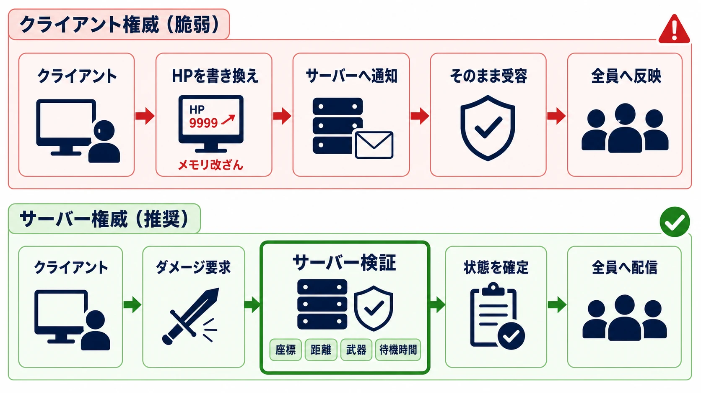
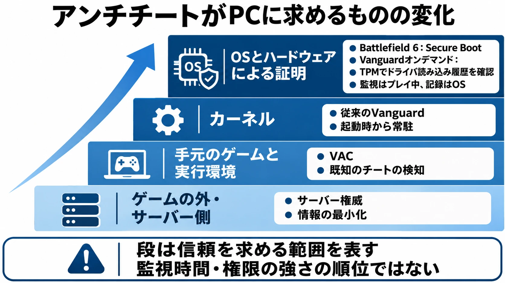

# アンチチートは、どこまで踏み込むのか――ゲームの外から機械の奥へ、攻防の30年とプランナーの判断

> 2026年11月25日改版：記事全体を全面的に書き直しました。内容の変更はGitの履歴から追えます。

> 本記事では、チート対策を検討するために、チートの手法や技術の概要を紹介します。チート行為を推奨・助長するものではありません。チート行為はゲームの利用規約に違反することがあり、手法や利用状況によっては法令に抵触する可能性もあります。

## はじめに――CtrlキーとCapsLockキー

2020年、『VALORANT』のサービスが始まったころ、編者はCtrlキーとCapsLockキーを入れ替えるために、MicrosoftのSysinternalsが公開していた「Ctrl2Cap」を使っていた。Windowsの中核であるカーネルの権限で動き、キー入力の扱いを変えるドライバだ。そのCtrl2CapがRiot Vanguardに検知され、編者は『VALORANT』を遊べなかった。[[1](#ref-1)]

5年後、『Battlefield 6』をPCで遊ぶにはSecure Bootが必須になり、『Call of Duty: Black Ops 7』も発売時にSecure BootとTPM 2.0を求めた。Secure Bootは、署名で信頼を確認できる起動用ソフトウェアを読み込む仕組みだ。出荷時から有効なPCなら、そのまま遊べる。無効なPCでは、ゲームを遊ぶためにいったんPCを再起動し、BIOS設定とも呼ばれるUEFIの設定画面を開いて、有効にすることになる。TPM 2.0は、暗号鍵や起動時の測定値を保護し、PCがどのような状態で起動したかを確かめるのにも使われる。[[2](#ref-2)][[3](#ref-3)]

対戦の公平さを守る仕組みが、ゲームを起動する前の設定にまで関わるようになった。チートを止めるために、アンチチートはプレイヤーの機械のどこまで入るのか。その答えは、チートがどこで試合を変えるかによって違ってくる。

***

## 1. チートは何をするのか

相手が壁の向こうにいるのに、角から出るたびに先回りされる。こんなとき、対策を考える出発点は「相手のPCが、なぜこちらの位置を知っていたか」だ。ゲームが受け取った敵の位置を読み出す透視と、ゲームが描いた画面を見て自動で照準を合わせるエイム補助では、同じ「撃つのが早すぎる」場面でも守る場所が違う。[[4](#ref-4)]

メモリの書き換えでは、ゲームの実行中にPCが保持する弾数や移動速度などの値が変えられる。クライアント、つまり手元のゲームが申告した結果をそのまま採用する設計なら、書き換えが対戦にも影響する。誰が弾数や速度を確定するかを見直す余地がある。ボットによる自動プレイや、別の人にアカウントを預ける代行では、ゲームのファイルが正常でも、対戦相手や報酬の仕組みが影響を受ける。見るべき場所は入力や試合の記録、アカウントの利用状況へ移る。

Cronus Zenなどの外付け入力機器で操作を自動化するケースでは、PCにはコントローラーからの入力に見えることがある。DMAは周辺機器などがCPUを介さずにメモリへアクセスする仕組みで、悪用されると、通常のアプリを調べるだけでは見つけにくい。AIで画面を読み取るタイプも、別の機器で処理されれば、ゲームのPCで動くプログラムを調べても手掛かりは乏しい。入力を観察する、機器が触れられるメモリの範囲を制限する、渡す情報を減らす。何が見えるかによって、選べる対策が変わる。[[5](#ref-5)][[6](#ref-6)]

***

## 2. 外から見張る時代

1997年7月の開発者向け雑誌『Game Developer』には、すでに『Quake』で対戦相手を自動で倒すボットが登場したとある。『Meridian 59』の開発に携わった著者たちは、不正を見つけるためにプレイヤーの行動を記録し、ゲーム内の通貨や希少品の数を追うよう勧めていた。試合や世界に何が起きたかを記録する守り方と並んで、手元のPCで何が起きたかを調べる道も育つ。[[7](#ref-7)]

2000年9月、Even Balanceはオンライン対戦のチートに対抗するPunkBusterを出した。既知のチートに固有の特徴、つまりシグネチャを探す方式では、運営が一度つかんだ手掛かりを、同じチートを使う別のプレイヤーにも適用できる。特徴を更新して配布することで、ゲームを作り直さずに検知を積み重ねられる。[[8](#ref-8)]

2002年に公開され、『Counter-Strike』にも導入されたValve Anti-Cheat（VAC）も、既知のチートの特徴を手掛かりにする。Valveは現在の開発者向け資料で、検知をSteamが担い、ゲーム側は利用制限の状態を照会すると説明している。[[9](#ref-9)][[10](#ref-10)][[11](#ref-11)] 2007年の研究には、VACが検知と処分の間に時間を置く遅延BANを採っていたことが記録されている。処分を遅らせると、使った側に「何が、いつ見つかったか」を悟らせにくくなる。検知されていないように見えても、その場で無事だったことは安全の証拠にならない。一方で、処分までの間に対戦相手が被害を受けうる。[[12](#ref-12)]

2004年に『Battlefield』シリーズの第三者製ツールとして始まったBattlEyeは、ゲームに組み込まれるアンチチートへ育った。現在のBattlEyeはWindowsでカーネルドライバを使う。Easy Anti-Cheatも複数のゲームに組み込む形で広がり、2018年にEpic Games傘下に入り、2021年にはEpic Online Servicesを通じて開発者向けに無償提供が始まった。専用の検知を一から作らずに導入できる一方、ゲームを出す側には、対応機種や互換性、起動できないときの窓口を決める仕事が残る。[[13](#ref-13)][[14](#ref-14)]

***

## 3. 情報を渡さないという守り方

壁の向こうの敵を、そもそも手元のPCが知らなければどうなるか。『VALORANT』の「Fog of War」は、敵の位置を知らせる必要があるかをサーバーで判断し、必要になるまでその情報をクライアントに送らない。敵が角から出てから初めて位置を送ると、通信の遅れで敵が突然現れたように見える。そのため、いつ見え始めるかを見越しながら、情報を早く渡しすぎないようにする。透視を抑える工夫が、角を曲がったときの見え方にも関わっている。[[4](#ref-4)]

これと組み合わせたいのが、最終判定をサーバーが持つ **サーバー権威** だ。移動なら、プレイヤーの入力を受けて、現在位置からその距離を進めるかをサーバーが確かめる。手元の画面は入力にすぐ反応させ、確定した結果が届いたら必要に応じて補正する。何を確定するかと、何を手元へ知らせるかは別の決定だ。前者で不正な結果を退け、後者で本来見えない情報を守る。どちらもプレイヤーのPCに新たな監視権限を求めずに始められる。[[15](#ref-15)] 手元のセーブも書き換えられることを前提に、どの値をサーバーで確定するかは、「[セーブは何を守っているのか――ふっかつのじゅもんからクラウドまで、記録の設計と落とし穴](save-system-design-history-and-pitfalls.md)」で扱っている。

***

## 4. 機械の奥へ

### 起動のときから見ている

Windowsでは、多くのアプリが動くユーザーモードと、OSの中核や一部のドライバが動くカーネルモードとで、触れられる範囲が違う。チートにカーネルの権限を取られると、通常のアプリと同じ権限で動く見張りから、チートの痕跡が見えなくなることがある。そこで見張りの側もカーネルに入り、ゲームの外で何が読み込まれたかを確かめる。[[15](#ref-15)]

2020年のRiot Vanguardは、カーネルモードのドライバをPCの起動とともに読み込む方式を採った。ゲームを開くより前にチートが動き始める可能性があり、先に見張りを置くためだ。Riotは、ドライバが持つ権限と実際に集めるデータは別の問題として説明している。導入する側にとっては、何にアクセスできるかに加え、実際に何を調べ、何を送信し、誰が扱うかまでが説明の範囲になる。[[16](#ref-16)][[17](#ref-17)]

2020年5月、クローズドベータ中のVanguardがチートに悪用されうるドライバを止めたことで、冷却や温度監視、マウスやキーボードの制御ソフトに影響が出た。[[18](#ref-18)]MSI Afterburnerも影響が報じられた一つだ。Riotは修正を出し、公式Xで、従来ブロックしていたドライバの大半は動くようになり、特に危険性が高いものが動いている場合はゲームが起動しなくなると告知した。編者にとってのCtrl2Capも、ゲームを開く前から使っていた、普段の入力環境の一部だった。[[19](#ref-19)]

### カーネルで起きた故障はどこに届くか

プライバシーに加え、カーネルで動くソフトには安定性とセキュリティの問題がある。高い権限を持つ部品に欠陥があれば、影響はゲームの終了では済まず、OSの停止にまで及びうる。その権限を持つ部品自体が、守るべき対象にもなる。

2024年7月19日、CrowdStrikeのWindows向けセキュリティ製品Falconに配信された設定データの更新をきっかけに、多くのPCがクラッシュし、一部は再起動を繰り返して通常どおり起動できなくなった。更新されたのはカーネルドライバ本体ではなく、カーネルで動くセンサーが読み込むデータだった。アンチチートとは用途が異なる製品だが、高い権限で動く部品に更新を届けるとき、影響範囲と復旧方法まで設計する必要があることを示した。[[20](#ref-20)]

***

## コラム：Windowsが起動する前にも境界がある

UEFIは、PCの電源を入れてからOSに制御を渡すまでの処理を担うファームウェア、つまり機器に組み込まれたソフトウェアだ。SMM（System Management Mode）は、対応するCPUが電源管理などの処理に使う、OSから独立した動作モードである。こうした領域が悪用されると、OSのカーネルに監視を置いても、その下で起きたことを十分に確かめられない場合がある。[[21](#ref-21)]

CERT/CCは、一部のマザーボードで、周辺機器がアクセスできるメモリを制限するIOMMUの保護が起動初期に正しく働かない問題を報告している。Riotは、影響を受けるPCにVanguardからファームウェアの更新を求める方針を示した。ゲーム会社が監視の権限を上げるだけでは届かない場所があり、PCメーカーが配布するファームウェアの更新が対戦環境の前提になることもある。[[22](#ref-22)][[23](#ref-23)]

***

## 5. OSと一緒に守る

### PCの起動状態が参加条件になる

『Battlefield 6』では、EA Javelin Anticheatによる対策に加えてSecure Bootを求める。『Black Ops 7』のRICOCHETは、Secure Bootに加えてTPM 2.0を求め、PCの起動状態をサーバー側で検証する仕組みを発売時から取り入れた。Secure Bootは起動時に読み込むものを制限し、TPMを使った証明は起動状態を確かめる材料になる。RICOCHETのカーネルドライバはゲーム実行中に動き、起動時の証明とは別の役割を持つ。[[2](#ref-2)][[3](#ref-3)][[24](#ref-24)]

参加条件にすると、条件を満たせない人が現れる。Activisionは2026年6月、一部のAMD環境ではTPMの実装によって証明処理にエラーが出ることや、条件を満たせないプレイヤーを別のマッチング集団に分ける運用を説明した。PCの設定やファームウェアの都合で証明できない場合にも、誰と対戦できるかが変わる。設定の確認方法や、メーカーの修正を待つ間に遊べる範囲も、参加条件と一緒に決めることになる。[[25](#ref-25)]

### 起動時から常駐する代わりに、起動後の記録を読む

CrowdStrikeの障害を受け、Microsoftは2024年11月19日のIgniteでWindows Resiliency Initiativeを発表した。2025年6月26日の進捗報告では、ウイルス対策やEDR（端末上の不審な活動を検知し、対応する製品）の機能をユーザーモードで動かせるようにするWindowsの基盤を説明した。これはセキュリティ製品の耐障害性を高める取り組みだ。同じくWindowsの機能を使って常駐の負担を見直した例が、Vanguardにもある。[[26](#ref-26)][[27](#ref-27)]

2026年6月24日、RiotはVanguardのオンデマンドモードを発表した。対応PCで任意に有効にすると、VanguardはWindowsの起動時から常駐する代わりに、ゲームと一緒に起動し、プレイ中にだけ動く。設定を変えなければ従来どおりだ。プレイ中は引き続きカーネルの権限を使う。[[17](#ref-17)]

RiotがMicrosoftのXbox OS Security Teamと組んで実現したこの方式を支えるのが、Windowsの「Runtime Driver Attestation Report」だ。Windowsは、起動後に読み込まれたドライバの測定値をTPMに積み重ねる。測定値とは、ドライバの内容から計算した識別用の値である。Vanguardはゲームが始まるときに、その測定に裏付けられたドライバ名と測定値の記録を調べる。自分が動いていなかった時間に何が読み込まれたかを、後から確かめられる。[[17](#ref-17)]

使うには、Windows 11 25H2以降に加え、UEFIでの起動、Secure Boot、TPM 2.0、IOMMUが必要となる。VBS（仮想化を使って重要な処理を隔離する機能）と、その隔離を利用してカーネルで動くコードの整合性を確かめるHVCIも有効にする。発表当時、条件をすでに満たしていたのは、Riotによればプレイヤーの約35％だった。常駐する時間を減らすには、OSが残す記録を信頼できるだけの環境が要る。踏み込み方を比べるには、どの権限で動くか、いつ動くか、どんなPC設定を求めるかの三つを見る必要がある。[[17](#ref-17)][[28](#ref-28)]

***

## 6. 振る舞いを見る

撃たれた直前のリプレイを見返すと、一発だけなら、とっさに当てたのか機械が合わせたのかは分かりにくい。試合を重ねて見ると、照準の動きや、相手が見えてから反応するまでの時間に特徴が現れる場合がある。行動分析は、そうした記録から統計的な外れ値を探す。機械学習では、複数の特徴を組み合わせ、どの記録を詳しく調べるべきかの判断にも使える。RICOCHETは、対戦記録から切り出した場面を機械学習で評価し、疑わしいプレイを調べる取り組みを公表している。[[15](#ref-15)][[29](#ref-29)]

集団の平均から離れた動きには、上級者の技術や入力機器の違いも含まれる。観戦映像の見え方は通信や記録の精度にも左右される。偽陽性とは、正規のプレイを不正と判定してしまうことだ。疑いを示すスコアを即座に永久BANへ結びつければ、選別の誤差がそのまま、プレイヤーの順位やフレンドと遊ぶ機会の喪失になる。調査に回す基準と処分を決める基準を分け、必要な記録の量や保存期間にも上限を持たせたい。

チート側が検知基準に合わせ、あえて人間に近い振る舞いをすることも考えられる。検知側が覚えた特徴に合わせて相手が行動を変える逆最適化だ。ある時点の精度を出して終えると、アップデート後や入力環境の異なる集団で、同じ基準がどのように働くかを見落とす。[[15](#ref-15)]

***

## 7. どう罰するか

試合中に高い確度で不正を検知できれば、その場で参加を止め、被害の拡大を抑えられる。遅延BANには検知の手掛かりを相手に与えにくい利点があり、まとめて処分するまでの試合をどう守るかが課題になる。アカウントを作り直して戻ってくる相手には、端末を単位にした利用制限という選択もある。ただし、共有PCや中古端末では別の人を巻き込みうる。どれだけ強い証拠で、どの単位を、どのくらいの期間止めるのかは、検知の仕組みとは別に決める必要がある。[[9](#ref-9)][[30](#ref-30)]

処分の通知が届いても、巻き込まれた側の順位はそのままでは戻らない。『VALORANT』は不正行為で処分されたプレイヤーと対戦して失ったランクレーティング（RR）を返す仕組みを導入した。レーティングが次の対戦相手にも関わる以上、巻き戻しは被害の回復であると同時に、以後の試合を整える措置でもある。順位と対戦相手の関係は、[マッチングとレーティングの記事](competitive-game-matchmaking-rating-explained.md)で扱っている。[[31](#ref-31)]

通報は、運営が試合のどこを見返すかを決める手掛かりになる。件数だけを処分の根拠にすると、対戦相手への嫌がらせでも処分を誘発できる。通報に試合や場面の記録をひも付け、運営が検知ログやリプレイと照合できるようにする。通報する側とされた側の双方を守る設計は、[迷惑行為のモデレーションの記事](online-game-harassment-moderation-design.md)につながる。[[29](#ref-29)]

***

## 8. いたちごっこの中で、どこまで入るかを決める

あるチートが使えなくなると、攻める側は別の場所を探す。ゲーム内の数値が通らなければ入力に寄り、PCの中で見つかるならPCの外に処理を移す。運営側が同じように監視範囲を広げ続ければ、次の対策を導入するたびに、正規のプレイヤーにも新しい条件が加わる。試合を守る費用の一部は、PCを設定し直したり、互換性を調べたりする時間として、プレイヤーが払う。

プランナーが最初に決められるのは、何をサーバーの判定にし、どの情報を端末へ渡すかだ。仕様書に「プレイヤーのPCからこの結果が送られてきたら承認する」と書いたなら、ありえない結果が送られたときの扱いも書く。[仕様書に悪用ケース欄を置く方法](abuse-case-column-in-game-specs.md)を使えば、発売前の段階でその判断をチームに共有できる。

そのうえで、ランク戦、大会、友人同士の部屋で守るべきものを比べる。サーバーの判定と情報の最小化を土台に、試合の記録、端末側の検知、処分と被害回復を重ねる。端末側に踏み込むなら、権限、稼働時間、収集する情報、対応PCを仕様に書く。起動拒否と不正行為によるBANはプレイヤーに別々に伝え、誤判定や互換性の問題を何で見分け、どこで誰が再確認し、いつ復旧できるかまで決めておく。

処分されたアカウントを作り直せばすぐに報酬や利益を得られるなら、検知だけを強めても再参入は続く。報酬を換金しやすい設計か、新規アカウントで競技モードに参加するまでどのくらいかかるかも抑止に関わる。参加までの条件を増やせば、初めて遊ぶ人にも同じ負担がかかる。[RMTを禁止してきた経緯の記事](rmt-history-japan-why-games-ban-real-money-trading.md)は、ゲームの外に利益が生まれる場合を扱っている。

チートをゼロにすることを完成条件にすると、監視を広げる判断に歯止めがかかりにくい。不正の影響を受けた試合の割合、検知から対処までの時間、誤処分の取り消しにかかった時間、PCの要件を理由に参加できなかった人数を一緒に見る。どの対戦を守るためなら、どの負担に見合うかを、その結果から判断し直せる。

編者が変えたかったのは、CtrlとCapsLockの位置だけだった。アンチチートが見ていたのは、その人がキーをどう使いたかったかよりも、どんな権限のドライバが読み込まれたかだ。普段の入力を整えるドライバにも、対戦を壊すために使われるドライバにも、カーネルの権限で動くものがある。その境界でゲームを止めるとき、守ろうとする試合と、その試合に入れなくなる人のことを、同じ仕様書に書いておきたい。

***

## References

1. [Mark Russinovich「Ctrl2Cap v3.0」][1] — Microsoft Learn（Sysinternals）、2025年2月13日。キーの割り当てを変える用途を参照。2020年の動作環境と検知は編者の体験による。

[1]: https://learn.microsoft.com/en-us/sysinternals/downloads/ctrl2cap

2. [Electronic Arts「SECURE BOOT INFORMATION」][2] — Battlefield、2025年8月4日。

[2]: https://www.ea.com/games/battlefield/battlefield-6/news/secure-boot-information

3. [Team RICOCHET「Ready for Launch: How RICOCHET Anti-Cheat Is Preparing for Day One」][3] — Call of Duty、2025年11月10日。発売時のPC要件とリモート証明を参照。

[3]: https://www.callofduty.com/blog/2025/11/call-of-duty-black-ops-7-ricochet-anticheat-day-one/

4. [Paul Chamberlain「Demolishing Wallhacks with VALORANT's Fog of War」][4] — Riot Games、2020年4月14日。

[4]: https://www.riotgames.com/en/news/demolishing-wallhacks-valorants-fog-war

5. [Activision「RICOCHET Anti-Cheat™ Update – Season 02」][5] — Call of Duty、2026年2月。外付け入力機器の検知を参照。

[5]: https://www.callofduty.com/blog/2026/02/call-of-duty-black-ops-7-ricochet-anti-cheat-season-02

6. [Terufumi Hata、Kenta Ishiguro、Pierre-Louis Aublin、Kenji Kono「Gangi: Preventing Memory Tampering Cheats in Online Games」][6] — Journal of Information Processing、2025年。ゲームのメモリを保護する際の脅威モデルを参照。

[6]: https://www.jstage.jst.go.jp/article/ipsjjip/33/0/33_901/_article/-char/en

7. [Andrew Kirmse、Christopher Kirmse「Security in Online Games」][7] — Game Developer、1997年7月号。

[7]: https://media.gdcvault.com/GD_Mag_Archives/GDM_July_1997.pdf#page=12

8. [Even Balance「PunkBuster Online Countermeasures」][8] — Even Balance、公開日表記なし。Historyおよび検知方式の説明を参照。

[8]: https://www.evenbalance.com/punkbuster.php

9. [Valve「I've been VAC banned」][9] — Steam Support、公開日表記なし。VACの検知対象や、検知したチートを開示しない理由を参照。

[9]: https://help.steampowered.com/en/faqs/view/647C-5CC1-7EA9-3C29

10. [Valve「Anti-Cheat Integration」][10] — Steamworks Documentation、公開日表記なし。

[10]: https://partner.steamgames.com/doc/features/anticheat/vac_integration

11. [Valve「Handbook for New Employees」][11] — Valve、2012年。年表の2002年を参照。

[11]: https://steamcdn-a.akamaihd.net/apps/valve/Valve_NewEmployeeHandbook.pdf

12. [Peter Laurens、Richard F. Paige、Phillip J. Brooke、Howard Chivers「A Novel Approach to the Detection of Cheating in Multiplayer Online Games」][12] — IEEE International Conference on Engineering of Complex Computer Systems、2007年。既存の検知方式を扱う節のVACの記述を参照。

[12]: https://research.tees.ac.uk/files/6438470/111786.pdf

13. [BattlEye「Decade-long history」][13] — BattlEye、公開日表記なし。同社トップページ内の見出し。

[13]: https://www.battleye.com/

14. [Epic Games「Epic Online Services launches free in-game voice and Easy Anti-Cheat」][14] — Epic Games、2021年6月。

[14]: https://www.epicgames.com/site/news/epic-online-services-launches-free-in-game-voice-and-easy-anti-cheat

15. [Adwa Alangari、Ohoud Alharbi「A Systematic Review of Technical Defenses Against Software-Based Cheating in Online Multiplayer Games」][15] — arXiv、2025年12月24日。プレプリント。

[15]: https://arxiv.org/html/2512.21377v1

16. [Riot Games「A Message About Vanguard From Our Security & Privacy Teams」][16] — Riot Games、2020年4月。

[16]: https://www.riotgames.com/en/news/a-message-about-vanguard-from-our-security-privacy-teams

17. [Phillip Koskinas「Incoming: Vanguard On-Demand」][17] — Riot Games、2026年6月24日。本文の副題は「How You Can Win Games and Reclaim Taskbar Space」。

[17]: https://www.riotgames.com/en/news/vanguard-on-demand

18. [Morgan Park「Valorant review」][18] — PC Gamer、2020年6月4日。温度監視とファン制御に関する訂正を参照。

[18]: https://www.pcgamer.com/valorant-review/

19. [Tyler Esguerra「Riot is shipping a hotfix to increase Vanguard’s compatibility with cheat-vulnerable drivers」][19] — Dot Esports、2020年5月7日。記事に掲載されたVALORANT公式Xの修正告知を含む。告知の大意は本稿による。

[19]: https://dotesports.com/valorant/news/riot-is-shipping-a-hotfix-to-increase-vanguards-compatibility-with-cheat-vulnerable-drivers

20. [CrowdStrike「Technical Details: Falcon Update for Windows Hosts」][20] — CrowdStrike、2024年7月。

[20]: https://www.crowdstrike.com/en-us/blog/falcon-update-for-windows-hosts-technical-details/

21. [Microsoft「System Management Mode deep dive: How SMM isolation hardens the platform」][21] — Microsoft Security Blog、2020年11月12日。

[21]: https://www.microsoft.com/en-us/security/blog/2020/11/12/system-management-mode-deep-dive-how-smm-isolation-hardens-the-platform/

22. [CERT/CC「Vulnerability in UEFI firmware modules prevents IOMMU initialization on some UEFI-based motherboards」][22] — CERT/CC Vulnerability Notes Database、2025年12月。

[22]: https://www.kb.cert.org/vuls/id/382314

23. [Riot Games「Vanguard Security Update: Closing the Pre-Boot Gap」][23] — Riot Games、2025年12月。Vanguardの対応を参照。

[23]: https://www.riotgames.com/en/news/vanguard-security-update-motherboard

24. [Team RICOCHET「RICOCHET Anti-Cheat™ Update – Season 05」][24] — Call of Duty、2025年8月。Secure Boot・TPMとカーネルドライバの役割を参照。

[24]: https://www.callofduty.com/blog/2025/08/call-of-duty-black-ops-6-ricochet-anti-cheat-season-05

25. [Activision「RICOCHET Anti-Cheat™ Update – Season 04」][25] — Call of Duty、2026年6月。

[25]: https://www.callofduty.com/blog/2026/06/call-of-duty-black-ops-7-warzone-ricochet-anti-cheat-season-04

26. [Microsoft「Windows security and resiliency: Protecting your business」][26] — Windows Experience Blog、2024年11月19日。

[26]: https://blogs.windows.com/windowsexperience/2024/11/19/windows-security-and-resiliency-protecting-your-business/

27. [Microsoft「The Windows Resiliency Initiative: Building resilience for a future-ready enterprise」][27] — Windows Experience Blog、2025年6月26日。

[27]: https://blogs.windows.com/windowsexperience/2025/06/26/the-windows-resiliency-initiative-building-resilience-for-a-future-ready-enterprise/

28. [Riot Games「Vanguard Pre-Check」][28] — Riot Gamesサポート、2026年6月24日。

[28]: https://support.riotgames.com/ja-jp/riot/performance/vanguard-pre-check

29. [Activision「RICOCHET Anti-Cheat™ Update – Season 03 Recap」][29] — Call of Duty、2025年5月。Replay Investigation Toolと機械学習の利用を参照。

[29]: https://www.callofduty.com/ja/blog/2025/05/call-of-duty-black-ops-6-warzone-ricochet-anti-cheat-season-three-recap

30. [Activision「Call of Duty Security and Enforcement Policy」][30] — Activision Support、2026年。処分の範囲を参照。

[30]: https://support.activision.com/content/atvi/support/web/en_gb/articles/call-of-duty-security-and-enforcement-policy.html

31. [Riot Games「VALORANT Patch Notes 10.10」][31] — VALORANT、2025年5月27日。返還されるRRの上限調整を参照。

[31]: https://playvalorant.com/en-us/news/game-updates/valorant-patch-notes-10-10/

----

この文書は、Perplexity、Claude、ChatGPT の3つのAIの支援を受けて著述されたものです。引用画像を除き、MIT License にて提供されています。
