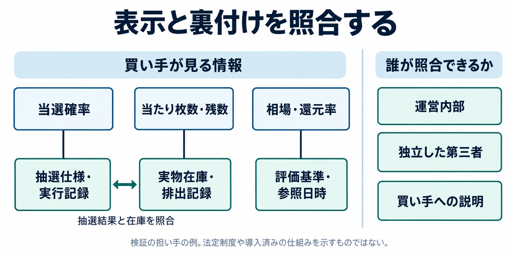
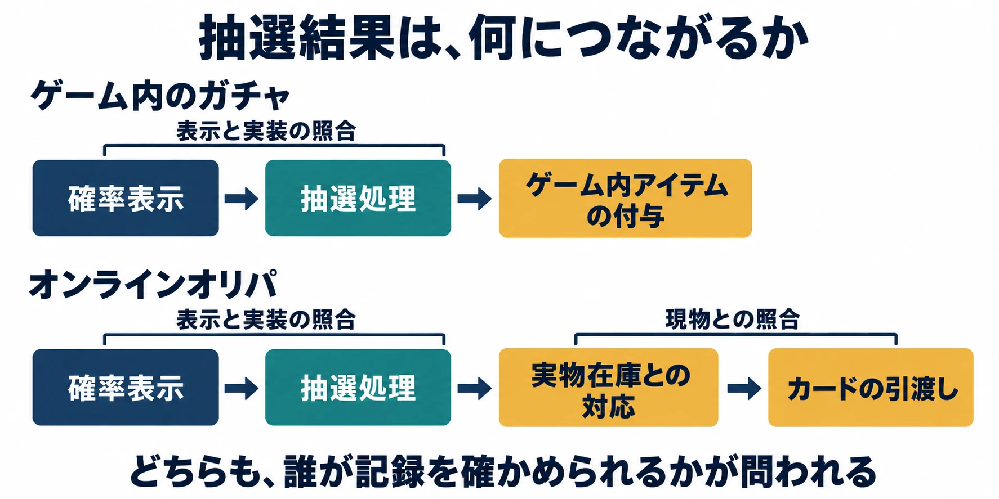

# その確率表示は、誰が確かめられるか――オンラインオリパと日本トレーディングカード協会から考える、くじ型商品の信頼

> **注意：** 本稿は法的助言ではありません。制度・事例は2026年10月24日時点の情報に基づきます。係争中の事案について紹介する違法性や損害の主張は、当事者の主張の段階であり、裁判所による認定とは区別してください。個別の企画・取引の法的判断は、弁護士などの専門家に確認してください。

「2分の1で当たる」。くじ型商品の画面にそう書かれていたとき、買い手が知りたいのは、その数字の意味と裏付けである。何を当たりと数え、どの範囲の抽選を対象とし、表示どおりに運用したことを誰が確かめられるのか。

編者はトレーディングカードの普通のプレイヤーで、タカラトミーから2026年12月26日に発売予定の『NIJISANJI 7 Colors Card Game』の発売を待っている。[[1](#ref-1)] カードを楽しむ立場からも、確率表示への信頼が、どのような仕組みに支えられるのかは気になる問題である。

オンラインオリパをめぐっては、2026年9月に購入者による提訴があり、10月には日本トレーディングカード協会のあり方を批判するインタビューや協会の声明が出た。本稿では、法律による規制、事業者の説明責任、業界団体による自主規制を分けながら、 **その確率表示は、誰が確かめられるか** を考える。

***

## オリパは、誰が中身を組んだ商品なのか

**オリパ（オリジナルパック）** は、店舗や個人などがカードを独自に詰め直して売る、メーカー公式のパックとは別の商品である。店頭で実物を売る「店舗オリパ」と、ウェブ上でポイントを購入し、抽選結果に応じてカードを受け取る「オンラインオリパ」がある。

この二つを分けるべきだと指摘しているのが、NPO法人カードゲーム文化振興協会代表の大河内卓哉氏である。同氏はブシロード創業期のカードゲーム事業の立ち上げに関わった人物で、GameBusiness.jpのインタビューでは、実物のパックとオンライン上の抽選を同じものとして扱うことに疑問を呈している。以下は、業界全体の総意ではなく、一団体の代表による見解である。[[2](#ref-2)]

**封入率** とは、ここでは特定のカードや当たりが含まれる割合、オンライン抽選では提供される確率を指す。ただし、実物の袋に何が入っているかと、画面の抽選結果が何を約束するかは、同じ問題ではない。

大河内氏が問題視するのは、オンラインでは現物の存在自体を買い手が確かめにくく、ポイントと引き換えに商品を渡すという販売者の約束に依存することだ。表示された当選確率の妥当性を第三者が証明する仕組みや、買い手が在庫・排出を検証する手段の欠如を指摘し、情報格差が過度な射幸心、すなわち偶然の利益への期待をあおる構造につながると批判している。制度整備や摘発の不足も同氏の指摘である。[[2](#ref-2)]

この批判から導ける問いは具体的だ。画面にカードの画像があり、確率が書かれているとき、その二つを実際の在庫と抽選記録へ結び付ける証拠は、どこにあるのか。

***

## 法律の論点は「カード」「特典」「表示」に分ける

法律の説明では、元裁判官で弁護士法人リット法律事務所共同代表の藤本拓大弁護士が監修する解説を主な手掛かりとする。同解説は、賭博、景品規制、誇大広告を分け、なかでも広告表示を実務上問題となる可能性の高い領域としている。[[3](#ref-3)]

### 抽選で売るカードと、追加でもらう特典

**景品表示法（景表法）** は、過大な景品の提供や、消費者を誤認させる表示を規制する法律である。藤本弁護士の解説では、オリパの抽選で受け取るカードは、原則として代金を払って買う対象そのものであり、取引に付随する「おまけ」としての景品類には当たらないとされる。[[3](#ref-3)]

一方、指定カードを集めた人へのコンプリート特典、購入者を対象とする追加抽選、最後の1口を購入した人へのラストワン賞などは、本体とは別の利益であり、景品類と評価される可能性があるという。特典の名前ではなく、提供方法が問題になる。[[3](#ref-3)]

**一般懸賞** とは、取引に付随し、くじなどの偶然性や行為の優劣によって景品を提供する懸賞のうち、所定の共同懸賞に当たらないものである。消費者庁は、その上限を次のように示している。[[4](#ref-4)]

| 懸賞に係る取引の価額 | 景品類の最高額 | 景品類の総額 |
| --- | --- | --- |
| 5,000円未満 | 取引の価額の20倍 | 懸賞に係る売上予定総額の2％以内 |
| 5,000円以上 | 10万円 | 懸賞に係る売上予定総額の2％以内 |

これは **一般懸賞に該当する場合** の上限である。購入特典すべてに同じ表を機械的に当てはめることはできず、追加特典の設計ごとの検討が必要になる。

### カード合わせには、金額とは別の禁止がある

**カード合わせ** は、異なる種類のカードや符号などの特定の組合せをそろえさせ、それを条件に別の景品を与える懸賞の方法である。消費者庁のQ&Aでは、景品類の最高額・総額にかかわらず全面禁止と説明されている。[[5](#ref-5)]

たとえば、ランダムに入手する指定カードを全種類そろえた人へ別のカードを渡す企画は、この禁止との関係が問題になる。集めたカードそのものと、そろえたことへの追加報酬を分けて見る必要がある。

消費者庁は、禁止の背景として、途中までは集めやすくても次第に集まりにくくなることによる当選率の錯覚や、子どもの射幸心への強い働きかけを挙げる。確率を正確に表示しても、禁止された特典の方式が許されるという整理にはならない。[[5](#ref-5)]

### 表示には、実態との対応が求められる

**特定商取引法（特商法）** は、通信販売などの取引で、事業者の表示や勧誘等を規律する法律である。消費者庁の通信販売ガイドは、販売価格、支払方法、引渡時期、事業者の名称・連絡先などの表示事項と、12条による誇大広告等の禁止を説明している。[[6](#ref-6)]

ここでは、「何を開示させるか」と「表示した内容が正しいか」を分けたい。確率を表示する制度の有無だけでは、個々の広告の適法性は決まらない。藤本弁護士の解説では、確率・還元率・市場価格・当たり本数などが実態と著しく食い違えば、景表法5条や特商法12条の問題になりうるとされる。[[3](#ref-3)]

表示の根拠については、池田・染谷法律事務所の越田雄樹弁護士も、当たり本数と残数、相場の時点、カードの状態などの整合性を重視している。販売画面、在庫管理、抽選・排出状況、広告の更新を一体で管理する必要があるという解説である。[[7](#ref-7)]

| 表示する内容 | 裏付けとして問われること |
| --- | --- |
| 当選確率 | 何を当たりとし、どの抽選を対象にした数値か |
| 当たり枚数・残数 | 用意した実物、抽選結果、表示更新が対応しているか |
| 還元率 | カード価格とポイントのどちらを、どんな算式で評価したか |
| 相場・市場価格 | いつ、どの市場で、どの状態のカードを評価したか |

還元率は、販売額に対する提供物の評価額の割合を示すために使われる言葉だが、その評価対象や基準を伴って初めて意味が定まる。現金、現物カード、再抽選にしか使えないポイントを、同じ価値で扱ってよいのかも説明の対象になる。

本稿の判断軸はここにある。 **表示があり、その数字を信じて支払う一方で、買い手には正しさを確かめる材料が届かない** 。この隔たりを埋めるには、数字の掲載に加えて、根拠資料を残し、必要な相手に検証させる仕組みが要る。

上段の表示と下段の裏付けを対応させ、抽選結果と実物在庫も照合する。検証の担い手は例示であり、現行の法定制度や導入済みの仕組みを示すものではない。

### 賭博の評価は、取引の設計に関わる

藤本弁護士の解説は、典型的なオリパでは販売者の売上が当たり外れで変わらず、販売者と購入者が偶然によって財産の得失を争う関係を認めにくいため、賭博罪に当たる可能性は低いとする。ただし、別の見方があり、判断が確立しているとまではいえないとも述べる。カードの買取やポイント還元を通じた実質的な換金の仕組みには注意が必要という立場である。[[3](#ref-3)]

したがって、賭博罪の成否と、広告の適否は別々に検討される。「賭博に当たるか」という問いへの回答だけで、確率表示の信頼まで保証されるわけではない。

資金決済法や古物営業法についても、越田弁護士はオンラインオリパに関係しうる法領域として挙げている。[[7](#ref-7)] 本稿では、ポイントや買取の条件ごとの法的評価には立ち入らず、表示と検証の関係に焦点を絞る。

***

## 2026年9月、表示をめぐる争いが訴訟になった

弁護士法人・響は2026年9月7日、オンラインオリパの大手5社について、特商法違反の疑いがあるとして消費者庁へ調査等を求める申出を行ったと公表した。情報格差や、還元率・当たりカードの確率・ポイントの価値の不透明さを問題視した発表である。[[8](#ref-8)]

9月17日には購入者38人が大手5社を東京地裁に提訴し、計約2億7,000万円の損害賠償を求めた。テレビ朝日は、「2分の1の確率」で希少なカードなどが出るという宣伝について、原告側が誇大広告や優良誤認などに当たると主張していると伝えている。[[9](#ref-9)][[10](#ref-10)]

響は翌18日付の公式発表で、17日の提訴とあわせて、1社の運営会社・代表者らについて東京地検特捜部へ告訴状を提出したことも説明している。ここでも、捜査・処分は捜査機関等の判断に委ねられるとしている。[[10](#ref-10)]

申出、提訴、告訴状の提出は、それぞれ行政や裁判所、捜査機関へ対応を求める行為である。表示の違法性や損害については原告側の主張の段階であり、本件の判決や和解による解決が公表された段階ではない。また、GameBusiness.jpは、事業者らが東京新聞の取材に対して、サイトの表示内容に沿って封入しているなどと回答したことも伝えている。[[11](#ref-11)]

問われているのは、購入者がどれだけ支払ったかだけでなく、その判断の前提となった表示と実態が対応していたかである。個人の当たり外れへの感想と、抽選仕様・運用・広告が一致していたかという検証は、区別して考える必要がある。

***

## 日本トレーディングカード協会は、誰の信頼を集めるのか

### 協会が掲げる活動と、参加構成への批判

一般社団法人日本トレーディングカード協会は、2025年11月14日に設立された。公式サイトの役員一覧は2026年8月25日を基準日とし、会長を古川宗一郎氏と記載している。警察・公的機関との不正流通防止に向けた連携、議員連盟との意見交換、公式大会、詐欺への注意喚起、「トレーディングカード統一定義規程」の制定などを掲げる。不正流通防止の情報共有先としては、2026年9月現在で会員店舗40店と記載されている。[[12](#ref-12)]

2026年7月23日には、自民党有志によるトレカ議連が設立総会を開いた。共同通信の配信記事によると、会長は木原誠二氏で、偽造品の流通や転売目的の大量購入へのルール整備を目指すとされた。[[13](#ref-13)]

この議連への協会の参加をめぐり、KAI-YOUは7月23日、公開されていた参加企業一覧にカードゲームの開発・販売メーカーが含まれず、カードショップも業界のごく一部にとどまることから、構成の偏りを不安視する声が出ていたと報じた。同記事は、協会が同日までに一覧を非公開にしたとも伝えている。これは当時の公開一覧に対する報道であり、そのまま現在の参加状況を示すものではない。[[14](#ref-14)]

大河内氏も、メーカーの信頼を得ないまま一部事業者主導で組織化が進んだことを批判し、業界のルール作りは、日本玩具協会などの既存の枠組みを通じ、メーカー主導・連携のもとで合意形成すべきだという見解を示した。[[2](#ref-2)]

この批判が投げかけるのは、団体の代表性の問題である。メーカー、店舗、オンライン販売者、プレイヤーでは、守りたい利益も知っている情報も異なる。限られた参加構成で政策への意見を伝える場合、どの立場の意見で、どこまで合意されたものかが分かることが重要になる。

### 10月23日の二つの声明

協会は7月25日時点では、オンラインオリパを無条件に肯定する立場でも、一律に否定する立場でもないとしていた。10月23日には、一部業者による消費者トラブルや表示・取引の透明性を重大な課題と位置付け、不正な業者の排除に必要な取り組みを進める方針を示した。7月の立場はGameBusiness.jpの報道、10月の方針は協会公式声明で示されている。[[11](#ref-11)][[15](#ref-15)]

さらに同日、協会は別の声明で、「警察の動きを察していたのではないか」「関係者に不利益を被る人がいたのではないか」という見方を事実無根として明確に否定した。特定企業の利害ではなく消費者保護と市場全体の信頼を重視し、所属や関係性によって判断を変えないとも表明している。[[16](#ref-16)]

GameBusiness.jpの10月23日記事は、協会への取材を申し込んでいるとし、大河内氏のインタビューに協会側の見解が含まれていないと説明している。[[11](#ref-11)] ただし、協会自身による否定声明はすでに存在する。取材記事での応答と、公式サイトでの意見表明は分けて読むべきである。

今後の自主規制を考えるうえでは、声明の方針を、検証の手続へどうつなげるかが焦点になる。たとえば、誰が調査を担当し、会員企業にも同じ基準を適用し、どこまで結果を公表するのか。これらは本稿が考える制度設計上の問いであり、協会がすでにその仕組みを備えているという意味ではない。

***

## ゲームのガチャから学べることと、実物カードが加える課題

ゲームのガチャでも、2012年にコンプガチャとカード合わせの関係が問題になった。消費者庁は、既存のカード合わせの禁止がオンラインゲームにも及ぶと説明している。[[5](#ref-5)] その後、2016年にはコンピュータエンターテインメント協会（CESA）が、有料ガチャで取得できるアイテムと提供割合の表示を原則とするガイドラインを制定した。[[17](#ref-17)]

法律による特定の方式の禁止と、業界による確率表示のルール整備は、異なる役割を持つ。詳しい経緯は、[ガチャは違法になったのか？ コンプガチャ規制から確率表示までの歴史](gacha-regulation-japan-history.md)で扱っている。

ここから得られるのは、自主規制が、法律に加えて運営や説明の基準を具体化する役割を担いうるという示唆だ。一方、表示された数字の存在と、それを裏付ける運用の検証は、別々の課題として残る。

ゲームのガチャでは、開発・運営会社が抽選を管理し、その結果をゲーム内のアイテム付与へ結び付ける。オンラインオリパでは、それに加えて、画面上の当選結果と実物カードの在庫・引渡しを対応させる必要がある。比較の焦点は、この実物との接続である。

| 比較する点 | ゲーム内のガチャ | オンラインオリパ |
| --- | --- | --- |
| 結果を受け取る先 | ゲーム内のキャラクター・アイテム等 | 実物カードの引渡しにつながる権利等 |
| 照合する対象 | 表示、抽選処理、アイテム付与 | 表示、抽選処理、実物在庫、引渡し |
| 信頼を支える問い | 設定どおり抽選・付与したと説明できるか | 抽選結果に対応する現物まで説明できるか |

これは仕組みの比較であり、ゲームのガチャで買い手が内部処理を自由に監査できるという意味ではない。オンラインオリパでは、抽選の適正さに加えて、実物を誰が保有し、当選後にどう管理するかという確認対象が増える。

***

## 設計する人と、買う人に残る六つの問い

確率表示を設計するゲームプランナーやカード販売者と、その表示を読んで支払う人は、異なる側から同じ数字を見ている。信頼について話すためには、数字の意味に加えて、照合に使う記録と、その記録を確かめる人まで考えたい。

1. **何の確率か**：当たりの定義、対象となる抽選、計算の時点を、設計する側と買う側が同じ意味で理解できるか。
2. **現物へつながるか**：表示したカードが用意され、抽選結果に対応する在庫と引渡しの記録が残るか。
3. **価値の基準は何か**：相場や還元率に使う価格・日時・状態、ポイントの扱いを説明できるか。
4. **誰が照合できるか**：運営者の自己申告に加え、利害から独立した相手が確かめられる範囲はあるか。
5. **表示が変わったら追えるか**：当たりの排出、残数の更新、企画の変更を、過去の広告と対応させられるか。
6. **団体は誰を代表するか**：自主規制の基準作り、調査、異議申立てに、メーカー・販売者・プレイヤーの声がどう反映されるか。

くじ型商品の信頼を支えるのは、確率という数字と、それを実態へつなぐ説明である。「誰が確かめられるか」を問うことは、その説明が届く範囲を、売る側と買う側の双方から考える出発点になる。

## References

1. [タカラトミー「『NIJISANJI 7 Colors Card Game(にじさんじセブンカラーズカードゲーム)』 2026年12月26日(土)から展開」][1] — 共同通信PRワイヤー、2026年10月7日。

[1]: https://kyodonewsprwire.jp/release/202610057308

2. [小川翔太「『日本トレーディングカード協会』設立は“急いだ”―警察が動くのを『誰か』が察した可能性も？カードゲーム文化振興協会代表に訊く問題点、そしてオンラインオリパのヤバさ」][2] — GameBusiness.jp、2026年10月21日。大河内卓哉氏へのインタビュー。

[2]: https://www.gamebusiness.jp/article/2026/10/21/28407.html

3. [藤本拓大監修「オリパは違法？賭博・景品表示法・誇大広告の3つの論点から元裁判官の弁護士が解説」][3] — 弁護士法人リット法律事務所、2026年10月19日更新。

[3]: https://lit-law-office.com/column/oripa-ihou/

4. [消費者庁「一般懸賞について」][4] — 消費者庁、2026年10月24日参照。一般懸賞の定義およびQ86。

[4]: https://www.caa.go.jp/policies/policy/representation/fair_labeling/faq/premium/lotteries

5. [消費者庁「インターネット上の取引と『カード合わせ』に関するQ&A」][5] — 消費者庁、2026年10月24日参照。Q5〜Q10、Q16、Q29。

[5]: https://www.caa.go.jp/policies/policy/representation/fair_labeling/faq/card/

6. [消費者庁「通信販売」][6] — 特定商取引法ガイド、2026年10月24日参照。広告の表示および誇大広告等の禁止。

[6]: https://www.no-trouble.caa.go.jp/what/mailorder/

7. [越田雄樹「【I&S インサイト】オンラインオリパを取り巻く景品表示法上の問題」][7] — 池田・染谷法律事務所、2026年4月13日。

[7]: https://www.ikedasomeya.com/insight/26467

8. [弁護士法人・響「オンラインオリパの違法性を問う｜消費者庁に上位5社の調査を申出」][8] — 弁護士法人・響、2026年9月7日。申出を行った側の発表。

[8]: https://hibiki-law.or.jp/service/consumer-protection/20260907/

9. [テレビ朝日「トレカの『オリパ』で誇大広告か　集団で運営会社を提訴　2億円超の賠償求め」][9] — テレ朝NEWS、2026年9月17日。

[9]: https://news.tv-asahi.co.jp/news_society/articles/000534142.html

10. [弁護士法人・響「オンラインオリパ運営会社5社への民事提訴および告訴状提出に関する記者会見を行いました」][10] — 弁護士法人・響、2026年9月18日。原告側代理人の発表。

[10]: https://hibiki-law.or.jp/service/consumer-protection/20260918/

11. [GameBusiness.jp「オンラインオリパ一部業者の消費者トラブルは『重大な課題』―日本トレカ協会が声明、不正業者の排除に向けた方針示す」][11] — GameBusiness.jp、2026年10月23日。

[11]: https://www.gamebusiness.jp/article/2026/10/23/28427.html

12. [日本トレーディングカード協会「協会について」][12] — 日本トレーディングカード協会、2026年10月24日参照。役員一覧の基準日は2026年8月25日。店舗数は不正流通防止に向けた情報共有の記載による。

[12]: https://www.jtca-web.or.jp/about

13. [共同通信「トレカ転売対策へ議連設立 自民『健全な市場育成』」][13] — 秋田魁新報、2026年7月23日（共同通信配信）。

[13]: https://www.sakigake.jp/news/article/20260723CO0087/

14. [都築陵佑「日本トレーディングカード協会、参加企業一覧を非公開に　自民党『トレカ議連』出席に不安の声」][14] — KAI-YOU、2026年7月23日。

[14]: https://kai-you.net/article/96036

15. [日本トレーディングカード協会「オンラインオリパをめぐる消費者保護上の課題について」][15] — 日本トレーディングカード協会、2026年10月23日。

[15]: https://www.jtca-web.or.jp/news/4

16. [日本トレーディングカード協会「一部報道における事実と異なる記述について」][16] — 日本トレーディングカード協会、2026年10月23日。

[16]: https://www.jtca-web.or.jp/news/5

17. [コンピュータエンターテインメント協会「『ネットワークゲームにおけるランダム型アイテム提供方式運営ガイドライン』制定に関するお知らせ」][17] — CESA、2016年4月27日。

[17]: https://www.cesa.or.jp/information/info6/000993/release20160427.html

----

この文書は、Perplexity、Claude、ChatGPT の3つのAIの支援を受けて著述されたものです。引用画像を除き、MIT License にて提供されています。
