# オープンワールドゲームの歴史：萌芽から革新へ

「オープンワールド」は、過去の作品にも後から当てはめられた呼び名である。本稿では、どの作品が最初だったかを決めるのではなく、 **プレイヤーに自由を渡しながら、行き先や目的をどう示すか** という問いで、その歴史をたどる。

自由といっても、行く場所を選ぶ自由、仕事を選ぶ自由、物を作る自由、問題の解き方を選ぶ自由では、必要な仕組みが違う。文字で洞窟を描いた時代から、立体的な大地を歩き回る時代まで、作り手はその時々の技術と制約の中で、探索を続けたくなる理由を用意してきた。

まず初期作品を見てから、家庭用ゲームの2Dと3D、都市や大陸の探索、2017年以降の試みへ進もう。

***

## 文字、地上、宇宙――探索の自由が育つ

1976年にWill Crowtherが制作した『Colossal Cave Adventure』は、大型コンピュータPDP-10上で、文章を読み、命令を入力して洞窟を探るゲームである。のちにDon Woodsが内容を拡張した。プレイヤーは移動や調査を言葉で指示し、文章の中にある手がかりから次の行動を考える。絵を描く代わりに言葉で場所を表せば、画面の見た目を超える広がりを想像できる。一方、位置関係は自分で把握する必要があり、地図を描きながら遊ぶ人もいた。[[1](#ref-1)]

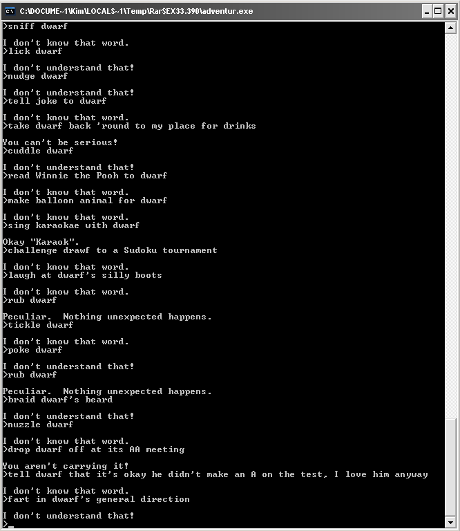
*画像出典: [Wikimedia Commons - Adventure.PNG](https://commons.wikimedia.org/wiki/File:Adventure.PNG) / 『Colossal Cave Adventure』の画面。本文中の作品解説のため引用。*

1981年のパソコン向けRPG『Ultima』では、制作者Richard Garriottが、地上を見下ろすマップと、一人称視点の地下迷宮を組み合わせた。プレイヤーは町へ入り、住民と話し、装備を整え、探索先を選ぶ。自由になったのは、地下迷宮の中だけでなく、その外に広がる世界を巡ることだ。魔法使いモンデインを倒す大目標があり、必要な宝石やタイムマシンを求める過程が行動の方向を与えていた。[[2](#ref-2)]

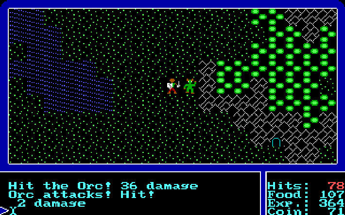
*画像出典: [GOG - Ultima 1+2+3](https://www.gog.com/en/game/ultima_1_2_3) / 『Ultima I: The First Age of Darkness』DOS版（後年の改訂版）の地上マップ。地上で探索先を選ぶ仕組みの説明のため引用。© Electronic Arts Inc.*

1984年にIan BellとDavid Brabenが制作した『Elite』は、BBC Microというパソコンの上に、宇宙を舞台とする交易と戦闘の遊びを載せた。商売をするか、戦うか、どこへ飛ぶかを選べる。一本の物語に沿って目的地を渡す代わりに、財産を増やすことや戦闘評価を上げることが、長く遊ぶ目標になっていた。宇宙の広さと、繰り返し取り組める行動の組み合わせが、旅の順番をプレイヤーへ委ねたのである。[[3](#ref-3)]

この三作品を並べると、探索先を選べることと、その先へ進む理由を持てることが、早い段階から別々の課題だったと読み取れる。洞窟の謎、冒険の大目標、財産や評価という形で、それぞれ異なる支えが置かれていた。

***

## 初代ゼルダ――行き先を自分で見つける

『ゼルダの伝説』は、1986年2月21日にファミリーコンピュータ ディスクシステム向けに発売された。[[4](#ref-4)] 地上を歩いて地下迷宮を発見し、攻略先を選ぶ作りは、探索を家庭用アクションゲームの中心に置いた。攻略順を変えられる余地があり、次の入口を探すこと自体が遊びになる。[[5](#ref-5)]

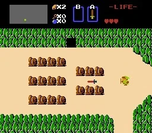
*画像出典: [Nintendo Life - The Legend of Zelda screenshots](https://www.nintendolife.com/games/nes/legend_of_zelda/screenshots) / 『ゼルダの伝説』NES版の画面。本文中の作品解説のため引用。*

初代の制作を手掛けた宮本茂氏は、David Sheff氏の著書『Game Over』のインタビューで、子どものころ、地図を持たずに歩き、思いがけず湖などに出会うことが冒険の感覚につながったと語っている。[[5](#ref-5)]

探索の自由と、進行の目安は併存している。任天堂の電子説明書は、8つのトライフォースを集めてガノンを倒す目的を示し、地下迷宮をLEVEL-1から順に攻略することを勧めている。迷宮で得る地図やコンパスも、内部の形や目標の位置を知る手がかりになる。プレイヤーは、自分で探した場所に、こうした情報を重ねて進める。[[6](#ref-6)]

一方、自由な探索は、何をすればよいか伝わりにくいという課題も抱えていた。宮本氏は、2009年の講演で、開発時に何をしてよいかわからないと反対された経験を語っている。そのうえで、剣を最初から持たせる仕様を変え、目につく洞穴に入り、老人から剣を得る体験を用意したという。[[7](#ref-7)]

この話からは、発見の楽しさそのものを、最初の行動で伝えようとした工夫が読み取れる。「この先も何かを見つけられそうだ」という期待が生まれれば、次の移動を自分で選ぶ理由になる。また、進行を保存して続きから遊べる仕組みは、長い探索を少しずつ積み重ねる支えとなった。[[6](#ref-6)]

***

## 3Dの広がりと、操作を助ける仕組み

1994年12月3日発売のプレイステーションは、家庭用ゲームで多くの3Dキャラクターや背景を表現できる環境を広げた。[[8](#ref-8)] 任天堂は1996年6月23日にNINTENDO 64を発売し、同日に『スーパーマリオ64』を送り出した。[[9](#ref-9)][[10](#ref-10)] ここで大切なのは、処理能力の数字そのものより、奥行きのある場所で「どちらへ動くか」を選べるようになったことである。

『スーパーマリオ64』では、宙返りや壁キックなどを使いながら、3Dのコースでパワースターを集める。移動の仕方を試す自由と、スターを得るという分かりやすい目的が組み合わされた。[[11](#ref-11)] コースを持つ本作は、広い一枚の世界を歩く作品とは構造が異なる。それでも、立体空間を探索し、その中に目標を見いだす遊びを考えるうえで、外せない例である。

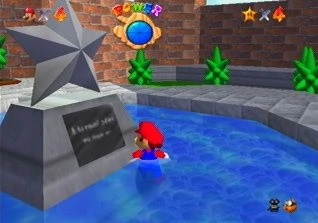
*画像出典: [Nintendo Life - Super Mario 64 screenshots](https://www.nintendolife.com/games/n64/super_mario_64/screenshots) / 『スーパーマリオ64』ゲームプレイ中の画面。本文中の作品解説のため引用。*

3D化は、見る方向や相手との位置関係も、プレイヤーが扱う必要を生んだ。1998年の『ゼルダの伝説 時のオカリナ』では、 **Z注目** によって相手と向き合いやすくした。[[4](#ref-4)][[12](#ref-12)] また、段差から自動的に跳ぶオートジャンプも、移動の操作を助ける。移植版『時のオカリナ 3D』のサウンドを担当した横田真人氏は、両者によって2Dのように遊べる点を挙げている。[[13](#ref-13)]

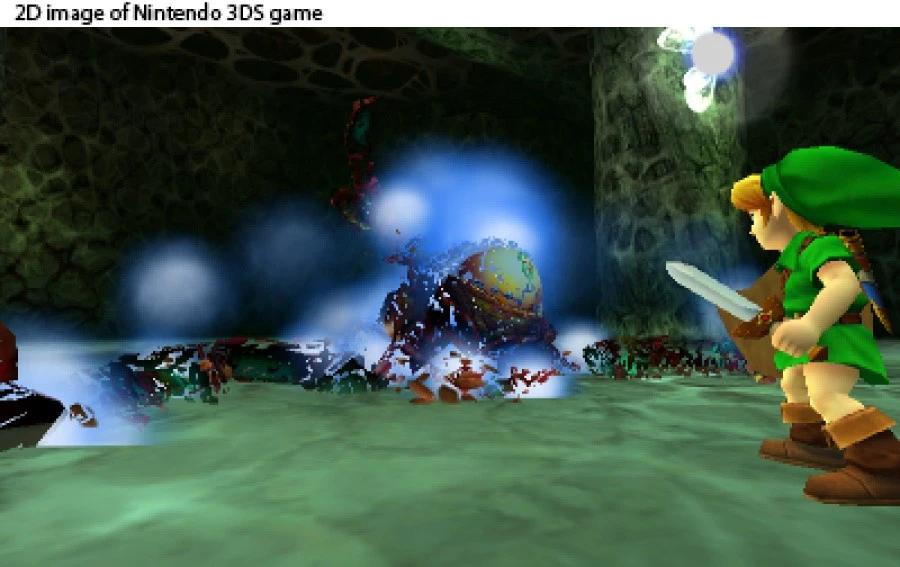
*画像出典: [Nintendo Life - The Legend of Zelda: Ocarina of Time 3D screenshots](https://www.nintendolife.com/games/3ds/legend_of_zelda_ocarina_of_time_3D/screenshots) / 『ゼルダの伝説 時のオカリナ 3D』の画面。本文中の作品解説のため引用。*

こうした補助は、自由に動ける空間の中で、敵や謎へ注意を向けるための土台と捉えられる。3Dの自由を増やすには、プレイヤーが次の行動に集中できる操作も必要になる。その設計判断は、[『時のオカリナ』とBotWを比較した記事](zelda-ocarina-botw-rethinking-conventions.md)で詳しく扱っている。

***

## 都市と大陸を歩く――1999〜2002年

### 『シェンムー』――人を探しながら、街に寄り道する

1999年12月29日、ドリームキャスト向けに『シェンムー 一章 横須賀』が発売された。メーカーが掲げたジャンル名は、FREE（Full Reactive Eyes Entertainment）。舞台の街にはそれぞれの生活を送るNPCがおり、ゲームセンターなど、寄り道できる場所も作り込まれている。当時のテレビCMは「制作費70億円」を宣伝文句として打ち出していた。[[14](#ref-14)]

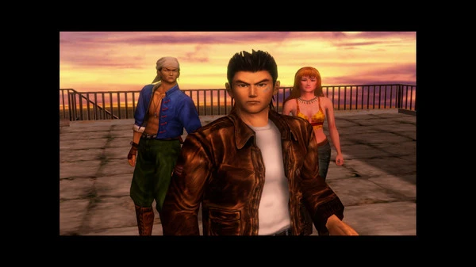
*画像出典: [Steam - Shenmue I & II](https://store.steampowered.com/app/758330/Shenmue/) / 『Shenmue I & II』公式スクリーンショット。本文中の作品解説のため引用。*

自由に見て回れる街に対し、進行の軸となるのは、父の死の謎を追う調査である。人に話を聞いて手がかりを集め、得た情報や経験は手帳に記録される。[[15](#ref-15)] 調査の目的が次に会う相手や訪ねる場所を与え、その途中で街の日常に触れる構造だ。

### 『GTA III』――都市を、移動と仕事の遊び場にする

2001年の『グランド・セフト・オートIII』（以下『GTA III』）は、3Dの都市リバティーシティを、移動や自由行動の舞台にした。20周年を伝える4Gamerの記事は、アートディレクターのアーロン・ガーブット氏の談話を紹介し、目的もなく歩き回ることがミッションを進めるのと同じくらい楽しい体験になったと伝えている。[[16](#ref-16)] 日本ではカプコンから、2003年9月25日に日本語版が発売された。[[17](#ref-17)]

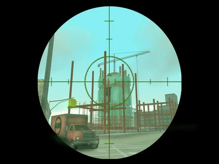
*画像出典: [Steam - Grand Theft Auto III](https://store.steampowered.com/app/12100/Grand_Theft_Auto_III/) / 『Grand Theft Auto III』公式スクリーンショット。本文中の作品解説のため引用。*

プレイヤーは街を移動して依頼を受け、ミッションに取り組む。物語を進める仕事のほか、タクシーなどの車両を使った活動もある。都市を巡る自由に、依頼という明確な目的を重ねる作りだ。[[18](#ref-18)] ここでは、道を移動することと、その道で何かを始めることが、一つの街の上でつながっている。

### 『Morrowind』――自分の人物として生きる

Bethesda Game Studiosの『The Elder Scrolls III: Morrowind』は、2002年に登場した。[[19](#ref-19)] 本作の製品説明は、メインストーリーを追うことも、自分で未知の場所へ出かけ、行動を通じて人物を育てることも選べると紹介している。[[20](#ref-20)]

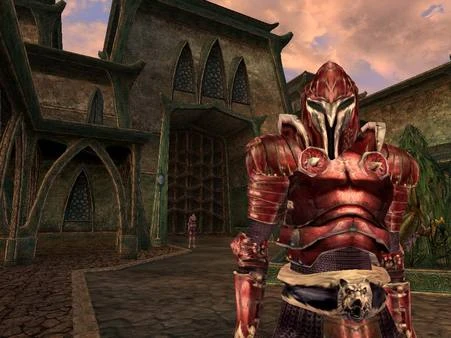
*画像出典: [Steam - The Elder Scrolls III: Morrowind Game of the Year Edition](https://store.steampowered.com/app/22320/The_Elder_Scrolls_III_Morrowind_Game_of_the_Year_Edition/) / 『The Elder Scrolls III: Morrowind』公式スクリーンショット。本文中の作品解説のため引用。*

自由になったのは、訪れる場所に加え、「どんな人物として何をするか」である。メインの物語は進む方向の一つとして存在し、その外にも自分の探索や成長の目標を置ける。3Dで表された土地と、人物を育てるRPGの仕組みが、プレイヤー自身の行動を旅の中心に据える支えになった。[[20](#ref-20)]

***

## 2010年代――世界を広げ、行動する理由を増やす

### 『Skyrim』――寄り道しながら、目的を持ち歩く

『The Elder Scrolls V: Skyrim』は、北米で2011年11月11日に発売され、日本語版のPS3・Xbox 360版は同年12月8日に発売された。[[21](#ref-21)] 冒険の手がかりを管理する仕組みとして、日誌、地図、画面上のコンパスがある。クエストを選択すると、その目標がコンパスや地図に表示される。[[22](#ref-22)]

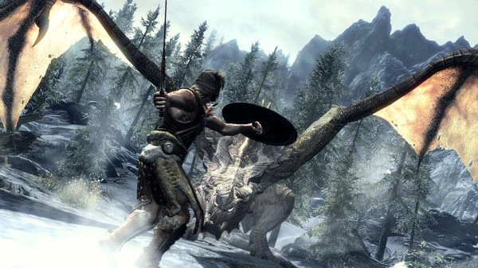
*画像出典: [Steam - The Elder Scrolls V: Skyrim](https://store.steampowered.com/app/72850/The_Elder_Scrolls_V_Skyrim/) / 『The Elder Scrolls V: Skyrim』公式スクリーンショット。本文中の作品解説のため引用。*

ここでは、複数の用事を抱えたまま探索し、追いたい目的を切り替えられる。行き先を選ぶ自由を残しながら、選んだ目的への手がかりを表示する方式だ。[[22](#ref-22)] プレイヤーが寄り道しても、再び目的を確かめる場所が用意されている。

### 『Minecraft』と『No Man's Sky』――生成された世界で目的を作る

『Minecraft』の正式版は2011年11月18日に公開され、2023年には累計販売本数3億本に到達した。[[23](#ref-23)][[24](#ref-24)] 世界をルールに従って作り出す **手続き的生成** と、ブロックを壊して置ける仕組みが、探索と建築を結びつける。[[25](#ref-25)] サバイバルでは素材を集め、生き延びる必要がある。クリエイティブでは資源の制約を外し、建築そのものを目的にできる。[[26](#ref-26)]

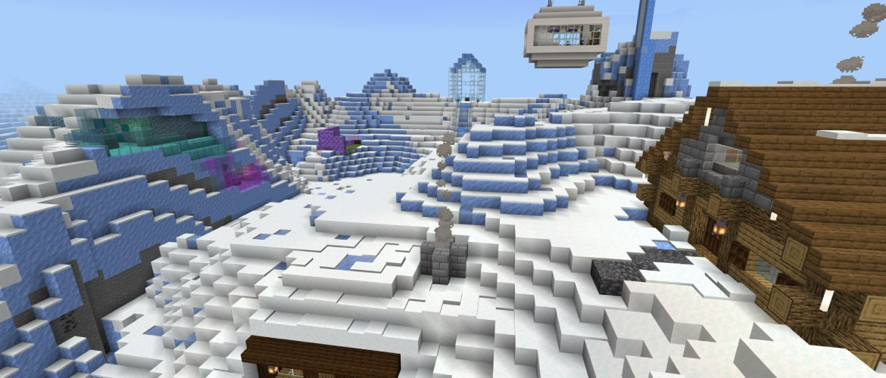
*画像出典: [Minecraft - Team Build Challenge: Winter Getaway](https://www.minecraft.net/en-us/article/team-build-challenge--winter-getaway) / 『Minecraft』の雪山にMojangのコミュニティチームが建築した画面。自然地形とブロックによる建築の関係を示すため引用。© Mojang AB. TM Microsoft Corporation.*

2016年の『No Man's Sky』では、Hello GamesのSean Murray氏が、生成可能な惑星数を公称約1,800京（18 quintillion）と説明した。惑星を定める数値から、その環境を生成する仕組みである。[[27](#ref-27)] 行く星を選ぶ自由に対し、探索・交易・戦闘・生存という行動の柱があり、新しく発見した生物や惑星へ名前を付けることも、旅の動機になる。[[28](#ref-28)]

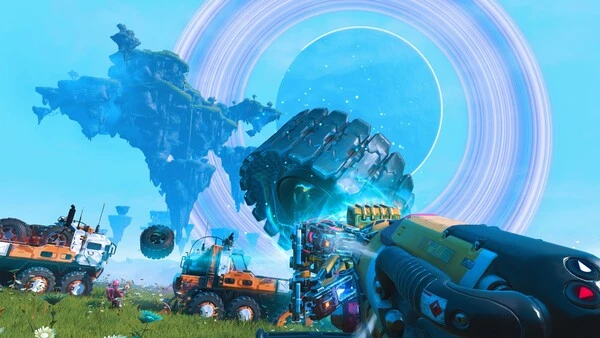
*画像出典: [Steam - No Man's Sky](https://store.steampowered.com/app/275850/No_Mans_Sky/) / 『No Man's Sky』公式スクリーンショット。本文中の作品解説のため引用。*

### 『ウィッチャー3』と『RDR2』――その場所へ行く意味を作り込む

2015年の『ウィッチャー3 ワイルドハント』では、クエストを一つずつ作り込み、寄り道にも物語上の意味を与える方針が重視された。シニアライターのKarolina Stachyra氏は、空間を埋めるだけの用事を避け、サブクエストもメインに近い質へ高めようとしたと説明している。探索や選択の幅を持たせつつ、シリを捜す大目標も見失わせないようにした。[[29](#ref-29)]

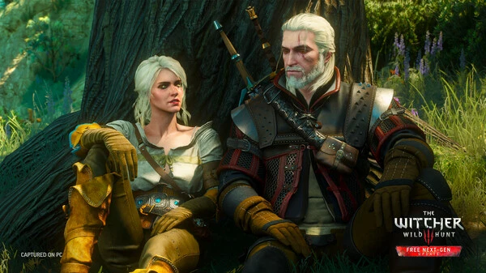
*画像出典: [Steam - The Witcher 3: Wild Hunt](https://store.steampowered.com/app/292030/The_Witcher_3_Wild_Hunt/) / 『The Witcher 3: Wild Hunt』公式スクリーンショット。本文中の作品解説のため引用。*

2018年の『レッド・デッド・リデンプション2』（以下『RDR2』）は、人や動物の反応を細かく組み合わせた。NPCはプレイヤーの振る舞いを見て反応し、動物は地域ごとに配置され、群れや時間帯によって行動を変える。自由に観察し、狩りをする中で、逃げてくる草食動物が肉食動物の存在を知らせることもある。[[30](#ref-30)]

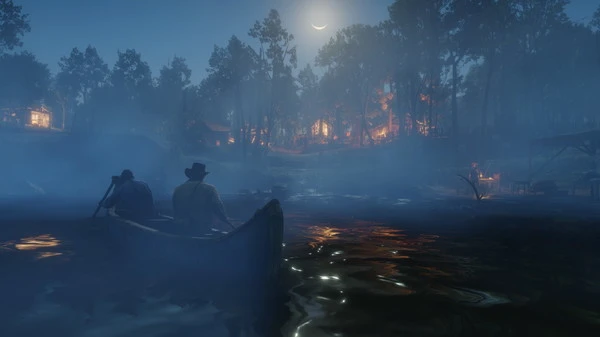
*画像出典: [Steam - Red Dead Redemption 2](https://store.steampowered.com/app/1174180/Red_Dead_Redemption_2/) / 『Red Dead Redemption 2』公式スクリーンショット。本文中の作品解説のため引用。*

この例では、周囲の出来事そのものが、目を向ける先や次の行動の手がかりになる。『ウィッチャー3』の物語を伴う依頼と『RDR2』の世界の反応は、探索先で何に出会えるかを厚くする、異なる取り組みとして読める。

***

## 2017年のBotW――見える景色を、選べる目的へ

2010年代のもう一つの節目が、2017年3月3日発売の『ゼルダの伝説 ブレス オブ ザ ワイルド』（以下BotW）である。任天堂は、決められた道筋のない冒険として本作を紹介した。[[31](#ref-31)] ディレクターの藤林秀麿氏らがGDC 2017で語った目標は、行く場所とすることを自分で考えるゲームだった。「アタリマエを見直す」中で、壁を登れるようにし、高所から滑空する遊びへつながっていった。[[32](#ref-32)]

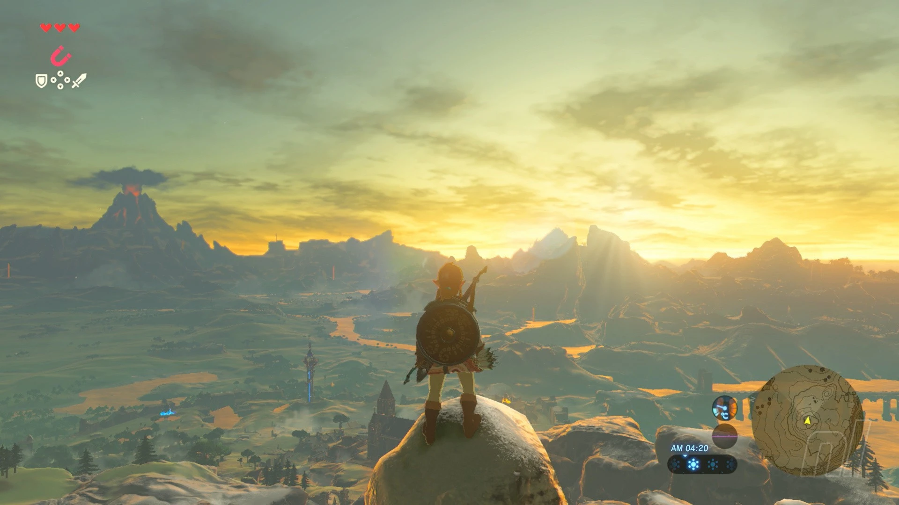
*画像出典: [Nintendo Life - The Legend of Zelda: Breath of the Wild screenshots](https://www.nintendolife.com/games/nintendo-switch/legend_of_zelda_breath_of_the_wild/screenshots) / 『ゼルダの伝説 ブレス オブ ザ ワイルド』ゲームプレイ中の画面。本文中の作品解説のため引用。*

移動の自由を支えるのは、寄り道したくなる対象の配置である。CEDEC 2017で藤林氏とシニアリードアーティストの米津真氏が紹介した初期テストでは、塔をたどる誘導だけでは一本道のように感じられ、街道を外れると出来事に出会いにくかった。そこで、報酬や発見を期待して自分から向かいたくなる力を「引力」と捉え、配置を調整した。[[33](#ref-33)]

同講演の「フィールド三角形の法則」は、地形の起伏や自然物を三角形として捉え、大小で役割を変える考え方だ。大きいものは遠くの目印、中くらいは向こう側を隠す遮蔽物、小さいものは近場の探索や移動のテンポを受け持つ。景色の見え方が変わることで、次に何を見に行くか選びやすくなる。[[33](#ref-33)]

画面上の表示にも同じ問いがあった。UIリードデザイナーの長谷隆広氏とUIプログラマーの北山茂寿氏による **UIの講演** では、「無ければ無いほうがいいUI」から出発したものの、情報を伝えるために完全にはなくせず、常時表示を左上と右下へまとめる方針が語られた。また、この講演で紹介されたマップ自動生成ツールは、3Dフィールドの水場・樹木・建物・街道など16種の要素と高さ情報を合成し、画面で見る地図の制作を助けるものだった。[[34](#ref-34)]

移動を自由にし、風景に目的の候補を置き、必要な表示で支える。この組み合わせが、歴史を読むうえでのBotWの特徴である。詳細は[ゼルダの設計判断の記事](zelda-ocarina-botw-rethinking-conventions.md)と、地形シリーズの[眺望と遮蔽](open-world-terrain-design-prospect-refuge.md)・[山](open-world-terrain-design-mountains.md)・[川](open-world-terrain-design-rivers.md)を参照してほしい。

***

## 2017年以降――指針を示し、選び方を委ねる

### 『エルデンリング』――導きに従うことも、外れることも選べる

2022年の『エルデンリング』で、ディレクターの宮崎英高氏は、「祝福の導き」を、何をしてよいかわからないという負担を抑える要素として説明している。進む方向を示す一方、その外にも発見や物語を置いた。指針があるからこそ、そこから外れる行動を、自分の選択として感じられるという考え方だ。[[35](#ref-35)]

自由になったのは、探索や攻略の進め方である。宮崎氏は発売前のインタビューでも、導きに強制力はなく、探索先で新しい目標が見つかることを述べていた。[[36](#ref-36)] 広いフィールドで進行の目安を渡しながら、それに従わない選択にも意味を持たせている。

### 『ティアーズ オブ ザ キングダム』――行く方法も、自分で組み立てる

2023年5月12日発売の『ゼルダの伝説 ティアーズ オブ ザ キングダム』（以下TotK）は、前作の大地を土台に、高さを使う遊びを広げた。[[37](#ref-37)] ディレクターの藤林秀麿氏は、地上から空までつながる立体的なフィールドを前提にしたと説明する。[[38](#ref-38)] ウルトラハンドでは物をつなげて乗り物などを作れ、目的地へ行く手段そのものを工夫できる。[[39](#ref-39)]

その自由に対し、冒険手帳が次の目的を示し、地図には目的地が表示される。人との会話も、新しい用事や情報の入口になる。[[40](#ref-40)] プロデューサーの青沼英二氏は、用意された謎をプレイヤーごとの解法で解くほうが、自分だけの体験を強く感じられると語っている。[[41](#ref-41)]

『エルデンリング』が指針から外れる選択を支え、TotKが目的に至る解法を広げた、と整理すると、自由の設計が「どこへ行けるか」から、さらに細かく枝分かれしていることが見えてくる。

***

## 振り返り――自由と目的を、何でつないだか

ここまでの作品を、同じ三つの問いで並べてみよう。各行は、本文で扱った特徴を絞って整理したものである。

| 時代・作品 | 自由にしたもの | 目的の示し方 | それを支えた技術・制約 |
| --- | --- | --- | --- |
| 1976年『Colossal Cave Adventure』 [[1](#ref-1)] | 言葉による探索行動 [[1](#ref-1)] | 場所の文章にある手がかり [[1](#ref-1)] | PDP-10上のテキスト表現 [[1](#ref-1)] |
| 1981年『Ultima』 [[2](#ref-2)] | 地上の探索先 [[2](#ref-2)] | モンデインを倒す大目標 [[2](#ref-2)] | 地上と迷宮で切り替わる視点 [[2](#ref-2)] |
| 1984年『Elite』 [[3](#ref-3)] | 交易や戦闘の選択 [[3](#ref-3)] | 財産や戦闘評価の上昇 [[3](#ref-3)] | BBC Microでの宇宙表現 [[3](#ref-3)] |
| 1986年『ゼルダの伝説』 [[4](#ref-4)] | 地上での行き先 [[5](#ref-5)] | トライフォースの収集 [[6](#ref-6)] | 進行を保存する仕組み [[6](#ref-6)] |
| 1996年『スーパーマリオ64』 [[10](#ref-10)] | 立体空間での移動 [[10](#ref-10)] | パワースターの収集 [[11](#ref-11)] | コースを3Dで表現 [[10](#ref-10)] |
| 1999年『シェンムー』 [[14](#ref-14)] | 街の中の寄り道 [[14](#ref-14)] | 聞き込みで得る情報 [[15](#ref-15)] | NPCごとの生活の表現 [[14](#ref-14)] |
| 2001年『GTA III』 [[16](#ref-16)] | 都市での自由行動 [[16](#ref-16)] | 依頼として受けるミッション [[18](#ref-18)] | 都市の3D化 [[16](#ref-16)] |
| 2002年『Morrowind』 [[19](#ref-19)] | 自分の人物としての探索 [[20](#ref-20)] | 選択肢としてのメインストーリー [[20](#ref-20)] | 行動による人物の成長 [[20](#ref-20)] |
| 2011年『Skyrim』 [[21](#ref-21)] | 追うクエストの選択 [[22](#ref-22)] | 選んだ目的の位置表示 [[22](#ref-22)] | 日誌と地図の連携 [[22](#ref-22)] |
| 2011年正式版『Minecraft』 [[23](#ref-23)] | ブロックによる建築 [[26](#ref-26)] | プレイヤー自身の制作目標 [[26](#ref-26)] | 手続き的に生成される世界 [[25](#ref-25)] |
| 2015年『ウィッチャー3』 [[29](#ref-29)] | 寄り道するクエストの選択 [[29](#ref-29)] | シリを捜す大目標 [[29](#ref-29)] | 個別に組み立てるクエスト [[29](#ref-29)] |
| 2016年『No Man's Sky』 [[28](#ref-28)] | 惑星を巡る探索 [[28](#ref-28)] | 発見と命名の機会 [[28](#ref-28)] | 数値から惑星を生成する仕組み [[27](#ref-27)] |
| 2017年BotW [[31](#ref-31)] | 壁登りと滑空による移動 [[32](#ref-32)] | 報酬を期待させる「引力」 [[33](#ref-33)] | 大小の地形による視界の調整 [[33](#ref-33)] |
| 2018年『RDR2』 [[30](#ref-30)] | 動物を観察し、狩る行動 [[30](#ref-30)] | 周囲の動物の反応 [[30](#ref-30)] | 生息地ごとの動物の配置 [[30](#ref-30)] |
| 2022年『エルデンリング』 [[35](#ref-35)] | 導きから外れる探索 [[36](#ref-36)] | 祝福の導き [[35](#ref-35)] | 広いフィールドと攻略の選択肢 [[36](#ref-36)] |
| 2023年TotK [[37](#ref-37)] | 目的に至る解法 [[41](#ref-41)] | 冒険手帳による目的の確認 [[40](#ref-40)] | 物をつなげる仕組み [[39](#ref-39)] |

***

## プランナーへの示唆――自由を足すとき、手がかりも設計する

ここからは、以上の事例を踏まえた本稿の考察である。

第一に、 **自由を増やすときは、目的の示し方も同時に考える** ことだ。次の場所を自由に選べても、その判断材料が乏しければ、選ぶこと自体が負担になる。試作では、移動できる範囲に加え、「プレイヤーは何を見て、次の行動を決めたか」を観察するとよい。

第二に、広さを測るだけでなく、目に入るものと寄り道の動機を確かめたい。丘の向こうの建物、困っている人の話、逃げる動物、手元の材料から思いつく乗り物。こうした小さなきっかけが、次の目的を作る。地図上の面積と、プレイヤーが選びたくなる行動の数は、別に検討する必要がある。

第三に、歴史を読むときは、各作品が何を解決しようとしたかを見ることだ。文字で場所を伝える、3Dでも相手と向き合えるようにする、寄り道しても目的を確かめられるようにする、別の解法を試せるようにする。その判断を知ると、自分の企画に必要な自由と、それを支える手がかりを具体的に考えやすくなる。

## References

英語資料の内容は本稿で要約した。製品ページなど日付のない資料の確認日は2026年11月5日である。

1. [ACMI「Colossal Cave Adventure notebooks」][1] — ACMI、公開日記載なし。1976年の作品とWill Crowther、Don Woodsによる拡張、テキストによる探索を参照。

[1]: https://www.acmi.net.au/works/125369--colossal-cave-adventure/

2. [The Strong「Ultima」][2] — The Strong National Museum of Play、2024年3月13日。1981年の発売、Richard Garriott、地上と地下の探索を参照。

[2]: https://www.museumofplay.org/games/ultima/

3. [MCV Staff「IP Profile: Elite」][3] — MCV/DEVELOP、2008年8月1日。開発者、1984年の発売、交易と戦闘の選択を参照。

[3]: https://mcvuk.com/development-news/ip-profile-elite/

4. [任天堂「History（ヒストリー）」][4] — ゼルダの伝説40周年、公開日記載なし。初代と『時のオカリナ』の発売情報を参照。

[4]: https://www.nintendo.com/jp/character/zelda/history/index.html?lang=ja

5. [Richard Stanton「How an 'Adventure Mario' project evolved to become The Legend Of Zelda」][5] — GamesRadar+、2023年4月6日。初代の探索とダンジョン攻略の自由を参照。宮本氏の発言はDavid Sheff『Game Over』からの引用。

[5]: https://www.gamesradar.com/how-an-adventure-mario-project-evolved-to-become-the-legend-of-zelda/

6. [任天堂「ゼルダの伝説 電子説明書」][6] — 任天堂、公開日記載なし。Wii U版。「ゲームの進めかた」「アイテムの説明」「セーブについて」を参照。

[6]: https://www.nintendo.co.jp/data/software/manual/WUP-N-FBAJ-JPN.pdf

7. [インサイド「【DCEXPO2009】30年にわたりビデオゲーム制作を振り返る『宮本茂の仕事史』」][7] — インサイド、2009年10月26日、同27日更新。宮本氏の講演を取材した記録。

[7]: https://www.inside-games.jp/article/2009/10/26/38413.html

8. [ソニーグループ「第2部 第9章 プレイステーション」][8] — Sony Group History、公開日記載なし。第3節の発売日と3D表現を参照。

[8]: https://www.sony.com/ja/SonyInfo/CorporateInfo/History/SonyHistory/2-09.html

9. [任天堂「そのほかの本体」][9] — 任天堂、公開日記載なし。NINTENDO 64の発売日を参照。

[9]: https://www.nintendo.com/jp/hardware/index.html

10. [任天堂「VCスーパーマリオ64」][10] — 任天堂、公開日記載なし。オリジナル版の発売日と3Dアクションの説明を参照。

[10]: https://www.nintendo.co.jp/wii/vc/vc_sm64/vc_mb_01.html

11. [任天堂「『Nintendo Switch Online + 追加パック』で遊べるNINTENDO 64タイトルをご紹介。64ポイントで交換できるマイニンテンドーグッズも登場。」][11] — 任天堂トピックス、2021年10月26日。『スーパーマリオ64』のアクションとパワースターを参照。

[11]: https://www.nintendo.com/jp/topics/article/6d3517c5-07bc-492b-9289-7a3ca1bc75ea

12. [任天堂「社長が訊く『ゼルダの伝説 時のオカリナ 3D』オリジナルスタッフ 篇 その1」][12] — 任天堂、2011年。第3節「太秦（うずまさ）映画村に行こう」のZ注目を参照。

[12]: https://www.nintendo.co.jp/3ds/interview/aqej/vol2/index3.html

13. [任天堂「社長が訊く『ゼルダの伝説 時のオカリナ 3D』サウンド 篇」][13] — 任天堂、2011年。第4節の横田真人氏によるオートジャンプとZ注目の説明を参照。

[13]: https://www.nintendo.co.jp/3ds/interview/aqej/vol1/index4.html

14. [ウワーマン「『シェンムー 一章 横須賀』25周年。制作費70億円を投じたオープンワールドゲームの元祖とも呼ばれる、時代を先取りし過ぎた伝説の作品【今日は何の日？】」][14] — ファミ通.com、2024年12月29日。2023年12月29日掲載記事の再編集。

[14]: https://www.famitsu.com/article/202412/28694

15. [セガ「Shenmue Instruction Manual」][15] — セガ、1999・2000年著作権表記。英語版説明書、冊子10〜17ページ。第三者サイトManuals+に保存された説明書を参照。

[15]: https://manuals.plus/m/7e2440c5d6f3bd0326936049fefd075d140d8924a7d95d99911b4352e8898e17.pdf

16. [S.K.Y「『グランド・セフト・オートIII』が20周年。シリーズの偉大なマイルストーンを築いたGTAIIIを開発者が振り返る」][16] — 4Gamer.net、2021年10月22日。アートディレクターのアーロン・ガーブット氏の談話を紹介したニュース記事。

[16]: https://www.4gamer.net/games/003/G000388/20211021166/

17. [GAME Watch「カプコン、『Grand Theft Auto III 日本語版』を9月25日に発売」][17] — GAME Watch、2003年7月22日。日本語版の発売元と発売日を参照。

[17]: https://game.watch.impress.co.jp/docs/20030722/gta3.htm

18. [GAME Watch「iOS/Androidゲームショートレビュー『グランド・セフト・オートIII:10周年記念版』」][18] — GAME Watch、2011年12月20日。ミッションと自由行動の仕組みを参照。

[18]: https://game.watch.impress.co.jp/docs/review/500238.html

19. [Bethesda Game Studios「Making Morrowind」][19] — Bethesda.net、2022年4月29日。2002年の発売を振り返る開発関係者の証言。

[19]: https://bethesda.net/en-US/news/making-morrowind-20th-anniversary

20. [Bethesda Softworks「The Elder Scrolls III: Morrowind Game of the Year Edition」][20] — Steam公式製品ページ、公開日記載なし。メインストーリーと独自の探索の選択を参照。

[20]: https://store.steampowered.com/app/22320/The_Elder_Scrolls_III_Morrowind_Game_of_the_Year_Edition/

21. [Ten-Four「ベセスダ、『The Elder Scrolls V: Skyrim』の国内発売日を2011年12月8日と発表」][21] — Game*Spark、2011年9月22日。北米版と日本語版の発売日を参照。

[21]: https://www.gamespark.jp/article/2011/09/22/29935.html

22. [Bethesda Softworks「The Elder Scrolls V: Skyrim Legendary Edition Manual」][22] — Bethesda Softworks、2013年版。英語PS3版説明書の「Compass」「Journal」「Maps and Fast Travel」を参照。

[22]: https://assets.ctfassets.net/rporu91m20dc/1IuJHrbXY8GqSQQM0GuuUM/2a3c85e2d7772c2eb45f996443f320f4/manual_skyrim-le_ps3_en-us.pdf

23. [Xbox Wire「The Most Important Moments in Minecraft’s First 15 Years」][23] — Xbox Wire、2024年5月17日。2011年11月18日の正式版公開を参照。

[23]: https://news.xbox.com/en-us/2024/05/17/minecraft-15-years-most-important-moments/

24. [Mojang Studios「Minecraft 15th Anniversary」][24] — Minecraft.net、2024年。年表の2023年の累計販売本数を参照。

[24]: https://www.minecraft.net/en-us/15th-anniversary

25. [Mojang Studios「The road to Dungeons」][25] — Minecraft.net、2020年。通常のMinecraftの環境と手続き的生成の説明を参照。

[25]: https://www.minecraft.net/en-us/article/the-road-dungeons

26. [Mojang Studios「What is Minecraft?」][26] — Minecraft.net、公開日記載なし。世界の生成、SurvivalとCreativeの遊びを参照。

[26]: https://www.minecraft.net/en-us/about-minecraft

27. [Sean Murray「No Man’s Sky: A Whole Universe to Explore」][27] — PlayStation.Blog、2014年8月26日。開発者による手続き的生成と生成可能な惑星数の説明。

[27]: https://blog.playstation.com/2014/08/26/no-mans-sky-a-whole-universe-to-explore/

28. [Josh Sepielli「What Can You Do in No Man’s Sky?」][28] — PlayStation.Blog、2016年7月14日。探索・交易・戦闘・生存の4本柱を参照。

[28]: https://blog.playstation.com/2016/07/14/what-can-you-do-in-no-mans-sky/

29. [Blake Hester「The Story Behind The Story Of The Witcher 3: Wild Hunt」][29] — Game Informer、2016年8月20日。シニアライターKarolina Stachyra氏へのインタビュー。

[29]: https://gameinformer.com/b/features/archive/2016/08/20/the-story-behind-the-story-of-the-witcher-3

30. [ファミ通.com「『レッド・デッド・リデンプション2』世界を驚愕させた緻密なオープンワールドはいかに生まれたのか？ ロックスター・ゲームスに訊くインタビュー」][30] — ファミ通.com、2018年12月7日。NPCの反応と動物の配置・行動を参照。

[30]: https://www.famitsu.com/news/201812/07168913.html

31. [任天堂「これからはじめる『ゼルダの伝説 ブレス オブ ザ ワイルド』」][31] — 任天堂、公開日記載なし。発売日と探索の自由を参照。

[31]: https://www.nintendo.com/jp/games/feature/zelda/index.html

32. [古屋陽一「『ゼルダの伝説 ブレス オブ ザ ワイルド』はいかにして至極のタイトルになり得たか “掛け算”の方法論など開発陣がノウハウを語る【GDC 2017】」][32] — ファミ通.com、2017年3月2日。藤林秀麿氏らの講演の取材記録。

[32]: https://www.famitsu.com/news/201703/02128158.html

33. [西川善司「［CEDEC 2017］『ゼルダの伝説BotW』の完璧なゲーム世界は，任天堂の開発スタイルが変わったからこそ生まれた」][33] — 4Gamer.net、2017年9月2日。藤林秀麿氏・米津真氏の講演の取材記録。

[33]: https://www.4gamer.net/games/341/G034168/20170901120/

34. [西川くん「『ゼルダの伝説 BotW』何気ないウィンドウやアイコンなどに隠された、プレイヤーを冒険の世界に没頭させる工夫と技術【CEDEC 2017】」][34] — ファミ通.com、2017年9月4日。長谷隆広氏・北山茂寿氏のUI講演の取材記録。

[34]: https://www.famitsu.com/news/201709/04141037.html

35. [ファミ通.com「『エルデンリング』宮崎英高ディレクターインタビュー。脅威と未知に満ちた世界、自由な冒険と手に汗握る戦闘、勝利への達成感……本作に込めた思いを語る」][35] — ファミ通.com、2022年2月25日。祝福の導きと自由度についての発言を参照。

[35]: https://www.famitsu.com/news/202202/25252631.html

36. [ファミ通.com「『エルデンリング』国内独占インタビュー。フロム・ソフトウェア最大規模となる新しいダークファンタジーをディレクター宮崎英高氏が語る【E3 2021】」][36] — ファミ通.com、2021年6月14日。探索、攻略の自由と導きの強制力を参照。

[36]: https://www.famitsu.com/news/202106/14223605.html

37. [任天堂「『ゼルダの伝説 ティアーズ オブ ザ キングダム』は本日発売。初心者向けの『冒険の手引き』や『アイコンパーツ』も登場。」][37] — 任天堂トピックス、2023年5月12日。

[37]: https://www.nintendo.com/jp/topics/article/053b130a-be15-4c19-9182-a3cff34a240a

38. [任天堂「開発者に訊きました：ゼルダの伝説 ティアーズ オブ ザ キングダム 第3章 空までひとつながりの世界」][38] — 任天堂、2023年5月11日。高さを活かす設計と開発上の制約を参照。

[38]: https://www.nintendo.com/jp/interview/totk/03.html

39. [任天堂「開発者に訊きました：ゼルダの伝説 ティアーズ オブ ザ キングダム 第4章 そういうところが『ゼルダっぽい』」][39] — 任天堂、2023年5月11日。ウルトラハンドの試作と解決手段の幅を参照。

[39]: https://www.nintendo.com/jp/interview/totk/04.html

40. [任天堂「ゼルダの伝説 ティアーズ オブ ザ キングダム：冒険の手引き」][40] — 任天堂、公開日記載なし。「次の目的は『冒険手帳』を見ればわかる」「いろんな人と話すことが大事」を参照。

[40]: https://www.nintendo.com/jp/zelda/totk/guide/index.html

41. [任天堂「開発者に訊きました：ゼルダの伝説 ティアーズ オブ ザ キングダム 第5章 できるかな？がちゃんとできる」][41] — 任天堂、2023年5月11日。青沼英二氏・藤林秀麿氏らの解法の自由に関する発言を参照。

[41]: https://www.nintendo.com/jp/interview/totk/05.html

----

この文書は、Perplexity、Claude、ChatGPT の3つのAIの支援を受けて著述されたものです。引用画像を除き、MIT License にて提供されています。
