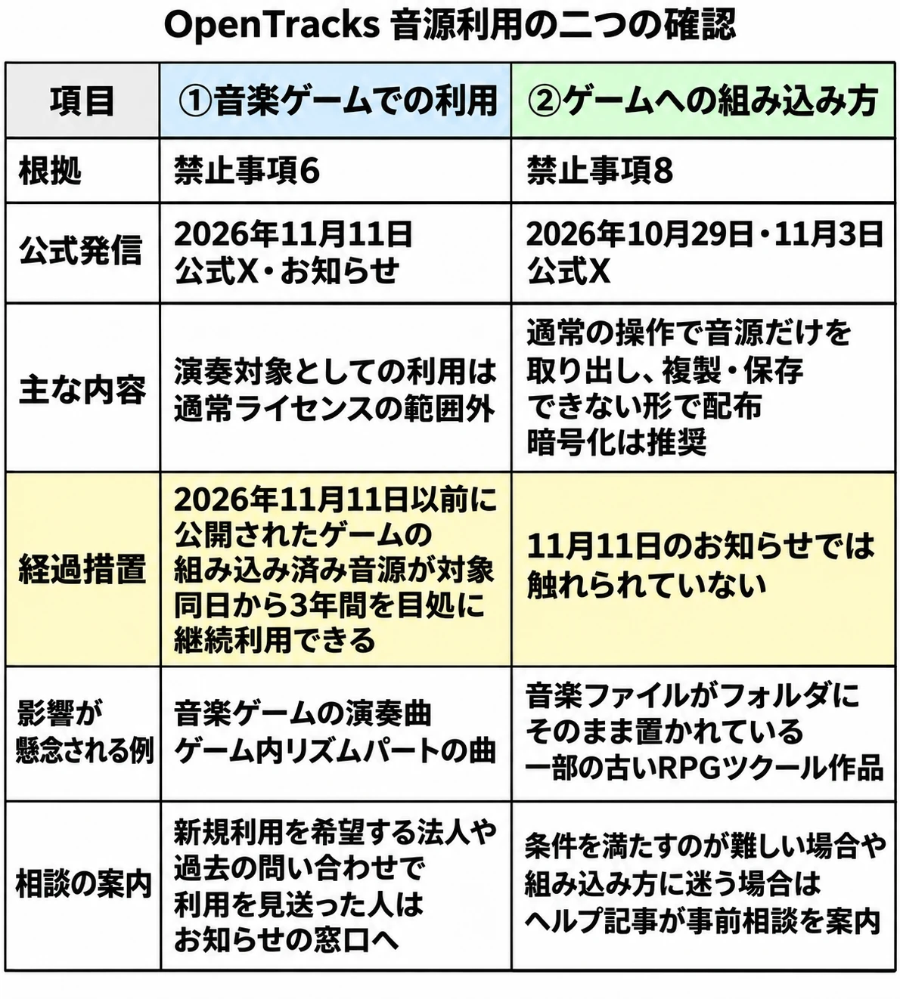

# OpenTracks（旧DOVA-SYNDROME）の音源をゲームで使うには――音楽ゲームの利用条件と配布時の組み込み方

> 本稿は2026年11月12日時点のOpenTracksの公開情報に基づきます。利用の可否は、必ず最新の音源利用ライセンスとヘルプ記事で確かめてください。

## 1. ゲームでの音源利用をめぐる二つの話

「昔のRPGツクールで作ったゲームが、これまでどおり配布できなくなるのではないか」。OpenTracksのゲーム向けの説明をめぐり、こうした懸念がSNSで広がった。Game\*Sparkは、一部の古いRPGツクール作品で音源の差し替えを心配する声と、音楽ゲームの開発者が楽曲を差し替えると発表した事例を伝えている。[[1](#ref-1)]

同じ「ゲームの音源を差し替える」という話でも、何を確かめるかは作品によって異なる。まず、音源がゲームの中で何をするためのものかを見る。たとえば、探索中に流れるBGMと、プレイヤーが楽曲に合わせて入力する場面での演奏対象では、音源の役割が違う。次に、公開されたゲームの中に音源がどのような形で収められているかを見る。ここでは、プレイヤーが配布物から音源だけを取り出して保存できるかが問題になる。

- **① 音楽ゲームでの利用**：演奏対象など、ゲーム内で音源が担う役割に関する話。
- **② ゲームへの組み込み方**：ゲームを配布するときに、音源ファイルがどのような状態で利用者に渡るかという話。

音源を取り出せないようにしても、演奏対象として使う場合は①の確認が要る。探索や戦闘のBGMとして使う場合も、公開するゲームに音源を含めるなら②の確認が要る。根拠となる禁止事項はそれぞれ異なり、既存作品に向けて11月11日に示された経過措置も、①だけを対象にしている。

***

## 2. 9月の名称変更から11月の発表まで

- **9月15日**：DOVA-SYNDROMEが、サービス名称をOpenTracks（オープントラックス）に変更し、サイトのURLも変更した。同日のお知らせでは、サイト利用規約、音源利用ライセンス、プライバシーポリシーの変更は名称とURLの表記に限られ、すでに楽曲を使っているコンテンツへの影響はないと案内した。[[2](#ref-2)]
- **10月29日**：OpenTracks公式Xが、ゲームの動作に必要なデータとして音源を組み込めると説明した。その際、利用者が音源だけを容易に取り出して複製・保存できない形にするよう求め、ヘルプ記事「ゲーム・TRPGでの利用」を案内した。[[3](#ref-3)][[4](#ref-4)]
- **11月3日**：公式Xが組み込み方を補足した。利用者の通常の操作で音源を取り出して保存できないことが条件で、暗号化は推奨とした。プラットフォームなどの仕様で暗号化が難しい場合も、通常の操作で音源を取り出せない形であれば、暗号化せずに組み込めると説明した。[[5](#ref-5)]
- **11月11日**：公式Xとサイトのお知らせで、音楽ゲームの演奏対象として音源を使う場合の扱いを説明した。運営は、具体的な利用範囲をヘルプ記事に明記した経緯と、すでに公開されていたゲームへの経過措置を案内した。[[6](#ref-6)][[7](#ref-7)]
- **11月12日**：Game\*Sparkが11時に、古いRPGツクール作品の配布形式をめぐる懸念と、音楽ゲームなどで楽曲を差し替える動きを報じた。[[1](#ref-1)]

秋の発信を日付でたどると、9月はサービスの名称とURL、10月末と11月初めは配布物への組み込み方、11月11日は音楽ゲームでの用途に関する案内である。11月11日の措置の対象を確かめるときは、そのお知らせがどの使い方を扱っているかまで読む必要がある。[[2](#ref-2)][[3](#ref-3)][[5](#ref-5)][[7](#ref-7)]

***

## 3. ① 音楽ゲームでの利用と、公開済み作品への経過措置

### 演奏対象としての利用

音源利用ライセンスの禁止事項6は、利用者に音源を聴かせることを主な目的とする制作物や、音源を再生すること以外に主たる機能がない仕様の制作物での利用を対象にしている。運営は、音楽ゲームで楽曲を演奏対象にする使い方がこの項目に当たり、通常のライセンスの範囲外だと説明している。ヘルプ記事では「音源を聴くこと自体が主要な目的となるもの」として、音楽ゲーム、リズムゲーム、ゲーム内の音楽鑑賞機能などを挙げている。[[8](#ref-8)][[7](#ref-7)][[4](#ref-4)]

確認の単位は、ゲームのジャンル名だけではなく、音源を使う場面や機能である。たとえば、RPGの一部に楽曲に合わせて操作するリズムパートがある場合、探索中に流れるBGMと、リズムパートで演奏対象にする曲とでは、仕様書に書く用途が違う。音楽鑑賞機能もヘルプ記事に例示されているため、本編の演出に使う場面とは分けて確認できる。[[4](#ref-4)][[7](#ref-7)]

ヘルプ記事はほかにも、ゲームに使った音源をサウンドトラックや音楽集として単独で配信・販売することや、ゲームエンジン用の音楽素材・テンプレートとして配布することを、通常のライセンスの範囲外の例に挙げている。ゲーム内の利用と、同じ音源を別の形で届ける利用とでは、確認する箇所が変わる。[[4](#ref-4)]

### どの作品の、どの音源が対象か

11月11日のお知らせが示す対象は、 **2026年11月11日以前に公開されたゲームに、すでに組み込まれている音源** である。公開済みであることと、その音源を組み込み済みであることの両方が条件になる。運営は、11月11日から3年間を目処に対象の利用を継続できるとし、その期間中は音源の削除やゲームの公開停止を求めないとしている。期間終了後は対象の音源の利用を終えるか、事前に連絡して別途ライセンスの取得を相談するよう案内している。[[7](#ref-7)]

ヘルプ記事を読んだあとに音源を削除したり、ゲームの公開を止めたりした場合についても説明がある。11月11日以前に公開されていたゲームであれば、もともと組み込んでいた音源を使った状態で再公開し、経過措置の期間中は使い続けられる。公開済みのゲームに今後新たに音源を加える場合や、新作・別作品に組み込む場合は対象外である。[[7](#ref-7)]

すでにOpenTracksと別途ライセンス契約を結んでいる法人は、その契約内容に従って利用できる。新たに音楽ゲームでの利用を希望する法人には、運営は事前の問い合わせを案内している。また、過去に事前に問い合わせて運営の案内を受け、利用を見送った人についても、当時の作品と音源を対象に、経過措置に準じた対応が可能か個別に確認するとしている。該当する人には、過去の問い合わせ内容を添えて連絡するよう案内している。[[7](#ref-7)]

### 報道された作品の対応

Game\*Sparkによると、音楽ゲーム『KamuSan』は経過措置の対象だが、開発者はOpenTracksの楽曲34曲をすべて外し、34曲以上の新曲に差し替えると発表した。対象になった作品でも、運営が示す継続利用の扱いと、開発者が選んだ対応はそれぞれ把握する必要がある。[[1](#ref-1)]

同じ報道は、11月13日発売予定の『ピアスゲーム』について、経過措置の対象外であるため、リズムパートの楽曲を差し替えると発表したことを伝えている。また、SNSでは、楽曲に合わせてプレイする音楽ゲームを、聴くことが主な目的の作品として扱うことへの反論も出たと報じている。[[1](#ref-1)]

***

## 4. ② ゲームへの組み込み方と、配布物に残る音源

### プレイヤーの手元にどんな形で届くか

ヘルプ記事によると、個人・法人、無料・有料を問わず、スマートフォンアプリ、PCゲーム、家庭用ゲーム、ブラウザゲームなどで、OpenTracksの音源をBGM、ジングル、効果音として利用できる。ゲームの販売や広告・アプリ内課金のある作品での利用も対象に含まれ、体験版、アップデート、追加コンテンツでも使える。その前提の一つが、配布するゲームへの組み込み方である。[[4](#ref-4)]

禁止事項8は、変換などをせず、利用者が音声ファイルとして容易にアクセスし、複製できる状態での利用を対象にしている。ゲーム向けのヘルプ記事は、この点を利用者の「通常の操作」で説明している。ゲームに含める場合は、その操作で音源ファイルだけを取り出し、複製・保存できない状態にするよう求めている。音源だけをダウンロードしたり書き出したりする機能を設けることや、配布物から音源ファイルをそのままコピーして使える状態で渡すことはできないとしている。[[8](#ref-8)][[4](#ref-4)]

ファイル形式の変換、音量調整、ループ加工など、ゲームで使うための加工は可能とされている。たとえば、ループ再生のために変換した音源でも、書き出したゲームのフォルダに単独の音声ファイルとして置かれ、そのままコピーして再利用できるのであれば、配布状態についてのヘルプの説明が関係する。加工内容と、配布したあとに音源へどうアクセスできるかは、それぞれ確かめる項目である。[[4](#ref-4)]

### 暗号化とRPGツクールの書き出し

OpenTracksは暗号化を推奨しているが、必須とはしていない。プラットフォームやゲームエンジンの仕様で暗号化が難しくても、利用者が通常の操作で音源だけを取り出し、複製・保存できない仕様なら、暗号化せずに組み込めるという説明である。確認に使うのは、制作者が編集しているプロジェクトの中身だけでなく、プレイヤーに実際に渡す書き出し後の配布物である。[[5](#ref-5)][[4](#ref-4)]

Game\*Sparkは、一部の古いRPGツクール作品で、音楽ファイルがゲームのフォルダに保護されないまま置かれており、作者から差し替えが必要になるのではないかという懸念が出ていると報じた。記事はツールの版を特定していない。一方、RPGツクールMZの公式ヘルプ「Output Formats」には、配布用に書き出す際、画像ファイルと音声ファイル（Sound Files）を暗号化する選択肢が記載されている。これはMZの書き出し機能についての情報であり、古い作品の配布形式は、その作品に使われた版や実際の配布物ごとに確認することになる。[[1](#ref-1)][[9](#ref-9)]

公開中のRPGツクール作品について、一律に配布できなくなるとする公式発表は確認されていない。一方、禁止事項8とヘルプ記事は、音源ファイルを容易に取り出して複製できる状態での配布を対象にしている。11月11日のお知らせで示された経過措置は、禁止事項6に関わる音楽ゲームでの利用についてのもので、禁止事項8に関わる配布時の組み込み方には触れていない。[[8](#ref-8)][[4](#ref-4)][[7](#ref-7)]

### 組み込み方についての問い合わせ

システム上の制約で条件を満たすことが難しい場合や、組み込み方の判断に迷う場合は、ヘルプ記事が事前の問い合わせを案内している。音源利用ライセンスの「その他」第1項には、音源の用途について個別の許可、判断、問い合わせには対応せず、ライセンスを参照して利用者自身で判断するよう求める記載もある。組み込み方法に迷ったときの相談案内と、用途についてのライセンス本文の記載は、参照する箇所が異なる。[[4](#ref-4)][[8](#ref-8)]

OpenTracksの音源利用で確認する二つの条件と、11月11日の経過措置の範囲。

出典：OpenTracks公式X（10月29日、11月3日、11月11日）、ヘルプ記事「ゲーム・TRPGでの利用」、11月11日のお知らせ、音源利用ライセンス、Game\*Sparkの11月12日報道をもとに作成。[[3](#ref-3)][[5](#ref-5)][[6](#ref-6)][[4](#ref-4)][[7](#ref-7)][[8](#ref-8)][[1](#ref-1)]

***

## 5. 「新しい禁止ではない」を、条文と案内の時期から読む

OpenTracksは、音楽ゲームで演奏対象として音源を使うことを以前から禁止事項6に当たるものとして扱い、問い合わせをした人にも同じ説明をしていたという。問い合わせが多かったため、今回は具体的な利用範囲をヘルプ記事に明記した。運営はこれを禁止事項の追加ではなく、従来の扱いを具体的に示すものと説明している。同時に、従来の説明ではどの利用方法が対象になるか伝わりにくい点があったとして謝罪した。[[7](#ref-7)]

旧サイトのライセンスを保存版で見ると、2019年3月30日の版には、現行の禁止事項6・8に当たる項目がない。2021年4月27日の版には、両方に当たる項目がほぼ同じ文言ですでにある。したがって、遅くとも2021年4月には二つとも禁止事項に入っていた。追加された正確な日は、この二つの保存版からは特定できない。[[10](#ref-10)][[11](#ref-11)][[8](#ref-8)]

条文が掲載されていた時期と、ヘルプで具体的なゲームの使い方が示された時期には間隔がある。Game\*Sparkは、今回の説明を受けた作り手の反応として、公開済み作品の音源も差し替えが必要になるのではないかという懸念や、音楽ゲームでの扱いに対する反論を伝えている。[[7](#ref-7)][[1](#ref-1)]

***

## 6. 作り手が企画時と配布前に確かめておきたいこと

既存作品の配布物を点検するときも、制作中のゲームに新しい曲を採用するときも、使う場面と配布するファイルを順にたどると、公式資料のどこを参照すればよいか見つけやすい。

1. **音源をどの場面や機能で使うか。** 探索中に流れるBGM、曲に合わせて操作するリズムパート、曲を選んで聴く音楽鑑賞機能のように、場面や機能の単位で書き出す。音楽ゲーム・リズムゲームの演奏対象や鑑賞機能での利用については、ヘルプ記事の範囲外の例と、11月11日のお知らせを参照する。経過措置を読む際は、ゲームの公開日と、その音源がすでに組み込まれていたかを確認する。[[4](#ref-4)][[7](#ref-7)]
2. **配布物から音源だけを取り出せる状態か。** エンジンの配布用書き出し設定を確認し、音声ファイルに暗号化の選択肢がある場合は、適用先も確かめる。書き出したゲームを、配布先から受け取ったプレイヤーと同じ状態で見て、音源だけを取り出して複製・保存できる状態になっていないかを確認する。体験版や別プラットフォーム向けの配布物で書き出し設定が違う場合は、配布する形式ごとに見る。[[4](#ref-4)][[9](#ref-9)]
3. **作曲・制作者が曲ごとに条件を定めているか。** 音源ページと、ライセンスの「前提条件」を確認する。作曲・制作者が別途条件を設けている場合は原則としてその条件が優先され、明示のない項目にはサイトのライセンスが適用される。禁止事項など、ライセンス本文が優先すると明記している項目もある。[[8](#ref-8)][[4](#ref-4)]
4. **判断に迷った箇所について、公式の案内を確認する。** 組み込み方については、ヘルプ記事にある[公式の問い合わせ窓口](https://opentracks.com/contact/general)を参照する。音楽ゲームへの新規利用を希望する法人や、以前の問い合わせで利用を見送った人については、11月11日のお知らせに案内がある。相談する場合は、用途、公開状況、配布形式など、迷っている箇所に関係する情報をそろえておくと説明しやすい。[[4](#ref-4)][[7](#ref-7)][[8](#ref-8)]

プランナーが音源の採用を決めるとき、利用条件は候補曲の選定から、再生する画面の機能、ビルド設定、配布物の確認まで及ぶ。たとえば音楽鑑賞機能を後から追加するなら、再生する曲は同じでも、その機能での用途を改めて確認することになる。音源リストに出典と用途を、配布手順に書き出し設定を記録しておくと、実装担当と公開担当が同じ条件を参照できる。素材を選ぶ段階の条件を実装や配布の仕様につなげる考え方は、[ゲームの文字は誰が決めるのか――デザイナーの判断を支えるために、プランナーが知っておくこと](game-font-selection-license-implementation-for-planners.md)でも扱っている。

***

## 7. まとめ

2026年11月12日時点で、OpenTracksは、音楽ゲームの演奏対象としての利用を禁止事項6に基づいて説明し、11月11日以前に公開されたゲームの組み込み済み音源には経過措置を設けている。配布時の組み込み方は、禁止事項8とゲーム向けヘルプに照らし、利用者が通常の操作で音源ファイルを取り出して複製・保存できる状態かを確認する。[[7](#ref-7)][[8](#ref-8)][[4](#ref-4)]

今後、ヘルプ記事やお知らせの内容が更新される可能性がある。素材の採用やゲームの公開・再公開にあたっては、その時点の音源利用ライセンス、ゲーム向けヘルプ、該当するお知らせを参照する。[[8](#ref-8)][[4](#ref-4)][[7](#ref-7)]

## References

1. [Game\*Spark「著名フリーBGMサイトの利用条件で波紋広がる。楽曲を取り出せる組み込みできず古い『RPGツクール』作品に影響―「音源を聴くこと自体が主要な目的」として音ゲーも範囲外」][1] — Game\*Spark、2026年11月12日11時。作品の対応と作り手の反応を報じた記事。

[1]: https://www.gamespark.jp/article/2026/11/12/174778.html

2. [OpenTracks「【重要】サービス名称およびWebサイトURL変更完了のお知らせ」][2] — OpenTracks、2026年9月15日。

[2]: https://opentracks.com/news/detail/7

3. [OpenTracks公式「【ゲームへの音源の組み込みについて】」][3] — X、2026年10月29日。

[3]: https://x.com/opentracks_jp/status/2115707708057780674

4. [OpenTracks「ゲーム・TRPGでの利用」][4] — OpenTracks ヘルプ、2026年11月12日時点。「ゲームへの音源の組み込み」「利用できない例」などを参照。

[4]: https://opentracks.com/help/articles/game_trpg/

5. [OpenTracks公式「「ゲームの利用者が音源だけを容易に取り出して複製・保存できない形」について（補足）」][5] — X、2026年11月3日。

[5]: https://x.com/opentracks_jp/status/2117519648040104005

6. [OpenTracks公式「【音楽ゲームでの音源利用について】」][6] — X、2026年11月11日。

[6]: https://x.com/opentracks_jp/status/2120341450508677437

7. [OpenTracks「音楽ゲームでの音源利用に関するお知らせ」][7] — OpenTracks、2026年11月11日。

[7]: https://opentracks.com/news/detail/13

8. [OpenTracks「音源利用ライセンス」][8] — OpenTracks、2026年11月12日時点。「前提条件」第3項、「禁止事項」第6項・第8項、「その他」第1項を参照。

[8]: https://opentracks.com/help/articles/license/

9. [RPG Maker MZ Help「Output Formats」][9] — RPG Maker Official、日付記載なし。「Encryption」を参照。

[9]: https://rpgmakerofficial.com/product/MZ_help-en/01_11_03.html

10. [DOVA-SYNDROME「音源の利用ライセンス」][10] — Wayback Machine、2019年3月30日保存版。

[10]: http://web.archive.org/web/20190330125946/https://dova-s.jp/_contents/license/

11. [DOVA-SYNDROME「音源利用ライセンス」][11] — Wayback Machine、2021年4月27日保存版。

[11]: http://web.archive.org/web/20210427111245/https://dova-s.jp/_contents/license/

----

この文書は、Perplexity、Claude、ChatGPT の3つのAIの支援を受けて著述されたものです。引用画像を除き、MIT License にて提供されています。
