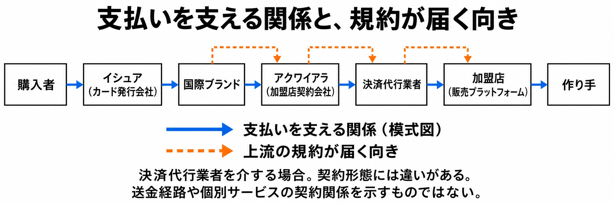

# その代金は、誰の規約を通って届くか――国内プラットフォームの決済停止と、政治・行政の関わり

2024年4月3日、ダウンロード販売サイトDLsiteでVisa・Mastercardが使えなくなった。翌4日にはAmerican Expressも停止した。理由は明らかにされなかった。[[1](#ref-1)] 作品が売り場に並んでいても、購入者がいつものカードで代金を払えなくなる。新たな法律や条例による販売禁止が示されたわけではなく、支払いの経路で販売の条件が変わったのである。

本稿は「ゲームと行政のあいだ」第6回である。[第1回](game-and-government-regulation-map.md)ではルールが届く経路を、[第2回](diet-1986-177-and-pc-game-self-regulation.md)では国会とPCゲームの自主規制を、[第3回](cero-z-rating-gta3-ordinance-link.md)では年齢表示と条例の連動を、[第4回](complete-gacha-administrative-tools-and-display-enforcement.md)ではコンプガチャと行政の道具を、[第5回](kagawa-game-ordinance-process-lawsuit-aftermath.md)では香川県の条例の宛て先と制定後の経過を見た。今回は取引規約が届く経路へ進む。判断軸は、 **その代金は、誰の規約を通って届くか** である。

決済停止は、同人ゲームを扱う売り場でも起きている。作り手やパブリッシャーにとって、支払い方法の変更は購入のしやすさや販売計画に関わる。仕組みと国内の記録をたどり、説明されていない部分も含めて、事業判断に使える地図にしていこう。

***

## 買う人と売る人のあいだに、複数の契約がある

カードには、購入者側と販売店側をつなぐ仕組みがある。まず、登場する事業者を整理する。

| 呼び名 | 平易にいうと | 主な役割 |
|---|---|---|
| 国際ブランド | VisaやMastercardなど、共通の取引網とルールを提供する仕組み | カードを異なる会社や国・地域のあいだで使うための基盤を提供する |
| イシュア | 購入者のカードを発行する会社 | カード会員との契約、利用の承認、代金の請求などを担う |
| アクワイアラ（加盟店契約会社） | 店がカードを受け付けるための契約を結ぶ会社 | 加盟店の審査・管理などを担う |
| 決済代行業者 | 店に代わって複数の決済との接続や契約を取りまとめる会社 | 決済手段の導入や処理をまとめて提供する |
| 加盟店 | カード決済を受け付ける店 | 本稿では主に販売プラットフォームを指す |

経済産業省の資料にも、カード会員、イシュア、国際ブランド、アクワイアラ、加盟店という関係が示されている。[[2](#ref-2)] ITmediaでカード決済を解説する鈴木淳也氏によれば、大手の通販事業者やチェーン店は国際ブランドと直接交渉して手数料率を決めることが多い。一方、中小の店では、決済代行業者を介して一括で契約するのが一般的だという。[[3](#ref-3)]

つまり、購入画面に見えるカードのロゴの背後には、売り場が直接契約する相手と、その相手が従うルールがある。国際ブランドとの直接交渉の有無と、実際の決済処理の経路は分けて考える必要がある。

決済代行業者を介する場合の模式図。契約形態には違いがある。送金経路や個別サービスの実際の契約関係を示すものではない。経済産業省資料と鈴木淳也氏の解説をもとに作成。[[2](#ref-2)][[3](#ref-3)]

### 停止理由には、異なる型がある

鈴木氏の2022年8月3日の解説は、ブランド側が取引停止を持ちかける理由を、倒産リスクなどの経済的な理由、政治的・社会的なリスク、ブランドのポリシーとの相反という三つに整理している。三つ目では明確な判断基準がなく、停止理由が外部から分かりにくい場合があると指摘する。同じ解説には、手数料の交渉が折り合わず、あるブランドの取り扱いがなくなる場合も示されている。[[3](#ref-3)]

この整理は、理由を読むための候補である。「成人向けを扱う店で止まった」という事実だけから、特定のポリシー違反や判断主体を割り当てることはできない。

Mastercardは2021年、成人向けコンテンツを扱う加盟店の要件を改め、違法なコンテンツを監視・排除する管理体制などを求めた。[[4](#ref-4)] 規則の詳細とSteamを巡る経緯は、[Steamの成人向けコンテンツと決済・銀行の問題を扱った記事](steam-adult-content-payment-banking-bottlenecks.md)に譲る。

***

## 国内では、何がどの単位で止まったか

次の表は、2022年以降の主な停止と、その後の対応を並べたものである。各行は記載した時点の告知・報道であり、現在の利用可否を一覧にしたものではない。

| 時期 | プラットフォーム | 止まった範囲 | 理由の説明 |
|---|---|---|---|
| 2022年7月29日 | DMM | Mastercardの取り扱いを停止 | ITmediaはDMMの説明として「諸条件が折り合わず」と伝えた。具体的な条件は示されていない。[[3](#ref-3)] |
| 2024年4月3〜4日 | DLsite | 3日にVisa・Mastercard、4日にAmerican Expressを停止 | 理由は明らかにされていない。[[1](#ref-1)] |
| 2024年5月21日 | Fantia | 15時30分からVisa・Mastercardを一時停止 | 公式告知に停止理由の説明はない。ほかの支払い方法への変更を案内し、当時は再開の目途も示さなかった。[[5](#ref-5)] |
| 2024年6月14日 | FANZA同人 | Visa決済を一時停止 | 理由・期限は不明と報じられた。[[6](#ref-6)] |
| 2024年6月、11月5日 | U-NEXT／H-NEXT | 6月、Visa・Mastercard利用者への成人向け作品の配信を停止し、月額プランから成人向け作品を切り離した。11月5日、H-NEXT見放題サービスでVisa・Mastercardを含むクレジットカード決済を再開 | 停止・再開の理由は示されていない。[[7](#ref-7)] |
| 2024年8月13日 | とらのあな通信販売 | Visa・Mastercard決済を停止。8月9日発表、12日いっぱいで終了 | 理由は明らかにされていない。[[8](#ref-8)] |
| 2024年11月 | マンガ図書館Z | 5日に、26日12時でのサービス停止を発表 | 創立者の赤松健氏によれば、10月に決済代行会社から、カード以外も含む決済サービス全体の契約を10月末に解約するよう通告され、既に過ぎた月の支払いも留保された。個別の根拠条項は示されていない。[[9](#ref-9)] |
| 2025年5〜6月 | 駿河屋 | 5月に成人向け商品の取り扱いが止まり、順次再開。6月5日にJCB・AMEX・Diners Clubで成人向け商品のカード決済を再開。Visa・Mastercardは利用できない状態 | 決済手段について提供側企業との協議が必要になったとの声明があった。停止判断の詳しい条件は示されていない。[[10](#ref-10)] |
| 2025年10月 | DLsite | 停止後の対応として「みんなの銀行決済」を導入 | 決済手段を追加した事例。停止原因の説明ではない。[[11](#ref-11)] |
| 2026年1月26日 | viviONグループ | ナッジとの提携による公式の「viviON JCBカード」のサービスを開始 | グループ独自のカードを用意した事例。国際ブランドや発行会社から独立した決済網ではない。[[12](#ref-12)] |

停止理由が具体的に公表された例は、この表ではほとんどない。一方、U-NEXTや駿河屋には再開の記録もある。停止という結果だけを並べても、共通する一つの原因や、継続期間を導くことはできない。

影響の単位にも差がある。ブランド単位でカードが使えなくなる場合、特定の売り場やサービスが切り離される場合、決済サービス全体の契約終了に及ぶ場合がある。マンガ図書館Zについては、赤松氏はビットキャッシュ以外の支払い方法が使えなくなったとも説明している。契約終了の通告範囲と、実際に残った支払い方法は分けて読む必要がある。[[9](#ref-9)]

DLsiteが銀行口座との連携による決済を加え、viviONが提携カードを用意したことは、プラットフォーム側が代替手段の確保に動いた例である。[[11](#ref-11)][[12](#ref-12)] DLsiteやFANZA同人には同人ゲームの販売の場が含まれる。作品の完成度や集客だけでなく、購入の入口を維持することも、ゲームを売る側の仕事になる。

***

## 政治は、説明を求める側として登場した

### Visa本社への確認と、日本法人への再確認

2024年8月1日、山田太郎参議院議員はVisaの米国本社を訪問し、責任者らと会談した。[[13](#ref-13)]

山田議員の報告を伝えたITmediaによれば、Visaは成人向けコンテンツについて、年齢に関するルールの順守と合意のもとでの提供を共通基準としている一方、内容についての基準は定めておらず、内容の判断もしていないと説明した。本社が基準を決め、判断は現場が行うとの説明もあったという。これは議員を通じて公表された説明であり、個々の停止で誰が判断したかを明かすものではない。[[13](#ref-13)]

同年12月のITmedia報道では、ビザ・ワールドワイド・ジャパンのシータン・キトニー社長がインタビューで、ブランドを守るために使えなくする必要が生じる場合があるという趣旨の発言をしたことが取り上げられた。山田議員が日本法人へ確認すると、本社の回答に変更・追加はなく、社長の発言はアクワイアラや決済代行会社などの現場でそうした判断があることを承知しているという意味だ、と回答があったという。[[14](#ref-14)]

ここには、本社の説明と社長の発言のあいだで受け取り方に違いが生じ、再確認が行われたという記録がある。ただし、このやり取りによってDLsiteなどの個別案件の判断主体や根拠が判明したわけではない。

### 質問主意書と、政府の答弁書

2024年12月17日、五十嵐えり衆議院議員は、クレジットカード及び決済代行会社の決済拒否について質問主意書を提出した。[[15](#ref-15)] 質問主意書とは、国会議員が政府の見解を文書で尋ねる仕組みである。

質問は、政府が対応すべき問題と認識しているか、取引上の強い立場を利用して相手に不当に不利益を与える「優越的地位の濫用」に当たる可能性をどう捉えるか、などを尋ねた。[[15](#ref-15)]

12月27日付の答弁書、すなわち質問に対する政府の公式な文書回答は、取引停止の事例があるとの情報を得ているとした。そのうえで、対応すべき問題があるかは個別の事情によるため、一概には回答できないとした。優越的地位の濫用への該当については、次のように答えている。[[16](#ref-16)]

> 個別具体的な事情により判断されることとなり、一概にお答えすることは困難である

この答弁は、一連の停止をまとめて適法、または違法と判定したものではない。政府の公式な見解は、個別具体的に判断するという段階にとどまった。

### 2025年の働きかけは、対象と成果を分けて読む

山田議員の公式サイトは、2025年5月の金融庁・経済産業省へのガイドライン策定等の依頼と、6月の研究会設立を関連する取り組みとして掲載している。ただし、5月20日の記事が扱うのは、決済アプリの残高の有効期限など、利用者保護の問題である。成人向けコンテンツの決済停止についてのガイドライン策定依頼と同じものとして扱うことはできない。[[17](#ref-17)]

同サイトによれば、6月3日に初会合を開いた「映像産業戦略推進研究会」は、クレジットカード問題の解決を重要テーマの一つとした。[[18](#ref-18)] これらの掲載内容では、決済停止の判断基準を明示するガイドラインの成立や、個別の停止を解消したという具体的な成果は示されていない。

二人は当時、異なる会派（山田議員は自由民主党、五十嵐議員は立憲民主党・無所属）に所属しており、それぞれ別の経路でこの問題を取り上げた。[[19](#ref-19)][[20](#ref-20)]

ここまでの記録で、政治は決済停止を指示する側としてではなく、事業者への説明要求や政府への照会を行う側として登場する。議員の働きかけと、政府が公式に示した判断は、それぞれ別に読む必要がある。

***

## 行政も、決済網を通じて働きかける

行政が決済網を対策の経路として使う例もある。経済産業省の2025年12月の資料は、オンラインカジノによる賭博事犯を防ぐため、警察庁と連携し、カード会社や国際ブランドへ決済停止や決済網からの排除などを要請してきたと記している。要請時期は2024年2月、2025年5月、同年7月である。[[2](#ref-2)]

同資料によれば、2025年7月には警察庁と経済産業省が国際ブランドに取引情報を提供し、アクワイアラとオンラインカジノ事業者などとの契約解除等を求める取り組みを取り決めた。国内のカード発行会社も、オンラインカジノでの利用を把握した場合に決済を停止するなどの対応を行うとしている。[[2](#ref-2)]

これは違法な賭博を防ぐための措置であり、合法なコンテンツの決済が止まる問題とは性質が異なる。この資料から、前掲の国内プラットフォームの停止に行政の指示があったと結び付けることもできない。

共通するのは、決済網が事業の継続条件に働きかける経路になりうる点である。誰が、どの目的で、どの契約相手に対応を求めたかが公表されれば、その経路をたどれる。成人向けコンテンツを巡る個別の停止では、同じ程度の経路情報が示されていない。

***

## 見えない部分を地図にする

説明のない停止を理解しようとすると、分かっている仕組みを使って原因を推測したくなる。そこで、情報を四つの段に分けておく。

| 情報の段 | 地図に置けるもの | そこからは分からないもの |
|---|---|---|
| 確認できる事実 | 各社の停止・再開の告知、政府答弁書、議員が公表した内容 | 告知や公表があったことだけでは、非公開の交渉経過まで分からない |
| 当事者の説明 | 山田議員経由のVisa本社の説明、赤松氏による決済代行会社からの通告や支払い留保の説明 | 説明した側が把握する範囲と、取引網全体の判断は同一とは限らない |
| 報道にもとづく推測 | 鈴木氏の解説が示す、経済的リスク、政治的・社会的リスク、ポリシーとの相反という停止理由の型 | 個別の停止がどの型に当たるかは、別の根拠が必要になる |
| 誰も説明していないこと | 本稿で扱った個別案件の多くについて、どの事業者が、どの規約のどの条項に基づいて判断したのか。停止を解除した理由 | 公表資料にない部分を、停止の時期や扱うジャンルだけで埋めることはできない |

最後の段でいう「誰も説明していない」は、本稿の参照資料に公表された説明がないという意味である。当事者同士で通知や交渉が一切なかったことを意味しない。

例えば、「Visaは内容の価値判断をしないと説明した」という記録と、「Visaが使えなくなった」という記録は両立する。そのあいだを埋めるには、加盟店側の契約、現場の判断、通知の内容などが必要だ。説明されていない部分は空白として残す。その空白こそ、販売計画で見通せない条件がどこにあるかを示している。

***

## ゲームの販売計画に置き換える――ここからは考察

### 支払い方法の数と、経路の数を分ける

販売先を選ぶときには、売り場の利用規約に加え、その上流に国際ブランド、アクワイアラ、決済代行業者のルールがあることを見込んでおきたい。小規模な作り手がすべての契約書を読めるとは限らない。それでも、使える決済方法、契約上の問い合わせ先、停止時の告知や売上精算の扱いは、販売先へ確認できる事項である。

複数の決済手段を用意することは備えになる。ただし、画面に並ぶ選択肢が多くても、同じ上流の事業者や契約に依存していれば、同時に止まる可能性がある。別の販売先を加える場合も、売り場の名前に加え、どの経路が共通しているかを見る必要がある。

DLsiteの「みんなの銀行決済」と、viviONがナッジと提携して用意したJCBカードは、プラットフォーム側が決済手段を自ら確保する方向の例と読める。[[11](#ref-11)][[12](#ref-12)] 後者もカード会社と国際ブランドの仕組みを利用する。独自のカードがあることを、上流のルールから自由になることと同一視せず、何への依存が変わったかを見るのがよい。

### 購入の入口と、売上を受け取る出口を点検する

購入者が代金を払う入口と、作り手が銀行口座で売上を受け取る出口には、それぞれ別の条件がある。銀行による入金拒否の事例とSteam側の経緯は、[既存記事](steam-adult-content-payment-banking-bottlenecks.md)で扱っている。販売先の決済が動いていても、自社の資金繰りまで確定したことにはならない。

企画・事業の計画では、入口が止まった場合に売上がどう変わるかと、出口が遅れた場合に次の支払いを続けられるかを分けて考えられる。代替経路の有無に加え、切り替えに必要な時間、購入者への案内、未精算分の扱いも計画の対象になる。

### 決済網の側の理由も、判断材料に含める

決済網の側にも、違法なコンテンツの流通を防ぐ理由がある。Mastercardが示した管理要件や、行政のオンラインカジノ対策は、その目的を明示している。[[4](#ref-4)][[2](#ref-2)] 停止には経済的理由や手数料交渉もあり、すべてを作品の内容への介入として一括りにはできない。[[3](#ref-3)]

そのうえで、合法なコンテンツについて判断基準が示されなければ、事業者はどの条件を満たせば販売を続けられるかを見通しにくい。企画を変えるべきか、販売先を分けるべきか、決済方法を追加すべきか。その選択に必要なのは、停止したという結果に加え、判断の対象と条件の説明である。

***

## 販売前に点検しておきたいこと

- 販売先が対応する決済方法と、それぞれの上流の事業者を、分かる範囲で整理しているか。
- 複数の支払い方法や販売先が、同じ決済代行業者や契約に依存していないか。
- 停止時の問い合わせ先、通知の方法、未精算売上の扱いを確認しているか。
- 代替手段への切り替えと購入者への案内に、どれだけ時間が必要か。
- 購入者が支払う入口と、自社が売上を受け取る銀行口座の出口を、別々に点検しているか。
- 停止・再開の事実、当事者の説明、自社の推測を分け、資料の日付を残しているか。

第7回では「振興策の採点」へ進む。ゲーム産業への支援が何を目標にし、その成果を何で測るのかを考える。

作品を届け続ける条件には、制作と販売の仕組みに加え、代金を運ぶ契約も含まれる。販売計画の中で繰り返し確かめたい問いは、 **その代金は、誰の規約を通って届くか** である。

## References

1. [太田亮三「「DLSite」でVisa・Mastercardの利用停止」][1] — Impress Watch、2024年4月4日。

[1]: https://www.watch.impress.co.jp/docs/news/1581842.html

2. [経済産業省 商取引・消費経済政策課「オンラインカジノ対応について（クレジットカード関連）」][2] — オンラインカジノに係るアクセス抑止の在り方に関する検討会（第10回会合）資料10-5、2025年12月。資料記載の1〜3ページ。

[2]: https://www.soumu.go.jp/main_content/001044907.pdf

3. [鈴木淳也「DMMの「Mastercard取引停止」で考える“カード決済の裏” クレカの扱いがなくなる複数の理由」][3] — ITmedia NEWS、2022年8月3日。DMMの説明と手数料交渉は1ページ目、停止理由の類型と中小店舗の契約は[2ページ目](https://www.itmedia.co.jp/news/articles/2208/03/news116_2.html)を参照。

[3]: https://www.itmedia.co.jp/news/articles/2208/03/news116.html

4. [John Verdeschi「Protecting our network, protecting you: Preventing illegal adult content on our network」][4] — Mastercard Newsroom、2021年4月14日。原文の大意を日本語で記した。

[4]: https://newsroom.mastercard.com/news/perspectives/2021/protecting-our-network-protecting-you-preventing-illegal-adult-content-on-our-network/

5. [Fantia「【重要】Visa、Mastercardをご利用のお客様へ（2024/5/21）」][5] — Fantia Spotlight、2024年5月21日。停止時刻、継続支払いへの影響、再開の目途に関する案内を参照。

[5]: https://spotlight.fantia.jp/news/240521_payment_method

6. [ITmedia NEWS「成人向けEC「FANZA」、同人コーナーでのVisa決済を一時利用停止に 理由や期限は不明」][6] — ITmedia NEWS、2024年6月14日。

[6]: https://www.itmedia.co.jp/news/articles/2406/14/news145.html

7. [ITmedia NEWS「U-NEXT、成人向け動画サービスでのVisa／Mastercardの決済再開 およそ4カ月ぶりに」][7] — ITmedia NEWS、2024年11月11日。

[7]: https://www.itmedia.co.jp/news/articles/2411/11/news105.html

8. [松浦立樹「とらのあな、通信販売でのVisa／Mastercard決済を停止に 13日以降は利用できず コミケ前に突如発表」][8] — ITmedia NEWS、2024年8月9日。

[8]: https://www.itmedia.co.jp/news/articles/2408/09/news175.html

9. [J-CAST ニュース「絶版配信の「マンガ図書館Z」サービス停止 「決済代行会社から通達」創立者・赤松健氏が経緯説明」][9] — J-CAST ニュース、2024年11月6日。運営元の発表と創立者による説明を参照。

[9]: https://www.j-cast.com/2024/11/06497259.html?p=all

10. [ずんこ。「駿河屋、成人向け商品のクレジットカード決済を再開。但し一部ブランドは未だ使用不可」][10] — GameBusiness.jp、2025年6月5日。

[10]: https://www.gamebusiness.jp/article/2025/06/05/24375.html

11. [三ツ矢「VisaやMastercard利用停止中の「DLsite」が新たな決済手段「みんなの銀行決済」提供開始」][11] — GameBusiness.jp、2025年10月7日。

[11]: https://www.gamebusiness.jp/article/2025/10/07/25213.html

12. [viviON「viviON、ナッジと提携し『viviON JCBカード』の提供を開始。」][12] — 株式会社viviON プレスリリース、2025年12月19日。2026年1月26日からの利用開始と、ナッジとの提携を参照。

[12]: https://media.vivion.jp/public/uploads/1769506886277_20251219_viviON%20JCB_press.pdf

13. [ITmedia NEWS「山田太郎議員が米Visa本社で会談──クレカ表現規制巡り「合法コンテンツの取引で価値判断はしない」との発言引き出す【追記あり】」][13] — ITmedia NEWS、2024年8月20日公開、8月23日更新。議員が報告したVisa側の説明。

[13]: https://www.itmedia.co.jp/news/article/2408/20/1240820180/

14. [ITmedia NEWS「クレカ表現規制に対するVisaの見解、山田議員が日本法人に「価値判断しない」と再確認 社長の発言を受け」][14] — ITmedia NEWS、2024年12月3日。

[14]: https://www.itmedia.co.jp/news/article/2412/03/1241203133/

15. [五十嵐えり「クレジットカード及び決済代行会社の決済拒否に関する質問主意書」][15] — 衆議院、2024年12月17日提出、質問第95号。

[15]: https://www.shugiin.go.jp/internet/itdb_shitsumon.nsf/html/shitsumon/a216095.htm

16. [内閣「衆議院議員五十嵐えり君提出クレジットカード及び決済代行会社の決済拒否に関する質問に対する答弁書」][16] — 衆議院、2024年12月27日、内閣衆質二一六第九五号。「一について」「二について」を参照。

[16]: https://www.shugiin.go.jp/internet/itdb_shitsumon.nsf/html/shitsumon/b216095.htm

17. [山田太郎「金融庁・経済産業省へガイドライン策定等を依頼」][17] — 山田太郎公式webサイト、2025年5月20日。[「クレジットカード問題」](https://taroyamada.jp/works/works-45247/)の関連掲載記事。決済アプリ残高の有効期限に関する依頼として参照。

[17]: https://taroyamada.jp/cat-digital/post-44841/

18. [山田太郎「クレカ問題解決を重要テーマに「映像産業戦略推進研究会」立ち上げ 初会合が開催されました」][18] — 山田太郎公式webサイト、2025年6月3日。[「クレジットカード問題」](https://taroyamada.jp/works/works-45247/)の関連掲載記事。研究会設立についての本人発信として参照。

[18]: https://taroyamada.jp/cat-digital/post-45147/

19. [参議院「議員一覧（50音順）／参議院会派名一覧（第216回国会）」][19] — 参議院、第216回国会の保存資料。山田太郎氏の会派略称「自民」と[会派名一覧の正式名称](https://www.sangiin.go.jp/japanese/joho1/kousei/giin/kaiha/kaiha216.htm)「自由民主党」を照合。

[19]: https://www.sangiin.go.jp/japanese/joho1/kousei/giin/216/giin.htm

20. [国立国会図書館「第216回国会 衆議院 安全保障委員会 第3号」][20] — 国会会議録検索システム、2024年12月12日。公式APIの五十嵐えり氏の発言データにある所属会派欄を参照。

[20]: https://kokkai.ndl.go.jp/txt/121603815X00320241212/33

----

この文書は、Perplexity、Claude、OpenAI Codex の3つのAIの支援を受けて著述されたものです。引用画像を除き、MIT License にて提供されています。
