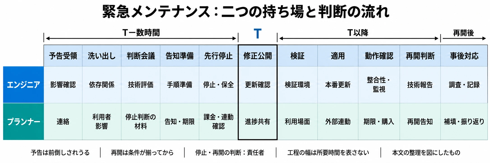

# その停止は、誰が、いつ、何を根拠に決めるか――PHPの重大な脆弱性から考える緊急メンテナンスの段取り

> 本稿は、2026年10月22日午前時点の情報に基づいています。FFXIVの新規ログイン再開については、同日21時台に追記しました。各サービスの再開状況や脆弱性に関する発表は変化しているため、最新の利用状況は各運営の公式告知をご確認ください。

運用型ゲームの緊急メンテナンスには、サーバーを修正する作業と、プレイヤーの時間を預かる判断が重なる。修正を待つ間にイベントが終わり、ログインボーナスの日付が変わり、有料の効果時間が消費されることもある。技術担当が危険性を把握した時点で、運営側も動き始める必要がある。

2026年10月21日、Webサービスを動かすプログラミング言語PHPの重大な **脆弱性**、すなわち攻撃に悪用されうるソフトウェアの弱点への対応で、ゲームや関連サービスが相次いで緊急メンテナンスを告知した。修正版の公開予告はUTCでは前日の20日であり、日本時間では21日早朝に当たる。[[1](#ref-1)]

この出来事を通じて考えたいのは、 **その停止は、誰が、いつ、何を根拠に決めるか** である。エンジニアが技術上の危険と対処の条件を示し、プランナーがプレイヤーへの影響を整理し、権限を持つ責任者が期限内に決める。その協調を、一本のタイムラインとして準備する。

***

## 何が危険で、いつ修正が出たのか

今回の2件は、メモリ処理の不備によって、認証なしに **RCE（遠隔からのコード実行）**、つまり外部からサーバー上で攻撃者のプログラムを動かされうる問題である。PHP公式は、Webリクエストを処理するPHPを広く対象とし、特にApacheのmod_phpでリスクが高いと説明した。ゲームの機能そのものに加え、ログインや公式サイトなど、周辺の仕組みも確認対象になる。[[1](#ref-1)]

脆弱性を識別する共通番号 **CVE** は、CVE-2026-109618とCVE-2026-109619である。深刻度を共通の物差しで評価する **CVSS** では、いずれもバージョン4.0の9.2点で、最上位のCriticalに分類される。これは侵害の発生確率や、自社の被害の大きさをそのまま表す点数ではない。自社の構成と外部への公開状況を併せて判断する。[[1](#ref-1)][[2](#ref-2)]

修正版はPHP 8.5.12、8.4.27、8.3.36、8.2.35である。PHP公式は直ちに更新するよう強く推奨し、完全な対策は更新だけであるとした。 **パッチ** は、こうした不具合や脆弱性を修正するためのプログラム変更を指す。[[1](#ref-1)]

### 予告から翌日夜までの時系列

下表の日本時間はUTCに9時間を加えたものだ。時刻のない発表は日付単位で示し、日中の発表同士の前後関係は確定しない。修正の協調公開予定時刻は21日14:00 UTC、日本時間23:00だったが、国家サイバー統括室の公開案内は22:57に出ている。23時は準備を合わせる基準であり、配布が一斉に始まる秒単位の境界ではなかった。

| UTC | 日本時間（JST） | 出来事と、その時点で分かったこと |
| --- | --- | --- |
| 10月20日15:00ごろ | 10月21日0:00ごろ | CVE番号が、誤った公開時刻・深刻度とともに出回る。この段階では技術的詳細は流出していない。[[3](#ref-3)] |
| 10月20日19:30 | 10月21日4:30 | PHPが予告を公開。修正版の公開予定を、当初の22日から21日14:00 UTCへ前倒しした。[[3](#ref-3)] |
| 10月20日20:00ごろ | 10月21日5:00ごろ | 報告元CalifがPoCの動画を誤って公開し、削除後も複製が広まった。PoCは、攻撃などが成立することを示す概念実証である。[[3](#ref-3)] |
| 10月21日7:41 | 10月21日16:41 | 財団の説明では、ある配布事業者が協調公開の6時間以上前に修正入りイメージを公開した。[[3](#ref-3)] |
| 10月21日（時刻の確定なし） | 10月21日（発表日） | CERT-EUとIPAが注意喚起。CERT-EUは即時更新が難しい場合の外部ネットワークからの切り離しも検討するよう求め、IPAは棚卸しと適用準備を呼びかけた。[[4](#ref-4)][[5](#ref-5)] |
| 10月21日11:30まで | 10月21日20:30まで | ファミ通が『ウマ娘』『グラブル』『Shadowverse: Worlds Beyond』のPHP対応の告知を報道。当初の開始予定は23時ごろだった。[[6](#ref-6)] |
| 10月21日12:16／12:20 | 10月21日21:16／21:20 | 『ウマ娘』『Shadowverse: Worlds Beyond』が、開始を22時ごろへ変更する追記を掲載。[[7](#ref-7)][[8](#ref-8)] |
| 10月21日12:44 | 10月21日21:44 | 国家サイバー統括室が、速やかな適用が難しい場合の一時停止もリスク低減策の一つと投稿。[[9](#ref-9)] |
| 10月21日12:55 | 10月21日21:55 | 高市早苗首相が、利用状況の確認と適用準備を呼びかけ、一時停止にも言及。[[10](#ref-10)] |
| 10月21日13:57／14:00ごろ | 10月21日22:57／23:00ごろ | 国家サイバー統括室が公開を案内。PHPの修正版が公開された。[[11](#ref-11)][[1](#ref-1)] |
| 10月21日15:30 | 10月22日0:30 | 『Shadowverse: Worlds Beyond』のメンテナンス終了。1時の追記で告知。[[8](#ref-8)] |
| 10月21日16:38 | 10月22日1:38 | FFXIVが、PHP対応に伴うパッチサーバー停止と全ワールドの新規ログイン停止を告知。告知時点では復旧所要時間を精査中としていた。時刻は告知の掲載時刻であり、停止開始時刻の明示はない。[[12](#ref-12)] |
| 10月21日17:30 | 10月22日2:30 | 『ウマ娘』のメンテナンス終了。2時32分の追記で告知。[[7](#ref-7)] |
| 10月21日22:00／23:35 | 10月22日7:00／8:35 | 『グラブル』はDMM版・GREE版を除いて7時に終了、GREE版は8時35分に終了。各告知時点でDMM版の終了は別途案内とされた。[[13](#ref-13)][[14](#ref-14)] |
| 10月22日10:46 | 10月22日19:46 | FFXIVが公式Xで、対応と検証を終えて最終確認中であり、当日中に新規ログインを再開できる見込みと発信。[[22](#ref-22)] |
| 10月22日12:16ごろ | 10月22日21:16ごろ | FFXIVが更新したパッチサーバーを公開し、新規ログインを再開。21:19の続報で告知。セーブデータのサーバーバックアップ機能は停止が続くとした。[[21](#ref-21)] |

### 「終了した範囲」と「被害を確認していない範囲」を分ける

翌朝の再開状況はサービスごとに異なる。さらに、同じゲームでも利用経路ごとに異なりうる。

| サービス | 終了・再開についての発表 | 被害・流出についての発表 |
| --- | --- | --- |
| ウマ娘 プリティーダービー | 22日2:30終了。開始予定は23時から22時へ変更された | 告知には、その時点で本脆弱性を悪用した被害や利用者データの流出を確認していないと記載。[[7](#ref-7)] |
| Shadowverse: Worlds Beyond | 22日0:30終了 | 告知には、その時点で本脆弱性を悪用した被害や利用者データの流出などを確認していないと記載。[[8](#ref-8)] |
| グランブルーファンタジー | DMM版・GREE版を除いて7:00終了、GREE版8:35終了。8:36の告知でもDMM版は別途案内 | ここで参照する終了告知は、被害・流出の調査結果を述べたものではない。[[13](#ref-13)][[14](#ref-14)] |
| FFXIVの新規ログイン | 22日1:38（JST）の告知で新規ログイン停止を案内。21:16ごろ（JST）に新規ログインを再開。セーブデータのサーバーバックアップ機能は、続報の時点で停止が続いている | 参照する停止告知と続報には、被害・流出についての記載はない。[[12](#ref-12)][[21](#ref-21)] |
| バンダイナムコエクスペリエンスの各種サービス | 21日22時ごろから。期間はサービスごとの公式サイト・SNSで案内 | 同社の総合告知では、その時点で本脆弱性を悪用した被害や利用者データの流出を確認していないと記載。[[15](#ref-15)] |

「確認されていない」は、発表主体と調査時点を伴う説明である。ある会社の発表を、他社やPHP利用サービス全体の安全宣言へ広げることはできない。また、更新が済んだことと、それ以前の侵害の有無を調べ終えたことは別の確認である。

***

## 予告があると逆算できる。ただし、その予告も動く

今回の対応では、修正版が出る予定時刻を先に共有できた。そのため、人員の確保、適用手順の確認、停止の決裁、告知の準備を前倒しで進められた。

一方で、公開予定は流出を受けて1日早まり、協調公開より先に修正入りイメージが配布される出来事もあった。 **エンバーゴ**、すなわち公開日まで情報の扱いを合わせる取り決めがあっても、計画どおりに進む保証はない。PHPの予告自体も、詳細公開や悪用の証拠があれば、さらに前倒しする可能性を示していた。[[3](#ref-3)][[1](#ref-1)]

したがって、予定表には「何時に何をするか」とともに、「どの情報が来たら予定を変えるか」を書く。たとえば、公式の前倒し発表、利用ベンダーの更新提供、自社への攻撃兆候を、停止時刻の再判断につなぐ。これは各社の内部判断を説明するものではなく、運営チーム向けに一般化した準備の考え方である。

再開側の見込みも、同じように段階を区切って伝えられる。FFXIVは22日19:46、公式Xで対応と検証を終えて最終確認中であると工程の段階を示し、新規ログインの再開を「本日中」の見込みとした。そのうえで21:16ごろに再開し、21:19に続報を出した。[[22](#ref-22)][[21](#ref-21)] 再開時刻を一点で約束せず、どの段階にいるかと見込みの幅を示す告知の実例である。

***

## 修正版の公開時刻「T」から、二つの持ち場を並べる

以下は特定企業の実際の手順を再現したものではない。修正版の公開予定時刻を **T** と置いた一般化モデルである。所要時間は構成と検証量で変わるため、固定の時間割として使わず、自社の担当者と完了条件を書き込んで使う。

| 段階 | エンジニアの作業 | プランナーの作業 | その段階で揃える判断材料 |
| --- | --- | --- | --- |
| T−数時間〜：予告受領 | 公式情報、影響範囲、公開予定を確認し、技術窓口を置く | 運営責任者、CS、課金・外部連動の担当へ連絡する | 情報源、確認時刻、次回確認時刻 |
| T−数時間：システムの洗い出し | PHPの利用箇所、公開状況、更新の提供元、依存先を整理する | 止まる機能を、ログイン・プレイ・購入・告知閲覧など利用者の行動に置き換える | 「どこを止めると何が使えないか」の一覧 |
| T−数時間：判断会議 | 稼働継続の危険、停止範囲、更新経路と不確実性を説明する | 売上、期限、イベント、問い合わせへの影響と代替案を示す | 責任者が停止範囲・開始時刻・再判断条件を決めた記録 |
| T−数時間〜直前：告知準備 | 技術的な説明と、外部公開してよい範囲を確認する | 告知、問い合わせ回答、次回更新時刻、期限変更案を揃える | 同じ内容を出せる告知経路と承認担当 |
| T以前：先行停止 | 決定した範囲を停止・隔離し、ログと作業前の状態を保全する | 告知を出し、課金導線・進行中の試合・外部連動の停止を確認する | 停止完了と影響範囲の実測 |
| T：修正版公開 | 正式な更新と自社への適用対象を確認する | 公開されたことを共有し、終了予告は検証状況と分けて扱う | 自社で使える更新が入手できたか |
| T以降：検証 | 検証環境で更新し、必要な拡張や機能への影響を調べる | ログイン、購入、報酬受取など優先して試す利用場面を確認する | 本番適用へ進める条件と、問題発生時の退避方針 |
| T以降：本番適用 | 手順に沿って更新し、対象漏れを確認する | 外部サービス側の進捗を集め、告知・CSへ反映する | 対象ごとの適用結果と残作業 |
| T以降：動作確認 | 本番で主要機能と監視、データ整合性を確認する | 期限変更、課金表示、補填対象、利用経路ごとの動作を確認する | 技術面と運営面の再開条件が揃ったか |
| 条件成立後：再開判断・告知 | 残る危険と監視体制を責任者へ報告する | 再開範囲、残る制限、イベント変更、問い合わせ先を告知する | 責任者の再開判断と、異常時の再停止条件 |
| 再開後：事後対応 | 監視と調査を継続し、作業記録を残す | 影響を集計し、補填・問い合わせ・振り返りを進める | 調査の継続事項、担当、期限 |

先行停止を行うか、その範囲をどこまで広げるかは、技術担当の評価に基づいて責任者が決める。更新の配布待ちや検証待ちの間も外部公開を続けるなら、残る危険と再判断の期限を記録する。プランナーは、技術的な安全性の判定を肩代わりするのではなく、その判断がプレイヤーに何をもたらすかを明らかにする。

*本文の整理を図にしたもの。工程の幅は所要時間を表さない。画像をクリックすると拡大表示できる。*

### 停止範囲は、プレイヤーの行動までたどる

FFXIVの公式告知は、PHP対応として **パッチサーバー** を停止した結果、全ワールドで新規ログインができなくなったと説明している。[[12](#ref-12)] ゲームを動かすサーバー以外でも、入口に必要な仕組みを止めれば、プレイヤーは入れなくなる。

洗い出しの会話では、「PHPを使うサーバーは何台か」から一歩進めて、「止めると既存利用者と新規利用者に何が起こるか」を問う。ログイン、更新ファイルの取得、Web購入、データ連携、問い合わせ、公式告知の閲覧を順にたどると、運営側も停止の意味を共有しやすい。

『Shadowverse: Worlds Beyond』は、ゲームに加え、関連サービス、公式サイトのお知らせ閲覧、問い合わせも利用できなくなると事前に案内した。[[8](#ref-8)] 告知を置くサイト自体が停止対象なら、別の経路を先に確保する必要がある。

***

## 実務では、予定表の行間で問題が起きる

### 深夜の集中作業と「終了未定」

日本時間23時の公開に合わせると、検証と本番適用は深夜へ集中する。更新担当だけでなく、判断する責任者、動作を確かめる運営担当、告知担当の待機と交代も必要になる。日中から準備した担当者が、そのまま翌朝の問い合わせまで抱える計画は避けたい。

終了が読めないときは「未定」とし、次の情報更新時刻を約束する。 **終了予定と、進捗を知らせる時刻を分ける** ことで、検証結果が出る前の再開約束を避けながら、プレイヤーが待ち方を選べる。告知では停止範囲、理由、次回案内、利用者に必要な操作を揃える。詳しい伝え方は [プレイヤーと開発元のコミュニケーション](player-developer-communication-crisis-response.md) を参照してほしい。

### 流出・PoC・攻撃の試みを一つの話にしない

情報が錯綜するときは、発表主体、発表時刻、何を観測したかを一組で記録する。

- **識別番号や動画の流出**：情報が出回った事実であり、自社への侵害を示すものではない。
- **悪用できると主張するPoC**：実用性や対象条件の評価を要する。運営担当が持ち込んで試す材料にはしない。
- **攻撃の試みの観測**：攻撃が成功したことや、自社に被害が出たこととは分ける。
- **侵害・流出の確認**：自社のログや調査結果に基づき、対象と時点を限定して説明する。

IPAの21日付注意喚起は、IPAが今回の脆弱性を悪用した攻撃を確認しているわけではないと明記している。一方、ITmedia NEWSの22日6:31の記事は、修正版公開前に攻撃の試みが観測されたと報じた。両者は発表主体・時点・観測対象が異なる。[[5](#ref-5)][[16](#ref-16)] PHP財団も、公開時点で、出回っていたPoCの中に機能する攻撃コードを見いだしていなかったと説明している。[[3](#ref-3)]

これらをまとめて「悪用済み」と断定することも、「攻撃はない」と断定することも避ける。判断を更新する担当を決め、未確認情報はその状態のまま扱う。GMO Flatt Securityも、更新前の準備としてシステムの洗い出し、更新後の動作確認、関係者との連絡、ログ保全などを挙げている。[[17](#ref-17)]

### 依存先の待ち時間と、更新による別の不具合

PHPは、アプリケーションとOSなどの間で機能を支えるミドルウェアの一つであり、提供形態によって更新の経路も異なる。自社で管理する環境、ホスティング会社が管理する環境、製品内部のPHPを使う環境を区別し、更新の提供元と完了を確認する窓口を持つ。IPAも、製品内部での利用についてはマニュアルや提供元の公開情報を確認するよう求めている。[[5](#ref-5)]

PHP 8.1以前はPHPプロジェクトの通常の更新対象外であり、利用ベンダーによる修正の提供状況や、サポート中の版への移行を確認する必要がある。今回、7.4・8.0・8.1向けに最小限の修正を移植したソースが用意されたことは、通常サポートの再開を意味しない。PHP 8.2も2026年12月31日にサポート終了予定であり、緊急更新の後には継続的な更新経路の見直しが残る。[[1](#ref-1)]

『グラブル』の再開告知がDMM版とGREE版を区別したことは、利用経路ごとに完了を確認する必要を示す具体例になる。[[13](#ref-13)][[14](#ref-14)] そこから各社の内部事情を推定する必要はない。一般的な運用としては、自社の更新完了と外部連動先の利用可能を別々に確認し、再開できる範囲を明示すればよい。

更新後に別の不具合が出た場合の方針も、適用前に決める。旧版へ戻せば脆弱性も戻りうるため、通常の不具合対応と同じ感覚でロールバックして公開を再開することはできない。停止・隔離を維持して修正を進めるのか、安全を確認した機能だけ再開するのかを技術担当が提案し、責任者が判断する。

### ゲーム内の時間、課金、再開時刻

プランナーは停止前に、イベント終了、ログインボーナスの日付変更、スタミナの自然回復、ランキング集計、有効時間付きアイテム、購入済み商品の受取期限を一覧にする。それぞれについて、停止中も時間が進むか、期限を変更できるか、後から対象者を特定できるかを確認する。

FFXIVは22日1:52（JST）、新規ログイン停止に伴って全ワールドのハウジング自動撤去カウンターを停止したと公式Blueskyで発表した。カウンターの再開日時は、状況を確認して検討のうえ、改めて案内するとしている。これはログインの復旧報ではなく、利用できない間に進む時間への対応である。[[18](#ref-18)]

『ウマ娘』は終了告知で、メンテナンス開始時に発動していたトレーナーアビリティの残り有効時間に応じて、アビリティPtを返還したと説明している。[[7](#ref-7)] 一律のお礼と、失われた時間に対応する処理を区別する実例である。進行中の遊びの扱いも、停止前に決めておく項目になる。『Shadowverse: Worlds Beyond』は、メンテナンス前に開始したものも含めてプレイ中のバトルをすべてノーコンテストとし、開催中のグランプリのバトルも同様に扱った。プレイ中のソロプレイは未プレイ扱いとした。[[8](#ref-8)] 補填の基準設計は [障害・不具合の補填基準](live-service-game-incident-compensation-framework.md) に譲り、ここでは対象を後から追える記録を残すことを優先する。

課金では、購入受付を止める範囲と再開条件を確認する。外部ストアで支払いが成立したのにゲーム内へ反映されない場合を含め、購入・付与・再送の確認が必要になる。ゲームを再開した直後から購入も再開するなら、その経路を動作確認の対象に入れる。

再開時刻には、技術面の完了と運営面の準備を合わせる。ログインや購入の確認、期限変更の反映、外部連動の確認、告知の準備を完了条件に含める。再開待ちの集中に備えた監視と、異常時に再停止する権限も確保する。安全条件が揃った後の追加の待機は、その目的と期限を明確にする。

### 「被害を確認していない」と言うための材料

告知担当は技術担当へ、調べた期間、対象システム、ログの種類、確認した兆候、未調査の範囲を尋ねる。調査中なら、その状態を伝える。「更新が成功した」「アラートが出ていない」だけで、過去の侵害まで否定する表現には進まない。

調査で侵害や個人情報への影響が疑われた場合は、復旧作業と並行して担当部署へつなぐ。報告義務の有無は事案の内容によって変わるため、法務・個人情報保護の担当と判断する。具体的な初動は [個人情報漏洩・不正アクセスの最初の48時間](personal-data-breach-first-48-hours-game-company.md) を参照してほしい。

***

## 技術に詳しくない決裁者へ、五つの情報を渡す

継続運営に慣れたゲーム会社では、緊急停止の必要性を説明する土台があることが多いだろう。一方、受託開発での発注元、小規模スタジオ、他部門のWebサービスへの相乗りでは、技術的な危険と事業上の停止判断を結ぶ説明から必要になる場合がある。

公的な呼びかけは、その会話の共通資料になる。国家サイバー統括室と首相は、速やかな適用が難しい場合の一時停止もリスク低減策の一つと示した。CERT-EUは外部ネットワークからの切り離しも検討するよう勧告し、IPAは公開後に速やかに適用できるよう準備を求めた。[[9](#ref-9)][[10](#ref-10)][[4](#ref-4)][[5](#ref-5)]

国家サイバー統括室と首相の投稿は、次のとおりである。[[9](#ref-9)][[10](#ref-10)]

<blockquote class="twitter-tweet" data-dnt="true">
PHPの重大な脆弱性に関し、本日午後11時に公開が予定されている修正パッチを可及的速やかに適用することが困難な場合は、例えばウェブサイト等を一時的に停止させることも、リスクを低減させるための有効策の一つと考えられます。
&mdash; 国家サイバー統括室(注意・警戒情報) (@cyber_forecast) <a href="https://x.com/cyber_forecast/status/2112887821312942568">2026年10月21日</a></blockquote>

<blockquote class="twitter-tweet" data-dnt="true">
皆様に、今夜に対応して頂きたい大至急のお願いです。  多くのウェブサイトで使用されているPHPに関し、PHPのセキュリティチームが、重大な２件の脆弱性に関する注意喚起を行っています。
&mdash; 高市早苗 (@takaichi_sanae) <a href="https://x.com/takaichi_sanae/status/2112890642590564386">2026年10月21日</a></blockquote>

修正版の公開後、国家サイバー統括室は速やかな適用を改めて求めた。[[11](#ref-11)]

<blockquote class="twitter-tweet" data-dnt="true">
2026年10月21日、多くのウェブサイトで使用されているPHP更新プログラムが公開されました。重大な脆弱性に関するセキュリティ修正が含まれていますので、可及的速やかに適用してください。適切な対応がなされない場合、ウェブサイト等が侵害を受ける可能性があります。
&mdash; 国家サイバー統括室(注意・警戒情報) (@cyber_forecast) <a href="https://x.com/cyber_forecast/status/2112906086160429175">2026年10月21日</a></blockquote>

ITmedia NEWSは、首相の発信によって経営層にもリスクが伝わるというエンジニアの評価を紹介している。[[16](#ref-16)] 自社の停止範囲と期限を決めるには、こうした資料に、自社固有の影響を添える必要がある。

次は、自社が影響対象だと技術担当が評価した場合の説明例である。対象箇所や時刻は、自社で確認した値に置き換える。

- **①何が起きているか**：「外部から認証なしでサーバー上のプログラムを動かされうる問題が2件あります。深刻度は最上位のCriticalです。」
- **②自社のどこが該当するか**：「技術担当が、公開中の会員サイトとゲームのログイン関連システムを対象と判断しました。停止すると、新規ログインとWeb購入が使えなくなります。」
- **③止めない場合の影響**：「侵害や情報流出につながるおそれがあります。発生した場合は調査・復旧に加え、内容に応じて本人通知や行政への報告が必要になります。」
- **④止めた場合の影響**：「停止中の売上とプレイ機会を失い、イベント期限や問い合わせへの対応が必要です。運営側で期限調整と告知を準備します。」
- **⑤いつまでに決めるか**：「修正版の公開予定はTです。停止・告知の準備時間を差し引いた時刻までに、先行停止の可否を決めてください。前倒しなどの新情報が出たら再判断します。」

決裁者へ渡すのは、危険性の大きな数字だけではない。選択肢、失うもの、判断の期限を一枚にまとめる。決定した内容は、判断者、時刻、根拠にした情報、次に見直す条件とともに残す。

***

## 次回は、予告を受け取る時間さえないかもしれない

Mandiantは、修正公開の前後で脆弱性が悪用されるまでの時間をTTEとして調べている。平均値は2018〜2019年の63日、2020年〜2021年初めの44日、2021〜2022年の32日から、2023年には5日へ短縮した。ただし2023年の5日は外れ値を除いた値で、除外しなければ47日である。公表後の猶予を示す数字としては使えない。[[19](#ref-19)]

同調査は、2023年に公表され、実際の悪用を追跡した138件のうち97件、約7割が **ゼロデイ**、すなわち修正が利用可能になる前に悪用された脆弱性だったとする。全脆弱性の約7割という意味ではない。[[19](#ref-19)]

今回も、CalifがAIを使った調査で重大な欠陥を見つけ、Wizも独立に両方を報告した。PHP財団によると、CalifとOpenAIは8月11日に同じ根本原因を独立に報告し、その後も追加の攻撃経路の報告が続いた。OpenAIは、同じ能力が攻撃者の攻撃用ツール作成も速めうると警告している。[[20](#ref-20)][[3](#ref-3)]

予告のない突発型では、予告受領から会議・告知準備までの余裕がほぼ失われ、調査と判断を同時に進めることになる。だからこそ、平時に「誰が止めるか」を決めておく。指揮系統と机上演習の進め方は [ライブサービスの障害対応で誰が指揮を執るか](incident-command-exercises-for-live-service-game-teams.md) で整理している。再開後は [重大インシデント後のポストモーテム](postmortem-methodology-after-major-incidents-for-game-teams.md) につなぎ、判断と引き継ぎの詰まりを改善する。

***

## 次の緊急メンテナンスに向けた六つの問い

- 停止と再開を決める責任者と、その人に連絡がつかない場合の代行者は決まっているか。
- どのサーバーを止めると、ログイン・購入・告知・問い合わせの何が使えなくなるかを説明できるか。
- 公開予定の前倒しや攻撃兆候を受けて、誰が、どの条件で計画を見直すか決まっているか。
- イベント期限、ログインボーナス、スタミナ、有効時間付きの効果を、停止中と再開後にどう扱うか整理できるか。
- 技術・運営・外部連動それぞれの再開条件と、終了未定の間の次回案内時刻を共有できるか。
- 被害について何を調べ、どこまで発表できるかを、記録に基づいて説明できるか。

PHPの修正版が出る時刻は、多くのチームが作業を合わせる基準になった。しかし、停止の影響、外部連動先の状況、検証に必要な時間はサービスごとに違う。公開予定から逆算した作業表に、判断者と完了条件を加えることで、エンジニアとプランナーは同じ状況を見て動ける。

次の予告が届いたとき、あるいは予告なしに危険が分かったとき、チームへ問い直したい。 **その停止は、誰が、いつ、何を根拠に決めるか。** 答えをその場で探し始めずに済むことが、緊急メンテナンスへの備えになる。

## References

1. [The PHP Group「Upcoming Critical PHP Security Release」「Security advisory: Critical remote code execution vulnerabilities, update now」ほか][1] — PHP News Archive 2026、2026年10月20日・21日。予告の公開時刻19:30 UTCは財団資料を参照。公開予定は21日14:00 UTC（23:00）。修正版、Webリクエスト処理環境への影響、更新の推奨を参照。2026年10月22日午前に参照。

[1]: https://www.php.net/archive/2026.php

2. [PHP「RCE via OOM corruption」][2] — GitHub php/php-src Security Advisory、2026年10月21日。GHSA-w8hw-w9fx-j79w／CVE-2026-109618のCritical・CVSS v4.0 9.2を参照。もう1件はPHP公式のCVE-2026-109619への案内を参照。2026年10月22日午前に参照。

[2]: https://github.com/php/php-src/security/advisories/GHSA-w8hw-w9fx-j79w

3. [The PHP Foundation「Today's PHP Security Release, and How We're Strengthening PHP Security」][3] — The PHP Foundation、2026年10月21日。流出と公開計画変更、PoC動画、21日7:41 UTCの修正入りイメージ公開、公開時点でのPoC評価、独立報告の経緯を参照。出来事の時刻は本文中のUTC表記による。2026年10月22日午前に参照。

[3]: https://thephp.foundation/blog/2026/10/21/todays-php-security-release-and-how-were-strengthening-php-security/

4. [CERT-EU「Critical Vulnerabilities in PHP」][4] — Security Advisory 2026-018、2026年10月21日、v1.0／v1.1。同日中の更新履歴がある。ページのRelease Date表示は「21-10-2026 15:20:18」だがタイムゾーンの明示がないため、表では分単位の時刻に換算していない。参照版は修正公開を13:30 UTCと記すため、本文の23時はPHPの公開予定時刻として扱い、国家サイバー統括室の22:57の公開案内を併記した。悪用可能性の上昇は述べるが、成功した攻撃の確認結果としては扱っていない。2026年10月22日午前に参照。

[4]: https://cert.europa.eu/publications/security-advisories/2026-018/

5. [情報処理推進機構「【事前準備のお願い】PHPのセキュリティリリース公開予定について」][5] — IPA、2026年10月21日。更新履歴は同日掲載。棚卸し、製品内部のPHP、速やかな適用準備、IPAとして悪用した攻撃を確認しているわけではないとの記述を参照。2026年10月22日午前に参照。

[5]: https://www.ipa.go.jp/security/security-alert/2026/pre-alert20261021.html

6. [ファミ通.com「『ウマ娘』『グラブル』『シャドバWB』などが本日（10/21）23時より緊急メンテ。“PHP”の重大な脆弱性に対応するため」][6] — ファミ通.com、2026年10月21日20:30。各社の当初告知を参照。実施・終了状況は後続の公式告知と区別した。2026年10月22日午前に参照。

[6]: https://www.famitsu.com/article/202610/91632

7. [Cygames「PHPの脆弱性対応に伴うメンテナンスのお知らせ」][7] — ウマ娘 プリティーダービー公式ポータルサイト、2026年10月21日18:30、同日21:16・22日2:32追記。開始の22時への変更、2:30終了、被害・流出についての記載、アビリティPt返還を参照。2026年10月22日午前に参照。

[7]: https://umamusume.jp/news/detail?id=3523

8. [Cygames「【10月21日 22:00 ～】PHPの脆弱性対応に伴うメンテナンスのお知らせ【10/22 1:00追記】」][8] — Shadowverse: Worlds Beyond公式サイト、2026年10月21日、同日21:20・22日1:00追記。22日0:30終了、停止対象、プレイ中のバトル・ソロプレイの扱い、被害・流出についての記載を参照。2026年10月22日午前に参照。

[8]: https://shadowverse-wb.com/ja/news/detail/?id=01M5ENH1HB26HZ8YGE8JXF4PSN

9. [国家サイバー統括室（注意・警戒情報）「PHPの重大な脆弱性に関し……」][9] — 公式X、2026年10月21日21:44。一時停止をリスク低減策の一つとする呼びかけを参照。2026年10月22日午前に参照。

[9]: https://x.com/cyber_forecast/status/2112887821312942568

10. [高市早苗「皆様に、今夜に対応して頂きたい大至急のお願いです。」][10] — 公式X、2026年10月21日21:55。PHPの利用確認、23時公開予定の修正への準備、一時停止への言及を参照。2026年10月22日午前に参照。

[10]: https://x.com/takaichi_sanae/status/2112890642590564386

11. [国家サイバー統括室（注意・警戒情報）「2026年10月21日、多くのウェブサイトで使用されているPHP更新プログラムが公開されました。」][11] — 公式X、2026年10月21日22:57。修正版公開と速やかな適用の案内。侵害の可能性への警告であり、悪用成功を確認したとの発表ではない。2026年10月22日午前に参照。

[11]: https://x.com/cyber_forecast/status/2112906086160429175

12. [スクウェア・エニックス「全ワールド 新規ログイン一時停止のお知らせ(10/22)」][12] — FINAL FANTASY XIV, The Lodestone、2026年10月22日1:38（JST、21日16:38 UTC）。時刻は告知の掲載時刻。パッチサーバー停止に伴う新規ログイン停止と、復旧所要時間を精査中との記載を参照。22日10:43（JST）に告知と公式ニュース一覧を確認。新規ログインの再開は続報[[21](#ref-21)]を参照。

[12]: https://jp.finalfantasyxiv.com/lodestone/news/detail/d9b4c1cf9d163fd1e4133bf615e7ed7e80b4aff2

13. [グランブルーファンタジー「【緊急メンテナンス終了のお知らせ】」][13] — 公式X、2026年10月22日7:01。21日22時開始、DMM版・GREE版を除き22日7時終了との告知。2026年10月22日午前に参照。

[13]: https://x.com/granbluefantasy/status/2113028048253747688

14. [グランブルーファンタジー「【GREE版緊急メンテナンス終了のお知らせ】」][14] — 公式X、2026年10月22日8:36。GREE版8:35終了、DMM版は終了次第案内との告知。DMM版については、この発表時点の状態を示している。2026年10月22日午前に参照。

[14]: https://x.com/granbluefantasy/status/2113051812920242672

15. [バンダイナムコエクスペリエンス「【重要なお知らせ】PHPの脆弱性に関する一部サービス停止について」][15] — 公式サイト、2026年10月21日対象の告知。22時ごろからのメンテナンス、サービス別の案内先、被害・流出を確認していないとの記載を参照。総合告知に終了時刻の記載はない。2026年10月22日午前に参照。

[15]: https://xp.bandainamco-am.co.jp/important_20261021/index.html

16. [岡田有花「高市総理『大至急、PHPパッチ適用を』Xで異例の要請　エンジニアは評価『経営層に伝わる』」][16] — ITmedia NEWS、2026年10月22日6:31。経営層へのリスク伝達に関する評価と、修正版公開前に攻撃の試みが観測されたとの報道を参照。後者はIPAやPHP財団の発表と主体・時点・対象が異なるため、悪用成功や各社被害の確認とは区別した。2026年10月22日午前に参照。

[16]: https://www.itmedia.co.jp/news/article/2610/22/2000002483/

17. [GMO Flatt Security「PHPの重大な脆弱性『php2shell』（CVE-2026-109618、CVE-2026-109619）の概要と対応指針」][17] — GMO Flatt Security Blog、2026年10月21日（11:12公開、14時追記）。更新前の棚卸し、検証、連絡フロー、ログ保全の推奨を参照。2026年10月22日午前に参照。

[17]: https://blog.flatt.tech/entry/php2shell

18. [FINAL FANTASY XIV／FF14「新規ログインが停止されたことに伴い、全ワールドでハウジング自動撤去カウンターを停止いたしました。」][18] — 公式Bluesky、2026年10月22日1:52（JST）。カウンター停止と再開日時を別途案内する方針を参照。22日10:43（JST）に確認。

[18]: https://bsky.app/profile/jp.finalfantasyxiv.com/post/3myfmdkxngs2c

19. [Casey Charrier、Robert Weiner「How Low Can You Go? An Analysis of 2023 Time-to-Exploit Trends」][19] — Google Cloud Blog／Mandiant、2024年10月15日。「Time-to-Exploit」「Zero-Day vs. N-day Exploitation」を参照。平均5日は15件の外れ値を除外した値で、除外前は47日。TTEは修正公開の前後を扱う指標であり、「脆弱性公表後から悪用までの平均猶予」とはしていない。

[19]: https://cloud.google.com/blog/topics/threat-intelligence/time-to-exploit-trends-2023

20. [OpenAI「Patch the Planet: global response coordination as agents uncover critical vulnerabilities」][20] — OpenAI、2026年10月21日。CalifのAIを用いた発見、Wizの独立報告、公開前の防御準備、攻撃側の開発加速への警告を参照。2026年10月22日午前に参照。

[20]: https://openai.com/index/coordinated-disclosure-of-critical-vulnerabilities/

21. [スクウェア・エニックス「[続報]全ワールド 新規ログイン再開のお知らせ(10/22)」][21] — FINAL FANTASY XIV, The Lodestone、2026年10月22日21:19（JST）。21:16ごろの更新したパッチサーバーの公開と新規ログイン再開、セーブデータのサーバーバックアップ機能の停止継続を参照。同日21時台に参照。

[21]: https://jp.finalfantasyxiv.com/lodestone/news/detail/f4889d558e4ae44695c87cafd4daaaf57ffdcb58

22. [FINAL FANTASY XIV／FF14「プログラム言語「PHP」に関するセキュリティ強化作業ですが、……」][22] — 公式X、2026年10月22日19:46（JST）。対応・検証作業の終了と最終確認中であること、当日中の新規ログイン再開見込みを参照。同日21時台に参照。

[22]: https://x.com/FF_XIV_JP/status/2113220352394555606

----

この文書は、Perplexity、Claude、OpenAI Codex の3つのAIの支援を受けて著述されたものです。引用画像を除き、MIT License にて提供されています。
