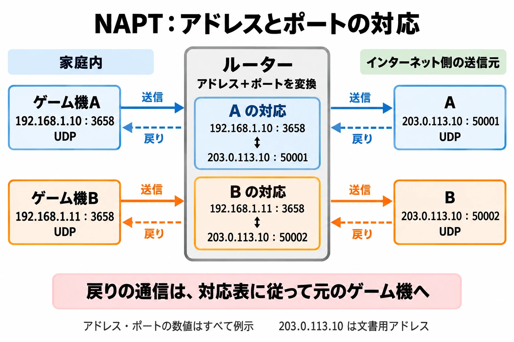

# なぜ友だちとつながらないのか——ゲームプランナーのためのネットワーク入門③

## 同じ部屋から、家の外へ

[第2回](planner-network-intro-02-physical-layer-and-local-play.md)では、同じ部屋へ機器を持ち寄り、電波やケーブルでつなぐ条件を整理した。今回は、別々の家にいる友だちと遊ぶ場面へ進む。

「ゲームにログインできる。ダウンロードもできる。それなのに、この友だちの部屋にだけ入れない」。こうした問い合わせでは、インターネットへの接続と、相手との通信を分けて考える必要がある。

今回の判断軸は、 **家の外の相手と直接つながるかどうかは、自分と相手、それぞれの家のアドレス変換と窓口の事情の組み合わせで決まる** ということだ。[第1回](planner-network-intro-01-which-layer-is-the-error.md)で予告した、双方のNATタイプが接続に影響する話である。

5段の地図では、宛先へデータを届ける「ネットワーク層」と、機器の中のどの通信へ渡すかを扱う「トランスポート層」の入口に当たる。IP（Internet Protocol、ネットワークを越えてデータを運ぶための規約）、NAT（Network Address Translation、アドレス変換）、ポート番号の3つから見ていこう。

***

## IPアドレスは、届け先を示す住所

IPアドレスは、ネットワーク上の宛先を示す番号である。住所のたとえで考えると、まず「インターネット側から使う住所」と「家の中で使う住所」を区別すると分かりやすい。ここでは主にIPv4（Internet Protocol version 4）を扱う。

**グローバルIPアドレス** は、インターネット上で宛先を区別するために使う。一方、 **プライベートIPアドレス** は、家庭や組織の内部で使うアドレスだ。別々の家で同じ番号を使えるが、その番号をそのままインターネット上の宛先にはできない。

RFC（Request for Comments、インターネットの技術仕様などを公開する文書群）のRFC 1918は、次の3つをプライベートアドレスの範囲として定めている。[[1](#ref-1)]

| プライベートIPv4アドレスの範囲 |
| --- |
| 10.0.0.0〜10.255.255.255 |
| 172.16.0.0〜172.31.255.255 |
| 192.168.0.0〜192.168.255.255 |

たとえば、自分のゲーム機も友だちのゲーム機も、家の中では `192.168.1.10` という番号かもしれない。それぞれの家庭内で区別できればよいからだ。住所のたとえなら、別の建物に同じ部屋番号があるようなものである。

### 1つのグローバルアドレスを分け合う背景

IPv4のアドレスには数の限りがある。番号資源を管理するIANA（Internet Assigned Numbers Authority）の未割り当て在庫は、2011年2月3日に枯渇した。[[2](#ref-2)] アジア太平洋地域のアドレス配分を担うAPNIC（Asia Pacific Network Information Centre）も、2011年4月15日に最後の大きな配分用ブロックへ達したと発表した。[[3](#ref-3)]

これは、それまで使っていたアドレスが使えなくなったという意味ではなく、新たに配る在庫の制約である。こうした不足を背景に、限られたグローバルIPv4アドレスを複数の機器で共有する仕組みが、家庭の接続を理解するうえで重要になった。その代表がNATである。

***

## NATは「代表番号と内線」

家庭のルーターは、家の中と外のネットワークの間でデータを取り次ぐ。NATを使う構成では、外へ送るときに送信元のプライベートアドレスをグローバルアドレスへ付け替える。

複数の機器で1つのグローバルアドレスを共有する場合には、 **アドレスとポート番号の組み合わせ** を変換する。正式にはNAPT（Network Address Port Translation）と呼ばれる仕組みだ。[[4](#ref-4)] IPマスカレードとも呼ばれ、日常的な説明では、この方式もまとめてNATと呼ばれる。

### ポート番号は、機器の中の通信の窓口

ポート番号は、1台の機器の中で通信の窓口を区別する番号である。IPアドレスが住所なら、ポート番号は、その住所でどの窓口へ渡すかを示す。

代表電話で考えると、家の外へ見せるグローバルアドレスが代表番号、家の中の機器のアドレスとポートの組み合わせが内線に近い。ルーターは、外向けのどの窓口が、家の中のどの窓口に対応するかを記録する。ただし、実際には電話の取次係が相手の用件を聞くのではなく、通信に含まれる番号と記録に従って処理する。

RFC 6335は、ポート番号を次の3範囲に分けている。[[5](#ref-5)]

| 名称 | 範囲 | 登録上の扱い |
| --- | --- | --- |
| System Ports（Well Known Ports） | 0〜1023 | IANAによる割り当ての対象 |
| User Ports（Registered Ports） | 1024〜49151 | IANAによる割り当ての対象 |
| Dynamic Ports（Private／Ephemeral Ports） | 49152〜65535 | IANAによる割り当てを行わない範囲 |

同じポート番号でも、TCP（Transmission Control Protocol）とUDP（User Datagram Protocol）では別の窓口として扱う。どちらもデータを運ぶための規約であり、その違いは第4回で扱う。今は「UDPの何番か」という形で、規約と番号を組にして読むとよい。

### アドレスだけでなく、ポートも付け替わる

たとえば、家の中の2台が、どちらもUDPの3658番を使っているとする。ルーターは、外向けには同じグローバルアドレスの別々のポートへ対応付けられる。外から見える番号が変わっても、記録を使えば返事を元の機器へ渡せる。

NAPTによる対応付けの概念図。[[4](#ref-4)]

実在したゲーム機の説明にも、この付け替えが登場する。 **PS3の時代の公式ユーザーズガイド** は、オンラインゲームの通信対戦や音声・映像チャットで本体どうしが直接通信し、UDPの3658番を使うと説明している。そのうえで、NATルーターを経由すると異なるポート番号を使うことがあるとしている。[[6](#ref-6)] 家の中のポート番号が、そのまま外から見える番号になるとは限らない例だ。

***

## P2Pでは、両方の家の条件が出会う

P2P（Peer-to-Peer、端末どうしが直接やり取りする通信）では、自分の家から友だちの家へデータを届ける必要がある。

家の中から外のサーバーへ通信を始める場合、ルーターは変換の対応を記録する。返事が届いたときは、その記録と受信を許可する条件に従って、家の中の機器へ渡せる。

一方、外から突然通信が届いた場合には、対応する記録や事前の設定がなければ、どの機器へ渡すべきか決められなかったり、受信の条件に合わず通せなかったりする。さらに、NATには対応付けや受信制限の振る舞いに違いがある。[[4](#ref-4)]

P2Pでは、相手の端末も家庭のルーターの内側にいることがある。互いに送信して経路を作ろうとしても、相手側から来た通信を両方の環境が受け入れられるかが問題になる。 **自分からサーバーへの通信が成功することと、友だちとの直接通信が成功することは、別の条件** なのだ。

### NATタイプは、接続性の目安

任天堂は、エラーコード「2618-0516」について、インターネットには接続できていても、自宅または通信相手の環境でNAT越えがうまくできていない可能性があると案内している。NAT越えとは、NATのある環境で相手との通信を成立させるための処理である。公式案内のNATタイプの説明は次のとおりだ。表の説明欄は原文を引用している。[[7](#ref-7)]

| NATタイプ | 任天堂の説明 |
| --- | --- |
| A・B | 「インターネットを使った対戦・協力プレイを比較的おこないやすい環境です。」 |
| C・D | 「インターネットを使った対戦・協力プレイをするのに最適な環境ではありません。」 |
| F | 「インターネット経由での対戦・協力プレイができない環境です。」 |

A・Bの案内にも、特定のプレイヤーと繰り返しエラーが発生する場合は、相手側のインターネット環境に原因がある可能性があると書かれている。[[7](#ref-7)] 自分の表示だけで、誰とでも遊べると保証されるわけではない。

PlayStationでは、PS3とPS Vitaの公式マニュアルがNATタイプを1〜3で示してきた。タイプ1はインターネットへ直接接続、タイプ2と3はルーター経由であり、タイプ3では他の本体との通信ができず、ゲームなどの通信機能が制限される場合があると説明される。[[6](#ref-6)][[8](#ref-8)]

任天堂のA〜FとPlayStationの1〜3は、 **それぞれの機器で使う別の尺度** として読む。共通の点数へ換算せず、対象機種の表示と公式案内を組み合わせて扱うことが大切だ。

***

## 日本の家庭では、ルーターの外にも条件がある

家庭の通信経路は「ゲーム機、家のルーター、インターネット」という3つだけで完結するとは限らない。任天堂がNATタイプC・D向けに挙げる確認事項からも、条件が複数の場所にあることが分かる。[[7](#ref-7)]

| 公式案内に登場する事情 | 通信経路を見るときの着眼点 |
| --- | --- |
| 家の中でルーターを複数使用する多重NAT | アドレス変換を行う機器が重なっていないか |
| 集合住宅の共用ルーター | 自分の部屋の外にも、通信を取り次ぐ機器があるか |
| プロバイダーとの「プライベートIPアドレスの割り当て」契約 | 家庭のルーターより外側でアドレスを共有しているか |
| IPv6サービスの利用 | 契約したサービスでIPv4通信をどの方式で運んでいるか |
| SPIなどのルーター機能 | 受信する通信を制限する機能が関係しているか |

SPI（Stateful Packet Inspection）は、通信の状態を踏まえてデータの通過を判断する機能である。プロバイダーはインターネット接続サービスを提供する事業者を指す。

任天堂の案内には、契約内容の確認、共用機器についての管理者への確認、条件に応じたブリッジ接続への変更、IPv6接続や一部機能の一時停止が並ぶ。ブリッジ接続は、その機器でルーターとしての処理を行わず、ネットワークをつなぐ使い方である。NATタイプFでは、UDP通信のポート制限について、プロバイダー、集合住宅の管理者、ルーターのメーカーへ確認するよう案内している。[[7](#ref-7)]

ゲーム内ヘルプを作る側には、 **問い合わせ先が家庭内の機器だけとは限らない** という点が役立つ。個々の設定変更は、対象環境に対応する公式案内へ導く設計にする。

### プロバイダー側で行う、大規模なNAT

プロバイダーの設備で、多数の利用者のIPv4通信をまとめて変換する仕組みを、キャリアグレードNAT（Carrier-Grade NAT、CGN）と呼ぶ。家庭のルーターの外側にも、アドレスを共有する段がある構成だ。

RFC 6598は、CGN機器で使う共有アドレス空間として、`100.64.0.0`〜`100.127.255.255` の範囲を予約している。これはRFC 1918のプライベートアドレスとは別の範囲である。[[9](#ref-9)] スマホ回線での具体的な事情は、第5回で扱う。

### IPv6サービスと、IPv4のポート制限

IPv6（Internet Protocol version 6）は、IPv4より大きなアドレス空間を持つ規約である。その普及に伴い、IPv6のネットワークを使ってIPv4通信を運ぶ方式も利用されている。

その一つがMAP-E（Mapping of Address and Port with Encapsulation）である。ヤマハの技術資料は、MAP-Eでは使用できるポート番号が限定され、特定のポート番号を使うアプリケーションは動作しないと説明している。[[10](#ref-10)]

ここから、IPv4通信に使えるポートの制約が、ゲームの接続条件に関わりうると分かる。一方、任天堂はIPv6接続の一時停止を対処に挙げる理由を、その案内では説明していない。MAP-Eの制約は **考えられる背景の一つ** であり、任天堂が示した原因ではない。IPv6サービスという名前だけで、接続失敗の原因を決めることはできない。[[7](#ref-7)][[10](#ref-10)]

***

## ゲーム側で、つながり方を用意する

ここまでは家庭側の条件を見てきた。ゲーム側にも、相手と直接つなぐほかに、中継サーバーを経由するリレーや、対戦の処理を担う専用サーバーという選択肢がある。両方の端末が外部のサーバーへ通信する形を使えば、互いの家庭へ直接通信を通す必要を減らせる。

RFC 4787は、UDPを扱うNATの振る舞いに要件を定めている。その一つが、同じ内部の通信元に対し、通信相手に依存せず外側の対応付けを保つことだ。文書は、この要件を満たさなければ、UDPの中継を使わざるをえなくなると説明する。[[4](#ref-4)] 家庭ごとのNATの違いを、すべて端末どうしの工夫だけで吸収できるとは限らないのである。

NAT越えを支えるSTUN（Session Traversal Utilities for NAT）とTURN（Traversal Using Relays around NAT）の仕組みは、親記事の[4-2節「NAT越えの問題」](console-online-multiplayer-latency-techniques.md#4-2-nat越えnat-traversalの問題)を参照してほしい。

### 中継には、接続性以外の役割もある

ValveのSteam Datagram Relay（SDR）は、ゲームの通信をValveの中継網へ通す仕組みである。公式資料は、IPアドレスを相手へ明かさずに中継することで、サーバーやプレイヤーをDoS（Denial of Service、サービスを使えなくする攻撃）から守ると説明している。[[11](#ref-11)]

また、経路によってはValveのネットワークを通す方が速くなり、ping、つまり通信の往復時間が改善するとも述べる。一方、専用サーバーの場所によっては、中継経路の方が遅くなる場合もある。[[11](#ref-11)] 中継は、通る拠点と経路まで含めて評価する仕組みだ。

専用サーバーとリレーは組み合わせることもでき、SDRも両方の通信に対応する。[[11](#ref-11)] 「誰が対戦を処理するか」と「通信をどこへ通すか」を分けると、開発担当との相談もしやすくなる。

***

## プランナーは、問い合わせと接続方式に使う

### エラー文は、分かった範囲を伝える

「インターネットにはつながるのに、この友だちとだけ遊べない」という問い合わせでは、通信できた範囲と、失敗した相手・場面を残したい。

- **エラー画面**：対戦相手との接続に失敗したこと、エラーコード、次に開くヘルプを示す。
- **サポートのよくある質問（FAQ、Frequently Asked Questions）**：全員と失敗するか、特定の相手とだけか、互いの機種とNATタイプは何かを整理する。
- **ゲーム内ヘルプ**：自分側と相手側の両方の環境が関係しうることを伝え、対象機種の公式案内へつなぐ。

たとえば、架空のゲームなら、次のような文言を検討できる。実際に表示する内容は、ゲームが取得できる診断結果と合わせる必要がある。

> 対戦相手との接続を確立できませんでした。ご自身または相手のネットワーク環境が影響している可能性があります。エラーコードを控え、接続ヘルプをご確認ください。

任天堂が特定の相手とのエラーでは相手側の環境も原因になりうると説明するように、自分側の設定不良と決め付けない案内が必要だ。[[7](#ref-7)] ただし、相手が悪いと断定する文言にもせず、双方の条件を調べるための情報をそろえる。

### 接続方式を、運営まで含めて相談する

接続方式は、対戦開始の成功率だけでなく、IPアドレスの露出、サーバー費用、問い合わせ対応にも関わる。プランナーが開発・運営と話し合う論点は、次のように整理できる。

| 方式 | 話し合う論点 |
| --- | --- |
| P2Pの直接通信 | 対象環境でどこまで接続できるか。相手にIPアドレスが見えることをどう扱うか。直接つながらない場合の案内や代替経路を用意するか |
| リレー経由 | 直接通信に失敗したときだけ使うか、常に使うか。中継拠点と遅延、通信量に応じた費用、障害時の影響をどう見積もるか |
| 専用サーバー | 設置地域、台数と稼働費、混雑時の容量をどう決めるか。サーバーへの接続失敗をどう診断し、必要に応じてリレーを組み合わせるか |

費用には、サーバーだけでなく、接続できないプレイヤーを支える手間も含めて考えたい。逆に、サーバーを用意すれば、今度はその容量や障害に対応する運営が必要になる。目標とするつながりやすさを決め、実際の接続成功率や問い合わせを見ながら判断するための論点である。

***

## 次回は、窓口の先の「TCPとUDP」へ

家の外の相手と遊ぶには、IPアドレスで宛先を示し、ポート番号で通信の窓口を区別する。家庭でアドレスを共有していれば、途中でそれらが付け替わる。直接通信の成立には、自分と相手の双方の変換や受信条件が関わる。

この見方があれば、「ネットにはつながる」を出発点に、その先のどの通信が失敗しているかを考えられる。さらに、ゲーム側で中継や専用サーバーを用意する判断へもつながる。

第4回は「TCPとUDP」である。宛先と窓口が決まった先で、どんな約束でデータを運ぶのかを見ていく。

## References

1. [Y. Rekhterほか「Address Allocation for Private Internets（RFC 1918）」][1] — RFC Editor、1996年2月。第3節のプライベートアドレス範囲を参照。

[1]: https://www.rfc-editor.org/rfc/rfc1918.html

2. [前村昌紀「IPv4アドレス枯渇の現状」][2] — JPNIC第43回総会・講演会、2011年3月11日。3月24日までの情報で更新。IANA在庫の枯渇日を参照。

[2]: https://www.nic.ad.jp/ja/materials/after/20110311/20110311-v4exh.pdf

3. [NRO「APNIC Announces its IPv4 Address Pool Reaches Final /8」][3] — The Number Resource Organization、2011年4月15日。

[3]: https://www.nro.net/apnic_announces_its_ipv4/

4. [F. Audet、C. Jennings「Network Address Translation (NAT) Behavioral Requirements for Unicast UDP（RFC 4787）」][4] — RFC Editor、2007年1月。第3節のNAPT、第4.1節の対応付けとREQ-1、第5節の受信制限を参照。要件はゲーム専用のものではない。

[4]: https://www.rfc-editor.org/rfc/rfc4787.html

5. [M. Cottonほか「Internet Assigned Numbers Authority (IANA) Procedures for the Management of the Service Name and Transport Protocol Port Number Registry（RFC 6335）」][5] — RFC Editor、2011年8月。第6節のポート番号の3範囲を参照。

[5]: https://www.rfc-editor.org/rfc/rfc6335.html

6. [ソニー・コンピュータエンタテインメント「PS3 ユーザーズガイド：インターネット接続テスト」][6] — PlayStation公式マニュアル、日付記載なし。システムソフトウェア3.10版の「PlayStation Networkへの接続について」とNATタイプの説明を参照。PS3当時の仕様。

[6]: https://manuals.playstation.net/document/jp/ps3/3_10/settings/connecttest.html

7. [任天堂「【Switch 2 / Switch】エラーコード『2618-0516』が表示されました。どうしたらいいですか？」][7] — 任天堂サポート、日付記載なし（2026年11月1日参照）。NATタイプ別の説明と対処を参照。

[7]: https://support-jp.nintendo.com/app/answers/detail/a_id/34283

8. [ソニー・インタラクティブエンタテインメント「PS Vita ユーザーズガイド：インターネット接続テスト」][8] — PlayStation公式マニュアル、日付記載なし（2026年11月1日参照）。

[8]: https://manuals.playstation.net/document/jp/psvita/settings/connecttest.html

9. [J. Weilほか「IANA-Reserved IPv4 Prefix for Shared Address Space（RFC 6598）」][9] — RFC Editor、2012年4月。CGN向け共有アドレス空間を参照。

[9]: https://www.rfc-editor.org/rfc/rfc6598.html

10. [ヤマハ「v6プラス対応機能」][10] — RTシリーズ技術資料、2026年1月6日更新。「注意事項」のMAP-Eのポート制限を参照。

[10]: https://www.rtpro.yamaha.co.jp/RT/docs/v6plus/

11. [Valve「Steam Datagram Relay」][11] — Steamworks Documentation、日付記載なし（2026年11月1日参照）。IPアドレスの秘匿、DoS対策、経路によるpingの改善、専用サーバーへの適用を参照。英文の説明は要約したもの。

[11]: https://partner.steamgames.com/doc/features/multiplayer/steamdatagramrelay

----

この文書は、Perplexity、Claude、ChatGPT の3つのAIの支援を受けて著述されたものです。引用画像を除き、MIT License にて提供されています。
