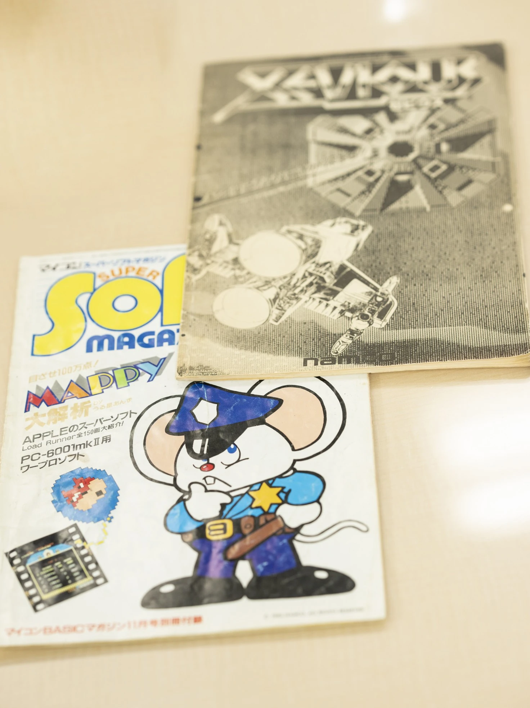
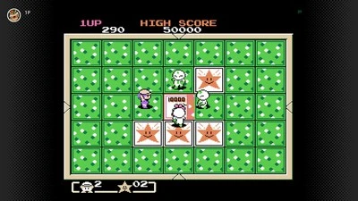
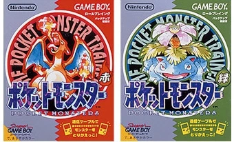

# ポケモンが生まれるまで――ゲームフリーク前史

> 2026年11月18日改版：記事全体を全面的に書き直しました。内容の変更はGitの履歴から追えます。

## はじめに

友だちのゲームには、自分がどれだけ遊んでも手に入らないものがある。それなら、ゲーム機をつないで、お互いの持ち物を渡し合えないか。ゲームセンターで攻略を教え合っていた田尻智氏たちが、この発想を『ポケットモンスター 赤・緑』にするまでには、1983年の同人誌から1996年の発売までの道のりがあった。

株式会社ポケモンが公表した全ポケモン関連ゲームソフトの世界累計出荷本数は、2026年3月末時点で5億1,500万本以上。その出発点には、攻略を載せた冊子と、それを読んだ高校生からの一通の手紙があった。[[1](#ref-1)]

***

## 1. 虫かごとゲームセンター（〜1982年）

小学館のHugKumが紹介する少年時代の田尻氏は、東京の町田で、身近な野山を歩いて昆虫を探していた。捕まえた虫を友だちと交換するのも、その遊びの一つだった。[[2](#ref-2)]

とみさわ昭仁氏の『ゲームフリーク』では、中学2年でインベーダーゲームに出会い、ゲームセンターに通い始める。硬貨を入れて遊ぶ筐体には、ほかの客のプレイを見ているだけでも、次に自分で試せる手がかりがあった。ゲーム開発者の遠藤雅伸氏が覚えているのは、店に置かれたノートに常連が書き込み、そこで得た情報が口コミで別の店にも伝わっていく時代である。[[3](#ref-3)][[4](#ref-4)]

とみさわ氏の本には、田尻氏が自分で遊びを考え始めた頃のことも出てくる。中学3年だった1980年、ユニバーサル社の「ゲームアイデア・コンテスト」に「闇夜のカラス」を出して落選。翌年、セガ・エンタープライゼスの「ゲームアイデア大賞」に出した「スプリング・ストレンジャー」は一等になった。[[3](#ref-3)]

***

## 2. 一冊のミニコミ誌と一通の手紙（1983年）

杉森建氏が後年語った出会いの場所は、新宿の同人誌専門店だった。高校生の頃、そこで「ゲームフリーク」を見つけた。ナムコのシューティングゲーム『ゼビウス』の攻略を読んでいくと、自分の知らない隠しキャラクターの情報が載っている。驚いた杉森氏は手紙を送った。後年の鼎談で、その話を聞いた遠藤氏は「おっかない手紙ですねえ」と笑った。[[4](#ref-4)]

杉森氏の手紙が向かったのは、田尻氏が1983年に始めた攻略中心のミニコミ誌、つまり仲間内で編集して読者に届ける自主制作の雑誌である。店で見つけた攻略が紙に載れば、別の店に通う人にも届く。杉森氏は、その紙を手に取った読者の一人だった。[[4](#ref-4)]

『ゼビウス』を作った遠藤氏にとっても、「ゲームフリーク」は目立つ雑誌だった。音楽家の細野晴臣氏も、人類学者の中沢新一氏も買っていたという。中沢氏の回想では、自身の『ゼビウス』論「ゲームフリークはバグと戯れる」の題も、細野氏が口にした言葉から取ったものだった。[[4](#ref-4)][[5](#ref-5)]

***

## 3. ゲームセンターから届いた『ゼビウス 1000万点への解法』

大堀康祐氏（筆名「うる星あんず」）が回想する『ゼビウス 1000万点への解法』の最初の売り場は、行きつけのゲームセンターだった。高得点を目指すプレイヤーのために攻略冊子を作り、出版前にナムコに連絡して許諾を求めたうえで、店に委託販売を頼んだ。人気で生産が追いつかなくなると、田尻氏に原稿を渡し、増刷と流通を任せた。利益は折半だった。[[6](#ref-6)]

田尻氏の記憶では、「うる星あんず」から、「ゲームフリーク」を続けるなら一緒に出してほしい、と頼まれた。その縁で、パソコン雑誌『マイコンBASICマガジン』（通称ベーマガ）の別冊付録「スーパーソフトマガジン」に『解法』の通販広告を載せた。大堀氏は、その付録の第1号で、田尻氏に販売を任せた『ゼビウス』の攻略を重ねて載せるのは不義理だと考え、ナムコのアクションゲーム『マッピー』を取り上げた。[[4](#ref-4)][[6](#ref-6)]

*『ゼビウス 1000万点への解法』と「スーパーソフトマガジン」第1号。画像出典 [4Gamerの大堀康祐氏・大橋太郎氏の対談記事](https://www.4gamer.net/games/596/G059646/20240204001/)*

遠藤氏の記憶では、大堀氏がナムコを訪ねてきたとき、キャラクターの名前を書いたシートを手渡した。その名前は『解法』の誌面に載った。田尻氏は、画面に現れるキャラクターの一つひとつに名前があったことに驚いた。自分もゲームを作るようになってから、その一つひとつに名前をつけることの大切さを知ったという。[[4](#ref-4)]

***

## 4. ゼビウス星の噂が行き着いた先（1983〜1988年頃）

田尻氏の著書『パックランドでつかまえて』には、仲間から非難され、孤立した田尻氏のもとに遠藤氏が現れる場面がある。場所はゲームセンター。遠藤氏はそこで、田尻氏と仲間の仲直りを取り持った。きっかけは、ある条件を満たせば『ゼビウス』のゼビウス星に行ける、という噂だった。[[4](#ref-4)]

後年の鼎談で田尻氏は、アスキーのゲーム雑誌『ログイン』の編集部に来た地方のゲーム愛好家から、その話を聞いたと振り返る。それを「うる星あんず」に話すと、そこから広まった。攻略の手がかりが人づてに渡っていったのと同じように、確かめきれない話もまた、次の人へ伝わっていった。[[4](#ref-4)]

大堀氏の回想では、田尻氏と大堀氏は電波新聞社とアスキーからほぼ同時に声をかけられた。大堀氏はベーマガへ、田尻氏は『ログイン』へ進んだ。田尻氏が取材で何度も訪れた先の一つがナムコだった。やがてそこへ、記事の取材とは別の用件で足を運ぶことになる。[[6](#ref-6)][[4](#ref-4)]

***

## 5. 手製のカセットを持って（1986〜1989年）

増田順一氏と杉森氏の回想に、市販の安いカセットを開けて、中のROMを外す場面が出てくる。そこへ、自分たちで作った『クインティ』のデータを書き込んだ記憶部品をはんだ付けする。テレビにつないで遊ぶファミコンで、自分たちのゲームを試すためのカセットだった。同人誌を作っていた仲間は、自分たちでゲームを作ろうと決めたものの、メーカーの公式開発機材を持っていなかった。[[7](#ref-7)][[8](#ref-8)]

増田氏の話では、解析に使ったのはファミコンと同じ6502系統のCPUを積んだパソコン「Apple II」だった。ファミコンにプログラムを打ち込める「ファミリーベーシック」のキーボードで、動作を確かめ、不具合を探した。PC-9801とエプソンの互換機も、2台をつないで使った。そうしてできた『クインティ』では、床のパネルをめくって敵をはね飛ばす。杉森氏は制作期間を通算で3年弱、あるいは2年余りと振り返り、増田氏は初期の動作デモから約2年半と数えている。[[7](#ref-7)]

*画像出典: [Nintendoトピックス - 「ファミリーコンピュータ＆スーパーファミコン＆ゲームボーイ Nintendo Classics」に追加タイトルを配信開始。](https://www.nintendo.com/jp/topics/article/236a40c6-6fc1-41bb-ae24-1751947fc386)*

とみさわ氏の本では、1988年の暮れ、田尻氏は仲間と作ったカセットを持って蒲田のナムコ本社を訪ね、ナムコット事業部の今成一雄課長に見せた。製品化の仕上げはナムコの下請けのソフト開発会社と一緒に進めた。田尻氏の記憶では、『ログイン』の取材で営業部によく通っていたため、完成品を営業課長や部長に見せに行った。増田氏への取材記事では、当時の任天堂は『クインティ』に関心を示さなかったとされる。[[3](#ref-3)][[4](#ref-4)][[8](#ref-8)]

増田氏は、ナムコから個人とは契約できないので法人にしてほしいと求められたと振り返り、とみさわ氏の本は、初期出荷20万本で約5,000万円の印税が入る見通しとなり、個人で受け取る場合の税負担を考えたと記す。[[8](#ref-8)][[3](#ref-3)]

1989年4月26日、株式会社ゲームフリークが設立された。とみさわ氏の記述では、資本金100万円は田尻氏の貯金から。社員は2人で、田尻氏は23歳だった。同じ年の6月、ナムコからファミコン用ソフト『クインティ』が発売された。[[9](#ref-9)][[3](#ref-3)][[7](#ref-7)][[8](#ref-8)]

***

## 6. ふしぎなぼうしと通信ケーブル（1989〜1990年）

とみさわ氏の本に、ロールプレイングゲーム『ドラゴンクエストII』の装備品「ふしぎなぼうし」が出てくる。杉森氏は持っていた。田尻氏には手に入らず、それが悔しかった。やがて、人のゲームにあるものを自分のゲームへ渡してもらう、という発想にこの体験が重なる。[[3](#ref-3)]

ゲームフリークが会社になる5日前、1989年4月21日に、任天堂は携帯型ゲーム機「ゲームボーイ」を発売した。この携帯機を生んだ技術者の考え方は、[横井軍平評伝](gunpei-yokoi-biography-lateral-thinking-of-withered-technology.md)で扱っている。とみさわ氏の記述では、それから約1年後、田尻氏は2台を結ぶ通信ケーブルに目を向ける。落ち物パズル『テトリス』で、ケーブルの向こうにいる人と対戦できる。それなら、手に入れたアイテムやモンスターを渡し合うこともできる。そこに子どもの頃の昆虫採集が重なり、「カプセルモンスター」の企画書になった。[[10](#ref-10)][[3](#ref-3)]

石原恒和氏は任天堂の「社長が訊く」で、企画が始まった年を1990年と答えている。聞き手の岩田聡氏も、石原氏のそばで、そこからの長い開発を見ていたという。[[11](#ref-11)]

***

## 7. 次の一本を作りながら（1989〜1995年）

増田氏が覚えているのは、最初は自分たちだけで作っていたポケモンの企画を、任天堂に見せたときの返事である。“Oh okay, good luck. As long as you guys have money, keep working on it.”（「わかった、がんばって。お金が続く限り作り続けて。」）増田氏の回想では、任天堂と一緒に仕事を始めたのは、同社から『ヨッシーのたまご』を依頼されたときだった。一本を完成させた縁で開発機材を借り続け、その期間は約6年に及んだ。田尻氏たちはこの時期に、任天堂の宮本茂氏や横井軍平氏とも関係を築いた。[[8](#ref-8)]

| 発売年 | 作品 | 発売元 | 機種 |
| --- | --- | --- | --- |
| 1989年 | クインティ | ナムコ | ファミリーコンピュータ [[7](#ref-7)][[8](#ref-8)] |
| 1991年 | ジェリーボーイ | EPIC・ソニーレコード | スーパーファミコン [[12](#ref-12)] |
| 1991年 | ヨッシーのたまご | 任天堂 | ファミリーコンピュータ、ゲームボーイ [[13](#ref-13)][[14](#ref-14)] |
| 1992年 | まじかる☆タルるートくん | セガ | メガドライブ [[15](#ref-15)] |
| 1993年 | マリオとワリオ | 任天堂 | スーパーファミコン [[16](#ref-16)] |
| 1994年 | パルスマン | セガ | メガドライブ [[17](#ref-17)] |

米誌TIMEが伝える初代ポケモンの開発期間には、『ヨッシーのたまご』『マリオとワリオ』『パルスマン』の仕事も重なっている。次の一本を作って会社の運営を支え、その間も、ゲームボーイで交換する遊びを作り続けた。[[18](#ref-18)]

***

## 8. 『赤・緑』が出た、2月の終わり（1996年）

1996年2月27日、任天堂からゲームボーイ用の『ポケットモンスター 赤・緑』が出た。石原氏は、前年の10月に完成させてすぐに出したかったと振り返る。年末商戦を過ぎて、発売は商品を出すには最も都合が悪いと考えていた2月末になった。岩田氏の記憶に残るのも、のちの広がりを想像できないほど静かな出足である。[[19](#ref-19)][[11](#ref-11)]

*画像出典: [ポケットモンスターオフィシャルサイト - ポケットモンスター 赤・緑](https://www.pokemon.co.jp/game/other/gb-rg/)*

やがてプレイヤーの間で、幻のポケモン「ミュウ」が話題になった。ゲームフリークの一之瀬氏が鼎談で語ったところでは、森本氏が描いていたものが残っていて、当初は出すつもりがなかった。ゲームにまだ知られていない何かがいると想像したプレイヤーが、その話を次の人に伝える。その広がり方には、かつてのゼビウス星の噂と通じるところがある。同じ鼎談で杉森氏は、遠藤氏が『ゼビウス』の謎を曖昧なままにしてくれたことが大切だったと語り、ポケモンの数を尋ねられても、はっきりとは答えないようにしているという。[[4](#ref-4)] 『赤・緑』から始まったシリーズが、その後どのように巨大なIPとして続いてきたかは、[ポケモンはなぜ巨大IPであり続けるのか](pokemon-global-ip-core-game-design.md)で扱っている。

***

## 交換することが、遊びになるまで

ゲームセンターでは、誰かが見つけた攻略の手がかりが、別の誰かの次のプレイを変えた。紙に載せた攻略は新宿の同人誌専門店で杉森氏の目に留まり、手紙が返ってきた。田尻氏の周りには、一緒に本を作る人や、ゲームを作る人が集まり、やがてその仕事を続ける会社ができた。[[4](#ref-4)][[6](#ref-6)][[7](#ref-7)][[9](#ref-9)]

その仲間と作ったゲームでは、友だちが手に入れたモンスターを、自分のゲームへ迎えることができる。見つけたことを教え合ってきた少年たちは、ゲーム機を2台つなぎ、持っているものを渡し合うことそのものを遊びにした。[[3](#ref-3)][[11](#ref-11)]

***

## References

1. [株式会社ポケモン「数字でみるポケモン」][1] — 株式会社ポケモン、2026年3月末集計。

[1]: https://corporate.pokemon.co.jp/aboutus/figures/

2. [小学館HugKum編集部「ポケモンをつくった男・田尻 智『少年時代の昆虫採集がポケモンの原点』」][2] — 小学館HugKum、2021年1月5日。

[2]: https://hugkum.sho.jp/190781

3. [とみさわ昭仁『ゲームフリーク 遊びの世界標準を塗り替えるクリエイティブ集団』][3] — 太田出版、2025年。初版はメディアファクトリー、2000年。電子版の第1部第1章「誕生前夜」、第2部第1章「少年さとし」、第2部第4章「プロとして模索の時代」を参照。

[3]: https://www.ohtabooks.com/publish/2025/04/25160302.html

4. [稲葉ほたて・斉藤大地・TAITAI（聞き手）「『ゼビウス』がなければ『ポケモン』は生まれなかった!?――遠藤雅伸、田尻智、杉森建がその魅力を鼎談。」][4] — 電ファミニコゲーマー「ゲームの企画書」第1回、2016年2月8日。全5ページ。田尻智『パックランドでつかまえて』（JICC出版局、1990年）の記述は、鼎談の導入部に掲載された抜粋の要旨。

[4]: https://news.denfaminicogamer.jp/projectbook/xevious

5. [伊藤誠之介「ゼビウスからポケモンGOまで… 国内ゲーム史を遠藤雅伸氏と『現代ゲーム全史』著者が振り返る」][5] — 電ファミニコゲーマー、2017年。

[5]: https://news.denfaminicogamer.jp/kikakuthetower/nakagawa-endo_bb

6. [箭本進一「『ゼビウス 1000万点への解法』から40年。マトリックス代表・大堀氏とベーマガ創刊編集長・大橋氏が黎明期のゲーム業界を語る」][6] — 4Gamer、2024年2月6日。冊子と付録の掲載写真の出典を兼ねる。

[6]: https://www.4gamer.net/games/596/G059646/20240204001/

7. [船津稔「ついにファミコンの名作、あの『クインティ』が帰ってきた！」][7] — GAME Watch、2014年7月2日。

[7]: https://game.watch.impress.co.jp/docs/news/655639.html

8. [Kyle Hilliard “Game Freak’s Origins And Its Pre-Pokémon Games”][8] — Game Informer、2017年8月9日。増田順一氏の発言は日本語で要約し、直接引用には編者訳を添えた。

[8]: https://gameinformer.com/b/features/archive/2017/08/09/game-freaks-origins-and-non-pokemon-games

9. [ファミ通.com編集部「ゲームフリークが本日（4月26日）設立30周年」][9] — ファミ通.com、2019年4月26日。

[9]: https://www.famitsu.com/news/201904/26175304.html

10. [任天堂「そのほかの本体」][10] — 任天堂公式サイト。「ゲームボーイ」の項。

[10]: https://www.nintendo.com/jp/hardware/index.html

11. [岩田聡（聞き手）「社長が訊く『ポケットモンスター ハートゴールド・ソウルシルバー』」][11] — 任天堂、2009年。

[11]: https://www.nintendo.co.jp/ds/interview/ipkj/vol1/index.html

12. [ファミ通.com編集部「ジェリーボーイ（SFC）の関連情報」][12] — ファミ通.com、ゲーム情報データベース。

[12]: https://www.famitsu.com/game/title/1767/page/1

13. [任天堂「ヨッシーのたまご」][13] — 任天堂公式サイト、ファミリーコンピュータ版。

[13]: https://www.nintendo.com/jp/famicom/software/fmc-yeg/index.html

14. [任天堂「ゲームボーイ」][14] — 任天堂公式サイト。ソフト一覧の「ヨッシーのたまご」の項。

[14]: https://www.nintendo.co.jp/n02/dmg/index.html

15. [セガ「まじかる☆タルるートくん」][15] — メガドライブミニ2公式サイト。

[15]: https://www.sega.jp/mdmini2/soft/taruruto.html

16. [ファミ通.com編集部「マリオとワリオ（SFC）の関連情報」][16] — ファミ通.com、ゲーム情報データベース。

[16]: https://www.famitsu.com/game/title/1106/page/1

17. [セガ「パルスマン」][17] — Wii バーチャルコンソール メガドライブ公式サイト。

[17]: https://vc.sega.jp/vc_pulseman/

18. [Courtney Mifsud Intreglia “The Path to Pokémon”][18] — TIMEのポケモン特集号。著者公開の誌面PDF。初代の開発中に並行した仕事について参照。

[18]: https://static1.squarespace.com/static/5fc7e8313370a43c43b23a4b/t/65ccf8e3815f104a1db5e416/1707931875740/Time_Pokemon_History.pdf

19. [株式会社ポケモン「ポケットモンスター 赤・緑」][19] — ポケットモンスターオフィシャルサイト。パッケージ画像の出典を兼ねる。

[19]: https://www.pokemon.co.jp/game/other/gb-rg/

----

この文書は、Perplexity、Claude、ChatGPT の3つのAIの支援を受けて著述されたものです。引用画像を除き、MIT License にて提供されています。
