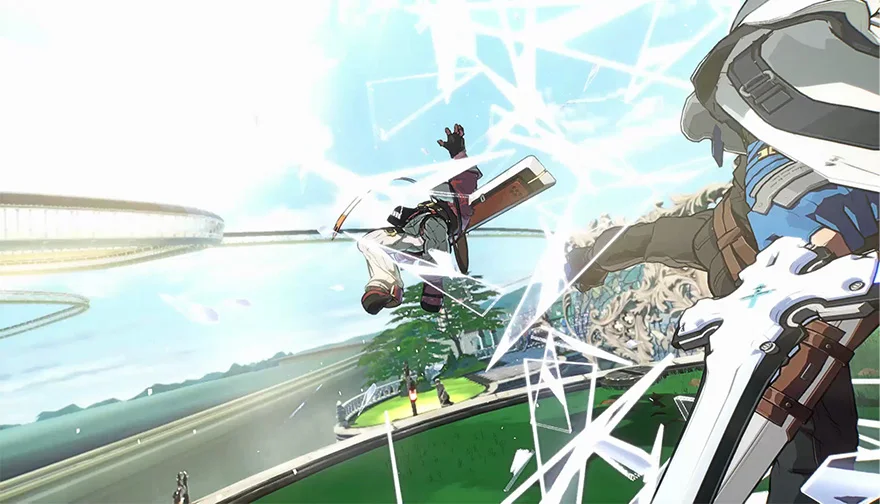
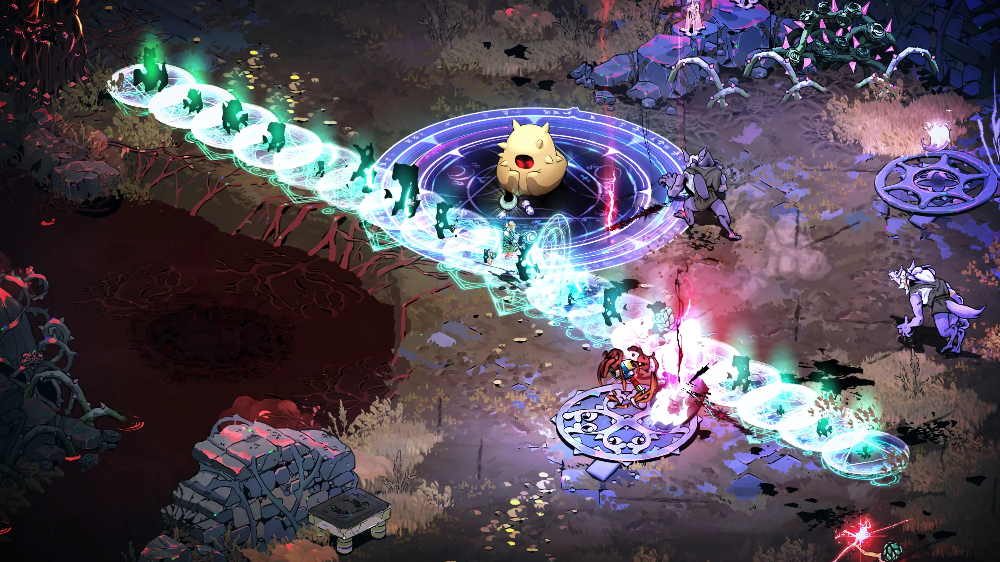
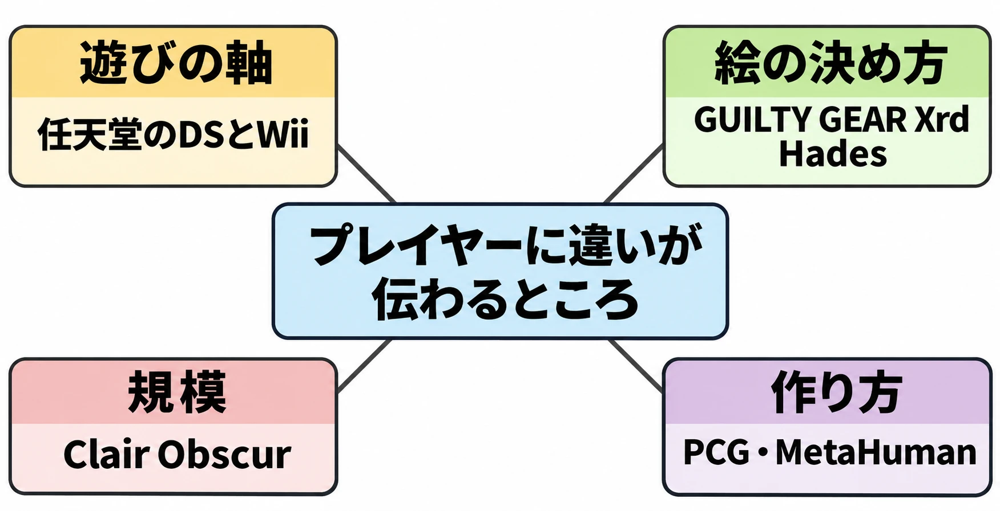

# きれいになった先で、何に手間をかけるか――グラフィックスの「飽和」と、開発が選べる4つの道

> 2026年11月24日改版：記事全体を全面的に書き直しました。内容の変更はGitの履歴から追えます。

## はじめに――300人で5年、30人で年間最高賞

『Horizon Forbidden West』は、約5年をかけ、最盛期には300人を超える正社員が開発に携わった。米連邦取引委員会（FTC）とマイクロソフトの裁判でソニーが提出した書類には、開発費が2億1,200万ドルと記されていた。黒塗りの下の数字が読み取れたことで、この金額が報じられた。同じ書類には『The Last of Us Part II』の開発費もあり、こちらは2億2,000万ドルだった。[[1](#ref-1)][[2](#ref-2)]

2025年12月11日、ロサンゼルスで開かれたThe Game Awardsでは、フランスのSandfall Interactiveが手がけた『Clair Obscur: Expedition 33』が、年間最高賞を含む9部門を受賞した。開発期間の大半を支えた中核チームは約30人で、社外にも協力者がいた。発売から33日間で全世界の累計販売は330万本を突破したと、4Gamerはセガの発表を伝えている。[[3](#ref-3)][[4](#ref-4)][[5](#ref-5)][[6](#ref-6)]

片方の数字は制作の規模を、もう片方の賞は完成した作品への評価を示す。どちらの作品も、画面は見せ場の一つだ。草木に覆われた廃墟を歩くゲームと、敵の一撃を引きつけてかわすターン制RPGでは、画面に求められる仕事も変わる。次の企画で今より細かく描けるとして、その手間をかけたことは、どんな場面でプレイヤーに伝わるだろう。グラフィックスに積み増していたリソースを、どこへ振り向けるか。

***

## 1. 「飽和」とは何か

好きなゲームを遊ぶ最大の理由を一つ挙げるとしたら、何を選ぶだろう。Bain & Companyは2025年5月、日本を含む6か国で計5,243人を対象にゲームに関する調査を行った。同社の集計では、好きなゲームを遊ぶ最大の理由として最も多かった回答はゲームプレイの22%で、高品質なグラフィックスや音声を挙げた回答は7%だった。一方、Bainはプレイヤーが引き続き高精細なグラフィックスを評価しているとも述べている。[[7](#ref-7)][[8](#ref-8)]

この7%が表すのは、映像や音声を一番に挙げた回答の割合だ。たとえば、敵が攻撃する直前の構えを読み取れることは、画面の仕事でもあり、遊びやすさでもある。プレイヤーが「戦闘が好きだ」と答えるとき、その理由の一部を絵が担っていることもある。

ここでいう「飽和」とは、いまの絵をさらに磨く費用に見合うだけの違いが、遊んでいるプレイヤーには伝わりにくくなった状態を指す。たとえば、走り抜ける廊下の壁を作り込んでも、通過する数秒で拾える情報には限りがある。同じ廊下でも、壁の模様が謎を解く手がかりなら、プレイヤーは足を止めて見る。どこで飽和するかは、画面の中でプレイヤーが何をするかによって変わる。ゲーム機の性能そのものがどう競われてきたかは、[「128ビット」からテラフロップスまでの性能競争](128-bit-to-teraflops-spec-wars.md)でたどっている。

***

## 2. 同じ問いは20年前にもあった――遊びの軸を変える

2003年9月26日、東京ゲームショウの基調講演「ファミコンから20年：ゲーム産業の今とこれから」で、任天堂社長の岩田聡氏は、3Dグラフィックスが新鮮だった時代を振り返った。それまで機械の性能が足りず、遊ぶ人が想像で補っていたものを、画面にはっきり描けるようになった。3Dならではの驚きがあらゆるゲームを3Dへ向かわせ、開発費も高騰していった。[[9](#ref-9)]

2年後の2005年9月16日、岩田氏は同じ東京ゲームショウで、のちにWiiとなる「Revolution」のコントローラーを初めて公開した。紹介映像では、細長いコントローラーを釣り竿のように持ち、魚がかかれば引き上げる。岩田氏は、次世代機用ソフトの開発費が上がり、小さなソフト会社が疎外感を覚えていると聞く、と会場の開発者に話した。そして、このコントローラーと本体なら「アイディア勝負でいける」と語りかけた。[[10](#ref-10)]

例に挙げたのは、DSの画面にタッチペンで答えを書く『脳を鍛える大人のDSトレーニング』だ。開発の最盛期でもチームは10人未満で、基礎技術の開発を除いた本開発は約4か月だった。岩田氏は同じ講演で、従来のゲームファンが求める奥深い大型作品も必要だと話している。翌年のWii Previewでは、任天堂が掲げた「ゲーム人口の拡大」の最初の答えがニンテンドーDSだったと説明した。[[10](#ref-10)][[11](#ref-11)][[12](#ref-12)]

任天堂が性能向上と並んで開いたのは、手に取った瞬間に違いが分かる遊びの入口だ。釣り竿を精密に描くことと、手にした道具を釣り竿のように引くことでは、驚きが生まれる場所が違う。企画で後者を選ぶなら、先に作り込むべきなのは、手を動かしてから画面が応えるまでの感触だ。この判断は、[WiiとWii Uの設計](wii-wii-u-design-language-and-legacy.md)や、[横井軍平の「枯れた技術の水平思考」](gunpei-yokoi-biography-lateral-thinking-of-withered-technology.md)にもつながる。

***

## 3. 絵の決め方を変える

格闘ゲーム『GUILTY GEAR Xrd』では、3Dモデルで作ったキャラクターが、手描きアニメのように動く。アークシステムワークスの技術アーティスト、本村・C・純也氏はGDC 2015で、3Dらしく見える要素を見つけて取り除く方針を説明した。たとえば、二つのポーズの間を自動で滑らかにつなぐ補間を切る。さらに、狙った角度から見たときに技の勢いが出るよう、手足の大きさや顔のパーツの位置までポーズごとに調整する。3Dモデルが持つ形の一貫性よりも、その一コマで出したい迫力を優先した。[[13](#ref-13)][[14](#ref-14)]

後の『GUILTY GEAR -STRIVE-』でアートディレクターを務めた坂村英彦氏は、手描きに見えることから、一目で『GUILTY GEAR』の動きだと分かることへ目標を進めたと話している。下の画面では、人物の立ち姿や輪郭に目を向けると、背景に情報が多くても対戦する二人の位置を追いやすい。キャラクター、動き、効果、背景を受け持つ人が、同じ画面で何を目立たせるかを共有してこそできる絵だ。[[15](#ref-15)]

*画像出典（引用）：Arc System Works, [GUILTY GEAR -STRIVE- 公式サイト](https://www.guiltygear.com/ggst/en/) / セルシェーディング系NPRの例として引用。WebP変換。*

Supergiant Gamesの『Hades』『Hades II』にも、一目でシリーズだと分かる絵がある。神々の会話では、太い輪郭とくっきりした明暗を持つ立ち絵が表情を伝える。戦闘に戻ると視点は引き、床を広く見渡せる画面で人物や攻撃の色が際立つ。同じ作品の中でも、立ち止まって顔を見る場面と、動きながら敵を追う場面では、細部の置きどころが違う。続編の『Hades II』は、冒頭で触れたThe Game Awards 2025でBest Actionを受賞している。[[16](#ref-16)][[17](#ref-17)][[5](#ref-5)]

*画像出典（引用）：Supergiant Games, [Hades II 公式サイト / Media Kit](https://www.supergiantgames.com/games/hades-ii/), © Supergiant Games / ペインタリー系のインゲーム表現の例として引用。WebP変換。*

絵の決め方を変えるとは、チームが次のキャラクターやステージでも守れる規則を持つことだ。「手描き風」という一言より、「攻撃の見せ場では、手足の形を崩してでもポーズを読ませる」と書いた方が、時間を使う箇所がはっきりする。様式によっては、一コマずつ手で直す仕事も増える。その手間をどの画面にかけるかを共有するための書き方は、[プランナーのためのアートディレクションとスタイルガイド](game-art-direction-style-guide-basics-for-planners.md)で扱っている。

***

## 4. 規模を変える

『Clair Obscur: Expedition 33』の会話シーンでは、カメラが人物の顔に寄る。Sandfallの共同創業者でリードプログラマーのトム・ギレルマン氏によると、チームはUnreal Engine 5のMetaHumanを人物制作の土台にし、俳優の顔の動きを記録して、映像シーンの表情に取り込んだ。クリエイティブディレクターのギヨーム・ブロシュ氏も、顔は作品に合わせて作り込む一方、表情を動かす仕組みを既存のものから始められたと述べている。大人数の制作でも求められる見栄えを、使える土台を借りて少ない手間で狙った例である。[[18](#ref-18)][[19](#ref-19)]

約30人は社内の中核チームを指す。ギレルマン氏は発売前のインタビューで、モンペリエとパリに分かれた体制を説明している。フランスの国立映画・映像センター（CNC）のインタビューでも、Sandfallは外部のパートナーが加わったことや、社内で複数の分野をまたいで働く人がいたことを語っている。人数を決めるときは、チームに常時置く役割と、必要な場面で外から力を借りる仕事を、作品の範囲と一緒に考えることになる。[[3](#ref-3)][[18](#ref-18)]

Bainは、大きな予算で作るAAA作品が、比較的小規模なインディー作品と、ユーザー自身も遊びを作り足せるプラットフォーム型の巨大タイトルの間で圧力を受けていると分析する。制作費が大きければ、それだけ回収のために多くの売上が要る。企画の早い段階で、どの場面に大作に迫る密度が必要かを決めれば、全編を同じ密度で作る前に予算や体制を見直せる。社外に任せる範囲が販売や資金調達に及ぶ場合は、[インディーゲームのパブリッシング契約](indie-game-publishing-contract-revenue-recoup-ip.md)も関わってくる。[[8](#ref-8)]

***

## 5. 作り方を変える

森の道を引き直すたびに、道沿いの草木を一本ずつ置き直すとしたら、道の試作にも時間がかかる。Unreal EngineのPCGフレームワークでは、地形などの情報をもとに、決めた規則に従って植生や小物を配置できる。たとえば道の上には生やさず、脇に植生を置くようにしておけば、道を引き直したときにも規則を適用し直せる。曲がり角で目印の木が見えるかどうかは、実際に歩いて確かめ、必要なら手で直す。[[20](#ref-20)]

人物でも、工程を切り分けられる。MetaHumanでは、姿や顔を調整でき、動かすための仕組みを備えたデジタルの人物を作れる。MetaHuman Animatorは、収録した映像などから動きを起こす工程を助ける。『Clair Obscur』で見たように、顔を動かせる状態から始められれば、人物ごとの顔つきや場面ごとの芝居に手を入れやすくなる。[[18](#ref-18)][[21](#ref-21)]

生成AIも、担当させる仕事ごとに判断が分かれる。候補を出す工程では、採用できる案にたどり着くまでの時間が目安になる。完成品に入れる工程では、絵の規則に合わせて直し、ほかの素材と組み合わせて確認する時間まで含めて考える。2026年2月4日付のGameSpotは、Take-Twoのストラウス・ゼルニックCEOが、傘下スタジオを含む社内でAIを広く試行・導入する一方、『GTA VI』の制作に生成AIは関わっていないと述べたと報じた。工程ごとに採用を判断すれば、会社全体で使う技術と、ある作品で使う技術は違ってくる。[[22](#ref-22)]

***

## 6. 編者の考察――違いが伝わる場面を先に決める

企画書に「前作よりグラフィックスを向上させる」と書く前に、プレイヤーがその違いを感じる場面を一つ書いてみる。たとえば「初めて遊ぶ人が、説明を読む前にコントローラーを振ってみる」なら、遊びの軸を変える仕事が先に来る。「一瞬の構えで、次に来る技が分かる」なら、絵と動きの規則を決める。「主要人物が言葉を飲み込む瞬間に気づく」なら、顔を見せる場面を選び、そこに見合う制作規模を考える。地形の作り直しでその場面の試作が遅れているなら、繰り返す配置の工程から変える余地がある。

四つの道に共通するのは、プレイヤーに違いが伝わるところへ手間を寄せる判断である。企画段階で、誰が、どの場面で、何に気づく作品なのかを決める。試作を遊んでもらったら、説明を足す前に、どこを見てどう動いたかを確かめる。その結果を持って、次に磨く箇所と、今の出来で先へ進める箇所を決める。

***

## 結び――手間をかけた先で

最盛期に300人を超える開発者が関わり、約5年をかけた『Horizon Forbidden West』では、プレイヤーは広い土地を進み、草木に埋もれた廃墟に足を踏み入れる。約30人の中核チームで年間最高賞を受けた『Clair Obscur: Expedition 33』では、敵の一撃を待つ短い間にも、構えや目線に注意が向く。手間が届く先は、歩いていく先の景色にも、技が放たれる直前の一瞬にもある。次の企画で決めるのは、自分たちのゲームで、その一瞬がどこにあるかだ。

***

## References

1. [Cameron Koch「The Last Of Us Part 2 And Horizon Forbidden West Budgets Revealed By Accident, And They Weren't Cheap」][1] — GameSpot、2023年6月28日。

[1]: https://www.gamespot.com/articles/the-last-of-us-part-2-and-horizon-forbidden-west-budgets-revealed-by-accident-and-they-werent-cheap/1100-6515551/

2. [Tyler Wilde「Sony's advanced black marker technology fails to stop super sleuths from reading confidential numbers」][2] — PC Gamer、2023年6月28日。

[2]: https://www.pcgamer.com/sony-ftc-microsoft-redacted-document/

3. [CNC「The story behind "Clair Obscur: Expedition 33", the breakout video game from French studio Sandfall Interactive」][3] — CNC、2025年7月4日。Sandfall Interactiveへのインタビュー。

[3]: https://www.cnc.fr/web/en/news/the-story-behind-clair-obscur-expedition-33-the-breakout-video-game-from-french-studio-sandfall-interactive_2419300

4. [AFP「French indie ‘Clair Obscur’ sweeps Game Awards with record nine wins, takes best video game of the year」][4] — Malay Mail、2025年12月12日。

[4]: https://www.malaymail.com/news/tech-gadgets/2025/12/12/french-indie-clair-obscur-sweeps-game-awards-with-record-nine-wins-takes-best-video-game-of-the-year/201675

5. [Brian Crecente「Clair Obscur takes home 9 Game Awards including Game of the Year」][5] — Epic Games Store、2025年12月12日。

[5]: https://store.epicgames.com/news/clair-obscur-takes-home-9-game-awards-including-game-of-the-year

6. [maru「『Clair Obscur: Expedition 33』全世界累計販売本数が330万本を突破。OSTがBillboardクラシックアルバムチャートで1位を獲得」][6] — 4Gamer、2025年5月28日。販売本数はパッケージ版とダウンロード版の合計で、Game Passを除く。

[6]: https://www.4gamer.net/games/807/G080770/20250528012/

7. [Anders Christofferson、Anders Videbaek、Tom Rowland、Matt Madden「Gamer Survey: Great Gameplay Is No Longer Enough」][7] — Bain & Company、2025年8月12日。調査の対象国、実施月、全回答者数は図表の注記を参照。

[7]: https://www.bain.com/insights/gamer-survey-great-gameplay-is-no-longer-enough-gaming-report-2025/

8. [Yohann Plantec、Anders Christofferson「Squeezed in the Middle: AAA Gaming Studios Must Adapt」][8] — Bain & Company、2025年8月12日。

[8]: https://www.bain.com/insights/squeezed-in-the-middle-aaa-gaming-studios-must-adapt-gaming-report-2025/

9. [電撃オンライン「【TGS】『今のゲーム産業はシューティングゲームと同じ』任天堂岩田社長が基調講演」][9] — 電撃オンライン、2003年9月26日。

[9]: https://dengekionline.com/data/news/2003/9/26/f5631461adbcf6c5ddd4ec38fd5bbdef.html

10. [船津稔「任天堂、岩田聡氏が基調講演でRevolutionのコントローラを初公開!」][10] — GAME Watch、2005年9月16日。

[10]: https://game.watch.impress.co.jp/docs/20050916/iwata.htm

11. [岩田聡「【東京ゲームショウ2005】岩田社長　基調講演　全文」][11] — インサイド、2005年9月17日。講演は同月16日。

[11]: https://www.inside-games.jp/article/2005/09/17/17049.html

12. [岩田聡「社長プレゼン全文」][12] — 任天堂、2006年9月14日。Wii Preview、Page 1。

[12]: https://www.nintendo.co.jp/wii/topics/wii_preview/presentation/index.html

13. [Arc System Works「“Guilty Gear Xrd’s Art Style : The X Factor Between 2D and 3D” talk from GDC 2015 is now available online」][13] — Arc System Works、2015年4月9日。

[13]: https://www.arcsystemworks.com/guilty-gear-xrds-art-style-the-x-factor-between-2d-and-3d-talk-from-gdc-2015-is-now-available-online/

14. [Junya Christopher Motomura「GuiltyGearXrd's Art Style : The X Factor Between 2D and 3D」][14] — GDC Vault、2015年3月。講演スライド。

[14]: https://media.gdcvault.com/gdc2015/presentations/Motomura_Junya_GuiltyGearXrd.pdf

15. [Jimmy Thang「How Guilty Gear -Strive- hits an ultra combo with groundbreaking visuals and gameplay」][15] — Unreal Engine、2021年6月23日。

[15]: https://www.unrealengine.com/en-US/developer-interviews/how-guilty-gear--strive--hits-an-ultra-combo-with-groundbreaking-visuals-and-gameplay

16. [Supergiant Games「Hades」][16] — Supergiant Games、公開日記載なし。公式の映像と画像を参照。

[16]: https://www.supergiantgames.com/games/hades/

17. [Supergiant Games「Hades II」][17] — Supergiant Games、公開日記載なし。公式の映像と画像を参照。

[17]: https://www.supergiantgames.com/games/hades-ii/

18. [Epic Games「Inside the development journey of Clair Obscur: Expedition 33」][18] — Unreal Engine、2025年3月27日。Tom Guillermin氏へのインタビュー。

[18]: https://www.unrealengine.com/developer-interviews/inside-the-development-journey-of-clair-obscur-expedition-33

19. [Robert Jones「Clair Obscur: Expedition 33 creative director speaks about the dark fantasy RPG's stunning Unreal Engine 5 graphics: 'It’s a key foundation for the studio to really look for the latest technology'」][19] — PC Gamer、2024年8月28日。Guillaume Broche氏へのインタビュー。

[19]: https://www.pcgamer.com/games/rpg/clair-obscur-expedition-33-creative-director-speaks-about-the-dark-fantasy-rpgs-stunning-unreal-engine-5-graphics-its-a-key-foundation-for-the-studio-to-really-look-for-the-latest-technology/

20. [Epic Games「Procedural Content Generation Framework」][20] — Epic Developer Community、公開日記載なし。Unreal Engine公式ドキュメント。

[20]: https://dev.epicgames.com/documentation/en-us/unreal-engine/procedural-content-generation-framework-in-unreal-engine

21. [Epic Games「MetaHuman Documentation」][21] — Epic Developer Community、公開日記載なし。MetaHuman公式ドキュメント。

[21]: https://dev.epicgames.com/documentation/en-us/metahuman/metahuman-documentation

22. [Hayley Williams「Generative AI Has “Zero Part” In GTA 6 Despite Widespread Use Across Take-Two」][22] — GameSpot、2026年2月4日。

[22]: https://www.gamespot.com/articles/generative-ai-has-zero-part-in-gta-6-despite-widespread-use-across-take-two/

----

この文書は、Perplexity、Claude、ChatGPT の3つのAIの支援を受けて著述されたものです。引用画像を除き、MIT License にて提供されています。
