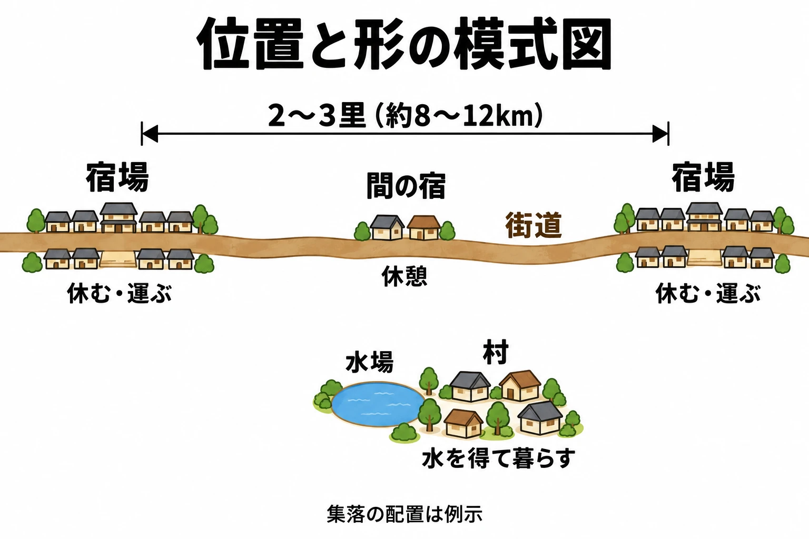

# その集落は、なぜそこにあるのか――宿場町と村から、人が集まる理由を設計する

街道――町と町を結ぶ主要な道――を歩いていくと、先に家々の屋根が見えてくる。次の宿場に着いたのだ。旅人は荷を下ろし、食事を取り、先の道に備える。そのそばでは、荷物を運んできた人や馬が、次の区間を受け持つ人や馬へと交代している。

**宿場（宿駅）** とは、旅人の休泊や、人と馬を交代させて荷物などを先へ送る仕事を担った交通の拠点である。そうした役割を中心にできた町が宿場町だ。[[1](#ref-1)]

全7回のシリーズ「城と街から拠点をつくる」第5回では、町や村をまとめて集落と呼び、 **「その集落は、何のために、そこにあるのか。理由から施設・間隔・形を決める」** ことを考える。[第1回の5要素](castle-town-design-lynch-city-image.md)でいえば、旅の道の上で人が集まる集落は「結節点」にあたる。

道を行く人を支える町と、水を得て暮らす村。その場所に人が集まる理由をたどると、ゲームの地図に集落を置くときの手がかりが見えてくる。

***

## 宿場は、道の先へ人と荷物をつなぐ町

江戸時代の宿場の主な役目は、休泊・輸送・通信だった。徳川家康は1601年（慶長6）に東海道へ宿駅を設け、荷物などを次の宿へ送るための馬である **伝馬** を出させる制度を始めた。宿ごとに人や馬を交代させ、運送をつないでいく仕組みを **人馬継立（じんばつぎたて）** という。[[1](#ref-1)]

休泊には宿が要り、輸送や通信には人と馬の手配が要る。その仕事に応じて施設がそろった。大名などが休泊する **本陣**、その予備を担う **脇本陣**、一般の旅人が食事や泊まる場所を得る **旅籠（はたご）屋** があった。宿の運営や人馬の手配を行う事務所が **問屋場（といやば）** である。宿役人や実務を担う人々がここに詰め、宿の事務を扱った。[[1](#ref-1)][[2](#ref-2)]

旅人から見れば休む場所であり、道全体から見れば運送を引き継ぐ場所である。宿場の建物を眺めるときには、泊まる人と、次へ送り出す人の両方を思い浮かべると、その町の働きがつかみやすい。

### 次の宿までの間にも、役割がある

『世界大百科事典（旧版）』の「輸送」は、江戸時代の宿駅について、2里・3里の間隔で設けられ、宿ごとに馬を替える仕組みを説明している。1里を約3.9kmとして換算すると、約8〜12kmである。ここでは、宿場が道の途中で運送をつなぐ間隔を持っていたことに注目したい。[[1](#ref-1)]

宿場と宿場の間には、旅人が休憩する **間の宿（あいのしゅく）** が置かれることもあった。道中には、大きな拠点のほかにも足を止める場所があったのだ。[[3](#ref-3)]

***

## 道に沿って伸び、入口で人を受け止める

岡山県の矢掛町は、江戸時代に宿場町となった。観光庁の解説によれば、町の中心は旧山陽道の直線約800mの区間にあり、約200軒の間口の狭い町家が並ぶ。本陣と脇本陣がともに残り、脇本陣は本陣から東へ約350mの位置にある。[[4](#ref-4)]

道を通る人に用がある町では、通り沿いが人を迎える場所になる。矢掛の細長い町並みは、道と町の関係を具体的に思い描く手がかりだ。宿場を一つの点として地図に置いたあと、その点を街道に沿って引き伸ばしてみると、施設の並び方まで考えやすくなる。

入口に目を向けると、長野県の妻籠宿には **枡形（ますがた）**、つまり道を折り曲げて進入の勢いを抑える仕掛けの跡がある。観光庁の解説は、宿場町が軍の防衛拠点とみなされていたことと、枡形が無法者の襲撃から宿場を守る役目も果たしたことを伝えている。[[5](#ref-5)]

[第2回で扱った枡形の構造](japanese-castle-gate-design-koguchi-masugata.md)や、[第4回の町と入口の関係](walled-city-vs-castle-town-enclosure.md)は、宿場にもつながっている。人を迎え入れる町にも、入口で町の暮らしを守る工夫があったのである。

***

## 水を得られる場所に、暮らしが集まる

村の立地を考える手がかりとして、山から平地へ出たところに目を向けよう。川が運んだ砂や石が谷の出口から扇のように広がって積もった地形を、 **扇状地（せんじょうち）** という。中央付近が **扇央（せんおう）**、平地側の先端が **扇端（せんたん）** である。[[6](#ref-6)]

砂や石の間には水がしみ込みやすく、川の水が途中で地下へ潜る。中央付近では地表の水を得にくく、先端付近では地下を流れてきた水が湧き出す。国土地理院の教材は、この水の得やすさに対応して、中央付近には果樹園、先端付近には集落や水田が見られると説明している。[[6](#ref-6)]

同じ扇状地の中でも、水を手に入れやすい場所と、手に入れにくい場所がある。人の暮らしと耕す土地の位置は、その違いと結びついている。水場から家々へ、家々から田へと目を移せば、人々がそこで暮らす理由を景色から読み取れる。

川沿いのわずかに高い土地に集落が連なる例は、[地形シリーズの川の回](open-world-terrain-design-rivers.md)で扱った。ここでは、扇状地の中で水の得やすさが変わることを、集落を置く手がかりとして持ち帰ろう。

宿場間の距離は参考文献[[1](#ref-1)]の説明に基づく概算。集落の配置は例示である。

***

## ゲームでも、人が集まる理由が町の仕事を決める

### 売り買いのために集まる町

『Kingdom Come: Deliverance II』の開発元Warhorseでシニアゲームデザイナーを務めるOndřej Bittner氏は、Deep Silver公式サイトの記事で、中欧の中世都市の多くは市場を中心に組織されていたと説明している。肉屋、靴屋、仕立屋など、特定の職業が一つの通りに集まるあり方を、ゲーム内の都市クッテンベルク（現在のチェコのクトナー・ホラ）を作る手本にしたという。[[7](#ref-7)]

本稿の考察として、この例から持ち帰れるのは、町の仕事を通りの性格へ結びつける考え方である。物を売り買いするために人が集まるなら、市場と店、その商品を作る人の仕事場が関係を持つ。「何の店があるか」に加えて、「なぜこの店がこの通りに集まるのか」まで決められる。

### 資源と仕事を求めて集まる前哨の町

『Horizon Forbidden West』の発売前、2021年11月22日のPlayStation Blog記事は、チェーンスクレイプを国境にあるオセラム族の前哨の集落として紹介している。前哨とは、領域の先端側に置かれる拠点のことだ。天然資源が豊富なこの場所には、稼ぎや新しい暮らしなどを求める人々が集まる。[[8](#ref-8)]

同記事は、危険な土地で生きる人々には、鍛錬し、休み、装備を強化する場所が必要であり、集落がその役目を担うと説明する。開発元GuerrillaのシニアデザイナーSteven Lumpkin氏が目指したのは、人が暮らし、活気があり、役に立つと感じられる町や村だった。[[8](#ref-8)]

本稿の考察として、資源を求めて人が来るという理由は、材料を扱う場所、働く人が休む場所、危険に備える場所へとつながる。住民の暮らしを支える施設と、プレイヤーが次の旅に備える施設を、同じ理由から組み立てられるのだ。

***

## 理由を、施設・間隔・形へ置き換える

ここからは、歴史・地理と開発者の説明を手がかりにした **本稿の考察** である。集落を設計する順番を、三つに分けて考えてみよう。

### 1．集まる理由から、施設を選ぶ

まず、「誰が、何をするために、ここへ来るのか」を一文にする。

たとえば、架空の峠の手前に「山越えの旅人が準備を整える町」を置く。休むための宿、運ぶ・移動を助けるための荷物預かりや乗り物の手配所、売り買いのための食料品店が候補になる。危険な山道を越えるという設定なら、鍛えるための稽古場や、道具を整える修理屋にも役割が生まれる。

一方、「湧き水を使って田を耕す村」なら、水場と田へ通う道、農具をしまう小屋などから考え始められる。住民が何をして暮らすかを決めると、プレイヤーに提供できる物や手助けも想像しやすい。

施設を選ぶ基準は、 **集落の理由と、そのゲームで必要な行動がつながっているか** である。

### 2．集落の間隔を、準備と休息の周期にする

宿場の間隔をゲームへ持ち帰るときは、プレイヤーが次の拠点までに経験する旅の長さへ置き換える。徒歩か乗り物か、戦闘や寄り道があるか、途中で夜になるかによって、同じ距離でも準備の重みが変わる。

『ドラゴンズドグマ 2』のプロデューサー平林良章氏は、発売前の2024年3月6日のインタビューで、一夜を費やすような遠出なら、拠点を出る前にランタンの油を確かめ、野営道具を持つか考える必要があると説明している。夜の危険と距離が、出発前の準備につながっている例だ。[[9](#ref-9)]

この例を踏まえた本稿の設計案では、「出発前に何を買うか」「道中で何を使うか」「到着時に何を回復・補充するか」を一続きに決める。そのうえで道を実際に歩き、補充したくなる頃に次の集落が見えるかを確かめる。

途中に小さな休憩場所を置けば、一息つく区切りも作れる。そこでできることを食事や休息に絞り、装備の修理や十分な買い物は次の町で行うようにすると、それぞれへ立ち寄る理由が生まれる。

### 3．集まる理由を、町並みから読めるようにする

形を考えるときは、人が日々向かう場所を先に置く。道を通る人を迎える宿場なら、道に沿って細長く。水を使う村なら、水場の近くに家々をまとめ、耕す土地へ道をつなぐ。市場へ売り買いに来る町なら、市場を中心に店や通りを広げる。これらは、今回の事例を単純化した配置の出発点である。

そのあとで、人々がどこから入り、何を運び、どこで立ち止まるかを追っていく。入口の守りが必要なら、妻籠宿の枡形のように、出入りを受け止める場所も考える。

先ほどの架空の峠の町なら、山へ向かう道沿いに食料品店や修理屋が見える配置にする。プレイヤーが通りを進むだけで、ここが山越えの準備をする町だと感じられれば、町並みがその集落の役目を伝えている。

***

## 「何のために、そこにあるのか」を点検する

集落の案ができたら、地図と施設一覧を並べて、次の順に点検するとよい。

| 観点 | 点検する問い | 設計に書き込むもの |
| --- | --- | --- |
| 集まる理由 | 水・道・交易・資源・境界のうち、何が人をここへ呼ぶのか | 「誰が、何のために集まるか」の一文 |
| 施設 | 住民と旅人の、どの行動を支えるのか | 休む、運ぶ・移動を助ける、売り買いする、鍛える場所 |
| 前後の間隔 | 次の集落までに何を準備し、何を使い、どこで休むのか | 旅の内容、補充できる物、途中の休憩場所 |
| 町並みの形 | 道・水場・市場と建物の関係から、集まる理由を読み取れるか | 施設の並び、生活の道、人や荷物の動き |
| 入口 | 何を迎え、何から守り、どこで出入りを確かめるのか | 入口の位置と、そこで足を止める必要性 |

宿場へ着いた旅人には、休める場所と、次へ進むための支えが見える。水場へ向かう村人の道からは、日々の暮らしが見える。

**「その集落は、何のために、そこにあるのか」**。この問いへの答えを施設・間隔・形に通すと、地図上の一つの点が、人の暮らしとプレイヤーの旅をつなぐ場所になる。

## References

1. [児玉幸多「宿駅」ほか][1] — 平凡社『改訂新版 世界大百科事典』、小学館『精選版 日本国語大辞典』「宿駅」、コトバンク掲載、日付表記なし。児玉幸多の解説で休泊・輸送・通信、施設、1601年の東海道への宿駅設置と伝馬制を参照。『精選版 日本国語大辞典』で交通集落としての定義を参照。同ページ所収の平凡社『世界大百科事典（旧版）』「輸送」の項（表示範囲に執筆者表記なし）で、宿駅の間隔「2里、3里」と宿ごとに馬を替える仕組みを参照。本文のkm表記は概算換算。

[1]: https://kotobank.jp/word/宿駅-77586

2. [「脇本陣」][2] — 小学館『デジタル大辞泉』『精選版 日本国語大辞典』、コトバンク掲載、著者・日付表記なし。本陣の予備としての役割を参照。

[2]: https://kotobank.jp/word/脇本陣-664837

3. [「間の宿」][3] — 『ブリタニカ国際大百科事典 小項目事典』、コトバンク掲載、著者・日付表記なし。宿場間に置かれた村と、旅人の休憩という役割を参照。

[3]: https://kotobank.jp/word/間の宿-23839

4. [「矢掛の歴史地区と大名のもてなし」][4] — 観光庁「地域観光資源の多言語解説文データベース」、著者・日付表記なし。PDFの1〜2ページを参照。

[4]: https://www.mlit.go.jp/tagengo-db/common/001927944.pdf

5. [妻籠宿連絡調整会議「国重要伝統的建造物群保存地区 妻籠宿保存地区 桝形の跡」][5] — 観光庁「地域観光資源の多言語解説文データベース」、2019年度作成。日本語解説「枡形跡」と英語解説「Site of the Masugata」を参照。

[5]: https://www.mlit.go.jp/tagengo-db/R1-01471.html

6. [国土地理院「日本の高いところと低いところを見る」（「扇状地のできかた」「扇状地の土地利用」）][6] — 国土地理院の地理教育用教材、日付表記なし。PDFの5ページを参照。

[6]: https://www.gsi.go.jp/common/000218165.pdf

7. [「Kuttenberg: A Medieval Metropolis」][7] — Deep Silver公式サイト、著者・日付表記なし。WarhorseのシニアゲームデザイナーOndřej Bittner氏による、市場と職種ごとの通りについての説明を参照。発売前の紹介記事。

[7]: https://www.deepsilver.com/games/kingdom-come-deliverance-ii/news/kuttenberg-a-medieval-metropolis

8. [Bo de Vries「Horizon Forbidden West: An authentic world」][8] — PlayStation Blog、2021年11月22日。Guerrillaによる発売前の記事。「Heading to Chainscrape」「Settlements of the Forbidden West」および導入を参照。英語の説明と発言は日本語で要約した。

[8]: https://blog.playstation.com/2021/11/22/horizon-forbidden-west-an-authentic-world/

9. [Jun Namba（執筆・編集）、Hideaki Fujiwara（聞き手・編集・写真）「『ドラゴンズドグマ 2』伊津野D＆平林Pインタビュー。一歩歩けば何かが起こる、絶対に退屈させないオープンワールドは“前作の不完全燃焼”から生まれた」][9] — AUTOMATON、2024年3月6日。発売前のインタビュー。「ファンタジー世界を自分の足で歩く体験」における平林良章氏の説明を参照。

[9]: https://automaton-media.com/articles/interviewsjp/20240306-284745/

----

この文書は、Perplexity、Claude、OpenAI Codex の3つのAIの支援を受けて著述されたものです。引用画像を除き、MIT License にて提供されています。