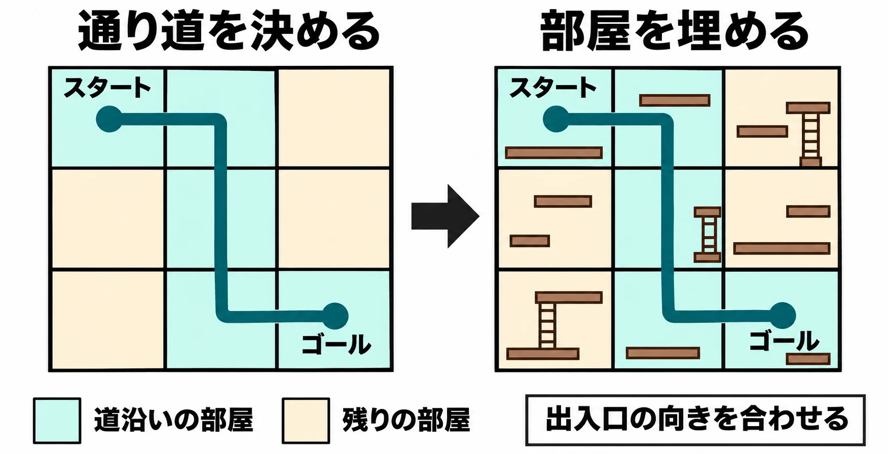

# 乱数に何を任せ、何を保証するのか——Eliteから『No Man's Sky』まで、プロシージャル生成の約束と限界

> 2026年11月13日改版：記事全体を全面的に書き直しました。内容の変更はGitの履歴から追えます。

## はじめに

プロシージャル生成とは、規則と乱数を使って、地形やダンジョン、敵やアイテムの配置などを自動で作る方法である。たとえばダンジョンでは、宝箱の場所は毎回変えてよい。一方、出口へ続く道は、どの回にも必要である。同じフロアの中でも、乱数に任せる場所と、作り手が成立を保証する場所がある。

何を変えると遊びが広がり、何が変わると遊びが壊れるのか。本稿では、星系の再現からダンジョンの通り道、惑星探索の手応えまで、この線引きを事例でたどる。Rogueと日本の「不思議のダンジョン」の系譜は、[結局ローグライクってなんなのさ？](what-is-a-roguelike.md) を参照してほしい。

***

## 同じ世界を再現する——シードの約束

David Braben氏とIan Bell氏が作ったBBC Micro版の『Elite』（1984年）は、使えるメモリが限られるなか、8つの銀河に計2,048の星系を収めた。星系のデータを一覧として保存する代わりに、16ビットの数3つを種にし、トリボナッチ数列を使って星系ごとの種を求める。そこから座標などの情報を必要なときに計算し直せるため、同じ星系を参照すれば同じ情報が得られる。[[1](#ref-1)][[2](#ref-2)]

生成の出発点になる値を **シード** と呼ぶ。『Elite』では、シードから同じ星系を再現できることがメモリの節約につながった。『Minecraft』では、同じ版・同じ生成設定でシードをそろえれば同じ初期ワールドを作れるため、プレイヤーが気に入った地形を別の人に紹介できる。疑似乱数とシードの仕組みは、[ゲームプランナーが知っておくべき乱数の話](random-numbers-for-game-planners.md) で詳しく扱っている。[[3](#ref-3)]

2021年の「Caves & Cliffs: Part II」（1.18）では、地上世界の生成方式が全面的に変わった。公式のBedrock版告知によれば、以前のシードを1.18で使って新規ワールドを作ると、以前と同じ位置からは始まらない。旧版に固定した環境では、以前の生成結果を再現できる。一方、すでに遊んでいるワールドには、新たに生成する地形を既存の地形につなぎ、境目を自然に見せる「World Blending」が用意された。[[3](#ref-3)][[4](#ref-4)]

シードの約束は、版ごとの約束でもある。以前と同じ初期ワールドを作りたい人には、シードと生成規則の版が要る。建物を残して探索を続けたい人には、既存のセーブデータをどう引き継ぐかが重要になる。同じ更新でも、どちらを支えるかで必要な仕組みは変わる。作品全体の設計については、[Minecraftはなぜ17年近く売れ続けるのか](minecraft-endless-design-java-bedrock-strategy.md) を参照してほしい。

***

## 必ず遊べることを保証する

Derek Yu氏が作った『Spelunky』は、足場を渡り、罠をよけながら出口を目指すプラットフォーマーである。フロアを毎回生成することで、決まった配置を暗記して進む遊びから、その場の足場や罠を見て進み方を選ぶ遊びへと重心を移している。初代の生成では、格子状に並ぶ部屋のうち、まずスタートからゴールまでの通り道を決める。道沿いの部屋には必要な方向に出入口がある手作りのパターンを選び、残りの部屋も別の候補から埋める。通り道の形は変わるが、通り道があることは生成の手順で保証する。[[5](#ref-5)][[6](#ref-6)]

『Diablo』（1996年）は、まず床や出入口など、どこを歩けるかを示す下地を作り、その後で見た目を担うタイルや装飾を当てる。ステージによって生成方法は異なる。たとえば大聖堂（Cathedral）では、通路でつないだ部屋を起点に、部屋から芽を出すように新しい部屋を増やす「Recursive Budding」を使う。増やした部屋は元の部屋につながり、歩ける床が規定の広さに達しなければ下地を作り直す。後から壁で区切るときにも、出入口を設けて通れるようにする。別のフロアへ進む階段を配置できなかった場合も作り直す。[[7](#ref-7)]

通行を保証する方法には、つながった道から作り始める方法と、できた地図を調べて条件を外れたものを作り直す方法がある。後者で出口への到達を保証するなら、床の広さに加えて、入口から出口まで実際に移動できるかを確かめる必要がある。鍵が要るフロアなら、鍵を先に取れることまでが条件になる。何をもって「遊べる」とするかは、そのゲームでプレイヤーが取れる行動から決まる。

***

## 手作りの部品を混ぜる

『Diablo』では、クエスト用に手作りした区画を「セットピース」として、生成したフロアに組み込む。たとえば「ブッチャーのねぐら」は、周囲の道順が変わっても作り手が用意した区画として現れる。『Spelunky』の部屋パターンも手作りだが、こちらは進行方向に合わせて選ぶ部品である。前者では特定の場面を残すために、後者では部屋の中で成立する足場や出入口の組み合わせを持たせるために、手作りを使っている。[[7](#ref-7)][[6](#ref-6)]

『Dead Cells』では、全体地図と区画どうしのつながりを固定し、区画の内側では手作りのタイルを選んで並べる。敵の配置も生成するが、戦闘に使える場所の広さや、敵の種類ごとの配置条件を考慮する。全体の進行、区画内の道順、個々の戦闘という異なる単位で、固定するものと変えるものを決めている。[[8](#ref-8)]

手作りの比率を考えるときは、まず、どの単位を固定すれば狙った体験が残るかを決める。クエストの場面を見せたいなら区画を、各回で進み方を考えさせたいなら部屋どうしの組み合わせを設計する。地形での分担は、[広さは規則で、印象は手で――自然の関係を広げる地形設計](open-world-terrain-design-procedural-rules.md) で扱っている。

***

## 規則を作る道具になる

『Dwarf Fortress』は、プレイヤーが遊び始める前に、地形に加えて世界の歴史まで生成する。標高や降水量などから土地の性質が決まり、川や生き物が生まれる。そこから文明のシミュレーションが始まり、集落が築かれ、交易路ができ、戦争が起こる。プレイヤーは、その過程を経た世界に入る。[[9](#ref-9)]

開発者のTarn Adams氏は、複雑さを必要な箇所に絞り、現実に対応する仕組みを手がかりにモデルを作ることを勧めている。たとえば川が不自然に流れたとき、高い場所から低い場所へ流れるという前提があれば、標高のデータと流れを決める規則から原因を調べられる。出力を一件ずつ直す代わりに、どの規則がその結果を生んだかを追えることが、生成を制作に使ううえで重要になる。[[9](#ref-9)]

生成は、発売後にプレイヤーの手元で動かすほか、開発中の素材づくりにも使える。ポリフォニー・デジタルの景観デザインチームなどはCEDEC 2019で、Houdiniのプロシージャル法で景観用の素材にバリエーションを作り、手作業に頼る部分もスクリプトで処理して、品質を一定に保つ方法を紹介した。制作側で生成する場合は、候補を並べて見比べ、採用するものを選べる。同じ工程を繰り返せるようにしておけば、後から規則を調整して候補を作り直すこともできる。[[10](#ref-10)][[11](#ref-11)]

***

## 数を増やしても、飽きられる

Hello Gamesの『No Man's Sky』（2016年）は、1,800京以上の惑星を生成する。Sean Murray氏は、影響を受けた作品の一つに『Elite』を挙げている。『No Man's Sky』では、宇宙から惑星の地表へ連続して移動できるよう、地形やその上に置くものをリアルタイムで生成する。[[12](#ref-12)][[13](#ref-13)][[14](#ref-14)]

発売時には、訪れる惑星の施設が似て見え、行く先を変えてもやることが繰り返しになるという批判があった。PC Gamerのレビューでは、前哨基地や遺跡などで同じようなものを何度も見つけた結果、画面に見える目印を一つずつ調べなくなったと述べている。その後、Hello Gamesは無料アップデートで内容を追加し、初期の「Foundation Update」では拠点建築やサバイバルモードなどを導入した。[[15](#ref-15)][[16](#ref-16)]

惑星ごとに景色が違えば、眺める楽しさは増やせる。探索を続ける理由まで生みたいなら、降り立つ場所によって取れる行動や判断がどう変わるかも設計する。たとえば地形の違いを、目的地までの経路を選ぶ理由にできる。拠点を建てる遊びがあれば、同じ景色でも、資源を集めやすいか、何度も戻ってきたいかという基準で見るようになる。生成される候補の数と、プレイヤーが経験する選択の幅は、それぞれ確かめる必要がある。

***

## 手法の早見表

Ken Perlin氏は、映画『Tron』（1982年）で使われたコンピューター映像の機械的な見た目をきっかけに、1983年にPerlin Noiseを開発した。1985年に論文を発表し、1997年にはプロシージャルな質感表現の技術で米国映画芸術科学アカデミーの科学技術賞（Technical Achievement Award）を受けた。[[17](#ref-17)][[18](#ref-18)][[19](#ref-19)]

| 手法 | 何をするか | 用途 | 作品例 |
| --- | --- | --- | --- |
| Perlin Noise | 近い点ほど値が似るように、不規則な値を滑らかにつなぐ。 | 地形の起伏や表面の模様 |  |
| セル・オートマトン | 格子のマスごとに、周囲のマスの状態を見て床や壁を決め直す。繰り返すと床や壁がまとまる。[[20](#ref-20)] | 洞窟の下地 |  |
| 空間の分割 | 広い領域を順に小さく分け、分けた領域に部屋を置く。必要な部屋を通路でつなぐ。[[21](#ref-21)] | ダンジョンの部屋の配置 |  |
| Wave Function Collapse（WFC） | Maxim Gumin氏の手法。手本の画像から近くに置ける模様の組み合わせを読み取り、隣り合ってよいタイルや模様の制約を満たすように並べる。[[22](#ref-22)] | タイル地図や模様の配置 |  |

***

## むすび

AI・機械学習とプロシージャル生成を組み合わせ、既存のレベルなどから配置の特徴を学ばせて新しい候補を作る研究も進んでいる。候補の作り方が変わっても、出口までたどり着けるか、遊ぶたびに判断が変わるかは、それぞれ確かめる必要がある。[[23](#ref-23)]

| 確認項目 | 企画・試作で確かめること |
| --- | --- |
| 再現性 | 同じ生成結果を出すために、シードのほかに版や設定も記録しているか。 |
| 遊べることの保証 | 入口から出口へ行けるか。必要な鍵や道具を、使うより先に入手できるか。 |
| 手作りの部品の比率 | 必ず見せたい場面をどの単位で固定し、どの部品の選択や組み合わせを乱数に任せるか。 |
| 規則を直す道具 | 問題の出た結果を再現し、どの規則が原因か調べ、変更前後を見比べられるか。 |
| 飽きへの対策 | 配置や見た目が変わったとき、プレイヤーが取る経路や行動にも違いが生まれるか。 |

## References

1. [Iain Thomson「40 years since Elite became the most fun you could have with 22 kilobytes」][1] — The Register、2024年1月18日。Ian Bell氏とMark Moxon氏へのインタビュー。

[1]: https://www.theregister.com/2024/01/18/elite_game_retro/

2. [Mark Moxon「Galaxy and system seeds」][2] — Elite on the 6502、公開日記載なし。Ian Bell氏が公開したソースコードに基づく解析。

[2]: https://elite.bbcelite.com/deep_dives/galaxy_and_system_seeds.html

3. [Matt Gartzke「Caves & Cliffs: Part II Out Today on Bedrock」][3] — Minecraft公式サイト、2021年11月30日。「Known Issues」のシードとバージョンについての記述を参照。

[3]: https://www.minecraft.net/en-us/article/caves---cliffs--part-ii-out-today-bedrock

4. [Cameron Thomas「Caves & Cliffs Part II: The Features」][4] — Minecraft公式サイト、2021年12月3日。「World Blending」を参照。

[4]: https://www.minecraft.net/en-us/article/caves---cliffs-part-ii-the-features

5. [Spelunky World「What is Spelunky?」][5] — Spelunky公式サイト、公開日記載なし。毎回の配置が変わる遊びについての紹介。

[5]: https://spelunkyworld.com/whatis.html

6. [Darius Kazemi「Spelunky Generator Lessons」][6] — Tiny Subversions、公開日記載なし。初代のソースコードに基づく解説と実演。David Pittman氏のGDC 2015講演「Procedural Level Design in Eldritch」でも参照されている。

[6]: https://tinysubversions.com/spelunkyGen/

7. [Adam Newgas（Boris）「Dungeon Generation in Diablo 1」][7] — BorisTheBrave.Com、2019年7月14日。復元されたコードに基づく技術解析。

[7]: https://www.boristhebrave.com/2019/07/14/dungeon-generation-in-diablo-1/

8. [Sébastien Bénard「Building the Level Design of a procedurally generated Metroidvania: a hybrid approach.」][8] — Game Developer、2017年3月29日。『Dead Cells』開発者による解説。

[8]: https://www.gamedeveloper.com/design/building-the-level-design-of-a-procedurally-generated-metroidvania-a-hybrid-approach-

9. [Tarn Adams「Simulation Principles from Dwarf Fortress」][9] — Game AI Pro 2 第41章、2015年。

[9]: https://www.gameaipro.com/GameAIPro2/GameAIPro2_Chapter41_Simulation_Principles_from_Dwarf_Fortress.pdf

10. [SideFX「Houdini at CEDEC 2019」][10] — SideFX公式サイト、2019年。「Part 1: バリエーション生成」を参照。

[10]: https://www.sidefx.com/ja/community/cedec-2019/

11. [齋藤彰・永友瑛里子・山部道義「プロシージャルゲームコンテンツ制作ブートキャンプ 2019 Part 1 バリエーション生成」][11] — CEDEC 2019、2019年9月6日。CEDiLの公式セッション記録。

[11]: https://cedil.cesa.or.jp/cedil_sessions/view/2111

12. [Josh Sepielli「What Can You Do in No Man’s Sky?」][12] — PlayStation.Blog、2016年7月14日。発売予定日と惑星の規模を参照。

[12]: https://blog.playstation.com/?p=178276

13. [秋夏「『No Man's Sky』に影響を与えた作品とは―未見シーンを含んだインタビュー映像」][13] — Game*Spark、2015年7月16日。IGNによるSean Murray氏へのインタビューの紹介。

[13]: https://www.gamespark.jp/article/2015/07/16/58597.html

14. [Innes McKendrick「Continuous World Generation in 'No Man's Sky'」][14] — GDC 2017、2017年。Hello Gamesの開発者による講演。

[14]: https://www.gdcvault.com/play/1024265/Continuous-World-Generation-in-No

15. [Christopher Livingston「No Man's Sky review」][15] — PC Gamer、2016年8月18日。

[15]: https://www.pcgamer.com/no-mans-sky-review/

16. [Hello Games「Foundation Update」][16] — No Man's Sky公式サイト、2016年11月27日。

[16]: https://www.nomanssky.com/foundation-update/

17. [Ken Perlin「Ken's Academy Award」][17] — ニューヨーク大学、公開日記載なし。

[17]: https://cs.nyu.edu/~perlin/doc/oscar

18. [Ken Perlin「An image synthesizer」][18] — SIGGRAPH '85、1985年7月1日。

[18]: https://doi.org/10.1145/325334.325247

19. [Nick Montfortほか「10 PRINT CHR$(205.5+RND(1)); : GOTO 10」][19] — MIT Press、2014年ペーパーバック版。「Acceptance and Resistance」の『Tron』と1983年の開発経緯を参照。

[19]: https://escholarship.org/uc/item/3mb1z52c

20. [Lawrence Johnson・Georgios N. Yannakakis・Julian Togelius「Cellular automata for real-time generation of infinite cave levels」][20] — PCGames 2010、2010年。マルタ大学の機関リポジトリ。

[20]: https://www.um.edu.mt/library/oar/handle/123456789/22895

21. [Jing Ming Yap・Nian Chein Woo・Bee Sian Tan・Kim Soon Chong「From Algorithm to Playable Space: A Technical Note on BSP-Based Dungeon Design」][21] — International Journal of Creative Multimedia、2025年9月30日。

[21]: https://journals.mmupress.com/index.php/ijcm/article/view/2470

22. [Maxim Gumin「WaveFunctionCollapse」][22] — GitHub、公開日記載なし。作者による実装と方式の説明。

[22]: https://github.com/mxgmn/WaveFunctionCollapse

23. [Adam Summervilleほか「Procedural Content Generation via Machine Learning (PCGML)」][23] — IEEE Transactions on Games、2018年。

[23]: https://ieeexplore.ieee.org/document/8382283/

----

この文書は、Perplexity、Claude、ChatGPT の3つのAIの支援を受けて著述されたものです。引用画像を除き、MIT License にて提供されています。
