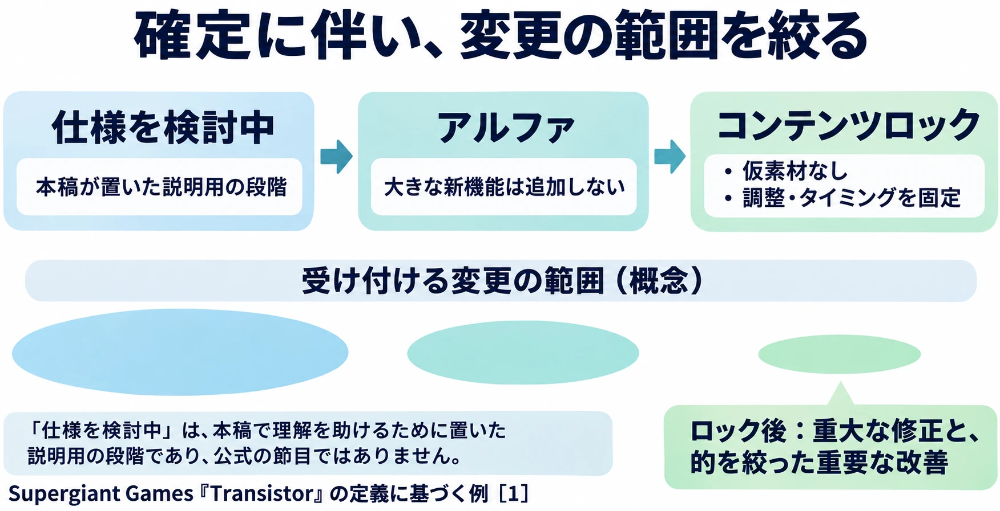
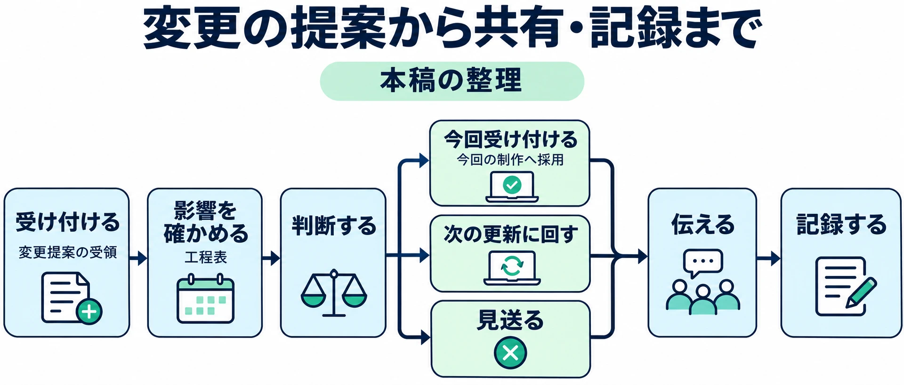

# 上流を固める——制作進行を任されたら③

## 1. 確定したはずの台詞が変わる

会話テキストの確認が終わり、翻訳も進んだ。ところが収録の直前、演出をよくするために台詞を差し替えることになった。翻訳を直し、収録用の台本を更新し、関係者の予定も確かめ直す。「確定した」と聞いて進めた仕事に、手戻りが生じてしまった。

これは、[第1回](production-coordination-01-role-and-visibility.md)と[第2回](production-coordination-02-building-the-schedule.md)で取り上げた架空の現場の続きである。今回は、翻訳した台詞を収録する体制を想定している。

第1回では、判断に必要な情報を揃える人と、最終判断をする人の分担を考えた。第2回では、工程表に受け渡しのつながりを加えた。その起点となる仕様について、次は **「下流は、どこまで進めてよいのか」** を明らかにしたい。

シリーズ共通の判断軸は、 **「次の工程が受け取れる状態で渡せているか」** である。第3回では、仕様の確定、残る未定事項、確定後の変更を、受け取る側が判断に使える形にする方法を考える。

***

## 2. 「確定」を状態で言う

Supergiant GamesのGreg Kasavin氏は、2014年3月11日の公式ブログ「From Alpha to Content Lock」で、『Transistor』の開発の節目を説明している。そこで使われる **アルファ** は、ゲーム全体を通して遊べ、最終的な体験を示せる段階である。大きな設計や物語の穴が残っていれば、この段階には達していない。[[1](#ref-1)]

アルファの説明には「no significant new features are being added」（大きな新機能はもう追加しない）とある。主要な機能が揃ったうえで、完成形に向けて磨いていく状態だ。[[1](#ref-1)]

次の大きな節目が **コンテンツロック** 、つまり内容を固定して出荷品質へ近づける段階である。「Placeholder assets are gone」（仮の素材がなくなる）ことが条件に含まれる。仮素材とは、完成した画像や音声などが用意できるまで、代わりに入れておく素材のことだ。ゲームの調整、音声のタイミング、実行時の処理性能まで固定していく。とりわけ「the timing of the voiceover」（音声のタイミング）も対象になっている点に、工程のつながりが表れている。[[1](#ref-1)]

ロック後に行う変更は「critical fixes or key surgical improvements」（重大な修正と、的を絞った重要な改善）に限られる。テストと磨き込みに重点を移し、変更の範囲を絞るのである。[[1](#ref-1)]

これは一社・一作品での定義であり、アルファやコンテンツロックが指す状態は、スタジオやプロジェクトによって異なる。同記事はベータの定義を示していない。

出典：Supergiant Games「From Alpha to Content Lock」を基に作成。[[1](#ref-1)]

この例を手掛かりに、本稿では **何が固定され、その後はどんな変更だけを受け付けるかまで言葉にする** ことを、確定の伝え方と整理する。第2回の「節目は名前とあわせて、その時点で何が満たされているかを揃える」という考え方を、仕様にも当てはめるのである。

冒頭の架空の現場なら、「会話テキストは確定」とだけ伝えるところから、次のように具体化できる。

> 今回の収録対象となる会話テキストは、この版で確定する。台詞の内容と収録対象の範囲を固定し、以後の差し替えは重大な不具合など、決めておいた条件に沿って判断する。変更の相談は進行担当へ集め、承認と共有が済むまでは、この版を翻訳・収録準備の基準にする。

この例で固定したのはテキストと対象範囲である。音声のタイミングまで固定する節目とは分けて考える。対象となる版と固定する範囲が分かれば、下流は何を前提に作業してよいか判断できる。

***

## 3. 未定は、未定として渡す

CEDEC 2026では、PHI法律事務所の弁護士である安藤広人氏と戸上雄基氏が、「ゲーム開発の契約実務：仕様・仕様変更・検収から、セキュリティ／生成AIリスクまで」を講演した。公式の紹介でも、仕様の曖昧さや変化が避けにくいゲーム開発を対象に、仕様の確定や変更の扱いを検討する内容とされている。[[2](#ref-2)]

GameBusiness.jpの講演レポートによれば、仕様が固まりきらない場合、未定事項と確定時期を明示し、後日合意する方法が紹介された。また、仕様書を詳細にするほどトラブルは減りやすい一方、小さなずれも仕様変更として扱われやすくなるというトレードオフが指摘された。これは外注の契約についての話である。[[3](#ref-3)]

ここから、社内の進行に引き寄せて考えてみよう。 **未定の箇所と、いつ誰が決めるかを明示する** と、受け取った担当者は、確定した部分と待つ部分を分けられる。ただし、未定部分の決定が確定済みの範囲へ及ぼす影響も、担当者と確かめておきたい。

たとえば、同じ架空の会話イベントでも、次のように渡せる。

| 項目 | 渡す状態の例 |
|---|---|
| 確定済み | 本編の会話は対象の版で確定。翻訳を進めてよい |
| 未定 | 追加する短い会話の採否と、その台詞 |
| 決める人と時期 | ディレクターが、追加分の翻訳着手予定日より前に決める。実際の共有時には日付も書く |
| それまで進めてよい範囲 | 本編の翻訳は進め、追加分の翻訳と収録準備は待つ |

この区切りが成立するのは、追加分の採否が本編の台詞を変えないことを確認できた場合である。本編まで変わりうるなら、その範囲も未定として扱う。確定予定日に間に合わないと分かった時点で、進行担当は工程表へ影響を戻し、対象範囲や予定を相談する。

全部が決まるまで受け渡しを待つと、下流が先に進められる時間が減り、後で急いだ調整や手戻りが生じやすくなる。未定を書かずに渡すと、下流はそこも確定済みだと受け止めてしまう。どちらも、次の工程が判断するための情報が足りない状態である。

ここで整理したのは、社内で作業範囲を共有する方法である。外注での仕様変更や取引上の扱いは、[ゲーム開発の外注と取適法](game-development-subcontracting-toriteki-law.md)を参照してほしい。

***

## 4. 確定の前に、疑問を集める

確定する前には、受け取る人の疑問を集める機会を置きたい。仕様を作った人が気づかない曖昧さも、使う側から見ると作業を止める理由になる。

CEDEC 2025で、だらねこげーむずのだらねこ氏は「疑うことがゲームを面白くする ― ゲーム制作におけるクリティカル・シンキングの応用 ―」を講演した。4Gamerのレポートでは、疑問を「前提への問い」「方法への問い」「結果への問い」に分け、まず前提を問い、曖昧なところを明らかにする流れが紹介されている。[[4](#ref-4)]

また、だらねこ氏は「ディレクターにこそ疑問をぶつけるべき」とし、相手を責めず、判断を助ける形で問いかけることを勧めたという。[[4](#ref-4)]

この考え方を受けて、本稿では、進行が確定前に下流の担当者から疑問を集める場を作ると整理する。翻訳、音声、実装、QA（品質保証）など、それぞれの作業で困る点を確かめるのである。

架空の会話イベントなら、問いの形は次のようになる。

- **前提への問い**：今回確定するのは本編だけか。分岐の台詞も、今回の収録対象に含むのか。
- **方法への問い**：差し替えが出たら、どの版を基準に変更箇所を伝えるのか。
- **結果への問い**：この台詞を長くすると、用意した演出の尺に収まるのか。

これらは本稿が受け渡しに当てはめた例である。進行は疑問を集め、答えられる担当者へつなぎ、決まった内容を戻す。回答が残るものは、未定事項として扱えばよい。

**確定の後に、固定した内容を問い直して変えるなら、それは変更になる。** 単なる説明の補足で済む質問と、制作の前提を動かす相談を分けて受け止めたい。確定前に疑問を出せる場があれば、その違いも関係者で揃えやすくなる。

仕様書の記述を明確にする方法は、[仕様書の落とし穴と伝わる書き方](game-spec-pitfalls-and-how-to-write-clear-specs.md)で扱っている。ここでは、その仕様を確定する前に、受け取る側が確認できる機会を設けることに目を向けよう。

***

## 5. 変更を受け付ける窓口と手順を決める

CEDEC 2026の契約講演では、変更の申し出先や手続きを、あらかじめ定めておく方法も挙げられた。さらに、仕様書に加えて企画書などの参考資料や、チャット・メールのやり取りも、合意内容を推し量る材料になりうると説明された。いずれも講演レポートが紹介する、外注契約の文脈での指摘である。[[3](#ref-3)]

社内の進行に置き換えるなら、変更を相談する先と、決定として残す場所を揃えておきたい。本稿では、その流れを次のように整理する。

1. **受け付ける**：窓口となる担当者へ、何をなぜ変えたいか、対象の仕様と版を集める。この時点では変更の提案として扱う。
2. **影響を確かめる**：第2回の工程表をたどり、作業のやり直し、確認、受け渡し予定への影響を関係する担当者に確かめる。
3. **判断する**：第1回で整理した分担に沿い、権限を持つ人が、今回受け付けるか、次の更新に回すか、見送るかを決める。
4. **伝える**：判断結果と、作業に使う版、対象範囲、予定の変更を、影響を受ける関係者へ伝える。
5. **記録する**：決定内容、理由、判断した人、決定日、対象の版と工程への影響を、決めておいた場所に残す。

判断する人は、変更の大きさに応じて分けてよい。たとえば次は、架空のチームでの分担例である。

| 変更の例 | 判断と影響確認の例 |
|---|---|
| 表示だけの誤字修正 | あらかじめ任された範囲で仕様担当が判断し、表示確認の担当へ伝える。音声や意味にも影響するなら、台詞変更として扱う |
| 収録する台詞の差し替え | 品質の判断をする責任者が、翻訳・収録などのやり直しと予定への影響を受けて決める |
| 新機能の追加 | 品質・予算・日程の責任者が、関係する工程を確かめ、今回の対象に含めるか決める |

進行は、この分担に沿って情報を集め、判断をつなぐ。各担当者への個別の依頼だけで作業が変わると、別の担当者は古い前提で進めてしまう。変更が承認されたことと、関係者が新しい前提を受け取ったことの両方を確かめたい。

チャットで判断したときも、決定として残す場所を一つ決めておく。元のやり取りへたどれるようにしつつ、現在の仕様と変更記録から、何がいつ変わったかを追える形にする。次の更新へ回した理由や、見送った理由も残せば、同じ相談を繰り返す際の手掛かりになる。

ロックの後なら、まず第2節で扱った、重大な修正と的を絞った重要な改善に限るという考え方に照らす。誤字でも影響は確かめるし、改善案でも今回扱うとは限らない。 **今の段階で受け付ける条件と、工程への影響を揃えて判断する** のである。

***

## 6. 運営型では、更新ごとに確定を分ける

第2回で紹介した、CEDEC 2019の『バンドリ！ ガールズバンドパーティ！』（以下、『ガルパ』）の事例を振り返ろう。優先度の高い案件から仕様を決め、関係者への説明・認識合わせを行うオリエンテーションを経て見積もりを出し、PM（プロジェクトマネージャー）が投入するバージョンを決める流れが紹介されていた。[[5](#ref-5)]

本稿の観点では、このオリエンテーションを、確定した仕様を関係者に共有し、見積もりの前提を揃える場として捉えられる。これは紹介された流れに対する本稿の解釈であり、すべての運営型タイトルが同じ手順を取るという意味ではない。

運営型では、次の更新の仕様が確定し、その次の更新はまだ検討中という状態が並行する。そこで **どの更新の、何が、どこまで確定しているか** を分けて示したい。

架空の運営チームなら、更新Aは「今回入れる機能と台詞を確定し、以後は定めた条件に沿う修正だけを判断する」、更新Bは「主要な仕様を検討中で、追加会話の採否を責任者が決める予定」と分けられる。更新Bへの提案が、収録準備の進む更新Aへいつの間にか混ざることも防ぎやすくなる。

変更を次の更新へ回すと決めた場合も、その更新の仕様や見積もりへ反映する必要がある。更新名と確定の範囲を添えることで、工程表と、担当者が使う仕様の前提をつなげられる。

***

## 7. 次の工程が進めてよい範囲を渡す

仕様の確定を伝えるときは、受け取った人が作業の前提にできる範囲まで示したい。未定が残っていても、その境界と決める予定が見えれば、進める部分と待つ部分を相談できる。変更が出たら、工程への影響を確かめて判断し、関係者へ伝えて残す。

「次の工程が受け取れる状態で渡せているか」を、仕様の確定と変更では次の観点から確かめたい。

- どの版の、何が確定し、何が未定か。下流が進めてよい範囲は分かるか。
- 未定事項は、いつ誰が決めるか。その決定がほかの作業へ及ぼす影響は見えているか。
- 確定する前に、下流の担当者の疑問を集めたか。
- 確定後に受け付ける変更の条件と、相談の窓口は決まっているか。
- 誰が変更を判断し、どこへ伝え、どこへ記録するか。対象の更新も区別できるか。

『Transistor』の開発記では、音声のタイミングまで固定する段階が示されていた。そこへ至るには、音声の元になるテキストが、下流の作業で使える状態になっている必要がある。

次回、第4回「下流へ流し込む（1）テキスト・ローカライズ・音声」では、テキストの確定が翻訳や収録でどう効くのかを、実際の受け渡しに沿って考える。

## References

1. [Greg Kasavin「From Alpha to Content Lock」][1] — Supergiant Games、2014年3月11日。『Transistor』のアルファ、コンテンツロック、ロック後の変更範囲を参照。英語引用の日本語訳は本稿による。

[1]: https://www.supergiantgames.com/blog/from-alpha-to-content-lock/

2. [安藤広人・戸上雄基「ゲーム開発の契約実務：仕様・仕様変更・検収から、セキュリティ／生成AIリスクまで ― 「あとで揉める」を防ぐ、契約の基本設計」][2] — CEDEC 2026、2026年7月22日。公式セッション案内。講演の主題と登壇者を参照。

[2]: https://cedec.cesa.or.jp/2026/timetable/detail/s69890d25299b0/

3. [葛西祝「ゲーム開発でトラブルを未然に防ぐための契約の作り方。開発中の仕様変更問題や、外注先の生成AI利用など揉め事を起さないための方法を解説【CEDEC2026】」][3] — GameBusiness.jp、2026年9月4日。講演レポート。未定事項と確定時期、仕様の詳細さのトレードオフ、変更の申し出先・手続き、合意内容を推し量る資料について参照。社内進行への置き換えは本稿の考察。

[3]: https://www.gamebusiness.jp/article/2026/09/04/27900.html

4. [荒井陽介「そんな仕様で大丈夫か？ 疑問によってゲーム開発をスムーズにする手法が紹介されたセッションをレポート［CEDEC 2025］」][4] — 4Gamer.net、2025年8月9日。だらねこ氏の講演レポート。問いの分類と、判断を助ける疑問の投げ方を参照。

[4]: https://www.4gamer.net/games/991/G999104/20250728053/

5. [山岡広樹「【CEDEC 2019】『ガルパ』の施策を支える開発・運用フローを紹介…スムーズな進行管理の秘訣は“チームワークの高さ”にあり！」][5] — gamebiz、2019年9月12日。2019年9月5日の講演「バンドリ！ ガールズバンドパーティ！を支える開発・運用のしくみ」のレポート。仕様決定、オリエンテーション、見積もり、投入バージョンの決定という流れを参照。

[5]: https://gamebiz.jp/news/248341

----

この文書は、Perplexity、Claude、ChatGPT の3つのAIの支援を受けて著述されたものです。引用画像を除き、MIT License にて提供されています。
