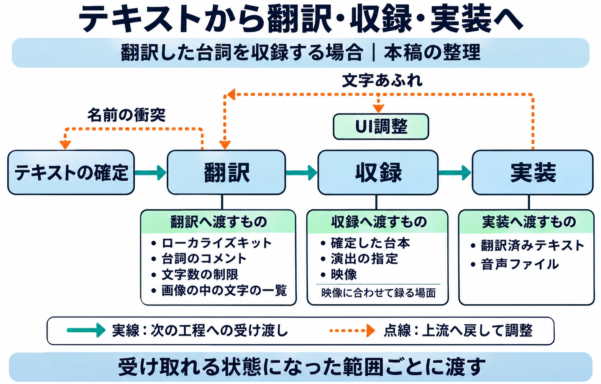

# 下流へ流し込む（1）テキスト・ローカライズ・音声——制作進行を任されたら④

## 1. テキストは確定した。翻訳者は何を知りたいか

会話テキストは確定した。翻訳用のファイルも渡した。ところが、翻訳者から質問が届く。「この台詞は、誰が誰に言っているのか」「この語は、前の章と同じ訳でよいか」。開発側では当たり前だった場面や関係が、ファイルの中には入っていなかった。

これは、これまで取り上げてきた架空の現場の続きである。[第1回](production-coordination-01-role-and-visibility.md)では、判断に必要な情報を整える役割を考え、[第2回](production-coordination-02-building-the-schedule.md)では、工程表に受け渡しのつながりを加えた。[第3回](production-coordination-03-locking-the-upstream.md)では、「確定」を状態で言い表し、変更の窓口と記録を決めた。

確定した文字に、訳すための情報を添える。さらに、収録するための台本や映像を揃える。シリーズ共通の判断軸である **「次の工程が受け取れる状態で渡せているか」** を、第4回ではテキスト、ローカライズ、音声の受け渡しに当てはめる。

***

## 2. テキストは「翻訳できる状態」で渡す

### 文脈も、渡すものに含める

Jennifer O'Donnell氏は、2021年8月23日のIGDAへのゲスト投稿で、次のように述べている。[[1](#ref-1)]

> Translators, editors, and localization testers all need context.
>
> 翻訳者、編集者、ローカライズのテスターには、文脈が要る。

同記事が強く勧めるのが、 **ローカライズキット** 、つまり翻訳に必要な資料一式である。作品の概要とあらすじ、キャラクターやアイテムの設定と画像、システム用語、名前などの元ネタをまとめる。性別、年齢、相手との関係によって表現が変わる言語もあり、原文に現れない情報も訳すために必要になる。[[1](#ref-1)]

個々の台詞には、話し手と聞き手、聞き手の人数、感情や意図、使われる場所、文字数・行数の制限をコメントとして添える。文字列の一覧も、アルファベット順より、章や場面の順に並べたほうが流れを追いやすい。同記事は、開発と翻訳の関係者が共通で質問と回答を見られるQ&Aの場も勧めている。求められる前に資料を渡すことが、後の確認や修正にかかる時間と費用を減らすのである。[[1](#ref-1)]

進行としては、資料の置き場所と版をテキストに添え、質問の回答先も決めて渡したい。質問を受けたら、キャラクターの意図ならシナリオ担当、画面の制約なら画面の担当へつなぐ。回答は質問者だけに返して終わりにせず、共有のQ&Aと関連資料にも残す。別の言語の担当者も、同じ疑問を持つ可能性があるからだ。

資料を作る負担は、上流で何が揃っているかによって変わる。[『文字遊戯』の日本語化を扱った記事](word-game-mojiyugi-japanese-localization.md)では、仕様書のない作品で全台詞をスクリーンショットに記録し、翻訳指示のための資料を整えた例を紹介している。テキストと場面の対応が開発中から残っていれば、渡す段階で一から調べ直す作業を減らせる。

### 名前の確定前にも、翻訳側の目を入れる

編者がローカライズの取りまとめを担当したとき、日本の開発者が作った武器名のバリエーションで、日本語では別のアイテムなのに、英訳すると同じ名前になってしまう問題があった。日本語のオリジナルの名称から調整する必要が生じたのである。

説明のための架空の例を挙げると、「鉄の剣」と「アイアンソード」という別々のアイテムが、どちらも「Iron Sword」（鉄の剣）になるような衝突だ。実際に扱った名前は、もっと難しいものだった。

名前を決める作業は日本語側で完了したつもりでも、翻訳先で区別が失われれば、日本語版まで巻き戻ることがある。第3回の「確定の前に、疑問を集める」を、ここにも使いたい。名前の候補と、それぞれが何を区別する名前なのかを、確定前に翻訳側へ見てもらう。変更が必要なら、命名を判断する人へ戻し、関連する台詞や画像にも同じ修正を通す。

***

## 3. 文字数と画像の中の文字は、上流で決めておく

### 表示の余裕と、翻訳対象を先に揃える

CEDEC 2015では、サイバーコネクトツー開発部ローカライズ室のティル・スティル氏が、ローカライズしやすい開発のための社内ガイドラインを紹介した。ファミ通の講演レポートによれば、同社はルールをExcelのリスト「ローカライズTRC」にまとめ、プロジェクトのサーバーで更新していた。これは当時の一社の取り組みであり、レポート時点では運用開始直後で、具体的な実績はまだなかった。[[2](#ref-2)]

そこで示された工夫は、翻訳へ渡す前の準備にも関わる。[[2](#ref-2)]

- **画像の中の文字を拾う**：テクスチャ、つまり画面や物体に貼る画像を、文字あり・なしで分類し、文字のあるものを翻訳資料にまとめる。システムのフォントで表示する文字と区別する。
- **文字を置く余裕を作る**：アイコンの漢字を絵に置き換えた例がある。文字を使う場合は、漢字1文字につきアルファベット10文字分の場所を確保するという方針も紹介された。この数値は同社の方針であり、あらゆる画面に共通する換算率ではない。
- **表示側にも対処手段を持たせる**：スクロールやウィンドウのサイズ変更、フォントの縮小、自動改行をプログラムに加え、翻訳者が文字数の制限を気にせず作業できるようにした。
- **不足の原因を画面で分ける**：文字列のID、つまり各テキストを識別する符号がない場合は「No String ID」（文字列IDなし）、対応する翻訳がない場合は「No Translation」（翻訳なし）と表示する。プログラムを見なくても、実機で原因を絞れる。

翻訳資料に聞き手の性別や人数を加える工夫も紹介されている。文脈、翻訳対象、表示側の対応を、同じ準備の中で揃えていたのである。[[2](#ref-2)]

### 文字があふれたら、翻訳とUIの両方に聞く

編者の経験でも、ドイツ語は一つの単語が長く、特に **UI** 、すなわちメニューやボタンなどの操作・表示部分では、短く収める工夫が必要だった。たいていは、 **下訳** 、つまり最初の翻訳のテキストをゲームに流し込んだときに判明した。

そのたびに編者は、ドイツ語の担当者と「どうにか短くできないか」、UIの担当者と「UI側で対処できることはないか」を仲裁した。時間に限りがある中での調整は、非常に大変だった。

流し込んで初めて分かる問題があるからこそ、上流で表示の余裕と、UI側で使える対処手段を決めておきたい。縮小できるとしても、読める大きさを保てるかは別に判断が要る。画面を変える余地があるか、短い訳でも意味を保てるか、その両方を確かめる必要がある。

たとえば文字あふれの報告には、対象の文字列ID、言語、画面、現象が分かる画像を添える。翻訳担当には短縮の可否と意味への影響を、UI担当には表示側で可能な対応と作業量を聞く。その材料を、どちらで解くかを判断できる人へ渡す。これが、第1回で扱った「情報のフィルター」の具体的な仕事になる。

対処に伴って原文や仕様が変わるなら、第3回の変更手順へ戻す。誰が承認し、どの言語と画面を直すかまで記録する。文字コードや名前の長さの制限は、[名前入力の文字ルールを扱った記事](game-name-input-character-rules.md)も参照したい。

***

## 4. 翻訳を待たせず、取りこぼさない

CEDEC 2023では、Aiming第二事業部エンジニア部部長の吉田正広氏と、同アート部部長の板井諒輔氏が、『陰の実力者になりたくて！マスターオブガーデン』（以下、『カゲマス』）と『ダンジョンに出会いを求めるのは間違っているだろうか バトル・クロニクル』（以下、『ダンクロ』）のローカライズ手法を紹介した。ゲームメーカーズのレポートによれば、翻訳量はそれぞれ160万文字と45万文字だった。[[3](#ref-3)]

同社では日本語版の完成を待たずに翻訳を始め、翻訳の管理と反映を担う担当者が、日々変わる日本語データの反映状況を追いながら翻訳会社とやり取りしていた。一方、日本語そのものを翻訳データの検索に使うキーとした方式では、わずかな原文修正も新規データと判定され、翻訳が漏れる問題が生じた。「ぁ」を1文字減らしただけで、英語版に日本語が表示された例も紹介されている。[[3](#ref-3)]

その後のツールには、翻訳済み、再翻訳の可能性あり、新規といった状態を記入する列が加えられた。また、GitHub Actionsという変更などを契機に処理を自動実行する仕組みで、翻訳済みの日本語が変わったことを通知できるようにした。これは当時の同社の開発事例である。[[3](#ref-3)]

ここから進行へ持ち帰れるのは、 **翻訳を並行して進めるほど、原文の変更を下流へ届ける仕組みが要る** という点だ。第3回の「変更の窓口と記録」は、翻訳へ渡した後も働き続ける。

本稿の整理として、変更の記録には、対象の文字列ID、変更前後の原文、変更理由、対象言語を結び付けたい。そのうえで、再翻訳が必要か、今の更新に反映するかを担当者に判断してもらう。通知を送った段階と、翻訳側が確認し、ゲームへ反映した段階は分けて追う。原文を書き換えた人が、意味の変化は小さいからと通知を省くと、データ上の対応が失われる問題を拾えなくなる。

***

## 5. 音声は、テキストと映像の下流にある

[音声制作の既存記事](voice-casting-and-localized-recording-guide.md)で整理したように、ボイスはシナリオ、ゲーム仕様、キャラクター設定、映像の尺の下流にある。早すぎれば未確定の台詞を録り直し、遅すぎればその後の日程が詰まる。収録可能な範囲を区切り、その範囲について必要な情報を確定させたい。

Microsoft Learnの「Localize games」は、音声の吹き替えには翻訳、配役、演出、顔のアニメーションに口の動きを合わせる同期が関わりうると説明している。特にカットシーンの収録には映像が必要であり、演者の収録開始前に、そのキャラクターの台詞をできるだけ揃えて確定しておくことを勧めている。[[4](#ref-4)]

第3回で紹介したSupergiant Gamesの『Transistor』のコンテンツロックでも、固定する対象には音声のタイミングまで含まれていた。文字が決まった後も、声がどこで始まり、どの場面に収まるかという受け渡しが残る。[[5](#ref-5)]

進行として、収録前に揃えるものを次のように整理できる。

| 渡すもの | 受け渡し時に確かめること |
|---|---|
| 確定した台本 | 今回録る範囲と版が明確で、対象言語の台詞が収録してよい状態か |
| 演出の指定 | 台本だけでは伝わらない感情、意図、再生条件が台詞と結び付いているか |
| 映像 | 映像に合わせて録る場面では、今回の収録に使える版と尺が確定しているか |

演出や再生条件をまとめる資料が、既存記事でいう **音響指定書** である。書類の名前より、どの台詞への指定かが分かることが大切だ。映像との合わせ方は、[プリレンダリングとリアルタイムのカットシーンを比較した記事](prerendered-vs-realtime-cutscenes-for-planners.md)ともつながる。

収録後に台詞を変えるなら、追加収録の段取りとして演者の予定や費用を確かめる必要がある。進行は変更理由と影響を揃え、承認する人へ渡す。変更が決まったら、台本、翻訳、音声、実装のどこまで差し替えるかを記録し、各担当へ届ける。キャスティングや収録現場の実務は、音声制作の既存記事へ譲る。

以下は、翻訳した台詞を収録する場合の受け渡しを、本稿の整理として示す図である。案件全体が一度に次へ移るのではなく、受け取れる状態になった範囲ごとに流すと考えたい。

***

## 6. 運営型では、更新ごとに流す範囲を分ける

Aimingの、毎日更新される日本語データと翻訳の反映を追う例は、運営型で継続してテキストを流す際の参考になる。[[3](#ref-3)] 本稿では、この変更追跡を更新ごとの締め切りと組み合わせて考える。

たとえば次のイベントについて、テキストの確定、翻訳、必要な音声の収録、実装の締め切りを置く。実装の後には、実際の画面と音声を確かめて修正する期間も必要になる。 **LQA** は、翻訳を組み込んだゲーム上で言語や表示などを確認する工程である。訳文が戻る日を、そのまま配信できる日と考えると、この確認と修正の時間が消えてしまう。

複数の言語を同時に配信するなら、言語ごとの翻訳、収録、確認に要する時間を聞き、最も時間のかかる言語の作業から逆算する。その待ち時間を見ながら、ほかの言語や別の更新を並行して進める。

[第2回の「運営型の周期を一枚にする」](production-coordination-02-building-the-schedule.md)に沿って、今回の更新の実装・確認と、次の更新の翻訳、その次の更新のテキスト作成を同じ工程表に置く。受け渡しには、更新の識別情報と対象範囲、版を添える。今届いた修正が、どの配信分に入るものかまで分かれば、進行は締め切りを越える変更を判断する人へつなげる。

***

## 7. 次の担当者が作業を始められるか

テキストの確定を起点に、翻訳、収録、実装へと渡すものを追うと、進行が確かめたい点が具体的になる。

- 文脈の資料と、台詞ごとのコメントを添えたか。
- 名前が翻訳先で衝突しないか、確定前に相談できたか。
- 文字数の余裕と、UI側で対処できる手段は決まっているか。
- 日本語の変更が翻訳側へ伝わり、反映まで追える仕組みがあるか。
- 収録の前に、対象範囲の台本と必要な映像、演出の指定が揃っているか。
- 更新ごとの受け渡しと、その後の確認・修正に時間を置いたか。

作品を理解する準備であるファミリアライズから、翻訳、吹き替え、LQAまでの工程全体は、[ゲームローカライズの工程と実践](game-localization-guide.md)で扱っている。本稿で進行が持ち帰りたいのは、その担当者が作業を始められる材料を揃え、困ったときには判断に必要な情報を集めてつなぐことである。

次回、第5回「下流へ流し込む（2）アセット・サウンド・映像」では、画像やモデルなどの素材、サウンド、映像へと対象を広げ、同じ判断軸で受け渡しを考える。

## References

1. [Jennifer O'Donnell「High Quality Localization? Help Loc Help You!」][1] — IGDA、2021年8月23日。ゲスト投稿。ローカライズキット、文脈、文字列の並べ方、開発コメント、共有Q&Aを参照。英語引用の日本語訳は本稿による。

[1]: https://igda.org/news-archive/high-quality-localization-help-loc-help-you/

2. [「サイバーコネクトツーにおける“ローカライズ”の取り組みとは？ 講演“ローカライズフレンドリーなゲーム開発のための社内ガイドライン入門”リポート【CEDEC 2015】」][2] — ファミ通.com、2015年8月28日。著者名の記載なし。2015年8月27日のティル・スティル氏の講演レポート。社内ガイドライン、画像内の文字、表示側の対処、実機でのエラー表示を参照。肩書きと取り組みの状況は講演当時。

[2]: https://www.famitsu.com/news/201508/28087043.html

3. [HATA「効率よく、漏れなく、大量に翻訳！自作ツールや日本語キーも使った『カゲマス』『ダンクロ』のローカライズ手法【CEDEC2023】」][3] — ゲームメーカーズ、2023年9月4日。編集：酒井理恵。2023年8月23日の吉田正広氏・板井諒輔氏の講演レポート。並行した翻訳、翻訳量、日本語をキーにした方式の課題、翻訳状態の列と変更通知を参照。肩書きは講演当時。更新ごとの締め切りの置き方は本稿の整理。

[3]: https://gamemakers.jp/article/2023_09_04_48902/

4. [Microsoft「Localize games」][4] — Microsoft Learn、2026年11月8日閲覧。吹き替え、映像に合わせた収録、収録前の台詞の確定を参照。

[4]: https://learn.microsoft.com/en-us/globalization/localization/localize-games

5. [Greg Kasavin「From Alpha to Content Lock」][5] — Supergiant Games、2014年3月11日。『Transistor』のコンテンツロックで音声のタイミングまで固定する点を参照。

[5]: https://www.supergiantgames.com/blog/from-alpha-to-content-lock/

----

この文書は、Perplexity、Claude、ChatGPT の3つのAIの支援を受けて著述されたものです。引用画像を除き、MIT License にて提供されています。
