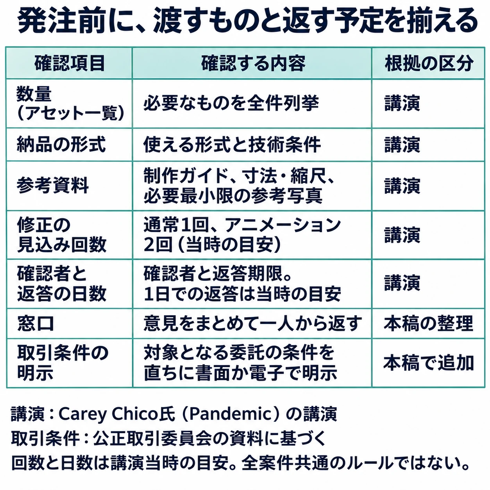
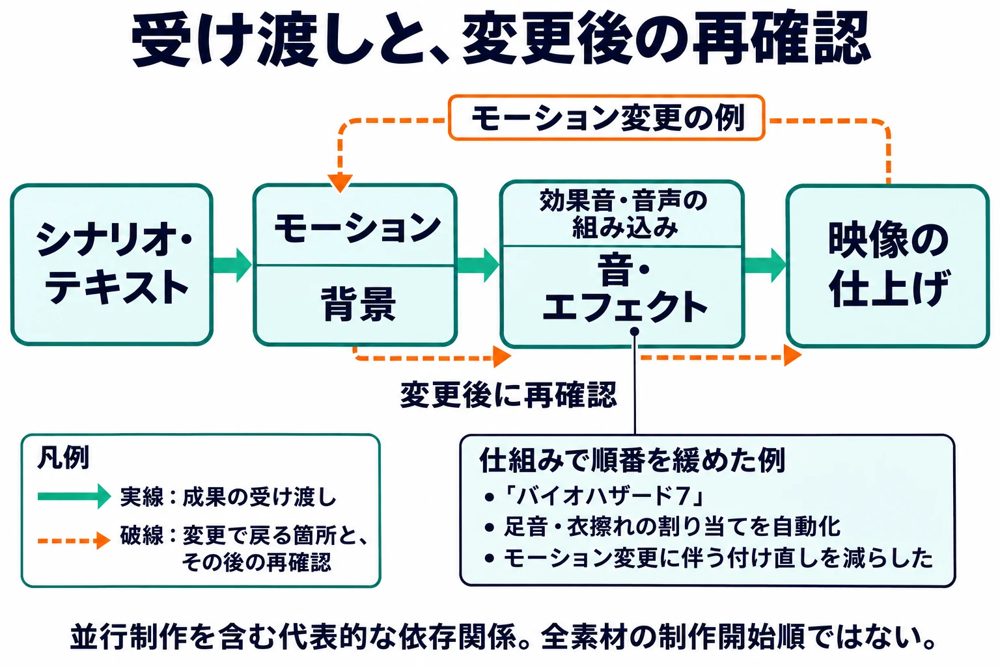

# 下流へ流し込む（2）アセット・サウンド・映像——制作進行を任されたら⑤

## 1. 絵・音・映像は「最後に来る」

エフェクト担当のところへ、必殺技の制作依頼が届いた。ところが、基準にするモーションは調整中で、攻撃が当たる瞬間もまだ動くという。締め切りは変わらず、前工程が遅れた分だけ、エフェクトに使える日数が短くなっていた。

これまで取り上げてきた架空の現場の続きである。[第1回](production-coordination-01-role-and-visibility.md)では、判断に必要な情報を整える役割を考え、[第2回](production-coordination-02-building-the-schedule.md)では、工程表に受け渡しのつながりを加えた。[第3回](production-coordination-03-locking-the-upstream.md)では確定の条件と変更の手順を決め、[第4回](production-coordination-04-text-localization-voice.md)ではテキストを翻訳と音声収録へ渡した。今度は、その音声をゲームへ組み込み、モーションに音やエフェクトを合わせ、カットシーンを仕上げる番である。

CEDEC 2021でミクシィのVFXチームに所属する池田博幸氏が行った講演の概要は、エフェクトが最終工程に当たるため納期が短くなりがちなこと、用途の調査と仕様確認の不足からリテイクの多くが起きることを挙げている。[[1](#ref-1)] 依頼の日と締め切りの間に日数があっても、作業に必要な条件が揃うまで待つなら、実際に使える時間はさらに短い。

テキストが固まると、絵・音・映像の受け渡しも具体的に動き出す。もちろん、素材の制作自体はそれ以前から並行している。ここで見るのは、前の成果を受け取って仕上げる工程だ。シリーズ共通の判断軸である **「次の工程が受け取れる状態で渡せているか」** を、画像やモデルなどのアセット、サウンド、映像に当てはめる。

***

## 2. 仮素材は「差し替える日」とセットで置く

### 先へ進めるために置き、残さず追う

仮素材、つまり **placeholder** は、完成品を待つ間も組み込みや動作確認を進めるための道具になる。仮のモデルで立ち位置を確かめ、仮の音で再生する条件を試す。その用途と、完成品で改めて見る点を共有しておけば、後ろの担当者も作業を始められる。

[第3回](production-coordination-03-locking-the-upstream.md)で紹介したSupergiant GamesのGreg Kasavin氏は、『Transistor』のコンテンツロックの条件に、次の一文を含めていた。[[2](#ref-2)]

> Placeholder assets are gone
>
> 仮素材がなくなっている。

仮素材を置いたときから、なくす段取りも必要になる。誰かが覚えていることに頼ると、見慣れた仮画像や仮音声が、完成した場面の中へ残り続ける。

本稿の架空の現場なら、仮素材の一覧を次のように作れる。期限は説明用の工程上の目安であり、どの案件にも共通する所要日数ではない。

| 仮素材と使用箇所 | 差し替え担当 | 差し替えるもの | 期限と完了の確認 |
|---|---|---|---|
| 必殺技の仮エフェクト | エフェクト担当 | 確定モーションに合わせた完成版 | 演出確認の前日まで。ゲーム内で当たる瞬間を確認 |
| 会話場面の仮音声 | 音声組み込み担当 | 収録済みの採用テイク | 会話確認用の版を作る前まで。台詞IDと再生を確認 |
| カットシーンの仮背景 | 背景担当・映像担当 | 仕上げ済み背景 | 映像の最終確認前まで。該当カットで差し替えを確認 |

ここには、仮素材の識別情報と置き場所も結び付ける。差し替え期限が動いたら、何の確認ができなくなるかを、受け取る担当者へ聞く。仮の状態で確認できた点と、完成版でしか確認できない点を分けておけば、工程表の「確認済み」の意味も明確になる。

### 仮素材は、ひと目で仮と分かるものにする

編者は、仮素材ははっきりと仮だと分かるものにするべきだと考えている。本番に近い出来の仮素材を入れると、QAの確認でも見逃され、そのまま本番に出てしまうことがある。仮素材の出来がよいほど、差し替え漏れに気づきにくくなるのである。

たとえばキャラクターなら、衣装を着せない裸の素体のままにするなど、本番ではあり得ない格好にしておく。音楽なら、メトロノームの音にしておけば、曲がまだ入っていないことがすぐに分かる。誰が見ても聞いても仮だと分かる状態なら、一覧だけでなく、画面と音からも差し替え漏れに気づける。

### まず全体が鳴る状態を作る

CEDEC 2016でカプコンのサウンドディレクター鉢迫渉氏とサウンドプログラマー小島健二氏が紹介した『バイオハザード7』では、「前行程が終わると、ざっくりいい感じに音が鳴る」という方針があった。ファミ通の講演レポートによれば、絵やモーションをもとに基本的な音の組み込みを自動化し、まず鳴る状態を作ってから調整する考え方である。[[3](#ref-3)]

これは仮素材そのものの運用規則ではないが、完成を待たずに全体を確かめられる状態を先に作る点で参考になる。進行としては、「仮で通して確認する日」と「完成版に差し替えて確かめる日」の両方を置きたい。先に動かせることを進める段取りと、仮素材を残さない段取りを、同じ一覧でつなぐのである。

***

## 3. 発注の前に「受け取れる形」を決める

### 作る側への資料と、返す側の予定を揃える

GDC 2009 Outsourcing Summitで、Pandemicのエグゼクティブ・アートディレクターCarey Chico氏は、必要なアセットの全リスト、制作ガイド、正確な納品形式を揃える重要性を述べた。Jeffrey Fleming氏の講演レポートでは、寸法・縮尺を示し、参考写真を絞ることも挙げられている。参考を増やしすぎると、大まかな方向を示したつもりの画像が、そのまま制作の基準になることがあるからだ。[[4](#ref-4)]

修正は通常のアセットで1回、アニメーションで2回を見込み、確認を1日で返すことを目指す。返事が遅れれば外注先の負担が増す。一貫したフィードバックを、同じ人から出たように揃えることも勧めている。これらは同氏の当時の実務上の目安であり、全案件の修正上限や返答期限ではない。[[4](#ref-4)]

GDC 2016のMaarten Van Der Gaag氏によるGuerrilla Gamesのセッション概要も、大半のゲームアセットを外注する体制と、そのための非常に詳細な発注資料を紹介している。[[5](#ref-5)] また、CEDEC 2016のラウンドテーブル「大量外部発注時代を乗り越える為の発注方法」の公式概要は、求められる物量が増え、内部制作だけではまかなえなくなった背景を挙げる。登壇したセガゲームスのリードキャラクターアニメーター木津恵一氏のメッセージには、海外発注で言葉や文化の違いを考慮した細かな指示とチェックバックが必要だという指摘がある。[[6](#ref-6)]

発注を出せば、社内にも確認して返す仕事が発生する。制作担当の予定だけを押さえ、確認者の時間を空けていないと、届いた素材が返答待ちで止まる。冒頭の現場なら、モーションの確定予定に加え、誰がエフェクトの用途と演出を判断し、いつ返すのかを先に決める必要がある。

### 進行は、判断できる条件を整える

進行が確かめる中心は、絵や音の良し悪しを自分で決めることより、 **資料は揃っているか、誰が見て何日で返すか、窓口は一本か** である。複数の専門担当から意見が出る場合も、相反する指示を整理し、判断できる人に決めてもらってから返す。窓口を一本にするとは、進行がすべての内容を決裁するという意味ではない。

絵の資料に何を書くかは、[ビジュアル発注基礎の「発注書とオリエンテーション資料」](concept-art-commissioning-basics-for-planners.md)で詳しく扱っている。ここでは、必要な資料と返答の予定が、発注前に揃っているかを追う。

取引条件もその準備に含まれる。2024年11月1日施行のフリーランス法では、対象となる委託の業務内容・報酬・支払期日などを直ちに書面か電子で明示し、支払期日の規定が適用される発注事業者は、原則として受領から60日以内のできる限り短い期間に期日を定める必要がある。適用条件の下では、仕様から判断できないやり直しを無償で繰り返させることも問題になりうる。[[7](#ref-7)] 詳しくは、取適法への改称も扱う[外注ガイドの「2. 法令の基礎知識」](game-planner-outsourcing-guide.md#2-法令の基礎知識知らないでは済まされない2つの法律)へ譲る。

以下は、講演の項目と、本稿で加えた進行上の確認を分けた確認表である。

作る側への資料と、受け取って返す側の予定を一緒に決める。回数と日数は講演当時の目安である。

出典：Carey Chico氏の講演レポート [[4](#ref-4)] と公正取引委員会の資料 [[7](#ref-7)] をもとに本稿整理。

***

## 4. 確定の順番を読む

### 前が動くと、どこを見直すか

この架空の場面では、シナリオ・テキストをもとにモーションや背景が作られ、その動きや空間に音声・効果音・エフェクトが組み合わさり、カットシーンの仕上げへ集まる。これは受け渡しを読むための整理であり、すべての制作が一列に進むという意味ではない。録音や素材制作は並行できても、最後に合わせる相手の状態に依存する。

たとえば攻撃のモーションが長くなると、発光の始まり、効果音、台詞との間合い、カメラの切り替えを見直す可能性がある。背景の扉が動けば、足音の位置や残響、画面に収まる構図にも確認が要る。モーション自体の収録から組み込みまでの流れは、[モーションキャプチャの工程を扱った記事](motion-capture-production-workflow-from-planning-to-integration.md)を参照したい。

進行は、変更箇所と、それを使っている場面を結び付ける。[第2回の「受け渡しの地図」](production-coordination-02-building-the-schedule.md)に、どの版のモーションを音とエフェクトが使い、どのカットがそれを受け取るかを加える。変更を承認する人には、変更内容とともに、やり直しの可能性がある範囲、各担当の見込み、締め切りへの影響を渡す。

### 順番の制約を、仕組みで緩める

『バイオハザード7』では、足音や衣擦れの割り当てを自動化したことで、モーションを待って手で音を付ける作業を減らし、モーション担当が締め切り近くまで作業できるようにした。基本的な組み込みの自動化は、上流変更の影響を受けにくくすることにもつながった。字幕も、音声の波形に台詞の情報を持たせ、データを渡した時点で表示タイミングがおおむね決まる仕組みが紹介されている。[[3](#ref-3)]

進行が仕組みを作るわけではない。同じ付け直しが繰り返されるなら、どの変更で誰の作業が戻るのかを整理し、モーション、サウンド、プログラムの担当者へ相談をつなぐ。自動化に必要な準備と、その後に減らせる作業を専門担当に見積もってもらい、今回の締め切りに間に合う対策と、今後の改善を分けて判断する。

映像の仕上げは、この整理では最後に各素材を受け取る工程になる。カットシーン担当へ渡す日だけでなく、受け取った後に音・絵・字幕を合わせて見る時間も必要だ。プリレンダーかリアルタイムかという方式の判断は、[カットシーンの比較記事](prerendered-vs-realtime-cutscenes-for-planners.md)で扱っている。

前の成果が変わると、使っている後ろの工程にも確認が及ぶ。依存関係を把握し、付け直しを減らす仕組みの相談につなぐ。

出典：工程と変更の例は本稿の整理。自動化の事例はファミ通.comのCEDEC 2016講演レポート。[[3](#ref-3)]

***

## 5. 受け取ってから組み込むまで

### 完了の条件を、ゲームの中まで伸ばす

制作進行上の完了は、ファイルを受け取った先に置きたい。指定の場所にデータがあっても、参照が切れて表示されない、別の台詞が鳴る、古いモーションにだけ音が合う、といった問題は残りうる。 **ゲームの中で正しく動いたことまで追う** と、受け渡しの終点が具体的になる。ただし、これは進行管理上の区切りであり、契約上の受領日や検収条件、支払期日とは分けて扱う。

CEDEC 2014では、バンダイナムコスタジオの長舩龍太郎氏とHeavy Spectrum Entertainment LabsのBen Carter氏が、アセットパイプラインを扱った。石田賀津男氏の講演レポートによれば、中心となる説明を担当したCarter氏は、作業の流れを明確にしてミスを減らすこと、変更が思わぬ所へ及ぼす影響を見つけることを、その目的として説明している。記録されていない暗黙の依存関係も、自動でチェックできるようにする重要性を挙げた。[[8](#ref-8)]

進行としては、組み込みに必要なデータや条件が、担当者の記憶だけに残っていないかを聞きたい。ファイル名の一致や関連データの存在を毎回手で確かめているなら、その確認を仕組みにできるか、専門担当へ相談する。版の管理や共同作業の仕組みは、[バージョン管理とアセット管理の記事](version-control-and-asset-management-for-game-development.md)へ譲る。

### 受け取り・組み込み・確認を分けて追う

架空の会話場面なら、同じ台詞IDに対して次の3段階を置ける。

| 段階 | 担当と作業 | 次へ渡せる状態 |
|---|---|---|
| 受け取り | 音声担当が収録データを整理する | 採用テイク、台詞ID、対象言語、版が対応している |
| 組み込み | 実装担当が再生データに反映する | 対象の確認用の版に入り、再生する場所と条件が分かる |
| 確認 | 音声・演出などの確認担当がゲームで見る | 正しい台詞が鳴り、字幕・動きとの対応も確認され、残る修正が記録されている |

工程表では、それぞれに担当、予定日、実績、止まっている理由を持たせる。担当が同じでも、状態は分けておく。「音声は届いているが組み込み待ち」なのか、「組み込んだが確認用の版がまだない」のかで、次につなぐ相手が変わるからだ。

確認で修正が出たら、対象の版、場面、現象、戻す担当を記録する。修正ファイルが届いた後も、組み込みと再確認までを追い直す。納品済みの数だけを見ていると、この最後の往復が工程表から消えてしまう。

***

## 6. 運営型では、イベントと告知から逆算する

運営型では、イベントの開始日から、ゲーム内での確認・修正、組み込み、絵や音の完成、発注と資料の確定をさかのぼって並べる。各工程の長さは担当者に聞き、前の遅れを後ろの作業日数だけで吸収する形になっていないかを見る。

告知映像にも、別の締め切りがある。ゲーム内の素材が揃ってから撮影・編集する計画なら、告知の公開日から、映像の確認・修正、編集、収録を逆算し、その収録に使える素材とゲームの版を確保する。イベント開始日に素材が揃えばよいと考えると、その前に公開する告知映像へ間に合わなくなる。

架空の現場で、必殺技を告知に載せるなら、モーション、エフェクト、音が組み合わさっていることが撮影の条件になる。一方、告知に映らない場面は、その撮影期限とは別に管理できる。どの素材がどの映像に必要かを決め、告知用の範囲とゲーム全体の完成範囲を結び付けたい。音楽制作の逆算は、[劇伴制作の進行管理実務](game-music-commissioning-and-production-management-for-planners.md)で詳しく扱っている。

これは、[第4回の「更新ごとに流す範囲を分ける」](production-coordination-04-text-localization-voice.md)の続きである。今回の更新の組み込み・確認、次の更新の素材制作、その次の更新の発注準備を同じ工程表に置く。素材の一覧には対象の更新と使用場面を添え、変更が来たら、ゲーム内だけでなく撮影済みの告知映像にも影響するかを確認する。

***

## 7. 次の担当者が作業を始められるか

絵・音・映像は、前の成果を受け取って仕上がっていく。進行が確かめたい点は、受け渡しの前後に並んでいる。

- 仮素材はひと目で仮と分かり、差し替える担当・完成品・期限が結び付いているか。
- 発注する一覧、仕様、参考資料は揃い、確認者と返答期限、窓口が決まっているか。
- 前の変更が、どの音・エフェクト・映像の再確認に及ぶかが分かるか。
- 繰り返される付け直しを、仕組みで減らせないか相談できているか。
- 受け取り、組み込み、ゲーム内での確認を分けて追っているか。
- イベント開始と告知公開の両方から、必要な素材の締め切りを逆算したか。

冒頭のエフェクト依頼も、モーションのどこまでが確定し、何が動く可能性があるかを渡せれば、先に作れる部分を担当者へ相談できる。待つ必要がある部分は工程表へ戻し、完成後の確認時間まで含めて判断してもらう。

**「次の工程が受け取れる状態で渡せているか」** は、ファイルを送る前にも、送った後にも使える判断軸である。次回、第6回「QAとリリースへつなぐ」では、組み上がったものを検証し、公開へ渡す受け渡しを考える。

## References

1. [池田博幸「リテイクゼロを目指して、ゲームエフェクトをスムーズに制作するための入門指南！」][1] — CEDEC 2021、2021年8月24日。公式セッション概要。最終工程の納期、用途の調査と仕様確認を参照。所属は講演当時。

[1]: https://cedec.cesa.or.jp/2021/session/detail/s6017750c8d42d.html

2. [Greg Kasavin「From Alpha to Content Lock」][2] — Supergiant Games、2014年3月11日。『Transistor』のコンテンツロックと仮素材の解消を参照。英語引用の日本語訳は本稿による。

[2]: https://www.supergiantgames.com/blog/from-alpha-to-content-lock/

3. [オポネ菊池「“やり直し”に強いサウンド開発環境の構築。『バイオハザード7』のサウンドコンセプトとそのワークフローとは？【CEDEC 2016】」][3] — ファミ通.com、2016年8月25日。鉢迫渉氏・小島健二氏の講演レポート。基本的な組み込み、足音・衣擦れの割り当て、字幕タイミングの自動化を参照。肩書きは講演当時。

[3]: https://www.famitsu.com/news/201608/25114163.html

4. [Jeffrey Fleming「GDC: How Do You Outsource Successfully As A Developer?」][4] — Game Developer、2009年3月25日。Carey Chico氏のGDC 2009 Outsourcing Summit講演レポート。制作資料、納品形式、修正と返答、一貫したフィードバックを参照。窓口を一人にまとめる運用は本稿の整理。

[4]: https://www.gamedeveloper.com/game-platforms/gdc-how-do-you-outsource-successfully-as-a-developer-

5. [Maarten Van Der Gaag「Art Direction Bootcamp: 'Guerrilla Games' Approach to Asset Production」][5] — GDC Vault、GDC 2016。公開されているセッション概要のみを参照。大規模な外注体制と詳細な発注資料を扱う。

[5]: https://gdcvault.com/play/1023575/Art-Direction-Bootcamp-Guerrilla-Games

6. [竹下勲・作山豪・中村亮・木津恵一「大量外部発注時代を乗り越える為の発注方法」][6] — CEDEC 2016、2016年8月24日。公式セッション概要と登壇者メッセージ。物量増加の背景、木津氏による海外発注時の細かな指示とチェックバックを参照。所属・肩書きは講演当時。

[6]: https://cedec.cesa.or.jp/2016/session/VA/8232.html

7. [公正取引委員会「フリーランス法特設サイト」][7] — 公正取引委員会、2026年11月9日閲覧。取引条件の明示、支払期日の設定、禁止行為を参照。義務は発注事業者の属性や委託期間等で異なり、再委託の支払期日には一定の例外がある。

[7]: https://www.jftc.go.jp/freelancelaw_2024/index.html

8. [石田賀津男「【CEDEC 2014】ゲーム開発を最適化するアセットパイプライン、基礎知識と構築のポイントを解説」][8] — インサイド、2014年9月6日。長舩龍太郎氏・Ben Carter氏の講演レポート。ワークフローの最適化、変更の影響、暗黙の依存関係のチェックを参照。所属は講演当時。

[8]: https://www.inside-games.jp/article/2014/09/06/80293.html

----

この文書は、Perplexity、Claude、ChatGPT の3つのAIの支援を受けて著述されたものです。引用画像を除き、MIT License にて提供されています。
