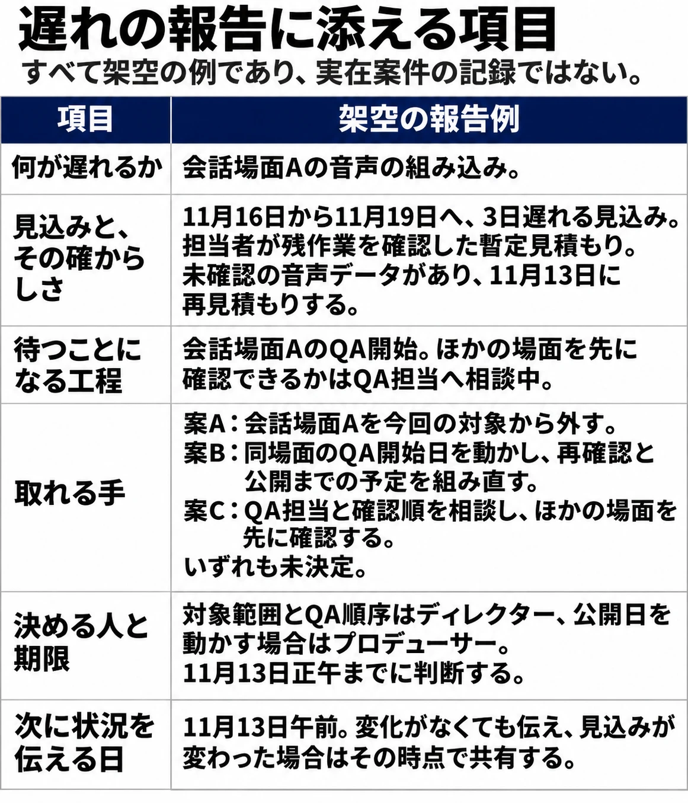
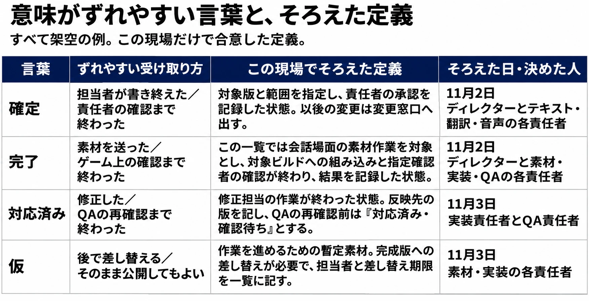

# 遅れを伝える、共通の言葉を作る——制作進行を任されたら（番外編）

## 1. 遅れを言えることが、受け渡しの前提

会話場面の音声を組み込む担当者は、作業が数日遅れそうだと気づいていた。自分の段取りにも落ち度があるので、言い出しづらい。週の定例では「順調です」と答えた。QAの開始日の直前になって遅れが表に出たときには、確認する人の予定を組み直す時間も、ほとんど残っていなかった。

これは、本編と同じ架空の現場の一場面である。会話テキストを翻訳と収録へ渡し、音声を含む素材を組み込み、QAからリリースへつないでいく。その途中で、工程表には現れない遅れが育っていた。

[第1回](production-coordination-01-role-and-visibility.md)では判断に必要な情報を揃え、[第2回](production-coordination-02-building-the-schedule.md)では受け渡しを工程表につないだ。[第3回](production-coordination-03-locking-the-upstream.md)では確定と変更の条件を決め、[第4回](production-coordination-04-text-localization-voice.md)ではテキストを翻訳・音声へ渡し、[第5回](production-coordination-05-assets-sound-video.md)では素材の受け取りから組み込み・確認まで追った。[第6回](production-coordination-06-qa-and-release.md)では、その成果をQAとリリースの判断へ渡した。これらの受け渡しはすべて、遅れや問題が早く表に出ることを前提にしていた。

『バンドリ！ ガールズバンドパーティ！』（以下、『ガルパ』）の開発・運用を紹介したCEDEC 2019の講演にも、この難しさが出ている。登壇者はCraft Eggの井上順行氏と佐藤崇徳氏である。山岡広樹氏によるgamebizのレポートは、井上氏の話として、進捗の遅れでデバッグを始められない状況は、自身の落ち度でもあるため言い出しづらいと伝えている。そのままでは運用に支障が出るため、全メンバーの認識や発言力を揃え、普段から話しやすい関係を築く考え方も紹介されている。[[1](#ref-1)]

[第2回](production-coordination-02-building-the-schedule.md)で工程や余裕の事例に使った、同じ講演レポートである。今回は、その工程を動かす人同士の関係に目を向ける。所属はいずれも講演当時のものだ。

シリーズ共通の判断軸は、 **「次の工程が受け取れる状態で渡せているか」** である。番外編では、その土台となる二つの柱、 **遅れを伝えることと、共通の言葉を作ること** を考える。

***

## 2. 遅れは、小さいうちに伝える

### 選べる手が残っている間に相談する

遅れが早く分かれば、作業の順番を変える、今回入れる範囲を見直す、後ろの担当者の予定を相談するといった手を選びやすい。遅く分かるほど、すでに始まった作業や動かせない予定が増え、選べる手は減っていく。遅れを知らせる時期は、その後の判断に使える時間を左右する。

CEDEC 2019で、ヘキサドライブのQAエンジニアだった森田和則氏は「心理的に安全な状況を作り出し，すべてをかき混ぜる方法」と題して講演した。箭本進一氏の4Gamerレポートでは、問題には早く対策を取れるほうがよいため、相談や報告、質問を早めに受けられる環境の大切さが紹介されている。相談を受けた後も、状況が変わっていないことを含めて経過を伝えれば、信頼を得られるという。[[2](#ref-2)]

進行にも当てはめられる。担当者から相談を受け、確認先の返事を待っているなら、その待ちを伝える。「まだ分からない」の中身と、次に確かめる予定が見えれば、相談した人も放置されているのか、確認が進んでいるのかを区別できる。

『ガルパ』の講演レポートでも、佐藤氏による動作確認会やおさわり会の説明に続き、バグを取り切れず修正が間に合わない事態も多いため、早めに動いて対応していると紹介されている。[[1](#ref-1)] 問題を見つける機会を早く置くことと、見つけた人が早く伝えられることを、両方揃えたい。

遅れを数字で見える形にする方法は、[第2回の『ドラゴンクエストX』のバッファ管理](production-coordination-02-building-the-schedule.md#4-余裕を置き減り方を見る)で扱った。余裕の減り方を見て、使い切る前に手を打つ考え方である。工程表の数字を、途中で話し合うきっかけにできる。

### バッファの先には、確認する人もいる

編者がプロデューサーとディレクターを兼ねていたとき、外注会社のシナリオ担当者の執筆に時間がかかることを承知のうえで、大きめのバッファを設けたことがある。それでもバッファを使い切り、なお遅れた。世界設定の最終チェックは編者自身が受け持っており、ずいぶん難儀した。

ただし、腕の確かなライターで、直しが入ることはなかった。その後はスケジュールどおりに進んだ。品質が高ければ、後ろの工程での修正の往復が減る。この体験では、その点が後続の進み方を支えていた。

バッファは遅れを吸収する置き場所であり、 **遅れを知らせる仕組みの代わりにはならない** 。残っているから大丈夫と見るだけでなく、減り方を早くから見て、途中で話し合える状態が要る。そして、制作する人の後ろには、確認する人の時間もある。このときの編者自身のように、受け取ってから判断を返す人も、遅れのしわ寄せを受ける。

外注先との窓口や確認の段取りは、[外部クリエイターへの発注ガイド](game-planner-outsourcing-guide.md)も参照してほしい。ここでは、社内外を問わず、受け渡す予定の変化が後ろの確認者まで届くかを見る。

***

## 3. 遅れを伝えるときに添えるもの

### 見込みと影響を、判断の材料にする

「遅れそうです」と伝えられたら、進行はまず相談を受け止める。そのうえで、判断する人へ届けるための材料を担当者と揃える。何が遅れるかだけでは、予定を動かすのか、作る範囲を変えるのかを決めにくい。

- 何が、どれだけ遅れるか。現時点の見込みと、その確からしさ。
- 誰が待つことになるか。次の工程と、その先の予定への影響。
- 取れる手は何か。範囲を減らす、日を動かす、人を足す、順番を入れ替えるといった案。
- 誰が、いつまでに決める必要があるか。

見込みには根拠も添える。担当者が残作業を確認して出した見込みと、まだ調べていない部分を含む概算では、判断に使うときの扱いが変わる。不明な部分は、その範囲と確認予定を示せばよい。

制作のコンサルタントであるKeith Fuller氏は、Game Developerに転載された意見記事「Opinion: What Do You Tell The Studio Head?」で、スタジオの責任者へ問題を伝える際の材料について論じている。問題の一覧だけでなく、事実を確かめ、実行できる解決案を持っていくという趣旨である。[[3](#ref-3)]

> Telling him you need more time isn't enough.
>
> もっと時間が必要だと彼に伝えるだけでは、十分ではない。

時間を増やすことで何ができ、増やせなければ成果物にどんな影響が出るかまで考える、という指摘である。[[3](#ref-3)] 本稿の報告例でも、日数だけでなく、選んだ手によって何が変わるかを添える。

### 案を用意し、決める人へ渡す

案を出すことと、案を決めることは分けたい。進行や報告者は、担当者と実現できる案を用意し、決裁者へ渡す。[第6回](production-coordination-06-qa-and-release.md)で述べたとおり、進行は決める場を整える人である。範囲や日程を変える権限まで、自動的に与えられるわけではない。

たとえば、人を足す案なら、受け入れや説明に必要な時間も担当者に確かめる。順番を入れ替える案なら、先に受け取る側が本当に作業できるかを聞く。案の数を増やすより、選んだ後の受け渡しが成立するかを揃えるほうが役に立つ。

図表1は、冒頭の音声組み込みの遅れを、判断できる人へ渡す報告の例である。日付、日数、状況、役割の割り当ては、すべて架空のものである。

図表1　遅れの見込みを、次の判断に使える材料にする。すべて架空の例である。

出典：本稿作成。報告に解決案を添える考え方はKeith Fuller氏の意見記事 [[3](#ref-3)] を参照。

この一式が埋まるまで、最初の相談を待つ必要はない。まだ影響を調べているなら、その状態で知らせ、いつまでに何を揃えるかを決める。報告の型は、相談を受けた後に一緒に埋めるためにも使える。

***

## 4. 報告を受け取る側の振る舞い

### 最初の返し方が、次の報告に響く

進行は、最初に悪い知らせを受け取る立場になりやすい。そのときに責める場にしてしまうと、次の問題が表に出る時期にも響く。

森田氏の講演レポートでは、スケジュールの遅れなどの悪い知らせに怒ってしまうと、相手は報告しづらくなると説明されている。報告に来てくれた行動そのものに感謝することが、継続して伝えてもらえる関係につながる。[[2](#ref-2)]

冒頭の担当者が相談に来たなら、まず「知らせてくれて助かった」と受け止め、残作業と、待つ人への影響を一緒に整理する。すでに分かっていること、まだ確かめていないこと、次に聞く相手を分ける。原因の振り返りが必要なら、その場の受け渡しを立て直す話と、改善を考える場の目的を整理して進めたい。

### 安心して、問題を指摘し合えるところまで

同レポートが紹介する心理的安全性は、チームへの信頼を土台に、厳しい指摘も安心してできる状態である。なれ合いとは区別されている。森田氏の「言える化」は、次の3段階として紹介されている。[[2](#ref-2)]

1. 思い込みを取り除き、不確かなことでも気軽に発言できる。
2. 新人かベテランかに関係なく、相談し、助けを求められる。
3. 問題や間違いを、互いに指摘し合える。

進行が目指したいのも、困っていることを言えるだけでなく、次の工程が困る条件を指摘し合える関係である。「その版では確認を始められない」「この予定では確認者の時間が足りない」と言えれば、成果物が届く前に受け渡しを組み直せる。

報告を受け止めた後は、次に何をするかを返す。誰へ相談し、いつ判断を戻すのかが分かれば、伝えた人も次の行動に移れる。受け取って終わりにせず、判断や確認の結果まで返すことも、日々の信頼を作る仕事になる。

***

## 5. 共通の言葉を作る

### 同じ状態を、同じ言葉で指す

説明用に、「音声は対応済みです」という返事を考えてみよう。修正担当は手元のデータを直したという意味で使い、進行は確認用ビルドに入ったと受け取り、QAは再確認まで終わったと理解した。短い一言で、3人が別の状態を思い浮かべている。

「確定」「完了」「仮」「FIX」「対応済み」といった言葉は、職種や人によって指す範囲がずれやすい。ここで挙げた用法は特定の会社のものではなく、意味の食い違いを考えるための例である。

『ガルパ』の講演レポートでは、各セクションが同じ認識で開発・運用を行うために、スケジュールの共通言語を浸透させていると紹介されている。[[1](#ref-1)] 受け渡す日付に加え、その日にどの状態になるのかも揃える必要がある。

ゲーム開発に限らない一般のソフトウェア開発にも、この考え方を明文化した資料がある。Ken Schwaber氏とJeff Sutherland氏による2020年版『The Scrum Guide』の「完了の定義」（Definition of Done）である。[[4](#ref-4)]

> The Definition of Done creates transparency by providing everyone a shared understanding of what work was completed as part of the Increment.
>
> 完了の定義は、インクリメントの一部としてどの作業が完了したのかについて、全員に共通の理解をもたらすことで透明性を生む。

インクリメントとは、ここでは利用できる状態に積み上げられた成果を指す。同ガイドは、一つの製品に複数のスクラムチームが関わる場合、同じ完了の定義を相互に決め、守ることも求めている。[[4](#ref-4)] 本稿では、作業の終わりを受け取る側も含めて共有する考え方を、進行の実務につなげる。

本編でも同じことを扱ってきた。[第3回](production-coordination-03-locking-the-upstream.md)では「確定」を状態で言い表し、[第5回](production-coordination-05-assets-sound-video.md)では「受け取り・組み込み・確認」を分け、[第6回](production-coordination-06-qa-and-release.md)では「修正済み・確認待ち」と「確認済み」などの報告の状態名を分けた。いずれも、言葉を聞いた人が、次に何をしてよいか判断するためである。

### 食い違った言葉から、一覧を育てる

最初からすべての用語を集めるより、受け渡しで使う言葉から始めたい。進行が聞き取った意味を、使う担当者と受け取る担当者に確かめ、何が満たされた状態なのかを書く。誰がその状態を確認するかまで揃えれば、一覧と実際の作業をつなげやすい。

図表2は、この架空の現場で合意した言葉の例である。ガルパの用語を再現したものではなく、日付と決めた人も含めて、すべて本稿の説明用である。

図表2　言葉と、次の人が判断できる状態を対応させる。すべて架空の例である。

出典：本稿作成。共通理解の考え方は『The Scrum Guide』の「完了の定義」[[4](#ref-4)] を参照。

食い違いが起きたら、その言葉を一覧に足す。すでにある定義が曖昧なら、関係者と直し、そろえた日と決めた人を更新する。過去の記録を読む必要がある場合は、変更前の意味もたどれるようにしておく。

一覧は、工程表や課題一覧からすぐ開ける場所に置き、新しく入った人へ最初に渡す。説明するときには、実際の受け渡しを一つたどるとよい。担当者が使った言葉と、一覧の状態が合わなければ、その場で確かめられる。一覧を作った後も、日々の報告と一緒に使って育てていく。

***

## 6. 話しやすい関係は、普段から作る

### 短く、何度も話す入口を持つ

遅れを言える状態は、遅れが起きてからでは作れない。困ったときに声をかける相手を知り、その人がどう受け取るかを想像できる関係は、普段の接点から育つ。

『ガルパ』の講演レポートでは、お互いをよく知り、業務以外の会話も必要だという考えから、書き初めやシャッフルランチなどの社内施策を行っていたと紹介されている。書き初めには、ほかの人がどのような目標を持っているかを知る意図もあった。[[1](#ref-1)]

[第6回](production-coordination-06-qa-and-release.md)で使った、CEDEC 2019のQAセッションのgamebizレポートにも、日常の関係づくりの話がある。ミクシィの福永裕幸氏は、開発や企画の人に時間をもらい、1on1や定例ミーティングで、好きなゲームや制作への思いなどを話すと述べている。雑談も多く、共通認識や信頼関係が生まれるとやり取りも増えるという。また、ボットで組み合わせを決めるシャッフルランチを行うチームもあると紹介した。[[5](#ref-5)]

同じセッションで、KLabの小林依光氏は、一緒に食事をしたりお酒を飲んだりすることが、人間関係や信頼関係を築く方法になるという趣旨の発言をしている。[[5](#ref-5)] いずれも当時の取り組みや考え方である。

関係づくりの方法には、人やチームによって合う・合わないがある。食事や飲み会への参加を前提にせず、勤務中の短い会話や定例、個別の相談など、参加しやすい接点を選びたい。

### 進行の側から、相談のきっかけを作る

森田氏の講演レポートでは、相手が来るのを待つより、自分から短くこまめに話しかけることが勧められている。また、自己紹介などの機会に、自分が何をできるかを知ってもらうことも、相談してもらう入口になる。[[2](#ref-2)]

進行なら、「予定が変わりそうなら、確定前でも一緒に整理できる」「判断する相手が分からなければ、つなぐことができる」と、引き受けられることを普段から伝えられる。話しかけるときも、報告を求めるだけでなく、次の担当者から来た質問や、こちらで確認した結果を返す接点にしたい。

[第2回](production-coordination-02-building-the-schedule.md)で触れた、編者の毎朝のスタンドアップミーティングも、日々顔を合わせる機会の一つである。短い定例で気がかりを拾い、詳しい相談は必要な人につなぐ使い方ができる。

担当者と話した後は、見つかった変化を工程表や一覧へ戻す。話しやすさと記録がつながれば、会話に参加しなかった人も同じ予定と状態を受け取れる。関係づくりは、次の受け渡しに必要な情報が届く経路を増やすことでもある。

***

## 7. 次の工程が受け取れる状態で、シリーズを閉じる

冒頭の担当者が、数日遅れそうだと気づいた時点で相談できていたら、QAの開始直前よりも多くの手を検討できたはずだ。報告を受けた進行は、見込みと影響、選べる案、決める人と期限を揃える。そして、「対応済み」がどこまで終わった状態なのかを、担当者と受け取る側が同じ意味で読めるようにする。

本編で追ってきたのは、会話テキストから翻訳・収録、素材の組み込み、QA、リリースへ続く受け渡しである。その流れは、 **遅れを早く言えることと、同じ言葉が同じ意味で通じること** に支えられている。

進行は、すべての作業を自分で作るわけではない。担当者の見込みを聞き、次で待つ人への影響をつなぎ、判断できる人へ材料を届ける。決まったことを関係者へ返し、受け取った先が動けるかを確かめる。そのための関係と共通の言葉も、日々整えていく。

シリーズを通して持ち帰りたい問いは、 **「次の工程が受け取れる状態で渡せているか」** である。成果物だけでなく、見込み、判断の材料、言葉の意味まで含めて問い直すことで、いま揃えるものが見えてくる。

制作進行を任された経験は、担当する企画の先まで見渡す、中堅プランナーへの足掛かりになる。

## References

1. [山岡広樹「【CEDEC 2019】『ガルパ』の施策を支える開発・運用フローを紹介…スムーズな進行管理の秘訣は“チームワークの高さ”にあり！」][1] — gamebiz、2019年9月12日。Craft Eggの井上順行氏・佐藤崇徳氏による講演レポート。遅れの言い出しづらさ、早期の確認、スケジュールの共通言語、社内の交流施策を参照。本文ではレポートの地の文による要約を中心に紹介した。所属は講演当時。

[1]: https://gamebiz.jp/news/248341

2. [箭本進一「［CEDEC 2019］ゲーム制作の現場における「心理的安全性」とは。ヘキサドライブのQAエンジニアが語る，「言える化」の重要性」][2] — 4Gamer.net、2019年9月10日。森田和則氏の講演「心理的に安全な状況を作り出し，すべてをかき混ぜる方法」のレポート。早期の報告、変化がない場合の経過共有、報告を受ける姿勢、言える化の3段階、日常の接点を参照。

[2]: https://www.4gamer.net/games/999/G999905/20190910126/

3. [Keith Fuller「Opinion: What Do You Tell The Studio Head?」][3] — Game Developer（当時Gamasutra）、2011年7月8日。#AltDevBlogADayから転載された意見記事。事実と実行可能な解決案を責任者へ伝える議論を参照。英語引用の日本語訳は本稿による。

[3]: https://www.gamedeveloper.com/programming/opinion-what-do-you-tell-the-studio-head-

4. [Ken Schwaber・Jeff Sutherland「The 2020 Scrum Guide」][4] — Scrum Guides、2020年11月版。「Commitment: Definition of Done」を参照。英語引用の日本語訳は本稿による。

[4]: https://scrumguides.org/scrum-guide.html

5. [gamebiz「【CEDEC 2019】ゲームの開発・運営に必要なQAとは…グリー、KLab、ミクシィの取り組み事例を軸にQAの本質や課題、その未来を語る」][5] — gamebiz、2019年9月6日。筆者名の記載なし。福永裕幸氏・小林依光氏の信頼関係づくりについての発言を参照。所属は講演当時。

[5]: https://gamebiz.jp/news/247895

----

この文書は、Perplexity、Claude、ChatGPT の3つのAIの支援を受けて著述されたものです。引用画像を除き、MIT License にて提供されています。
