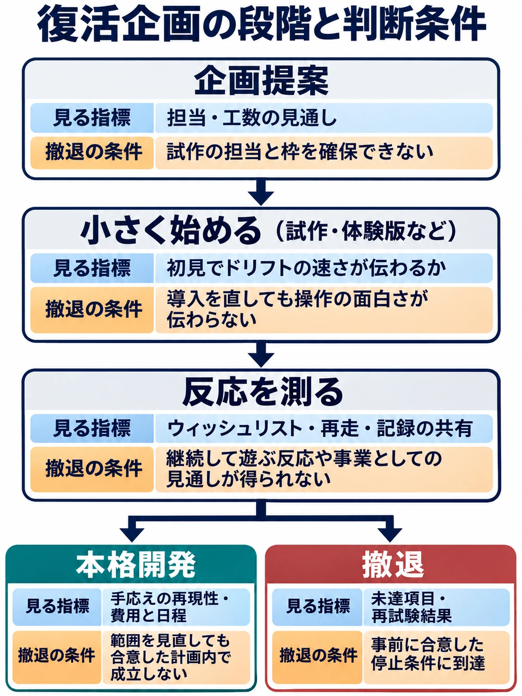

# リッジレーサーを、いま上層部にどう提案するか——「ゲームっぽいレース」が消えた理由から組み立てる復活の企画

> 2026年11月14日改版：記事全体を全面的に書き直しました。内容の変更はGitの履歴から追えます。

> 📺 関連動画では、プレイヤー側の視点から「ゲームっぽい挙動」のレースゲームがなぜ少なくなったのかを議論しています。
> **動画：[なぜ「ゲームっぽい挙動」のレースゲーは絶滅したのか？【議論】](https://youtu.be/F3sifvfous4?si=4GdlJ5NpPctGp5GG)**
>
> 本稿では視点を変え、その議論をゲームプランナー側の問いに置き換えます。つまり、バンダイナムコにアーケードレーサーを提案するなら、代表作であるリッジレーサーをどのように復活させるべきかを検討します。

  <iframe
    src="https://www.youtube.com/embed/F3sifvfous4"
    title="なぜ「ゲームっぽい挙動」のレースゲーは絶滅したのか？【議論】"
    style="width: 100%; height: 100%; border: 0;"
    allow="accelerometer; autoplay; clipboard-write; encrypted-media; gyroscope; picture-in-picture; web-share"
    allowfullscreen>
  </iframe>

***

## 上層部に、まず何を見せるか

関連動画が投げかけたのは、現実の車とは違う挙動を楽しむレースゲームが、なぜ少なくなったのかという問いだ。ここではその問いを「いま『リッジレーサー』を復活させたい社内のプランナーは、上層部に何を示せば次の予算を取れるか」に置き換える。企画を持ち込む立場に自分を置く思考実験である。

会議で最初に見せたいのは、車が横を向いているのに、コーナーを抜けたところで前の車に追いつく場面だ。シリーズを知る人にも初めて触れる人にも、その一場面から伝わる遊びを作れるか。そこから復活の規模を考える。

***

## 家庭用新作の空白と、続いてきた復刻・イベント

ナムコは1993年にアーケード版『リッジレーサー』を出し、翌年には初代PlayStationの本体と同時に家庭用版を発売した。アーケード版とPS版では、ドリフトが続く時間や車の姿勢を立て直す感覚にも違いがあった。家庭用で展開する中で、1998年の『R4 -RIDGE RACER TYPE 4-』は所属チームごとの物語を持ち込み、レースの合間にも次を遊ぶ理由を作った。[[1](#ref-1)][[2](#ref-2)][[3](#ref-3)]

2004年にPSPで出た『リッジレーサーズ』はニトロを導入した。ドリフトでゲージをため、任意のタイミングで使うと急加速する。高速で滑るほどゲージが早くたまるため、ひとつのコーナーで成功した操作が、その先で追い抜く機会を作る。2012年の『Ridge Racer Unbounded』では、外部スタジオのBugbear Entertainmentが開発を担当した。ドリフトも残しつつ、ライバル車への体当たりや、障害物を破壊して近道を開くことをレースの見せ場に据えた。[[4](#ref-4)][[5](#ref-5)]

その後もPC向け『Ridge Racer Driftopia』の早期アクセスや、スマートフォン向け『Ridge Racer Slipstream』の展開があった。家庭用の新作につながり得た動きとしては、2025年にVGCがNintendo Switch向けの試作版が流出したと報じている。Bandai Namco Studios Singaporeが開発を担当したとされ、出回った映像は2017年のビルドとみられる。タイトルは正式発表されず、新作はキャンセルされたとみられる。家庭用で新作が発売されない理由や、この試作の中止理由は、これらの公開資料からは特定できない。[[6](#ref-6)][[7](#ref-7)][[8](#ref-8)]

一方、初代のアーケード版は2025年6月5日に、アーケードアーカイブスおよびアーケードアーカイブス2として、Nintendo Switch、Nintendo Switch 2、PS4、PS5、Xbox Series X｜Sの5機種で同時配信された。「RIDGE RACER NIGHT 2025」は『レイブレーサー』の30周年を記念したDJイベントで、開催日は2026年2月21日である。同年2月には『レイブレーサー』のアーケード版も復刻され、9月にはフィーチャーフォン版『リッジレーサー』がNintendo SwitchとSteamに移植された。旧作を遊ぶ機会と音楽を楽しむ機会は、家庭用新作の空白期にも作られている。[[9](#ref-9)][[10](#ref-10)][[11](#ref-11)][[12](#ref-12)]

復刻や再配信を新作の判断材料としてどう読むかは、[F-ZEROに残る23年目の空白から読む、任天堂の休眠IP再起動](nintendo-dormant-ip-revival-f-zero-kirby-star-fox.md) で整理した。

***

## 何がリッジレーサーだったのか（本稿の考察）

ゴール後、順位より先に「あのコーナーをもう少しうまく抜けたい」と思えるか。復活作で残す要素は、この基準で選びたい。音楽と速度感はコーナーが続くリズムを作り、短いレースは、気になった一か所を走り直すまでの時間を縮める。

| 判断 | 要素 | 復活作での考え方 |
| --- | --- | --- |
| 残す | ドリフトの手応え、速度感、架空の車とコース、電子音楽、短い1レース | 車の向きと速度を自分で調整し、曲がり切った勢いを次の直線に持ち越す。車種やコースの形は、その違いを感じ取れるように作る。 |
| 見直す | ニトロとドリフトの関係 | まずドリフト単体で出口が速くなるようにする。ニトロを採る場合は、上手に曲がった先で追い抜く機会を増やす役に置く。小さなカーブで毎回滑ってゲージをためるほうが有利になっていないか、周回全体で確かめる。 |
| 見直す | CPU車の追い上げ補正 | 集団で競る緊張感を保てる幅を探る。着順だけで判断せず、タイムアタックも用意し、走り方の改善が時計に出るようにする。 |
| 外す | 破壊を中心に据える設計、ランダム生成コース、過剰な旋回補正、実在車のライセンス | コーナーの形を覚え、自分の操作で上達する遊びに制作を集中させる。架空の車なら、挙動の違いを基準に車種を設計できる。 |

***

## 「ドリフトが速い」をどう伝えるか（本稿の提案）

現実の舗装路での速さの常識をひっくり返し、このゲームではドリフトで曲がったほうが速いコーナーを作る。タイヤが路面をつかんだまま曲がるグリップ走行では手前で減速が必要だが、うまく滑らせれば速度を保ったまま向きを変えられる。進入が早すぎると出口で外にはらみ、姿勢を戻すのが遅いと次の加速が遅れる。滑り始める位置と、滑りを終える位置の両方に腕の差が出る。

最初の数コーナーで、この速度差を体験させる。最初のコーナーは素直に曲がれる形にし、次は大きく回り込むカーブの先に長い直線を置く。そこでドリフトを試し、直後の区間タイムや前を走るゴーストとの距離で違いを確かめられるようにする。滑り始めとグリップが戻る瞬間は、車体の向き、タイヤ音の切り替わり、短い画面表示で知らせる。スピン寸前まで滑った走りと、ちょうどよく姿勢を戻せた走りを、同じ派手な演出で褒めないことも大切だ。

旧作の例では、PSP版『リッジレーサーズ』の試遊記事で、アクセルを戻してステアリングを切る入力が確認できる。試作ではこの入力から始め、踏んだまま別の入力で滑り始める方式を足す場合は、初見でも使い分けを説明できるかを確認する。DualSenseには押し込みの抵抗を変えられるアダプティブトリガーと、状況に応じた振動を返すハプティックフィードバックがある。対応機器では、滑り出しで抵抗を軽くし、グリップの回復で戻す案を試せる。操作の判断に必要な情報は、触覚を切った場合も画面と音で受け取れるようにする。[[13](#ref-13)][[14](#ref-14)]

現実の物理を意図して曲げ、操作の手応えを作る考え方は、[ゲームフィールとは何か](game-feel-design-theory-for-game-planners.md) のPhysicalityの節にまとめている。

***

## 周辺の動きから見る「いま」

元気の『首都高バトル』は約18年ぶりの新作として、2025年1月23日にSteamで早期アクセス版を3,960円で発売した。元気は5月、想定を上回る反響を受けて収録内容を見直し、品質を高めるために早期アクセス期間を延長すると発表した。正式版は9月25日に6,600円で発売された。[[15](#ref-15)][[16](#ref-16)][[17](#ref-17)]

Milestoneの『Screamer』は、1995年作の名を継いで2026年3月26日に発売された。Pure Xboxがまとめた発売時の批評は全体として好意的で、Creative Bloqはアニメ調の再構成に加え、ドリフトでためたゲージを加速や攻撃に回すレースのリズムを評価した。一方、左スティックで操舵し、右スティックでドリフトする操作には賛否がある。PC Gamerは物語や演出を評価しつつ、二本のスティックを使う操作に戸惑い、滑りから直進に戻る感触にも違和感があったとして、運転そのものは好みに合わなかったと述べた。[[18](#ref-18)][[19](#ref-19)][[20](#ref-20)][[21](#ref-21)] その後、10月7日のアップデートで、従来の二本スティック操作に加えて一本のスティックで遊べる方式が追加された。[[22](#ref-22)]

『マリオカート ワールド』は、ファミ通による2025年の国内パッケージ販売集計で266.8万本、年間首位だった。速報の集計には本体プリインストール版なども含まれる。[[23](#ref-23)]

同作がオープンワールドを競技にどう組み込んだかは、[『マリオカート ワールド』は、なぜオープンワールドを「競技の一部」にしたのか](mario-kart-world-open-world-design-vs-forza-horizon.md) で扱った。

本稿の考察では、復活作の狙いは「マリオカートより少し手応えがあり、リアル系よりずっと手に取りやすい」という中間に置ける。初めてでも1レースを走り切れ、詰めようとすると進入と脱出の差がラップタイムに出る、という意味である。『首都高バトル』は反応を受けて開発範囲を調整した例であり、『Screamer』は作品の個性が評価されても、操作の感触では意見が分かれ得る例だ。どちらも復活作の売上予測に使うより、何を先に試すかを決める材料にできる。

***

## 上層部にどう掛け合うか（本稿の提案）

### 最初に求めるのは試作の承認

アーケードアーカイブスやDJイベントによって、往年のファンに案内を届けたり、初めての人に過去作を紹介したりする接点がある。『首都高バトル』と『Screamer』も、かつてのシリーズ名を現代の新作に使った近年の事例だ。提案書では、こうした動きを「今なら誰に試作を触ってもらえるか」につなげる。復刻やイベントへの関心と、新作を買う意思は、それぞれ測る。

承認してほしいものは、走行担当とコース担当を確保し、車1台と短いコース1本で試作し、次の審査日に持ち込むことだ。走行仕様の担当者、使える期間と工数、提出するビルド、次に判断する人を提案書に記す。試作で見せるのは、同じカーブを普通に曲がった場合と、ドリフトで早く抜けられた場合の差だ。描画や収録車種の比較に会議を使う前に、操作の違いを担当者自身に走ってもらう。

### 反応を測る順番と、止める条件を決める

試作が通ったら、小規模な新作を想定して体験版を作る。1レースとタイムアタックがあれば、完走後に自分から同じコースを選ぶかを見られる。公開するなら、ストアページでウィッシュリスト登録を測り、体験版では初回完走後の再走、翌日以降の再訪、タイムアタックの記録やリプレイの共有を見る。登録は告知を受け取りたいという反応、再走は操作をもう一度試したいという行動、共有は走りを誰かに見せたいという行動である。集客経路や過去作の経験の有無も併せて見れば、懐かしさで登録した人と、遊んで関心を持った人の反応を読み違えにくい。

たとえば告知から登録は伸びたのに再走が続かないなら、離脱が最初のドリフトの前に集中したのか、成功を体験してから止まったのかを見る。前者なら導入を直して同じ問いをもう一度試せる。後者が続くなら、コースを増やす前に企画を止める判断ができる。再走が続いても公開時の関心が弱く、想定する価格・制作費で成立する根拠を示せなければ、本格開発には進まない。評価期間、対象とするプレイヤー、修正を再試験できる範囲、審査の担当者は公開前に合意しておく。

早期アクセスは、短い体験版を越えて収録内容や更新の優先順位まで検証したい場合の選択肢である。『首都高バトル』は反応を受けて追加開発期間を確保した。自分たちの提案で有料の早期アクセスを選ぶなら、現時点で提供する内容、予定する更新、継続が難しくなった場合の購入者への対応まで示せる体制を先に確保する。[[16](#ref-16)]

### 会議で出そうな三つの反論に備える

- **走行のノウハウを持つ人が分散していたらどうするか。** まず走行モデル、コース設計、音響ごとに試作の責任者候補と使える工数を確認する。旧作を参照するなら、コーナーで横を向き始める時点、減速、姿勢の戻り方を動画と試作の走行記録で比較し、再現したい感触をチームで確認できる形にする。走行の調整を担当できる人を確保できなければ、公開日を決める前に止める。
- **若い世代に名前が通じなかったらどうするか。** 過去作を遊んだ人と、名前も知らない人の両方に、同じコースを説明なしで触ってもらう。初見の人が自分でドリフトを決め、もう一度走りたいと思えるかを見る。試遊者が覚えて帰るのがシリーズ名だけなら、広告を増やす前に操作を伝える場面を作り直す。
- **他の企画より優先する理由は何か。** バンダイナムコグループの中期計画（2025年4月〜2028年3月）は「Connect with Fans」を中長期ビジョンとし、ファンとのつながりの質を重視している。生み出したIPを「そだてつづける」ことを重視し、長く愛されるブランドに育てる方針も示している。事業戦略にはゲームポートフォリオの推進も掲げる。これは企画を説明する際の接点になる。会議では、その接点に加え、試作に必要な工数、並行案件と競合する人員、いつ続行を判断できるかまで示す。復刻での入口、体験版での初回プレイ、記録の共有での再訪がつながるかを、小さな投資で確かめる提案にする。[[24](#ref-24)][[25](#ref-25)]

***

## 結論

**コーナーをドリフトで決め、速度を落とさず抜けていく手応えが楽しい。** この一文を、どの仕組みを残すか、試作で何を見せるか、次の予算を求めるかの起点にする。

技術は走りを試す手段であり、復活を決めるのは、その遊びにどこまで投資するかという意思決定だ。その走りを初見の人も理解し、もう一度試したくなるか。そこまでを確かめる費用と期間を示し、結果に応じて続ける条件と止める条件を先にそろえる。上層部が最初に承認できるのは、そうして範囲の定まった試作である。

## References

1. [バンダイナムコホールディングス「Bandai Namco Group’s History」][1] — 統合レポート2022、2022年。「NAMCO’S HISTORY」の1993年、1994年の項。

[1]: https://www.bandainamco.co.jp/files/ir/integrated/pdf/2022EN_fact.pdf

2. [G.Suzuki「【特集】PS版初代『リッジレーサー』発売30周年！リアルとカジュアルで揺れ動いたシリーズ作を今追いかける」][2] — Game*Spark、2025年1月5日。

[2]: https://www.gamespark.jp/article/2025/01/05/148208.html

3. [ウワーマン「『R4 -リッジレーサー タイプ4-』が発売25周年。ストーリーモードを備えた異色のレースゲームで、初代PS最後の『リッジレーサー』シリーズ【今日は何の日？】」][3] — ファミ通.com、2023年12月3日。

[3]: https://www.famitsu.com/news/202312/03325939.html

4. [バンダイナムコゲームス「PSP/RIDGE RACERS｜ここが新リッジ」][4] — バンダイナムコゲームス公式サイト、公開日記載なし。ニトロとアルティメットチャージの説明。

[4]: https://www.bandainamcoent.co.jp/cs/list/ridgeracers_psp/newridge/

5. [バンダイナムコエンターテインメント「Ridge Racer™ Unbounded」][5] — Steam、2012年3月29日発売。

[5]: https://store.steampowered.com/app/202310/

6. [Valve「Now Available - RIDGE RACER™ Driftopia - Early Access」][6] — Steam、2013年9月10日。

[6]: https://store.steampowered.com/oldnews/11432

7. [Engadget「Ridge Racer Slipstream overtakes rivals on iOS, Android this month」][7] — Engadget、2013年12月4日。iOS・Android向けの発表。2013年12月19日配信開始。

[7]: https://www.engadget.com/2013-12-04-ridge-racer-slipstream-overtakes-rivals-on-ios-android-this-mon.html

8. [Jordan Middler「Unreleased Nintendo games allegedly leak online, including Ridge Racer and Retro Studios prototype」][8] — VGC、2025年4月7日。未発表の試作版についての報道。

[8]: https://www.videogameschronicle.com/news/unreleased-nintendo-games-leak-online-including-ridge-racer-and-retro-studios-prototype/

9. [ハムスター「『アーケードアーカイブス』シリーズ初の5ハード同時配信！」][9] — ハムスター公式サイト、2025年6月4日。

[9]: https://www.hamster.co.jp/release/4497/

10. [Bandai Namco Game Music「レイブレーサー30周年記念ライブ音源CD『RIDGE RACER NIGHT 2025 – LIVE REC』受注開始！」][10] — Bandai Namco Game Music公式サイト、2026年2月22日。イベントの開催実績を記載。

[10]: https://gamemusic.bn-ent.net/news/1242/

11. [ハムスター「『アーケードアーカイブス レイブレーサー』『アーケードアーカイブス2 レイブレーサー』配信開始！」][11] — ハムスター公式サイト、2026年2月26日。

[11]: https://www.hamster.co.jp/release/6547/

12. [ジー・モード「リッジレーサー」][12] — G-MODEアーカイブス、2026年9月3日配信。

[12]: https://info.gmodecorp.com/gmodearchives/bandainamco/ridgeracer/

13. [船津稔・佐伯憲司「SCEJ、『PSビジネスブリーフィング』開催。PSPの実機を公開!! ただし発売日は公開せず」][13] — GAME Watch、2004年9月21日。「『新リッジレーサー (仮称)』ファーストインプレッション」。

[13]: https://game.watch.impress.co.jp/docs/20040921/scej1.htm

14. [ソニー・インタラクティブエンタテインメント「DualSense ワイヤレスコントローラー」][14] — PlayStation公式サイト、公開日記載なし。「アダプティブトリガー」「ハプティックフィードバック」。

[14]: https://www.playstation.com/ja-jp/accessories/dualsense-wireless-controller/

15. [ファミ通.com編集部「『首都高バトル』早期アクセス版が1月23日に発売決定。車両50台以上が収録、ライバル200人以上と対戦可能。PCの推奨・最低スペックも公開」][15] — ファミ通.com、2025年1月6日。

[15]: https://www.famitsu.com/article/202501/29646

16. [ファミ通.com編集部「『首都高バトル』早期アクセス期間を延長して正式リリースは2025年9月末に。“想定を大きく上回る反響”に応えるためクオリティアップを目指す」][16] — ファミ通.com、2025年5月15日。

[16]: https://www.famitsu.com/article/202505/42143

17. [ファミ通.com編集部「『首都高バトル』フルリリース版が9月25日に発売決定。ホンダやレクサスの車種追加、国内パーツメーカー25ブランドを収録」][17] — ファミ通.com、2025年9月5日。

[17]: https://www.famitsu.com/article/202509/51583

18. [Milestone「SCREAMER – THE TOURNAMENT HAS BEGUN」][18] — Milestone公式サイト、2026年3月26日。

[18]: https://milestone.it/news/screamer/screamer-launch/

19. [Fraser Gilbert「Screamer Is Out On Xbox This Week, And Here's What The Reviews Are Saying About It」][19] — Pure Xbox、2026年3月23日。

[19]: https://www.purexbox.com/news/2026/03/screamer-is-out-on-xbox-this-week-and-heres-what-the-reviews-are-saying-about-it

20. [Alan Wen「Screamer review: the '90s arcade racer gets an anime redesign, and I love it」][20] — Creative Bloq、2026年3月22日。

[20]: https://www.creativebloq.com/entertainment/gaming/screamer-review-the-90s-arcade-racer-gets-an-anime-redesign-and-i-love-it

21. [Phil Iwaniuk「Screamer review」][21] — PC Gamer、2026年3月22日。

[21]: https://www.pcgamer.com/games/racing/screamer-review/

22. [PLAION「SCREAMER RECEIVES NEW PATCH INTRODUCING SINGLE STICK CONTROL MODE」][22] — PLAION Press Server、2026年10月7日。

[22]: https://press.plaion.com/pl/SCREAMER-RECEIVES-NEW-PATCH-INTRODUCING

23. [ファミ通.com編集部「Nintendo Switch 2が約半年で378万台を販売し2025年の国内ゲーム市場急拡大を牽引。『マリオカート ワールド』が年間ソフトランキング首位に」][23] — ファミ通.com、2026年1月19日。ファミ通の年間ソフトランキング速報。集計期間は2024年12月30日〜2025年12月28日。

[23]: https://www.famitsu.com/article/202601/63539

24. [バンダイナムコホールディングス「中期計画」][24] — バンダイナムコホールディングス公式サイト、2025年4月〜2028年3月の計画。「中長期ビジョン」「そだてつづける」。

[24]: https://www.bandainamco.co.jp/ir/message/midtermplan.html

25. [バンダイナムコホールディングス「2025-2027年度 中期計画 事業戦略」][25] — バンダイナムコホールディングス、2025年2月5日。「デジタル事業」のゲームポートフォリオ推進。

[25]: https://www.bandainamco.co.jp/files/HP_04E3808020250205E38080E38390E383B3E38380E382A4E.pdf

----

この文書は、Perplexity、Claude、ChatGPT の3つのAIの支援を受けて著述されたものです。引用画像を除き、MIT License にて提供されています。
