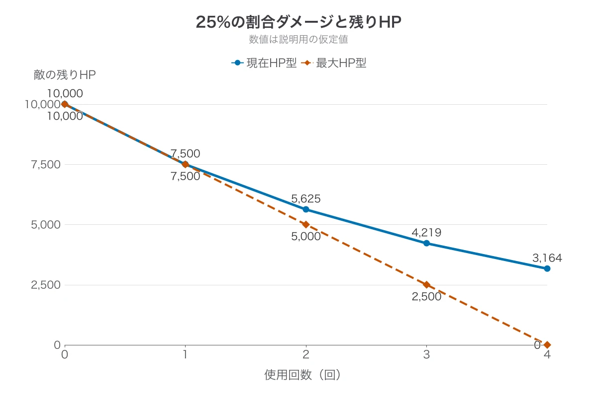
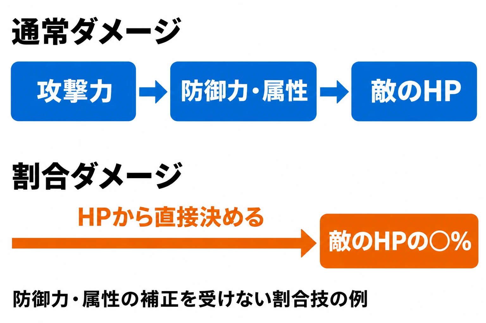

# RPGバトル設計の落とし穴：割合ダメージを軸に学ぶ「萎え」の原因と対策

> 2026年11月18日改版：記事全体を全面的に書き直しました。内容の変更はGitの履歴から追えます。

***

## はじめに

同じ剣で斬っても、鎧を着た敵には通りにくい。そこで攻撃力の高い武器に持ち替えたり、敵の弱点を突いたりする。それでも敵のHP（残りの体力）が多ければ、倒すまでに何度も攻撃がいる。攻撃力、防御力、HPは、育成や装備でできることと、敵の強さを測るRPGバトルの物差しだ。割合ダメージは、相手のHPから直接ダメージを決めることで、その物差しを飛び越えられる。硬い敵を削る手段になる一方で、ほかの技や育成の価値まで薄れやすい。そこで考えたいのが、割合ダメージをどこで止めるかである。

***

## 1. 割合ダメージとは何か

割合ダメージとは、相手のHPの何％かをダメージとして与える仕組みだ。「25%」と書かれた技でも、現在HPと最大HPのどちらを基準にするかで役割が変わる。

現在HP型は、技を当てた時点で相手に残っているHPを基準にする。HPが満タンで10,000の敵なら、初回は2,500を削って残り7,500、2回目は1,875を削って残り5,625、3回目は1,406を削って残り4,219だ。ここでは毎回のダメージの小数点以下を四捨五入している。敵が弱るほど削れる量が減り、この丸め方では残りHPが1になるとダメージが0になる。序盤に大きく削り、最後は別の技で仕留める使い方に向く。

最大HP型は、戦闘中にHPが減っても最大HPの10,000を基準にする。毎回2,500を削るので、残りHPは7,500、5,000、2,500と減る。回復や軽減、上限などがなければ、4回で倒せる。「4回で100%」と足し算できるのは、この型だ。

通常の攻撃なら、防御力が高い敵には通りにくく、属性の相性によってもダメージが変わる。割合をそのまま適用する技なら、こうした補正を通さずにHPを削れる。HPの大きさも、撃破に必要な手数を増やす物差しとして働きにくくなる。最大HP型の25%なら、HPが1,000でも10,000でも、満タンから削る割合は同じだ。

***

## 2. 飛び越えることの何が問題か

強い戦法を見つけて使いこなすことは、ゲームの遊びの一部だ。ゲームデザインを論じたTaekwan Kimは、単一の仕組みを使って（悪く言えば乱用して）、プレイヤーが不釣り合いに大きな影響力を得る戦法を「退化戦略」と呼ぶ。そうした戦法は名作の遊びの中心をなすこともあり、巧みなプレイか不正かの境目は、作り手の意図をどう受け取るかでプレイヤーごとに分かれるという。本稿で扱うのは、ある戦法が広く通用し、ほかの選択肢を選ぶ意味が薄れる場合だ。[[1](#ref-1)]

『ファイナルファンタジーXI』の開発にゲームデザイナーとして参加した下田賢佑は、プレイヤーがゲームの中で「支配的な価値観」の存在に気づき、それが自分の価値観とかけ離れていると、ゲームへの愛を失うと論じる。たとえば、敵ごとに武器や属性を変えて攻略するのが好きなプレイヤーでも、どの相手にも同じ割合技が最も効くなら、装備を工夫しても勝ち方に反映されにくい。技や装備の種類が画面に残っていても、バトルでの使い分けは減っていく。[[2](#ref-2)]

Ian Schreiberは、強すぎる要素を見たとき、その効果に対してコストが安すぎると捉え直せる場合があると説明する。割合技を見るときは、1回でどれだけ削れるか、どれほど広い相手に使えるか、何を払うかを合わせて見る。最大HP25%の技を通常攻撃と同じ1手で繰り返せるとしよう。通常攻撃で毎回500を与えられる場合、HP2,000の敵はどちらでも4手だが、HP10,000のボスには通常攻撃で20手、割合技で4手だ。HPの多さで粘り強さを表したボスほど、割合技で短縮できる手数が増える。支払える範囲でコストを上げてもほかの技に出番が戻らないなら、割合や対象の広さを調整する余地がある。Schreiberはこの状態を、コストが安すぎる状態と区別して「強すぎる（overpowered）」と呼び、コストを上げるだけでは足りず、効果そのものを下げる必要があるとする。[[3](#ref-3)] 最強の手を構造で作らない別の方法は、[3すくみはなぜ最強手を作らないのか](intransitive-balance-rock-paper-scissors-game-design.md)で扱っている。

調整が後手に回ると、「この敵には割合ダメージが無効」「最初の致死ダメージにはHP1で耐える（根性）」といった例外が増えやすい。例外が増えるほど、同じ説明の技でも、相手ごとに追加のルールを覚える必要がある。プレイヤーが一度行動を消費して初めて例外に気づく設計では、その失敗分の手数まで負担になる。

***

## 3. どこで止めるか

上限は、HPが大きい相手ほどダメージが際限なく伸びるのを防ぐ。最大HPの25%、上限2,000と決めると、HP4,000の敵には1,000、HP8,000の敵には2,000入る。HP10,000の敵にも2,000なので、満タンからは5手かかる。上限に達するHP8,000を境に、高HPの敵ほど一撃で削れる割合が小さくなり、HPの多さが再び撃破までの手数に反映される。

条件と対象を絞れば、割合技を使う場面をつくれる。たとえば「盾を壊した敵にだけ効く」なら、盾を壊す技と組み合わせる理由が生まれる。「装甲を持つ敵にだけ効く」なら、硬い相手への対策として持ち込む価値がある。使用回数を戦闘中に1回に絞れば、いつ使うかが判断になる。チャージで1手使う、回復と同じ資源を消費する、といったコストなら、待って撃つ価値や、いま資源を残す価値と比べられる。何を払うかは、プレイヤーにどんな判断をしてほしいかで決める。

効かない相手は、編成や装備を決める時点で分かると対策を立てやすい。敵の情報画面に「割合ダメージ無効」と表示し、技の説明文にも「無効の敵には効果なし」と添えれば、両方を見比べられる。初見のボスなら、事前の演出で護りの存在を示し、戦闘開始時にその効果を表示する方法もある。チャージが必要な技なら、使用を確定する前に対象への有効・無効が分かると、別の手を選べる。

敵が割合ダメージを使うと、今度はプレイヤーが育てたHPの価値が問われる。最大HPの50%を受けると、最大HP1,000なら500、2,000なら1,000減る。残りHPの実数は増えても、その技だけを満タンから受けられる回数は変わらず、HPを伸ばした手応えが薄れやすい。そこで「次のターンに最大HPの50%を削る」と予告し、防御を選べば25%に軽減できる、構えの間に特定の行動をすれば回避できる、といった対抗手段を用意する。割合攻撃の後に固定ダメージの追撃が来る設計なら、HPを伸ばして残りの実数を増やすことにも意味が出る。

***

## 4. 計算式の落とし穴

攻撃力から防御力をそのまま引く式は、説明しやすい反面、数値が接近する場面や成長幅が大きいバトルにそのまま使うと極端な結果を生む。攻撃力100で防御力98の敵を攻撃すると2ダメージだが、防御力102では計算結果がマイナス2になる。通常攻撃で必ず削れる仕様なら、最低1ダメージなどの補正が要る。最低1にした場合、HP100の敵に対し、防御力102なら100発、98なら50発、90なら10発だ。攻撃力と防御力をともに10倍にすると、防御力が攻撃力をわずかに下回る側では差も10倍に広がるが、上回る側では最低1に張り付く。

この引き算式は俗に「アルテリオス計算式」と呼ばれる。名前の元は日本物産が1987年にファミリーコンピュータ向けに発売した『アルテリオス』だ。[[4](#ref-4)] 防御力が攻撃力をわずかに上回ると攻撃がほとんど通らず、関係が逆転すると同じ相手が急に弱くなる極端なバランスにちなむ。RTA（実時間でクリアの速さを競う遊び）の動画投稿者、biim兄貴の命名から広まった通称である。攻撃側の値から防御側の値を引く発想自体には、テーブルトークRPG以来の先例がある。[[5](#ref-5)]

別の考え方として、防御力に応じて被ダメージの軽減率を決める方法がある。元の攻撃が100で、軽減率が20%なら80、30%なら70になる。防御力をどれだけ上げると軽減率が何ポイント変わるかは、調整の対象になる。数値の「＋1」が結果にどう響くかは [ダイスの振り方で「＋1」の価値が変わる](dice-roll-distributions-and-modifier-value.md)、上限を適用する処理は [ゲームの上限値はどう決まるのか](game-numeric-limits-for-planners.md) で扱っている。

軽減の重なり方も表示とそろえる必要がある。50%軽減を2つ足すと100%で、ダメージは0になる。別々に掛ける仕様なら、元の100ダメージは最初の軽減で50、次の軽減で25となり、合計では75%軽減だ。効果欄に「50%軽減」が2つ並ぶだけでは、どちらの結果も考えられる。説明に「残ったダメージをさらに半減」と書いたり、装備時に合計の軽減率を表示したりすれば、組み合わせを選ぶ前に結果を見通せる。

式は、どの能力を伸ばすかにも影響する。下田が例に挙げたサイバードのiOS向けサッカーシミュレーション『バーコードフットボーラー』では、「決定力」がどのシュートにも効く。キックやヘディングなど、特定場面だけで使う能力値の1ポイントが決定力の1ポイントと同じ効果なら、あらゆるシュートに効く決定力に投資が集まりやすい。そこで、場面に対応する能力値の効きを強めた。決定力はシュート全般を底上げし、キックやヘディングを伸ばした選手は得意な形からのシュートでより強くなる。能力値を増やすだけでは生まれなかった育成の選択が、式によって生まれる例だ。[[2](#ref-2)]

***

## 5. 補助の効果が攻撃を置き換えるとき

IGN Japanは2024年の論考で、HD-2D版『ドラゴンクエストIII そして伝説へ…』の「ラリホー」を強力な呪文として取り上げた。ラリホーは敵を眠らせる補助呪文だ。論考が着目したのは、複数回行動する敵でも目覚めたターンは行動せず、眠らせ続ければ敵の行動を封じられる点である。ターン経過で切れる防御系の補助呪文をいくつも維持する手間も減り、眠っている間に一方的に攻撃できるという。ただし論考は、ボスを眠らせる確率自体はそれほど高くないとも書いている。強さを決定づけたのは組み合わせだ。まもの使いが覚える、1ターンに2回行動できる特技「ビーストモード」によって、ラリホーの効果を持つ装備「ねむりの杖」を続けて使えるようになった。ラリホー単体ではなく、試行の回数を増やす手段と重なったことで、眠りを維持しやすくなった。[[6](#ref-6)]

割合ダメージが撃破までの手数を縮めるように、行動を止める状態異常は、味方を守るために必要な手数を減らす。状態異常の調整でも、成功率や持続ターンに加え、1ターンに何回試せるか、成功したときに敵の行動を何回止め、その結果どの味方行動の出番が減るかを見ると、効きすぎる理由を追いやすい。

***

## 6. プランナーが確認すること

実装前に、序盤・中盤・終盤の味方の攻撃力と、敵の防御力・HPを表計算に並べる。Ian SchreiberとBrenda Romeroの『Game Balance』は、第3部を表計算に割いている。技ごとに1回のダメージだけでなく、撃破までの手数、チャージを含めた所要ターン、回復などと取り合う資源も出す。雑魚戦とボス戦を分け、割合技だけで戦う場合と、通常攻撃や属性技を組み合わせる場合を並べれば、どこで同じ行動ばかりが有利になるか見つけやすい。[[7](#ref-7)]

- 技を選ぶ前に、現在HPと最大HPのどちらを参照し、どれくらい削れるかをプレイヤーが予測できるか。
- 効かない相手を、編成や行動を決める前に知れるか。
- 割合技を覚えた後も、ほかの技や装備を選ぶ理由が残っているか。
- 上限や発動条件を少し動かすと、どの敵で撃破に必要な手数が急に変わるか。

最後の問いは、境目の前後を1行ずつ並べると調べやすい。最大HPの25%、上限2,000という先ほどの例では、HP7,999、8,000、8,001を試す。最大HP8,000なら4回で倒せるが、8,001では4回当てても1残り、5手目がいる。この1手が想定した差か、ほかの技で埋められる差かを、実装前に確かめられる。

命中率などで結果が振れる技の確認には [ゲームプランナーが知っておくべき乱数の話](random-numbers-for-game-planners.md)、難しさがプレイヤーの意欲にどう関わるかには [フロー理論はゲームのために生まれたのか](flow-theory-psychology-origins-and-game-design.md) も参照できる。

***

## まとめ

割合ダメージは、攻撃力や防御力、HPの大きさという物差しを飛び越えて、硬い敵やタフなボスに対抗する手段をつくれる。どこまで削れるかは上限で、いつ誰に効くかは条件と対象で、何を諦めて使うかはコストで決まる。説明文や予告があれば、プレイヤーもその判断に参加できる。計算式を決めるときも、代表値でうまく動くだけで十分とせず、序盤から終盤までの数値の幅と、結果が変わる境目を確かめる。技や装備を選ぶ理由がどこに残るかは、その差に表れる。

***

## References

1. [Taekwan Kim「What Is “Degenerate”?」][1] — Game Developer、2014年4月28日。

[1]: https://www.gamedeveloper.com/design/what-is-quot-degenerate-quot-

2. [下田賢佑「バランスの破綻を防ぐゲームデザイン」][2] — オライリー・ジャパン『ゲームクリエイターが知るべき97のこと』、2012年11月5日。リンク先はCC BY 3.0で公開されたエッセイ。

[2]: https://yoshi389111.github.io/kinokobooks/game1/game145.htm

3. [Ian Schreiber「Level 3: Transitive Mechanics and Cost Curves」][3] — Game Balance Concepts、2010年7月21日。

[3]: https://gamebalanceconcepts.wordpress.com/2010/07/21/level-3-transitive-mechanics-and-cost-curves/

4. [NesCartDB「Artelius」][4] — NesCartDB、掲載日記載なし。ファミリーコンピュータ版の発売元・発売日を参照。

[4]: https://nescartdb.com/profile/view/1503/artelius

5. [ピクシブ百科事典「アルテリオス計算式」][5] — ピクシブ百科事典、掲載日記載なし。百科事典的資料（通称の由来として）。

[5]: https://dic.pixiv.net/a/%E3%82%A2%E3%83%AB%E3%83%86%E3%83%AA%E3%82%AA%E3%82%B9%E8%A8%88%E7%AE%97%E5%BC%8F

6. [IGN Japan「なぜ、HD-2D版『ドラクエ3』では「ラリホー」が“最強呪文”なのか？」][6] — IGN Japan、2024年12月。発売当時のバトルについての論考。

[6]: https://jp.ign.com/games/77827/opinion/hd-2d3

7. [Ian Schreiber、Brenda Romero『Game Balance』][7] — CRC Press、2021年。目次の第3部「Spreadsheets」を参照。

[7]: https://www.routledge.com/Game-Balance/Schreiber-Romero/p/book/9781315156422

----

この文書は、Perplexity、Claude、ChatGPT の3つのAIの支援を受けて著述されたものです。引用画像を除き、MIT License にて提供されています。
