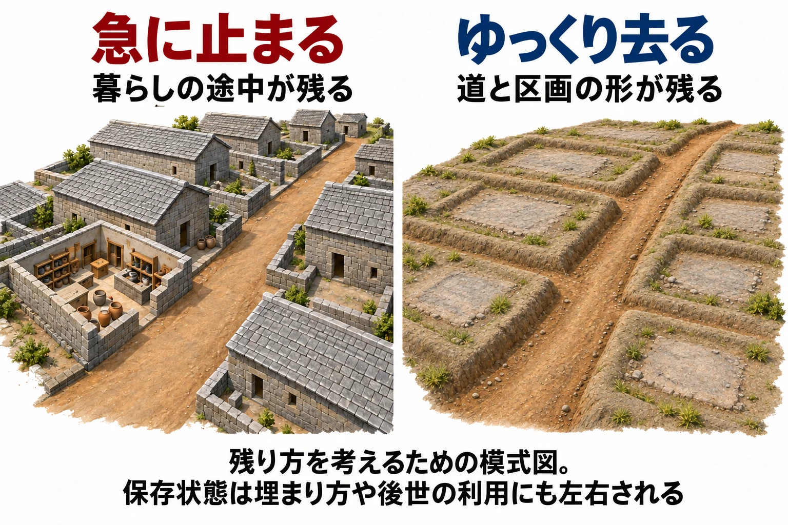

# ここは、何だったのか――廃墟に残る形から、かつての用途を読ませる

草に埋もれた石の土台が、少しずつ間を空けて並んでいる。その前を、周囲より窪んだ道が通っている。道をたどると、土台に囲まれた広い場所へ出た。

ここには家が並んでいたのだろうか。広い場所には、人が集まっていたのだろうか。壁や屋根が失われても、歩いてきた道と、足元に残る形をつなぐと、かつての暮らしを想像できる。

全7回のシリーズ「城と街から拠点をつくる」第6回では、人が去った場所に残る形を読む。[第1回の5要素](castle-town-design-lynch-city-image.md)でいえば、残った道は「道」、区画のまとまりは「地域」の痕跡にあたる。[第5回で考えた「集落ができた理由」](post-towns-villages-why-people-gather.md)は、人が去ったあとにも、道や建物の配置として残りうる。

持ち帰る判断軸は、 **「かつての用途を形に残し、失われた理由と、今の使われ方を重ねる」** である。昔の暮らしから現在の姿までを三つの層で考えると、ゲームの廃墟に何を残すかを決めやすくなる。

***

## 場所に結びついた痕跡を読む

過去の人の活動の痕跡が残る場所を **遺跡** と呼ぶ。そのうち、建物の跡や溝、墓など、動かせない痕跡が **遺構（いこう）**、土器や道具など持ち運べるものが **遺物（いぶつ）** である。遺構と遺物は、ともに遺跡を構成する。[[1](#ref-1)]

住居跡、倉庫跡、水田跡、柱を立てた穴である **柱穴（ちゅうけつ）** などは、昔の町や建物の配置を知る手がかりになる。『最新 地学事典』で小野昭氏は、暮らしに結びついた遺構は場所との結びつきが強く、そこから切り離すと本来の意味を失うと説明している。[[1](#ref-1)]

ゲームの景色に引き寄せれば、石の土台が一つあるときと、道に沿って同じような土台が並ぶときでは、伝わることが変わる。前者からは建物の存在を想像でき、後者からは町並みや人の行き来まで想像できる。 **形そのものと、形どうしの位置関係を一緒に見る** ことが大切だ。

小物や置かれた物から出来事を語る手法は、[「世界設定・ロアの書き方」第1回](worldbuilding-lore-narrative-placement.md)で扱った。本稿では、道・区画・建物の配置という、場所に結びついた形に重心を置く。

***

## 急に止まった町と、ゆっくり捨てられた村

廃墟の残り方を考える入口として、「暮らしが急に止まった場所」と「人が徐々に去った場所」を並べてみよう。ここでの二つの型は、ゲームの設計へ持ち帰るための整理である。実際に何が残るかには、埋まり方や、その後の土地の使われ方も関わっている。

### 暮らしの途中が残る――ポンペイとヘルクラネウム

西暦79年、ヴェスヴィオ火山の噴火によって、ローマの町ポンペイとヘルクラネウムは埋まった。UNESCOは、これらの遺跡が過去のある時点の社会と日常生活を、きわめて完全で鮮やかな姿で伝えると評価している。[[2](#ref-2)]

両市には、舗装された道に沿って住宅や商業の建物が並ぶ。ヘルクラネウムの店には大きなワイン壺などの設備も残り、建物の配置と、中で営まれていた暮らしを結びつけられる。火山の堆積物に埋まったことが、こうした保存状態をもたらした。[[2](#ref-2)]

道があり、その道に面して建物があり、店の中には商いの痕跡がある。町の形から個々の場所へ目を移すと、そこでの活動までたどれる。災害によって暮らしが断たれた土地に残るのは、かつて人々が日々を営んでいた証拠である。

### 道と区画が残る――イングランドの廃村

Historic Englandは、中世の村についての一般的な説明で、イングランドでは特に14〜15世紀に、多くの村が縮小したり放棄されたりしたと述べている。背景には、暮らしや生産が経済的に成り立ちにくくなったこと、土地を囲い込んで利用を変えること、黒死病などの疫病による人口の減少があった。後世の居住による掘り返しなどを受けず、痕跡がよく保存される場合も多い。[[3](#ref-3)]

具体例が、グラフトン・フライフォードの廃村である。ここには、土を盛った囲いで区切られた土地、建物を載せていた平らな土台にあたる **基壇（きだん）**、周囲より低く窪んだ道である **ホロウウェイ** が残る。その道が、区画や畑、家の土台をつないでいる。[[3](#ref-3)]

この村には1779年まで集落の記録がある。14〜15世紀という時期や先ほどの原因は、イングランドの廃村全般についての説明であり、この村だけの放棄時期や原因を示すものではない。[[3](#ref-3)]

ここで目を向けたいのは、窪んだ道が何と何をつないでいるかである。屋根のある家を思い浮かべ、そのそばの区画から畑へ歩く姿を想像すると、地面の起伏が暮らしの配置として見えてくる。

二つの例から、 **失われた理由を考えることは、何を残すかを考えることにつながる** 。急な中断と埋没が暮らしの道具まで残す場合もあれば、放棄された土地に道や区画の形が長く残る場合もある。

***

## 形から読めることと、想像に残ること

遺構の用途には、わかるものと、判断のつかないものがある。『ブリタニカ国際大百科事典 小項目事典』も、発掘調査ですべての遺構の用途を決められるわけではないと説明している。[[1](#ref-1)]

ゲームでも、プレイヤーが受け取れる情報には段階がある。「ここに建物があった」「建物が道沿いに集まっていた」「この一帯は商いの場所だった」では、必要な手がかりが異なる。

以下は本稿の考察である。商いの場所だったと読ませたいなら、広場の周囲に売り場の土台を並べ、そこへ道が集まるようにする、といった組み合わせが考えられる。一つの四角い土台だけでは読みづらい用途も、空間全体の関係から推測しやすくなる。

一方で、「何かを売っていたらしい」まで伝われば十分な場所もある。何を売り、どんな人が店を開いていたかは、想像に残してよい。 **どこまで読ませたいかを先に決める** と、足すべき形と、余白として残せる部分を選べる。

***

## ゲームの廃墟に、三つの層を重ねる

ここからは本稿の考察として、廃墟づくりを「元の用途」「失われた理由」「今の使われ方」の順に考える。開発者の説明を紹介する箇所は、出典を添えて区別する。

### 元の用途を、道と配置に残す

まず、その場所が使われていたころの簡単な平面図を描く。第5回で考えた、人が集まる理由を置くのである。

架空の市場なら、道が集まる広場があり、その縁に売り場が並ぶ。露店に固定の土台を使う町という設定なら、店が消えたあとも、広い空間と土台の列を残せる。荷を運び込む道が広場へ続いていれば、人と物が集まった場所として読みやすくなる。

ここで残したいのは、 **人が何のために、どこを通り、どこへ集まったか** という関係だ。その関係を決めてから壁や屋根を失わせると、壊れたあとの形にも元の用途が通る。

### 失われた理由から、残す量を決める

次に、町が使われなくなるまでを短い一文にする。「突然立ち去り、その後も誰も入れなかった町」と「街道が移り、店が少しずつ閉じた町」では、残す物の量を変えられる。

前者なら使いかけの設備も残す。後者なら、運び出せる物が減り、道や区画、土台が目立つ姿にする。これはゲーム内で違いを伝えるための目安であり、急な中断から長い年月がたった場所なら、その間の持ち出しや風化も加味する。

広場も売り場も同じ配置のまま、残す量を変えてみるとよい。元の用途を保ちながら、「どのように人が去ったか」を景色に重ねられる。

### 今そこを使うものを重ねる

最後に、現在の使い手を決める。草木が入り込むのか、誰かが住み着くのか、敵が見張り場として使うのか。昔の道や区画に、今の都合による変化が加わる。

ゲーム版『The Last of Us』のビルの町について、Naughty Dogのリードシネマティックアニメーター、Bryant Wilson氏は、自然が戻って町を覆った場所として説明している。アートディレクターのErick Pangilinan氏は、ビルが自然の成り行きに任せながら、自分の小さな隔離区域も築いていると語る。[[4](#ref-4)]

同じゲームのボストン隔離区域では、植物を取り除き、人工物に囲まれた無機質な環境で暮らしの苦しさを表したという。市場で鼠や金属くずを売る様子も、物資の乏しさを示すためのものだった。これらはPangilinan氏によるゲームの設計意図の説明である。[[4](#ref-4)]

ここから本稿の考察として持ち帰りたいのは、 **昔の場所に、今の住人の暮らし方が見える変化を加える** という視点だ。架空の市場跡なら、広場の端を囲って住み、昔の通りの一部だけを出入りに使う姿を考えられる。草に覆われた土台の列と、人が通れるように開けた一角が同時に見えれば、かつての用途と今の使われ方を重ねて読める。

***

## 三つの層を、歩きながら点検する

廃墟の配置ができたら、プレイヤーの目線の高さで入口から歩いてみよう。次の表は、本稿の考察を設計時の問いにしたものである。

| 点検する層 | 問い | 架空の市場跡なら |
| --- | --- | --- |
| 元の用途 | 道・区画・建物の配置から、何をする場所だったか読めるか | 道が広場に集まり、縁に売り場の土台が並ぶ |
| 失われた理由 | 人が去った速さと、その後の経過に、残っている物の量が合っているか | 徐々に店が閉じたなら、売り場の形を残し、持ち運べる物を減らす |
| 今の使われ方 | 今そこを使う自然・住人・敵が、どこを変えているか | 草に覆われた広場の端を囲い、一部を住まいと出入口にする |

三つの層を確認したら、最後に「どこまで読ませるか」を決める。市場だったこと、ゆっくり衰えたこと、今は誰かが住んでいること。このうち、プレイヤーに届けたいものは、立ち止まらなくても見える位置に手がかりを置く。細かな店の用途や住人の来歴は、見回した人が考える余白にできる。

草に埋もれた土台にも、窪んだ道にも、昔の暮らしとのつながりがある。その形に、人が去るまでの経緯と、去ったあとの時間を重ねる。そうして歩ける場所にすることが、「ここは、何だったのか」と考えたくなる廃墟をつくる出発点となる。

## References

1. [「遺構」各辞典の解説][1] — コトバンク、更新日記載なし。『ブリタニカ国際大百科事典 小項目事典』の定義と用途判定、『改訂新版 世界大百科事典』（田中琢執筆）の遺構・遺物の区別、『最新 地学事典』（小野昭執筆）の場所との結びつき、『デジタル大辞泉』の配置を知る手がかりを参照。2026年10月11日確認。

[1]: https://kotobank.jp/word/%E9%81%BA%E6%A7%8B-166324

2. [UNESCO World Heritage Centre「Archaeological Areas of Pompei, Herculaneum and Torre Annunziata」][2] — UNESCO、1997年世界遺産登録。英語版の「Brief synthesis」を参照。冒頭の紹介文は噴火を8月24日とするが、月日の議論が続くため本文は西暦79年とした。議論についてはポンペイ考古学公園刊行の[「La data della distruzione di Pompei: premesse per un dibattito aperto」](https://pompeiisites.org/e-journal-degli-scavi-di-pompei/la-data-della-distruzione-di-pompei-premesse-per-un-dibattito-aperto/)（2024年12月12日）も参照。2026年10月11日確認。

[2]: https://whc.unesco.org/en/list/829/

3. [Historic England「Deserted medieval village, Grafton Flyford」][3] — National Heritage List for England、List Entry 1005351、1975年12月8日指定。「Reasons for Designation」の廃村一般の説明と、「Details」の当該遺跡の記述を区別して参照。2026年10月11日確認。

[3]: https://historicengland.org.uk/listing/the-list/list-entry/1005351

4. [Jonathon Dornbush「The Last of Us developers, HBO creators on building the world around Joel and Ellie」][4] — PlayStation Blog、2023年2月7日。「Cruel world」「Beauty in the danger」のうち、Naughty Dog開発者がゲーム版について述べた箇所を参照。英語の発言は日本語で要約した。

[4]: https://blog.playstation.com/2023/02/07/the-last-of-us-developers-hbo-creators-on-building-the-world-around-joel-and-ellie/

----

この文書は、Perplexity、Claude、OpenAI Codex の3つのAIの支援を受けて著述されたものです。引用画像を除き、MIT License にて提供されています。
