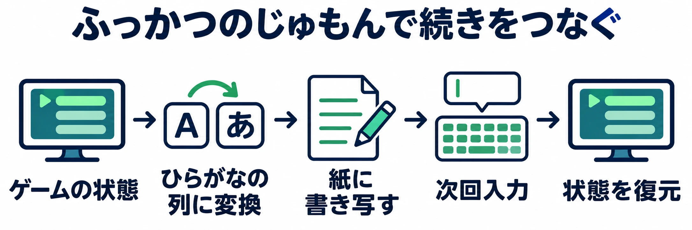
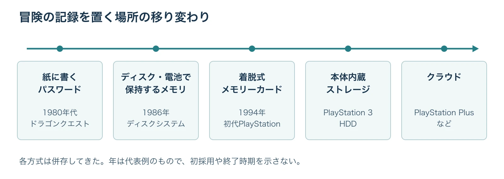
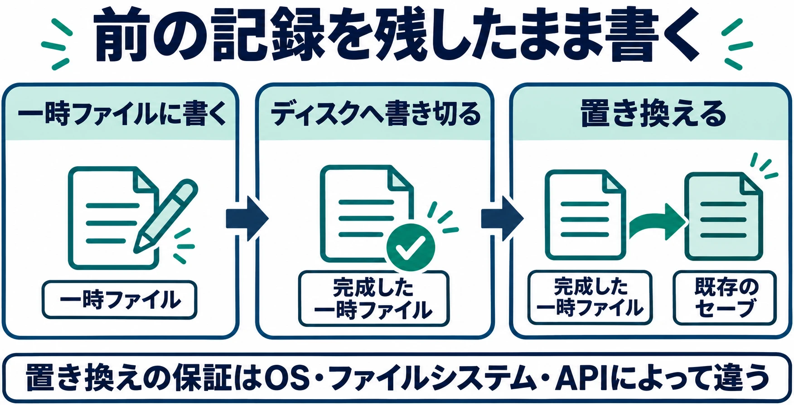
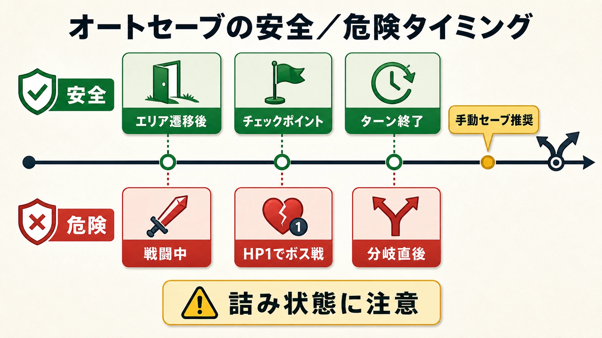
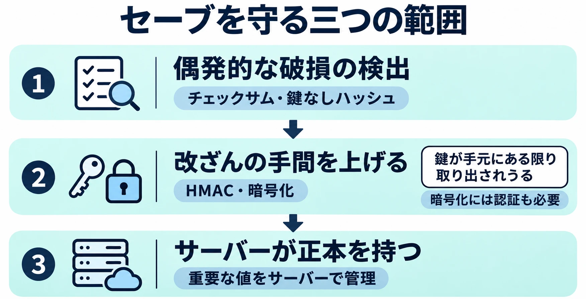
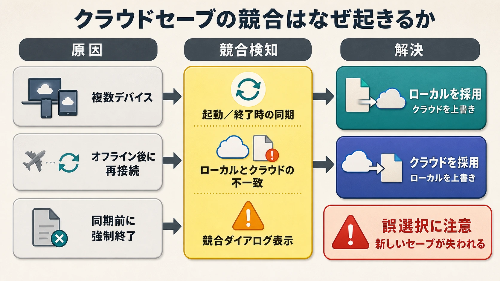

# セーブは何を守っているのか――ふっかつのじゅもんからクラウドまで、記録の設計と落とし穴

> 2026年11月25日改版：記事全体を全面的に書き直しました。内容の変更はGitの履歴から追えます。

「セーブ中は電源を切らないでください」。

画面の隅でセーブの印が消えるのを待ってから、電源を切る。あの一文の裏で、ゲームは何を守ろうとしているのか。

書き込みを待つ数秒に目を向けると、まずファイルを壊さずに残す仕事が見えてくる。翌日そのファイルを開く場面まで考えると、どこから再開できるのかも大事になる。別の本体で続きを遊び、数年ぶりに更新されたゲームを開くなら、どの記録を採用し、どう読めばいいかまで決めておく必要がある。

***

## 1. 書き留める場所の移り変わり

ファミコン版の『ドラゴンクエスト』では、冒険を切り上げるときに「ふっかつのじゅもん」を書き写した。ゲームが再開に必要な状態をひらがなの列に変え、プレイヤーがその列を紙に残す。次に遊ぶときは紙を見て入力し、ゲームが文字列を読み取って続きを組み立てる。プレイヤーの手元にある一枚の紙が、電源を切る前と入れ直したあとをつないでいた。『ドラゴンクエストII 悪霊の神々』でも使われた方式である。[[1](#ref-1)]

同じ1980年代には、ゲーム自身が媒体に書き込む方法も広がった。1986年に登場したファミリーコンピュータ ディスクシステムのディスクカードは書き換えができ、『ゼルダの伝説』ではディスクに冒険の記録を残せた。カートリッジでは、内蔵電池でセーブ用のメモリに給電するバッテリーバックアップも使われた。本体の電源を切っても記録は残るが、電池が切れれば記録を保持できなくなる。[[2](#ref-2)][[3](#ref-3)]

1994年に登場した初代PlayStationでは、ゲームを収める読み取り専用のCD-ROMと、進行を書き込むメモリーカードが別になった。ソフトとは別にカードを抜き差しできたので、記録だけを別の本体に持っていけた。PlayStation 3の時代には、保存先として本体のハードディスクを使う。初代PlayStation用ソフトの記録も、ハードディスク内に作った仮想のメモリーカードに保存できた。[[4](#ref-4)][[5](#ref-5)]

クラウドに写しを置けるようになると、物理的なカードを持ち歩かなくても、別の本体で続きを遊べるようになった。現在のPS5でも、本体のセーブデータとPlayStation Plusのクラウドストレージを同期できる。紙、ディスク、カード、本体、クラウドと置き場所が変わっても、再開に必要なものを、あとで読める形で渡す仕事は残る。[[6](#ref-6)]

***

## 2. 状態を書き出す

宝箱を開けて鍵を拾ったところで、ゲームを終える。次に開いたとき、宝箱は開いていて、鍵は持ち物に入っている。この二つが揃って、ようやく「続き」になる。宝箱だけ開いて鍵がなければ、鍵が必要な扉の先に進めなくなるかもしれない。

ゲームのメモリ上にある状態のうち、再開に必要なものを選び、ファイルなどに書き出せる形に変える。これが **シリアライズ** である。ロード時には、書き出した記録から状態を組み立て直す。たとえば持ち物の参照は、実行中にだけ有効なメモリ上の住所のまま残すと、次の起動時に使えない。セーブにはアイテムの識別子と個数を持たせ、読み込み時にゲームがその識別子を引き直す。「何を残すか」と「どのように復元するか」は、ひと続きの仕様になる。

### 前の記録を残したまま書く

前のセーブに直接上書きすると、途中で電源が切れたときに、新しい記録も古い記録も読めなくなることがある。そこで、まず保存先と同じファイルシステム上の一時ファイルにすべてを書き、フラッシュしてバッファに溜まったデータを永続ストレージへ書き切る。書き込みとフラッシュの成功を確認してから、完成したファイルで元のセーブを置き換える。

この置き換えを、他の処理から見て途中のない一操作にするのが **アトミック書き込み** の考え方である。たとえばPOSIXの `rename` で同じファイルシステム内の既存ファイルを置き換える場合、元の名前で開こうとする側には、置換前か置換後のファイルが見える。この性質は、突然の電源断のあとでも新しい名前と内容が残るという保証とは別である。Linuxでは、ファイル自体に `fsync` をかけても、その名前を持つディレクトリの更新が永続化されたとは限らない。置換後の名前まで残すには、ディレクトリにも別途 `fsync` が必要になる。[[7](#ref-7)][[8](#ref-8)]

どこまで保証されるかは、OS、ファイルシステム、使うAPIによって違う。.NETの `File.Move` は既定では移動先に同名ファイルがあると失敗する。上書きには対応するオーバーロードで明示的に指定するか、`File.Replace` を使う。上書きできるという仕様と、置き換えが原子的に見えるという保証は、それぞれ確認する。家庭用ゲーム機では、プラットフォームが用意する保存の仕組みに任せることが多い。[[9](#ref-9)][[10](#ref-10)]

正しく書き終えたファイルにも、ゲーム側の不具合で矛盾した状態が入ることはある。保存に成功するたび、直近の数世代を残して古いものから入れ替える **ローリングバックアップ** なら、最新の記録が読めないときに一つ前まで戻れる。失うのは最後の保存からの進行で済むか、それとも冒険の最初に戻るのか。バックアップの世代は、その差を決める。

### 長く遊んだ記録ほど大きくなる

『Cyberpunk 2077』の発売直後、PC版ではセーブデータが8 MBの上限を超えると、破損して読み込めなくなる問題があった。Stadia版にも同様の症状が報じられたが、2020年12月の公式パッチノートでは、Hotfix 1.06による8 MB上限の撤廃はPC版の項目に記載されている。同じパッチのStadia版の項目には、終盤に近いセーブのロード時にまれに起きるクラッシュの修正と、一部の破損セーブの復旧が別に記されている。PC版の上限撤廃には、更新前に壊れたファイルは直らないという注記が付いた。[[11](#ref-11)][[12](#ref-12)][[13](#ref-13)]

アイテムや素材を集め続ける遊びなら、序盤のセーブが小さく収まることを確かめただけでは足りない。開発の早い段階から、所持品が増え、クエストや探索が進んだデータを作り、容量と読み書きにかかる時間を測る。境界に近い記録は書き出したあと実際に読み込んでみる。数十時間遊んだ記録を失ってからでは、保存できる容量を引き上げても、その時間は戻らない。

***

## 3. いつ保存するか

次にゲームを開いた瞬間、キャラクターが崖から落ちている。セーブは仕様どおり書き込まれ、ロードも成功した。それでも、読み込み直すたびに落下の途中から始まるなら、プレイヤーにとっては再開できたとは言いがたい。

オートセーブの時点を決めるときは、そこから再開する場面もセットで考える。戦闘の最中、落下中、操作を受け付けない演出の途中は避け、エリアの移動が完了したときや、チェックポイントに着いたときに保存する。取り返しのつかない選択なら、選択前の記録を別に残すか、手動セーブを促す。選択を引き受けること自体が遊びなら、どの時点で確定するかをプレイヤーに伝えておく。

「どの瞬間の状態を残すか」と「いつストレージに書くか」は分けられる。安全な区切りで整合した状態の写しを確保し、書き込みは裏で進める。これが **非同期の書き込み** で、操作を止める時間を減らせる。書き込みのあいだもゲームは進むため、処理中の持ち物を後から直接読み直したり、遅れて終わった古い保存が新しい保存を上書きしたりしないようにする。保存完了の表示も、保存を頼んだ瞬間と、保存が成功した瞬間を区別する。

『Dark Souls』のようにプレイ中に繰り返し保存する設計では、一つ前の判断に簡単に戻れないことが、失敗の重みを支える。『DARK SOULS REMASTERED』の取扱説明書は、特定のタイミングでオートセーブが行われ、そのたびに前の記録が上書きされると案内している。一方、ボスの前に置かれたセーブポイントは、負けてもそこから挑み直せるという前提を作る。ボスの強さが同じでも、挑戦のたびに長い道を戻るかどうかで、負けたときに失うものは変わる。やり直しをどう遊びに組み込むかは、[セーブとロードを使ったやり直しの設計](retry-design-save-scumming-game-planning.md)で扱っている。[[14](#ref-14)]

***

## 4. 書き換えられることを前提に守る

セーブに入っている音量をプレイヤーが変えても、その影響は手元に収まる。ランキングに送るスコアや、購入した通貨の残高が書き換われば、他のプレイヤーや取引にも影響する。手元の端末に保存して、そこで読み書きする以上、書き換えを完全に防ぐことには原理的な限界がある。守り方は、その値がどこで効くかに合わせて選ぶ。

最初の段は、 **偶発的な破損を見つける** ことだ。チェックサムやSHA-256のような鍵を使わないハッシュは、データから検査値を計算する。保存時の検査値と読み込み時に計算した値が違えば、読み込んだデータと検査値が食い違うと分かる。書き込みの中断やビット化けによる破損を見つける手がかりになる。書き換えた側が検査値も計算し直せる場合は、変更後の記録が検査を通る。[[15](#ref-15)]

次の段は、 **改ざんの手間を上げる** ことだ。HMACは秘密鍵とデータを使って認証用の値を作る仕組みである。GameMakerの公式ブログは、書き出したセーブにHMACの値を添え、ロード時に照合する例を紹介している。この例では、対応する鍵を変えると以前の記録を検証できなくなる。古い鍵で保存した記録をどう読み続けられるようにするかは、更新時の設計に含める。鍵をどこに置くかも重要だ。配布したゲームが手元で使う鍵は取り出されうるので、鍵を入手されれば認証用の値も偽造されうる。内容を隠すために暗号化を使う場合は、書き換えを検出するための認証も考える。[[15](#ref-15)]

三つ目の段では、 **サーバーが正本を持つ** 。オンラインのゲームなら、有償通貨の残高や重要な進行をサーバーで更新し、手元のデータは表示などに使う写しとして扱える。有料コンテンツの解放には購入権の記録を使い、ランキングに関わる値はサーバーが採用の可否を決める。音量や表示設定まで同じ強度で守る必要性は低い。端末から届いた値をどこまで信用するかという判断は、[オンラインゲームのアンチチート](online-game-anti-cheat-technology-history.md)にも通じる。

***

## 5. 一つのセーブが、いくつもの場所にあるとき

外出先で、通信を切ったままゲームを進める。帰宅して別の端末を開くと、そこには出かける前のセーブがあり、そのまま別のクエストを進められる。あとで両方を同期すると、同じ冒険から枝分かれした二つの記録が残る。更新日時は選ぶ手がかりになるが、どちらの冒険を続けたいかまでは教えてくれない。

Steam Cloudは、対応するゲームのセーブファイルなどを端末とクラウドの間で同期する。オフラインでのプレイや、前の端末で同期が終わる前に別の端末で遊ぶなどして、どちらの変更を採用すべきか判断できなくなると競合が起きる。Steamは競合時に端末側かクラウド側かをプレイヤーに選ばせる。古い方を選ぶと新しい進行が上書きされるおそれがある。ゲーム側で判断材料を示せるなら、最後に遊んだ日時のほか、プレイ時間や章の名前があると、自分の記録を見分けやすい。[[16](#ref-16)][[17](#ref-17)]

### バックアップが公平さに触れるとき

『スプラトゥーン2』は、Nintendo Switch Onlineの「セーブデータお預かり」に対応していない。任天堂はGame Informerへの回答で、一部のゲームではバックアップによって他のプレイヤーに譲ったアイテムを取り戻したり、落ちたオンラインランキングを元に戻したりできると説明した。『スプラトゥーン2』で対応を見送った理由として同社が挙げたのは、オンラインランキングの公平性である。故障に備えて過去の記録を取っておくことと、その記録を対戦の成績に反映させることが、同じ復元操作でつながっていた。[[18](#ref-18)][[19](#ref-19)]

預けた記録を使えるかどうかは、加入状況にも左右される。任天堂のサポートによると、Nintendo Switch Onlineの利用をやめると「セーブデータお預かり」に保管したデータは使えなくなるが、180日以内に再加入すれば以前預けたデータを再び利用できる。[[20](#ref-20)]

### 別の機種でも、同じ続きから遊ぶ

『Destiny 2』は2019年にクロスセーブを導入した。Bungieのアカウントに各プラットフォームのアカウントを連携し、そのうち一つのキャラクターの組を有効にして各機種で遊ぶ。複数の機種で別々に育てたキャラクターは統合されない。クロスセーブを無効にすると、再び有効にするまで90日間待つ必要がある。拡張DLCのライセンスは機種をまたいで引き継がれないため、別の機種でそのDLCを遊ぶには、その機種での購入が必要になる。[[21](#ref-21)][[22](#ref-22)]

レベルファイブが2025年5月22日に発売した『ファンタジーライフｉ グルグルの竜と時をぬすむ少女』も、機種をまたいで続きを遊べる。こちらはEpic Gamesアカウントを連携し、引き継ぎ元のゲーム内で「クロスセーブにも保存する」を選んでデータを預け、引き継ぎ先のタイトル画面で「クロスセーブを確認」を選んで受け取る方式である。同じ「クロスセーブ」でも、どのキャラクターで遊ぶかをアカウントで選ぶ方式と、どのセーブを引き継ぐかを操作する方式では、プレイヤーが判断する場面が違う。[[23](#ref-23)][[24](#ref-24)]

編者が家庭用ゲーム機とアプリで関わった作品は、いずれもクラウドセーブを前提とし、サーバーに正本を置く設計だった。本体のストレージに保存したセーブをあとから預ける設計では、出発点は本体の記録にある。サーバーに正本がある設計では、たとえば報酬を受け取った事実はサーバーで確定させる。二つの端末で同時に受け取ろうとした場合や、通信が切れて同じ操作を送り直した場合も、一度分として扱う必要がある。そこから先の設計は、[同時操作と繰り返し操作への対処](game-concurrent-and-repeated-operations-for-planners.md)で扱っている。

***

## 6. 版が変わっても読めるか

アップデートで持ち物の記録に倉庫の欄を足したとする。更新前のセーブにはその欄がない。空の倉庫を用意すれば済む変更もあれば、従来の持ち物の一部を倉庫へ移さなければ、所持上限を超えて消えてしまう変更もある。古い記録を読み取れることと、同じ冒険の続きを遊べることは、二つの仕事である。

セーブにはゲーム本体の版とは別に、データ形式のバージョン番号を持たせる。ロード時に番号を読み、旧版から新版へ移す処理を順に適用すれば、更新を何回か飛ばして戻ってきたプレイヤーにも対応できる。移行した記録を保存するときは、検証に成功するまで元の記録を残す。クラウドを介して新旧のゲームが同じセーブに触れるなら、旧版が未知の形式を開いたときに上書きさせないことも大切になる。

Protocol Buffersのバイナリ形式では、既存項目の番号を維持したまま新しい項目を追加するなど、互換性を保てる変更が定められている。旧セーブに項目がない場合にゲーム上どんな値として扱うかや、すでに保存された値の意味が変わった場合の移行は、ゲーム側で決める。たとえば「未設定」と「ゼロ個」を区別したいなら、その区別を形式と読み込み処理の両方で表現する。[[25](#ref-25)]

開発中は、過去に配布した版で作られたセーブをテスト用に残しておく。変更のたびに自動でビルドやテストを行う **CI** に、古い記録をロードするテストを組み込む。ファイルが開けたかだけでなく、クエストが達成済みのままか、鍵が持ち物に残っているか、保存し直したあとも先へ進めるかまで確かめる。互換性が守るのは、ファイルの読み方と、その先にある遊びである。

***

## 結び

「セーブ中は電源を切らないでください」。あの一文が守ろうとしたのは、冒険がまだ書き出されている途中の、ほんの短い時間だった。

その先を守るのは、作り手の判断である。どの時点を続きとして残すのか。どの値を手元に預け、どの値をサーバーで確定するのか。記録が二つに分かれたり、ゲームの版が変わったりしたときにも、プレイヤーを同じ冒険へ戻せるか。セーブの印が消えるのを待った時間は、次に電源を入れたとき、続きがそこにあって初めて報われる。

***

## References

1. [ファミ通.com「『ドラゴンクエストXI』“ふっかつのじゅもん”の情報が公開！ 過去作のじゅもんも使用できる【『DQXI』発売日発表会】」][1] — ファミ通.com、2017年4月11日。

[1]: https://www.famitsu.com/news/201704/11130825.html

2. [任天堂「ファミコン年表」][2] — 任天堂、ファミリーコンピュータ。

[2]: https://www.nintendo.com/jp/famicom/history/index.html

3. [任天堂「オウガバトル64」][3] — 任天堂、取扱説明書。カセットのバッテリーバックアップに関する注意書き。

[3]: https://m1.nintendo.net/docvc/NUS/JPN/NOBJ/NOBJ_J.pdf

4. [Sony Interactive Entertainment「Company History」][4] — Sony Interactive Entertainment。

[4]: https://sonyinteractive.com/en/our-company/company-history/

5. [Sony Computer Entertainment「Using saved data on memory cards」][5] — PlayStation 3 User’s Guide。

[5]: https://manuals.playstation.net/document/en/ps3/3_15/game/mcsavedata.html

6. [ソニー・インタラクティブエンタテインメント「PS5のPlayStation Plusクラウドストレージ」][6] — PlayStationサポート。

[6]: https://www.playstation.com/ja-jp/support/subscriptions/ps5-ps-plus-cloud-storage/

7. [IEEE・The Open Group「rename, renameat — rename file」][7] — POSIX Programmer’s Manual、2017年版の転載。

[7]: https://man7.org/linux/man-pages/man3/rename.3p.html

8. [Linux man-pages project「fsync(2) — Linux manual page」][8] — man7.org。ファイルとディレクトリの永続化。

[8]: https://man7.org/linux/man-pages/man2/fsync.2.html

9. [Microsoft「File.Move Method」][9] — Microsoft Learn。

[9]: https://learn.microsoft.com/en-us/dotnet/api/system.io.file.move

10. [Microsoft「File.Replace Method」][10] — Microsoft Learn。

[10]: https://learn.microsoft.com/en-us/dotnet/api/system.io.file.replace

11. [CD PROJEKT RED「Hotfix 1.06」][11] — Cyberpunk.net、2020年12月23日。

[11]: https://www.cyberpunk.net/en/news/37214/hotfix-1-06

12. [GOG「Cyberpunk 2077 - Saved data is damaged and cannot be loaded.」][12] — GOG Support Center。

[12]: https://support.gog.com/hc/en-us/articles/360016743298-Cyberpunk-2077-Saved-data-is-damaged-and-cannot-be-loaded

13. [Tom’s Hardware「Cyberpunk 2077 PC Bug Causes Corruption in Game Saves: Reports」][13] — Tom’s Hardware、2020年12月。Stadia版については当時のユーザー報告に基づく記事。

[13]: https://www.tomshardware.com/news/cyberpunk-2077-pc-bug-causes-corruption-in-game-saves-reports

14. [フロム・ソフトウェア「DARK SOULS REMASTERED - WEB MANUAL」][14] — フロム・ソフトウェア、PS4版。「ゲームを中断する時は」を参照。

[14]: https://www.fromsoftware.jp/manual/darksoulsremastered/ps4/start.html

15. [Juju Adams「How To Protect Your Save Files In GameMaker」][15] — GameMaker、2019年10月24日。記事ページの署名はRoss Manthorp、ブログ一覧ではJujuによる寄稿として紹介されている。

[15]: https://gamemaker.io/en/blog/protect-your-savefiles

16. [Valve「Steam Cloud」][16] — Steamworks Documentation。

[16]: https://partner.steamgames.com/doc/features/cloud

17. [Valve「Steam Cloud at a glance」][17] — Steamworks、2025年。「Steam Cloud – Cloud Conflict dialog」の画面例を参照。

[17]: https://steamcdn-a.akamaihd.net/steamcommunity/public/images/steamworks_docs/english/Steamworks_Features_SF_2025.pdf

18. [任天堂「スプラトゥーン2」][18] — 任天堂、製品情報。

[18]: https://www.nintendo.com/jp/games/switch/splatoon2/index.html

19. [Imran Khan「Multiple Switch Games Including Pokémon, Splatoon, And Dark Souls Do Not Support Cloud Saves (Update: Nintendo Responds)」][19] — Game Informer、2018年9月7日。追記に任天堂の回答を掲載。

[19]: https://gameinformer.com/2018/09/07/multiple-switch-games-including-pokemon-splatoon-and-dark-souls-do-not-support

20. [任天堂「【Switch 2 / Switch】Nintendo Switch Onlineの利用をやめたら『セーブデータお預かり』に保管したセーブデータは使えなくなりますか？」][20] — 任天堂サポート。

[20]: https://support-jp.nintendo.com/app/answers/detail/a_id/35640

21. [Bungie「Destiny 2 Archived Years 1-2 Known Issues and Vital Information」][21] — Bungie Help。2019年8月21日のクロスセーブ開始予定を記録。

[21]: https://help.bungie.net/hc/en-us/articles/360048720192-Destiny-2-Archived-Years-1-2-Known-Issues-and-Vital-Information

22. [Bungie「Destiny 2: Cross Save Guide」][22] — Bungie Help。

[22]: https://help.bungie.net/hc/en-us/articles/360049498031-Destiny-2-Cross-Save-Guide

23. [ファミ通.com「『ファンタジーライフｉ グルグルの竜と時をぬすむ少女』が本日（5/22）発売。ファンタジー世界で自由気ままな生活を満喫できるスローライフRPG」][23] — ファミ通.com、2025年5月22日。

[23]: https://www.famitsu.com/article/202505/42718

24. [レベルファイブ「クロスセーブを行う方法」][24] — 『ファンタジーライフｉ グルグルの竜と時をぬすむ少女』公式サイト。

[24]: https://www.fantasylife.jp/fli/guide/cross-save/

25. [Google「Language Guide (proto 3)」][25] — Protocol Buffers Documentation。「Updating A Message Type」を参照。

[25]: https://protobuf.dev/programming-guides/proto3/

----

この文書は、Perplexity、Claude、ChatGPT の3つのAIの支援を受けて著述されたものです。引用画像を除き、MIT License にて提供されています。
