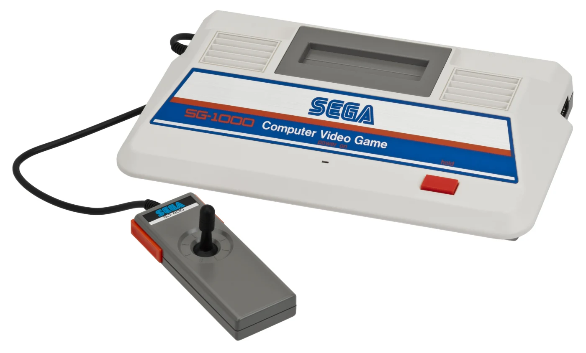
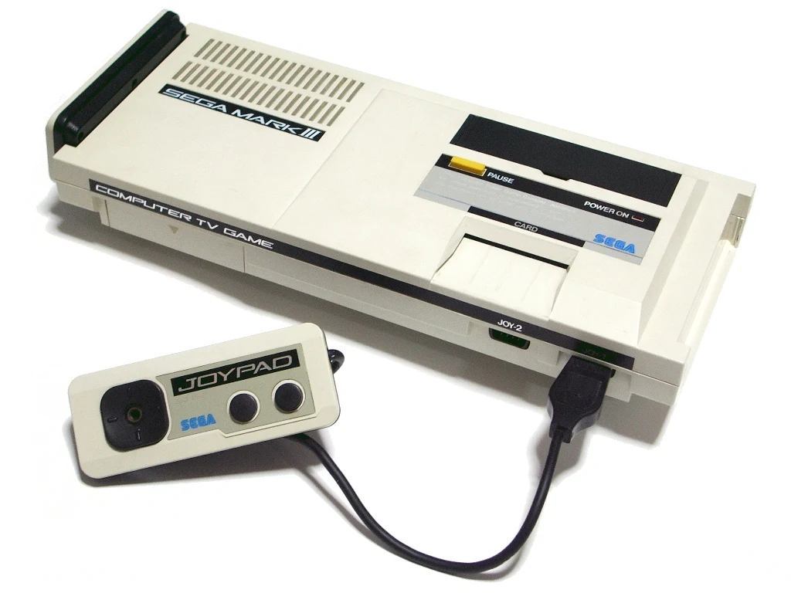
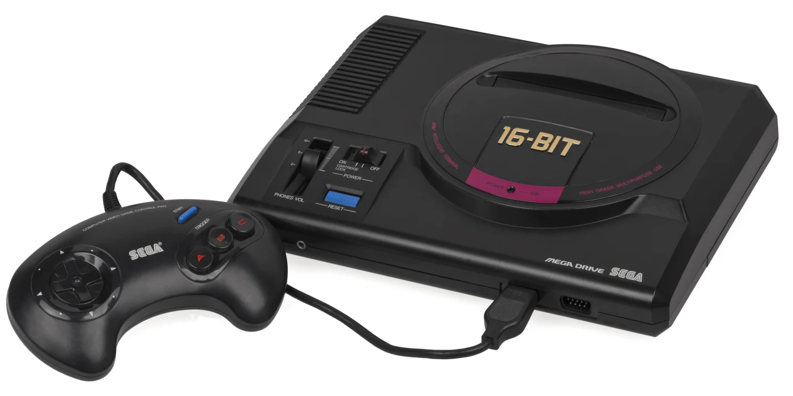
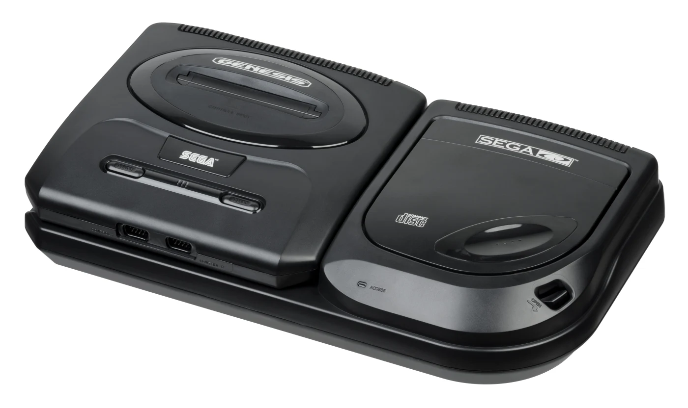
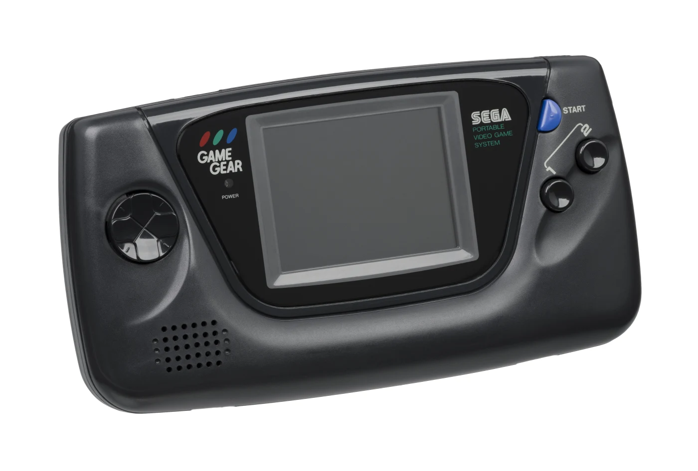
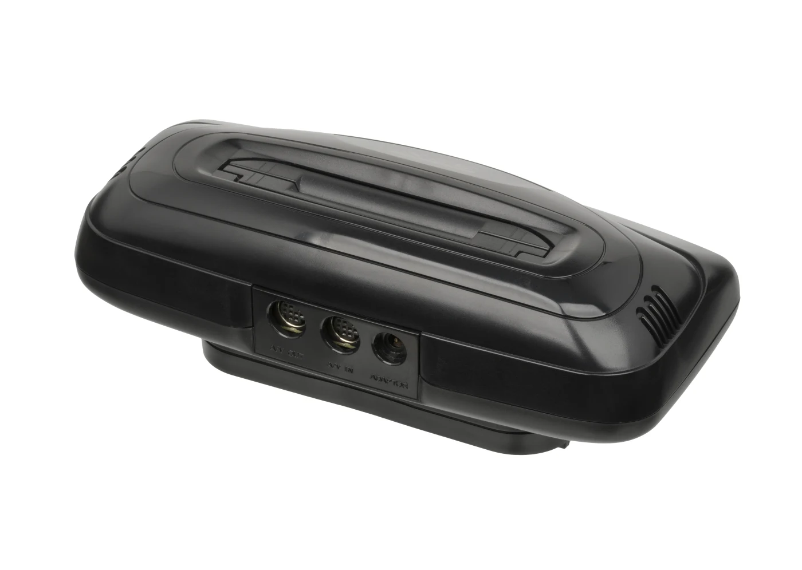
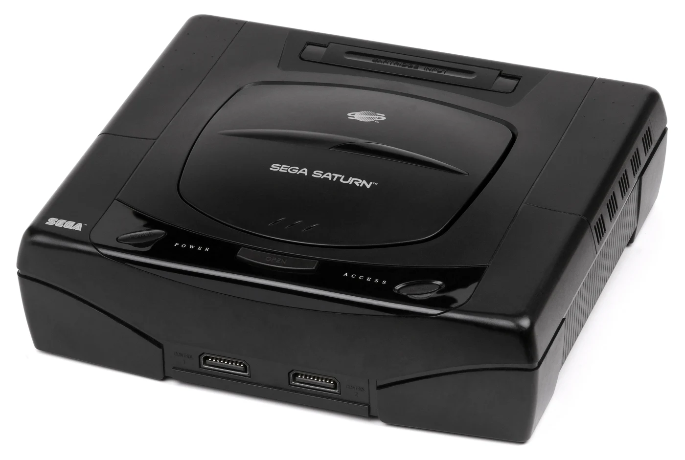
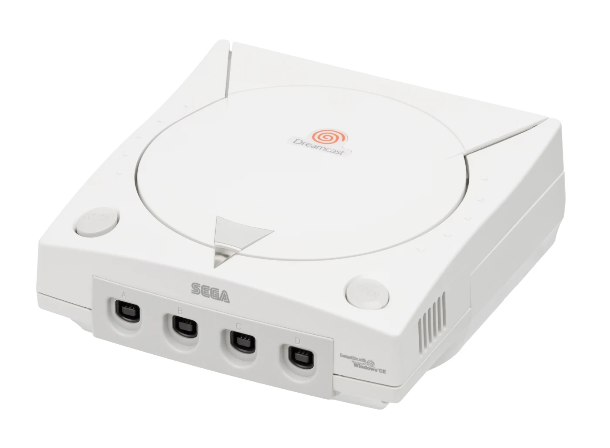

# セガのコンソール史：SG-1000からドリームキャストまで

## ハード設計とマーケティング戦略の因果関係

***

## はじめに：「アーケードを家庭へ」という哲学

本ブログではこれまで、家庭用ゲーム機の歴史を語る際、基本的には市場でメジャーな流れとして、任天堂のファミコンからスーパーファミコン、Wii、Switchへ続く系譜や、PlayStation各シリーズを中心に扱ってきた。これは、多くのプレイヤーが実際に触れてきた環境を基準にゲーム体験を考えるためであり、決してマイナー機を軽んじる意図ではない。

しかしセガのハードウェアには、単に「マイナーだった」で片づけられない独自の設計思想と、市場で優位に立てなかっただけの構造的な理由がある。そこで今回は、あえてセガの家庭用ハードに焦点を絞り、その成功と失敗をまとめて見ていく。

セガのハード史を貫く一本の軸は、 **「アーケードゲームを家庭に持ち込む」** という設計思想だ。この哲学は、SG-1000の誕生からドリームキャストの終焉まで一貫して続く。しかしこの哲学は時に技術的な先進性として輝き、時に市場の読み違いとして組織を蝕んだ。ハードウェアの設計決定がいかにマーケティング戦略の成否を決定づけたか、年代ごとに解剖する。[[1](#ref-1)]

***

## 第一世代（1983–1985）：出発点の呪い

### SG-1000 ― ファミコンと同日に生まれた悲劇

*画像出典: Evan-Amos, [Sega-SG-1000-Console-Set.jpg](https://commons.wikimedia.org/wiki/File:Sega-SG-1000-Console-Set.jpg), Wikimedia Commons, Public Domain.*

| 項目 | SG-1000 | ファミコン |
|---|---|---|
| 発売日 | 1983年7月15日 | 1983年7月15日 |
| CPU | Z-80A（3.58MHz） | RP2A03（6502系、約1.79MHz） |
| 映像 | 15色＋1色、8×8ドットのキャラクタ | 専用の映像処理回路PPU（RP2C02） |
| 価格 | 15,000円 | 14,800円 |
| 初年度販売 | 約16万台 | 約45万台 |

SG-1000の仕様はセガ公式、ファミコンのCPUとPPUはRodrigo Copetti氏の解析、ファミコンの価格と初年度販売はインサイドの記事による。[[2](#ref-2)][[3](#ref-3)][[4](#ref-4)]

1983年7月15日、セガ・エンタープライゼスは初の家庭用ゲーム機 **SG-1000** を、ファミコンとまったく同じ日に発売した。SG-1000はファミコンの発売が発表された後に急遽開発された機種で、CPUは8ビット、当時のパソコンMSXと同程度のものが採用されていた。[[5](#ref-5)][[2](#ref-2)]

**ハード設計とマーケの因果関係①**：SG-1000では、セガのアーケードゲームが家で遊べるという体験価値が打ち出された。しかし当時のセガは、業務用タイトルを家庭用ゲームにする権利を海外のメーカーに与えていたこともあり、ソフトラインナップを整えるのに苦心した。アーケードゲームメーカーに声をかけても、ライバルメーカーへのソフト供給が問題となって、なかなか集まらなかった。初年度の販売台数では、同日発売のファミコンに大きく差をつけられた。[[5](#ref-5)][[4](#ref-4)]

同時に発売されたコンピュータ版 **SC-3000** （キーボード付き）は、ホームコンピュータ市場も狙うという戦略的二刀流だった。SC-3000は30万台ほどが流通した。[[5](#ref-5)][[6](#ref-6)]

### セガ・マークIII / マスターシステム ― 「高性能なのに負けた」教訓

*画像出典: Muband, [Sega Mark III.jpg](https://commons.wikimedia.org/wiki/File:Sega_Mark_III.jpg), Wikimedia Commons, [CC BY-SA 3.0](https://creativecommons.org/licenses/by-sa/3.0/)。WebP変換。*

SG-1000の反省を活かし、1985年10月に **セガ・マークIII** が日本で登場。これをベースに、海外では **Master System** として展開された。[[7](#ref-7)]

**ハード設計の論理**：マークIIIは64色の発色パレットを持ち、映像表現を強化した。業務用基板システムⅡの移植を想定した設計だった。[[7](#ref-7)][[8](#ref-8)]

**しかし市場は動かなかった（北米・日本）**：ファミコン／NESが普及する市場では、ハードの性能を高めるだけで競争を逆転することは難しかった。「高性能」というメッセージを支えるには、ソフトラインナップの充実も必要だった。[[7](#ref-7)]

**ところが欧州とブラジルでは逆転した**：マスターシステムは欧州と南米で成功した。ブラジルでは **Tectoy社** が代理店として、1990年代後半まで本体とソフトを発売し続けた。[[7](#ref-7)]

> **設計→マーケの因果：** 「高性能」という技術的優位は、サードパーティのコンテンツなしには市場を動かせない。北米・日本での失敗は、ハードの性能ではなくエコシステムの欠如が原因だった。

***

## 第二世代（1988–1993）：黄金期の設計哲学

### メガドライブ / Genesis ― 「アーケードの完全移植」が世界を制した

*画像出典: Evan-Amos, [Sega-Mega-Drive-JP-Mk1-Console-Set.jpg](https://commons.wikimedia.org/wiki/File:Sega-Mega-Drive-JP-Mk1-Console-Set.jpg), Wikimedia Commons, Public Domain.*

| 項目 | メガドライブ / Genesis |
|---|---|
| 発売日 | 1988年10月29日（JP）/ 1989年（NA） |
| メインCPU | Motorola 68000（7.67MHz） |
| サブCPU | Zilog Z80（3.58MHz、サウンド制御） |
| 海外販売台数 | 北米1,500万台以上、欧州800万台以上 |
| 北米シェアピーク | 一時期ナンバー1 |

**メガドライブのハード設計は意図的な「アーケード基板の家庭用化」だった。** メインCPUに採用したMotorola 68000は、セガの業務用アーケード基板と同系統のプロセッサだ。さらにZ80も搭載し、外付けアダプタ「メガアダプタ」を介すことで過去のソフトとの後方互換も実現した。68000採用は、アーケードで蓄積したプログラミング資産を活かす選択だった。[[9](#ref-9)][[10](#ref-10)]

比較広告などを用いた北米キャンペーンは、「クール」なイメージを打ち出すものだった。ハードの性能だけでなく、競合との違いを印象づけるマーケティングが成功につながった。[[9](#ref-9)]

**トム・カリンスキーの戦略**：Sega of AmericaのCEO、トム・カリンスキーは、1990年秋にセガの取締役会へ計画を示し、中山隼雄氏の承認を得た。その柱は次のとおりだった：[[11](#ref-11)]

- Genesisの同梱ソフトを『獣王記』から『ソニック・ザ・ヘッジホッグ』に替え、任天堂との違いを打ち出した
- 「キッズは任天堂に任せる」として、10代から大学生を主なターゲットにした
- 任天堂を揶揄するような、エッジの効いた広告で「クール」なブランドを構築した

**日本での苦戦**：一方、日本ではファミコンやスーパーファミコン、PCエンジンがしのぎを削るなかで、ライバル機種の牙城を崩すには至らなかった。それでも国内で300万台以上を販売し、セガの家庭用ハードとして初めて国内100万台を超えた。[[9](#ref-9)]

#### メガCD（北米名：Sega CD）― CD-ROMというハード拡張の野望

*画像出典: Evan-Amos, [Sega-CD-Model2-Set.jpg](https://commons.wikimedia.org/wiki/File:Sega-CD-Model2-Set.jpg), Wikimedia Commons, Public Domain.*

1991年12月12日に日本で発売されたこのCD-ROMアドオンは、メガドライブ本体の下部に接続して使用する。専用のCPUを載せ、画像の回転・拡大・縮小をハードウェアで処理できるようにした、アーケード的な「スペック拡張」の発想そのものだった。その大容量は、次のような作品と議論を生んだ：[[12](#ref-12)]

- **映像表現の広がり**：ソフトライセンシーも本格参入し、長編RPGやアドベンチャーゲームが多数登場した。画面描き換えによるアニメーションや動画圧縮技術を用いた作品も現れ、現在では定番の「オープニングムービー」などの基礎を作った[[12](#ref-12)]
- 代表タイトル *ナイトトラップ* は、1993年12月9日の米議会公聴会でセガが販売するタイトルとして取り上げられ、暴力・性的表現が問題視された[[13](#ref-13)]
- 良作（*ソニック・ザ・ヘッジホッグCD*、*LUNAR ザ・シルバースター*、*スナッチャー*）も存在した

> **設計→マーケの因果：** CD-ROMという「大容量」は表現の幅を大きく広げた。一方で、映像が生々しくなるほど、表現内容が社会的な議論を呼ぶリスクも伴うようになった。

***

## 第三世代（1990–1994）：拡張戦略の迷走

### ゲームギア ― カラー携帯機の「電池問題」

*画像出典: Evan-Amos, [Sega-Game-Gear-FR.jpg](https://commons.wikimedia.org/wiki/File:Sega-Game-Gear-FR.jpg), Wikimedia Commons, Public Domain.*

1990年10月6日に発売された **ゲームギア** は、セガのカラー液晶携帯ゲーム機だ。[[14](#ref-14)]

| 項目 | ゲームギア | ゲームボーイ |
|---|---|---|
| 発売年 | 1990年 | 1989年 |
| ディスプレイ | カラーバックライトLCD | モノクロ反射型LCD |
| 電源と連続使用時間 | 単3アルカリ乾電池6本で約3〜4時間 | 単3アルカリ乾電池4本で約35時間 |

**ハード設計の選択とその代償**：バックライト付きカラーディスプレイは技術的に優れていたが、電力消費量が膨大だった。「カラーで綺麗に見える」というマーケティング上の訴求ポイントは、「電池がすぐ切れる」という致命的なユーザー体験によって相殺された。ゲームボーイの「ゲームボーイはどこでも遊べる」シンプルさに対し、ゲームギアは「遊べるが電源が必要」という実用上の制限を抱えた。[[14](#ref-14)][[15](#ref-15)]

ゲームギアは世界で1,000万台以上を販売したが、ゲームボーイとの競争は厳しかった。[[16](#ref-16)]

### 32X ― 史上最悪のハード拡張

*画像出典: Evan-Amos, [Sega-Genesis-32X-02.jpg](https://commons.wikimedia.org/wiki/File:Sega-Genesis-32X-02.jpg), Wikimedia Commons, Public Domain.*

1994年11月に北米で、日本では同年12月3日に発売された **32X** は、メガドライブのカートリッジスロットに装着する独立電源付きの拡張ユニットだった。[[17](#ref-17)]

**なぜこれが生まれたか：** Genesisが北米で売上を伸ばし続けるなか、Sega of Americaは、市場環境の違いから高価なセガサターンへの切り替えを時期尚早と見ていた。その提案に応えて32Xが急遽生まれ、9か月で設計された。32XはセガサターンのCPUと同系のHitachi SH-2を、より低いクロックで2基搭載していた。[[17](#ref-17)][[18](#ref-18)]

**結果**：

- 発売時期がセガサターンの日本発売（1994年11月22日）とほぼ同時 → 自社競合[[17](#ref-17)]
- 1995年内で展開を終えた[[17](#ref-17)]
- 北米でも1995年5月にセガサターンが投入され、ライセンシーもユーザーも、どこに注力・注目すべきなのか迷う状況になった[[17](#ref-17)]

> **設計→マーケの因果：** 「社内の政治的妥協」がハード設計に持ち込まれると、どのプラットフォームでも中途半端な存在になる。32Xは技術的には興味深いが、マーケットにとっては「また新しいセガのハードを買わされる」という不信感の象徴となった。

***

## 第四世代（1994–1998）：傑作と崩壊のセガサターン

### セガサターン ― 2Dの傑作、3Dの試練

*画像出典: Evan-Amos, [Sega-Saturn-Console-NA-Mk-I-FL.jpg](https://commons.wikimedia.org/wiki/File:Sega-Saturn-Console-NA-Mk-I-FL.jpg), Wikimedia Commons, Public Domain.*

| 項目 | セガサターン | Sony PlayStation |
|---|---|---|
| 発売日（JP） | 1994年11月22日 | 1994年12月3日 |
| CPU | Hitachi SH-2 ×2基（各28.6MHz） | MIPS R3000A（33.87MHz）×1 |
| ポリゴン描画 | 四辺形（クワッド）ベース | 三角形ベース |
| 北米発売価格 | 399ドル | 299ドル |
| 販売規模（各社公表） | 国内で600万台以上を出荷 | 世界で1億240万台以上（2012年3月末） |

販売規模は、セガサターンがセガ公式の国内出荷、PlayStationがSIE公表の世界累計出荷であり、数字の範囲が異なる。[[17](#ref-17)][[19](#ref-19)]

**ハード設計の根本的な選択ミス：**

セガサターンのアーキテクチャは **デュアルSH-2** という独創的な構成だったが、元々2Dグラフィックマシンとして設計されており、3DCG機能は開発上の「クセ」を理解しないと性能を発揮できなかった。さらにポリゴン描画単位が **四辺形（クワッド）** であり、スプライトに幾何変換を施すVDP1の設計に由来するものだった。[[1](#ref-1)][[20](#ref-20)]

この設計は **格闘ゲームと2Dゲームには強力** だった。 *バーチャファイター2* （1995）はアーケード版の人気を家庭に持ち込み、セガサターン本体の販売を牽引する看板タイトルとなった。 *ザ・キング・オブ・ファイターズ（KOF）* シリーズ、 *バーチャコップ* など、アーケード由来のタイトルの移植品質も高く、ここではセガの「アーケードゲームを家庭に持ち込む」という思想が素直に強みとして出た。[[17](#ref-17)]

ただし、セガサターンを支えたのは移植タイトルだけではない。 *NiGHTS into dreams...* はアーケードからの移植ではなく、セガサターン向けに作られたオリジナルタイトルだった。夢の空間を飛ぶ独特のフライトアクションは、サターンが単なる移植機ではなく、独自の表現を持つプラットフォームでもあったことを示していた。[[21](#ref-21)]

しかし3DCG機能を使いこなすには開発上の難しさがあり、 **3Dゲームの開発負担** が課題になった。[[1](#ref-1)]

**E3 1995の大失策：**

1995年5月11日、Sega of America社長兼CEOのトム・カリンスキーはE3の壇上でセガサターンの「本日発売」を宣言。価格は399ドルだった。事前通告のなかった主要小売チェーンの一部は在庫がなく、セガに不信感を持った。その後、ソニー側ではスティーブ・レースが壇上に上がり、ひと言「299ドル」とだけ告げて降壇した。PlayStationはセガサターンより100ドル安いことが示された瞬間だった。[[22](#ref-22)]

中山隼雄氏はソニーより先に発売することにこだわっていた。一方、カリンスキー氏は秋の発売でも早すぎると考えて反対しており、この方針の違いはセガを去った主な理由の一つだったと語っている。[[23](#ref-23)]

**セガサターンは日本では成功：**

日本においてはセガサターンはむしろ健闘した。1994年内に50万台、発売から約半年後に国内100万台を出荷し、セガハード史上最速のペースとなった。最終的には国内で600万台以上を出荷した。 *サクラ大戦* 、 *グランディア* 、 *バーニングレンジャー* などオリジナルIPが育った。これは「日本市場ではアーケード移植と2D RPGへの需要が強い」という地域特性と、セガのハード設計思想が一致した稀な例だった。[[17](#ref-17)]

***

## コラム：PCエンジン ― 第三極の証明

ここまでセガのハードを軸に見てきたが、同じ時代の日本市場には、任天堂でもセガでもない第三極のハードウェアも存在した。PCエンジンはその代表例であり、セガの失敗を相対化するうえでも重要な比較対象になる。

### NEC × ハドソンの奇跡

**PCエンジン** は1987年10月30日、NECホームエレクトロニクスとハドソンの共同開発によって発売された。価格は24,800円。[[24](#ref-24)]

| 仕様 | PCエンジン |
|---|---|
| CPU | HuC6280（6502互換カスタム、7.16MHz） |
| グラフィック | 512色中最大481色、スプライト最大64個 |
| 記録メディア | HuCard（独自ICカード） |
| 国内での位置 | 一時期はスーパーファミコンに次ぐ国内2位の販売シェア |

**設計の独自性：** PCエンジンはCPUこそ8ビット（6502互換）だが、グラフィックス性能が高く、ファミコンやセガ・マークIIIなどを遥かに上回る性能を誇っていた。HuCardという薄型ICカードの採用は、後の **PCエンジンGT** （1990年）として世界初の「据置機とソフト互換性を持つ携帯ゲーム機」を実現させた。[[24](#ref-24)]

**CD-ROM²の革命（1988年）：** PCエンジンは1988年に世界初の家庭用CD-ROMアドオン「CD-ROM²」を発売（59,800円）。これはセガのメガCDより3年先行しており、大容量を活かした *イース* シリーズのアクションRPG、アニメボイス付きのアドベンチャーゲームなど独自のコンテンツ文化を育てた。[[24](#ref-24)]

**セガとの競合と棲み分け：** PCエンジンは、一時期はスーパーファミコンに次ぐ国内2位の販売シェアを持ち、日本市場でセガのメガドライブより高いシェアを維持した期間があった。メガドライブが苦手とした「日本のコアゲーマー」層をPCエンジンが取り込んでいたとも言える。[[24](#ref-24)]

**北米での失敗（TurboGrafx-16）：** 北米では *TurboGrafx-16* として1989年8月に発売されたが、Genesisは約2週間早く店頭に並び、マーケティング費用でもセガに大きく上回られた。米国側にソフトの専門家が少なく、要望したタイトルのローカライズが進まなかったことや、サードパーティの少なさも響いた。[[25](#ref-25)]

**後継機PC-FXの迷走（1994年）：** PCエンジンの後継として1994年12月に発売した **PC-FX** は、3Dポリゴン描画に非対応というセガサターン・PlayStation世代に完全に取り残された設計で市場を去った。セガサターンと同様、「前世代の文化（2D・FMV）を引き継ぎすぎた」設計思想が足を引っ張った事例だ。[[24](#ref-24)]

> **PCエンジンの教訓：** 強いハードと強いコンテンツ文化は日本市場では通用した。しかしグローバル展開と世代移行の失敗は、どのメーカーも平等に滅ぼす。

***

## 第五世代（1998–2001）：ドリームキャストの先見性と終焉

### ドリームキャスト ― 未来に生まれすぎた機体

*画像出典: Evan-Amos, [Sega-Dreamcast-Console-FL.jpg](https://commons.wikimedia.org/wiki/File:Sega-Dreamcast-Console-FL.jpg), Wikimedia Commons, Public Domain.*

| 項目 | ドリームキャスト |
|---|---|
| 発売日 | 1998年11月27日（JP）/ 1999年9月9日（NA）|
| CPU | Hitachi SH-4（200MHz）シングルコア |
| GPU | NEC PowerVR2（Holly）100MHz |
| 記録メディア | GD-ROM（約1GB） |
| 標準搭載 | モデム（国内向け33.6kbps、海外向け56kbps） |
| 世界販売台数 | 累計1,000万台あまり |

**セガサターンの反省を設計に活かした：** セガサターンのデュアルプロセッサによる開発の複雑さへの反省から、ドリームキャストはSH-4シングルCPUに統一された。ポリゴン描画もDirectXと互換性の高い標準的な三角形ベースに移行し、サードパーティ開発が容易になった。[[26](#ref-26)]

**アーケード基板NAOMIとの統一戦略：** ドリームキャストはセガのアーケードボード **NAOMI** （1998年）とほぼ同一のアーキテクチャを持つ。両者のスペックはほぼ並んだ。これにより「アーケードで稼働中のゲームがほぼそのままドリームキャストに移植できる」という、セガの長年の夢を最も完璧に実現した設計だった。[[1](#ref-1)]

**モデム標準搭載という先見：** 業界初の「本格的なオンラインコミュニケーション機能を持つ家庭用ゲーム機」というドリームキャストの設計は、最大の差別化要因となった。[[27](#ref-27)]

- **ファンタシースターオンライン** （2000年）：家庭用ゲーム機のオンラインゲームの草分け的存在。パーティを組んでネットで協力する体験を一般家庭に届けた[[28](#ref-28)]
- 北米ではプロバイダ2年契約でDreamcast本体＋キーボードを無料配布するキャンペーンも実施[[29](#ref-29)]
- ビジュアルメモリ（VMU）はコントローラーに差し込むメモリカードでありながら、液晶画面・ボタン・CPUを備え、ゲーム中のコンパス表示や簡易キャラクター表示を可能にした[[1](#ref-1)][[26](#ref-26)]

**シェンムー（1999年）** の制作費について、鈴木裕氏はGDC 2011で、7,000万ドルという数字は誇張で、実際は4,700万ドルだったと述べた。[[30](#ref-30)] かつてない規模で制作された本作で表現されたオープンワールドの概念は、後のゲーム業界に大きな影響を与えたと言われている。[[1](#ref-1)]

### なぜドリームキャストは市場で敗北したか

セガのハード事業の終焉は多層的な要因の複合だ：

**① PS2とのシェア争い：** PlayStation 2との世界規模のシェア争いに対抗するため、巨額の広告宣伝費が必要になった。[[1](#ref-1)]

**② 海賊版問題：** ドリームキャストでは通常のCDにコピーしたゲームとブートディスクが出回り、セガは違法サイトやオークションサイトの閉鎖に動いた。[[31](#ref-31)]

**③ 開発コスト回収と環境整備の負担：** 早期の値下げにより開発コストの回収が遅れ、セガプロバイダなどの環境整備にも費用がかかった。[[1](#ref-1)]

**④ サードパーティの離反：** Electronic Artsはドリームキャストに参加しなかった。EA側のビング・ゴードン氏は、チップセットの変更、モデム搭載をめぐる迷い、従来のライセンス条件を出せなかったことを理由に挙げる。一方、セガ側のバーニー・ストーラー氏は、EAがスポーツの唯一のブランドであることを求め、セガが買収したVisual Concepts（『NFL 2K』）と衝突したと語っている。[[32](#ref-32)]

2001年1月31日、セガはドリームキャストの製造終了と家庭用ゲーム機事業からの撤退を発表。セガは以後、サードパーティ・デベロッパーとして活動を続けている。[[1](#ref-1)]

***

## 構造分析：セガを滅ぼした因果の連鎖

### ハード設計の失敗パターン

セガのハード史を振り返ると、失敗には明確なパターンがある：

| フェーズ | ハード | 設計の問題 | マーケへの影響 |
|---|---|---|---|
| 1983 | SG-1000 | ソフトの調達に苦心 | 初年度販売でファミコンに大差（約16万台対約45万台） |
| 1985 | マスターシステム（北米名：Master System） | 高性能だがエコシステム欠如 | サードパーティ確保できず北米で失敗 |
| 1991 | メガCD / Sega CD | CD-ROMの大容量で映像表現を拡張 | 表現内容が社会的な議論を呼んだ |
| 1994 | 32X | 地域ごとの移行判断の違い | 短期間で展開を終了 |
| 1994 | セガサターン | クワッドポリゴン・デュアルCPU | 3Dゲーム時代に開発困難・移植困難 |
| 1998 | ドリームキャスト | オンライン機能と環境整備の負担 | PS2に市場を奪われ財務悪化 |

### マーケティング組織の分断

ここでは、2000年11月1日に「株式会社セガ」へ社名変更する前の日本側組織を、原則として「日本法人であるセガ・エンタープライゼス」と呼ぶ。Sega of Americaとの対比を明確にするためだ。[[33](#ref-33)][[34](#ref-34)]

日本法人であるセガ・エンタープライゼスとSega of Americaの対立は、ハード設計にも直接影響を与えた：[[17](#ref-17)]

- **Genesis期**：カリンスキー主導の北米マーケが「クール」ブランドを構築し、成功
- **セガサターン期**：日本法人であるセガ・エンタープライゼスがE3サプライズ発売を強行し、在庫を持たない小売店を生んだ
- **ドリームキャスト期**：日本法人（2000年10月まではセガ・エンタープライゼス、同年11月以降はセガ）がネット戦略を主導し、一定の成果を上げたが財務が持たなかった

**組織の分断は、ハードの設計と市場投入タイミングを直接歪める。** これがセガの最も根深い「ハード設計とマーケの因果」だった。

***

## まとめ：セガのDNAと現代ゲームへの遺産

セガのハード史が残したものは、単なる「失敗の博物館」ではない：

- **アーケードと家庭機の融合思想** は、NAOMIとドリームキャストで両者のスペックがほぼ並ぶところまで進んだ[[1](#ref-1)]
- **ドリームキャストのオンライン標準搭載** は、家庭用ゲーム機でのオンライン体験の先駆けとなった。『ファンタシースターオンライン』は、以降のオンラインRPGにも大きな影響を与えたといわれる[[1](#ref-1)][[28](#ref-28)]
- **ソニック** はGenesisの「クール」なイメージを支える看板キャラクターとなった[[9](#ref-9)]
- **ビジュアルメモリの小さな画面** は、手元にもう一つの画面を持つという点で、本稿の見方では後のニンテンドーDSやWii Uの発想にも通じる

ゲームプランナーにとって最大の教訓は、 **優れたハード設計と正確な市場読解と組織的整合性の三位一体が揃わなければ、技術的先進性は市場勝利に直結しない** という事実だ。セガはその三つのうち、常にどれか一つか二つを欠いていた。

## References

1. [セガ「セガハードストーリー 最終回 ゲームの未来を変えた先進的ハード 『ドリームキャスト』」][1] — セガ、2018年11月5日。

[1]: https://www.sega.jp/history/hard/column/column_06.html

2. [セガ「SG-1000」][2] — セガハード大百科、掲載日不明。

[2]: https://www.sega.jp/history/hard/sg1000/index.html

3. [Rodrigo Copetti「NES / Famicom Architecture — A Practical Analysis」][3] — Architecture of Consoles、2019年1月25日公開。CPU（RP2A03）とPPU（RP2C02）を参照。

[3]: https://www.copetti.org/writings/consoles/nes/

4. [仁志睦「『ゲーム19XX～20XX』第4回：ファミコンが登場した歴史的な年、1983年のゲームを振り返る」][4] — インサイド、2018年10月24日。ファミコンの価格と初年度の販売台数を参照。

[4]: https://www.inside-games.jp/article/2018/10/24/118261.html

5. [セガ「セガハードストーリー 第1回 セガはなぜ家庭用ゲームに参入したのか?」][5] — セガ、2017年7月14日。

[5]: https://www.sega.jp/history/hard/column/column_01.html

6. [ファミ通「SC-3000とSG-1000が発売された日」][6] — ファミ通、2025年7月15日。

[6]: https://www.famitsu.com/article/202507/46954

7. [セガ「セガハードストーリー 第2回 本格的な家庭用ハード開発時代へ」][7] — セガ、2017年9月11日。

[7]: https://www.sega.jp/history/hard/column/column_02.html

8. [セガ「セガ・マークⅢ」][8] — セガハード大百科、掲載日不明。

[8]: https://www.sega.jp/history/hard/segamark3/index.html

9. [セガ「セガハードストーリー 第3回 “時代が求めた16ビット” 『メガドライブ』」][9] — セガ、2017年10月27日。

[9]: https://www.sega.jp/history/hard/column/column_03.html

10. [セガ「メガドライブ」][10] — セガハード大百科、掲載日不明。

[10]: https://www.sega.jp/history/hard/megadrive/index.html

11. [Blake J. Harris「How Sega Planned To Crush Nintendo, 24 Years Ago」][11] — Kotaku、2014年5月12日。書籍『Console Wars』の抜粋。

[11]: https://kotaku.com/how-sega-planned-to-crush-nintendo-24-years-ago-1575042229

12. [セガ「メガCD」][12] — セガハード大百科、掲載日不明。

[12]: https://www.sega.jp/history/hard/mega-cd/index.html

13. [Mark Walsh「Coalition To Develop Rating System for Video Games」][13] — Education Week、1993年12月15日。

[13]: https://www.edweek.org/ew/articles/1993/12/15/15video.h13.html

14. [セガ「ゲームギア」][14] — セガハード大百科、掲載日不明。

[14]: https://www.sega.jp/history/hard/gamegear/index.html

15. [任天堂「ゲームボーイ全機種仕様対比表」][15] — 任天堂、掲載日不明。ゲームボーイ（DMG-01）の使用電源と電池寿命を参照。

[15]: https://www.nintendo.co.jp/n02/dmg/hardware/gbtaihi/index.html

16. [セガ「セガハードストーリー 第4回 誰もが待ち望んだ携帯型フルカラー液晶『ゲームギア』」][16] — セガ、2017年12月13日。

[16]: https://www.sega.jp/history/hard/column/column_04.html

17. [セガ「セガハードストーリー 第5回 家庭用ゲーム機新時代の幕開け『セガサターン』」][17] — セガ、2018年3月1日。

[17]: https://www.sega.jp/history/hard/column/column_05.html

18. [セガ「スーパー32X」][18] — セガハード大百科、掲載日不明。

[18]: https://www.sega.jp/history/hard/super32x/index.html

19. [Sony Interactive Entertainment「Business Data & Sales」][19] — Sony Interactive Entertainment、掲載日不明。初代PlayStationの世界累計出荷（2012年3月末時点）を参照。

[19]: https://sonyinteractive.com/en/our-company/business-data-sales/

20. [Rodrigo Copetti「Sega Saturn Architecture」][20] — Architecture of Consoles、掲載日不明。

[20]: https://www.copetti.org/writings/consoles/sega-saturn/

21. [セガ「NiGHTS into dreams...」][21] — セガ、掲載日不明。

[21]: https://nights.sega.jp/nights1/hd/

22. [Matt Gardner「It’s Been 25 Years Since Sega Of America Made Its Biggest Ever Mistake」][22] — Forbes、2020年5月11日。

[22]: https://www.forbes.com/sites/mattgardner1/2020/05/11/its-25-years-since-sega-of-america-made-its-biggest-ever-mistake/

23. [Brian Shea「How A Series Of Bad Decisions Led To The Sega Saturn Failure」][23] — Game Informer、2020年5月11日。

[23]: https://gameinformer.com/b/features/archive/2017/07/03/gi-classic-the-saturn-spiral.aspx

24. [石井英男「「PCエンジン」生誕37周年！ カートリッジではなくHuCARDを採用。コンシューマ機世界初のCD-ROMにも対応」][24] — GAME Watch、2024年10月30日。

[24]: https://game.watch.impress.co.jp/docs/kikaku/1634927.html

25. [Christian Nutt「Stalled engine: The TurboGrafx-16 turns 25」][25] — Game Developer、2014年9月12日。元NEC関係者への取材。

[25]: https://www.gamedeveloper.com/business/stalled-engine-the-turbografx-16-turns-25

26. [Rodrigo Copetti「Dreamcast Architecture」][26] — Architecture of Consoles、掲載日不明。

[26]: https://www.copetti.org/writings/consoles/dreamcast/

27. [セガ「ドリームキャスト」][27] — セガハード大百科、掲載日不明。

[27]: https://www.sega.jp/history/hard/dreamcast/index.html

28. [ファミ通「『ファンタシースターオンライン』が発売された日」][28] — ファミ通、2021年12月21日。

[28]: https://www.famitsu.com/news/202112/21245240.html

29. [たいちょー「「セガハードヒストリア」のヒストリア～または製作日記【第3回】」][29] — GAME Watch、2021年3月19日。

[29]: https://game.watch.impress.co.jp/docs/feature/1312900.html

30. [Brandon Sheffield「GDC 2011: Yu Suzuki: 'Sega Will Probably Let Me Make Shenmue 3'」][30] — Game Developer、2011年3月2日。

[30]: https://www.gamedeveloper.com/game-platforms/gdc-2011-yu-suzuki-sega-will-probably-let-me-make-i-shenmue-3-i-

31. [Andrew Quinn「Sega Shuts Down Computer Game Pirates」][31] — ABC News、2000年7月21日。

[31]: https://abcnews.com/Technology/story?id=119647

32. [Staff「Execs: Tech Changes, Visual Concepts Issues Behind EA’s Lack Of Dreamcast Support」][32] — Game Developer、2009年9月9日。

[32]: https://www.gamedeveloper.com/game-platforms/execs-tech-changes-visual-concepts-issues-behind-ea-s-lack-of-dreamcast-support

33. [セガ「沿革」][33] — 株式会社セガ、掲載日不明。

[33]: https://www.sega.co.jp/company/history/index.html

34. [Impress Watch「1日から新社名「セガ」に～旧セガ・エンタープライゼス」][34] — Impress Watch、2000年11月1日。

[34]: https://www.watch.impress.co.jp/finance/news/2000/11/01/doc893.htm

----

この文書は、Perplexity、Claude、ChatGPT の3つのAIの支援を受けて著述されたものです。引用画像を除き、MIT License にて提供されています。
