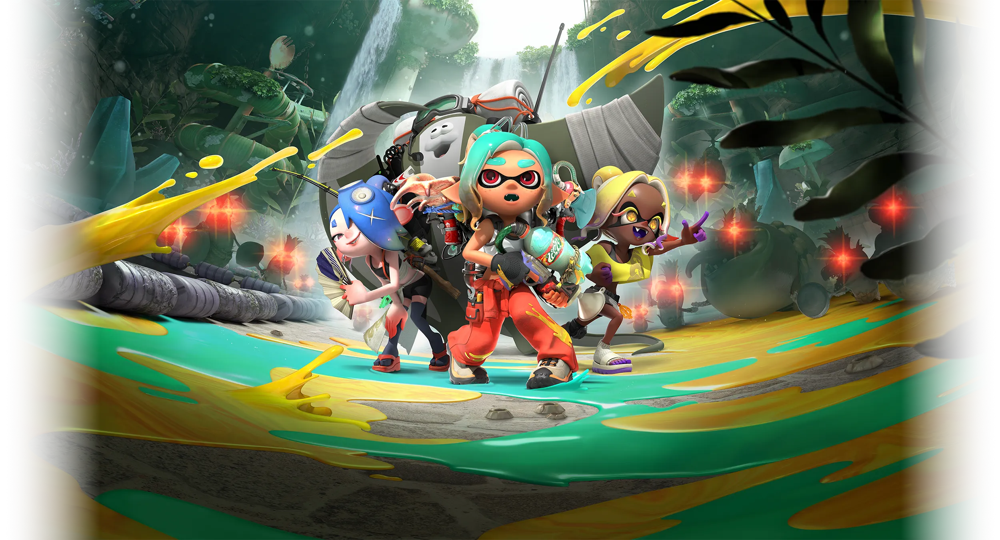
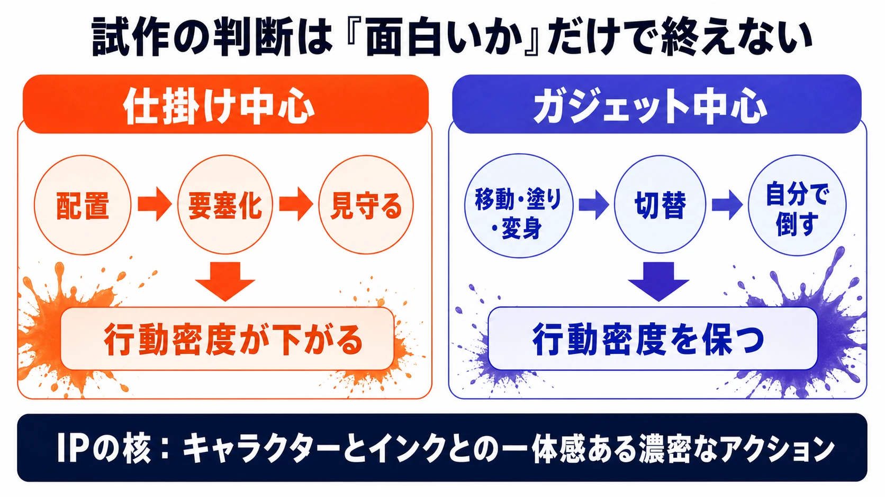
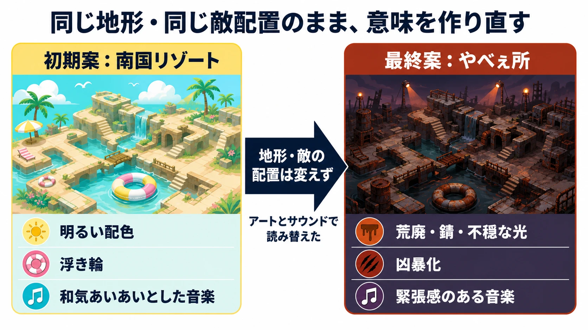

# 『スプラトゥーン4』ではなくスピンオフを選んだ理由――『スプラトゥーン レイダース』の二つの方向転換から学ぶ設計判断

> 2026年11月26日改版：発売後の販売実績と、『スプラトゥーン3』の更新データの情報を加え、最新の情報に更新しました。内容の変更はGitの履歴から追えます。

任天堂の「開発者に訊きました」で、聞き手が開発陣にこう問いかけた。

> 『スプラトゥーン3』の次に出るのは『4』かと思いきや・・・スピンオフになったのは、なぜでしょうか。 [[1](#ref-1)]

その問いへの答えを、開発中の二つの場面からたどってみたい。ひとつは、次々と迫るシャケを仕掛けで迎え撃つタワーディフェンス型の試作だ。要塞づくりには面白さがあったが、仕掛けが働くのを見守る時間が増えていった。もうひとつは、浮き輪で遊ぶシャケもいた南国リゾート風の島だ。そこで戦うと、試遊した人からシャケがかわいそうだという声が上がった。インクを塗り、泳ぎ、跳び回る手触りをどう残すか。そこにいる相手と戦う理由をどうつくるか。二つの方向転換は、この二つの問いから始まった。[[1](#ref-1)][[2](#ref-2)]

『スプラトゥーン レイダース』は2026年7月23日にNintendo Switch 2向けに発売された。本稿でたどるのは、そこに至るまでの設計判断と、発売後の販売実績や本編とのつながりである。発売後の評価は扱わない。[[3](#ref-3)]

出典：任天堂「[スプラトゥーン レイダース ｜ Nintendo Switch 2][3]」（© Nintendo）

***

## 1. スピンオフで、シリーズへの入口を増やす

『スプラトゥーン』は、インクを使って陣地を塗り合うアクションシューティングとして始まり、初代から11年以上で3作とアップデートを積み重ねてきたシリーズである。『スプラトゥーン レイダース』は、その基本操作を引き継ぎながら、ひとりでアクションを掘り下げる作品として設計されている。[[1](#ref-1)]

プロデューサーの井上精太氏は、4人で協力してシャケを倒し金イクラを集める「サーモンラン」や、ひとりで進めるストーリーモードにも、シリーズを好きになるきっかけがあると見ていた。そうした遊びを独立した作品に育てれば、対戦に馴染めなかった人にも新たな入口をつくれる。対戦の遊びづくりも引き続き進める。その両方をかなえる形がスピンオフだった。[[1](#ref-1)]

これはブランドの約束を二つに分ける設計である。ナンバリング作品には、競技性を含む対戦の進化を期待する人がいる。一方で、インクを塗り、泳ぎ、跳び回る操作の手触りやキャラクターを好きでも、対戦の緊張感には入りにくい人もいる。両者に一つの作品だけで応えようとすると、主力シリーズの期待を薄めるか、新しい層への説明を後回しにするかの二択になりやすい。

スピンオフは、その二択をほどく。何を独立させれば、別の遊び方に十分な密度を与えられるかを考える余地が生まれる。本作では、サーモンランを起点にした「大量の敵をひとりでさばく」アクションを主役に据えた。すりみ連合は『スプラトゥーン3』で登場したフウカ、ウツホ、マンタローの3人組であり、本作では新主人公メカニックとともに島を探索する。シリーズの人物や操作感を橋にしながら、対戦とは別の目的で新規プレイヤーを迎える構造だ。[[1](#ref-1)][[3](#ref-3)]

ファミ通の国内週間ランキング（2026年7月20〜26日）では、発売週の推定販売本数は47万4,684本で、初登場1位だった。任天堂が11月5日に発表した2027年3月期第2四半期の決算説明資料では、9月末までの世界販売本数は242万本。こちらはセルインで、任天堂グループから取引先などへの販売に加え、直販サイトでの個人向け販売やダウンロードソフトの販売も含む。[[4](#ref-4)][[5](#ref-5)]

対戦の遊びづくりも続いた。『スプラトゥーン3』は8月20日配信のVer.11.3.0で対戦バランスを調整し、『レイダース』の「PETシューター」を模した「PETシューター レプリカ」を追加した。同じ本体に『レイダース』のメインストーリーをクリアしたセーブデータがあれば、そのデータを保存したユーザーで『スプラトゥーン3』を起動し、ロビー端末で受け取れる。島の冒険と本編の対戦は、それぞれに入口を持ち、冒険で使ったブキのレプリカでつながった。[[6](#ref-6)]

11月18日配信のVer.12.0.0では、対戦モードの「Xマッチ」にフレンドと2人1組で参加できる仕組みも加わった。試験導入は2026年12月に始まる「2026冬 Chill Season」からである。[[7](#ref-7)][[8](#ref-8)]

***

## 2. 転換①：「面白い試作」をIPの核で止める

サーモンランは、4人での協力を前提に敵が設計されている。これをひとり用に翻案する最初の試作は、フィールドに多数の仕掛けを配置し、迫るシャケを迎え撃つタワーディフェンス型だった。仕掛けを組み上げ、要塞を築く遊びには明快な面白さがある。しかし突き詰めるほど、プレイヤーは要塞を整えた後に見守る時間が増えた。[[1](#ref-1)]

この段階で開発チームが優先したのは、プレイヤー自身が動き続ける手応えだった。ディレクターの伊藤慈彦氏は、「スプラトゥーン」の長所を、敵と戦いながら地面を塗り、イカになり、飛び移るような短時間で多くのアクションを行う濃密さとして捉えた。井上氏も、キャラクターやインクとの一体感を伴う濃密なアクションがあれば、対戦か否かを問わず「スプラトゥーンを遊んでいる」感覚になると語る。仕掛け中心の遊びには、この条件を満たしにくい問題があった。[[1](#ref-1)]

そこで設計の主語を、配置物からプレイヤーへ戻した。プレイヤーの行動を大きく拡張する「ガジェット」を中心に据え、突進、跳躍、浮遊などをブキと組み合わせ、複数のガジェットを切り替えながら大量のシャケに対処する構成へ転換した。ガジェットは成長・カスタマイズもできるが、ルール面では金イクラをコンテナへ納品する要素を外し、拾う行為だけを残して、濃密なアクションへの集中を優先している。[[1](#ref-1)]

「既存IPらしさ」は、プレイヤーが何をして時間を過ごすかにも表れる。インクやシャケが出ていても、プレイヤーの主要な時間が待機と観察へ移れば、体験の核は変わる。逆に、対戦がなくても、移動、照準、塗り、変身といった操作が短い間隔で連鎖し、身体感覚を伴うなら、シリーズらしさは保てる。

試作を続けるか切り替えるかを決める際には、次の問いが有効である。

| 問い | 見るべきもの | 本作での判断 |
| --- | --- | --- |
| プレイヤーは何を繰り返し手で行うか | 操作頻度と行動の主語 | 仕掛けを見守るのではなく、ブキとガジェットを使い分ける |
| その反復はIP固有の手触りを生むか | 操作とキャラクターの一体感 | インク、変身、移動、攻撃が短い間隔で連鎖する状態を守る |
| 既存ルールは目的に必要か | ルールが行動密度を下げていないか | 金イクラの納品を外し、拾得と戦闘へ絞る |

プロトタイプの面白さに加えて、既存IPの派生作品では、「この作品でプレイヤーが自分の手で何をし続けるか」を、シリーズの核と照合する必要がある。そこがずれたなら、実装量が少ない時期ほど切り替える価値が高い。

*図：試作は面白さに加え、プレイヤーの行動密度とIP固有の操作感で評価する。*

***

## 3. 転換②：「かわいそう」を動機づけの破綻として受け取る

二つ目の転換は、島に足を踏み入れたプレイヤーが、そこで戦う理由をどう受け取るかという問題から始まった。ウズシオ諸島は、既存シリーズの街から切り離したスピンオフの舞台として、当初から島に定められた。初期のコンセプトアートは、浮き輪で遊ぶシャケもいる、明るく爽やかな南国リゾート風の無人島だった。[[2](#ref-2)]

だが、その場所でプレイすると、楽しく暮らしているシャケを一方的に倒し、大事な宝を奪っているように見えた。シャケを生き物として親しみやすく描いたこともあり、試遊した人から「シャケがかわいそう」という反応が繰り返し出たという。その反応は、敵を倒し、報酬を得るというプレイの目的自体が、感情面で受け入れにくくなっていたことを示していた。音楽も冒険感のある和気あいあいとした方向だったため、敵を倒す行為の意味がさらに曖昧になった。[[2](#ref-2)]

プランナーがこの種の反応を受けたとき、「かわいくしすぎた」とだけ処理すると修正が表層で終わる。ここで翻訳すべき設計言語は、少なくとも三つある。

1. **敵対の理由**：なぜプレイヤーは戦うのか。相手は脅威として理解できるか。
2. **失敗の納得感**：負けたとき、プレイヤーは自分の未熟さだけでなく、その場所や敵の危険さを受け取れるか。
3. **報酬の意味**：探索で得るものは、島の設定の中でどう位置づくか。

伊藤氏によると、本作は遊び始めに敵が強く、負けを重ねながら成長し、やがて突破できるようになる。だからこそ、島に足を踏み入れたときから「島や敵がやばい」と伝わることに意味があった。手ごわい相手に出会ったという実感が、序盤の敗北を受け入れる手がかりになったのである。[[2](#ref-2)]

本作では、地形の大まかな特性や敵のラインナップはすでに変えにくい段階だった。そこでチームは「やべぇ所に来ちまった」を共通のキーワードにし、周囲のオブジェクト、ライティング、敵の見せ方、音楽までを再設計した。初期のウォータースライダーのような地形は残しつつ、壊れ、荒廃し、錆びたものへ変えた。島の不思議な塩によってシャケが凶暴化する設定を置き、危険な場所に踏み込んだという感触を、アートとサウンドの両面から作った。[[2](#ref-2)]

このピボット（方向転換）では、地形や敵の大枠を生かしながら、そこで戦う意味を変えた。背景、光、敵の振る舞い、音、収集物の意味を一つの方向へ揃えれば、同じ地形でも「楽しいリゾートを荒らす」体験から、「危険な場所に踏み込み、危険な敵を突破する」体験へ読み替えられる。

アートディレクターの園山耕司氏らは「やべぇ所」という短い言葉を起点に、地殻変動で海と山のものが混ざる不自然さや、居心地の悪さを形にした。作曲担当者がそれに合う音を提示し、サウンドディレクターの田村集氏は、シャケにとっては心地よくても、イカやタコには異様に響くという感触を大切にしたと振り返る。制約下のピボットでは、抽象的な違和感を、各職能が判断できる共通語に圧縮することが重要になる。[[2](#ref-2)]

*図：大枠の地形と敵配置を保ったまま、環境表現と音でプレイの意味を読み替える。*

***

## 4. 難易度と救援を、非対戦の入口として組み込む

対戦ゲームは、プレイヤー同士の腕前の差が結果に表れやすい。本作はそこから離れ、プレイヤーの成長によって主人公メカニックが強くなるひとり用の進行を用意した。加えて「トラベラー」「レイダー」「サバイバー」の3段階を選べる難易度設定を導入している。井上氏は、これを「スプラトゥーン」シリーズとして初の難易度選択だと説明する。各難易度で、気持ちのよい忙しさと成長の達成感を味わえるように調整したという。[[9](#ref-9)]

この設計は、入門者が自分に合った速度で忙しさに慣れていくためのものだ。難易度が戦闘の圧力を調整し、装備と操作の両方で徐々にできることを増やすなら、シリーズ経験の差を、上達の過程へ置き換えられる。[[1](#ref-1)][[9](#ref-9)]

さらに、オンラインの「ヘルプ」機能では、進行度が違うプレイヤー同士で遊んでも、それぞれのレベルに合わせてプレイヤーと敵の強さが調整される。腕前や進行度の差があっても、始めたばかりの人が戦闘に加わり、協力の手応えを持てるようにする仕組みである。非対戦スピンオフの入口を広げるなら、「遊べる」と「助けを求められる」を別の機能として用意する必要がある。[[9](#ref-9)]

***

## 5. 小さな遊びを、人材育成の場にもする

アジト船で遊べる2Dミニゲームは、若手中心で社歴の浅いスタッフがチームを組んで開発し、シリーズのゼネラルプロデューサーである野上恒氏が協力する形を取った。野上氏はドット絵を描き、ブラウン管テレビ風の表示について若いスタッフへ説明も行ったという。[[9](#ref-9)]

作品の中で独立性が高い小さな遊びが、次の世代にとって自分たちでつくり切る機会になった。井上氏は、初代『スプラトゥーン』を10代で遊んでいた人が開発チームに入り、いま一緒にゲームをつくっていると語る。シリーズを初代から遊んできた世代が開発に加わる時期には、過去の手触りを知る人たちにも、自分たちで仕様を決め、試し、古い表現の理由を先輩から受け取る場が要る。[[9](#ref-9)]

長く続くIPで次の作り手を育てるなら、完成品の品質を守りながら、企画から実装までを任せられる小さな単位があるとよい。ミニゲームで得た判断と技術は、いずれ本編の新しい遊びを託すときの蓄積になる。

***

## 6. おわりに：ピボットを三つの判断として残す

『スプラトゥーン レイダース』は、対戦の開発を続けながら、ひとりでじっくり遊びたい人にも独立した入口を開いた。その入口で「スプラトゥーンを遊んでいる」と感じられるように、どの操作を重ね、どんな場所で戦うかを、試作から決め直していった。[[1](#ref-1)]

要塞を見守った時間と、明るい島でシャケと戦ったときの違和感から、企画を見直す三つの判断基準が見えてくる。

1. **「IPらしさ」を主要行動で判定する。** 試作が成立していても、プレイヤーの大半の時間がIPの核から離れるなら、記号や設定だけでは補えない。本作では、仕掛けを置く遊びから、プレイヤー自身が動き続けるガジェット中心の遊びへ転換した。[[1](#ref-1)]
2. **感情的な反応を、設計上の問題へ翻訳する。** 「シャケがかわいそう」という反応を起点に、敵対の理由、失敗の納得感、報酬の意味が噛み合っているかを見直せる。[[2](#ref-2)]
3. **制約下では、アートを体験の意味に接続する。** 地形と敵の大枠が固まっていても、環境、光、敵の印象、サウンドを一つのコンセプトへ揃えれば、プレイヤーがその場所で何をしているのかを立て直せる。[[2](#ref-2)]

見張っていた要塞からは、プレイヤー自身が動き続ける戦い方が見えてきた。明るい島にあったウォータースライダーは、荒れた島にも残った。試作とテストを重ねると、その案がどんな体験を支え、どこでつまずくかが見えてくる。シリーズの入口を増やすとき、残すものと作り直すものを決める手がかりは、プレイヤーがその場で何をし、どう感じるかにある。

***

## References

1. [任天堂「開発者に訊きました : スプラトゥーン レイダース」][1] — 任天堂公式サイト、2026年7月21日。第1章「究極のワンオペ」。

[1]: https://www.nintendo.com/jp/interview/aadla/index.html

2. [任天堂「開発者に訊きました : スプラトゥーン レイダース」][2] — 任天堂公式サイト、2026年7月21日。第2章「やべぇ所に来ちまった」。

[2]: https://www.nintendo.com/jp/interview/aadla/02.html

3. [任天堂「スプラトゥーン レイダース ｜ Nintendo Switch 2 ｜ 任天堂」][3] — 任天堂公式サイト、公開日記載なし。公式商品ページ。

[3]: https://www.nintendo.com/jp/games/switch2/aadla/index.html

4. [ファミ通.com「【ソフト＆ハード週間販売数】『スプラトゥーン レイダース』が47万本を売り上げ首位スタート！ 国内累計販売本数では『トモコレ わくわく生活』が150万本、『マリオカート ワールド』が300万本を突破【7/20～7/26】」][4] — ファミ通.com、2026年7月30日。推定販売本数はパッケージソフト、ダウンロードカード、本体プリインストール版の合算。

[4]: https://www.famitsu.com/article/202607/82960

5. [任天堂「2027年3月期第2四半期　決算説明資料」][5] — 任天堂 株主・投資家向け情報、2026年11月5日。5ページ「ハードウェアおよびソフトウェアの主な販売状況（セルイン）」。

[5]: https://www.nintendo.co.jp/ir/pdf/2026/261105_3.pdf

6. [任天堂「スプラトゥーン3 更新データ」][6] — 任天堂サポート、2026年8月20日。Ver. 11.3.0「対戦に関する変更」。

[6]: https://support.nintendo.com/jp/switch/software_support/av5ja/1130.html

7. [任天堂「スプラトゥーン3 更新データ」][7] — 任天堂サポート、2026年11月18日。Ver. 12.0.0「Xマッチに関する変更」。

[7]: https://support.nintendo.com/jp/switch/software_support/av5ja/1200.html

8. [任天堂「『スプラトゥーン3』の更新データVer.12.0.0を本日配信。さまざまなアイテムが手に入るゲームニュースも配信中。」][8] — Nintendo トピックス、2026年11月18日。Xマッチへのペア参加の試験導入時期。

[8]: https://www.nintendo.com/jp/topics/article/405b3f79-3dfb-4336-baae-5256a086eb35

9. [任天堂「開発者に訊きました : スプラトゥーン レイダース」][9] — 任天堂公式サイト、2026年7月21日。第3章「多才な主人公」。

[9]: https://www.nintendo.com/jp/interview/aadla/03.html

----

この文書は、Perplexity、Claude、ChatGPT の3つのAIの支援を受けて著述されたものです。引用画像を除き、MIT License にて提供されています。
