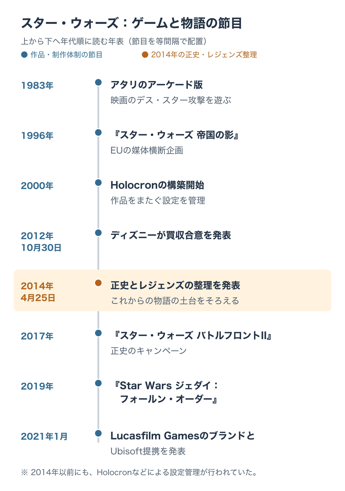

# その結末は、大きな物語の中で一つに決められるか――『スター・ウォーズ』の正史・レジェンズとゲームの関係

## はじめに――映画を見てきた編者の疑問

編者は『スター・ウォーズ エピソード4／新たなる希望』から、映画を全作、映画館で見てきた。とてもワクワクしていたことを、よく覚えている。一方で、最近の「正史」と「レジェンズ」の区分けはごちゃごちゃしていて、どういうことなのかと思っている。この記事は、その疑問をほどくために書く。

まず、正史（カノン）とは、シリーズが共通の歴史として扱う物語のことである。レジェンズは、2014年の整理で、それまでに広がっていた小説やコミック、ゲームなどの作品群に付けられた名称だ。「公式のゲームなら全部正史なのか」「映画以外は正史に入らないのか」。この二つの疑問を整理するには、作品に使用許可が出ていることと、その出来事をほかの作品も引き継ぐことを分けて考えるとよい。

そのための判断軸が、 **「その結末は、大きな物語の中で一つに決められるか」** である。これは公式の分類規則を一文で置き換えるものではない。ゲームと一つの歴史の関係を理解するための問いだ。結末が一つなら自動的に正史になるわけでもないが、プレイヤーごとに結果が変わるゲームの何を歴史として共有できるかが見えやすくなる。

映画会社とゲーム会社の関係も、この問いとともに見ていこう。映画の体験を確かめる監修から、映画の外で起きた出来事を一緒に作る仕事へ。2014年の前後で変わったのは、その約束の結び方である。

***

## 映画の名場面を、自分の手で遊ぶ

1983年、アタリはアーケード版『スター・ウォーズ』を送り出した。線で像を描くベクターグラフィックを使い、プレイヤーをXウイングの操縦席へ乗せるゲームだ。コックピット型の筐体と操縦桿、映画の音声が組み合わされ、『新たなる希望』のデス・スター攻撃を自分の操作で体験できた。[[1](#ref-1)]

同作のデザイナー、マイク・ハリー氏は、試作機をスカイウォーカー・ランチへ運んだ際のことを振り返っている。ルーカスフィルムのスタッフが遊び、細かいところまで気にしていたという。現在の正史・レジェンズという線引きよりずっと前から、版権元はゲームの中身を確かめていたのである。[[1](#ref-1)]

日本でも、同作は1983年の第21回AMショーという業界見本市に出展された。『ゲームマシン』同年11月1日号の33ページでは、「アップライト、コックピット型TVゲーム機」部門のランキングで1位に載っている。これは、調査に協力した店舗の設置機種について、各オペレーターが売上げと人気度から判断したデータを同誌が集計し、平均値で順位を付けたものであり、日本全体の販売台数の順位ではない。当時、日本のゲームセンターでも存在感があったことを伝える記録だ。[[2](#ref-2)]

日本で作られた作品としては、X68000版『スター・ウォーズ アタック・オン・ザ・デス・スター』もある。1991年12月17日にビクター音楽産業から発売され、開発はM.N.M Softwareが担当した。[[3](#ref-3)] 線だけで立体を描くワイヤーフレームで、同じく『新たなる希望』のデス・スター攻撃をゲームにした作品であり、音楽家の古代祐三氏も参加している。これはアタリ版の移植ではなく、日本の開発者が作った別作品だ。[[4](#ref-4)]

編者は、アタリ版とX68000版のどちらも、ベクターグラフィック・ワイヤーフレームを採用し、当時の限られたマシン性能をフルに使った良作だと評価する。

この二作を理解する入口は、「映画の名場面を遊ぶ」ことである。映画では決まっている出来事に、操縦や照準合わせという自分の行為が加わる。失敗したプレイのたびに、映画の歴史が別の結末へ更新されるわけではない。遊びの成功と失敗は、映画で共有された物語とは役割が違う。

ここでいう昔とは、現在の二つの区分がなかった時代のことだ。設定への配慮まで存在しなかったわけではない。ただ、この二作の魅力を受け取るうえで、「このゲームが映画の歴史に新たな事実を加えるのか」という問いは前面に出てこない。映画で見た冒険を、自分の手で成立させることが中心だった。

***

## 映画の外へ広がる物語――EUとHolocron

やがて、小説・コミック・ゲームは、映画の前後や合間にも物語を広げていく。こうしたスピンオフ作品群をExpanded Universe、略してEUと呼ぶ。映画の外にも、同じ銀河で生きる人物や事件が積み重なっていった。

その展開を象徴するのが、1996年の『スター・ウォーズ 帝国の影』（Shadows of the Empire）企画である。映画を作らずに、小説・コミック・ゲームなど複数の媒体を連動させた。同作でプロジェクトリーダーを務めたマーク・ヘイグ＝ハッチンソン氏の振り返りにも、この横断的な企画の一部として制作したことが記されている。ゲームは日本では『スター・ウォーズ 帝国の影』として発売された。[[5](#ref-5)][[6](#ref-6)]

映画の場面を再現するゲームでは、主な出来事の行き先は映画にある。映画の隙間へ物語を加えるゲームでは、そこで生まれた人物や事件が、別の作品にとっての前提にもなりうる。ゲームは映画を追体験させるだけでなく、銀河の歴史を書き足す媒体にもなったのである。

こうして増える設定を支えたのが、ルーカスフィルムのデータベース「Holocron」だ。担当者のリーランド・チー氏は、2000年1月にこのデータベースを作るために採用された。2012年7月の本人の記事によれば、登録は5万5,000件を超え、オンラインRPG『Star Wars: The Old Republic』の情報も加えられていた。[[7](#ref-7)]

Holocronは、人物や場所の名前を集めるだけでなく、作品間の食い違いも追跡する仕組みだった。ひとつの小説の出来事がコミックやゲームに影響するなら、別々の制作者が同じ情報にたどり着ける必要がある。映画の外に広がるほど、共有するための仕事も大きくなる。[[7](#ref-7)]

ただし、設定を整理することと、映画の制作者が今後の展開をすべてその設定に合わせることは別である。2014年の公式説明も、EUの整合性を保つ努力を続けてきた一方で、ジョージ・ルーカス氏自身はEUに拘束されない立場だったと説明している。映画とその外の作品には、以前から関係の違いがあった。[[8](#ref-8)]

2014年に変わるのは、これから作る複数の媒体が、どの物語を共通の土台として進むかという方針である。

***

## 2014年、これからの物語の土台をそろえる

ディズニーがルーカスフィルムの買収合意を発表したのは、2012年10月30日である。同時に、新たな映画を作る方針も示された。[[9](#ref-9)] 続きの映画を作るとき、すでに映画の後の時代を描いていたEUをどう扱うか。その整理が、2014年4月25日のStarWars.comの発表につながる。

発表は、映画6作とアニメ『スター・ウォーズ／クローン・ウォーズ』を、ほかの物語が合わせる動かない土台として示した。それまでのEUは「レジェンズ」という名称のもとで刊行を続け、新たな映画は従来のEUと同じ筋書きをたどるものにはしないとした。[[8](#ref-8)]

以後の制作を横断して調整するのが、ストーリーグループ、すなわち映画・テレビ作品・小説・コミック・ゲームの物語をつなぐルーカスフィルムのチームである。個々の作品を作る人々が、同じ大きな物語の中で仕事を進める体制が示された。[[8](#ref-8)]

レジェンズという区分は、従来の作品を読む価値が消えたという意味ではない。過去の物語は作品として残り、新しい物語の作り手もその要素を利用できる。ただし、従来の筋書きすべてを、新しい映画やゲームが引き継ぐ約束からは外したのである。[[8](#ref-8)]

読者の側から言えば、レジェンズを楽しむことと、新作の予習として読むことは目的が違う。その作品の中で完結する冒険は楽しめる。一方、そこに登場した人物の運命が、新しい映像作品でも同じになるとは限らない。区分を知ることは、どの作品を好きになってよいかを決めることではなく、何を次の作品へ持ち越せるかを知ることだ。

*節目は等間隔で配置しており、年の隔たりは距離に対応しない。出典：[[1](#ref-1)]、[[5](#ref-5)]、[[7](#ref-7)]〜[[9](#ref-9)]、[[11](#ref-11)]、[[12](#ref-12)]、[[18](#ref-18)]、[[19](#ref-19)]。*

***

## 承認と正史を分ける――ゲームには複数の結果がある

ここからが、ゲームを考えるうえでの核心である。版権元の承認を受けたことと、その物語が正史になることは、別の判断だ。

2015年のイベント「Star Wars Celebration」で行われた「One Big Story」パネルを、/Filmが報じている。そこでは、ストーリーグループが関わっていても、すべてが完全に正史になるわけではないと説明された。複数の結末を持つゲームや、さまざまな要素を混ぜるLEGOのゲームが例に挙がっている。こうした作品でも、キャラクターらしさを保つ「Authenticity」の承認は行われる。[[10](#ref-10)]

ここには、二種類の約束がある。一つは「この人物なら、こう話し、こう振る舞う」という約束。もう一つは「この事件が起こり、この結果になったことを、ほかの作品も共有する」という約束だ。前者を守りながら、大胆に遊びを組み立てる作品も成立する。後者まで引き受けると、そのゲームの出来事が、以後の制作で参照される土台になる。

同じパネルでストーリーグループのパブロ・ヒダルゴ氏は、物語がサルラックの中から連れ出すまでは、ボバ・フェットは生きても死んでもいる、という趣旨の喩えを示した。これは2015年当時、まだ物語で確定していない事柄を説明したものだ。[[10](#ref-10)] 新しい物語が答えを示すことには、以後の選択肢を決める働きがある。ゲームの結末も、その答えを担う場合がある。

たとえば、ある重要人物を救う結末と失う結末を、プレイヤーの選択で用意したとする。どちらも優れたゲーム体験になりうる。しかし、後の映画でその人物を登場させるなら、どうなった人物なのかを共有しなければならない。これは作品の出来の良し悪しとは別に生じる問題だ。

「その結末は、大きな物語の中で一つに決められるか」という問いは、そこで役立つ。分岐があること自体に問題があるのではなく、分岐した結果のうち、どこまでをほかの作品も引き継ぐのかを決める必要があるのである。

***

## 正史のゲームは、遊びながら共通の歴史を作る

### 『バトルフロントII』では、キャンペーンを見る

『スター・ウォーズ バトルフロントII』（2017年）のキャンペーンは、その具体例だ。Xbox Wireは発売前の紹介で、シングルプレイの物語を公式の正史として説明している。映画の間をつなぐ出来事を、ゲームで語るのである。[[11](#ref-11)]

ここで見るべき単位は「キャンペーンの物語」である。同じ商品に対戦モードがあっても、プレイヤー同士の一戦一戦の勝敗まで、銀河の共通の歴史になるとは読み取れない。商品名に正史という札を一枚付けるより、「どの物語についてそう説明しているか」を読むほうが、混乱が少ない。

マルチプレイは、何度も違う勝者が生まれることに意味がある。その楽しさを保つための結果と、後の映画も前提にする出来事とは、分けて設計できる。同作の別の論点については、[課金問題を扱った記事](battlefront-2-loot-box-controversy.md)を参照してほしい。

### 『フォールン・オーダー』では、決定の影響が外へ広がる

『Star Wars ジェダイ：フォールン・オーダー』（2019年）では、ルーカスフィルムとの協働が、制作側の言葉からも見える。開発元Respawn Entertainmentの当時のCEO、ヴィンス・ザンペラ氏は、Varietyのインタビューで、銀河全体を管理するのはストーリーチームであり、自分たちはその小さな一部だと説明している。ゲーム内でよい決定かを考える開発側に対し、相手はその決定が全体にどう影響するかを考えるという。[[12](#ref-12)]

同氏が述べるのは、何度も意見をやり取りする関係である。ゲームの中で作ったものが、シリーズ全体にも波及しうる。そのため、場面単位の面白さと、大きな物語の中での位置をすり合わせる仕事になる。[[12](#ref-12)]

同作のディレクター、スティグ・アスムッセン氏も、StarWars.comのインタビューで、物語や登場人物、話の流れを組み立てる各段階でルーカスフィルムの大きな助けがあったと述べている。完成品を最後に確認するだけでなく、物語の土台から共同で作る関係がうかがえる。[[13](#ref-13)]

このゲームは、ひとりの主人公の旅を描くシングルプレイ作品である。[[14](#ref-14)] プレイヤーが戦闘や探索を担いながら、物語の主要な出来事を共有できる形は、正史としてほかの媒体と接続する際にも理解しやすい。

### 自由にする場所と、共有する場所を決める

ゲームの自由には、いくつかの種類がある。攻撃を避けるか受け止めるか、どの道から探索するか、どんな順番で目的を果たすか。こうした遊び方の違いは、主要な結末を共有する物語とも組み合わせられる。

一方、主人公の出自や信条を自由に作り、誰と協力するか、誰を救うかまで大きく変えられると、次の作品が受け取る人物像も変わる。自由が増すほど、そのうち何をシリーズ共通の事実にするかという相談が必要になる。プレイヤーに選んでもらう範囲と、後の作品に渡す範囲を、企画の段階で見定める仕事だ。

たとえば、敵の拠点へ入る方法を複数用意しても、任務の結果が同じなら、次の物語はその結果から始められる。反対に、銀河の勢力図が結末ごとに変わるなら、後の作品の出発点も分かれる。どちらを選ぶかによって、必要な調整の広さが変わる。この例は特定作品の分類ではなく、ゲームの企画を考えるための整理である。

だから、結末が一つという条件だけで正史を判定してはいけない。一つに決めた出来事を、シリーズ側が共通の歴史として受け入れていることが必要だ。同時に、正史のゲームだからといって、プレイヤーの全操作を一つにそろえる必要もない。何を遊びとして変えられ、何を物語の約束として共有するか。その境界が重要なのである。

***

## レジェンズから、必要な要素を拾い直す

レジェンズと新しい正史の間には、要素を取り入れる道もある。2014年の公式発表は、『スター・ウォーズ 反乱者たち』の尋問官などに、1980年代のロールプレイングゲーム資料に由来する要素を取り入れていると説明した。[[8](#ref-8)]

もう一つ分かりやすいのが、スローン大提督である。2016年の公式発表は、レジェンズで人気のあったこの人物が、『反乱者たち』シーズン3に登場すると告知した。[[15](#ref-15)] 過去に親しまれた人物や発想を、新しい物語に組み込むことはできるのである。

ただし、人物が登場したことと、その人物を扱った昔の物語がすべて正史になることは分けて考えたい。新作が引き継ぐのは、その新作で採用した人物像や出来事だ。名前が同じだから過去の展開も全部前提にできる、と考えると再び混乱する。

プランナーにとっては、過去の資産を使うときにも、新しい作品でどこまでを約束するかを決めるという話になる。親しまれた特徴を生かしながら、今後の物語に接続する形を作る。レジェンズは、その発想や人物に再び出会える蓄積でもある。

***

## 開発の契約と、物語の管理は別の線で動く

最後に、ゲームを誰が作るかという権利の流れも整理しておこう。2013年4月3日、LucasArtsは社内開発からライセンス中心へ移る方針を示した。[[16](#ref-16)] 同年5月6日には、ディズニーとEAが、コアなゲームファン向けの新作を開発・販売する複数年の独占ライセンス契約を発表した。一方、モバイルやソーシャル、タブレット、オンラインの一部の権利はディズニーが保持した。[[17](#ref-17)]

2021年1月11日には、「Lucasfilm Games」がルーカスフィルムのゲーム作品を示すブランドとして改めて発表される。[[18](#ref-18)] 1月13日にはUbisoftとの新作オープンワールドゲームの提携を発表した。[[19](#ref-19)] のちの『スター・ウォーズ 無法者たち』である。[[20](#ref-20)][[21](#ref-21)]

当時、この発表はEA独占の終わりへ向かう動きとして報じられたが、契約がその日に失効したと断定することはできない。公式説明ではEAとの協力も継続するとされていた。[[22](#ref-22)][[23](#ref-23)] ここで押さえたいのは、開発・販売の相手を広げることと、正史をどう管理するかは、別の論点だということである。

***

## プランナーが企画の初めに確かめること

他社の大きな物語の中でゲームを作るなら、面白い遊びと、その遊びが残す出来事を一緒に考えたい。最初に確かめる項目は、次の四つに整理できる。

- **物語の位置づけ**：正史として新しい出来事を加える企画なのか。キャラクターらしさの承認を得て、自由な組み合わせを楽しませる企画なのか。対戦とキャンペーンがある場合は、それぞれについて確認する。
- **結末と選択の範囲**：シリーズ全体で結末を一つにする必要があるか。分岐するなら、人物の生死や所属など、何をほかの作品へ引き継ぐのか。操作や攻略の自由と、歴史を変える自由を分けて話す。
- **使える時代と登場人物**：どの時代を舞台にでき、誰を登場させられるか。既存作品だけでなく、今後の制作予定との関係で、使えない範囲があるかも確認する。
- **確認の段取り**：あらすじ、人物設定、会話、演出、実装した場面を、誰がどの時点で確認するか。確認の回数、返答までの日数、変更が出たときの戻り先も、制作日程に含める。

これらは制約を数えるためだけの項目ではない。何を任せてもらえるかを早く知れば、企画の強みをそこへ集中できる。自由な対戦を中心にするなら、繰り返して違う結果が出る楽しさを磨ける。正史の新しい冒険を担うなら、共有する結末へ至るまでの操作、探索、人物との時間を磨ける。

プレイヤーが自分で起こしたと感じる出来事と、シリーズが次の作品へ渡す出来事。その二つをどう重ねるかは、ゲームならではの設計課題だ。版権元との相談も、その重ね方を決める制作の一部になる。

編者が感じた「正史とレジェンズはごちゃごちゃしている」という疑問も、作品名の仕分けだけを追うと解けにくい。映画の名場面を遊ぶゲームがあり、映画の外へ物語を足すゲームがあり、自由な組み合わせを楽しむゲームもある。それぞれで、ほかの作品に渡す約束が違うのである。

区分は、物語の約束を守るための線だった。その線を見つけるときは、いつ作られたかを入口に、ストーリーグループが何を確認したか、どの物語が正史と説明されているかをたどる。そして「その結末は、大きな物語の中で一つに決められるか」と問う。その見方があれば、すべての作品を暗記しなくても、自分が楽しんでいるゲームと、大きな銀河の物語との距離がつかめる。

## References

1. [Ryan Lambie「Atari’s Star Wars 1983 coin-op ｜ remembering a masterpiece of arcade tech」][1] — Film Stories、2023年5月4日。Mike Hally氏の回想を掲載。

[1]: https://filmstories.co.uk/features/atari-star-wars-1983-coin-op-a-masterpiece-of-arcade-tech/

2. [アミューズメント通信社「ゲームマシン 第223号」][2] — ゲームマシン、1983年11月1日。第21回AMショーの記事、および33ページの「アップライト、コックピット型TVゲーム機」部門。PDFの17枚目に32・33ページを収録。

[2]: https://onitama.tv/gamemachine/pdf/19831101p.pdf

3. [Time Extension「Star Wars: Attack on the Death Star (1991) ｜ Sharp X68000 Game」][3] — Time Extension、日付記載なし。発売日、発売元、開発元を参照。確認日：2026年10月27日。

[3]: https://www.timeextension.com/games/x68000/star_wars_attack_on_the_death_star

4. [みお「EP4の名シーンを日本の開発者がゲーム化！古代祐三氏も参加の『スター・ウォーズ アタック・オン・ザ・デス・スター』はこだわり光る傑作STG【STAR WARSゲームを遊んでみよう】」][4] — インサイド、2024年5月4日。

[4]: https://www.inside-games.jp/article/2024/05/04/155144.html

5. [Mark Haigh-Hutchinson「Classic Postmortem: Star Wars: Shadows Of The Empire」][5] — Game Developer（旧Gamasutra）、2009年4月6日（再掲）。開発者による振り返り。冒頭と「Why Shadows?」を参照。

[5]: https://www.gamedeveloper.com/game-platforms/classic-postmortem-i-star-wars-shadows-of-the-empire-i-

6. [任天堂「スター・ウォーズ 帝国の影」][6] — 任天堂、日付記載なし。日本語版の作品名を参照。確認日：2026年10月27日。

[6]: https://www.nintendo.co.jp/n01/n64/software/nus_p_nswj/index.html

7. [Leland Chee「What is the Holocron?」][7] — StarWars.com、2012年7月20日。件数は記事掲載当時。

[7]: https://www.starwars.com/news/what-is-the-holocron

8. [Lucasfilm「The Legendary Star Wars Expanded Universe Turns a New Page」][8] — StarWars.com、2014年4月25日。正史の土台、ストーリーグループ、レジェンズの刊行と要素の再利用を参照。

[8]: https://www.starwars.com/news/the-legendary-star-wars-expanded-universe-turns-a-new-page

9. [The Walt Disney Company「Disney to Acquire Lucasfilm」][9] — The Walt Disney Company、2012年10月30日。買収合意の発表日。

[9]: https://thewaltdisneycompany.com/news/disney-acquire-lucasfilm/

10. [Germain Lussier「How The Lucasfilm Story Group Figures Out The Star Wars Canon」][10] — /Film、2015年4月20日。Celebrationの「One Big Story」パネルの現地報道。

[10]: https://www.slashfilm.com/537322/lucasfilm-story-group-star-wars-canon/

11. [Xbox Wire「E3 2017: It Feels Good to be Bad in Star Wars Battlefront II’s Story Mode」][11] — Xbox Wire、2017年6月12日。キャンペーンを公式の正史と説明。

[11]: https://news.xbox.com/en-us/2017/06/12/e3-2017-star-wars-battlefront-ii-story-mode/

12. [Alex Stedman「‘Star Wars Jedi: Fallen Order’: Respawn CEO on Telling the Story Behind ‘Becoming a Jedi’」][12] — Variety、2019年10月17日。Vince Zampella氏へのインタビュー。英語発言の日本語による要約は本稿による（ほかの英語資料も同様）。

[12]: https://variety.com/2019/digital/features/star-wars-jedi-fallen-order-respawn-vince-zampella-lucasfilm-1203373525/

13. [Matt Cabral「Inside the Cinematic Storytelling and Thoughtful Combat of Star Wars Jedi: Fallen Order」][13] — StarWars.com、2019年11月15日。Stig Asmussen氏らへのインタビュー。

[13]: https://www.starwars.com/news/inside-star-wars-jedi-fallen-order-interview

14. [Electronic Arts「STAR WARS ジェダイ：フォールン・オーダー」][14] — Electronic Arts、日付記載なし。日本語版の作品名、発売日、ゲームの形式を参照。確認日：2026年10月27日。

[14]: https://www.ea.com/ja/games/starwars/jedi-fallen-order

15. [Lucasfilm「The Rebels Face Grand Admiral Thrawn When Star Wars Rebels Season Three Premieres Saturday, September 24」][15] — StarWars.com、2016年8月8日。レジェンズで人気を得たスローンの登場を告知。

[15]: https://www.starwars.com/news/the-rebels-face-grand-admiral-thrawn-when-star-wars-rebels-season-three-premieres-saturday-september-24

16. [Reuters「Disney to draw shutters on LucasArts」][16] — Mail & Guardian、2013年4月3日。ルーカスフィルム広報担当者の説明を報道。

[16]: https://mg.co.za/friday/2013-04-03-disney-to-draw-shutters-on-lucasarts/

17. [Electronic Arts／The Walt Disney Company「The Walt Disney Company and EA Announce Multi-Year Star Wars Games Agreement」][17] — Electronic Arts、2013年5月6日。独占ライセンスの対象とディズニーが保持する権利を参照。

[17]: https://news.ea.com/press-releases/press-releases-details/2013/The-Walt-Disney-Company-and-EA-Announce-Multi-Year-Star-Wars-Games-Agreement/default.aspx

18. [Lucasfilm「Lucasfilm Games Begins a New Era」][18] — StarWars.com、2021年1月11日。

[18]: https://www.starwars.com/news/lucasfilm-games

19. [Ubisoft「Ubisoft and Lucasfilm Games Announce New Story-Driven Star Wars Game」][19] — Ubisoft News、2021年1月13日。日本語版も同日公開。

[19]: https://news.ubisoft.com/en-us/article/1NuKtLdz0qhUg3zgvpLqhL/ubisoft-and-lucasfilm-games-announce-new-storydriven-star-wars-game

20. [いーさん「『Star Wars Outlaws』ゲームプレイ先行レポート。オープンワールドで最強で無敵の悪党を目指せ！」][20] — ファミ通.com、2023年6月13日。2021年1月の提携発表との対応を参照。

[20]: https://www.famitsu.com/news/202306/13305903.html

21. [Ubisoft「スター・ウォーズ 無法者たち」][21] — Ubisoft、日付記載なし。日本語の正式タイトルを参照。確認日：2026年10月27日。

[21]: https://www.ubisoft.com/ja-jp/game/star-wars/outlaws

22. [Andy Robinson「EA’s Star Wars exclusivity set to end as Lucasfilm partners with Ubisoft」][22] — VGC、2021年1月13日。発表当日の契約に関する説明を参照。

[22]: https://www.videogameschronicle.com/news/eas-star-wars-exclusivity-is-over-as-lucasfilm-partners-with-ubisoft/

23. [Dan Brooks「Lucasfilm Games Hits Lightspeed Toward the Future」][23] — StarWars.com、2021年1月13日。Douglas Reilly氏へのインタビュー。EAとの協力継続を説明。

[23]: https://www.starwars.com/news/lucasfilm-games-interview

----

この文書は、Perplexity、Claude、OpenAI Codex の3つのAIの支援を受けて著述されたものです。引用画像を除き、MIT License にて提供されています。
