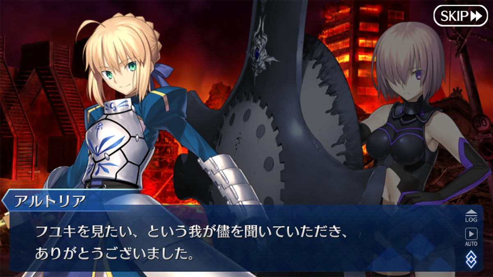
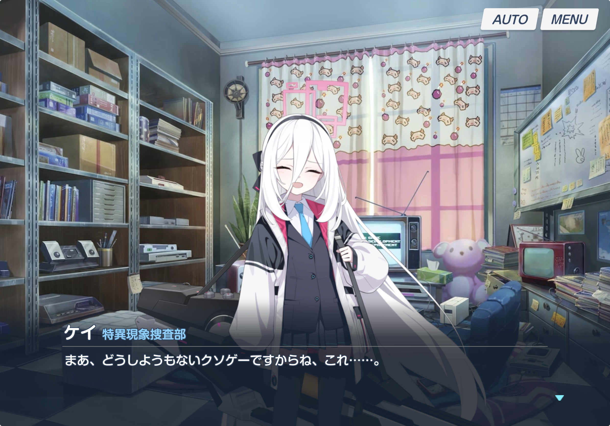
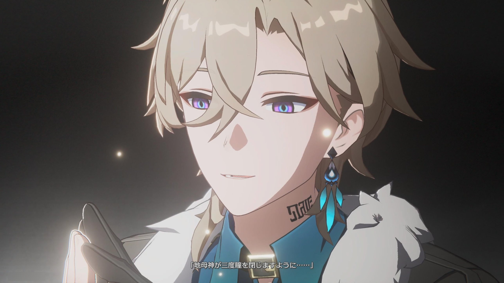
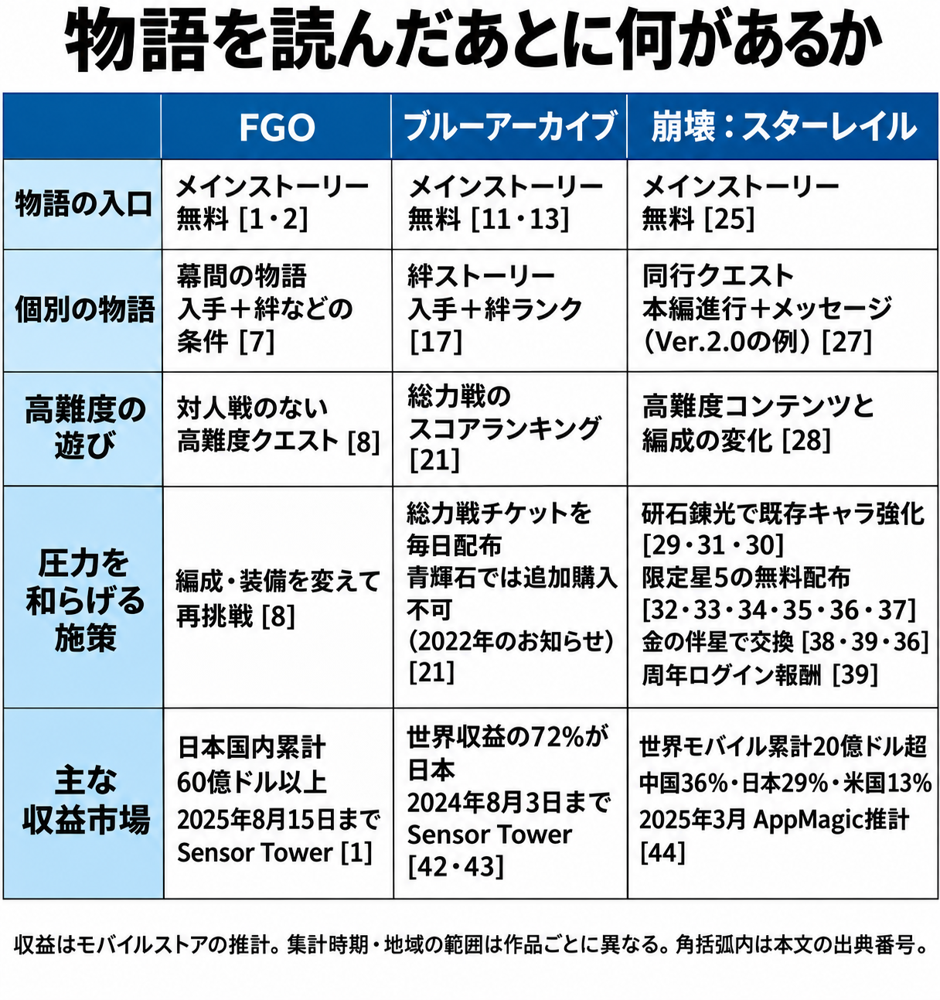

# 「この子を迎えたい」はどこから来るのか――FGO、ブルーアーカイブ、崩壊：スターレイルにみる物語と課金

> 2026年11月22日改版：ブルーアーカイブの運営体制と生徒募集の変更を反映し、出典と後半の考察を見直しました。内容の変更はGitの履歴から追えます。

## はじめに

『Fate/Grand Order』のキャメロットを読み終え、召喚画面を開く。円卓の騎士が並ぶその画面には、ついさっきまで敵として戦った顔もある。どれほど強いかを調べるより先に、あの騎士が何を守ろうとしていたかを思い出す。画面は同じでも、章を読む前とは、そこにいる人物の見え方が違う。

「この子を迎えたい」という気持ちは、どこから来るのか。『Fate/Grand Order』（以下FGO）、『ブルーアーカイブ』、『崩壊：スターレイル』（以下HSR）では、メインストーリーを無料で進められる。そこで出会ったキャラクターを仲間にする手段の一つが、ゲーム内通貨などを使って抽選するガチャだ。迎えた仲間を連れていく先には、育成が進んだプレイヤー向けの難しい遊び、つまりエンドコンテンツもある。物語が育てた愛着は、そこで戦力や順位を求められたとき、どう扱われるのだろう。

***

## 1. Fate/Grand Order――愛着が先、課金が後

*画像引用: [App Store - Fate/Grand Order](https://apps.apple.com/jp/app/fate-grand-order/id1015521325)*

### ストーリーとIP戦略

FGOは『Fate/stay night』から広がったシリーズのスマートフォン向けRPGである。アニプレックスが配信し、現在の開発はラセングルが担う。2015年7月にAndroid版、同年8月にiOS版が配信され、奈須きのこが全体構成を手がける物語は、10周年を越えて続いている[[1](#ref-1)]。第2部は2025年12月の終章で決着し、2026年1月7日に「アフタータイムのはじまり」、6月3日に「運命の三女神編 郷愁永巡刻盤 パスト・カルデア」が開幕した[[2](#ref-2)][[3](#ref-3)][[4](#ref-4)]。

この「物語が先に感情を作る」構造が強く表れた転換点が、第六特異点「神聖円卓領域キャメロット」である。キャメロットでは、プレイヤーは単に円卓の騎士を倒すのではなく、獅子王の理想、円卓の騎士たちの忠義、そしてベディヴィエールが抱え続けてきた悔恨を順に理解していく。敵として登場するサーヴァントにも、それぞれの正義と破綻が与えられているため、戦闘は性能確認の場ではなく「この人物をどう受け止めるか」を迫る場面として機能する。物語を読み終えたあとにガチャ画面で同じサーヴァントを見ると、そこには単なるユニットではなく、章の記憶を背負った人物がいる。

第七特異点「絶対魔獣戦線バビロニア」では、この設計がさらに拡張される。ウルクの市民生活、ギルガメッシュ王の統治、エルキドゥ／キングゥの葛藤、エレシュキガルの孤独といった複数の感情線を積み上げたうえで、終盤の破局へと向かうため、プレイヤーは「世界を救う」以前に「この都市と人々を失いたくない」と感じるようになる。終局特異点ソロモンで過去に出会ったサーヴァントたちが集結する展開も、FGOが長期間の読書体験を資産化していることを象徴している。ガチャで入手したキャラクターは、攻略上の駒である前に「自分が見届けた物語から来た仲間」になる。

第二部ロストベルトでは、さらにプレイヤーの立場そのものが揺さぶられる。異聞帯を攻略することは、別の歴史とそこに生きる人々を剪定することでもあり、勝利が必ずしも道徳的な快感に直結しない。Lostbelt No.6「妖精円卓領域アヴァロン・ル・フェ」では、アルトリア・キャスター、モルガン、オベロンといったキャラクターが、味方・敵・黒幕という単純な分類を越えて、妖精國という閉じた世界の希望と歪みを体現する。こうした章を通過したあと、プレイヤーが彼らを召喚したいと思う理由は「強いから」だけではない。物語の中で一度失われた関係を、手元のカルデアで引き受け直したいという欲望が生まれるのである[[5](#ref-5)]。

### 「推し活」としての課金構造

TesTee Labが2018年に20〜30代の男女1,001人を対象に行った調査では、FGO課金者の74.7%が「欲しいキャラクターのため」に課金すると回答した。他のゲームアプリ課金者では44.7%だった。その理由を選んだ人に、欲しいキャラクターに求めるものを聞くと、FGO課金者の79.9%はデザインや推しであることなど「キャラクター自体」を選び、他のゲームアプリ課金者の57.6%は能力やスキルなど「ステータス」を選んだ[[6](#ref-6)]。

「愛着が先、課金が後」というのが、ここでの編者の読みだ。章を読み終えた時点で、迎えたい相手にはもう名前と顔がある。召喚がかなえば、その人物を自分の編成に入れて次の旅へ出られる。サーヴァントによっては、入手して絆レベルや育成などの条件を満たすと、個別のエピソード「幕間の物語」も開く。期間限定で未所持でも読めるようになることがあり、2026年には「冠位名代戦」の準備応援キャンペーンでその機会が設けられた[[7](#ref-7)]。

### 高難度の挑戦と330回の確定召喚

FGOの高難度は対人戦の順位を争う形ではなく、ゲーム側が用意した敵に挑む。イベントのチャレンジクエストでは、サーヴァントや装備にあたる概念礼装の組み合わせを変え、クリア後も何度でも試せる[[8](#ref-8)]。

一方、特定のキャラクターが出やすくなる期間限定ピックアップガチャには、天井（当たらないまま一定回数に達したときの入手保証）がある。FGOでは対象の星5サーヴァントが329回目までに出なければ330回目で確定する。回数は召喚ごとに数える[[9](#ref-9)]。対人戦がなくても、欲しい一騎を確実に迎えるまでの距離は長い。攻略で急ぐ必要があるかと、その人物を迎えるためにどこまで出せるかは、プレイヤーにとって別々の判断である。

***

## 2. ブルーアーカイブ――「先生」と生徒たちの放課後

### ストーリー設計の哲学

ブルーアーカイブはNEXON GamesのIO DivisionにあるMX Studioが開発し、2021年2月4日に日本で先行配信された[[10](#ref-10)][[11](#ref-11)]。日本版の配信・運営はYostarが担ってきたが、2026年10月25日の発表では、2027年1月にネクソンへ移る。開発は引き続きNEXON Gamesが担う[[12](#ref-12)]。移管の詳細は[日本版パブリッシャー変更の記事](bluearchive-japan-publisher-transfer-yostar-nexon.md)に譲る。

開発陣が物語の魅力に挙げるのは、生徒それぞれの個性と、その個性を引き出すエピソードである。たとえば「Vol.1 対策委員会編」は、砂漠化と借金に苦しむアビドス高等学校を舞台に、廃校寸前の学校を守ろうとする少人数の生徒たちの物語として始まる。プレイヤーは「世界の危機」ではなく、放課後に集まる部室、返済計画、街に残る思い出といった小さな生活圏からキヴォトスへ入っていく。ここで「先生」は強大な指揮官ではなく、生徒たちが諦めずに済むための大人として配置されるため、以後の物語でもプレイヤーの役割は勝利条件の達成より「生徒の選択を支えること」に置かれる[[10](#ref-10)][[13](#ref-13)]。

「Vol.2 時計じかけの花のパヴァーヌ編」では、ミレニアムサイエンススクールの「ゲーム開発部」がたった数人の部員と先生で廃部の危機に立ち向かい、自作ゲームの完成にこぎつけるまでが描かれる。「廃部を阻止する」というささやかな目標が、合理性を尊ぶ学園文化に対する情熱の物語として展開されるこの章は、ゲームづくりにかける生徒たちの思いが前面に出るエピソードとなっている[[14](#ref-14)]。重要なのは、ゲーム開発部の生徒たちが単に「可愛いキャラクター」としてではなく、不器用な創作衝動や友人関係のすれ違いを抱えた人物として描かれる点である。FGOが壮大な歴史改変を、HSRが惑星規模の舞台劇を通じて感情を作るのに対し、ブルーアーカイブは部活、学園祭、試験、補習、放課後といった日常的なスケールから愛着を積み上げる。

また、「Vol.3 エデン条約編」は、トリニティ総合学園とゲヘナ学園の政治的対立、補習授業部の落ちこぼれたち、アリウス分校の復讐心を重ね合わせながら、「赦し」と「大人の責任」を主題化する。聖園ミカとアリウススクワッド・錠前サオリが互いによく似た境遇にありながら別々の道を歩み、やがて対面する場面には、物語の重みが集まる[[15](#ref-15)]。なかでも、ミカが賛美歌「Kyrie」を歌う場面は、プレイヤーの間で語り草となっている屈指の名場面だ。さらに「Vol.1 対策委員会編」第3章「夢が残した足跡」（2024年実装）では、シリーズ最初期から登場する小鳥遊ホシノが、かつての先輩との「言えなかった別れ」と向き合い、自らを赦すまでの過程が描かれる[[16](#ref-16)]。これらは派手な演出に頼った「泣かせ」ではなく、長い時間をかけてキャラクター一人ひとりへの愛着を積み上げた末に訪れる感情的な収束として機能している。

### 生徒を迎えたあとに読める物語

生徒を迎え、交流を重ねて絆ランクを上げると、メッセージアプリ「モモトーク」でのやり取りから、その生徒の絆ストーリーが開く[[17](#ref-17)]。ケイの第3話で先生が足を運ぶのは、メインストーリーにも登場したゲーム開発部の部室だ。そこでケイがゲームにこぼす一言には、部室で過ごした時間を知っているからこそのおかしさがある。

*画像引用: 編者撮影 / 『ブルーアーカイブ』ケイの絆ストーリー第3話「Out of Control」（©NEXON Games Co., Ltd. & Yostar, Inc.）。本文中の絆ストーリーの説明のため引用。*

Yostarはオンライン公式ショップでアクリル製品や缶バッジ、書籍、音楽・映像、アパレルまで扱い、ゲームの外にも生徒と出会う場所を広げてきた[[18](#ref-18)]。JR秋葉原駅店での新作グッズの先行販売、周年イベントの会場販売や事後通販も、その接点の一つだった[[19](#ref-19)][[20](#ref-20)]。移管後の取り扱いについては[日本版パブリッシャー変更の記事](bluearchive-japan-publisher-transfer-yostar-nexon.md)を参照されたい。

### 総力戦の順位と、生徒募集への信頼

「総力戦」では、期間ごとに現れるボスに、いくつもの部隊を編成して挑む。2022年の公式のお知らせでは、ボスは月に1〜3回の不定期で現れ、成績に応じた順位と報酬がある。挑戦に使う「総力戦チケット」は毎日上限まで配られ、ガチャにも使う青輝石では追加購入できない[[21](#ref-21)]。好きな生徒を迎える喜びとは別に、上位を狙うなら、いまのボスに合う生徒をそろえる理由が生まれる。

2026年7月29日、生徒募集は「呼び出しチャージ」へ変わった。単独ピックアップで目当ての生徒を迎えるまでの平均回数は試算上減ったが、同時開催の募集で片方を引いてから、もう片方を交換するといった従来の取り方が変わることには反発が起きた[[22](#ref-22)][[23](#ref-23)]。詳しくは[募集変更とプレイヤーの信頼を扱った記事](bluearchive-recruitment-charge-probability-player-trust.md)にまとめている。

同年5月には、戦術対抗戦の不具合で過剰に配布された青輝石が回収され、回収量に手持ちが足りない場合は残高がマイナスになる対応が取られた[[24](#ref-24)]。いわゆる「負債石」の経緯は[誤配布通貨の回収を扱った記事](negative-currency-recovery-bluearchive-fgo-case.md)に譲る。欲しい生徒がいるからこそ、次の募集まで貯めた石がどう扱われるか、どこまで引けば迎えられるかという運営への信頼が重くなる。

***

## 3. 崩壊：スターレイル――舞台が変わるたび、仲間の出番も変わる

### HoYoverseの設計哲学

崩壊：スターレイルは、HoYoverseが2023年4月にリリースしたターン制RPGである。GDC 2025でリードゲームデザイナーのChengnan An氏が語った設計哲学は「プレイアブルなフィクション」だ。没入感、シンプルさ、拡張性を原則とし、テレビシリーズのように新しい物語を定期的に届ける。無料で進められるメインストーリー「開拓クエスト」が、次の舞台と登場人物への入口になる[[25](#ref-25)]。

この「TVシリーズ型」のストーリードリブン設計が最も明確に表れたのが、Ver.2.0以降のピノコニー編である。ピノコニーは「祝祭の星」として提示され、ホテル、夢境、ジャズエイジ風の都市景観、ショービジネスの華やかさを前面に出しながら、その裏側にある支配構造、ファミリー（調和の運命を歩む一団）の秩序、夢から醒めることへの恐怖を徐々に露出させていく。プレイヤーは単に新マップを攻略するのではなく、夢の中の演出装置や視点変更を通じて、物語の不確かさそのものを体験する。これは「没入感」「シンプルさ」「拡張性」を掲げるプレイアブルなフィクションの具体例であり、戦闘や探索を物語の幕間ではなく、物語を進めるための舞台装置として機能させている[[26](#ref-26)]。

また、ピノコニー編ではアベンチュリン、黄泉、ロビン、サンデー、ホタルといったキャラクターが、単なるピックアップガチャの商品ではなく、章全体のテーマを担う登場人物として配置されている。たとえばアベンチュリンは、軽薄な賭博師として登場しながら、カンパニーに回収された過去と「賭けること」以外で自分を証明できない孤独を背負う人物として描かれる。ホタルもまた、プレイヤーとの短い逃避行と「夢の中でしか自由でいられない」という設定によって、性能より先に喪失感と保護欲を喚起する。ブルーアーカイブが「先生と生徒」の近さで愛着を作るのに対し、HSRは惑星ごとの大きな舞台劇の中でキャラクターを一度強く印象づけ、その余韻がガチャへの欲望に変換される構造を持っている。

*画像引用: 編者撮影（ストーリー振り返り機能を使用） / 『崩壊：スターレイル』開拓クエスト 第3幕 第2節「墓場を往く死の影」セクション12（©COGNOSPHERE）。本文中のピノコニー編の説明のため引用。*

キャラクターに焦点を当てた「同行クエスト」もある。たとえば花火とブラックスワンが登場するVer.2.0のクエストは、対応するメインストーリーを進め、指定のメッセージを読むと開く。ガチャで二人を迎える前にも、彼女たちの物語に触れられる[[27](#ref-27)]。

### 高難度の編成と、過去の仲間の強化

育てた仲間を連れていく先には、「混沌の記憶」などの高難度コンテンツがある。新しいキャラクターが加わり、攻略に有利な編成が変わっていくと、好きで育てた仲間をそのまま使うのが難しくなることがある。新しいキャラクターの性能が次第に高くなり、以前の仲間の戦力としての価値が相対的に下がる現象が、パワークリープだ。GameSpotは1周年時点で、高難度で手持ちのキャラクターを使い続けることへのプレイヤーの懸念を取り上げている[[28](#ref-28)]。

HoYoverseは、この圧力を和らげる施策を重ねてきた。一つは、すでに実装されたキャラクターをあとから強くする「研石錬光」である。2025年7月のVer.3.4で銀狼、刃、カフカ、鏡流を対象に始まり、スキルや軌跡、同じキャラクターを重ねて得る「星魂」の効果まで調整された。強化の前と後は切り替えられる[[29](#ref-29)][[30](#ref-30)]。2026年1月にはVer.4.0での花火とブラックスワンの強化が発表され、4月のVer.4.2ではホタル、フォフォ、ゼーレ、ヴェルトが対象になった[[31](#ref-31)][[30](#ref-30)]。ピノコニーで、夢の中でしか自由でいられない少女として出会ったホタルも、2年近くたってから戦闘での出番を広げられたことになる。物語を読んで迎えた仲間に、あとから戦闘での出番を戻す手段である。

もう一つは、限定星5キャラクターを無料で迎えられる機会だ。Ver.1.6の途中からVer.2.1の終了まで、指定の開拓クエストをクリアしてメール機能を開放したプレイヤーにはDr.レイシオが配られた[[32](#ref-32)]。2025年7月に始まった『Fate/stay night [Unlimited Blade Works]』とのコラボではアーチャーが、10月のVer.3.6後半では新しく登場した丹恒・騰荒が、育成素材とあわせて配布された[[33](#ref-33)][[34](#ref-34)]。2026年7月のコラボ第2弾ではギルガメッシュとアーチャーから1名を選べ、11月のVer.4.7では黄泉、丹恒・飲月、景元の3名から1名を選んで受け取れ、さらに同じ3名の「奇縁星魂」からも1つを選べる[[35](#ref-35)][[36](#ref-36)]。11月20日には、『ゼンレスゾーンゼロ』とのコラボで加わるアストラ・ヤオを、Ver.4.8からVer.5.0の終了までにログインしたプレイヤーへ配ることも告知された[[37](#ref-37)]。

選ぶ自由を広げたのが「金の伴星」だ。2周年のVer.3.2で開いたショップ「集霊創星」では、金の伴星1個を、恒常の星5キャラクターや一部の限定星5キャラクターと交換できる。星魂が上限に達したキャラクターを再び引いたときに得る「銀の伴星」2個からも作れ、Ver.3.2では金の伴星が1個配られた[[38](#ref-38)]。3周年のVer.4.2では、ログインで20連分のガチャアイテムと金の伴星が配られ、交換先にフォフォとロビンが加わった[[39](#ref-39)]。Ver.4.7でも金の伴星が配られ、交換先に椒丘が加わっている[[36](#ref-36)]。

強化はすでに迎えた仲間に、配布と交換はこれから仲間を迎える機会に働く。二つの施策が支えているのは、長く運営されるゲームの別々の時点である。

***

## 比較分析――物語を読んだあとに何があるか

三作品とも、メインストーリーで会った人物をガチャで迎え、自分の編成に加えられる。迎えたあとに待っているのは、FGOの幕間、ブルーアーカイブで届く生徒からのメッセージ、HSRで仲間を連れて挑む次の戦いだ。HSRの同行クエストのように、個別の物語を先に読める設計もある。どの場面で迎えた実感が生まれ、どの場面から戦力が問われるかを並べると、三作品の違いが見えてくる。

***

## 4つのメカニズム――ストーリーが課金につながるとき

第一は、 **愛着が先に育つこと** 。FGOの円卓の騎士に会い直すとき、召喚の画面に持ち込まれるのは章を読み終えたプレイヤー自身の記憶だ。欲しい人物のために課金したという回答が多かったTesTee Labの調査は、そのような動機があることを示している[[6](#ref-6)]。

第二は、 **迎えたことに意味が生まれること** 。ブルーアーカイブでは、メインストーリーで見知った生徒から、自分のモモトークに連絡が来る。やり取りの先に絆ストーリーがあるから、迎えた日は生徒との新しい話が始まる日になる[[17](#ref-17)]。

第三は、 **期限が判断を早めること** 。期間限定ピックアップガチャでは、いつ迎えるかにも締切がある。好きな人物の見せ場を読み終えたばかりなら、その熱が冷めないうちに決めたい人もいる。Adjustがガチャの仕組みを解説するなかで挙げているのが、機会を逃すことへの不安（FOMO）だ[[40](#ref-40)]。

第四は、 **好きな人物の話が人から人へ渡ること** 。プレイヤーが好きな台詞や場面をSNSで語ると、その人物がまだ遊んでいない人の目にも留まる。Sensor Towerの10周年資料では、2022年8月から2025年7月までの国内ダウンロードのうち、アプリストア内での自然流入が30%以上、ウェブブラウザー経由が20%以上だった[[1](#ref-1)]。この集計で見えるのはダウンロード直前の経路までで、SNSでの会話がどれだけきっかけになったかは数字からはわからない。

***

## 収益はどこから来ているか

**FGO** は、Sensor Towerの10周年資料で2025年8月15日までの日本国内累計収益が60億ドル以上。同資料が集計した直近3年間の国内モバイルゲーム収益では、『モンスターストライク』に次ぐ2位だった[[1](#ref-1)][[41](#ref-41)]。

**ブルーアーカイブ** は韓国のNEXON Gamesが開発し、Sensor Towerの2024年9月公表資料では、2024年8月3日までの世界のモバイル収益の72%が日本から生まれていた。日本はダウンロードでは全体の34%を占める[[42](#ref-42)][[43](#ref-43)]。

**崩壊：スターレイル** は、PocketGamer.bizが報じたAppMagic推計で、2025年3月にApp StoreとGoogle Playの世界累計プレイヤー支出が20億ドルを超えた。この集計では中国36%、日本29%、米国13%だった[[44](#ref-44)]。

いずれもモバイルのストア推計で、集計時期と地域の範囲が異なる。数字が示すのは、どこで支払いが生まれたかだ。同じキャラクターへの支出でも、ブルーアーカイブの秋葉原駅の売り場で手に取られた缶バッジは、アプリの収益には入らない。

***

## 結論――迎えた仲間に、次の出番はあるか

FGOでは、円卓の騎士を迎えれば、自分の編成で次の旅に出られる。高難度で向き合う相手はゲームが用意した敵であり、ほかのプレイヤーの順位を抜く必要はない。その一騎を確実に迎えるまでには、最大330回という長い道のりがある。

ブルーアーカイブでは、同じ生徒が放課後のメッセージをくれる相手にも、総力戦で上位を目指すための一員にもなる。2026年の募集変更への反発は、目当ての生徒を迎えるまでの平均回数が減っても、プレイヤーが頼りにしていた迎え方には別の価値があることを示した。

崩壊：スターレイルでは、ピノコニーの舞台で印象に残った仲間を連れ、次の星へ向かえる。高難度で有利な編成は新しい仲間とともに変わっていく。既存キャラクターの強化は以前に迎えた仲間に出番を作り、限定キャラクターやチケットの配布は新しい編成を試す入口を広げる。

物語で「この子を迎えたい」と思ってもらえたなら、迎えたあとの時間までが設計の範囲に入る。次の高難度でその子を編成から外したとき、プレイヤーにはどんな出番が残っているだろうか？

***

## References

1. [Sensor Tower「10周年を迎えたFGOはロングヒットタイトルの中でも2倍のRPD、広告経由のDLは少なく、25～34歳のユーザーが45％」][1] — Sensor Tower、2025年9月。

[1]: https://sensortower.com/ja/blog/fgo-10th-anniversary-JP

2. [Fate/Grand Order「【追記・更新】「第2部 終章」開幕」][2] — Fate/Grand Order公式サイト、2025年12月。

[2]: https://news.fate-go.jp/2025/cil_final_chapter/

3. [Fate/Grand Order「『？？？』開幕！」][3] — Fate/Grand Order公式サイト、2026年1月7日。

[3]: https://news.fate-go.jp/2026/01/after_time/

4. [Fate/Grand Order「【追記・更新】「運命の三女神編 郷愁永巡刻盤 パスト･カルデア」開幕！」][4] — Fate/Grand Order公式サイト、2026年6月12日更新。

[4]: https://news.fate-go.jp/2026/05/past_chaldea/

5. [Fate/Grand Order「第2部 第6章「Lostbelt No.6 妖精円卓領域 アヴァロン･ル･フェ 星の生まれる刻」(前編)開幕！」][5] — Fate/Grand Order公式サイト、2021年6月。

[5]: https://news.fate-go.jp/2021/avalon-le-fae/

6. [TesTee Lab「Fate/Grand Orderに関する調査」][6] — TesTee Lab。

[6]: https://lab.testee.co/fgo-result/

7. [Fate/Grand Order「【期間限定】『「冠位名代戦」準備応援キャンペーン』開催！」][7] — Fate/Grand Order公式サイト、2026年10月。

[7]: https://news.fate-go.jp/2026/10/grand_substitute_cp/

8. [Fate/Grand Order「【追記・更新】【期間限定】「真冬の水着スペシャル ぐだぐだぷにぷにウォーズ！ ～史上最低の爆弾娘～」開幕！」][8] — Fate/Grand Order公式サイト、2026年11月。

[8]: https://news.fate-go.jp/2026/10/2026gudaguda/

9. [Fate/Grand Order「【期間限定】『劇場アニメーション「魔法使いの夜」公開記念 ピックアップ召喚』！」][9] — Fate/Grand Order公式サイト、2026年11月20日。

[9]: https://news.fate-go.jp/2026/11/mahoyo_cp_pu/

10. [DayOne「An Interview with IO Division's Executive & Studio Producers on 'Blue Archive'」][10] — DayOne、2025年9月4日。

[10]: https://playday.one/2025/09/04/an-interview-with-io-divisions-executive-studio-producers-on-blue-archive/

11. [4Gamer「新作「ブルーアーカイブ -Blue Archive-」は2021年2月4日にリリース」][11] — 4Gamer、2021年1月25日。

[11]: https://www.4gamer.net/games/519/G051983/20210125121/

12. [ネクソン「『ブルーアーカイブ』パブリッシャー変更に関するご案内」][12] — ネクソン、2026年10月25日。

[12]: https://cmn-jp.nexon.com/transfer/bluearchive/

13. [Gamer「「ブルーアーカイブ」ストーリーのススメ｜ブルアカのメインストーリーの魅力を紹介」][13] — Gamer。Vol.1「対策委員会編」。

[13]: https://www.gamer.ne.jp/news/%E3%83%96%E3%83%AB%E3%82%A2%E3%82%AB%E7%89%B9%E9%9B%86/

14. [Gamer「【「ブルーアーカイブ」ストーリーのススメ】Vol.2 時計じかけの花のパヴァーヌ編――私たちは合理の世界でパッションを突き通す」][14] — Gamer、2023年3月29日。

[14]: https://www.gamer.ne.jp/news/202303290002/

15. [Gamer「【「ブルーアーカイブ」ストーリーのススメ】Vol.4 エデン条約編3～4章――アズサとサオリ、2人の感情がいかに心を撃ち抜いたか」][15] — Gamer、2023年4月26日。

[15]: https://www.gamer.ne.jp/news/202304260002/

16. [Gamer「【「ブルーアーカイブ」ストーリーのススメ】Vol.7 対策委員会編第3章――ユメの遺したもの、ホシノが手放したもの」][16] — Gamer、2025年2月4日。

[16]: https://www.gamer.ne.jp/news/202502040003

17. [Gamer「学園モノとしての魅力がパワーアップ！「ブルーアーカイブ -Blue Archive-」先行プレイレポート」][17] — Gamer、2021年1月20日。

[17]: https://www.gamer.ne.jp/news/202101200007/

18. [Yostar「ブルーアーカイブ」][18] — Yostar OFFICIAL SHOP ONLINE。

[18]: https://shop.yostar.co.jp/products/list?category_id=MTExODQ4OTE%3D

19. [Yostar「『ブルーアーカイブ』新作グッズがJR秋葉原駅店で先行販売中！」][19] — Yostar Plus、2025年10月。

[19]: https://plus.yostar.co.jp/goods-bluearchive-251031/

20. [Yostar「かわいいがたくさん！『ブルーアーカイブ』5周年記念グッズ紹介！」][20] — Yostar Plus、2026年1月。

[20]: https://plus.yostar.co.jp/goods-bluearchive-2601/

21. [Yostar「メンテナンスのお知らせ（4/27 11:00 - 19:00予定）」][21] — ブルーアーカイブ公式サイト、2022年4月26日。総力戦の出現頻度と総力戦チケットの説明を参照。

[21]: https://bluearchive.jp/news/newsJump/208

22. [Yostar「生徒募集システムのリニューアルについて」][22] — ブルーアーカイブ公式サイト、2026年7月28日。

[22]: https://bluearchive.jp/news/newsJump/679

23. [AUTOMATON「『ブルーアーカイブ（ブルアカ）』波紋を呼ぶガチャ新仕様、「募集回数特典」の内容が公開。200連までに計40連分の期間限定募集チケットなどがもらえる」][23] — AUTOMATON、2026年7月28日。

[23]: https://automaton-media.com/articles/newsjp/20260728-457011/

24. [Yostar「臨時メンテナンスのお知らせ（5/29 11:00 - 17:00予定)」][24] — ブルーアーカイブ公式サイト、2026年5月28日（同29日追記）。

[24]: https://bluearchive.jp/news/newsJump/662

25. [4Gamer「［GDC 2025］HoYoverseが語る「崩壊：スターレイル」のデザイン哲学――RPGを“プレイアブルなフィクション”として再発明する」][25] — 4Gamer、2025年3月。

[25]: https://www.4gamer.net/games/599/G059954/20250321048/

26. [Screen Rant「Honkai: Star Rail Interview: Penacony Reworks, Black Swan's Design, & Story Content Planning」][26] — Screen Rant、2024年。

[26]: https://screenrant.com/honkai-star-rail-interview-penacony-2-0-plans/

27. [Honkai: Star Rail「Version 2.0 Companion Mission Details」][27] — HoYoLAB、2024年2月。

[27]: https://www.hoyolab.com/article/24732428

28. [Jessica Reyes「Why Honkai: Star Rail Players Have Stuck With The Game For A Year-And What Needs To Change」][28] — GameSpot、2024年。

[28]: https://www.gamespot.com/articles/why-honkai-star-rail-players-have-stuck-with-the-game-for-a-year-and-what-needs-to-change/1100-6522974/

29. [電撃オンライン「『崩壊:スターレイル』Ver.3.4新情報公開。銀狼、刃、カフカ、鏡流のキャラクター強化や会話スキップなどが実装」][29] — 電撃オンライン、2025年6月。

[29]: https://dengekionline.com/article/202506/44940

30. [電撃オンライン「『崩壊:スターレイル』Ver.4.2でホタル、フォフォ、ゼーレ、ヴェルトが強化【研石錬光】」][30] — 電撃オンライン、2026年3月。研石錬光の仕組みとこれまでの対象。

[30]: https://dengekionline.com/article/202603/68537

31. [AUTOMATON「『崩壊:スターレイル』Ver.4.0アプデで花火とブラックスワンがまさかの強化へ。過去キャラ強化第2弾が突如発表」][31] — AUTOMATON、2026年1月4日。

[31]: https://automaton-media.com/articles/newsjp/honkai-star-rail-20260104-397075/

32. [Honkai: Star Rail「Log in to get a limited 5-star character Dr. Ratio (The Hunt: Imaginary)」][32] — HoYoLAB、2024年1月16日。

[32]: https://www.hoyolab.com/article/24375965

33. [電撃オンライン「『崩壊：スターレイル』×『Fate/stay night [Unlimited Blade Works]』コラボが本日（7/11）より開催中。夢追いの星・ピノコニーで“聖杯戦争”が幕を開ける」][33] — 電撃オンライン、2025年7月11日。アーチャーの無料配布。

[33]: https://dengekionline.com/article/202507/46994

34. [Game*Spark「『崩壊:スターレイル』 Ver.3.6後半イベント跳躍では限定星5キャラ「丹恒・騰荒」が育成素材ごと無料配布!アナイクスも再登場」][34] — Game*Spark、2025年10月15日。

[34]: https://www.gamespark.jp/article/2025/10/15/158421.html

35. [ファミ通.com「【スタレ】『Fate』コラボ第2弾が7月24日に開催。限定星5キャラ“ギルガメッシュ”が無料配布、遠坂凛も新登場【崩壊スターレイル】」][35] — ファミ通.com、2026年5月。

[35]: https://www.famitsu.com/article/202605/75732

36. [Gamer「「崩壊:スターレイル」初の星神キャラ「星神★アッハ」(CV:戸松遥)がついに登場!Ver.4.7がリリース」][36] — Gamer、2026年11月11日。Ver.4.7の選択配布、奇縁星魂、金の伴星、ログイン報酬。

[36]: https://www.gamer.ne.jp/news/202611110015/

37. [電ファミニコゲーマー「【無料】『崩壊：スターレイル』×『ゼンゼロ』コラボキャラ「アストラ・ヤオ」が無料配布へ！Ver.4.8からVer.5.0終了までのログインで入手」][37] — 電ファミニコゲーマー、2026年11月20日。

[37]: https://news.denfaminicogamer.jp/news/2611202x

38. [Game*Spark「『崩壊:スターレイル』2周年記念で「ルアン・メェイ」or「羅刹」配布!★5キャラ・光円錐を交換できる“新ショップ”も開放【Ver.3.2予告番組まとめ】」][38] — Game*Spark、2025年3月29日。

[38]: https://www.gamespark.jp/article/2025/03/29/150881.html

39. [HoYoverse「『崩壊：スターレイル』Ver.4.2「そして、人々の笑いが響き渡る」」][39] — PR TIMES、2026年4月10日。3周年のログイン報酬と金の伴星。

[39]: https://prtimes.jp/main/html/rd/p/000000402.000096124.html

40. [Adjust「Everything you need to know about gacha mobile games」][40] — Adjust。限定ガチャとFOMOの解説。

[40]: https://www.adjust.com/blog/gacha-mechanics-for-mobile-games-explained/

41. [ファミ通.com「『FGO』直近3年間の収益が『モンスト』に次いで2位を記録。ダウンロードあたりの収益は他タイトルの2倍と、10周年を迎えてた今なお高い人気を示す結果に」][41] — ファミ通.com、2025年9月。

[41]: https://www.famitsu.com/article/202509/54080

42. [Sensor Tower「3.5周年を迎えたブルアカは日本が最大の市場、ストーリー性の高い女性キャラゲーム好きの若い男性から大きな支持」][42] — Sensor Tower、2024年9月。

[42]: https://sensortower.com/ja/blog/blue-archive-three-and-half-anniversary

43. [AUTOMATON WEST「Blue Archive earns over 70% of its revenue from Japan, but who’s playing?」][43] — AUTOMATON WEST、2024年9月。

[43]: https://automaton-media.com/en/news/blue-archive-earns-over-70-percent-of-its-revenue-from-japan-but-whos-playing/

44. [PocketGamer.biz「Honkai: Star Rail rockets past $2bn on mobile in under two years」][44] — PocketGamer.biz、2025年3月。AppMagicによるプレイヤー支出の推計。

[44]: https://www.pocketgamer.biz/honkai-star-rail-rockets-past-2bn-on-mobile-in-under-two-years/

----

この文書は、Perplexity、Claude、ChatGPT の3つのAIの支援を受けて著述されたものです。引用画像を除き、MIT License にて提供されています。
