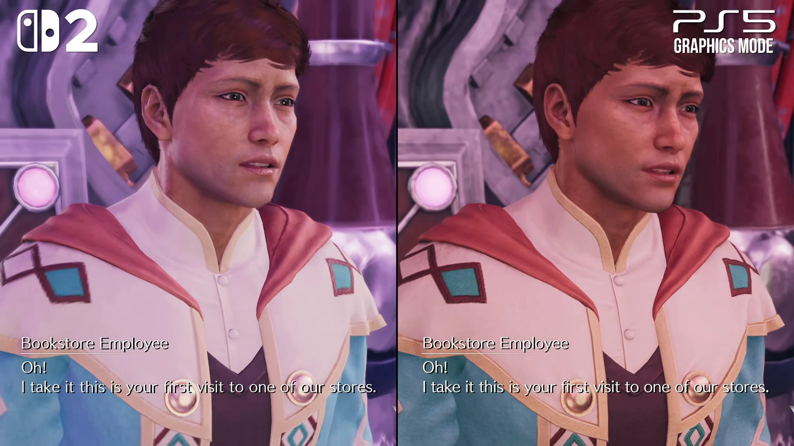

# Nintendo Switch 2へ移植できるゲームは何で決まるのか――重量級タイトルから読む四つの判定軸

> 2026年11月25日改版：掲載後に発売された『ELDEN RING Tarnished Edition』の技術レビューと、『ファイナルファンタジーXIV』Nintendo Switch 2版の発売直後の不具合対応を加え、最新の情報に更新しました。内容の変更はGitの履歴から追えます。

2025年6月5日、Nintendo Switch 2の発売日に、ナイトシティも一緒に店頭へ並んだ。『サイバーパンク2077 アルティメットエディション』は本体と同じ日に発売され、本編と拡張を一枚のゲームカードに収めて携帯機へ届いた。[[1](#ref-1)][[2](#ref-2)]

それから一年あまりで、『ファイナルファンタジーXIV』と、『ファイナルファンタジーVII リメイク インターグレード』『ファイナルファンタジーVII リバース』も同機へ渡った。三部作の完結編『ファイナルファンタジーVII リベレーション』も、2027年春にNintendo Switch 2を含む複数プラットフォームで同時発売することが告知されている。その一方で、2025年中の発売を予定していた『ELDEN RING Tarnished Edition』は、性能調整のため発売を2026年へ延ばし、同年8月28日にようやく届いた。[[3](#ref-3)][[4](#ref-4)][[5](#ref-5)][[6](#ref-6)]

同じ「重量級」と呼ばれる作品でも、発売日に並んだもの、時間をかけて届いたもの、まだ届いていないものがある。その差は「AAAかどうか」では説明がつかない。GPUが限界になる作品、CPUが限界になる作品、画面の破綻が許されにくい作品、サーバーや運営が重くのしかかる作品は、それぞれ別の場所でつまずくからである。

本稿では、自社タイトルのNintendo Switch 2版を検討するときの診断の順番を、四つの軸に分けて組み立てる。 **GPUとCPUの負荷がどちらへ偏るか** 、 **低い内部解像度を許容できる絵作りか** 、 **オンラインの制約がクライアントにあるのか運営にあるのか** 、 **ストレージ待ちをどこまで減らせるか** である。GPU性能だけを比べて「載る」と決めると、密集したNPC、物理演算、ネットワーク、アセット供給のどこかで見積もりを落とす。

***

## 1. GPUは伸びたが、CPUの問題は別に残る

Nintendo Switch 2のSoCはArm Cortex-A78C 8コアCPU、12GBのLPDDR5Xメモリーを備える。開発者がゲームに使えるメモリーは9GBと報じられている。Digital Foundryが開発資料を基に報じた動作値では、GPUの理論演算性能は携帯モード約1.71TFLOPS（561MHz）、TVモード約3.072TFLOPS（1007MHz）である。CPUの動作値は携帯モード1.1GHz、TVモード998MHzとされる。任天堂はこれらの詳細なクロック値を公表していないため、企画の固定前提ではなく、実機検証を始めるための目安として扱うべきである。[[7](#ref-7)][[8](#ref-8)]

ここでGPUとCPUを一つの「性能」にまとめないことが重要である。GPUは画素、ジオメトリー、影、ポストエフェクトを主に担い、CPUはゲームロジック、AI、物理、描画命令の準備、ネットワーク処理などを担う。GPUが空いていても、CPUが一フレームに必要な仕事を終えなければ、フレームレートは上がらない。これをCPUバウンドと呼ぶ。

### GPU側はDLSSと可変解像度で予算を作れる

DLSS（Deep Learning Super Sampling）は、低い内部解像度で描いた画像を学習済みモデルで再構成し、出力解像度に近い見え方を目指す技術である。内部解像度を下げればGPUの画素処理予算を、影・ライティング・遠景・描画密度へ振り替えられる。Nintendo Switch 2がDLSSを利用できることは、携帯機で重量級タイトルを成立させる際の大きな差である。[[9](#ref-9)][[10](#ref-10)]

『サイバーパンク2077 アルティメットエディション』はその典型である。Nintendo Switch 2本体と同日の2025年6月5日に発売され、TVモードでは1080p出力・30〜40fps、携帯モードでは720pを目標にDLSSを使う。64GBゲームカードに本編と拡張を収録した点も、初回の大容量ダウンロードを必須にしない商品設計である。CD PROJEKT REDの技術担当Charles Tremblay氏は移植について「想定より挑戦的ではなかった」と述べた。この言葉は、DLSS、品質設定、30fpsを含む設計上の選択を積み重ねた結果として読むのがよい。[[10](#ref-10)][[2](#ref-2)][[11](#ref-11)]

『ファイナルファンタジーVII リバース』は、より露骨にGPU予算の配分を見せる。TVモードの内部解像度は1920×1080から960×540、携帯モードは1344×756から672×380まで動的に変化し、DLSSで再構成する。目標は30fpsであり、短いヒッチや細部の破綻は残るが、広いフィールドを切り捨てずに持ち込むために、内部解像度を積極的に変える選択をした。[[12](#ref-12)][[13](#ref-13)]

この二例が示す問いは、GPU予算を食う要素を、可変解像度と再構成でどこまで移せるかである。ネイティブ1080pを維持できるかどうかは、その答えの一部にすぎない。移植の初期検証では、最高画質の一場面ではなく、戦闘、遠景、エフェクト、カットシーンを含む最悪ケースで内部解像度とフレーム時間を記録したい。

### CPUバウンドな設計は、別の試験表を作る

一方、NPCの群集AI、複雑な当たり判定、多数の物理オブジェクト、協力プレイ時のシミュレーションは、解像度を下げても大きく軽くならない。GPU設定の削減だけでは救えない領域である。

『HITMAN World of Assassination』Nintendo Switch 2版は、解像度を落としたときの挙動をCPU負荷とGPU負荷で分けて見る実例になる。Digital Foundryの検証では、720p出力を選ぶとGPU負荷が大きい場面ではフレームレートが上がる一方、群集密度が高いCPU集約的な場面では伸びが小さいと報告された。解像度を下げたときの伸び方は、その場面の重さがGPUとCPUのどちらにあるかで変わる。[[14](#ref-14)]

同作はNintendo Switch 2向けに発売済みであり、CPUバウンドな設計でも移植は成立している。問われるのは、どの場面を目標フレームレートに収めるために、群集の密度、AIの更新頻度、物理演算の精度、描画距離をどこまで調整するかである。グラフィックが地味でも、街で常時更新するNPC数、行動状態の組み合わせ、物理や戦術AIが多いなら、CPUバウンドなタイトルとして別枠で測る必要がある。[[14](#ref-14)]

プランナーが技術チームへ最初に渡すべき問いは、「画質を一段落とせば成立するか」に加えて、「プレイヤーが最も多くのエンティティを同時に見て、AI・物理・オンライン状態が重なる瞬間はどこか」である。後者の答えが曖昧な企画は、GPUの試験に合格しても製品化判断を早まれない。

***

## 2. 絵作りの許容度が、再構成の成否を決める

DLSSは、低い内部解像度から学習済みモデルで画像を再構成する技術であり、入力情報が少ない領域ほど再構成の精度に限界が生まれる。細い線、透明物、髪、草、粒子、画面速度の速い輪郭は、時間方向の揺れ、ディザリング、輪郭の不安定さとして現れやすい。特に人肌、毛髪、布、金属の反射を近接で見せる写実系は、プレイヤーが差に気付きやすい。

『ファイナルファンタジーVII リバース』のNintendo Switch 2版は、携帯モードで内部解像度が最低672×380まで下がる。技術分析では、髪など高周波の細部に再構成由来の不安定さが見える場面が指摘されている。これは、「広域の風景、戦闘、人物の近接演出を同じ画面品質で守る」という表現上の要求が、再構成の弱点を表面化させた例として読むべきである。[[12](#ref-12)][[13](#ref-13)]

*出典：Digital Foundry「[Final Fantasy 7 Rebirth Switch 2/Xbox Series X｜S Demo Tested - A Miracle Port for Switch 2?][13]」（Digital Foundry、動画07:09付近）からのフレーム引用。左：Nintendo Switch 2、右：PS5 Graphics Mode。*

ここから得られる指針は、輪郭、色面、マテリアル、カメラ距離、画面を横切る速度といったルールが、低い内部解像度でも読みやすさを保つかを問うことである。太いシルエット、明快な色分け、近接時に極細ディテールへ依存しないキャラクター設計は、再構成の瑕疵を「情報の欠落」として認識されにくくする。様式化されたアートにも同じ注意が要る。絵本調でも大量の半透明エフェクトや細密な草を画面全体に置けば、同じ問題を抱える。

『ELDEN RING Tarnished Edition』は、この軸の重さを延期という形で示した。当初2025年発売予定だったNintendo Switch 2版は、2025年10月23日、「性能調整」のため発売時期を2026年へ変更した。2026年8月28日に発売された製品版について、Digital Foundryは延期が最終的な品質に大きく役立ったとし、移植を成功と評価している。描画の水準はおおむねPS4版の機能に相当し、解像度はTVモードで720pから1080p、携帯モードで432pから864pの間を動的に変わる。フレームレートの上限は40fpsだが、TVモードの実際の値は30〜35fps前後に収まることが多く、画質を選ぶモードは用意されていない。[[5](#ref-5)][[6](#ref-6)][[15](#ref-15)]

様式化されたダークファンタジーであっても、広い地形、植生、戦闘エフェクト、移動速度を同時に満たすには、描画の水準を据置機の前世代へそろえ、延期を挟んで性能予算を配り直す必要があったことになる。

移植可否の判定では、アートディレクターと技術チームが早い段階で、次のような「壊れてはいけない一枚」を共有したい。顔のアップ、髪と半透明物が重なる会話、草地を高速移動する場面、粒子が密集する戦闘、暗部から明部へ切り替わる場面である。画面写真で合格しただけでは足りない。カメラ移動時の連続した動画で確認し、何を捨てても作品らしさが残るかを決める必要がある。

***

## 3. オンラインでは、クライアントの限界と運営の限界を分ける

『ファイナルファンタジーXIV』Nintendo Switch 2版は2026年8月4日に発売された。約一か月の先行プレイ期間を経て正式サービスへ移る構成で、Nintendo Switch Onlineへの加入は求めない。[[3](#ref-3)][[16](#ref-16)]

この事例は、MMOの壁を「サーバーが重いから携帯機では無理」と一括りにせず、分けて見ることを求める。サーバーが多数のプレイヤー状態を同期できても、各クライアントはその状態を受け取り、可視範囲のキャラクター、装備、エフェクト、UIを描画しなければならない。吉田直樹プロデューサーは安定30fpsを目標としつつ、街中など同時に描画するキャラクター数が多い場所では部分的なフレームレート低下が起こり得ると説明している。これはサーバー接続そのものより、クライアント側の同時描画と更新負荷が表に出るケースである。[[17](#ref-17)]

したがってMMOや大規模オンラインゲームの移植では、同接人数だけでなく、次の三つを分解して測るべきである。

- **サーバー処理**：権威判定、マッチメイキング、永続データ、帯域と遅延。
- **クライアント処理**：可視キャラクター数、装備・アニメーションの更新、エフェクト、UI、描画命令。
- **プレイ規約**：PC版・据置版と同一ワールドに入るなら、表示制限や簡略化が対戦・協力の公平性、読み取りやすさ、アクセシビリティへどう作用するか。

『グランド・セフト・オートV』を対比に置くと、もう一つの壁が見える。同作のNintendo Switch 2版は、2026年11月時点でRockstar Gamesから公式発表されていない。仮に技術的に移植できたとしても、既存のライブサービスを新プラットフォームへ投入するには、認証、クロスプレイ方針、パッチ配信、チート対策、カスタマーサポート、年齢区分や販売導線を継続する費用がかかる。技術的な「動く」と、事業としての「運営する」は別の判断である。

この区別は、新作の企画にも使える。オンライン要素をNintendo Switch 2へ持ち込むなら、同時描画の上限、遠距離プレイヤーの表現、重要情報の優先順位、回線品質の下限、運営期間を、移植終盤のネットワーク試験に任せず、最初から仕様へ入れたい。特に一人の画面へ誰を何人、どの精度で出すかは、ゲームデザインで先に決められる性能予算である。

***

## 4. ストレージは、世界をつなぐコストを変えた

Nintendo Switch 2は256GBの内蔵ストレージとmicroSD Expressに対応する。microSD Expressは従来のmicroSDとは別規格であり、本体の拡張ストレージとして利用するには同規格のカードが必要である。SoCにはデータ展開をCPUから分離する専用のファイル展開機構もあると報じられた。これはGPUやCPUの演算性能を増やすものではないが、移動中に必要なアセットを読み込む設計の待ち時間とCPU負荷を減らす方向に働く。[[8](#ref-8)][[18](#ref-18)]

『ホグワーツ・レガシー』は分かりやすい傍証である。Nintendo Switch 2版はNintendo Switch版を土台にした移植ではなく、新規ビルドとして制作され、Nintendo Switch版にあった区切りや大幅な簡略化を外した。TVモードで30fpsをおおむね維持し、ホグワーツとホグズミードの間も読み込み画面なしで移動できると技術分析で確認されている。これはストレージだけの成果とは断定できない。GPU、CPU、メモリー、アセット構成の再設計が組み合わさった結果である。しかし、「SSD相当のストリーミングを前提としたゲームが携帯機へ来るには、演算性能だけを見ればよい」という見方を改めるには十分な例である。[[19](#ref-19)][[20](#ref-20)]

初代Nintendo Switchではクラウド版のみだった『HITMAN World of Assassination』、『バイオハザード7 レジデント イービル』、『バイオハザード ヴィレッジ』、そして「キングダム ハーツ」シリーズも、Nintendo Switch 2ではネイティブ版へ切り替わった。各タイトルの技術構成は同じではなく、この動きだけから「microSD Expressが移植を可能にした」と因果を断定してはならない。それでも、通信先で実行するしかなかった作品群が、ローカルで実行する選択肢を得たことは、演算性能とストレージ帯域を合わせた基盤の変化を示す傍証である。[[21](#ref-21)][[22](#ref-22)][[23](#ref-23)]

プランナーがここで確認すべきなのは、総容量に加えて、プレイヤーが「待たされた」と感じる操作列である。エリア境界の読み込み、ファストトラベル、死亡からの復帰、衣装変更、メニュー遷移、シェーダー生成などを棚卸しする。続いて、各待ちがストレージI/O、CPU展開、GPUのリソース生成、ネットワーク待ちのどれに支配されるかを分ける。ロード時間を一つの数字にしてしまうと、性能改善の担当を誤る。

掲載後に届いた二作は、この切り分けの両面を見せた。『ELDEN RING Tarnished Edition』では、ロードの速さが見どころとして挙げられ、前世代の据置機より大幅に速いと評価された。[[15](#ref-15)] 一方、『ファイナルファンタジーXIV』Nintendo Switch 2版では、発売翌日の2026年8月5日、スクウェア・エニックスがコンテンツ内の画面の暗転に通常より時間がかかる場合があると告知した。周囲に多数のキャラクターがいる場所からコンテンツに入ると、退出するまで読み込みが遅くなるという。原因は、安全に描画するためのデータの再読み込みとキャッシュの消去に時間がかかっていたことで、2日後のメンテナンスで処理を最適化して対応した。[[24](#ref-24)] 待ち時間の原因は、ストレージの読み出しそのものより、描画の安全を確保する処理の側にあった。第3節で見た街の混雑が、ここでは読み込みの遅さとして表に出たことになる。

***

## おわりに：移植可否を決めるための四軸チェックリスト

Nintendo Switch 2で『サイバーパンク2077』、『ファイナルファンタジーXIV』、ファイナルファンタジーVII リメイクシリーズ、そして延期を経た『ELDEN RING Tarnished Edition』が成立した事実は、移植の可否を決めるのが個別の負荷特性であることを示している。企画段階では、次の順に答えを集めるとよい。

| 判定軸 | 最初に確認する問い | 企画で先に決めること |
| --- | --- | --- |
| GPU／CPUの非対称性 | 最悪場面は画素処理で遅いのか、AI・物理・描画命令で遅いのか | 30fps目標、同時エンティティ数、エフェクトと遠景の優先順位 |
| 絵作りの許容度 | 低い内部解像度と再構成で、何が壊れると作品らしさを失うか | 顔・髪・透明物・植生・カメラ速度の品質下限 |
| オンライン構成 | 制約はサーバー、クライアント、または運営費のどこにあるか | 表示人数、簡略化の規約、クロスプレイ、継続運営の責任範囲 |
| ストレージ | プレイヤーの待ち時間はI/O、展開、リソース生成、通信のどれか | エリア分割、先読み、アセット容量、ゲームカードとダウンロードの方針 |

この表を埋めるとき、「AAAだから」「オープンワールドだから」という分類は補助情報に下がる。必要なのは、自作の最悪ケースを一つずつ観測可能な負荷へほどくことである。

『黒神話：悟空』や『バルダーズ・ゲート3』のように、Nintendo Switch 2版を待望するプレイヤーがいるタイトルは、公式発表があった時点で四軸の線引きを確かめる観測点になる。前者なら高密度な写実表現と高速戦闘を、後者なら多数の状態を伴うシミュレーションを、それぞれどこまで携帯機へ持ち込めるかが問われる。プランナーが見るべきは、他社の移植予定の向こうにある、同じ負荷特性を持つ自社タイトルの最悪ケースである。

***

## References

1. [任天堂「Nintendo Switch 2 を 2025年6月5日に発売」][1] — 任天堂、2025年4月2日。発売日、価格、256GBの内蔵ストレージ、microSD Expressへの対応。

[1]: https://www.nintendo.co.jp/corporate/release/2025/250402.html

2. [CD PROJEKT RED「Cyberpunk 2077: Ultimate Edition coming Launch Day to Nintendo Switch 2!」][2] — Cyberpunk 2077公式サイト、2025年4月2日。本体と同日の発売、64GBのゲームカードに本編と拡張を収録しダウンロード不要。

[2]: https://www.cyberpunk.net/en/news/51356/cyberpunk-2077-ultimate-edition-coming-launch-day-to-nintendo-switch-2

3. [スクウェア・エニックス「Nintendo Switch 2 版 8月4日（火）発売！ 予約受付中 ＆ 今なら30％OFF！」][3] — The Lodestone（ファイナルファンタジーXIV公式サイト）。Nintendo Switch 2版の2026年8月4日発売。

[3]: https://jp.finalfantasyxiv.com/lodestone/topics/detail/252ef267c24c00f8d3b7bc7d1f2f00c0db3fbde7

4. [スクウェア・エニックス「ファイナルファンタジーVII リベレーション」][4] — 公式サイト。2027年春に、Nintendo Switch 2を含む複数プラットフォームで同時発売。

[4]: https://www.jp.square-enix.com/ffvii_revelation/

5. [バンダイナムコエンターテインメント「ELDEN RING Tarnished Editionの発売時期を2026年に変更」][5] — Bandai Namco Entertainment Europe、2025年10月23日。性能調整のための発売時期の変更。

[5]: https://en.bandainamcoent.eu/elden-ring/news/elden-ring-tarnished-edition-release-window-changed-2026

6. [バンダイナムコエンターテインメント「ELDEN RING Tarnished Edition launches August 28, 2026」][6] — Bandai Namco Entertainment Europe。Nintendo Switch 2版の発売日。

[6]: https://en.bandainamcoent.eu/elden-ring/news/elden-ring-tarnished-edition-launches-august-28-2026

7. [Kyle Orland「New Switch 2 specs show large performance dip in undocked mode」][7] — Ars Technica、2025年5月14日。Digital Foundryが報じたGPUクロック、CPU構成、メモリー、ファイル展開機構。数値は任天堂の正式な仕様表ではない。

[7]: https://arstechnica.com/gaming/2025/05/new-switch-2-specs-show-large-performance-dip-in-undocked-mode/

8. [任天堂「機能・仕様｜Nintendo Switch 2」][8] — 任天堂。256GBの内蔵ストレージ、microSD Expressへの対応、CPUとGPUの構成（クロック数の詳細は含まない）。

[8]: https://www.nintendo.com/jp/hardware/switch2/specs/index.html

9. [千葉大輔「Nintendo Switch 2はレイトレーシングとDLSSに対応。NVIDIAが公式blogで明かす」][9] — 4Gamer.net、2025年4月4日。NVIDIA公式ブログの発表に基づく、DLSSとレイトレーシングへの対応。

[9]: https://www.4gamer.net/games/990/G999030/20250404007/

10. [Digital Foundry「Cyberpunk 2077 on Switch 2: a cutting-edge game translates well to Nintendo's console hybrid」][10] — Eurogamer。DLSSの利用、動作モード、技術分析。

[10]: https://www.eurogamer.net/digitalfoundry-2025-cyberpunk-2077-on-switch-2-a-cutting-edge-game-translates-well-to-nintendos-console-hybrid

11. [Issy van der Velde「CDPR "thought it was going to be more of a challenge" porting Cyberpunk 2077 to Nintendo Switch 2, but beefier specs and microSD made it "surprisingly fast"」][11] — GamesRadar+、2025年6月2日。CD PROJEKT REDのCharles Tremblay氏の発言。

[11]: https://www.gamesradar.com/games/rpg/cdpr-thought-it-was-going-to-be-more-of-a-challenge-porting-cyberpunk-2077-to-nintendo-switch-2-but-beefier-specs-and-microsd-made-it-surprisingly-fast/

12. [AUTOMATON WEST「Final Fantasy VII Rebirth's Switch 2 port was built around "what to preserve," not "what to cut."」][12] — AUTOMATON、2026年6月4日。浜口直樹氏への取材。内部解像度の範囲とDLSSの利用。

[12]: https://automaton-media.com/en/interviews/final-fantasy-vii-rebirths-switch-2-port-was-built-around-what-to-preserve-not-what-to-cut-director-naoki-hamaguchi-on-optimizing-a-massive-ope/

13. [Digital Foundry「Final Fantasy 7 Rebirth Switch 2/Xbox Series X｜S Demo Tested - A Miracle Port for Switch 2?」][13] — Digital Foundry（YouTube公式チャンネル）。体験版の動的解像度、フレームレート、再構成画像の技術分析。

[13]: https://www.youtube.com/watch?v=jISSWd4aiy0

14. [PJ O'Reilly「Hitman: World Of Assassination Has A Hidden 'Performance Mode' On Switch 2」][14] — Nintendo Life、2025年7月21日。Digital Foundryの検証に基づく、GPU負荷の大きい場面と群集密度の高い場面での差。

[14]: https://www.nintendolife.com/news/2025/07/hitman-world-of-assassination-has-a-hidden-performance-mode-on-switch-2

15. [Liam Doolan「Video: Digital Foundry Delivers Its Tech Review For Elden Ring On Switch 2」][15] — Nintendo Life、2026年9月5日。Digital Foundryによる製品版の技術レビュー（解像度、フレームレート、ロード時間）の紹介。

[15]: https://www.nintendolife.com/news/2026/09/video-digital-foundry-delivers-its-tech-review-for-elden-ring-on-switch-2

16. [スクウェア・エニックス「Nintendo Switch 2 版 リリース決定！」][16] — The Lodestone。約一か月の先行プレイ期間と、Nintendo Switch Onlineへの加入が不要であること。

[16]: https://jp.finalfantasyxiv.com/lodestone/topics/detail/2f1efc7f1647b4c43062e643072a80a105f8a964

17. [スクウェア・エニックス「『ファイナルファンタジーXIV』Nintendo Switch™ 2 版 発売記念！ 公開生放送 in 渋谷サクラステージ」][17] — スクウェア・エニックス公式の生放送（YouTube）。吉田直樹氏による30fpsの目標と、混雑する場面でのクライアント側の描画負荷の説明。

[17]: https://www.youtube.com/watch?v=MhaL0WCzgbE

18. [任天堂「microSD Expressカードを使いはじめる」][18] — 任天堂サポート。Nintendo Switch 2で使うmicroSD Expressカードの案内。

[18]: https://support.nintendo.com/jp/switch2/mastery/sdcard/start-using/index.html

19. [GameSpot「Hogwarts Legacy for Switch 2 is not a port of the Switch version」][19] — GameSpot。Nintendo Switch 2版が新規ビルドであるという開発元の説明。

[19]: https://www.gamespot.com/articles/hogwarts-legacy-for-switch-2-is-not-a-port-of-the-switch-version/1100-6531087/

20. [Digital Foundry「Hogwarts Legacy - Switch 2 Review - The Big Face-Off」][20] — Digital Foundry（YouTube公式チャンネル）。性能とストリーミングの技術分析。

[20]: https://www.youtube.com/watch?v=MAl9NcEDO1s

21. [IOI「Hitman World of Assassination – Signature Edition launching on Nintendo Switch 2」][21] — IOI公式サイト、2025年。Nintendo Switch 2向けのネイティブ版。

[21]: https://ioi.dk/hitman/news/2025/hitman-world-of-assassination-signature-edition-launching-on-nintendo-switch-2

22. [カプコン「Resident Evil 7 biohazard Gold Edition／Resident Evil Village Gold Edition Nintendo Switch 2版FAQ」][22] — カプコン サポート。Nintendo Switch 2向けネイティブ版の出力解像度などの仕様。

[22]: https://www.capcom.co.jp/support/faq/platform_switch2_biohazard7_GE_0268083.html

23. [スクウェア・エニックス「キングダム ハーツ コレクション [I~III]（Nintendo Switch 2）」][23] — スクウェア・エニックス e-STORE。初代Nintendo Switchではクラウド版だったシリーズの、ローカル実行版コレクション。

[23]: https://store.jp.square-enix.com/estore/g/gPOT-P-ABU8A/

24. [スクウェア・エニックス「［Nintendo Switch™ 2 版］コンテンツ内で画面の暗転が明けるまでに時間を要する場合がある現象について(8/5)」][24] — The Lodestone、2026年8月5日（8月7日追記）。発生条件、原因、メンテナンスでの処理の最適化。

[24]: https://jp.finalfantasyxiv.com/lodestone/news/detail/3ca86567856a11e1a1e863d258597ad78ffc1e5d

----

この文書は、Perplexity、Claude、ChatGPT の3つのAIの支援を受けて著述されたものです。引用画像を除き、MIT License にて提供されています。
