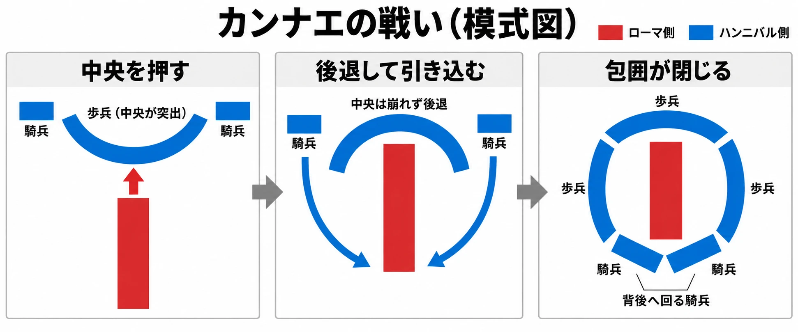

# その包囲は、相手に逃げ道を残すか――カンナエと『孫子』から、側面・挟撃・包囲を設計する

敵の正面に立ち、そのまま攻撃する。あるいは、横へ回り込み、背後から攻撃する。同じ相手を同じユニットで狙う場面でも、向きによって当たりやすさや追加の攻撃が変わるなら、移動先を選ぶ意味は変わる。

さらに、味方を反対側へ回して挟む。一方向だけ逃げ道を空ける。周囲をすべてふさぐ。どこまで囲むかによって、攻める側の有利と、囲まれた側に残る選択は変わっていく。

[第3回](tactics-concentration-numbers-widen-or-narrow.md)では、集中攻撃を「何体で」行えるかを考えた。今回は、その攻撃を「どの向きから」加えるかを取り上げる。人数がそろっていても、正面へ集める配置と、横や後ろへ分ける配置では、使える有利が異なる。

判断軸は、次の問いである。

**その包囲は、相手に逃げ道を残すか。**

この問いを考えるには、側面や背後を取る有利をどれだけ大きくするか、完全に囲んだ相手をどう振る舞わせるか、同じ規則を敵にも使わせるか、という三つの判断が必要になる。まずは、向きと位置関係をルールにしたゲームから見ていこう。

***

## 向きがあるから、側面が生まれる――タクティクスオウガ

任天堂のWiiバーチャルコンソール『タクティクスオウガ』紹介ページは、攻撃と向きの関係を次のように説明している。[[1](#ref-1)]

> 攻撃で敵に与えるダメージは、お互いが向いている方向が重要なポイントになります。

続いて、背後から攻撃したときの効果を説明する。[[1](#ref-1)]

> 敵の背後から攻撃すると、正面から攻撃するよりもヒット率を大幅に上げることができます。

左右からの攻撃についても、「背後からの攻撃には劣りますが、左右からの攻撃でも正面よりもヒット率が上がる」と記している。[[1](#ref-1)] 導入には「ダメージ」という言葉があり、方向別の具体的な説明には「ヒット率」という言葉が使われている。ここで取り上げる有利は、その説明にある攻撃の当たりやすさである。

### 考察：移動先と、そこで向く方向が一組になる

ユニットに向きがあれば、その周囲を正面・側面・背後に分けられる。同じ隣のマスへ近づくとしても、相手がどちらを向いているかで、そのマスの価値が変わる。

向きを選んで移動を終える仕組みなら、プレイヤーは「どこに立つか」に加え、「そこでどちらを向くか」を判断することになる。敵の背後へ回れたとしても、移動した味方自身が、別の敵へ背中を見せるかもしれない。攻撃の有利と、攻撃後に受ける危険を一緒に考えられる。

公式ページも、守る側について次の注意を添えている。[[1](#ref-1)]

> 逆に敵からの攻撃を受けるときも上記の条件が当てはまります。敵に背後を取られないように注意してください。

同じ規則が敵にも働くと、背後へ回ることと、背後を守ることが対になる。命中しやすい位置へ進むだけでなく、敵が次に回り込める場所まで読む理由が生まれるのである。

側面の有利を小さくすれば、回り込みは余裕のあるときに狙う工夫になりやすい。大きくすれば、正面から攻撃するより、まず有利な向きを取ることが重要になる。プランナーが決めるのは、その差をどの程度まで戦闘の中心に置くかである。

***

## 挟むと、追撃が出る――トライアングルストラテジー

Nintendo Australiaの「Ten tactical tips for TRIANGLE STRATEGY™!」は、位置取りのコツとして次の一文を挙げている。[[2](#ref-2)]

> Attack enemies from behind to land a critical hit.

日本語に訳すと、「敵を背後から攻撃して、クリティカルヒットを出そう」ということだ。

続く文では、2体で敵を囲むと「an automatic follow-up attack」、つまり「自動の追撃」が出ると説明し、自分たちも同じことをされないよう注意を促している。[[2](#ref-2)]

ここでは、背後からの攻撃と、2体で挟む攻撃を分けて見たい。背後を取ることは、攻撃する1体と相手の向きの関係で成り立つ。挟撃は、同じ敵に対する味方2体の位置関係で成り立つ。

### 考察：2体目の立ち位置に、攻撃を増やす価値が生まれる

挟撃に追撃が伴えば、2体目をどこへ置くかが、1体目の攻撃の成果につながる。個々のユニットが敵へ近づくだけでなく、互いの位置を合わせることに報酬が付く。

そのぶん、攻撃のために前へ出した味方が、敵同士の間へ入ってしまう危険もある。公式記事の注意は、この裏返しを示している。自分が使った挟撃を敵にも使われるなら、攻める配置の良さを、敵の側からも見直す必要がある。

設計では、「2体が近くにいる」と「挟撃が成立する」を区別して伝えたい。どの位置へ移れば成立し、誰の追撃が加わるかを画面上で読めれば、追加の攻撃を偶然の結果ではなく、配置を工夫した成果として受け止めやすくなる。

また、追撃を大きな報酬にするほど、挟むために味方を分ける価値も高まる。一方、分けた味方を守りにくければ、その報酬には危険が伴う。挟撃の強さは、追撃の効果と、成立させる配置の取りやすさを合わせて考える必要がある。

***

## 崩れない中央と、背後へ回る騎兵――カンナエの戦い

カンナエ（カンネー）の戦いは、第二次ポエニ戦争中の紀元前216年8月2日に起きた。コトバンク所収の『日本大百科全書（ニッポニカ）』は、八万数千のローマ軍が、ハンニバル指揮下の約5万のカルタゴ軍に壊滅的な敗北を被った戦いと説明している。[[3](#ref-3)] 以下では、カンナエの戦いと呼ぶ。

Britannicaは、この戦いを、両翼から包み込む包囲が成功した古典的な例と位置付けている。[[4](#ref-4)] その経過を、中央を押す側と、横から回る側の関係に注目して見てみよう。

### 中央を押し切ろうとしたローマ軍

Britannicaによれば、ローマ軍の歩兵は中央へ「an exceptionally deep and narrow formation」で集められた。日本語に訳すと、「非常に奥行きが深く、幅の狭い隊形」である。人数を集めた圧力で敵の中央を突破しようとしたのだ。[[4](#ref-4)]

対するハンニバル側は、中央が前へ張り出す三日月形の陣を取った。両翼では騎兵が勝ち、その一部が敵の背後へ回り込んだ。その間、中央の歩兵はローマ軍に押されて後退した。[[4](#ref-4)]

この中央について、同記事は次のように記している。[[4](#ref-4)]

> although it fell back, it did not break

日本語に訳すと、「後退はしたが、崩れなかった」ということだ。中央が持ちこたえたため、前進するローマ軍の中央は、徐々に包囲の内側へ引き込まれた。両側の部隊が内向きになり、背後にはカルタゴ側の騎兵が回った。三日月は円へ変わり、ローマ軍は密集して、武器を十分に使えなくなった。[[4](#ref-4)]

Britannica「Battle of Cannae」の記述をもとに作成した模式図。地形・兵数・部隊の細部は省略している。[[4](#ref-4)]

### 考察：回り込む部隊と、持ちこたえる部隊を一緒に見る

ここで[第3回の「何体が攻撃に参加できるか」](tactics-concentration-numbers-widen-or-narrow.md)という問いへ戻れる。数で勝っていても、包囲されて密集し、十分に動けなくなれば、その数を働かせにくくなる。兵の総数と、目の前で力を発揮できる数は、配置によって離れていく。

同時に、包囲を成立させた側にも、役割の分担がある。側面や背後へ回る部隊が動く間、中央は崩れずに持ちこたえる必要があった。回り込みの経路だけを見ていると、その時間を支える部隊の役割が抜け落ちる。

ゲームの架空例なら、中央の味方が敵を引き受け、別の味方が左右へ回る配置を考えられる。中央がすぐ倒れるなら、側面を取る工夫が成果になる前に戦いが決まる。反対に、中央がほとんど危険を負わずに耐え続けられるなら、回り込む手順を毎回繰り返すだけになりやすい。

側面の有利を設計するときは、回る側が何を得るかとともに、正面で受け持つ側が何を引き受けるかを見る。両者が役割を果たして初めて包囲が成立するなら、部隊を分ける判断にも意味が生まれる。

***

## 囲みに穴を残す――『孫子』軍争篇・九地篇

相手の周囲をすべてふさげば、逃げられなくなる。その配置が相手の抵抗をどう変えるかを考える言葉が、『孫子』にある。

軍争篇には、次の一節がある。[[5](#ref-5)]

> 歸師勿遏，圍師必闕，窮寇勿迫

大意は、帰ろうとする軍をさえぎらず、囲んだ軍には必ず逃げ口を空け、追い詰められた敵を追い込みすぎない、というものだ。

一方、九地篇には、行き場を失った側についての言葉がある。[[5](#ref-5)]

> 投之無所往，死且不北

大意は、行き場のない所へ投じれば、死んでも退かない、ということだ。続いて、次のように述べる。[[5](#ref-5)]

> 兵士甚陷則不懼，無所往則固，深入則拘，不得已則鬥

大意は、兵士は深く陥ると恐れなくなり、行き場がなければ固くまとまり、深く入り込めば結び付き、やむを得なければ戦う、というものだ。

軍争篇は、敵を囲む側へ逃げ口を残すよう説く。九地篇は、自軍が行き場を失ったときに、退かずに戦う力が生まれると説く。この二つを合わせると、完全に囲むことは、相手を最も必死にさせる配置でもあると考えられる。

### 考察：囲んだ後の反応が、囲み方を決める

ゲームでは、包囲された相手がどう動くかを仕様として選べる。逃げ道を探して移動するのか、連携が崩れて抵抗しにくくなるのか、それとも退路を失うと決死の反撃に出るのか。どれを選ぶかで、プレイヤーが目指す配置も変わる。

完全包囲で相手を弱められるなら、最後の空きをふさぐことが目標になる。包囲されると相手が強く反撃するなら、あえて逃げ道を空ける理由が生まれる。逃げられる相手が実際にその経路を選ぶなら、空ける方向にも意味を持たせられる。

たとえば、架空のタクティクスRPGで「敵は安全に通れる退路があれば離脱を優先し、退路がなくなると反撃を強める」と決めたとする。プレイヤーは、周囲を完全にふさぐか、目標地点から離れる側だけを空けるかを選べる。敵を倒すことが目的なら包囲を続けたくなるが、敵を目標地点から遠ざければよい場面なら、逃がす配置が役立つかもしれない。

この場合、 **逃げ道は、相手の次の行動を選ばせるために残す空間** になる。ただ空いているだけでなく、そこへ進めることと、相手がそこを選ぶ理由が必要だ。

反対に、架空の別のゲームで「完全に包囲された敵は援護を受けられなくなる」と決めれば、周囲をふさぐ価値を強められる。こちらは、包囲を完成させる配置そのものへ報いる設計である。どちらも作れるが、同じ「囲む」という操作から生まれる判断は違う。

### 逃げ口と、ただのすき間を分ける

逃げ道を残す遊びにしたいなら、空きマスの有無に加え、相手がそこを通って包囲の外へ出られるかを確かめたい。見た目では1方向が空いていても、その先を別の味方がふさいでいれば、移動経路としての退路は残っていないかもしれない。

また、決死の反撃が突然発生すると、プレイヤーは囲んだ工夫を罰せられたと感じやすい。完全包囲の成立条件と、そのとき相手がどう変わるかが見えていれば、最後の1か所をふさぐ前に判断できる。

包囲すること自体への報酬と、相手を誘導するために穴を残す価値。そのどちらを楽しんでほしいかを決めることで、逃げ道の仕様も具体化できる。

***

## 側面を守る――常山の蛇

『孫子』九地篇は、よく部隊を動かす姿を、常山の蛇にたとえている。[[5](#ref-5)]

> 擊其首則尾至，擊其尾則首至，擊其中則首尾俱至

大意は、常山の蛇は、頭を撃てば尾が、尾を撃てば頭が、胴を撃てば頭と尾が助けに来る、というものだ。離れた部分も互いに応じ、一つのものとして働く姿である。

### 考察：守り合う配置にも、選ぶ理由を作る

ゲームの配置へ置き換えるなら、側面を取られた味方を、別の味方が助けられる仕組みを考えられる。攻める側に回り込む工夫があるなら、守る側にも互いの側面を守り合う工夫を持たせられる。

たとえば、架空のルールとして、「味方同士が隣接している間は、互いの背後への攻撃に援護防御が出る」と定める。単独で前へ出ると攻めやすいが、隣接して進めば背後を守りやすい。挟撃のために左右へ分かれるか、守り合える距離を保つか、という選択が生まれる。

この守りが強いほど、集まる価値は増す。一方、隣接しているだけであらゆる方向を安全にできるなら、側面へ回る工夫の価値は小さくなる。援護できる方向や相手、守れる回数などに条件を設ければ、守り合いの強みと、そこを崩す余地を調整できる。

包囲への対策を、個々のユニットの防御力だけで用意する必要はない。向きをそろえる、互いを助けられる位置に置く、分かれた部隊をまとめ直す。そうした配置の判断を守る手段にできれば、攻撃側と防御側の双方が盤面へ働きかけられる。

敵にも挟撃を行わせる際の実装上の論点は、[敵AIの設計・実装を扱った記事](enemy-ai-design-practices.md)も参考になる。配置の規則が同じでも、敵がそれを使って近づくなら、味方の守り方を試す場面を作れる。

***

## ゲームへの置き換え――ここからは設計上の考察

ここまでの例から、側面・挟撃・包囲を、企画書で決める項目へ整理してみよう。

| 決める項目 | 具体化する問い | プレイヤーの判断へのつながり |
| --- | --- | --- |
| 側面・背後の有利 | 命中率、ダメージ、クリティカルなどの何を、どれだけ上げるか | 正面から攻めるか、移動して回り込むか |
| 挟撃の成立条件 | 何体が、相手に対してどの位置へ立つと成立するか | 個々に近づくか、2体以上の位置を合わせるか |
| 包囲された側の振る舞い | 逃げる、連携が崩れる、決死で反撃する、のどれにするか | 完全包囲を目指すか、逃げ道を残して誘導するか |
| 守る側の手段 | 向き、味方との隣接、隊形のうち何で側面を守れるか | 攻撃のために分かれるか、守り合う配置を保つか |
| 敵への適用 | 敵も同じ有利や守りの規則を使うか | 自分の攻撃位置と、敵から見た攻撃位置を合わせて読むか |

表にある「ダメージを上げる」「連携が崩れる」などは、設計で選べる項目である。本文で紹介した各作品が、すべての項目を採用しているという意味ではない。

### 強さと、成立させる手間を組み合わせる

側面の報酬が大きくても、毎回簡単に背後へ回れるなら、移動先の選択は似通いやすい。挟撃に大きな追撃を付けても、2体目を置く場所がほぼ決まっていれば、配置を考える余地は小さくなる。

反対に、回り込む味方を支える中央が必要で、分かれた味方の背後も守らなければならないなら、攻め方を選ぶ理由が増える。どのユニットを回すか、誰が正面を受け持つか、どこまで囲んだら十分かが、一つの判断としてつながる。

試遊では、包囲が完成した瞬間だけでなく、完成するまでに何を選び直せたかを見たい。敵の動きに合わせて向きを変える、挟撃を諦めて味方の隣へ戻る、最後の空きを残して敵を動かす。そうした選び直しができれば、包囲は毎回同じ形を作る作業から、相手の配置に応じる遊びへ近づく。

[第1回](tactics-strategy-levels-what-player-decides.md)で考えた、プレイヤーに何を決めてもらうかという問いにもつながる。背後を取る爽快さを中心にするなら、その成果を大きく見せられる。敵の進路を操る面白さを中心にするなら、空ける場所と相手の反応を読めるようにしたい。

完全包囲と、逃げ道を残す配置のどちらか一方が正解になるわけではない。プレイヤーに、囲みを完成させる判断を楽しんでほしいのか、囲み方で相手の行動を変える判断を楽しんでほしいのか。その目的に合わせて、報酬と反応を組み合わせるのである。

***

## 企画書を見直すための点検表

「側面を取ると有利」「囲むと強い」と書いたら、次の問いで、その先を具体化できる。

- ユニットの正面・側面・背後は、何を基準に区別され、画面上で読み取れるか。
- 側面や背後を取ると、何がどれだけ有利になるか。回り込む危険に見合うか。
- 挟撃には何体が必要で、どの位置なら成立するか。攻撃前に追撃の有無を確かめられるか。
- 回り込む間、正面を受け持つ味方は持ちこたえられるか。攻める役と支える役の両方に選択があるか。
- 完全に囲まれた相手はどう振る舞うか。逃げ道を残した場合との違いを、プレイヤーは事前に読めるか。
- 守る側は、向き、隣接、隊形などで側面を守れるか。その守りを崩す余地も残っているか。
- 敵も同じ規則を使うか。自分が挟む場面と、自分が挟まれる場面の両方を試しているか。

背後を取る1体、反対側に立つもう1体、正面で持ちこたえる味方。それぞれの役割をつなぐと、側面の有利は部隊全体の配置を選ぶ理由になる。そして、最後の空きをふさぐかどうかが、相手に残す選択を変える。

**その包囲は、相手に逃げ道を残すか。**

囲んだ形の強さと、囲まれた相手の反応を合わせて考えれば、プレイヤーにどこまで包囲を目指してほしいかが見えてくる。

## References

1. [任天堂「VC タクティクスオウガ」][1] — 任天堂、掲載日記載なし。Wiiバーチャルコンソールの紹介ページ。向きとヒット率、敵から攻撃を受ける場合の説明を参照。2026年10月18日閲覧。

[1]: https://www.nintendo.co.jp/wii/vc/vc_to/vc_to_10.html

2. [Nintendo「Ten tactical tips for TRIANGLE STRATEGY™!」][2] — Nintendo Australia、2022年3月9日。「Positioning is the key to victory」の背後からの攻撃と2体による追撃の説明を参照。本文中の日本語訳は本稿による。2026年10月18日閲覧。

[2]: https://www.nintendo.com/au/news-and-articles/ten-tactical-tips-for-triangle-strategy-tm/

3. [「カンネーの戦い」各辞典の解説][3] — コトバンク、掲載日記載なし。日本大百科全書(ニッポニカ)、吉村忠典。戦いの日付と両軍の兵数の概数を参照。2026年10月18日閲覧。

[3]: https://kotobank.jp/word/%E3%81%8B%E3%82%93%E3%81%AD%E3%83%BC%E3%81%AE%E6%88%A6%E3%81%84-3148254

4. [Patrick Hunt・Britannica Editors「Battle of Cannae」][4] — Encyclopaedia Britannica、2026年9月25日最終更新。中央の隊形、三日月形の陣、騎兵の回り込みと包囲の経過を参照。本文中の日本語訳は本稿による。2026年10月18日閲覧。

[4]: https://www.britannica.com/event/Battle-of-Cannae

5. [孫武『孫子兵法』][5] — 維基文庫、掲載日記載なし。通行本の原文。軍争篇・九地篇を参照。編名の日本語表記は[コトバンク「孫子」](https://kotobank.jp/word/%E5%AD%AB%E5%AD%90-90609)の『日本大百科全書（ニッポニカ）』に合わせた。本文中の大意は本稿による。2026年10月18日閲覧。

[5]: https://zh.wikisource.org/zh-hant/%E5%AD%AB%E5%AD%90%E5%85%B5%E6%B3%95

----

この文書は、Perplexity、Claude、ChatGPT の3つのAIの支援を受けて著述されたものです。引用画像を除き、MIT License にて提供されています。
