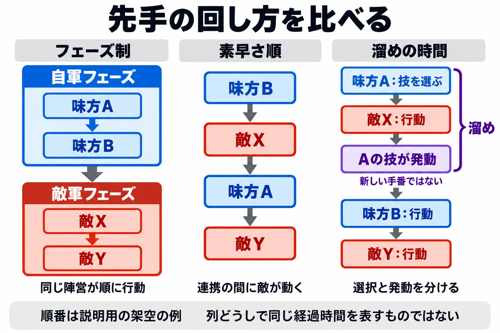

# その手番は、先手をどう回すか――『孫子』とタクティクスRPGから、行動順と主導権を設計する

高所を先に取れば、そこから相手を迎えられる。相手が動く前に両側へ回り込めれば、挟撃の形を作れる。[第2回の地形](tactics-terrain-high-ground-what-it-lends.md)も、[第4回の側面と包囲](tactics-flank-encirclement-leave-a-way-out.md)も、有利な位置へ先に動けるかどうかで、使える機会が変わる。

同じ地図に同じ部隊を置いても、味方全員が続けて動ける場合と、途中で敵が動く場合とでは、組み立てられる連携が違う。高所へ向かう途中で道を塞がれるかもしれないし、包囲を完成させる前に相手が抜けるかもしれない。

「戦術と兵法からバトルをつくる」第7回は、シリーズの最終回である。今回は、こうした判断の土台にある手番と、主導権を扱う。

今回の判断軸は、次の問いである。

**その手番は、先手をどう回すか。**

先に動ける機会を、陣営ごとにまとめて渡すのか。ユニットごとに順番を回すのか。選んだ技の発動を遅らせ、効果が出る先後を入れ替えるのか。手番の仕組みを選ぶことは、プレイヤーに、どこまで先を読み、いつ相手に応じてほしいかを決めることでもある。

***

## 相手を動かし、動かされない――『孫子』

『孫子』虚実篇は、先に戦う場所へ着く者と、後からそこへ急ぐ者の違いを述べる。[[1](#ref-1)]

> 凡先處戰地而待敵者佚，後處戰地而趨戰者勞。故善戰者，致人而不致於人

大意は、先に戦地へ着いて敵を待つ者には余裕があり、後から戦地へ駆けつける者は疲れる。だから戦いに巧みな者は、相手をこちらへ来させ、相手によって動かされることはない、というものである。

ここでは、先に着くことと、余裕を持って相手を迎えることが結び付いている。続く記述でも、利益によって敵を来させることや、敵が救わなければならない場所を攻めることが語られる。[[1](#ref-1)] 自分の動きが、相手の次の動きを決めるのである。

### 考察：先に動ける機会を、相手への要求に変える

主導権は、相手に応じさせられる側から、相手を応じさせる側へ回ることとして考えられる。ゲームなら、味方を危険から逃がすだけで手番を使う場面と、敵が守りに戻る必要のある場所へ味方を進める場面では、その後の展開を誰が作っているかが違う。

架空のマップで、先に動いた味方が橋を押さえたとしよう。敵は、橋を突破するか、別の道へ回るかを考えなければならなくなる。先手が、相手に選択を迫る形へ変わっている。

ただし、先に動けても、目的の場所へ届かなければ、その形は作れない。先手の価値は、移動できる距離、地形、攻撃できる範囲ともつながる。手番の設計では、「誰が最初か」と合わせて、「その機会に何を変えられるか」を見たい。

『孫子』の記述をゲームへ置き換えるなら、手番の仕組みは、主導権を取るための条件を決めるものになる。先手を得た後に相手へ何を迫れるか、相手にはどこで応じる機会が戻るかが、設計の対象になるのである。

***

## 陣営ごとに交互に動く――フェーズ制

『タクティクスオウガ』などを手掛けたゲームクリエイターの松野泰己氏は、ファミ通.comの2023年8月17日の対談で、タクティクスRPGとボードゲームのつながりを語っている。アメリカのアバロンヒル社が出した『タクティクスII』を例に、次のように述べる。[[2](#ref-2)]

> 有名なところでは、アメリカのアバロンヒル社が出した『タクティクスII』のスタイル、たとえば敵軍と自軍がフェーズで交互に戦うとか、そうしたゲーム性がそのままコンピューターゲームに持ち込まれているわけです。

フェーズは、ここでは陣営ごとの行動の区切りである。自軍が動く時間の後に、敵軍が動く時間が来る。

『ファイアーエムブレム 覚醒』の英語版電子説明書は、「9 Battle Basics」の「Turns」で、次のように説明している。[[3](#ref-3)]

> The battle is divided into turns. A Player Phase, during which you give orders to your units, is followed by an Enemy Phase, when your opponents carry out their attacks.

「戦闘はターンに分かれる。自分のユニットに命令するプレイヤーフェーズの後に、敵が攻撃を行うエネミーフェーズが続く」という説明である。同じ説明書では、各ユニットは1ターンに一度移動でき、行動済みのユニットは次のターンまで使えないとされる。[[3](#ref-3)]

### 考察：この手番で何を終わらせておくか

陣営ごとに手番をまとめると、自軍の全員を使って連携を組み立てやすい。架空の例なら、味方Aが通路を塞ぐ敵を倒し、その後で味方Bを通す、という順序を選べる。敵の移動が間に入る前に、一連の狙いを形にできる。

その代わり、敵の手番には、自分の好きなタイミングで移動や行動を選び、割り込むことはできない。『覚醒』にも攻撃を受けた際の反撃はあるが、それは自由に次の行動を命令する手番とは区別したい。[[3](#ref-3)]

そこで先手の価値は、「この手番で何を終わらせておくか」に集まる。敵を倒すだけでなく、傷ついた味方を下げる、通路を守る、次の敵の攻撃に耐えられる配置へ整えることも、手番を渡す前の仕事になる。

企画の段階では、自軍の連携をどこまで完了させられるかと、敵に手番を渡した後の危険を、一組で考えるとよい。先に動く陣営が相手の重要な部隊を一方的に倒せるなら、後から動く側に何が残るかを試す必要がある。初期配置や、最初から攻撃が届く距離も、手番の有利不利に関わる。

ウォーゲームの手番構造と卓上での試作については、[既存記事](wargame-adjudication-and-tabletop-prototyping.md)でも扱っている。

***

## 素早さで入り乱れる――タクティクスオウガ

同じファミ通.comの対談で、松野氏は『タクティクスオウガ』に加えたアレンジを説明している。その一つが、行動順の仕組みである。[[2](#ref-2)]

> フェーズからユニットの素早さで味方と敵が入り乱れて戦うというターンシステムを導入

陣営ごとにまとまっていた行動が、ユニットごとの順番へ変わる。ここで注目したいのは、味方の次にも味方が動くとは限らない、という点である。

### 考察：連携の間に誰が動くか

味方A・Bと敵X・Yがいる、架空の盤面を考えよう。行動順が「B → X → A → Y」なら、BとAの行動の間に、Xが動く機会を持つ。

Bを敵の横へ回し、次にAを反対側へ回したいとしても、その前にXが移動するかもしれない。包囲を狙うなら、Xが動いた後にもAが届くか、Bが孤立しないかまで考えたくなる。味方同士の連携を、敵の手番を挟んで組み立てるのである。

こうした仕組みでは、速いユニットが、敵より先に動く役を担いやすくなる。たとえば、敵が動く前に道を押さえる役や、傷ついた味方を先に助ける役に価値が生まれる。攻撃力が同じでも、動ける順番が違えば任せたい仕事が変わる。

一方、速さがあらゆる仕事で有利になると、他の能力を選ぶ理由が弱くなりやすい。架空の設計なら、遅くても通路を守れる、先に届かなくても広い範囲へ支援できる、といった別の役割も考えられる。

プレイヤーが読むものも、陣営全体の手番から、「次に誰が動き、その後に誰が続くか」へ変わる。判断に使ってほしい長さの行動順を見せることが、この仕組みを扱いやすくする。

***

## 行動順を見せ、発動を遅らせる――FFTのCT

『ファイナルファンタジータクティクス』（以下、『FFT』）では、CT（チャージタイム）という、ユニットが行動できるまでの時間を表すゲージを使う。各ユニットのゲージがたまり、満ちたユニットから手番が回ってくる仕組みである。『FFT 獅子戦争』の公式説明では、素早いキャラクターほどゲージが早くたまるとされる。[[4](#ref-4)]

この「ユニットの手番が来るまでの待ち時間」に加えて、魔法などには「選んでから効果が出るまでの溜め時間」もある。誰が先に行動を選べるかと、選んだ技がいつ効くかを、合わせて考えるのがポイントになる。

『ファイナルファンタジータクティクス - イヴァリース クロニクルズ』でディレクターを務める前廣和豊氏は、電撃オンラインとファミ通ドットコムの合同インタビューで、オリジナル版の確認操作を次のように振り返る。[[5](#ref-5)]

> CT（チャージタイム）というバトルシステムは『FFT』の特徴のひとつではありますが、オリジナル版では戦闘を中断して、メニューを開いて行動順を確認する必要がありました。

同作のエンハンスドでは、戦闘中に行動順を見られるコンバットタイムラインが実装された。その狙いについて、前廣氏は次のように述べている。[[5](#ref-5)]

> 本作では、行動順を考えて使用するアビリティや対象を選ぶという、CTのバトルシステムの楽しさはそのままに、より直感的で遊びやすくしたいという思いから、コンバットタイムラインを実装しています。

さらにインタビューでは、魔法や弓のチャージ、つまり溜めてから発動するまでの時間の調整も扱われている。前廣氏は、使い勝手の悪かったアビリティや、CTの長かったアビリティを調整したと説明している。[[5](#ref-5)]

### 考察：選ぶ時点と、効果が出る時点を分ける

ユニットが行動を選べる順番に加えて、選んだ技の効果がいつ出るかも、先手を左右する。溜めのある技なら、今選んだ行動の効果が、別のユニットの行動より後に出ることがある。

架空の例として、味方Aが、指定した場所へ発動する溜めの長い技を選ぶとしよう。その発動前に敵Xの手番が来て、Xが範囲の外へ出れば、狙いは外れる。今すぐ効果が出る技なら届いても、発動が遅れる技では間に合わない、という違いである。

逆に、敵が動く前に発動する見込みなら、その技を使う理由になる。味方の回復でも、傷ついた仲間へ敵の攻撃が届く前に効果が出るかどうかで、同じ技の価値が変わる。

ここで必要なのは、行動順の表示と、技を選んだ後の見通しである。「Aが次に動く」と分かることに加えて、「Aの技が効く前にXが動く」と分かれば、技と対象を選ぶ判断になる。

これは、[第5回の情報](tactics-information-fog-show-hide-or-read.md)で扱った「見せる」とつながる。行動順を見せれば、先後の関係を材料にして技を選べる。順番を調べる操作を軽くすることは、読む判断へ注意を向けやすくすることでもある。

溜めの時間を短くすれば使いやすくなるが、どの技も相手が動く前に発動するなら、待つ間を読む場面は減る。調整するときは、発動までの長さと、間に誰が動くかを合わせて見たい。

***

## 待つことにも価値を付ける――トライアングルストラテジー

『トライアングルストラテジー』について、Nintendo Australiaが2022年3月9日に公開した公式記事の四つ目のコツは、「Speed is a virtue」である。記事は、味方の行動順が素早さの能力によって決まると説明する。[[6](#ref-6)]

そのうえで、有利な動きがない場合は、手番を見送る選択も紹介している。移動せず、コマンドも使わなければ、次の手番までの時間が20%短くなる。[[6](#ref-6)]

ここでの条件は、移動もコマンドの使用もしないことである。移動してから攻撃だけを見送る場合と、同じ条件として扱わないようにしたい。

### 考察：今の機会と、次の機会を比べる

この仕組みを設計の観点で見ると、今の手番を手放し、次に動ける機会を早める選択に意味が付いている。

架空の場面で、味方の手番が来たものの、敵へ近づくと危険な位置へ出ることになるとしよう。安全な位置で待てば、今は攻撃できないが、次に行動できるまでの時間を短くできる。敵が近づいた後で動く機会を取り直したい、という狙いを持てるのである。

次の手番が早まることは、必ず敵より先になることとは別である。意味を持つのは、待った結果、誰との先後が変わるかだ。その変化を見せられれば、プレイヤーは今できる小さな行動と、早く戻ってくる次の機会を比べられる。

待つ利点を設けるときは、今行動する理由も合わせて残したい。毎回待つほうが得なら、選ぶ余地は小さくなる。今なら確保できる場所、今助ける必要のある味方などと結び付けば、待つか動くかを盤面に応じて選べる。

***

## ゲームへの置き換え――ここからは設計上の考察

先手の回し方を、陣営交互、個別の順番、溜めの時間という三つの観点から整理してみよう。ここでの「先手」は、戦闘開始時の最初の一回に加え、相手より先に位置や状況を変えられる機会も指す。

| 方式・観点 | 先手が何に宿るか | プレイヤーが読むもの | 見せるべき情報 | 起こりやすい問題 |
| --- | --- | --- | --- | --- |
| 陣営交互（フェーズ制） | 陣営全体にまとまった行動機会 | 自軍の連携と、手番を渡した後の敵の動き | 行動済みの味方、敵の届く範囲、手番終了の区切り | 先に動く陣営が戦力を奪いすぎ、後手が立て直せない |
| 個別の順番（素早さ順など） | ユニットごとの行動機会 | 味方の行動の間に、どの敵が動くか | 敵味方の行動順、選択で順番が変わる場合はその変化 | 素早さが他の能力より強くなり、選ぶ役割が偏る |
| 溜めの時間 | 選んだ行動の効果が出る時点 | 発動までに誰が動き、何が変わるか | 技の発動位置、発動の順番、対象や範囲の扱い | 見通しが立たず技が外れる、溜めの長い技を選ぶ理由が薄れる |

本文の作品がすべての項目でこの分類どおりという意味ではない。表は、企画書で選べる手番の仕組みと、必要な情報を整理したものである。

### 組み合わせるなら、二つの順番を確かめる

三つの観点は組み合わせられる。とくに溜めの時間は、誰が行動を選べるかという手番に重ねられる。

架空の設計として、ユニットごとの順番を素早さで決め、一部の技には溜めを付けるとしよう。プレイヤーは「次に誰が選ぶか」と「選んだ技がいつ効くか」の両方を読む。味方が先に選べても、技の効果では敵に先を越される場合がある。

陣営交互の仕組みでも、強い技だけは次の自軍フェーズに発動する、といった構成を考えられる。その場合は、技を選んだ後に相手の手番が丸ごと入る。発動場所を予告して相手が避けられるようにするか、動ける場所を狭めるための技として使わせるかによって、役割が変わる。

組み合わせを増やすときは、効果の大きさに加えて、先後を確かめる手間も見たい。技を選ぶたびに複数の画面を開くなら、考える以前の操作が重くなる。行動順と発動の位置を一緒に比べられる表示が、判断を支える。

### 先手を取った後と、渡した後を試す

試作では、同じ盤面から動く側を入れ替えてみると、先手の価値をつかみやすい。先に動く側は何を確保でき、後から動く側にはどの選択が残るかを記録するのである。

たとえば、先手が必ず中央の高所を取れるなら、後手には遠回りして包囲する道があるか。速いユニットが先に攻めた後、その味方が続くまでに敵へ対応の機会が回るか。溜めの長い技を見た相手が逃げれば、技を選んだ側は空いた場所を使えるか。先手の利益は、直接のダメージ以外にも置ける。

後手にも選択があれば、先手を渡すことが次の判断につながる。反対に、最初の行動で相手の選択がほぼなくなるなら、行動順だけでなく、攻撃が届く距離や初期配置も見直したい。

***

## 企画書を見直すための点検表

- **先手の単位**：先に動く機会を、陣営全体へ渡すのか、ユニットごとに回すのか。
- **手番を渡す条件**：プレイヤーは、いつまでに何を済ませておく必要があるか。
- **連携の隙間**：味方同士の行動の間に敵が動くと、どんな判断が生まれるか。
- **発動までの見通し**：技を選ぶ前に、効果が出るまでに誰が動くか分かるか。
- **速さと待機の価値**：速いユニット、遅いユニット、今は待つ選択に、それぞれ役割があるか。
- **後手の選択**：先手が有利な場所を取った後でも、相手に進路や応じ方を選ぶ余地が残るか。

***

## シリーズのまとめ――戦術を、任せたい判断へ変える

「戦術と兵法からバトルをつくる」では、階層から始め、地形、集中、側面と包囲、情報、補給、主導権を見てきた。それぞれの回で置いた問いを並べると、企画のどこを考えるための話だったかを振り返れる。

| 回 | 題目 | 判断軸 |
| --- | --- | --- |
| [第1回](tactics-strategy-levels-what-player-decides.md) | 階層 | どの階層の判断を、プレイヤーに任せるか。 |
| [第2回](tactics-terrain-high-ground-what-it-lends.md) | 地形 | その地形は、誰に何を貸し、何を払わせるか。 |
| [第3回](tactics-concentration-numbers-widen-or-narrow.md) | 集中 | その仕組みは、数の差を広げるか、縮めるか。 |
| [第4回](tactics-flank-encirclement-leave-a-way-out.md) | 側面と包囲 | その包囲は、相手に逃げ道を残すか。 |
| [第5回](tactics-information-fog-show-hide-or-read.md) | 情報 | その情報は、見せるか、隠すか、読ませるか。 |
| [第6回](tactics-supply-where-losses-are-restored.md) | 補給 | その消耗は、どこで補えるか。 |
| [第7回](tactics-initiative-passing-the-first-move.md) | 主導権 | その手番は、先手をどう回すか。 |

これらの問いは、一つの盤面でつながる。高所を誰が先に取れるかは、地形と手番の両方で決まる。包囲を完成させられるかは、部隊の集め方に加え、その間に相手が動くかでも変わる。先の行動を読めるかは情報の見せ方に、そこまで戦い続けられるかは補給に関わる。

架空の試作で「味方を高所へ集めると、いつも簡単に勝てる」と分かったとしよう。高所の効果を弱める方法もあるが、近づく途中に敵へ手番を回す、別の進路を用意する、高所から補給場所を離す、といった見直しも考えられる。どの問いを使うかによって、残せる面白さが変わる。

最初に決めたいのは、プレイヤーにどんな場面で迷ってほしいかである。全員の連携を完成させてから相手を迎えてほしいなら、陣営単位の手番が候補になる。敵の動きを挟んで連携をつないでほしいなら、個別の順番が候補になる。今の確実な効果と後の大きな効果を比べてほしいなら、溜めの時間を考えられる。

**その手番は、先手をどう回すか。**

最後の問いも、プレイヤーへ渡す判断を選ぶためのものである。古典や史実の戦術論を読むときは、そこで何を選び、何を引き受けていたのかを取り出したい。そのまま再現することを目的にせず、プレイヤーに任せる判断を見つけるために読む。その判断が盤面とルールの中で選べる形になったとき、戦術の知識は、バトルをつくる材料になる。

## References

1. [孫武『孫子兵法』][1] — 維基文庫、掲載日記載なし。通行本の原文。虚実篇を参照。編名の日本語表記は[コトバンク「孫子」](https://kotobank.jp/word/%E5%AD%AB%E5%AD%90-90609)の『日本大百科全書（ニッポニカ）』に合わせた。本文中の大意は本稿による。2026年10月19日閲覧。

[1]: https://zh.wikisource.org/zh-hant/%E5%AD%AB%E5%AD%90%E5%85%B5%E6%B3%95

2. [古屋陽一・NiSHi「松野泰己氏がタクティクスRPGの魅力と真髄を語る。『タクティクスオウガ』の精神は脈々と生き続ける【鈴蘭の剣・特別対談】」][2] — ファミ通.com、2023年8月17日。松野泰己氏による『タクティクスII』と『タクティクスオウガ』の手番の説明を参照。2026年10月19日閲覧。

[2]: https://www.famitsu.com/news/202308/17312800.html

3. [Nintendo『Fire Emblem™: Awakening』電子説明書（英語版）][3] — Nintendo of Europe、発行日記載なし。「9 Battle Basics」の「Turns」、「11 Moving Units」、「12 Combat」を参照。本文中の日本語訳は本稿による。2026年10月19日閲覧。

[3]: https://www.nintendo.com/eu/media/downloads/games_8/emanuals/nintendo_3ds_2/fire_emblem__awakening_1/ElectronicManual_Nintendo3DS_FireEmblemAwakening_EN.pdf

4. [スクウェア・エニックス『ファイナルファンタジータクティクス 獅子戦争』システム紹介][4] — SQUARE ENIX MARKET、掲載日記載なし。CTゲージと素早さによる行動順の説明を参照。2026年10月19日閲覧。

[4]: https://an.sqexm.net/sp/site/Page/sqmk/FFT/other_system

5. [電撃オンライン「【FFTインタビュー】要望を受けて源氏が盗めるように調整。タクティカルRPGの歯応えは残しつつ遊びやすさを追求したこだわりを訊く【 ファイナルファンタジータクティクス - イヴァリース クロニクルズ】」][5] — 電撃オンライン、2025年9月2日。ファミ通ドットコムとの合同インタビュー。前廣和豊氏によるCT、コンバットタイムライン、発動時間の調整の説明を参照。2026年10月19日閲覧。

[5]: https://dengekionline.com/article/202509/51063

6. [Nintendo「Ten tactical tips for TRIANGLE STRATEGY™!」][6] — Nintendo Australia、2022年3月9日。「4. Speed is a virtue」を参照。2026年10月19日閲覧。

[6]: https://www.nintendo.com/au/news-and-articles/ten-tactical-tips-for-triangle-strategy-tm/

----

この文書は、Perplexity、Claude、ChatGPT の3つのAIの支援を受けて著述されたものです。引用画像を除き、MIT License にて提供されています。
