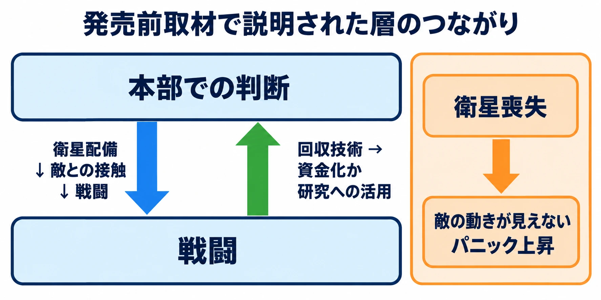

# その判断は、どの階層のものか――戦略・作戦・戦術から、プレイヤーに任せる決断を選ぶ

国の行方を決める判断と、目の前の一手を決める判断。同じ「戦い」を扱うゲームでも、プレイヤーが考えることはどこまで違うのだろうか。

たとえば、次の架空の場面を考えてみる。王国が「交易路を守る」と方針を決める。そのために、どの街道へ部隊を送り、どの順番で橋を確保するかを決める。そして橋の上では、誰を物陰へ移動させ、誰に相手の進路をふさがせるかを決める。

これらをすべてプレイヤーが選ぶゲームも作れる。国の方針と目的地は物語が決め、橋の上の判断だけを任せるゲームも作れる。同じ橋の戦闘でも、前後にどんな判断を置くかによって、一手の意味が変わる。

本稿は「戦術と兵法からバトルをつくる」第1回である。全7回を通して使う判断軸は、次の問いだ。

**どの階層の判断を、プレイヤーに任せるか。**

シリーズで扱う題材は、孫子、ランチェスター、古代の会戦などの古典・史実の戦術論である。兵器の技術や近現代の戦争・紛争には踏み込まず、判断の構造をゲームへ持ち帰る。

***

## 戦い方には、3つの階層がある

### 戦略は大きな方針、戦術は個々の戦闘の進め方

まず、戦略を「大きな目的へ向けた方針」、戦術を「個々の戦闘をどう進めるか」と言い換えてみよう。

『改訂新版 世界大百科事典』の「戦略・戦術」は、戦略を「目標または目的を効果的に達成するための大規模かつ長期的な方法で，戦争の総合的な準備，計画，運用の方法をいう。」と説明する。戦術の説明は、「戦略により定められた構想に従って実際の作戦や戦闘などを効果的に行うための，戦略と比べ小規模かつ短期的な方法をいう。」である。[[1](#ref-1)]

同じ「戦略戦術」のページに掲載された『日本大百科全書（ニッポニカ）』では、山崎馨が、戦術は「戦略の枠内で個々の戦闘を計画・遂行するための通則である。」と説明している。[[1](#ref-1)] 通則とは、いくつもの場面に共通して使う基本的な決まりや考え方のことだ。

大きく見れば、戦略は目的や全体の進め方へ、戦術は目の前の戦闘へと関心を向ける。では、その間にある「どの戦闘を、どんな順序で行うか」はどう捉えればよいのだろうか。

### 作戦は、目的と個々の戦闘をつなぐ

作戦という言葉には、幅のある使い方がある。『日本大百科全書（ニッポニカ）』の「作戦」で、藤井治夫は「一般に戦略は作戦を対象とし、戦術は戦闘を対象とする。」「戦略、戦術が現実に適用、具体化されたものが作戦、戦闘なのである。」と説明する。『世界大百科事典（旧版）』の「軍事作戦」も、戦闘に加えて情報収集や移動、補給などを含む行動を扱い、「戦略･戦術を具体化したもの」としている。[[2](#ref-2)]

ここでは、戦略・戦術という考え方と、それを具体的な行動へ移した作戦・戦闘との関係が説明されている。

一方、判断の階層として三つを区別する説明もある。海上自衛隊幹部学校のコラム「なぜ作戦が必要なのか」で、当時1等海佐の北原浩一は、米軍による三階層の整理を紹介している。戦略・作戦・戦術は「国家の目的と戦術行動の間の関係のモデル」であり、作戦レベルは「「軍隊の戦術的用法を国家の目的に関連付ける」中間のレベル」とされる。[[3](#ref-3)]

平易に言えば、作戦レベルとは、個々の戦闘を大きな目的へつなぐ判断の階層である。同コラムの「戦術レベルにおいては、目前の敵の撃破が注目され」という説明と対にすると、違いをつかみやすい。[[3](#ref-3)]

辞典の「作戦」と、この三階層モデルの「作戦レベル」は、説明の切り口が異なる。本稿では三階層モデルを判断の整理に使い、用語の境界には資料による幅があるものとして扱う。また、この整理を、そのまま古代の人々が使った分類とみなすことも避ける。

冒頭の架空の場面を、このモデルで整理すると次のようになる。表の問いと例は、本稿による説明用の整理である。

| 階層 | 平易に言い換えた問い | 架空の王国での例 |
| --- | --- | --- |
| 戦略 | 何を達成し、全体をどう進めるか | 交易路を守る方針を決め、使える人員や資源を配分する |
| 作戦 | 目的へ向けて、個々の戦闘をどう組み合わせるか | 部隊を送る街道と、橋を確保する順序を決める |
| 戦術 | この戦闘で、どう行動するか | 橋の上での配置、移動、攻撃の対象を決める |

上の階層ほど、扱う時間と範囲はおおむね大きくなる。下の階層ほど、具体的な場所と目の前の行動に近づく。ただし、長時間かかる判断をすべて戦略と呼べるわけではない。何の目的へ向けて、何を決めているかを見ることが大切である。

***

## 階層をまたいで、結果が返ってくる――『XCOM: Enemy Unknown』

ゲーム側の例として、『XCOM: Enemy Unknown』を見てみよう。Firaxisで同作のリードデザイナーを務めたJake Solomon氏への取材を含む、Kevin VanOrdによるGameSpotの記事を手掛かりにする。2012年8月10日付の発売前記事なので、ここで扱うのは取材時点で説明された設計である。[[4](#ref-4)]

記事は、ターン制の戦術戦闘に触れたうえで、それは全体の一部だと述べる。原文の表現は「but that is only part of the alien equation.」である。続いて「The strategy layer is the other keystone of this invasion story.」と書き、本部での研究や施設建設などを、もう一つの柱として紹介している。[[4](#ref-4)]

そこで説明される層のつながりには、往復がある。

- 本部で衛星を配備し、敵と接触すれば戦う必要が生じる。上の層での判断が、戦闘へつながる。
- 戦場で回収した技術は闇市（gray market）で資金にできるが、重要な発見の機会を失いうる。戦闘の成果が、次の資源配分へ返る。
- 衛星の防護が不十分で撃墜されると、敵の動きが見えなくなり、その国のパニックが高まる。防護の失敗が、情報と全体の状況へ響く。[[4](#ref-4)]

### 考察：戦闘の外へ持ち帰るものが、一手を変える

ここからは本稿の考察である。これらの判断は、資源や情報が行き来することでつながっている。戦場で得たものを何に使うか、防護の失敗をどこまで持ち越すかによって、戦闘は全体の進行の一部になる。

兵士・資源・情報のうち、何を次の判断へ持ち越すか。戦術の層の損失が上の層に残る設計なら、目の前の勝利にも、その先へ向けた代償が生まれる。これが、本稿が『XCOM』の例から取り出したい設計上の問いである。

なお、記事が「strategy layer」と呼ぶゲーム上の層には、基地運営などもまとめられている。ゲーム内の呼び名は、その作品の遊びの区分として読み、現実側の三階層との対応は、個々の判断ごとに考えるのがよい。

図は発売前取材で説明された層のつながりを整理したもの。[[4](#ref-4)]

***

## 戦術の階層だけを切り出したジャンル――タクティクスRPG

戦場の配置や行動へ判断を集める設計を考えるなら、タクティクスRPGが手掛かりになる。

『タクティクスオウガ』を手掛けた松野泰己氏は、2023年8月17日公開のファミ通.comの対談で、次のように述べている。[[5](#ref-5)]

> そもそも、このタクティクスRPGは、ボードゲームのウォーシミュレーションの影響を色濃く受け継いだジャンルです。

松野氏は、アバロンヒル社の『タクティクスII』を挙げ、敵軍と自軍がフェーズ、つまりそれぞれの行動する区切りで交互に戦う形式などが、コンピューターゲームに持ち込まれたと説明している。また『タクティクスオウガ』では、疑似3Dのマップによる立体的な戦いと、ユニットの素早さによって敵味方が入り乱れて行動するターンシステムを導入したと述べる。[[5](#ref-5)]

地形と行動順の具体的な設計は、それぞれ第2回と第7回で詳しく扱う予定である。ウォーゲームの手番構造や戦闘結果表については、既存の「読める仕様書」第2回、[『卓上プロトタイプは「実装を待たずに動かせる仕様書」である』](wargame-adjudication-and-tabletop-prototyping.md)を参照してほしい。

### 考察：どこへ判断を集めるかで読む

以下は本稿の考察である。松野氏が挙げた配置や行動順への工夫は、戦術の階層を中心にプレイヤーの判断を組み立てるものとして読める。

国の方針や戦場へ至る道筋を物語が用意すれば、プレイヤーは「この場所で、どう行動するか」へ集中できる。同じマップでも、誰を先に動かし、どこを押さえるかに判断の余地が生まれる。

この節の「戦術の階層だけを切り出す」とは、主な操作と判断の置き場所を指す。作品全体には育成や物語の選択もあり、ジャンルに属するすべての作品の判断を戦術だけに限定する定義ではない。

また、松野氏は同対談で、タクティクスRPGの魅力を「“ごっこ遊び”」という要素として語っている。[[5](#ref-5)] 判断を一つの階層へ集めても、キャラクターへの思い入れや物語を想像する余地まで狭める必要はないだろう。

***

## ゲームへの置き換え――ここからは設計上の考察

現実側の三階層モデルと、ゲーム側の二つの例を重ねると、企画では「任せる判断」と「返す結果」を対で決めると整理しやすい。以下の例は、すべて架空のゲームの設計例である。

### 任せる判断と、用意しておく判断を分ける

橋を舞台にしたタクティクスRPGで、プレイヤーに配置と行動順を考えてほしいとする。この場合、王国の方針は物語が決め、次に行く戦場は固定の進行に任せ、戦闘後の物資補充は自動処理にできる。

プレイヤーが選ばない階層にも、役割はある。物語は「なぜ橋を守るのか」を伝え、固定の進行は「今はここで戦う」という条件を用意する。その条件の中で、プレイヤーが方法を選ぶ。

一方、橋を確保する順序まで選ばせるなら、判断は作戦の階層へ広がる。国の方針や資源配分も選ばせるなら、さらに上の階層へ広がる。どこまで広げるかは、プレイヤーに経験してほしい決断から決める。

### 階層をまたいで運ぶものを決める

複数の階層をつなぐなら、その間を何が行き来するかを書き出したい。

| 行き来するもの | 架空の設計例 | 次の判断に生まれる影響 |
| --- | --- | --- |
| 兵士 | 負傷した隊員は、次の出撃まで休養が必要になる | 今の戦闘で無理をさせるか、次へ備えるか |
| 資源 | 橋の修復に、部隊の準備にも使う物資が必要になる | 通行を回復するか、部隊の準備を優先するか |
| 時間 | 遠回りすると戦闘を避けられるが、到着が遅れる | 損失を抑えるか、期限を守るか |
| 情報 | 偵察で次の戦場の入口が分かる | 調べてから進むか、情報が少ないまま進むか |

こうした持ち越しがあると、戦術の判断に「次の戦闘のために何を残すか」が加わる。上の階層の選択も、次の戦場で使える人員や情報として具体的に返ってくる。

### 失敗が響く範囲を決める

戦闘中の負傷を、戦闘終了時に回復させる設計もできる。休養が必要になり、次の任務へ連れていけなくなる設計もできる。橋の確保に失敗すれば、街道の選び直しが必要になる設計もできる。

上の階層へ結果を持ち越さなければ、戦闘は全体の資源管理から切り離された遊びになり、目の前の問題へ集中しやすくなる。持ち越す範囲を広げれば、失敗後の立て直しも遊びになる。そのぶん、どの行動が後の不利益につながったのかを伝える必要が増す。

たとえば、戦闘終了時に「負傷により次の任務は休養」と示し、出撃画面でも同じ隊員の状態を示す。こうすれば、戦場で起きたことと、その後に選べることの変化をつなげて理解しやすい。

一つの階層へ絞る設計は、判断を深める場所を定める。複数の階層を行き来させる設計は、ある場所での判断が別の場所の条件になる面白さを作る。後者を選ぶときは、画面を増やすだけでなく、その間を運ぶ結果まで設計することになる。

***

## シリーズの予告と、企画書を見直すための点検表

第2回以降は、戦術の階層にある判断を一つずつ取り出す予定である。以下の題目は予定である。

| 回 | 題目（予定） | 主に扱う、プレイヤーの判断 |
| --- | --- | --- |
| 第1回 | 総論（本稿） | どの階層をプレイヤーに任せるか |
| 第2回 | 地形：高い場所と物陰 | どこに立ち、どの経路で動くか |
| 第3回 | 集中：数の差はどれだけの差になるか | 誰を、どの相手や場所へ集めるか |
| 第4回 | 側面と包囲：どこから攻められると崩れるか | どの方向から近づき、どこを守るか |
| 第5回 | 情報：敵の動きをどこまで見せるか | 何を調べ、何を予測して動くか |
| 第6回 | 補給：戦いの外で何が戦いを決めるか | 何を持ち込み、何を使い、いつ戻るか |
| 第7回 | 主導権：誰が先に動けるか | いつ動き、どちらが相手へ対応を迫るか |

第6回の補給は、戦術と、その外側をつなぐ回でもある。戦闘中に使えるものを決める判断と、戦闘前にそれを用意する判断が、どこで接続するかを見る予定だ。地形や情報も、戦略・作戦の階層に関わりうるが、このシリーズではまず一つの戦闘での判断に焦点を合わせる。

企画書を見直すときは、プレイヤーが実際に選べることを拾い、次の点を確認したい。

- プレイヤーに最も考えてほしいのは、大きな方針、戦闘の組み合わせ、目の前の行動のどれか。
- 各階層で、プレイヤーが選べることは具体的に何か。
- プレイヤーが選ばない判断は、自動処理・物語・固定の進行のどこへ任せるか。
- 複数の階層をつなぐなら、兵士・資源・時間・情報の何を持ち越すか。
- 一つの戦闘での失敗は、どこまで後の判断へ響くか。
- その影響が、どの行動の結果なのかをプレイヤーが理解できるか。
- 予定している機能は、任せたい判断を豊かにするか、それとも別の階層の負担を増やすか。

配置の選択を深めるのか、戦場を選ぶところから任せるのか。その違いを決めれば、必要な機能と、物語や自動処理へ任せる部分が見えてくる。バトルを作る入口には、次の問いを置きたい。

**どの階層の判断を、プレイヤーに任せるか。**

## References

1. [「戦略戦術」各辞典の解説][1] — コトバンク、掲載日記載なし。『改訂新版 世界大百科事典』の冒頭定義・「概史」「軍事戦略」の担当は井本熊男、「政治闘争における戦略・戦術」は下斗米伸夫。本稿では冒頭定義を参照。『日本大百科全書（ニッポニカ）』の担当は山崎馨。2026年10月17日閲覧。

[1]: https://kotobank.jp/word/%E6%88%A6%E7%95%A5%E6%88%A6%E8%A1%93-1180546

2. [「作戦」各辞典の解説][2] — コトバンク、掲載日記載なし。『日本大百科全書（ニッポニカ）』（藤井治夫）と、『世界大百科事典（旧版）』「軍事作戦」からの抜粋を参照。後者の執筆者名は同ページの抜粋に記載なし。2026年10月17日閲覧。

[2]: https://kotobank.jp/word/%E4%BD%9C%E6%88%A6-68713

3. [北原浩一「なぜ作戦が必要なのか」][3] — 海上自衛隊幹部学校、コラム207、2021年10月11日。特に「2 作戦とは何か」を参照。掲載日と番号は同校のコラム一覧による。本文末尾に、記述は執筆者個人の見解であり、防衛省・海上自衛隊の統一見解ではない旨の注記がある。2026年10月17日閲覧。

[3]: https://www.mod.go.jp/msdf/navcol/assets/pdf/column207_01.pdf

4. [Kevin VanOrd「XCOM: Enemy Unknown - Dissecting the Strategic Layer」][4] — GameSpot、2012年8月10日。Firaxisへの訪問とリードデザイナーJake Solomonへの取材に基づく発売前記事。本稿は記事で説明された設計を扱い、製品版の全仕様を示すものではない。2026年10月17日閲覧。

[4]: https://www.gamespot.com/articles/xcom-enemy-unknown-dissecting-the-strategic-layer/1100-6390815/

5. [古屋陽一・NiSHi「松野泰己氏がタクティクスRPGの魅力と真髄を語る。『タクティクスオウガ』の精神は脈々と生き続ける【鈴蘭の剣・特別対談】」][5] — ファミ通.com、2023年8月17日。松野泰己と『鈴蘭の剣』ディレクター郭磊の対談。ボードゲームからの継承、『タクティクスオウガ』のアレンジ、および「タクティクスRPGは“ごっこ遊び”」の節を参照。2026年10月17日閲覧。

[5]: https://www.famitsu.com/news/202308/17312800.html

----

この文書は、Perplexity、Claude、ChatGPT の3つのAIの支援を受けて著述されたものです。引用画像を除き、MIT License にて提供されています。
