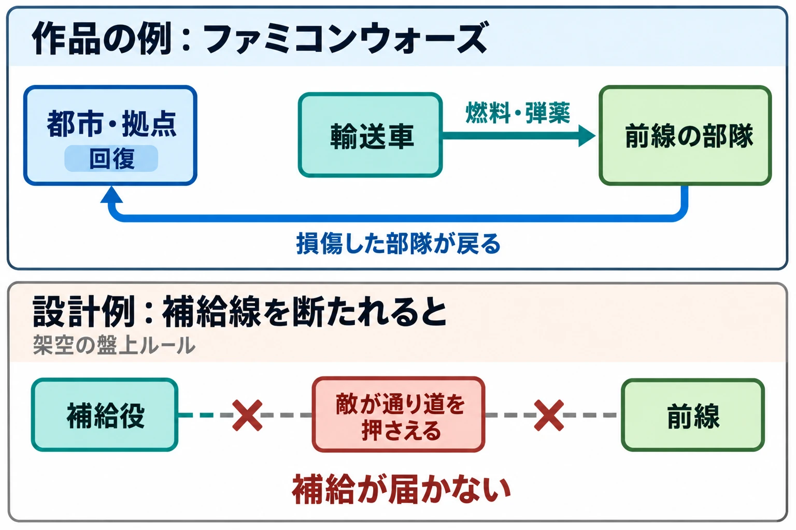

# その消耗は、どこで補えるか――兵站と『孫子』から、補給と消耗を設計する

敵の拠点まで、あと少し。前へ進める部隊は残っているが、弾薬が少ない。傷ついた部隊を戻せば立て直せるものの、その間は前線の味方が減る。補給役を近づけるか、いったん引くか、それとも今ある力で押し切るか。

これは、架空のタクティクスゲームで考えられる場面である。攻撃力や移動力に加えて、使ったものを補える場所が、次の一手を変えている。

[第1回](tactics-strategy-levels-what-player-decides.md)では、補給を、戦闘中に使えるものを決める判断と、戦闘前にそれを用意する判断が、どこで接続するかを見る回として予告した。「戦術と兵法からバトルをつくる」第6回では、その接続を、消耗と回復の仕組みから考える。

今回の判断軸は、次の問いである。

**その消耗は、どこで補えるか。**

何を使うと減るのか。減ったものは、拠点へ戻せば補えるのか、補給役が届けるのか、敵から奪うのか。それとも次の戦闘に入る前に用意するのか。補給の置き方を決めることは、プレイヤーに、どこまで進み、何を守り、いつ立て直してほしいかを決めることでもある。

***

## 戦いは後ろから支えられる――兵站

兵站（へいたん）は、部隊の活動を後ろから支える仕組みである。『改訂新版 世界大百科事典』の「兵站」で、栂博は、作戦軍の生存と活動を維持・増進するため、必要な物資や補充員を送り、死傷者や損傷した兵器などを後方へ送る、諸活動・機関・施設の総称として説明している。[[1](#ref-1)]

同項目は「兵站の中心は補給業務である」と述べる。食糧、燃料、弾薬などを前線へ運ぶために設ける交通路が、兵站線、または後方連絡線である。そこには物資を集める倉庫や補給所なども置かれる。[[1](#ref-1)]

物資と施設を展開した兵站線は、簡単には変えられない。そのため、作戦がこの先どう進むかを見通して道を設け、必要な機関を置くことが重要だと説明される。[[1](#ref-1)] 目の前の部隊を動かす判断は、その後ろで何を届けられるかと結び付いている。

### 考察：運ぶ道と、道の両端を見る

補給をゲームへ置き換えるときは、運ぶ道と、その両端に注目すると考えやすい。送り出す拠点、受け取る前線、その間をつなぐ経路である。

架空のルールとして、拠点に十分な弾薬があっても、補給役が前線まで移動しなければ渡せないゲームを考えてみよう。拠点にある在庫と、今この場で使える弾薬には、距離がある。プレイヤーは攻撃役を進めるだけでなく、補給役が通れる道も確保したくなる。

反対に、味方の拠点とつながっているマスなら、その場で補給を受けられるルールも作れる。この場合は、補給役を一体ずつ動かす代わりに、つながりを保てる位置を選ぶことが判断になる。

同じ「弾薬を回復する」でも、前線まで届く条件によって遊びは変わる。企画書では、補給量だけでなく、出発点、届け方、届く範囲まで書くと、盤上で何を考えてもらうのかが見えやすくなる。

***

## 長引く戦は費用がかさむ――『孫子』作戦篇

『孫子』作戦篇は、大軍を動かすための負担を述べる。遠くへ食糧を運ぶことと、一日ごとの支出が、同じ記述の中にある。[[2](#ref-2)]

> 千里饋糧，則內外之費，賓客之用，膠漆之材，車甲之奉，日費千金

大意は、千里の先へ食糧を送り、内外の費用、来客の接遇、資材、車や武具の維持などをまかなえば、一日に多額の費用がかかる、というものだ。

さらに、戦いが長引くことについて、次のように述べる。[[2](#ref-2)]

> 兵聞拙速，未睹巧之久也

大意は、戦いでは、拙くても速やかに済ませた例は聞くが、巧みに長引かせてよい結果を得た例は見たことがない、ということだ。そして作戦篇の終わりでは、次の言葉にまとめられる。[[2](#ref-2)]

> 兵貴勝，不貴久

大意は、戦いでは勝つことを重んじ、長く続けることを重んじない、というものである。

### 考察：時間が何を減らすかを決める

補給の負担があれば、戦いを早く終える理由が生まれる。この関係は、ゲームのターン数と消耗を結ぶときにも使える。

架空の例として、毎ターン、部隊全体の食糧が減るとする。安全な場所で待つ間にも残量が減るなら、プレイヤーは、十分に備えてから進む安心と、今すぐ進んで消費を抑える利点を比べることになる。

一方、攻撃したときだけ弾薬が減るなら、待つだけでは弾薬を失わない。こちらで生まれやすいのは、早く動く判断より、どの相手に弾を使うかという判断である。消耗する資源を置くことと、戦いを急がせることは、消耗の条件を通じてつながる。

急ぐ理由を作るなら、残り時間と、残りの力との関係を伝えたい。あとどれくらい持つかが分かれば、回復を待つか、余裕のあるうちに攻めるかを考えられる。逆に、補給のために待つことが必要なルールへ、待つほど重い消耗を重ねると、立て直しが苦しくなりやすい。

『孫子』の言葉からゲームの正解を一つに決める必要はない。ここで使えるのは、長引くほど何が失われるかを決めると、戦いを終える判断にも理由が付く、という見方である。

***

## 補給をルールにする――ファミコンウォーズの燃料・弾薬・輸送車・都市

ファミコンウォーズの流れを汲む『Advance Wars』と『Advance Wars 2: Black Hole Rising』は、日本では2004年に『ゲームボーイウォーズアドバンス1+2』としてセットで発売された。そのSwitch版リメイクが『Advance Wars 1+2: Re-Boot Camp』である。[[3](#ref-3)] 作品の紹介は[第3回](tactics-concentration-numbers-widen-or-narrow.md)も参照してほしい。ここでは、リメイク版について英国任天堂が紹介する補給と回復を見る。

公式記事の二つ目のコツは「Don't overlook your APCs」、つまり「輸送車を見落とさない」である。輸送車は歩兵を運ぶだけでなく、部隊の燃料や弾薬も補給できる。[[4](#ref-4)]

> APCs can also refuel and rearm your units!

「輸送車は、部隊への燃料補給と弾薬補給もできる」ということだ。記事は、戦車を敵の本拠地まで進ませること、ロケット砲に弾薬を補充して遠距離攻撃を続けることを、その使い道として挙げる。[[4](#ref-4)]

三つ目のコツでは、都市へ戻って立て直す方法を紹介している。損傷した部隊を都市に置くと、体力が1ターンに2ずつ回復し、そこにいる間は防御も上がる。空港・港・拠点も同様だと説明される。[[4](#ref-4)]

燃料や弾薬を前線へ届ける輸送車と、損傷した部隊が回復する都市。補う対象と場所が、部隊の移動先を考える材料になっている。

### 考察：戻る部隊と、届ける部隊を分ける

架空のタクティクスゲームで、後方の拠点へ戻ると回復でき、補給役を近づけると弾薬を補充できるとする。傷ついた部隊は戻したいが、弾薬だけが少ない部隊には補給役を送って前線に残したい。何が減ったかによって、動かす相手が変わる。

補給役を送るなら、その移動先を守る必要が生まれる。拠点へ戻すなら、部隊が抜けた場所を誰が支えるかを考えることになる。相手側から見れば、補給役の通り道を押さえたり、回復に使う拠点を狙ったりする理由になる。

ここでいう補給線の遮断は、たとえば「敵に通路を押さえられると、補給役が前線へ届かない」という架空の盤上ルールである。道を通れなくなった結果、補給を受けられない場所ができる。敵を直接倒すことに加えて、戦い続ける条件を崩す目標を置けるのである。

補給役を守るために、攻撃役を一部後ろへ回すか。回復用の拠点を残すために、別の場所への進出を遅らせるか。補給の仕組みがあれば、強い部隊を集める場所にも、複数の理由を持たせられる。

***

## 現地で補う――『孫子』の「因糧於敵」

『孫子』作戦篇は、必要なものをすべて遠くから運ぶ負担にも目を向ける。[[2](#ref-2)]

> 取用於國，因糧於敵

大意は、必要な用具や費用は自国で調達し、食糧は敵地でまかなう、というものである。続いて、敵から食糧を得る価値を、次のように表す。[[2](#ref-2)]

> 智將務食於敵，食敵一鍾，當吾二十鍾

大意は、知恵ある将は敵地で食糧をまかなうことに努め、敵の食糧一鍾を得ることは、自国から運ぶ二十鍾に相当する、ということだ。「鍾」は容量の単位であり、ここでは遠くから運ぶ負担の大きさが示されている。

### 考察：前へ出るほど、補う場所が近くなる

この見方をゲームへ置き換えると、進んだ先で補給できる仕組みを考えられる。奪った拠点で回復できる、敵の持ち物を手に入れて使える、といった設計である。

ファミコンウォーズの例でも、英国任天堂の記事は、建物の占領を収入につながる行動として紹介したうえで、都市などでの回復を説明する。[[4](#ref-4)] 都市を占領することは、資金を得ることに加え、進んだ先に回復の場を持つこととも結び付く。

架空のマップに、自分の拠点から遠い中間地点の回復施設を置くとしよう。そこを確保すれば、傷ついた部隊が出発地点まで戻る必要はなくなる。施設へ近づく間は消耗するが、確保できれば、その先の行動を続けやすくなる。

すると、前進には、敵へ近づく危険と、補給を楽にする利点の両方が生まれる。後方で万全になるまで待つか、残りの力を使って次の補給場所を取りに行くかを選べるのである。

一方、勝っている側が次々と補給場所を得ると、さらに攻め続けやすくなる。架空の設計なら、占領後に回復を始めるまで時間を置く、確保しやすい施設を後退側にも残す、といった調整も考えられる。補給場所を奪う面白さと、押された側が立て直せる余地を合わせて見たい。

***

## 消耗をやめる、何を残すか――ファイアーエムブレム エンゲージ

消耗させる対象そのものを選び直した例として、『ファイアーエムブレム エンゲージ』を見てみよう。

AUTOMATONの2023年1月7日の記事は、GameSpotが前日に公開した先行プレイ動画の内容を紹介している。その報道によれば、本作では、武器を一定回数使うと壊れる耐久値の仕組みが撤廃された。『ファイアーエムブレムif』など、近年の一部作品でも撤廃されていた仕組みである。[[5](#ref-5)]

同記事によると、GameSpotがプレイした範囲では、杖には使用回数の限りがあったという。[[5](#ref-5)] 武器の耐久値をなくす一方で、使用回数に限りがある道具も残るという紹介である。

### 考察：消耗の対象を選べば、残す判断も変わる

ゲームで何を消耗させるかは、個別に選べる。通常の攻撃に使う武器、回復の道具、特別な攻撃のための弾薬など、それぞれに回数を設けるかどうかを決められる。

架空の例として、武器は使い続けられ、回復道具だけに回数があるゲームを考えよう。攻撃のたびに武器の残り回数を数える必要はなくなるが、被害を受けた後、今ここで回復道具を使うかという判断は残る。

その回復道具を戦闘中に補えなければ、持ち込む数と使う場面がつながる。戦闘が終わるたびに回数が戻るなら、今回の戦いの中でどう配分するかが中心になる。同じ道具でも、補える時点によって、気にする先の長さが変わるのである。

これは、消耗をすべてなくすか、すべて残すかという二択を、対象ごとに分けて考える方法だ。何を減らすかを選べば、何を節約するか、どの準備に意味を持たせるかも選び直せる。

***

## ゲームへの置き換え――ここからは設計上の考察

ここまでの例を、消耗をどこまで持ち越すかという単位で整理してみよう。表の「戦闘」は、攻撃一回ではなく、一つのマップや遭遇戦の始まりから終わりまでを指す。

| 消耗の単位 | 架空の設計例 | 補う場所・時点 | 生まれる判断 |
| --- | --- | --- | --- |
| 1回の戦闘の中 | 弾薬や体力が減り、戦闘後には元に戻る | 盤上の拠点、補給役のユニット、敵から奪う場所 | 今の前線を維持するか、戻って立て直すか |
| 戦闘をまたぐ | 道具の残量や部隊の損傷を次の戦闘へ持ち越す | 戦闘間の準備画面、途中で立ち寄る拠点 | 今使うか、次の戦闘へ残すか。誰を休ませるか |
| 作戦・キャンペーン全体 | 複数の戦闘で共通の資金や物資を使う | 全体を管理する準備画面、補給拠点、敵から得た物資 | どの戦線へ物資を回し、どの部隊を維持するか |

本文の作品がすべての項目でこの分類どおりという意味ではない。表は、企画書で選べる消耗の範囲と補給方法を整理したものである。

同じ「弾薬が減る」でも、今回のマップで使い切ってよいのか、次のマップへ残す必要があるのかで、攻撃を選ぶときの見通しが変わる。まずは、何がいつ元に戻るかを決めたい。

### 補う場所が、動かす相手を変える

補給の場所は、持ち越しの単位とは別に選べる。盤上に置くなら、どこへ移動するかが問われる。戦闘の外へ置くなら、何を準備して入るかが問われる。

- **拠点**：部隊がそこへ戻って補う。戻る経路と、前線から離れる間を考える。
- **補給役のユニット**：必要な場所へ補給を届ける。誰に届けるか、どこを通るか、その移動をどう守るかを考える。
- **敵から奪う場所**：前進や占領の結果として補う。残りの力で次の補給場所まで届くかを考える。
- **戦闘の外の準備画面**：出撃前に物資を整える。持ち込む量や配分、次の戦闘へ残す分を考える。

これらは組み合わせられる。たとえば、準備画面で補給役に弾薬を積み、戦闘中はその補給役から受け取り、損傷は拠点へ戻って回復する、といった架空の構成である。戦闘前の選択が、盤上で使える補給の範囲として現れる。

上段は英国任天堂が紹介する補給と回復の仕組みを整理したもの。[[4](#ref-4)] 下段は、補給役の通り道を敵が押さえる架空の設計例である。

### 補給を通じて、判断の階層をつなぐ

[第1回](tactics-strategy-levels-what-player-decides.md)で扱った戦術・作戦・戦略の区別へつなぐなら、目の前の戦闘で誰を戻すかは戦術の判断として置ける。複数の戦闘を見越して、どの拠点を経由し、どこで補うかを組み立てるのは、作戦の判断として考えやすい。全体の資金や物資をどの部隊へ割り当てるかまで扱えば、戦略の判断へ広がる。

この対応は、ゲームで任せる判断を整理するためのものだ。資源が長く持ち越されるだけで、自動的に戦略の遊びになるわけではない。プレイヤーが配分先や進路を選び、その結果が次の戦闘の選択へ届くことで、階層のつながりが生まれる。

架空のキャンペーンで、出撃前に「補給役を多く用意するか、攻撃役を多く用意するか」を選ぶとしよう。前者なら前線に長くとどまりやすい。後者なら、持ち込んだ力で短く決着させたい。準備で選んだ構成が、戦闘中に戻るか進むかの判断に表れるのである。

### 補う操作に、選ぶ余地を残す

補給を入れたときは、試遊で何を迷っているかを見たい。どの部隊を先に回復するか、どの補給場所を確保するかを迷っているなら、仕組みが判断を生んでいる。毎回、安全な場所で同じ回復操作を繰り返すだけなら、その手順を短くする余地がある。

たとえば、敵をすべて倒した後で、残った部隊を順番に拠点へ戻すだけの時間があるとする。戦闘後の損傷を持ち越す設計なら、帰還に費用を付けて選択にする方法も、準備画面でまとめて整備できる方法も考えられる。何を選ばせたいかによって、必要な操作は変わる。

また、補給を失った側にも、次に選べる行動があるかを見たい。別の拠点へ戻れる、残った部隊をまとめて道を開ける、物資を使わない方法へ切り替えるなど、立て直し方を残せる。補給を狙う手に意味を持たせながら、失った後も判断が続く形を探すのである。

***

## 企画書を見直すための点検表

「燃料が減る」「拠点で回復する」と書いたら、次の問いで具体化できる。

- 体力、燃料、弾薬、道具、資金のうち、何を消耗させるか。それぞれの消耗は、どの選択を生むか。
- 減る条件は、攻撃、移動、被害、ターン経過のどれか。長引くほど何を失うかが伝わるか。
- 消耗は一つの戦闘で戻るか、次の戦闘へ持ち越すか。プレイヤーは、どこまで先を見て使えばよいか分かるか。
- 補う場所は、拠点、補給役、敵から奪う場所、準備画面のどこか。部隊を戻す判断と、補給を届ける判断のどちらを任せたいか。
- 補給を守る側と狙う側には、どの経路や場所を選ぶ余地があるか。補給を失った後にも立て直す方法があるか。
- 前進して補給場所を得る利点と、途中で消耗する危険が釣り合うか。押された側にも回復の機会が残るか。
- 消耗を一つなくしたら、どの判断が減り、どの判断が残るか。補給の操作は、選択につながる時間になっているか。

補給は、攻撃を続ける力を届けると同時に、戻る理由や、次の場所を取りに行く理由を作る。何を減らし、どこで取り戻せるかによって、同じ地図にも違う目標を置ける。

**その消耗は、どこで補えるか。**

この問いを、資源ごとに置いてみよう。戦闘前に用意したものが盤上でどう使われ、盤上で失ったものが次の準備へどう返るかまでつなげれば、補給は戦いの内と外を結ぶ設計になる。

## References

1. [「兵站」各辞典の解説][1] — コトバンク、掲載日記載なし。『改訂新版 世界大百科事典』、栂博。定義、陸上兵站の補給業務、兵站線の設定を参照。2026年10月19日閲覧。

[1]: https://kotobank.jp/word/%E5%85%B5%E7%AB%99-128980

2. [孫武『孫子兵法』][2] — 維基文庫、掲載日記載なし。通行本の原文。作戦篇を参照。編名の日本語表記は[コトバンク「孫子」](https://kotobank.jp/word/%E5%AD%AB%E5%AD%90-90609)の『日本大百科全書（ニッポニカ）』に合わせた。本文中の大意は本稿による。2026年10月19日閲覧。

[2]: https://zh.wikisource.org/zh-hant/%E5%AD%AB%E5%AD%90%E5%85%B5%E6%B3%95

3. [Taijiro Yamanaka「Nintendo Switch『Advance Wars 1+2: Re-Boot Camp』が海外発表。『ゲームボーイウォーズアドバンス1+2』のリメイク版」][3] — AUTOMATON、2021年6月16日。原作2作と日本での発売形態、リメイク版との関係を参照。2026年10月19日閲覧。

[3]: https://automaton-media.com/articles/newsjp/20210616-165635/

4. [Nintendo「5 Tips To Triumph In Advance Wars 1+2: Re-Boot Camp」][4] — Nintendo UK、2023年5月8日。「2. Don't overlook your APCs」「3. Retreat to safety」を参照。本文中の日本語訳は本稿による。2026年10月19日閲覧。

[4]: https://www.nintendo.com/en-gb/News/2023/May/5-Tips-To-Triumph-In-Advance-Wars-1-2-Re-Boot-Camp-2383501.html

5. [Hideaki Fujiwara「『ファイアーエムブレム エンゲージ』では武器の耐久値が廃止へ。ほかにも懐かしさと遊びやすさ要素を盛り込み」][5] — AUTOMATON、2023年1月7日。GameSpotが1月6日に公開した先行プレイ動画を紹介した報道。武器耐久値と、先行プレイの範囲での杖の使用回数の説明を参照。2026年10月19日閲覧。

[5]: https://automaton-media.com/articles/newsjp/20230107-233040/

----

この文書は、Perplexity、Claude、OpenAI Codex の3つのAIの支援を受けて著述されたものです。引用画像を除き、MIT License にて提供されています。
