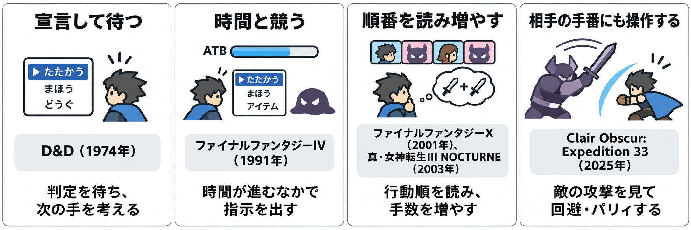
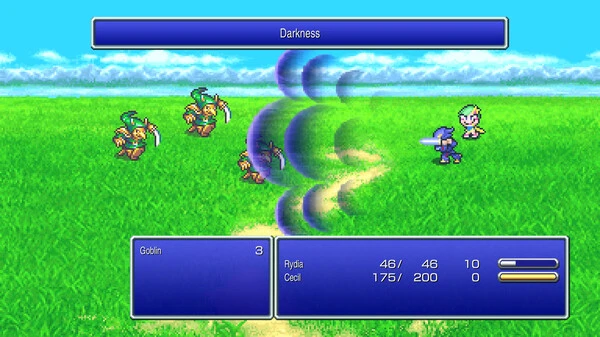
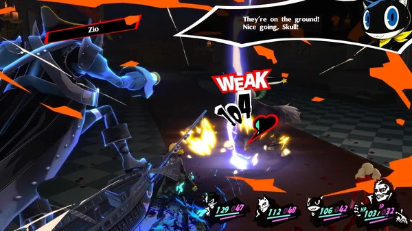
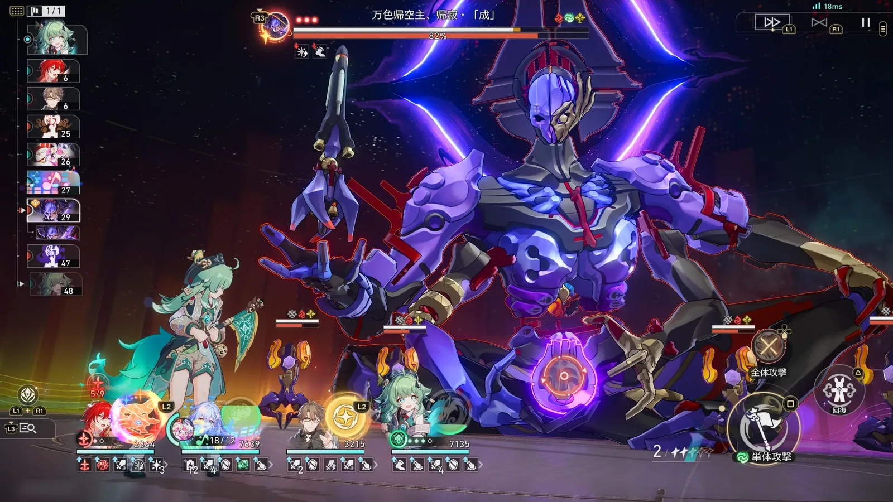
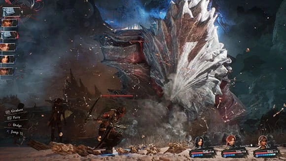

# ターンの間、プレイヤーは何をしているのか——D&Dから『Clair Obscur』まで、ターン制RPGの戦闘の変遷

> 2026年11月12日改版：記事全体を全面的に書き直しました。内容の変更はGitの履歴から追えます。

## はじめに

「ターン制は古い」という見方は、欧米を含む世界市場へ大作RPGを届けるとき、どんな操作なら新しいプレイヤーに届くのかという議論に現れる。『ファイナルファンタジーXVI』（以下『FFXVI』）のプロデューサー、吉田直樹氏は、ボタンを押すだけでキャラクターが剣を振る表現が当たり前になり、RPGを普段遊ばない若い層を中心にコマンド選択への見方が変わってきたとして、アクション寄りの戦闘を選んだ。吉田氏自身はコマンドRPGの面白さを知っており、今後も作りたいと述べている。想定する販売規模と、シリーズの新作に求められる反響を踏まえた判断だった。[[1](#ref-1)]

『メタファー：リファンタジオ』のリードバトルプランナーを務めた後藤健一氏も、世界に向けて作品を発売する機会が増えるなか、日本で培ってきたRPGの形式を現代のプレイヤーに向けて作り直す必要があったと語っている。同作では、フィールドでのアクションと、コマンドを選ぶターン制戦闘を一つの作品に収めた。[[2](#ref-2)][[3](#ref-3)]

そこで、戦闘方式の名前から、プレイヤーが手を動かす場面に視点を移してみたい。 **ターンの間、プレイヤーは何をしているのか。** 歴史をたどると、宣言して結果を待つ、時間と競う、順番を読んで手数を増やす、相手の手番にも操作する、という四つの答えが見えてくる。各段階は登場時期が重なり、後の作品にも並んで残っている。一つの戦闘のなかで複数が組み合わさることもある。

***

## 宣言して、結果を待つ

1974年に登場した卓上RPG『ダンジョンズ＆ドラゴンズ』（D&D）では、プレイヤーが自分のキャラクターの行動を言葉で伝え、進行役がルールやサイコロの出目をもとに結果を裁定する。剣を振ると宣言すれば、命中するかどうかが判定され、その結果を受けて次の行動を考える。宣言と結果の間には、卓を囲む人が判定を行い、その結果を共有する時間がある。[[4](#ref-4)][[5](#ref-5)]

1981年の『Wizardry』と『Ultima』では、コンピュータがルールに沿った処理を受け持つようになった。卓上で言葉にしていた指示は画面上の入力に置き換わり、判定の結果も画面に返る。『Wizardry』で一行を率いて迷宮を進むにせよ、『Ultima』で広いフィールドを歩くにせよ、プレイヤーは返ってきた結果をもとに次の指示を出せる。[[6](#ref-6)][[7](#ref-7)][[8](#ref-8)]

1986年の『ドラゴンクエスト』は、『Wizardry』を思わせるターン制戦闘と、『Ultima』を思わせるフィールド探索をファミコンに持ち込んだ。多根清史氏は、この仕事を「編集」と捉える。堀井雄二氏らは、コンピュータRPGに馴染みのない読者に雑誌のページをめくってもらうように、画面に出す情報の量や、プレイヤーが新しい仕組みに触れる順序を組み立てた、という見方である。[[8](#ref-8)]

たとえば前の攻撃で敵を倒しきれなかったとき、次も攻めるか、先に回復するかを考えられる。結果が出るまでの間や、次の入力までの間は、直前の出来事を読み取って方針を立てる時間として働いた。

***

## 時間と競う

『ファイナルファンタジーIV』（1991年）の **ATB（アクティブタイムバトル）** は、戦闘中の時間経過によってキャラクターが行動できるようになる仕組みである。スクウェアの特許明細書では、キャラクターごとに定めた時間を数え、所定の時間が経つとコマンドを入力できる。計時は一定の間隔で進み、行動と次の行動に向けた計時が繰り返される。キャラクターごとの待ち時間の長短には、素早さの違いが表れる。[[9](#ref-9)][[10](#ref-10)]

*画像引用: [Steam - FINAL FANTASY IV](https://store.steampowered.com/app/1173800/FINAL_FANTASY_IV/) / 『FINAL FANTASY IV』ピクセルリマスターの戦闘画面。本文中のATB解説のため引用。*

この設計では、誰かが指示を待っている間にも、ほかの味方や敵は行動できる時点に近づいていく。回復役の順番が来たとき、どの魔法を使うか迷っている間に敵が動くこともある。何を選ぶかに加えて、いつまでに決めるかが戦闘の手触りを変える。

アクティブモードではコマンド選択中にも時間が進み、ウェイトモードではコマンド選択の特定の場面で時間が止まる。時間が進む緊張感を楽しむか、選択肢を落ち着いて吟味する余地を持つか。同じ戦闘システムでも、考えている間の時間をどう扱うかは、プレイヤーが設定で選べた。[[10](#ref-10)][[11](#ref-11)]

***

## 順番を読み、増やす

『ファイナルファンタジーX』（2001年）の **CTB（カウントタイムバトル）** は、キャラクターの素早さと選んだ行動に応じて次の手番までの間隔が決まる仕組みである。画面右上には敵と味方の行動順が並ぶ。次の手番までの間隔が長い技なら、その間に敵が何度か動くかもしれない。今の一手の効果と、そのあと誰が動くかを同じ画面で考えられる。[[12](#ref-12)]

『真・女神転生III NOCTURNE』（2003年）で初めて実装された **プレスターン** は、陣営ごとに行動の持ち分を持ち、攻撃の結果によって使える手数が変わる仕組みである。弱点を突けば行動回数が増え、攻撃をかわされたり、反射・吸収されたりすると減る。敵側にも同じルールが働くため、味方の弱点を守ることは、敵の手数を抑えることにもつながる。[[13](#ref-13)][[14](#ref-14)][[15](#ref-15)]

『ペルソナ』シリーズの **1MORE（ワンモア）** は、弱点を突くか、クリティカル（会心の一撃）を出して敵をダウンさせたキャラクターが、続けて行動できる仕組みである。『ペルソナ5』のバトンタッチでは、その追加行動を仲間に託せる。たとえば次の敵の弱点を突ける仲間に渡せば、いま得た一手を、さらに攻撃をつなげるために使える。[[16](#ref-16)][[17](#ref-17)]

*画像引用: [Steam - ペルソナ５ ザ・ロイヤル](https://store.steampowered.com/app/1687950/Persona_5_Royal/) / 『ペルソナ５ ザ・ロイヤル』の戦闘画面。本文中のワンモアバトル解説のため引用。*

『崩壊：スターレイル』（2023年）では、画面に表示された行動順を見ながら、パーティで共有する **SP（戦闘スキルを使うためのポイント）** を配分する。通常攻撃でSPをためておけば、後続の仲間が戦闘スキルに使える。敵の弱点に対応する属性で靭性ゲージを削り切ると「弱点撃破」が起き、敵の次の行動が遅れる。必殺技は通常の順番に割り込んで使えるので、敵が動く直前に撃って弱点撃破を狙うこともできる。[[18](#ref-18)][[19](#ref-19)][[20](#ref-20)]

*画像引用: 編者撮影 / 『崩壊：スターレイル』の戦闘画面（©COGNOSPHERE）。本文中のバトルシステム解説のため引用。*

この段階では、誰に何回行動させるか、敵が動く前にどの行動を差し込むかが、戦略の資源になる。同じ攻撃でも、敵の手番の前に使えるなら、その手番を遅らせるところまで見込んで選べる。

***

## 相手の手番にも操作する

タイミング入力を取り入れる発想は、行動順の表示や追加行動が広がるより前にもあった。『スーパーマリオRPG』（1996年）の **アクションコマンド** では、攻撃に合わせてボタンを押したり、技に応じて連打したりすると、効果が高まる。敵の攻撃に合わせた入力で、受けるダメージを減らすこともできる。コマンドを決めたあとも、キャラクターの動きを見て押す瞬間を計る。[[21](#ref-21)][[22](#ref-22)]

アクションで知られてきたシリーズが、ターン制へ転じた例もある。『龍が如く7 光と闇の行方』（2020年）は、従来型のアクション戦闘で開発が進んでいた。開発陣によれば、エイプリルフール企画でRPG風の戦闘を映像にしたところ反響があり、それをきっかけにターン制へ切り替えたという。開発陣にとって映像への反応は、シリーズに新しい戦闘方式を持ち込む判断材料になった。[[23](#ref-23)]

『Sea of Stars』（2023年）も、攻撃や防御のアニメーションに合わせてボタンを押すタイミング入力を取り入れた。タイミングが合えば、与えるダメージを増やしたり、受けるダメージを減らしたりできる。[[24](#ref-24)][[25](#ref-25)]

『Clair Obscur: Expedition 33』（2025年）の開発元は、戦闘を **リアクティブなターン制** と呼ぶ。自分の手番では技を選び、技によってはタイミング入力で効果を高める。敵の手番にも攻撃の動きに合わせて回避したり、 **パリィ（攻撃を受け流して反撃につなげる操作）** を狙ったりできる。画面には行動順も表示されるため、先の手を考えることと、目の前の攻撃に反応することが同じ戦闘に収まっている。[[26](#ref-26)][[27](#ref-27)]

*画像引用: [セガ - Clair Obscur: Expedition 33](https://www.sega.jp/game/detail/expedition33/) / 公式スクリーンショット。本文中のリアクティブターン制解説のため引用。*

ここで変わるのは、結果が出るまでの時間の使い方だ。次の指示を考える余地を残しながら、敵が攻撃している数秒を、手元の操作で結果に関われる時間に変えている。

***

## 「古い」という見方は覆ったのか

『ペルソナ5』は、The Game Awards 2017でBest RPGを受賞した。The Game Awards 2025では『Clair Obscur: Expedition 33』がGame of the Yearに選ばれ、同賞で単一作品として最多となる9部門を受賞した。開発元と販売元は、発売1周年に当たる2026年4月24日に累計販売本数が800万本を超えたと発表した。[[28](#ref-28)][[29](#ref-29)][[30](#ref-30)][[31](#ref-31)]

『崩壊：スターレイル』は、AppMagicの推計を報じたPocketGamer.bizによると、発売から約23か月でApp StoreとGoogle Playを合わせたプレイヤーの累計支出額が20億ドルを超えた。賞、販売本数、モバイルでの支出額はそれぞれ異なる指標だが、ターン制を採用した作品が、複数の市場や評価の場で大きな反響を得た例である。[[32](#ref-32)]

Larian Studiosのパブリッシング・ディレクター、マイケル・ダウス氏は、こうした作品の成功を受け、現代に作られるターン制の『ファイナルファンタジー』にも十分な観客がいるという見方を示した。ダウス氏は、ターン制がシリーズの描こうとする感情を伝えるうえで相性がよいと考えつつ、戦闘方式を選ぶ判断は作り手に委ねるべきだとしている。[[33](#ref-33)]

受賞や販売の実績から読み取れるのは、古いと見られていた形式が、手数をつなぐ遊びや敵の攻撃に反応する遊びを取り込み、現代の作品として評価を得たということだ。『メタファー：リファンタジオ』の後藤氏も、かつてはターン制が時代遅れになりつつあると感じていたが、開発を経て、現代のプレイヤーが求めるものと作品の狙いを見定めれば、ターン制には長い未来があると考えるようになった。[[2](#ref-2)][[3](#ref-3)]

***

## プランナーが持ち帰れること

戦闘の試作では、プレイヤーがコマンドを確定してから次のコマンドを確定するまでを一度観察してみるとよい。たとえば味方の体力が減った場面で、結果を見て次の方針を **考えさせる** のか、時間が進むなかで決断を **急かす** のか、誰が先に動くかを **読ませる** のか、敵の攻撃をしのぐ操作に **参加させる** のか。同じ危機でも、置きたい面白さによって必要な画面表示や入力が変わる。

四段階は、作品の狙いに応じて組み合わせられる道具である。急いで決める緊張感を持たせたいなら、ATBのアクティブとウェイトのように、考える時間を設定で調整できる余地がある。敵の手番にも参加させたいなら、攻撃の予兆の読みやすさや入力を受け付ける時間の幅も一緒に考えたい。たとえば回避は押すタイミングに余裕を持たせ、反撃を狙うパリィではより正確な入力を求める設計なら、同じ攻撃に対してプレイヤーが難しさを選べる。

試遊でプレイヤーが手を止めたとき、次の手を楽しんで考えているのか、何を見ればよいか迷っているのかで、直す箇所は変わる。コマンドの一覧を見ているなら選択肢の説明、行動順を追っているなら順番が変わる理由、敵の動きを見ているなら攻撃の予兆が手がかりになる。ターンとターンの間に何をしてほしいかを決めると、その時間に画面が何を伝えるべきかも具体的になる。

## References

1. [Jordan Middler「Final Fantasy 16 ditched turn-based combat to appeal to younger generations, producer says」][1] — VGC、2022年7月14日。ファミ通の吉田直樹氏インタビューの紹介。

[1]: https://www.videogameschronicle.com/news/final-fantasy-16-ditched-turn-based-combat-to-appeal-to-younger-generations-producer-says/

2. [Catherine Lewis「Metaphor: ReFantazio dev once thought turn-based JRPG combat “was starting to get outdated,” but now thinks the format has a “long future ahead”」][2] — GamesRadar+、2025年3月25日。GDC講演とPC Gamerのインタビューの紹介。

[2]: https://www.gamesradar.com/games/jrpg/metaphor-refantazio-dev-once-thought-turn-based-jrpg-combat-was-starting-to-get-outdated-but-now-thinks-the-format-has-a-long-future-ahead/

3. [Wes Fenlon「Metaphor: ReFantazio battle director says turn-based RPGs can still be just as popular as action RPGs」][3] — PC Gamer、2025年3月24日。後藤健一氏のインタビューとGDC講演。

[3]: https://www.pcgamer.com/games/rpg/metaphor-refantazio-battle-director-says-turn-based-rpgs-can-still-be-just-as-popular-as-action-rpgs-i-personally-believe-turn-based-games-have-a-long-future-ahead-of-them/

4. [ACMI「Dungeons & Dragons」][4] — ACMI収蔵資料、1974年の初版。

[4]: https://www.acmi.net.au/works/125386--dungeons-dragons/

5. [The Strong National Museum of Play「Dungeons & Dragons: The First 50 Years of Storytelling」][5] — Google Arts & Culture。サイコロによる判定の解説。

[5]: https://artsandculture.google.com/story/jwUhqeUB49cvBg

6. [Digital Eclipse「Wizardry: Proving Grounds of the Mad Overlord FAQ & Info」][6] — Digital Eclipse。Apple II版の発売年。

[6]: https://www.digitaleclipse.com/media/wizardry-faq

7. [The Strong National Museum of Play「The Influence of Dungeons and Dragons on Video Games」][7] — The Strong National Museum of Play。初期のコンピュータRPGへの影響。

[7]: https://www.museumofplay.org/blog/the-influence-of-dungeons-and-dragons-on-video-games/

8. [多根清史「初代ドラクエはRPGへの逆風の中に生まれた――“ドラクエ以前”の国内RPG史に見る『苦闘』の歴史」][8] — 電ファミニコゲーマー、2016年5月25日。「ゲーム語りの基礎教養」第1回。

[8]: https://news.denfaminicogamer.jp/column03/game-gatari01

9. [任天堂「ファイナルファンタジーIV」][9] — Wii バーチャルコンソール。スーパーファミコン版の発売日とATBの紹介。

[9]: https://www.nintendo.co.jp/wii/vc/vc_ff4/vc_ff4_01.html

10. [坂口博信・伊藤裕之「Video game apparatus, method and device for controlling same」][10] — 米国特許第5,390,937号、スクウェア、1992年3月16日出願、1995年2月21日登録。明細書と請求項。

[10]: https://patents.google.com/patent/US5390937A/en

11. [スクウェア・エニックス「ファイナルファンタジーIV アドバンス 取扱説明書」][11] — 任天堂掲載PDF。「せってい」のバトルモードを参照。

[11]: https://www.nintendo.co.jp/data/software/manual/manual_WUPNPDSJ.pdf

12. [スクウェア・エニックス「FINAL FANTASY X｜X-2 HD Remaster」][12] — 公式サイト。「CTB（カウントタイムバトル）」を参照。

[12]: https://www.jp.square-enix.com/ffx_x-2HD/sp/system/

13. [Game*Spark編集部「『真・女神転生』って何がスゴいの？ 人気の理由って？」][13] — Game*Spark、2024年6月14日。3ページ目のプレスターン解説。

[13]: https://www.gamespark.jp/article/2024/06/14/142359_3.html

14. [アトラス「真・女神転生III NOCTURNE HD REMASTER」][14] — 公式サイト。「SYSTEM」のバトルを参照。

[14]: https://shin-megamitensei.jp/3hd/system/

15. [ファミ通.com編集部「『真・女神転生3 ノクターン HDリマスター』基本攻略。バトルのコツや序盤のお役立ち豆知識を紹介！」][15] — ファミ通.com、2020年10月29日。「プレスターンバトルのコツ」を参照。

[15]: https://www.famitsu.com/news/202010/29208378.html

16. [アトラス「ペルソナ５ 怪盗ライフ」][16] — 作品公式サイト。「進化した爽快バトル」を参照。

[16]: https://persona5.jp/phantom_life/

17. [アトラス「ペルソナ３ リロード」][17] — 公式サイト。「バトルシステム」で1MOREと『ペルソナ5』のバトンタッチに言及。

[17]: https://p3re.jp/

18. [HoYoverse「Honkai: Star Rail hits PS5 on October 11 — new story and combat details revealed」][18] — PlayStation.Blog、2023年9月14日。「Combat 101: Fundamentals of Combat」を参照。

[18]: https://blog.playstation.com/2023/09/14/honkai-star-rail-hits-ps5-on-october-11-new-story-and-combat-details-revealed/

19. [HoYoverse「Boarding Preparation Special Program」][19] — 作品公式放送、2023年3月24日。戦闘システムの紹介。

[19]: https://www.youtube.com/watch?v=yNhUruXu-04

20. [江波戸るく「大作感漂うHoYoverse新作がエモい…！ 銀河を列車で旅する『崩壊：スターレイル』世界観・システムまとめ」][20] — 電撃オンライン、2023年2月10日。行動順と必殺技の発動タイミングの紹介。

[20]: https://dengekionline.com/articles/167228/

21. [任天堂「スーパーマリオRPG」][21] — Wii バーチャルコンソール。スーパーファミコン版の発売日とアクションコマンドの紹介。

[21]: https://www.nintendo.co.jp/wii/vc/vc_smr/vc_smr_01.html

22. [任天堂「スーパーマリオRPG アクションコマンド」][22] — Wii バーチャルコンソール。敵の攻撃への入力を参照。

[22]: https://www.nintendo.co.jp/wii/vc/vc_smr/vc_smr_08.html

23. [Alissa McAloon「Yakuza: Like a Dragon's turn-based combat came from an April Fools joke that went too well」][23] — Game Developer、2020年11月19日。開発陣の説明を報道。

[23]: https://www.gamedeveloper.com/design/-i-yakuza-like-a-dragon-i-s-turn-based-combat-came-from-an-april-fools-joke-that-went-too-well

24. [Sabotage Studio「Sea of Stars」][24] — 公式プレスキット。「Features」を参照。

[24]: https://sabotagestudio.com/presskits/sea-of-stars/

25. [Sabotage Studio「Sea of Stars: Sunset Edition」][25] — Steam公式ストア。「このゲームについて」のタイミング入力を参照。

[25]: https://store.steampowered.com/app/1244090/Sea_of_Stars/

26. [Sandfall Interactive「Expedition 33 Launches in 2025!」][26] — 作品公式サイト、2024年6月9日。リアクティブなターン制とリアルタイムの防御操作の紹介。

[26]: https://www.expedition33.com/post/news-expedition-33-announce

27. [Sandfall Interactive「Your first look at gameplay from Clair Obscur: Expedition 33」][27] — 作品公式サイト、2024年8月28日。「Combat」を参照。

[27]: https://www.expedition33.com/post/your-first-look-at-gameplay-from-clair-obscur-expedition-33

28. [ファミ通.com編集部「“The Game Awards 2017”全アワードの受賞作品を紹介」][28] — ファミ通.com、2017年12月8日。Best RPGの項を参照。

[28]: https://www.famitsu.com/news/201712/08147682.html

29. [The Game Awards「2025 Rewind」][29] — The Game Awards公式アーカイブ、2025年12月11日開催。受賞一覧。

[29]: https://thegameawards.com/rewind/year-2025

30. [Guinness World Records「Most Game Awards won by a videogame in a single year」][30] — Guinness World Records、2025年12月11日の記録。

[30]: https://www.guinnessworldrecords.com/world-records/781348-most-game-awards-won-by-a-videogame-in-a-single-year

31. [Sal Romano「Clair Obscur: Expedition 33 sales top eight million」][31] — Gematsu、2026年4月24日。開発元と販売元の発表を報道。

[31]: https://www.gematsu.com/2026/04/clair-obscur-expedition-33-sales-top-eight-million

32. [Aaron Astle「Honkai: Star Rail rockets past $2bn on mobile in under two years」][32] — PocketGamer.biz、2025年3月25日。AppMagicによるモバイル支出額の推計。

[32]: https://www.pocketgamer.biz/honkai-star-rail-rockets-past-2bn-on-mobile-in-under-two-years/

33. [Carlos Zotomayor「Baldur’s Gate 3 publishing director weighs in on the potential success of a modern turn-based Final Fantasy」][33] — AUTOMATON WEST、2025年7月15日。マイケル・ダウス氏のXでの発言を紹介。本文は発言の大意。

[33]: https://automaton-media.com/en/news/baldurs-gate-3-publishing-director-weighs-in-on-the-potential-success-of-a-modern-turn-based-final-fantasy/

----

この文書は、Perplexity、Claude、ChatGPT の3つのAIの支援を受けて著述されたものです。引用画像を除き、MIT License にて提供されています。
