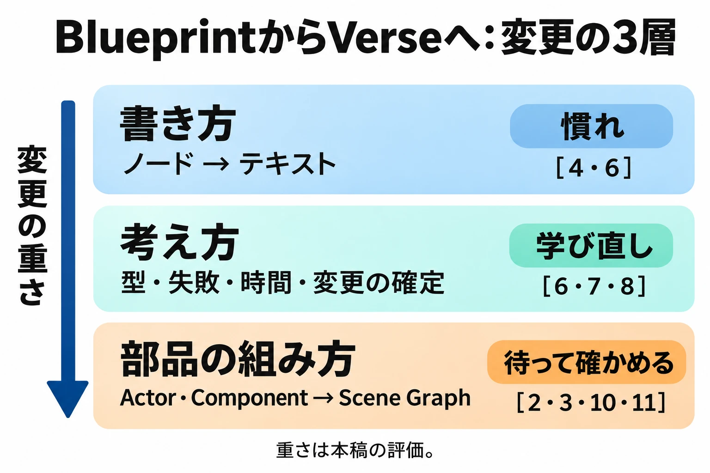

# UE6でブループリントがなくなる――自分で組むプランナーは何を失い、何を持ち越せるか

扉の開閉条件を変え、その場で遊び、手応えが悪ければもう一度つなぎ直す。Blueprintでギミックやイベントを組むプランナーにとって、この短い往復は企画を考える時間の一部である。

2026年11月3日のUnreal Fest Tokyo 2026では、Unreal Engine 6（UE6）からBlueprintを最初から外す方針が示されたと報じられた。[[1](#ref-1)] では、自分で組んできた仕事は、どこまで変わるのだろうか。

変更は **書き方、言語としての考え方、部品の組み方** の3層に分けると見通しやすい。ノードからテキストへの変更は慣れの問題として扱えるが、Verseの失敗や並行処理には学び直しが必要になる。さらに、Actorを中心とした構成からScene Graphへ移す仕事は、既存資産とチームの分担に及ぶ。

この3層は、同じ日に同じ深さまで勉強する必要はない。現在の仕様で学べるところと、UE6の資料を待つところを分けることが、不安を具体的な準備へ変える出発点である。

***

## 1. 何が発表されたか――初期版に残す方針から、最初から外す方針へ

4Gamerの基調講演報道によると、Epic GamesのCEO、ティム・スウィーニー氏は、UE6の開発環境からBlueprintを最初から取り除き、ゲームプレイの記述をVerseに一本化すると説明した。Blueprintを愛用する開発者に謝罪し、働き方の変更を求める決定であることも認めている。[[1](#ref-1)]

ファミ通の報道では、撤廃の対象にActorとC++ゲームプレイフレームワークも含まれる。新しいゲームプレイは、Verseで作られたScene Graphのエンティティとコンポーネントを通じて構築するという。移行には痛みが伴うものの、AI支援によって置き換えを進めるという説明である。[[2](#ref-2)]

6月のシカゴでの発表後、Epicは開発チームを率いるMarcus Wassmer氏名義で、6月22日に公式記事「The road to Unreal Engine 6」を公開した。そこでは、ActorとBlueprintを初期のUE6に残し、新しい枠組みが十分に成熟した後に非推奨化し、変換ツールを提供する方針だった。[[3](#ref-3)]

| 項目 | 6月の方針 | 11月の方針・説明 |
| --- | --- | --- |
| Blueprint・Actorの扱い | 初期のUE6に残し、新しい枠組みの成熟後に非推奨化する。[[3](#ref-3)] | UE6から最初から外し、Scene Graphへ移る。[[1](#ref-1)][[2](#ref-2)] |
| C++ | ゲームプレイのプログラミングモデルをVerseへ移す構想。Verseから呼ぶC++のトランザクション化も説明。[[3](#ref-3)] | C++ゲームプレイフレームワークを撤廃する。エンジンの基盤ではC++を使い続ける。[[1](#ref-1)][[2](#ref-2)] |
| 移行支援 | 新旧の枠組みを移す変換ツールを提供する。[[3](#ref-3)] | AIを活用した変換手段を用意し、Fortniteで移行を進める。[[1](#ref-1)] |
| 時期 | 早期アクセスは2027年末が目標。正式版はその12〜18か月後。[[3](#ref-3)] | 4Gamerは2027年末、ファミ通は「2027ish」と伝える。[[1](#ref-1)][[2](#ref-2)] |
| 根拠となる資料 | Epic公式の文章によるロードマップ。[[3](#ref-3)] | 東京の講演を取材した4Gamer、ファミ通の報道。[[1](#ref-1)][[2](#ref-2)] |

2026年11月5日時点で、本稿が参照する11月の撤廃方針は講演報道に基づく。Epicがこの変更を文章でまとめた公式文書は確認できておらず、6月の公式記事は段階的移行の記述のまま掲載されている。したがって、従来の公式ロードマップと、より新しい講演で示された方針を、資料の性格ごとに読み分ける必要がある。

***

## 2. なぜ変えるのか――AIが扱いやすい記述へ集中する

4Gamerによると、方針転換の理由は、AIにとってBlueprintよりテキストベースのコードを扱うほうが生産的だと分かったことにある。人がノードをつなぐ操作に親しんでいることと、AIが処理を生成・編集しやすいことは、異なる評価軸である。Epicは後者を重く見たことになる。[[1](#ref-1)]

この判断は、UE5とUnreal Editor for Fortnite（UEFN）を一つのエンジンへ統合するUE6の構想の中にある。6月の公式記事では、新しいゲームプレイの枠組みであるScene GraphをVerseの上にゼロから作ること、エンジンの幅広い機能をMCPという接続の仕組みで公開し、開発者が各社のAIモデルを選んで連携できるようにすることが説明されていた。[[3](#ref-3)]

東京の講演で示された生産性の数字も、この方針の背景である。4Gamerは、Epic社内で1.5〜4倍の向上が見られ、2026年末までに少なくとも4倍、2027年半ばには多くの領域で10倍を見込むというスウィーニー氏の説明を伝えている。[[1](#ref-1)]

これらは **Epicが講演で示した社内の状況と将来の見通し** である。各社の案件で同じ効果が得られるという保証ではない。プランナーにとっては、生成にかかる時間に加え、遊んで確かめる時間、誤動作を調べる時間、自分で直せるまでの時間を含めて評価する必要がある。

***

## 3. UE5、C++、登場時期を分けて捉える

進行中のUE5案件には、引き続き現行の制作計画がある。6月の公式記事は、5.8の後に別の公式UE5リリースを計画していないとしつつ、必要なら5.9を出す余地を残していた。東京の講演ではEpic Games Japan代表の河﨑高之氏が、UE5.9のプレビュー版を翌週に公開する予定だと発表した。[[3](#ref-3)][[1](#ref-1)] 11月5日時点では公開済みの版ではなく、公開予定の発表である。

これは、UE6の発表をもってUE5の作業環境が即座に終わるという状況ではないことを示している。一方、UE6登場後のUE5のサポート期間まで、この発表から確約されたと読むこともできない。

C++は、引き続きエンジン基盤の実装に使われる。今回の変更で分けるべきなのは、エンジンの内部を作る言語と、ゲームプレイを記述する枠組みである。C++という言語全体の廃止と、UE6のC++ゲームプレイフレームワークの撤廃は、範囲が異なる。[[1](#ref-1)][[2](#ref-2)]

登場時期も予定として扱う。6月の公式記事では、早期アクセスは2027年末を目標とし、正式版はその12〜18か月後としている。11月の報道には表現の幅があり、4Gamerが2027年末とする一方、ファミ通は「2027ish」、つまり2027年ごろという含みを注記している。[[3](#ref-3)][[1](#ref-1)][[2](#ref-2)] 移行計画を固定日から逆算するには、追加の案内が必要である。

***

## 4. Blueprintがプランナーに渡していたもの

Epicの公式ドキュメントは、Blueprintを、ノードを使ってゲームプレイを作るビジュアルスクリプティングとして説明する。プログラマーがC++で基盤を用意し、それをデザイナーが拡張する使い方も想定されている。変数や型、条件分岐を扱いながら、テキストでコードを書く工程をノードの接続に置き換えた仕組みである。[[4](#ref-4)]

プランナーにとって、その価値は **自分で試作し、すぐ遊んで確かめられること** にある。「この条件を加えたら面白くなるか」を考えた人が、小さな変更をそのまま動かせる。仕様を渡して実装を待つ往復の一部を、自分の手元で閉じられるのである。

具体例として、PolygonはGDC 2026のSandfall Interactiveの講演を取材している。『Clair Obscur: Expedition 33』のテクニカルディレクターTom Guillermin氏とシニアゲームプレイプログラマーFlorian Torres氏は、社内プログラマー4人の体制で、ゲームプレイシステムの95％をBlueprintで構築したと説明したという。これはゲーム全体のコード量の95％という意味ではない。

同記事では、デザイナーが制作に参加しやすい利点と、デバッグやメモリの扱いの課題も紹介されている。Blueprintの活用は、少人数で扱える制作範囲を広げる一方、保守の負担も伴っていた。[[5](#ref-5)]

***

## 5. BlueprintからVerseへ――変更を3層で測る

以下で言語の具体例として扱うのは、現在UEFNで使えるVerseである。UE6でのAPIや細かな書き方、編集操作まで確定したものとして読み替えることはできない。また、「慣れ」「学び直し」「待って確かめる」という重さの整理は、公式資料の仕様を基にした本稿の評価である。

### 層1：書き方――ノードからテキストへ

小さな例として、「一定時間待ち、プレイヤーの体力が基準以上なら得点を与える」処理を考える。Blueprintなら、起点のイベントからDelayへつなぎ、対象キャラクターの体力を取得し、比較した結果でBranchを分け、条件を満たす側で得点処理を呼ぶ、という組み立てになる。

Verseの公式ドキュメントには、同じ流れの短い例がある。次は、その例から説明コメントだけを省いた抜粋である。[[6](#ref-6)]

```verse
CountdownScore(Player:agent)<suspends>:void=
    Sleep(CountdownTime)
    if:
        Character := Player.GetFortCharacter[]
        PlayerHP := Character.GetHealth()
        PlayerHP >= HPThreshold
    then:
        ScoreManager.Activate(Player)
```

待機時間の`CountdownTime`、基準値の`HPThreshold`、得点を与える`ScoreManager`などは、周囲の定義を前提にしている。この断片だけで動くプログラムではない。

ノードの実行線を追っていた部分は、上からの記述順と字下げを読む作業に変わる。待つ、体力を得る、条件を満たしたら得点を与える、というルールの骨格は共通である。すでに処理を分解できる人なら、書き方の層は慣れで越えられると考えられる。

ただし、この例の角括弧や`<suspends>`には、単なる記号の置き換え以上の意味がある。それが次の層である。

### 層2：考え方――失敗、時間、変更の確定を言語で扱う

学び直しの中心は、処理がどのような条件で実行でき、失敗したときに何が残り、待っている間に何が進むかという理解である。

**型**：Blueprintではピンや変数の種類で扱っていた型を、Verseでは宣言や型推論を含むテキストで読む。

Blueprintにも数値、真偽値、配列などの型がある。したがって「Verseで初めて型が必要になる」という変化ではない。Verseの公式用語集は、識別子に型が割り当てられ、明記しない場合には推論されること、コンパイル時に静的検査を行うことを説明している。[[4](#ref-4)][[7](#ref-7)] プランナーには、エラーをピンの接続だけでなく、型と関数の入出力の関係から読む習慣が必要になる。

**失敗するかもしれない式**：Blueprintで成否を分岐や出力ピンから追っていた場面を、Verseでは式の成功・失敗と、それを許す失敗コンテキストとして読む。

Verseのfailable expressionは、成功して値を返すか、失敗して値を返さない式である。配列の要素取得や比較も該当し、失敗しうる式を実行できる場所を失敗コンテキストと呼ぶ。[[7](#ref-7)] 上の例では、`if`内でキャラクターを取得し、体力の条件を満たした場合に得点処理へ進む。条件の不成立を、実行時エラーと同じ意味に受け取らないことが第一歩になる。[[6](#ref-6)]

**時間待ちと並行処理**：BlueprintでDelayなどの待機ノードをつないでいた処理を、Verseでは`<suspends>`の付いた関数や`Sleep`、並行処理の式で組み立てる。

`Sleep`は指定した秒数だけ待機する関数である。[[8](#ref-8)] さらに、別の処理を開始して後続へ進む`spawn`、最初に終わった処理に合わせて残りをキャンセルする`race`、すべての完了を待つ`sync`がある。[[6](#ref-6)] 「扉が開くまで待つ」と「扉を開けながら別の判定を続ける」は、どちらを選ぶかで挙動が変わる。複数の処理の終了と中断まで、ルールとして整理する必要がある。

**トランザクション**：Blueprintで変更ノードの実行順を追っていた場面では、Verseの失敗コンテキスト内の変更が、成功時に確定し、失敗時に巻き戻るという違いも考える。

公式用語集は、失敗コンテキストで処理を試し、成功すれば変更を確定し、失敗すれば実行前のように戻す仕組みを説明する。巻き戻せない関数は、そのコンテキストでは呼べない。[[7](#ref-7)] 先に値を変更してから条件を調べる場合も、「途中まで実行されたから変更は残る」とは限らないのである。

UE6の構想では、この考えをソフトウェア・トランザクショナル・メモリ（STM）として広げる方針が説明されている。処理をまとまりとして確定・巻き戻しできることが基盤になるが、公式記事が将来構想として示す分散実行まで、現在のUEFNで完成しているという意味ではない。[[3](#ref-3)]

この層は、記号の暗記だけでは身につかない。「条件を満たさない」「待っている間に対象がいなくなる」「複数人が同時に操作する」ときの結果を説明できることが、学び直しの目安になる。

### 層3：部品の組み方――Actor中心の資産からScene Graphへ

Blueprint Classでは、物理的なComponentとスクリプトによる振る舞いを組み合わせられる。Actorをレベルに置き、その中に部品と処理をまとめる経験を積んできた人も多いだろう。[[4](#ref-4)] UE6では、この資産の構成自体を読み替える必要がある。

6月の4Gamer記事は、VerseとScene Graphを軸とする新しい枠組みを、UnityのPrefabに近いワークフローや、柔軟なコンポーネント式の構成への転換と比較している。これは仕組みの方向を説明する比較であり、Unityと操作や構造が同じになるという意味ではない。[[9](#ref-9)]

現在のUEFNの公式資料でも、Scene GraphはVerseを基盤とする仕組みであり、エンティティにコンポーネントでデータや振る舞いを加え、再利用可能なPrefabを作れると説明されている。[[10](#ref-10)] 東京の報道が伝えるUE6の移行先も、Scene Graphのエンティティとコンポーネントである。[[2](#ref-2)]

移行支援については、6月のInven Globalによるインタビューで、Epicの開発責任者Marcus Wassmer氏が、Fortnite自体に数十万のBlueprint構造が結びついており、Epicがまず大規模な移行を経験すると説明した。そこで作る移行ツールを無償で提供し、中心的な成果としてBlueprint-to-Verse自動変換ツールを用意する計画を述べている。[[11](#ref-11)] 11月の4Gamer報道では、数千のBlueprintと残るC++ゲームプレイコードをVerseへ移す作業が進んでいるという。[[1](#ref-1)] 6月の資産規模と11月の移行作業の説明は、同じ母数・進捗率として比較できる数字ではない。

この層は、3層の中で最も重いと考えられる。ノードをテキストへ変えても、部品の境界、参照関係、共通化の単位が変われば、テンプレートやレベルごとのイベントの設計まで見直すことになるからだ。

一方、UE6向けの具体的な移行資料はまだ少ない。自社の資産がどう変換され、何を人が組み直す必要があるのかは、ツールと資料が出た段階で確かめる層である。



3層をまとめると、次のようになる。出典は各項目の仕様上の根拠であり、重さと「今できること」はそれを踏まえた本稿の評価・提案である。

| 層 | Blueprintでは | Verseでは | 重さ | 今できること |
| --- | --- | --- | --- | --- |
| 書き方 | ノードと実行線で処理を表す。[[4](#ref-4)] | テキストと字下げで処理を表す。[[6](#ref-6)] | 慣れ。 | 既知の小さな処理を公式サンプルと読み比べる。[[6](#ref-6)] |
| 考え方 | 型のあるピンやノードをつなぎ、条件と待機を組む。[[4](#ref-4)][[6](#ref-6)] | 型、式の成否、待機と並行処理、巻き戻しを読む。[[6](#ref-6)][[7](#ref-7)][[8](#ref-8)] | 学び直し。 | 条件不成立、待機、中断時の結果を小さく試す。[[6](#ref-6)][[7](#ref-7)] |
| 部品の組み方 | ActorとComponent、Blueprint Classを中心にまとめる。[[4](#ref-4)] | Scene Graphのエンティティとコンポーネントへ移る。[[2](#ref-2)][[10](#ref-10)] | 待って確かめる。 | 資産を棚卸しし、UE6向けの移行資料と変換ツールで検証する。[[3](#ref-3)][[11](#ref-11)] |

***

## 6. プランナーへの影響――変換後も自分で直せるか

ここからは、報じられた方針と現在の仕様を踏まえた考察である。同じプランナーでも、どの層に日常的に触れているかで負担は変わる。

| 現在の役割 | 影響が大きい部分 | 移行時に見るべきこと |
| --- | --- | --- |
| Blueprintでギミック・イベント・試作を組む人 | 書き方と考え方の両方。既存の部品構成にも影響する。 | 自分で条件を足し、動作を確かめ、問題箇所を直せるか。 |
| 配置とパラメーター調整が中心の人 | 共通部品の供給方法と、調整値の公開方法。 | 置き換え後も、必要な値や参照を自分で変更できるか。 |
| 仕様・数値・進行の設計が中心の人 | 実装担当との受け渡しと、検証に要する時間。 | 仕様の表し方や試作の待ち時間がどう変わるか。 |
| プランナー向けの共通Blueprintやテンプレートを整備する人 | 部品の境界と共通化の設計、利用者への学習支援。 | VerseとScene Graphで、利用者が扱える編集範囲をどう用意するか。 |

特に、 **既存のBlueprintを変換できることと、変換後もプランナーが自分で直せることは別の問題** である。動作を保ったまま変換できても、担当者が条件を一つ足すたびにエンジニアを待つなら、企画の検証は遅くなる。移行の完了条件には、動作の一致に加えて、日常の編集を誰が続けられるかを入れる必要がある。

### 持ち越せるのは、ルールを組み立てて確かめる力

Blueprintで身につけた次の力は、新しい記法でも使うことになる。

- ルールを「イベント・条件・結果」に分解する。
- 「未開放・開放中・開放済み」のように、状態と状態遷移を整理する。
- 調整用データと処理を分け、変更の影響範囲を小さくする。
- 不具合が起きる条件を絞り、再現できる形にする。
- 小さな試作で仮説を確かめ、次の変更を決める。

一方、Actorの継承や参照など、UE固有の仕組みを前提にした知識には読み替えが必要になる。「イベントで条件を判定する」という理解と、「このActorのこの機能で実現する」という手順を分けておくと、持ち越す部分を見つけやすい。

### AIに書かせるときも、仕様の判断は残る

例えば「扉を開ける」という指示にも、開く条件を誰が判定するか、連打や同時操作をどう扱うか、待機中にプレイヤーが退出したらどうするか、再接続後やセーブ後にどの状態へ戻すか、という判断がある。

AIがコードを出力できても、その判断まで適切だったとは限らない。責任を持って扱うには、生成された処理が意図するルールに合っているかを説明し、例外条件を試せる必要がある。AIによる試作と企画検証の関係は、[Unity AIとバイブコーディングの記事](cedec2026-unity-ai-prototyping-planner-vibe-coding.md)でも扱っている。

***

## 7. 今からの備え――学習と資産整理を小さく始める

### 進行中のUE5案件は、現在の要件で判断する

UE5.9のプレビュー公開予定が発表されている現在、UE6の発表だけを理由に進行中の実装方針を覆すのは早い。[[1](#ref-1)] まず発売・運営の予定、利用中の機能、残る作業を基準に現行案件を進める。UE6への判断は、対象機能と移行手順を自社の条件で検証できる段階に結びつけるべきである。

### Verseは、すでに理解している小さなルールから触る

学習の入口にはUEFNを使える。最初の題材は、すでにBlueprintで組んだことがあり、期待する結果を説明できる小さな処理がよい。公式サンプルを動かし、待ち時間や条件を一つずつ変えると、書き方への不慣れと、処理の考え方の違いを分けて学べる。[[6](#ref-6)]

成功した場合に加え、条件を満たさない場合、対象がいない場合、複数の処理が重なる場合も試す。動いた画面だけでなく、なぜその順番で動いたのかを説明できることを目標にする。

### Blueprint資産は、用途と編集担当者を記録する

棚卸しでは、ファイル数だけでなく、次の4種類に分けて用途を記録するとよい。

| 資産の種類 | 記録する内容の例 |
| --- | --- |
| 調整用データ | 誰がどの値を変えるか。処理から切り離されているか。 |
| レベル固有のイベント | どの配置物や進行条件に依存するか。レベル担当者が直す範囲はどこか。 |
| 共通のゲームロジック | 何から参照されるか。動作を確かめる代表的な場面は何か。 |
| 制作ツール | 誰のどの作業を助けるか。動かなくなると制作のどこが止まるか。 |

すべてに「移した後に誰が編集するか」を添える。移行対象の選別と、編集できる人の確保を同じ台帳で扱えば、変換に成功したのに制作が止まる問題を見つけやすい。

エンジン側の方針変更が現場の判断を揺さぶった前例は、[Unity Runtime Fee騒動とエンジン選定の記事](unity-runtime-fee-controversy-godot-multi-engine-era.md)でも整理している。

新しい基盤を評価するときは、プランナーが自分で条件を足せるか、値を調整できるか、不具合を調べられるかを確認する。Blueprintが担っていた **「企画者が自分で組み、すぐ遊んで確かめる」権限** を、新しい環境でも保てるか。それを移行計画の要件に入れることが、プランナー側から見た最大の論点である。

## References

<a id="ref-1"></a>1. [或鷹「UE6ではブループリントを最初から廃止へ。AIの生産性を優先した方針転換を，Tim Sweeney氏が謝罪とともに明かした『Unreal Fest Tokyo 2026』基調講演」][1] — 4Gamer、2026年11月4日。

[1]: https://www.4gamer.net/games/210/G021013/20261104013/

<a id="ref-2"></a>2. [ミル☆吉村「Unreal Engine 6ではアクターやブループリントなどを撤廃し、Verse完全移行でAI支援による開発効率の最大化を目指す。Unreal Fest基調講演リポート」][2] — ファミ通.com、2026年11月4日。

[2]: https://www.famitsu.com/article/202611/92974

<a id="ref-3"></a>3. [Marcus Wassmer「The road to Unreal Engine 6」][3] — Epic Games、2026年6月22日。新しいゲームプレイフレームワーク、AI連携、移行方針と提供予定を参照。2026年11月5日確認。

[3]: https://www.unrealengine.com/news/the-road-to-ue-6

<a id="ref-4"></a>4. [Epic Games「Blueprints Visual Scripting Overview」][4] — Unreal Engine公式ドキュメント。型を持つデータ、実行線、Componentと振る舞い、C++基盤のデザイナーによる拡張を参照。2026年11月5日確認。

[4]: https://dev.epicgames.com/documentation/en-us/unreal-engine/overview-of-blueprints-visual-scripting-in-unreal-engine

<a id="ref-5"></a>5. [Giovanni Colantonio「95% of Clair Obscur's gameplay systems were built from Unreal Blueprints, says Sandfall Interactive」][5] — Polygon、2026年3月10日。GDC 2026の講演「Delivering a Wide Scope of Features & Content When You Only Have Four Programmers」の取材記事。

[5]: https://www.polygon.com/clair-obscur-expedition-33-gdc-panel/

<a id="ref-6"></a>6. [Epic Games「Debugging and Troubleshooting in Verse」][6] — Fortnite公式ドキュメント。「Controlling Timing with Events」のCountdownScore例と、spawn・sync・raceの説明を参照。コードはコメントを省いた抜粋で、周囲の定義が必要。2026年11月5日確認。

[6]: https://dev.epicgames.com/documentation/fortnite/debugging-and-troubleshooting-in-verse?lang=en-US

<a id="ref-7"></a>7. [Epic Games「Verse Glossary」][7] — Fortnite公式ドキュメント。strongly-typed、static checking、failable expression、failure context、speculative execution、no-rollback、STMを参照。2026年11月5日確認。

[7]: https://dev.epicgames.com/documentation/fortnite/verse-glossary?lang=en-US

<a id="ref-8"></a>8. [Epic Games「Sleep function」][8] — Verse API公式リファレンス。待機とsuspendsを参照。2026年11月5日確認。

[8]: https://dev.epicgames.com/documentation/fortnite/verse-api/versedotorg/simulation/sleep?lang=en-US

<a id="ref-9"></a>9. [西川善司「次世代ゲームエンジン『Unreal Engine 6』はゲーム開発用言語『Verse』を基盤技術に。『Unreal Fest 2026』基調講演レポート」][9] — 4Gamer、2026年6月20日。6月17日のシカゴでの講演と、Scene Graph・Prefabの比較を参照。

[9]: https://www.4gamer.net/games/210/G021013/20260619058/

<a id="ref-10"></a>10. [Epic Games「Scene Graph」][10] — UEFN公式ドキュメント。Verseを基盤とするScene Graph、エンティティとコンポーネント、再利用可能なPrefabを参照。2026年11月5日確認。

[10]: https://dev.epicgames.com/documentation/en-us/fortnite/scene-graph-in-unreal-editor-for-fortnite

<a id="ref-11"></a>11. [Seoho “Ruudi” Yoon「CEO Tim Sweeney: “Unreal Engine 6 Will Fundamentally Change the Development Paradigm”」][11] — Inven Global、2026年6月18日。Wassmer氏によるFortniteの資産規模、移行ツールと無償提供計画の説明を参照。英語資料の要約・訳は本稿による。

[11]: https://www.invenglobal.com/articles/22928/ceo-tim-sweeney-unreal-engine-6-will--change-the-development-paradigm

----

この文書は、Perplexity、Claude、ChatGPT の3つのAIの支援を受けて著述されたものです。引用画像を除き、MIT License にて提供されています。
