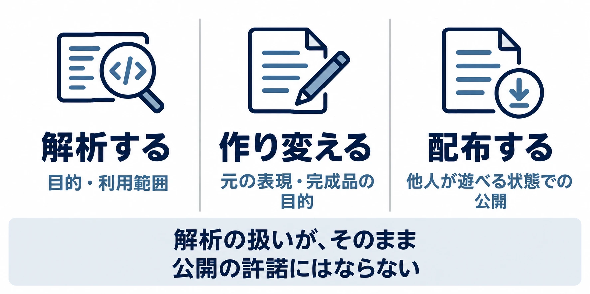

# AIで「勝手移植」が速くなる時代――速く作れることは、出してよい理由になるか

## はじめに：完成までの時間と、公開を決める権利

好きなゲームを今のPCで遊びたい。別のゲーム機で動かしてみたい。ファンによる移植やリメイクには、作品への熱意と技術的な挑戦がある。その成果に驚き、遊んでみたいと感じることも自然だ。

2026年秋、AIを使ってゲームの解析や移植を進める動きが急速に広がったと報じられた。制作の手間が減るほど、完成品を世に出すまでの距離も短くなる。しかし、そこで問うべきことがある。 **速く作れることは、出してよい理由になるか。**

本稿では、権利者の許諾を得ずに既存ゲームを別の環境へ移したり、作り直したりする活動を、便宜上「勝手移植」と呼ぶ。移植とリメイクは制作上の異なる仕事だが、ここでは公開に伴う権利者との衝突に焦点を当てる。

AIは解析や実装、完成へ向けた仕上げを速くする道具である。作品を公開してよいかを決める許諾まで生み出すわけではない。この区別は、AI以前の事例からも見えてくる。

***

## 2026年秋、解析から公開までの距離が縮んだ

米国のゲームメディアKotakuの記者Lewis Parker氏は、10月15日の記事で、AIを使ったブラウザ向け移植などの急増と、GitHubで相次ぐDMCA削除申し立てを報じた。DMCAは米国の著作権法で、ここでは権利侵害を理由とする削除の申し立てに使われている。記事は、ゲーム開発会社Mega Critが10月7日、『Slay the Spire II』の一般公開していないソースコードが含まれるとして削除を申し立て、GitHubがこれを処理した事例も挙げている。[[1](#ref-1)]

同じ取材で、ゲーム企業Take-Two Interactiveの元AI責任者Luke Dicken氏は、この動きを開発者とパブリッシャーが真剣に受け止める必要があると指摘した。日本のゲームメディアGame*Sparkのライター・松本鹿介氏も、この取材を10月19日に紹介している。[[2](#ref-2)]

国内では、プロゲーミングチームCrazy Raccoon所属のどぐら選手が、『鉄拳6』の非公式PC版をXで「ライン越えすぎ」と批判したとGame*Sparkが報じた。同記事は、この移植でのAI利用や制作ツール、移植者、バンダイナムコの反応を伝えていない。『鉄拳6』の件は非公式移植への批判の例として扱い、AIによる移植の実例とは区別する。[[2](#ref-2)]

この秋の変化は、既存のゲームを調べ、別の環境で動く形にまとめるための手間が大きく下がったことにある。速さの変化によって、権利者が把握し、判断し、対応するより先に成果が広まる場面が増え得る。

***

## AI以前から、ファン作品と公式展開はぶつかってきた

### 2020年のPC版『スーパーマリオ64』

2020年5月には、『スーパーマリオ64』をPCで動かす非公式移植と、そのインストールファイルの配布が話題になった。ゲームメディアAUTOMATONの記者Taijiro Yamanaka氏の記事によれば、リバースエンジニアリングを経て、DirectX 12を使ったPC移植が行われた。リバースエンジニアリングとは、完成したプログラムなどを調べ、内部の構造や動作を理解する作業である。逆コンパイル、つまり機械向けのコードを人が読めるコードに戻す作業は、前年に達成されていたという。[[3](#ref-3)]

Nintendo of Americaは同年5月6日、DMCAに基づきGoogleへ削除申請を行った。技術的に別の環境で動くことと、そのファイルを配布できることが、別々の問題として現れた事例である。[[3](#ref-3)]

### 2016年のAM2Rと、その後の公式リメイク

『メトロイドII』の非公式リメイク『AM2R（Another Metroid 2 Remake）』は、2016年8月6日の無料公開後、任天堂の要請を受けて8月9日に公開中止となった。AUTOMATONの記者Ayuo Kawase氏は、2012年から開発されてきた作品として紹介している。[[4](#ref-4)]

取り下げを伝えたGame*Sparkによれば、任天堂はファンの情熱に感謝しつつ、自社のキャラクターや商標などの知的財産を保護する必要があると説明した。[[5](#ref-5)] AUTOMATONが紹介する米国のゲームメディアPolygonへの回答では、非公式にIPが使われることが、IPを守る力、保護する力、新作を生み出す力を弱める可能性にも触れている。[[4](#ref-4)] 熱意を評価することと、公開を認めることは、権利者にとって両立しない場合がある。

翌2017年6月14日には、任天堂がニンテンドー3DS向けの公式リメイク『メトロイド サムスリターンズ』を発表した。開発はスペインのゲーム開発会社MercurySteamで、発売日は9月15日と告知された。AM2Rの取り下げと公式リメイクの発表は、この順に起きた出来事である。両者の因果関係を示すものとしては扱わない。[[6](#ref-6)]

### 2026年9月の『GGアレスタ3』

2026年9月には、ファン制作チームBlast Processing Arcadeによる『GGアレスタ3』の非公式メガドライブ移植が報じられた。元の作品は、エムツーが『アレスタコレクション』に収録したゲームギア向けのゲームである。英国のレトロゲームメディアTime Extensionの記者Kris Moyse氏によれば、エムツー代表の堀井直樹氏の発言を受け、移植の動画は非公開になった。制作側からのコメントはなく、プロジェクト自体の中止が明らかになったわけではない。AIの関与も報じられていない。[[7](#ref-7)]

以上の事例を、2026年10月19日までの対象報道に沿って並べると次のようになる。「報道なし」は、利用や対応がなかったことを意味しない。

| 年 | 作品 | 何が起きたか | AIの関与 | 権利者の対応 |
|---|---|---|---|---|
| 2016年 | AM2R | 『メトロイドII』の非公式リメイクが無料公開され、公開中止となった | 報道なし | 任天堂が取り下げを要請 [[4](#ref-4)] [[5](#ref-5)] |
| 2020年 | PC版『スーパーマリオ64』 | 解析を経た非公式PC移植のインストールファイルが配布された | 報道なし | Nintendo of AmericaがGoogleへDMCAに基づく削除申請 [[3](#ref-3)] |
| 2026年9月 | 『GGアレスタ3』メガドライブ移植 | 非公式移植の動画が公開され、その後非公開になった | 報道なし | エムツー代表が公式展開への影響を表明 [[7](#ref-7)] |
| 2026年10月に報道 | 『鉄拳6』非公式PC版 | どぐら選手による批判が報じられた | 報道なし | 報道なし [[2](#ref-2)] |

かつての解析やファン制作には、年単位の取り組みもあった。ただし、AM2Rのような作り直しの開発期間を、そのまま解析期間とみなすことはできない。2026年秋の報道から読み取れるのは、AIで解析・移植の手間を大幅に短くできる場面が増えたという変化であり、作品ごとに同じ倍率で速くなったという話ではない。

変わったのは、主に速さと手間、そして起こり得る件数である。権利者の許諾や公式展開と衝突するという問題の性質は、以前から続いている。

***

## 堀井氏の言葉が示す、公式の「次」を決める難しさ

『GGアレスタ3』について、堀井氏は9月16日、この移植を報じたブラジルのレトロゲームメディアWarpZoneへの返信として、許可なく進めるのを止めるための協力を求める投稿をした。[[8](#ref-8)]

<blockquote class="twitter-tweet" data-dnt="true">
私はそのゲームを作ったエムツーの代表で、このゲームの権利者です。我々はこのゲームの新たな展開ができないか？と楽しい雑談やしんどい議論を進めていました。 ファンメイドが世にでると、そういう展開は不可能になります。
&mdash; ほりい なおき (@hor11) <a href="https://x.com/hor11/status/2100107088664162369">2026年9月16日</a></blockquote>

これは、正規の移植・復刻を本業とする会社の代表であり、対象作品の権利者でもある人物の発言だ。その後、堀井氏はWarpZoneへの謝意とともに、次のようにも述べている。[[9](#ref-9)]

<blockquote class="twitter-tweet" data-dnt="true">
極めて困難な話だと思いますが落とし所はさがします。
&mdash; ほりい なおき (@hor11) <a href="https://x.com/hor11/status/2100186876875526512">2026年9月16日</a></blockquote>

この発言の中心にあるのは、 **完成した非公式版が、公式企画を決める条件そのものを変えてしまう** という問題である。

一般に、正規の移植やリメイク、古いハードの表現へ作り直すデメイクには、制作費、販売先、契約、品質保証、告知時期などを決める仕事がある。ファン版が先に出れば、公式版を企画する側は、その存在と反響も含めて事業を説明し直すことになる。これは衝突の構図を説明するための一般論であり、『GGアレスタ3』の未公表の契約や計画を推測するものではない。

「ファン版があっても公式版を買う」という個々のプレイヤーの意思だけで、企画を進める関係者すべての判断が決まるわけではない。また、告知がない間にも、権利者は堀井氏のいう議論を進めているかもしれない。外から見える空白と、公式に何も検討していない状態は区別する必要がある。

正規の作り直しで何を残し、何を変えるかという設計の話は、[リマスター・リメイクを扱った既存記事](game-remaster-remake-design-philosophy.md)で掘り下げている。今回の焦点は、その設計に着手し、公開する判断を誰が担うかにある。

***

## 「解析する」「作り変える」「配布する」を分ける

技術的な作業と公開の判断を整理するには、行為を三つに分けると分かりやすい。これは日本の文化庁資料に基づく説明であり、海外を含む個別事例の適法・違法を判定するものではない。

### 解析する：目的が問われる

文化庁著作権課の資料は、問12でプログラムのリバースエンジニアリングを取り上げている。プログラムの機能を利用して楽しんだり役立てたりするためではなく、調査解析を目的とする利用は、著作権法第30条の4の対象になり得るという説明だ。同条は、一定の条件で著作権者の許諾を要しない利用を定めている。[[10](#ref-10)]

同じ資料は、権利者の利益を不当に害する場合を除くことや、利用規約との関係に注意が必要なことも示している。「解析」という作業名だけで一律に結論が決まるわけではなく、何のために、どこまで利用するかが問われる。[[10](#ref-10)]

### 作り変える：完成品の中身と目的を考える

解析の結果を使い、遊べる移植版を作る段階では、元のコードや画像、音楽などをどう使ったか、どのような目的の成果物にしたかを改めて考える必要がある。文化庁の説明は、プログラムの機能を享受することを目的としない利用についてのものであり、遊ぶための完成品づくりまでを想定したものではない。[[10](#ref-10)]

移植、リメイク、デメイクという呼び名は、作品の作り方を説明する言葉である。呼び名や制作ツールだけで許諾の要否が決まるわけではない。

### 配布する：他の人が遊べる状態にする

完成品をダウンロードできるようにすれば、複製権、つまりコピーを作ることに関する権利や、公衆送信権、つまりネットなどで公衆へ送ることに関する権利が問題になる。文化庁資料が説明する第30条の4も、調査解析のための利用と、他の人がゲームとして楽しむための利用を区別する手掛かりになる。[[10](#ref-10)]

「無料だから」「元のゲームが好きだから」「AIで作ったから」という説明だけで、遊べるものを公に配る判断は済まない。調査から公開までの工程が短くなった今こそ、各段階を分けて考えたい。

解析と保存の関係は、[ゲーム保存を扱った既存記事](game-preservation-playable-archives-and-live-service-limits.md)に譲る。また、AI生成物自体の著作権については、[生成AIとゲーム業界の著作権を扱った記事](generative-ai-copyright-game-industry-guide.md)を参照してほしい。ここでの判断軸は、既存作品を利用して何を公開するかである。

***

## 守るための負担は、開発者とプレイヤーへ回ってくる

### DRM強化は予測であり、すでに決まった未来ではない

Dicken氏は、より侵襲的なDRMやプラットフォーム単位の対策が進み、消費者に不利な方向へ働く可能性を指摘している。DRMは、ソフトの利用や複製を技術的に制御する仕組みである。社会・法律・技術による防御が変化に追い付いていない一方、時間とともに安定することへの期待も示した。[[2](#ref-2)]

これは今後の見通しだが、問題の広がり方を考えるうえで重要だ。無断の公開が増えれば、対策の費用に加え、正規購入者が使う環境まで制約される可能性がある。

### 公開をためらう開発者と、販売の場の責任

ゲーム開発エンジンGodot EngineのエグゼクティブディレクターEmilio Coppola氏は、悪意ある者からゲームを守る負担を開発者が負うべきではないと述べた。Steamを例に、低品質なクローンの販売を認め、そこから利益を得るプラットフォーム側の責任を指摘している。これは同氏の問題提起であり、特定の販売行為について法的責任が確定したという意味ではない。[[2](#ref-2)]

同氏によれば、模倣を恐れ、開発途中の作品を遊んでもらう早期アクセスの公開にも不安を感じる開発者が多い。感想を集めることや、プレイヤーと一緒に作品を育てることまで難しくなるなら、影響は削除依頼の事務作業だけに収まらない。[[2](#ref-2)]

### クローン脅迫メールは、未発売作品の模倣という別の現象

2026年10月には、未発売ゲームのクローンを先に出すと脅すメールも報じられた。こちらは古いゲームの移植とは別の現象である。ただし、制作物を公開する側が守りの負担を負う点ではつながっている。

AUTOMATONの記者Hiroyuki Furukawa氏によれば、『Iron Pilgrim』を開発するWeasel Pitや、『Circusar』を開発するPsicodart Gamesなどに、24時間以内に200ドル相当のSteamコンテンツを送るよう要求するメールが届いた。公開映像をもとにAIで作ったとみられるクローン動画が添付されていたが、支払った被害者の報告はないという。動画の存在と、販売可能な完成品を作ったという脅しの真偽は分ける必要がある。[[11](#ref-11)]

Game*Sparkの記者・稲川ゆき氏は、日本の開発者へのメールも報じた。『Dragon's Chronicles～双星のレギンレイヴ～』を手がける、あっとほ～むの持辺高志氏に届いたメールには動画がなく、同氏は無差別のスパムと判断して拒否した。一方、『Project Solaris』の開発者tomo-mana氏は、週2回の進捗投稿を取りやめると表明した。[[12](#ref-12)]

脅しが実行されなくても、開発者が公開をためらう理由にはなる。作る側が交流の機会を減らし、プレイヤーが開発過程に触れる機会を失うことも、守るためのコストである。

***

## プランナーが持ち帰る四つの準備

### 1．自社作品の移植・保存方針を外へ示す

旧作をどう残したいか、どこで正規版を遊べるか、要望や相談をどこへ送ればよいかを示す。すべての企画を予告する必要はないが、方針や窓口があれば、ファンが熱意を向ける先を持てる。未発表の計画と、現在提供している正規の選択肢を混同しない告知も大切だ。

### 2．ファン向けガイドラインに移植・改造の扱いを書く

動画配信やイラストへの許諾と、ゲーム本体の移植・改造・配布の扱いを分けて書く。公開前の問い合わせ先や、素材・コードを含む配布物について相談が必要な範囲も示したい。具体的な文面は法務担当者などと確認する。設計の考え方は、[ファン活動のガイドラインを扱った既存記事](game-streaming-fan-creation-guideline-design.md)ともつながる。

### 3．体験版と進捗映像の公開範囲を決める

体験版や早期アクセス、短い動画には、それぞれ感想の収集や認知拡大という目的がある。その目的に必要な範囲、公開の時期、問い合わせや模倣の報告を受ける担当を決めておく。模倣の可能性をゼロにするために交流を一律に閉じるのではなく、公開から得たい成果と対応に使える人員を合わせて考える。

### 4．脅迫メールへの初動を共有する

脅迫メールについては、要求に支払わず、添付を開かないというAUTOMATONの記事の呼びかけを、チーム内で共有しておきたい。[[11](#ref-11)] メールを受け取った一人が抱え込まないよう、社内の連絡先を決め、必要に応じて販売プラットフォームなどへ相談できる体制も用意する。

***

## おわりに：速くなった工程の先に、誰の判断があるか

ファンが作品を好きであり続けることも、新しい環境で遊びたいと願うことも、ゲーム文化を支える力である。同時に、その作品の権利者にも、公式の移植やリメイク、デメイクをどの形で世に出すか検討する仕事がある。堀井氏の言葉は、表に出ていない議論が、非公式版の登場によって影響を受けることを示している。

AIは、解析・実装・仕上げに必要な時間を縮める。その速さは、許諾を得た復刻や保存の仕事にも役立ち得る。しかし、速く完成できることと、公開を決められることは別である。

**速く作れることは、出してよい理由になるか。** プランナーが持ち帰るべきなのは、制作の速さを評価する目と、その先の公開の判断を確かめる習慣である。

## References

1. [Lewis Parker「AI Vibe-Coding Just Hit The Video Game Industry Like An Avalanche」][1] — Kotaku、2026年10月15日。

[1]: https://kotaku.com/ai-vibe-coding-just-hit-the-video-game-industry-like-an-avalanche-2000746366

2. [松本鹿介「AIによるゲームの“勝手移植”に『開発者・パブリッシャーは真剣に向き合う必要がある』ロックスター親会社テイクツー元AI責任者が指摘―国内では『鉄拳6』勝手移植に批判の声も」][2] — Game*Spark、2026年10月19日。Kotakuによる取材の紹介。

[2]: https://www.gamespark.jp/article/2026/10/19/173796.html

3. [Taijiro Yamanaka「任天堂が“PC版『スーパーマリオ64』”に対し削除要請。8K解像度とレイトレ対応の無断移植配布『マリオ64』」][3] — AUTOMATON、2020年5月9日。

[3]: https://automaton-media.com/articles/newsjp/20200509-123780/

4. [Ayuo Kawase「非公式『メトロイド2』リメイクが公開中止へ。任天堂のIP戦略を悩ませる“熱烈すぎる”ファンメイド」][4] — AUTOMATON、2016年8月12日。任天堂の説明は同記事によるPolygonへの回答の紹介を参照。

[4]: https://automaton-media.com/articles/newsjp/metroid2-unofficial-remake-was-taken-down-by-nintendo/

5. [RIKUSYO「『メトロイドII』ファンリメイク作品が公開直後に任天堂の警告で取り下げ」][5] — Game*Spark、2016年8月9日。

[5]: https://www.gamespark.jp/article/2016/08/09/67847.html

6. [Ayuo Kawase「『メトロイド2』をフルリメイクする『メトロイド サムスリターンズ』3DS向けに発表。懐かしの横スクロールに」][6] — AUTOMATON、2017年6月14日。

[6]: https://automaton-media.com/articles/newsjp/20170614-48786/

7. [Kris Moyse「GG Aleste 3 Mega Drive Fan Port Video Removed Following Social Media Intervention From M2 Rep」][7] — Time Extension、2026年9月15日初出・16日更新。動画の非公開と制作側のコメント状況を補足する報道。

[7]: https://www.timeextension.com/news/2026/09/gg-aleste-3-mega-drive-fan-port-video-removed-following-social-media-intervention-from-m2-rep

8. [堀井直樹「私はそのゲームを作ったエムツーの代表で、このゲームの権利者です。」で始まる投稿][8] — X、2026年9月16日。

[8]: https://x.com/hor11/status/2100107088664162369

9. [堀井直樹「極めて困難な話だと思いますが落とし所はさがします。」を含む投稿][9] — X、2026年9月16日。

[9]: https://x.com/hor11/status/2100186876875526512

10. [文化庁著作権課「デジタル化・ネットワーク化の進展に対応した柔軟な権利制限規定に関する基本的な考え方」][10] — 文化庁、2019年10月24日。問5〜9、問12、および第30条の4の解説を参照。

[10]: https://www.bunka.go.jp/seisaku/chosakuken/hokaisei/h30_hokaisei/pdf/r1406693_17.pdf

11. [Hiroyuki Furukawa「『クローンゲームを先に発売されたくなければ3万円払え』との“ゲーム開発者脅迫メール”が相次ぐ。たぶんハッタリ。だけど悪質」][11] — AUTOMATON、2026年10月2日。

[11]: https://automaton-media.com/articles/newsjp/20261002-471454/

12. [稲川ゆき「『200ドル相当を払わなければクローンゲームを先に公開する』―日本のインディーSRPG開発者にもAI模倣作を先に出すとちらつかせる脅迫メールが届く…」][12] — Game*Spark、2026年10月19日。

[12]: https://www.gamespark.jp/article/2026/10/19/173774.html

----

この文書は、Perplexity、Claude、OpenAI Codex の3つのAIの支援を受けて著述されたものです。引用画像を除き、MIT License にて提供されています。
