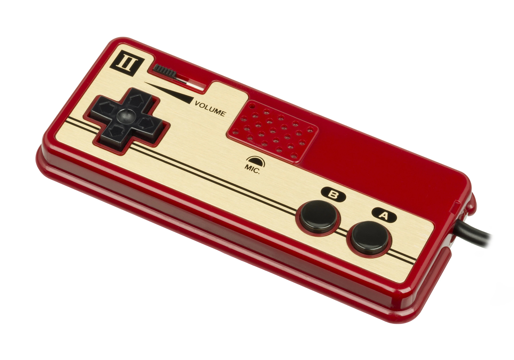
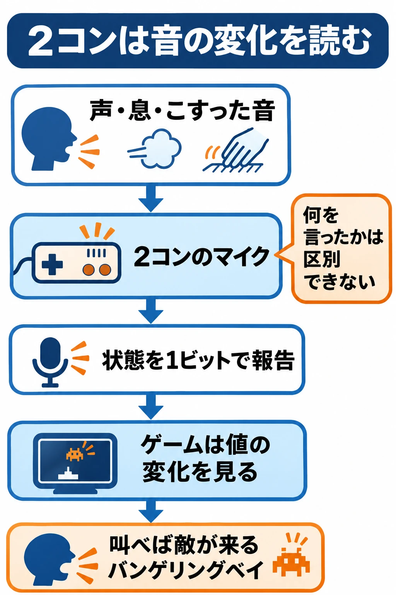
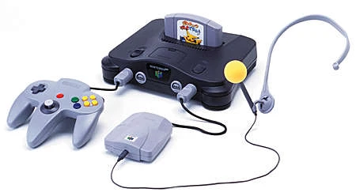
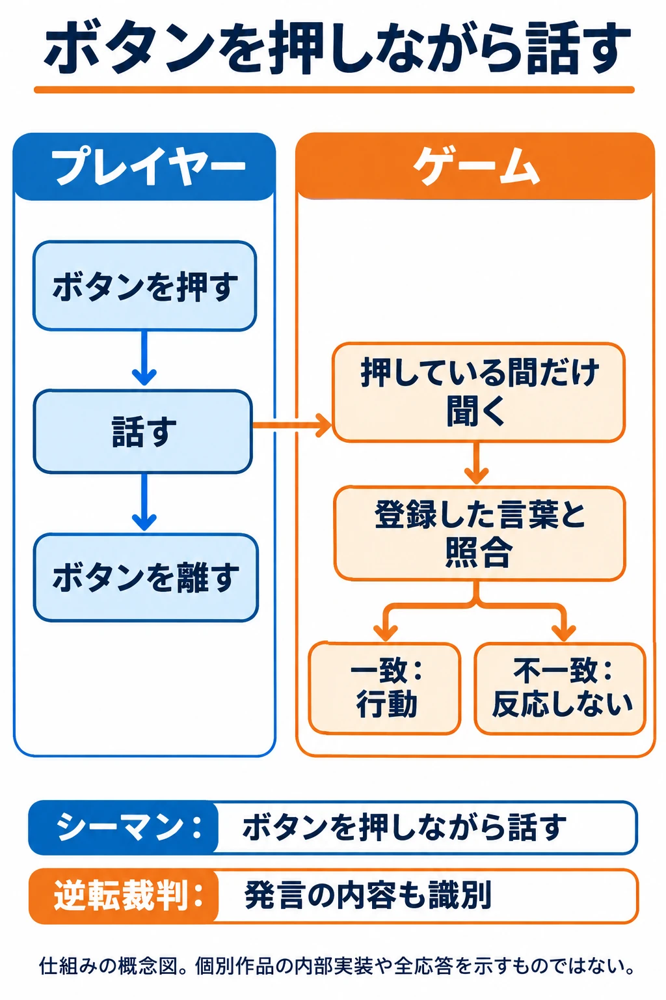
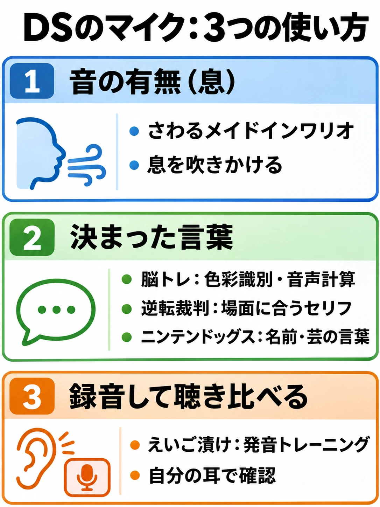
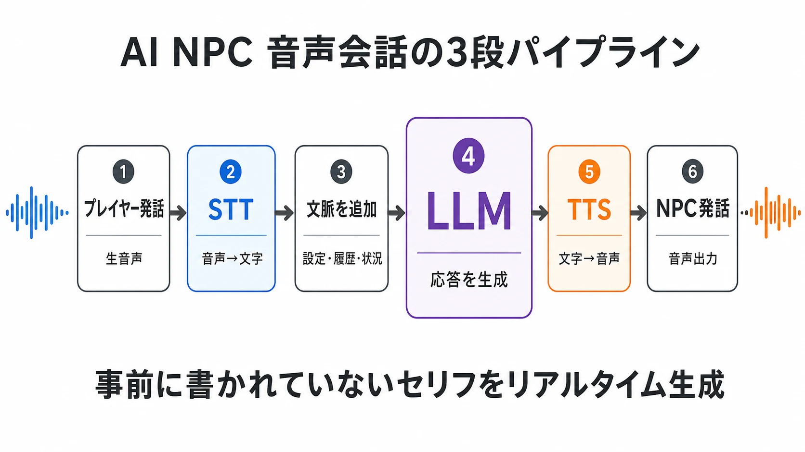
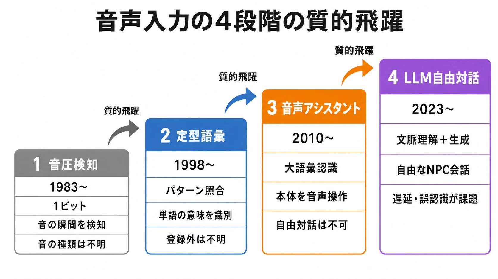

# かつて僕らは「ハドソーン！」と叫んだ — 家庭用ゲーム機における音声入力の歴史

> 2026年11月7日改版：記事全体を全面的に書き直しました。内容の変更はGitの履歴から追えます。

## 概要

1985年の『バンゲリングベイ』で、ファミコンの2コンに向かって「ハドソン！」と叫ぶ。1998年にはピカチュウへ話しかけ、2010年代にはゲーム機本体を声で操作する。そして2023年以降、AIがその場で返答を作る対話が、PCゲームや技術デモに現れた。

この歩みを、本稿では **音圧検知／定型語彙の音声認識／汎用音声アシスタント／LLM自由対話** の4段階でたどる。聞く対象が「音が鳴ったか」から「決まった言葉」、本体に対する指示、自由な会話へと広がってきた、という整理である。新しい段階が登場しても、以前の遊び方は残り続けた。

2026年のNintendo Switch 2にも、決まった言葉で相棒に指示する遊びが登場する。さらに、鼻歌やオカリナの音を受け取る別の枝も伸びた。技術と機器が変わるなかで、声を出してゲームの世界に関わる体験が、どのように受け継がれてきたのかを見ていこう。

| 年 | できごと | 段階 |
| --- | --- | --- |
| 1983 | ファミコン発売。2コンにマイク | 音圧検知 |
| 1985 | 『バンゲリングベイ』、叫ぶと敵が来る | 音圧検知 |
| 1986 | ディスクシステム版『ゼルダの伝説』、ポルスボイス | 音圧検知 |
| 1998 | 『ピカチュウげんきでちゅう』、VRSを同梱 | 定型語彙の音声認識 |
| 1999 | 『シーマン』、マイクデバイス | 定型語彙の音声認識 |
| 2003 | 『オペレーターズサイド』『SOCOM』 | 定型語彙の音声認識 |
| 2004 | ニンテンドーDS、マイクを内蔵 | 音圧検知・定型語彙 |
| 2005 | 『脳を鍛える大人のDSトレーニング』 | 定型語彙の音声認識 |
| 2010 | Xbox 360向けKinect（北米） | 汎用音声アシスタント |
| 2014 | Xbox One、日本語の音声操作 | 汎用音声アシスタント |
| 2023 | NVIDIA ACE for Games（技術デモ） | LLM自由対話 |
| 2025 | Nintendo Switch 2、マイクを内蔵 | — |
| 2026 | 『時のオカリナ』Switch 2版（11月5日） | 別の枝：音の高さ |
| 2026 | 『ピクミン4 Switch 2 Edition』（11月12日発売予定） | 定型語彙の音声認識 |

*本文で取り上げる事例を年順に並べた。出典は各章の本文を参照。PS5のVoice Commandは開始年を確認できていないため、第4章で扱う。*

***

## 第1章｜1980年代：音が鳴ったかだけを読む（音圧検知）

*初代ファミコンの2Pコントローラー。1P側のスタート／セレクトボタンに相当する位置にマイクが配置されている。*

出典: [Wikimedia Commons「Nintendo-Famicom-Controller-II-FL.jpg」](https://commons.wikimedia.org/wiki/File:Nintendo-Famicom-Controller-II-FL.jpg)（撮影: Evan-Amos、パブリックドメイン）

### 2コンが受け取ったのは、言葉より手前の信号

1983年発売のファミリーコンピュータでは、2コンにスタート・セレクトボタンがなく、その代わりにマイクと音量調整用のスライダーが付いていた。ゲームからはマイクの状態を1ビット、つまり0か1で読み取れた。読み出し位置は「$4016のD2」で、特定の値を音の有無に対応させるより、値が変化したかを追うのが一般的だったとNESdev Wikiは説明する。息を吹きかけるような音の検出に向く仕組みであり、何という言葉を話したかは区別できない。マイクの音は、本体の音声出力にも混ぜられていた。[[1](#ref-1)]

海外向けのNESには、コントローラーのマイクがない。日本のファミコンでは、マイクが拾った音がテレビのスピーカーからも聞こえた。声はゲームへの入力であると同時に、部屋に響く音でもあった。[[2](#ref-2)]

### 「ハドソン！」で敵が来る

ハドソンの『バンゲリングベイ』（1985年）では、2コンのマイクへ叫ぶと敵の戦闘機を呼び出せた。「ハドソン！」は印象的な合言葉だが、実際には何を叫んでもよかった。マイクが拾う音を、1人目のプレイヤーを妨害する操作に結び付けたのである。[[3](#ref-3)]

マグミクスの記事は、当時ハドソンに在籍していた高橋名人の談話として、ラジコンの操縦がうまくなりたい社員が、ヘリコプターの独特な操作方式を作ったと紹介している。[[3](#ref-3)]

1986年のディスクシステム版『ゼルダの伝説』にも、声を使う仕掛けがある。大きな耳を持つ敵「ポルスボイス」は、2コンのマイクを使うと倒せる。任天堂も、マイクへ話しかけるとこの敵を簡単に倒せることを公式に紹介している。[[4](#ref-4)]

ほかにも『たけしの挑戦状』『スターラスター』『熱血高校ドッジボール部』などがマイクを活用した。2018年に発売されたSwitch用「ファミリーコンピュータ コントローラー」でも、2コンのマイクは実際に動く。ファミ通の実機レビューでは、『熱血高校ドッジボール部』のおまけ要素がマイクで再現された。声を使う遊びは、当時の本体だけに閉じたものではなくなっている。[[5](#ref-5)]

***

## 第2章｜1998〜2003年：決まった言葉を聞き分ける（定型語彙の音声認識、周辺機器の時代）

### ピカチュウへ、声で話しかける

1998年12月12日発売の『ピカチュウげんきでちゅう』は、NINTENDO 64 VRS（音声認識システム）を同梱した。[[6](#ref-6)] 任天堂の説明によると、人の声を波形データというデジタル信号へ変換し、それをNINTENDO 64でプレイヤーの意思として識別してゲームへ反映する。VRSには、NECが開発した音声認識用のLSI（大規模集積回路）「アルトーカー」が使われた。[[7](#ref-7)]

*NINTENDO 64 VRS（Voice Recognition System）。NINTENDO 64本体に接続するVRSモジュールと専用ヘッドセットマイクで構成される。*

出典: [任天堂『ピカチュウげんきでちゅう』「VRS（音声認識システム）って何？」](https://www.nintendo.co.jp/n01/n64/software/nus_p_npgj/sound/index.html)（© Nintendo）

ファミコンでは音が鳴ったことを合図にしていたが、ここでは声を言葉として受け取り、ピカチュウへの働きかけに使う。プレイヤーの入力に「何を言ったか」という違いが生まれた。

### シーマンには、ボタンを押しながら話す

ドリームキャスト版『シーマン 〜禁断のペット〜』は、1999年7月29日に発売された。[[8](#ref-8)] コントローラーに取り付けるマイクデバイスを通して、人面魚のシーマンへ話しかける。[[9](#ref-9)]

『クリスマスシーマン プレゼントディスク』の取扱説明書は、Aボタンを押しながら話すよう説明している。プレイヤーがボタンで発話の区間を示す、いわゆるプッシュトゥトーク方式である。マイクを付けるだけでなく、「いま話している」とゲームへ伝える操作も含めて、会話が組み立てられていた。[[10](#ref-10)]

### PS2では、声が指示の中心になる

SCEの『オペレーターズサイド』は、2003年1月30日にPlayStation 2で発売された。プレイヤーはオペレーターとなり、音声でリオに指示を出して、宇宙ステーションホテルからの脱出を目指す。声による指示を操作の中心に据え、マイク同梱版も用意された。[[11](#ref-11)] ScanSoftの発表によると、採用されたのは話者非依存、つまり特定の人の声に合わせることを前提としない音声認識エンジンだった。[[12](#ref-12)]

同じ年の7月24日、日本で『SOCOM: U.S. Navy SEALs』が発売された。[[13](#ref-13)] ロジクール製のUSBヘッドセットを同梱し、一人用のストーリーモードでは声で隊員へ指示を出せる。電撃オンラインは、PS2初のボイスチャット対応オンライン対戦を実現する作品とも紹介した。隊員への声の指示はゲームが言葉を処理する入力、ボイスチャットはプレイヤー同士の会話であり、同じマイクでも役割が違う。[[14](#ref-14)]

この時代の代表例では、ソフトに専用機器を同梱するか、別にマイクを用意した。のちのDSやSwitch 2を考えるとき、この「遊びの前に機器をそろえる」という条件の違いが効いてくる。

*仕組みの概念図。個別作品の内部実装や全応答を示すものではない。ボタンを押しながら話す操作はシーマン、発言内容の識別は逆転裁判の例に基づく。[[10](#ref-10)][[15](#ref-15)]*

***

## 第3章｜2004〜2014年：マイクが標準装備になる（音圧検知と定型語彙の広がり）

2004年に登場したニンテンドーDSは、本体にマイクを内蔵した。任天堂は、声や手拍子でゲームを進めたり、音声認識を使ったりできる入力として紹介している。マイクを買い足す手間がなくなり、ソフトごとに音を使った遊びを選べるようになった。[[16](#ref-16)]

### 息を吹く、色を答える、決めぜりふを叫ぶ

『さわるメイドインワリオ』では、マイクを使うゲームで息を吹きかける。言葉の意味を伝えるというより、体から出した息をそのまま操作へつなぐ遊びである。[[17](#ref-17)]

2005年の『脳を鍛える大人のDSトレーニング』は、世界で1,901万本を販売した。[[18](#ref-18)] 声の内容を使う例には、文字そのものの色を答える「色彩識別」と、計算問題の答えを声で伝える「音声計算」がある。一方、「名作音読」は文章を読み終えるまでの時間を測るトレーニングである。声を出す活動にも、答えを機械に聞き取らせるものと、読む行為に取り組むものがあった。[[19](#ref-19)]

『逆転裁判 蘇る逆転』では、場面に合った決めぜりふを声で発する。カプコン公式FAQによると、発言の内容も識別するため、「異議あり！」と言うべき場面で「待った」と叫んでも認識されない。ファミコンの「何を叫んでもよい」との違いが、分かりやすく表れた例である。[[15](#ref-15)]

### 自分の声で、犬との関係を作る

『ニンテンドッグス』では、名前を呼ぶと子犬が駆け寄ってきたり、マイクで芸の言葉を教えたりする。声は答えを入力する道具に加えて、相手を呼び、しつけをするための手段になった。[[20](#ref-20)]

『えいご漬け』には、自分の発音を録音し、ネイティブの発音と聴き比べる「発音トレーニング」がある。こちらは **録音を自分の耳で比べる機能** である。決まった言葉を認識させる遊びと並んで、マイクに声を記録する使い方も広がった。[[21](#ref-21)]

2012年のWii Uも、同梱するGamePadにマイクを備えた。[[22](#ref-22)] 標準装備のマイクをどんな遊びに結び付けるかは、既刊[『鼻歌でも、実物のオカリナでもいい ― Switch 2 が音声入力に出した答え』第1章](switch2-microphone-voice-and-melody-input-design.md#第1章マイクは14年前から据置機に載っていた)へ譲る。

***

## 第4章｜2010年代〜：本体を声で操作する（汎用音声アシスタント）

### ゲーム内の相手から、ゲーム機本体へ

2010年、Xbox 360向けにKinectが登場した。Microsoftは、体の動きと声を使って、ゲームやエンターテインメントを操作する機器として紹介した。[[23](#ref-23)] 音声の行き先は、ゲーム内のキャラクターから、本体のメニューや機能にも広がる。

日本語での操作が分かりやすい例は、Xbox Oneである。2014年8月28日の週刊アスキーの記事では、Kinectに向かって「Xbox オン」と言うと、スタンバイ中の本体が起動する。「Xbox」に操作名を続ける方式で、50種類以上の操作に対応した。声が、本体を使うための共通の入り口になったのである。[[24](#ref-24)]

### PS5の英語プレビュー

PS5の「Voice Command (Preview)」では、「Hey PlayStation!」で受け付けを始め、ゲームやアプリの起動、ゲームプレイの録画、メディア再生などを指示できる。2026年11月7日時点の公式サポートでは、米国・英国で登録されたアカウントに限り、英語だけに対応するプレビュー版である。 **日本語では使えない。** プレビューの内容は変更・終了される場合がある。[[25](#ref-25)]

この段階の「汎用」は、複数のゲームにまたがる本体機能を扱うという意味である。何でも会話できるという意味ではなく、声で呼び出せる機能の範囲が広がったと捉えるとよい。

***

## 第5章｜2023年〜：決めていない言葉に答える（LLM自由対話）

### NVIDIA ACEが示した会話のつながり

2023年5月29日、NVIDIAはCOMPUTEXで「NVIDIA ACE for Games」を発表した。大規模言語モデル（LLM）は、言葉の文脈を扱い、その場で応答を生成する技術である。あらかじめ用意された合言葉を行動に対応させる入力に加え、プレイヤーの自由な問いかけへ返答を作る対話が示された。[[26](#ref-26)]

発表では、言語モデルを構築・調整するNeMo、音声認識と読み上げを担うRiva、音に合わせて表情を動かすAudio2Faceを組み合わせていた。Convaiとのデモ「Kairos」では、プレイヤーがラーメン店の店主ジンと対話する。声を受け取る処理と、返事を考える処理、声や表情で返す処理がつながっている。[[26](#ref-26)]

文字を介する構成なら、音声認識による文字起こし（STT）→LLMによる返答の生成→音声合成による読み上げ（TTS）と整理できる。次の図は、その基本的な流れを示したものである。個々の作品がすべて同じ構成を採るという意味ではない。[[27](#ref-27)]

*声を文字にし、返答を作り、音声で返す構成の概念図。*

### PCで試みられる、声による自由対話

以下はPC向けのゲームやMOD（ゲームに機能を加える改造データ）の例であり、家庭用ゲーム機での実装例ではない。表は音声入力の機能を示すもので、認識精度や会話の品質を比較したものではない。

| 作品 | 対応機種・環境 | 声で行うこと |
| --- | --- | --- |
| Suck Up! | PC（Windows） | 吸血鬼となり、自分の声で住民と交渉して家へ招き入れてもらう。[[28](#ref-28)] |
| Inworld Origins | PC向けデモ（Steamでの提供は終了） | 捜査で登場人物へ声で質問し、その場で生成される返答を聞く。[[29](#ref-29)] |
| Vaudeville | PC（Windows、Linux） | 探偵として、マイクまたは文字で住民と対話して事件を調べる。[[30](#ref-30)] |
| Whispers from the Star | PC（Windows） | 遠い惑星で遭難したステラと、音声や文字でやり取りする。[[31](#ref-31)] |
| Mantella | PC版SkyrimなどのMOD | 登場人物へ自然な言葉で話しかけ、AIが作る応答を受け取る。[[27](#ref-27)] |
| TALKER（T.A.L.K.E.R.） | PC向けS.T.A.L.K.E.R. AnomalyのMOD | 音声入力用ユーティリティを使い、Left Altを押しながら登場人物へ話しかける。[[32](#ref-32)] |

自由対話を支えるキャラクターの設計については、[『ドラゴンクエストX』のおしゃべりスラミィを扱う記事](dragon-quest-x-slamy-generative-ai-companion-design.md)と、[RyzaChatとSpiralLLMを扱う記事](ryzachat-spiralllm-ai-game-master-design.md)を参照されたい。会話の自由度や、キャラクターとしての一貫性をどう支えるかを掘り下げている。

***

## 第6章｜2025〜2026年：Switch 2で、声と音がふたたび遊びになる

2025年6月5日に発売されたNintendo Switch 2は、本体にマイクを内蔵する。[[33](#ref-33)] そのマイクをゲーム内の遊びに使う例が、2026年に続く。

### ピクミン4：9種類の音声コマンド

『ピクミン4 Nintendo Switch 2 Edition + だれでもチャレンジ! ダンドリ検定』は、2026年11月12日発売予定である。本稿の掲載時点では未発売だ。追加機能「わんコマンド」では、声で相棒のオッチンへ指示を出せる。任天堂は、トッシン、オタカラ運び、ほめる呼びかけなど、全部で9種類の指示を紹介している。英国の公式ページも9種類と説明する。[[34](#ref-34)][[35](#ref-35)]

本稿の4段階に当てはめると、これは「定型語彙の音声認識」に位置する。決まった種類の指示を聞いて相手が動く、という考え方が、本体に標準搭載されたマイクを通じて戻ってきた例である。

### 時のオカリナ：音の高さを受け取る別の枝

Switch 2版『ゼルダの伝説 時のオカリナ』は、2026年11月5日に発売された。[[36](#ref-36)] 鼻歌を歌うと、それに合わせてリンクがオカリナを演奏する。任天堂のDirectでは、実物のオカリナでも反応する様子が紹介された。英国の公式ページも、内蔵マイクを使った鼻歌による演奏を説明している。[[37](#ref-37)][[38](#ref-38)]

こちらが受け取るのは、言葉の意味ではなく音の高さである。「言葉をどこまで理解するか」という4段階とは別に、声や音を旋律として使う枝が伸びた、と捉えられる。

認識が外れたときの扱いや、ボタンで代わりに操作できることを含む設計の話は、[『鼻歌でも、実物のオカリナでもいい ― Switch 2 が音声入力に出した答え』](switch2-microphone-voice-and-melody-input-design.md)で扱っている。『時のオカリナ』そのものの操作設計は、[『ゼルダの「あたりまえ」は二度見直された』](zelda-ocarina-botw-rethinking-conventions.md)へ譲る。

***

## 第7章｜時代別の俯瞰

*聞き取る対象と使い道を整理した4段階。後の段階が登場しても、以前の入力は遊びに応じて使われ続ける。*

| 段階 | 時期 | 代表的な機器 | 何を聞き取るか | 代表作 |
| --- | --- | --- | --- | --- |
| 音圧検知 | 1980年代〜 | ファミコン2コン、DS内蔵マイク | 音や息が入力されたか | バンゲリングベイ、ゼルダの伝説、さわるメイドインワリオ |
| 定型語彙の音声認識 | 1998年〜 | NINTENDO 64 VRS、DCマイクデバイス、PS2のマイク、DS・Switch 2の内蔵マイク | 決まった言葉や指示 | ピカチュウげんきでちゅう、シーマン、オペレーターズサイド、逆転裁判 蘇る逆転、ピクミン4 Switch 2 Edition（発売予定） |
| 汎用音声アシスタント | 2010年代〜 | Kinect、PS5のコントローラーやヘッドセット | 本体機能に対する音声指示 | Xbox Oneの日本語操作、PS5 Voice Command (Preview) |
| LLM自由対話 | 2023年〜 | PCとマイク | あらかじめ決めていない問いかけ | Kairos（技術デモ）、Suck Up!、Vaudevilleなど |
| 別の枝：音の高さ | 2026年の紹介例 | Switch 2の内蔵マイク | 鼻歌やオカリナの音の高さ | ゼルダの伝説 時のオカリナ（Switch 2版） |

*各行は本文の事例を再整理したもの。「音の高さ」の歴史が2026年に始まったという意味ではない。LLM自由対話の行は、PCでの試みを含む。*

***

## 分析と考察

### 「叫び」から「会話」へ、変わったものと続くもの

公表された仕組みを比べると、ファミコンはマイクの状態変化を読み、VRSは声を波形データへ変換して識別し、ACEは音声の認識・返答の生成・読み上げをつないでいた。何を受け取り、どのような反応へ結び付けるかが変わってきたのである。[[1](#ref-1)][[7](#ref-7)][[26](#ref-26)]

ここからは編者の考察である。ファミコンが読み取れたのは、音が鳴ったかという限られた情報だった。それでも、自分が叫ぶと敵が現れるという因果関係は成立する。手で押すボタンに加えて、部屋にいる自分の声が画面の中へ届く。その感覚に、音声入力ならではの魅力があったと考えられる。

約40年を経た自由対話では、自分の言葉に相手が返事をする。ピクミンでは相棒が指示に応え、ゼルダでは自分の鼻歌がリンクの演奏になる。受け取る情報量は違っても、「自分の声でゲームの世界に関われた」という体験の質が、繰り返し追い求められているのではないだろうか。

### 声を、いつでも使いたい操作にする難しさ

公表された例には、認識がうまくいかない場面もある。Xbox Oneの週刊アスキーによる実演記事は、音声指示の認識に何度か失敗した様子を記している。PS5の公式サポートも、ノイズキャンセリング機能を持つ一部の機器では声を理解しにくい場合があると案内する。声を発すれば常に意図どおりに伝わる、という操作ではない。[[24](#ref-24)][[25](#ref-25)]

以下は、こうした事例から広げた編者の考察である。周囲の騒音は声を届けにくくし、家族のいる部屋で繰り返し命令を口にすることには気まずさもある。選ぶ項目が分かっていてボタンが手元にあれば、押すほうが速い場面も多いだろう。これらは音声入力が主流になりにくい理由として考えられるが、個々の作品の売上や継続を説明する原因として実証されたものではない。

さらに、声を出せる条件は人や環境で異なる。発話に関わる障害や、声を出せない場所で遊ぶ場合も含め、入力手段の選択肢については[『ゲームのアクセシビリティ設計――「遊べない」を減らす企画・実装・検証の実務』](game-accessibility-design-guide.md)を参照されたい。

***

## 結論

1985年の『バンゲリングベイ』で、叫びは1ビットの入力としてゲームへ届いた。その後、決まった言葉でキャラクターを動かし、本体の機能を呼び出し、自由な言葉で返事を受け取る試みへと広がってきた。

そして2026年のSwitch 2では、声で相棒に指示を出す遊びと、鼻歌や楽器の音にリンクが応える遊びが並ぶ。編者には、この歩みが「声でゲームの世界に触れたい」という欲求の積み重ねに見える。かつて2コンへ向かって叫んだ瞬間のうれしさは、聞き取れる内容が増えた今も、遊びの核に残っているのかもしれない。

## References

1. [NESdev Wiki「Standard controller」][1] — 開発者向け技術Wiki。2コンのマイク、1ビット入力、状態変化による検出、音声出力への混合。

[1]: https://www.nesdev.org/wiki/Standard_controller

2. [Benj Edwards「Inside Nintendo’s Classic Game Console」][2] — PCWorld。NESのマイク非搭載と、テレビへのマイク音声出力。

[2]: https://www.pcworld.com/article/536115/nintendo_famicom.html

3. [早川清一朗「『バンゲリングベイ』ウソ技の記憶を被害者が語る 『コントローラーを投げたい』」][3] — マグミクス、2020年2月22日。高橋名人の談話は同記事による紹介。

[3]: https://magmix.jp/post/23878/2

4. [任天堂「『光神話 パルテナの鏡』でも！『ファミリーコンピュータ Nintendo Switch Online』にはマイクが使えるソフトがあるんです。」][4] — 任天堂トピックス、2019年3月13日。ポルスボイスをマイクで倒す説明。

[4]: https://www.nintendo.com/jp/topics/article/2b2c3200-43e1-11e9-b104-0a6d14145cb1

5. [ファミ通.com「2コンのマイクが使える!? Nintendo Switch“ファミコンコントローラー”の各種機能や使えるタイトルなどを実機レビュー」][5] — ファミ通.com、2018年12月20日。

[5]: https://www.famitsu.com/news/201812/20169462.html

6. [任天堂『ピカチュウげんきでちゅう』][6] — 任天堂。発売日とVRS同梱の説明。

[6]: https://www.nintendo.co.jp/n01/n64/software/nus_p_npgj/index.html

7. [任天堂「VRS（音声認識システム）って何？」][7] — 任天堂。波形データへの変換とNECの「アルトーカー」。

[7]: https://www.nintendo.co.jp/n01/n64/software/nus_p_npgj/sound/index.html

8. [ファミ通.com「『シーマン ～禁断のペット～』がDCで発売された日」][8] — ファミ通.com、2022年7月29日。1999年7月29日の発売、ビバリウム開発・セガ発売、マイクデバイスと音声認識。

[8]: https://www.famitsu.com/news/202207/29269925.html

9. [セガ「ドリームキャスト 関連・周辺機器」][9] — セガハード大百科。マイクデバイス。

[9]: https://www.sega.jp/history/hard/dreamcast/devices.html

10. [セガ『クリスマスシーマン プレゼントディスク』取扱説明書][10] — メーカーの取扱説明書（Sega Retroに保存されたスキャン）。Aボタンを押しながら話す操作。

[10]: https://segaretro.org/images/archive/c/cf/20220209200034!Christmas_Seaman_Present_Disc_DC_JP_Manual.pdf

11. [電撃オンライン「USB対応マイクでプレイ可能！PS2『オペレーターズサイド』PC用体験版を配布」][11] — 電撃オンライン、2003年5月30日。発売日、音声でリオに指示する遊び、マイク同梱版。

[11]: https://dengekionline.com/data/news/2003/5/30/22cde0052d26fdba69cac11d0856a016.html

12. [ScanSoft「ScanSoft Speech Recognition For PS2」][12] — Worthplaying、2003年3月12日。ScanSoftの発表を掲載。

[12]: https://worthplaying.com/article/2003/3/12/news/8770-scansoft-speech-recognition-for-ps2

13. [勝田哲也「SOCOM USB ヘッドセットで迫力のリアリティ。SCE PS2『SOCOM： U.S. NAVY SEALs』」][13] — GAME Watch、2003年6月25日。日本での発売日。

[13]: https://game.watch.impress.co.jp/docs/20030626/som.htm

14. [電撃オンライン「PS2初のボイスチャット対応！『SOCOM:U.S.NAVYSEALs』この夏発売決定！」][14] — 電撃オンライン、2003年4月25日。ヘッドセット同梱、隊員への音声指示、オンライン対戦のボイスチャット。

[14]: https://dengekionline.com/data/news/2003/4/25/f252bb208467eea3e2f33d6c7ef0a79c.html

15. [カプコン「音声が正しく認識されない（逆転裁判 蘇る逆転）」][15] — カプコン サポート。発言内容と場面に対応したセリフの識別。

[15]: https://www.capcom.co.jp/support/faq/platform_othersgames_nintendods_saiban_037061.html

16. [任天堂「ニンテンドーDS マイク入力」][16] — 任天堂。内蔵マイクの説明。

[16]: https://www.nintendo.co.jp/ds/features/feature5.html

17. [任天堂『さわるメイドインワリオ』取扱説明書][17] — 任天堂。マイクに息を吹きかける操作。

[17]: https://m1.nintendo.net/docvc/NTR/JPN/AZWJ/AZWJ_J.pdf

18. [ウワーマン「DS版『脳トレ』が発売20周年。脳年齢チェックで一喜一憂、世界で1900万本以上のヒットを記録して大ブームとなった脳の活性化ソフト」][18] — ファミ通.com、2025年5月19日。世界販売本数1,901万本。

[18]: https://www.famitsu.com/article/202505/42074

19. [任天堂『脳を鍛える大人のDSトレーニング』取扱説明書][19] — 任天堂。冊子22〜27ページの「名作音読」「音声計算」「色彩識別」。

[19]: https://www.nintendo.co.jp/ds/andj/andj.pdf

20. [任天堂「ニンテンドッグスとは？」][20] — 任天堂。名前を呼ぶことと、マイクを使って芸を教える遊び。

[20]: https://www.nintendo.co.jp/ds/adgj/what/index.html

21. [任天堂「えいご漬け：ちょっと息抜き」][21] — 任天堂。「発音トレーニング」は自分の声を録音してお手本と聴き比べる機能。

[21]: https://www.nintendo.co.jp/ds/angj/rest/index.html

22. [任天堂「各部機能｜Wii U」][22] — 任天堂。Wii U GamePadのマイク。

[22]: https://www.nintendo.co.jp/hardware/wiiu/parts/index.html

23. [Microsoft「Kinect for Xbox 360 Sets the Future in Motion — No Controller Required」][23] — Microsoft、2010年6月14日。2010年11月の北米発売と音声操作の紹介。

[23]: https://news.microsoft.com/source/2010/06/14/kinect-for-xbox-360-sets-the-future-in-motion-no-controller-required/

24. [馬波レイ「Xbox Oneの音声認識やKinectでゲームの遊び方が変わる」][24] — 週刊アスキー、2014年8月28日。日本語の音声操作と実演の様子。

[24]: https://weekly.ascii.jp/elem/000/002/625/2625540/

25. [Sony Interactive Entertainment「Preview: How to control a PS5 console with your voice」][25] — PlayStation サポート。2026年11月7日参照。米国・英国アカウント、英語のみのプレビュー。

[25]: https://www.playstation.com/en-gb/support/hardware/ps5-voice-command/

26. [NVIDIA「NVIDIA ACE for Games が生成 AI で仮想キャラクターに命を吹き込む」][26] — NVIDIA報道資料、2023年5月29日。

[26]: https://www.nvidia.com/ja-jp/about-nvidia/press-releases/2023/nvidia-ace-for-games-sparks-life-into-virtual-characters-with-generative-ai/

27. [Art from the Machine「Mantella」][27] — 開発元ドキュメント。SkyrimとFallout 4の音声対話MOD。インストール手順を含む。

[27]: https://art-from-the-machine.github.io/Mantella/

28. [Proxima『Suck Up!』ストアページ][28] — Steam。実際の声を使った交渉とWindows対応。

[28]: https://store.steampowered.com/app/2726370/Suck_Up/

29. [Inworld AI『Inworld Origins』ストアページ][29] — Steam。マイクで証人に質問する遊びの説明。2026年11月7日参照時点でストアでの提供終了を告知。

[29]: https://store.steampowered.com/app/2199920/Inworld_Origins/

30. [Bumblebee Studios『Vaudeville』ストアページ][30] — Steam。マイクまたは文字による自然言語での対話、Windows対応。

[30]: https://store.steampowered.com/app/2240920/Vaudeville/

31. [Anuttacon『Whispers from the Star』ストアページ][31] — Steam。音声・文字での対話とWindows対応。

[31]: https://store.steampowered.com/app/3730100/Whispers_from_the_Star/

32. [danclave「TALKER README」][32] — 開発元配布リポジトリ。S.T.A.L.K.E.R. Anomaly向けMOD、音声入力ユーティリティ、Left Altを押しながら話す操作。

[32]: https://github.com/danclave/TALKER/blob/main/README.md

33. [任天堂「Nintendo Switch 2 本体」][33] — 任天堂。2025年6月5日発売、マイク内蔵。

[33]: https://www.nintendo.com/jp/hardware/switch2/index.html

34. [任天堂「『ピクミン4 Nintendo Switch 2 Edition + だれでもチャレンジ! ダンドリ検定』を11月12日に発売。」][34] — 任天堂トピックス、2026年9月10日。発売予定日と9種類の音声指示。

[34]: https://www.nintendo.com/jp/topics/article/6d1198af-8fbf-4172-9e60-d8504a6bddb7

35. [Nintendo UK「Pikmin 4 – Nintendo Switch 2 Edition + Dandori Academy」][35] — 任天堂。9種類の音声コマンド。

[35]: https://www.nintendo.com/en-gb/Games/Nintendo-Switch-2-Edition/Pikmin-4-Nintendo-Switch-2-Edition-Dandori-Academy-3188744.html

36. [GAME Watch「Nintendo Switch 2『ゼルダの伝説 時のオカリナ』本日発売。1998年発売の『時オカ』が20年以上の時を経てフルリメイク」][36] — GAME Watch、2026年11月5日。

[36]: https://game.watch.impress.co.jp/docs/news/2152925.html

37. [任天堂「ゼルダの伝説40周年 Direct 2026.9.8（テキスト版）」][37] — 任天堂、2026年9月8日。鼻歌と実物のオカリナによる演奏。

[37]: https://www.nintendo.com/jp/nintendo-direct/description/20260908_ja-JP.html

38. [Nintendo UK「The Legend of Zelda: Ocarina of Time」][38] — 任天堂。内蔵マイクを用いた鼻歌による演奏。

[38]: https://www.nintendo.com/en-gb/Games/Nintendo-Switch-2-games/The-Legend-of-Zelda-Ocarina-of-Time-3115664.html

----

この文書は、Perplexity、Claude、ChatGPT の3つのAIの支援を受けて著述されたものです。引用画像を除き、MIT License にて提供されています。
