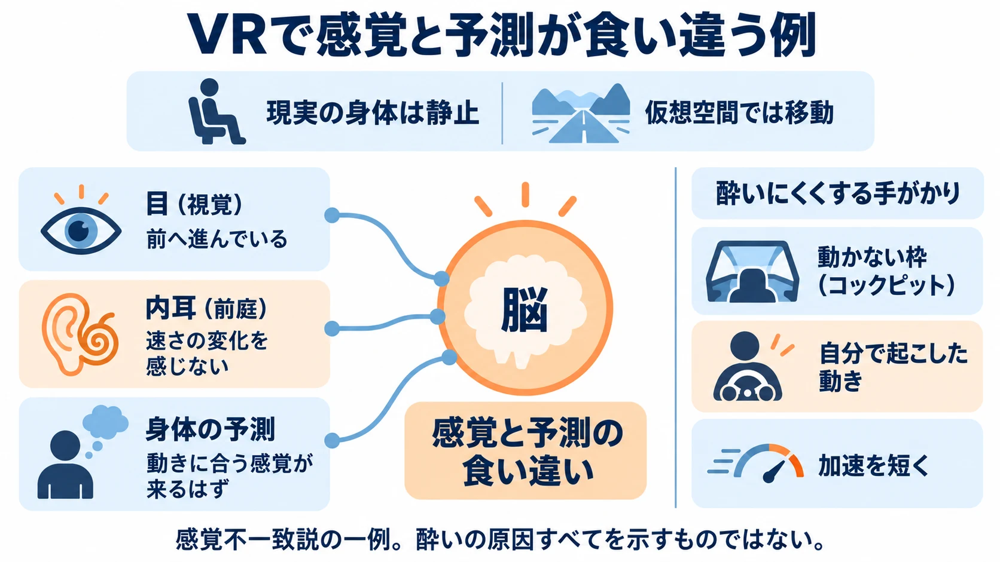

# その動きを、身体は先に予想できるか――VRの身体と酔いを、移動の設計から考える

「VR・XRを企画することになったら」第2回

## 1. コックピットに座ると、運転に入り込めた

編者は、これまで遊んだVR対応ゲームの中で、最も体験が良かったと感じた作品に『グランツーリスモ7』を挙げている。コックピットに座った状態で、DualSenseのモーションセンサー操作を使った。コントローラーを傾けてハンドルを切る操作で、かなり没入できたという。

このとき編者は、コンタクトレンズで視力を補正していた。視力や見え方の話は、第3回「見え方と読みやすさ」で扱う。

ここで注目したいのは、現実でもゲーム内でも座り、自分の手の動きで車の向きを変えていたことだ。同じ「景色の中を進む」体験でも、姿勢や操作とのつながりによって、受け取り方は変わりうる。

[第1回](vr-xr-planning-reason-to-wear-a-headset.md)では、 **その体験は、ヘッドセットを被る理由になるか** を企画の出発点に置いた。今回は、その体験を身体が受け止められるようにするため、 **その動きを、身体は先に予想できるか** と問う。

これは、酔いをすべて説明する法則ではなく、移動や演出を見直すための判断軸である。まず仕組みを押さえ、移動方式を比較し、編者の体験を読み解いてみよう。

***

## 2. 目の動きと身体の感覚が食い違う

### 視覚・内耳・予測のずれ

VR酔いは、車酔いや船酔いに似た不快な症状である。原因には諸説あり、すべてが解明されているわけではない。広く支持される説明の一つが、 **感覚不一致説** である。脳が過去の経験から予測する感覚と、実際に得られる感覚が食い違うことに着目する説だ。[[1](#ref-1)]

ヘッドセットの中では景色が後ろへ流れ、自分が前進しているように見える。一方、現実の椅子は動いていない。内耳にある **前庭** 、つまり頭の動きや傾き、加速度などを感じ取る器官には、見た目に対応する動きが届かない。目が受け取る動き、前庭が受け取る動き、脳が予測する感覚の間にずれが生じる、という捉え方である。[[1](#ref-1)][[2](#ref-2)]

身体が止まっていても、自分が動いていると感じることを **ベクション** という。隣の電車が動き始めたとき、自分の電車が動いたように感じる場面を思い浮かべるとよい。VRでは、このような自己運動の感覚を映像で作れる一方、身体の感覚との食い違いが不快につながる場合がある。[[2](#ref-2)]

### 長く加速し続ける映像に注意する

内耳は、一定の速さでまっすぐ進むことそのものより、速さや向きの変化に反応する。そのため、身体が静止したまま仮想空間を移動する場合、一定速度の移動のほうが快適なことが多い。[[2](#ref-2)]

VIPO（映像産業振興機構）のガイドラインは、連続移動で加速度を最小にし、なるべく等速直線運動にするよう勧めている。Metaの開発者向け資料も、加速する時間と回数を減らす方針を示す。企画では「滑らかに見えるから」と長い加速・減速を付ける前に、その変化を身体が受け取れるかを考えたい。[[1](#ref-1)][[2](#ref-2)]

出典：VIPOとMetaの解説をもとに作成。[[1](#ref-1)][[2](#ref-2)]

### 終了直後まで含めて試す

体験中には酔いを感じず、終わってしばらくしてから自覚するケースも報告されている。また、耐性は人やその日の体調によって異なる。頻繁にVRを体験する人は慣れることが多く、開発者自身は耐性がつきやすい。[[1](#ref-1)]

そこで試遊では、途中の感想に加え、外した直後と少し時間がたった後の感想を聞く。VRに慣れた開発者だけで判断せず、経験や体調の異なる人に試してもらい、中断した場面も記録する。フレームレート、つまり1秒間に表示する画像の枚数を安定させることも、基本条件である。[[1](#ref-1)]

平面画面でのカメラの揺れや画角の設計は、[3Dゲームのカメラの記事](game-camera-design-challenges.md)で扱っている。ここでは、視界を覆うヘッドセットと、現実の身体の関係に絞って考える。

***

## 3. 移動方式は、得たい体験と組み合わせて選ぶ

VIPOは移動の実装を、プレイヤーの足による移動と、乗り物・飛行を含む移動に大別し、前者を連続移動とテレポート、後者を地上移動と空間移動に分けている。以下はその分類を土台に、向きを変える方式のスナップターンを加えた比較である。「失うもの・注意」には、企画上のトレードオフも整理した。[[1](#ref-1)][[2](#ref-2)]

| 移動方式 | どう動くか | 酔いへの配慮 | 失うもの・注意 |
| --- | --- | --- | --- |
| 歩き続ける移動（連続移動） | 操作に応じ、仮想空間の中を途切れず進む | 加速を抑え、等速直線運動を基本にする。見ている方向以外へ進む場面にも注意する | 移動の連続性を保てる一方、現実の身体が止まっていると感覚がずれやすい |
| テレポート | 行き先を指定して、位置を切り替える | 移動中に景色が流れ続けることを避ける。移動先の向きを把握する手がかりを用意する | 移動の途中が省略されるため、道順や距離、追いかける遊びの設計が変わる |
| スナップターン | 一度の操作で一定角度ずつ向きを切り替える | 連続して視界を回転させる時間を減らす | 移動方式と組み合わせる旋回方法である。角度の刻みが細かな位置合わせに影響する |
| 乗り物（地上） | 車などに乗って地面に沿って進む | コックピットなどの安定した枠や、先の進路が分かる景色を使う | 急旋回や衝突などの視点変化は別に点検する。座っていても実際の加速度までは一致しない |
| 乗り物（空中） | 飛行機などで上下も含めて移動する | 進行方向を予想できる手がかりや、機内の安定した枠を用意する | 上下移動や機体の傾きが増える。飛ぶ自由と身体の負担を一緒に検討する |

ここでいう連続移動は、現実の床を歩く方法に限らず、スティックなどで仮想の身体を歩かせる方法を含む。移動をテレポートにし、旋回をスナップターンにする、といった組み合わせも可能だ。

### 視界の端を暗くするビネット

**ビネット** は、移動中に視界の端を暗くし、周辺の景色が流れる範囲を抑える手法である。Metaも移動の快適さを高める選択肢として紹介している。周囲を見渡す遊びでは、手がかりを見落とさないかも合わせて試したい。[[2](#ref-2)]

コロンビア大学のFernandesとFeinerは、2016年の研究で、移動に応じて柔らかな縁で視野を狭める方式を30人で検証した。参加者が感じる酔いを減らし、その場にいる感覚を下げずに済む可能性を報告している。すべての視野制限で同じ結果になるという意味ではなく、狭め方や変化のさせ方を含めて試した研究である。[[3](#ref-3)]

### 視界に動かない枠を残すコックピット効果

**コックピット効果** は、車の窓枠など、視界の中に常に動かないものがあるとVR酔いを軽減できるとする効果である。[[1](#ref-1)][[2](#ref-2)] つまり、ここでの「動かない」は、外の景色が流れても車内の枠が安定した基準になる、という意味であり、頭を動かしても視界の同じ位置に貼り付いたままになる表示とは別のものと考えられる。

テレポートは移動中の景色の流れを減らし、ビネットは流れが見える範囲を絞り、コックピットは安定した基準を与える。得たい遊びに合わせて、どの手がかりを使うかを選ぶのである。

***

## 4. 『グランツーリスモ7』の体験を読み解く

### 公式資料にある視点と操作

『グランツーリスモ7』の公式マニュアルによると、PS VR2でのレース視点は、内装視点のある車ではコックピットビュー、ない車ではボンネットビューに限られる。VR用のSenseコントローラーには非対応である。[[4](#ref-4)]

通常のコントローラーによるステアリング操作は、左スティック、方向キーの左右、モーションセンサーの3通りから選べる。編者が使った、DualSenseを傾けてハンドルを切る方法も、この選択肢の一つだ。[[5](#ref-5)]

### 姿勢・枠・自分の操作がつながっていた

以下は、これらの公式仕様と、前節までの一般的な知見を組み合わせた設計上の考察である。編者の没入感の理由を実験で特定したものではない。

第一に、現実の身体が座っており、仮想の身体も運転席に座っている。現実では静止しているのに、ゲーム内では足で走り続ける、といった姿勢や行為の隔たりが小さい。

第二に、編者が体験したコックピットビューでは、外の景色が流れても内装の枠が視界に入り続ける。これは、コックピット効果として説明される安定した視覚の基準と重なる。内装のない車のボンネットビューにも、同じ車内の枠があるとは限らない。

第三に、編者は自分の手を傾けてハンドルを切っていた。自分が操作を起こすので、次に曲がり始めることを予想する手がかりがある、と考えられる。進路を先に読み取れることが役立つというVIPOの知見とも合わせると、予告なく視点が動かされる場面との差が見えてくる。[[1](#ref-1)]

ただし、座席が実際に加速したり、旋回の力を身体へ伝えたりするわけではない。『グランツーリスモ7』でも酔い方には個人差や体調差がある。編者の良い体験から取り出せるのは、姿勢をそろえる、安定した枠を残す、自分の操作と動きを結び付ける、という企画上の着眼点である。

***

## 5. 身体に合わせる選択肢を、最初から作る

### 座るか立つかを選べるようにする

Metaの開発者向け資料は、体験と根本的に両立しない場合を除き、着座モードを支援し、早い段階で座るか立つかを選べるようにすることを勧めている。PlayStationも、初めは短い時間、座るスタイルから始め、慣れに応じて遊び方を広げる方法を紹介している。[[2](#ref-2)][[6](#ref-6)]

企画書には、座った高さでも必要な対象へ手が届くか、途中で姿勢を変えられるかまで書いておく。入力デバイスや手の追跡の詳しい話は、第4回で扱う。

### 中断と休憩を、遊びの区切りに合わせる

短いステージや一区切りごとの保存、いつでも止められる操作を用意すると、身体の都合に合わせて離れやすくなる。PlayStationは使用時間を少しずつ延ばし、休憩を忘れないようタイマーを使うことも勧めている。[[6](#ref-6)]

Meta Quest 3の公式警告は、初めて使うときの例として、最大30分の使用と15分の休憩から始め、慣れに応じて徐々に延ばすとしている。必要な時間は人によって異なり、不快感がある場合はヘッドセットを外し、症状が治まるまで使用しないよう案内している。これはメーカーの案内であり、「30分までは誰でも平気」という境界ではない。[[7](#ref-7)]

### 快適さの設定を段階的に用意する

Metaは、チームの評価に基づく「Recommended」、快適さを優先する「Comfortable」、経験者向けの「Advanced」という3つの設定を提案している。[[8](#ref-8)]

企画への落とし込み例なら、「おすすめ」「快適さ優先」「細かく調整」といった入口を用意し、その下で移動方式や旋回方法、ビネットを変更できるようにする。慣れている人も、体調や場面によって設定を戻せることが大切だ。設定が何を変えるかも、選ぶ画面で短く説明したい。

身体に合わせる選択肢を企画の早い段階から作る考え方は、[アクセシビリティ設計の記事](game-accessibility-design-guide.md)にもつながる。

### 年齢条件は、機器ごとの公式基準を示す

2026年10月20日時点で、Meta Quest 3の公式警告は、使用に必要なアカウントの年齢条件を10歳以上とし、国によって異なる場合があるとしている。PS VR2の公式案内は、12歳以下の子ども向けではないとする。対象機器と提供地域の公式基準を、そのまま案内する必要がある。[[7](#ref-7)][[9](#ref-9)]

***

## 6. 研究では何が報告されているか

酔い止めに用いられる薬を調べた医学論文にも、条件によって異なる結果がある。以下は研究報告の紹介である。

1996年のReganとRamseyのヘッドセット型VRの研究では、薬を使う群19人と偽薬の群20人が20分間VRを体験した。二重盲検、つまり参加者にも評価側にも割り当てを知らせない比較で、ヒヨスチン（スコポラミン）群では症状を報告する人が少なく、その差は統計的に有意だったと報告されている。[[10](#ref-10)]

一方、2023年のBen-Ariらの研究は、ヘッドセット型VRではなく、ヘリコプターのフライトシミュレーターを使い、パイロット41人を無作為に割り当てた二重盲検試験である。シンナリジンで症状スコアの改善が報告され、スコポラミンはシンナリジンにも偽薬にも劣る結果だった。[[11](#ref-11)]

両研究の結果は一致していない。機器や体験内容、対象者が異なり、参加人数はいずれも数十人規模である。特にヘッドセット型VRの研究は1996年と古く、現在のゲーム体験へそのまま当てはめるには限界がある。

また、2025年のCossioらによる **系統的レビュー** 、つまり多数の研究を一定の手順で集めてまとめた論文は、教育用途のヘッドセット型VRに関する25研究を扱った。最も多く報告された悪影響は眼球運動系の不調、すなわち目の疲れなど目の働きに関わる不調で、次いで見当識障害、つまり方向や自分の位置などをつかみにくくなる不調だった。これは報告された種類の傾向であり、全利用者に同じ割合で起こるという結果ではない。[[12](#ref-12)]

***

## 7. 企画書を、六つの問いで点検する

移動の仕様が決まったら、映像の見栄えに加えて、身体が受け取る順番を書き出してみたい。

- [ ] その動きの始まりと進行方向を、プレイヤーは自分の操作や周囲の手がかりから先に予想できるか。
- [ ] 加速・減速・旋回・ジャンプなど、身体が静止したまま視界が変わる場面を洗い出したか。
- [ ] 連続移動、テレポート、スナップターン、ビネットなどを比較し、得たい遊びと失うものを説明できるか。
- [ ] 座る／立つと快適さの設定を早い段階で選べ、途中でも変更できるか。
- [ ] 短く遊べる区切りと、いつでも中断して休憩できる仕組みがあるか。
- [ ] VR経験の異なる人に試してもらい、終了後の不調や中断、動きが激しい場面のフレームレートも記録する計画があるか。

編者の『グランツーリスモ7』体験には、運転席に座り、自分で曲がり、車内から景色を見るというつながりがあった。そのつながりを別の企画で作るには、 **その動きを、身体は先に予想できるか** を、一つ一つの移動や演出へ問いかける必要がある。

身体が受け止められる範囲を考えたうえで、そこでしか得られない体験を育てる。その体験は、ヘッドセットを被る理由になるか。第1回の問いは、身体の側からも点検できるのである。

次回、第3回「見え方と読みやすさ」では、ヘッドセットの中で何が見え、何が読みにくくなるのかを考える。

## References

1. [映像産業振興機構「VR等のコンテンツ制作技術活用ガイドライン2020」][1] — VIPO、2021年3月。冊子表記のp.41–42、45–49を参照。

[1]: https://www.vipo.or.jp/u/VR-guideline-2020.pdf

2. [Meta「Locomotion comfort and usability」][2] — Meta Horizon OS Developers、2025年12月17日更新。感覚不一致、加速度、移動の手がかり、着座対応の説明を参照。

[2]: https://developers.meta.com/horizon/design/locomotion-comfort-usability/

3. [Ajoy S. Fernandes・Steven K. Feiner「Combating VR Sickness through Subtle Dynamic Field-Of-View Modification」][3] — IEEE Symposium on 3D User Interfaces、2016年3月、pp.201–210。著者所属大学が公開する論文。

[3]: https://www.cs.columbia.edu/2016/combating-vr-sickness/images/combating-vr-sickness.pdf

4. [ポリフォニー・デジタル「PlayStation VR2で遊ぶ」][4] — グランツーリスモ7 オンラインマニュアル、2026年10月20日参照。

[4]: https://www.gran-turismo.com/jp/gt7/manual/psvr/01

5. [ポリフォニー・デジタル「コントローラーの基本操作」][5] — グランツーリスモ7 オンラインマニュアル、2026年10月20日参照。

[5]: https://www.gran-turismo.com/jp/gt7/manual/controller/01

6. [ソニー・インタラクティブエンタテインメント「PlayStation VR2のゲームプレイに慣れる方法」][6] — PlayStationサポート、2026年10月20日確認。

[6]: https://www.playstation.com/ja-jp/support/hardware/ps-vr2-motion-tips/

7. [Meta「健康および安全に関する警告｜Meta Quest 3」][7] — Meta、2026年10月20日確認。年齢条件、使用時間と休憩、不快感がある場合の案内を参照。

[7]: https://www.meta.com/legal/quest/health-and-safety-warnings/quest-3/

8. [Meta「Locomotion Best Practices」][8] — Meta Horizon OS Developers、2025年12月17日更新。快適さの設定3段階を参照。

[8]: https://developers.meta.com/horizon/design/locomotion-best-practices/

9. [ソニー・インタラクティブエンタテインメント「PlayStation VR2：PlayStation Safety（プレーヤー向け）」][9] — PlayStationサポート、2026年10月20日確認。

[9]: https://www.playstation.com/ja-jp/support/hardware/ps-vr2-safety/

10. [E. C. Regan・A. D. Ramsey「The efficacy of hyoscine hydrobromide in reducing side-effects induced during immersion in virtual reality」][10] — Aviation, Space, and Environmental Medicine、1996年3月、67(3):222–226。PubMed掲載抄録を参照。

[10]: https://pubmed.ncbi.nlm.nih.gov/8775399/

11. [Oded Ben-Ariほか「Anticholinergic Versus Antihistaminic Treatment for Simulator Sickness Prevention」][11] — Journal of Clinical Pharmacology、2023年10月、63(10):1119–1125。PubMed掲載抄録を参照。

[11]: https://pubmed.ncbi.nlm.nih.gov/37491788/

12. [S. Cossioほか「Cybersickness and discomfort from head-mounted displays delivering fully immersive virtual reality: A systematic review」][12] — Nurse Education in Practice、2025年5月、85:104376。教育用途の25研究を対象とする系統的レビュー。英語資料の説明の大意・訳は本稿による。

[12]: https://pubmed.ncbi.nlm.nih.gov/40267853/

----

この文書は、Perplexity、Claude、ChatGPT の3つのAIの支援を受けて著述されたものです。引用画像を除き、MIT License にて提供されています。
