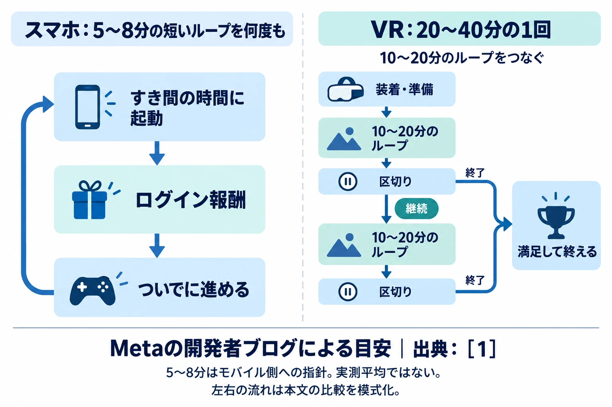
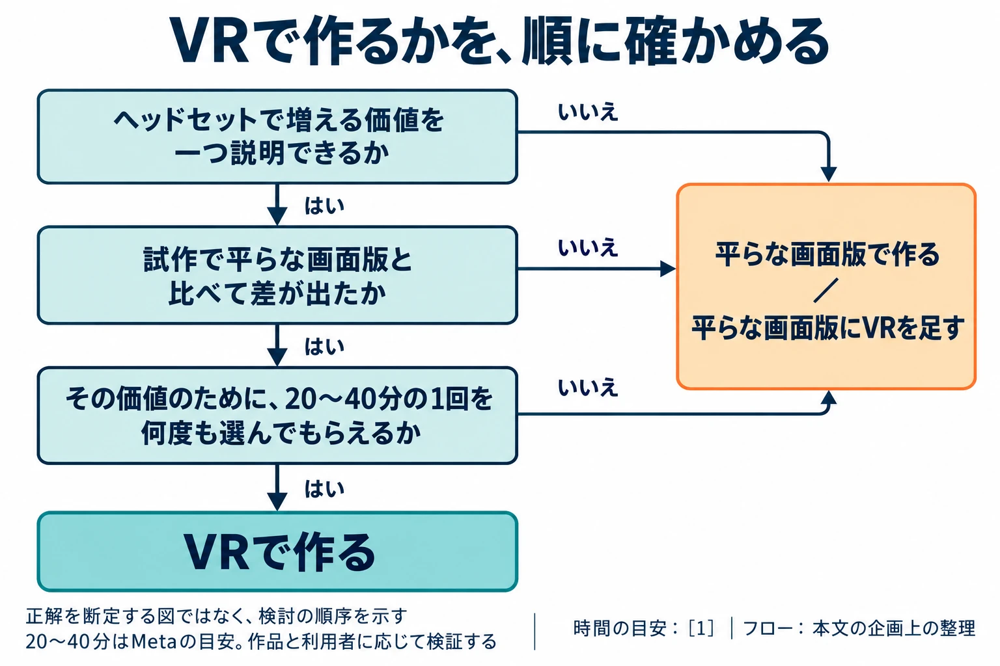

# 明日もヘッドセットを被りたくなる理由を、作れるか――VR・XRの出口を、遊び終えた後から設計する

「VR・XRを企画することになったら」第6回

## 1. 編者が作れなかった、毎日被る動機

編者は以前、VRゲームの試作に携わった。当初はホラータイトルを中心に試作し、最終的には自社のノウハウを活かせる格闘ゲームへと絞っていった。

そこで残った課題が、ヘッドセットを毎日被ってもらう動機だった。スマートフォンゲームなら、ちょっと暇だからアプリを起動し、ログインボーナスを受け取り、ついでに少し進める、という流れを作れる。こうした、行動と成果が次の行動へつながる繰り返しを、ゲームの設計では「ループ」と呼ぶ。

編者たちは、その流れをVRでは作れなかった。ヘッドセットを準備して被る行動を、日々の遊びへ結び付けられなかったのである。課題を解決できないまま、プロダクトを1本出しただけでプロジェクトは解散となった。

この経験は、一つのプロジェクトの経験である。それでも、初めてVRの企画を任された人が考えるべき問いを残している。最初の試遊で驚いてもらえた後、プレイヤーは何を楽しみに、もう一度その機器を手に取るのか。

最終回では、 **明日もヘッドセットを被りたくなる理由を、作れるか** を判断軸にする。遊び始める入口に続いて、満足して終える区切り、その先に戻る理由、そしてVR以外も含めた企画の出口を考える。

***

## 2. Meta自身が示した、被る手間に見合う1回

### 20〜40分は、社内調査に基づく目安

Metaは2025年7月24日の開発者ブログで、多くのVRコンテンツに適したセッションの長さとして20〜40分を挙げた。「セッション」は、遊び始めてから終えるまでの1回を指す。短すぎず、長すぎず、日常で選びやすい時間帯という考え方である。[[1](#ref-1)]

記事では、15〜20分未満のセッションはそれ以上の長さに比べて楽しさの評価が低く、多くの利用者のセッションは通常40分未満で、約40分を超えても楽しさは増えにくいとしている。根拠はMetaの社内調査だが、調査方法や規模は公開されていない。 **20〜40分は、すべてのVR作品や利用者に当てはまる普遍的な法則ではなく、企画を検討するための目安である。** [[1](#ref-1)]

Metaが理由に挙げるのは、長時間の装着による身体の負担、目の疲れや酔い、周囲の人から離れて過ごすこと、バッテリーの制約である。さらに、身体的な準備や装着の手間、終了後の作業を予期することも、遊び始める際の摩擦になる。[[1](#ref-1)]

そのため、モバイル型の短いループは、被る手間に見合うには短すぎるという。短時間だけ確認して終える行動を促す、とても短いクエストも避けるよう勧めている。[[1](#ref-1)] 編者が直面した「スマホのように、ついでに進めてもらえない」という課題は、この開始時の摩擦と重なる。

### 満足して外せるところまでを作る

Metaの提案は、10〜20分のループをつなぎ、20〜40分の1回を組み立てることである。最初の20分で、そのゲームに期待して来た中核の体験を届ける。1回の中に複数の区切りを置けば、プレイヤーは次へ進むか、そこで終えるかを選べる。[[1](#ref-1)]

たとえば格闘ゲームなら、対戦し、結果を振り返り、別の相手や課題に挑む、というまとまりを考えられる。重要なのは、所定の分数まで引き延ばすことより、被ったことで味わえた成果と、次を選ぶ余地があることだ。

Metaは10〜15分ごとの、遊びを妨げない休憩も勧める。ただし、その休憩で快適さが元どおりになるわけではなく、満足できる終わり方の代わりにはならないとしている。オートセーブ、前回のセーブからの経過時間、次のチェックポイントまでの進み具合を示し、離れやすく戻りやすくすることも提案している。40分になったら強制的に終える設計を求めているわけではない。[[1](#ref-1)]

「今日はここまで進んだ」「次はあそこから始められる」と分かれば、ヘッドセットを外す判断に迷いにくい。[プレイ時間とコンテンツの消費設計](game-play-time-limits-content-consumption-design.md)で扱った時間の問題を、VRでは装着の負担と一緒に考える必要がある。

時間の目安はMetaの開発者ブログによる。5〜8分はモバイル側への指針であり、実測平均ではない。流れは本文の比較を模式化したもの。[[1](#ref-1)]

***

## 3. 戻ってもらう工夫を、VRの1回に合わせる

2026年6月24日のMetaの開発者ブログは、ライブ運営を製品の半分に当たるものと位置づけている。「ライブ運営」とは、発売後も更新やイベントを続けて運営することである。週次または隔週の予測できる更新、2〜4週ごとのイベント、イベント期間中のデイリーログイン報酬などを勧めている。デイリー・ウィークリークエストは、それぞれ日単位・週単位で取り組む課題であり、ランキングや協力目標といった他者との関わりも、再訪の理由に挙げている。[[2](#ref-2)]

ここには、[ログインボーナスの設計](login-bonus-retention-tips.md)でも扱った、おなじみの仕組みが並ぶ。VRでも、報酬や更新を通じて再訪を促す発想は使われている。

ただし、2025年の時間設計の指針と合わせて読むなら、それらは **20〜40分を目安とする、遊び応えのある1回に乗せる仕組み** と整理できる。これは二つの記事を踏まえた本稿の設計上の読み取りであり、2026年の記事が全作品に同じ時間を義務付けているという意味ではない。

2025年の記事では、デイリークエストは約20分で完了できるようにし、ウィークリーは複数回のセッションで進められるよう勧めている。ログイン報酬のような確認行動も、より長く遊ぶ週間の課題などと組み合わせる提案である。[[1](#ref-1)]

企画書では、「今日の報酬を受け取るために被る」だけでなく、「今日の対戦を楽しんだ結果、報酬も受け取れる」までを一つの流れとして書きたい。毎日来る理由の中に、毎回来て良かったと思える中身が要る。

更新の頻度も、チームが続けられる範囲で決める必要がある。2026年の記事も、頻度以上に一貫して続けることを重視している。また、1日後・7日後・30日後の継続率の数値は示していない。これらの施策を導入すれば、どの程度戻ってもらえるかまで保証されるものではない。[[2](#ref-2)]

***

## 4. 続きを楽しめても、被り続けられるとは限らない

編者にとって、『Horizon Call of the Mountain』は『グランツーリスモ7』に次いでVRの体験が良かった作品だった。山を登り、機械獣と戦い、弓で矢を射るといった行為を中心にした、PS VR2向けの作品である。[[3](#ref-3)]

スマホのような、短時間だけ起動して報酬を受け取るループとは違う。それでも編者は、冒険を進めていく過程を楽しめた。次の場所へ行くことや、その先の体験が、続ける楽しみになっていたのである。

一方で、編者は視力補正の都合でエンディングまで進められなかった。ここで体験を区切ったのは、編者自身の見え方の条件である。[第3回「見え方と読みやすさ」](vr-xr-vision-legibility-different-eyes.md)で扱った、補正しても必要なものを見分けにくいという問題が、続きを遊ぶ段階にも関わっていた。

企画では、続きへの興味と、次回もその体験へ入れる条件を、一緒に点検したい。物語の先を知りたい人にも、装着、見え方、身体、部屋の条件がある。前回楽しめた理由を用意することと、明日もそこへ戻れるようにすることが、ここでつながる。

***

## 5. 届け方の出口を、複数持つ

### 平らな画面版に、VRを足す

Valveの2026年9月のSteamハードウェア＆ソフトウェア調査では、VRヘッドセットを持つSteamユーザーの割合は1.35％だった。調査への参加は任意・匿名であり、対象はSteamで調査に応じたPC利用者に限られる。世界のゲーマー全体や、単体で動くVR機器の利用者全体の保有率を示す数字ではない。[[4](#ref-4)]

この範囲の狭さを踏まえても、企画を届ける際には、被れる人と、画面で遊ぶ人の両方を考える意味がある。

『バイオハザード ヴィレッジ』では、本編を持っている人向けの無料DLC「VRモード」が用意された。DLCとは、ダウンロードで追加するコンテンツのことである。本編（またはGold Edition）を持っていれば、別途ダウンロードすることで、PS VR2で本編のストーリー全体を体験できる。[[5](#ref-5)] 『グランツーリスモ7』もPS5版でPS VR2に対応し、オンラインレースを含むほぼすべてのレースをVRで体験できる。[[6](#ref-6)]

こうした形なら、まず画面で作品に出会い、装着したときには同じ題材を別の身体感覚で楽しむ入口を作れる。ただし、操作や表示をVR向けに設計する仕事は必要になる。企画書には、画面版で成立する楽しさと、被ったときに増える楽しさを、それぞれ書いておきたい。

### モバイルやPCと行き来する

Metaの2025年の記事は、Horizon Worldsを作る場合、モバイルアプリとの画面をまたぐ対応を検討するよう勧めている。モバイル側の5〜8分の短いループと、ほかの機器での没入する体験のバランスを取り、必要に応じて行き来できるようにする提案である。[[1](#ref-1)]

たとえば、スマホでは次に挑む課題を選び、VRでは身体を使う遊びを楽しむ、といった役割分担を試作できる。その場合も、スマホで何をしたかが、次に被る楽しみへつながっているかを確かめたい。

[第5回のソーシャルVR](vr-xr-social-vr-safe-place-without-goal.md)で扱ったVRChatも、通常のPCで、モニターとキーボード、マウスを使って参加できる。[[7](#ref-7)] これはモバイルとの往来そのものの例ではないが、同じ場所へ参加するための入口を、ヘッドセットだけに限らない例である。

MR、つまり現実の部屋と仮想の物体などを組み合わせる体験も、届け方を考える選択肢になる。部屋を見ながら遊ぶ価値と、機器を装着する負担を比べたい。[第1回で扱ったメガネ型機器の伸び](vr-xr-planning-reason-to-wear-a-headset.md)には、VR・MR以外の用途を持つ機器も含まれるため、その伸びをそのまま自分のゲームの需要には置き換えず、どの機器で何を届けるかを考える材料にする。

***

## 6. 「VRにしない」も、試作で選ぶ

ゲームのアイデアがあり、ヘッドセットで増える価値をまだ説明できないなら、平らな画面版で作るほうが、多くの人に届けられる場合がある。装着の準備をせずに始められることも、遊びの価値を受け取るための条件だからである。

[第1回の「灯台の修理工房」](vr-xr-planning-reason-to-wear-a-headset.md)では、部品を選んで組み合わせる楽しさと、巨大な歯車をのぞき込み、両手で軸を合わせ、頭上のレンズを動かす楽しさを比べた。同じ修理の場面を画面版とVR版で試し、被ることで何が増えたかを見る姿勢は、企画の終盤まで使える。

最初の試遊で差が出たら、次は日を空けて、もう一度遊んでもらう。「面白かった」という感想に続いて、準備をして再訪する行動につながるかを見る。戻らなかった人には、時間がなかったのか、装着が負担だったのか、次にしたいことがなかったのかを聞く。試遊の場で被ってもらえたことと、日常の中で選んでもらえたことを、分けて受け止めたい。

その結果をもとに、VR専用で作る、画面版にVRを足す、画面版へ企画を移す、といった出口を検討できる。制作を続ける形式を選ぶことも、企画の仕事である。

20〜40分はMetaの目安であり、作品と利用者に応じて検証する。フローは本文の企画上の整理である。[[1](#ref-1)]

***

## 7. 六つの判断軸を、企画書へ戻す

このシリーズでは、ヘッドセットを被る理由から始め、身体、見え方、操作する部屋、他者と過ごす場所、そして明日も戻る理由までを見てきた。各回の問いは、企画書の別々の欄を埋めるだけでなく、同じ体験が届くまでの条件として読み返せる。

| 回 | 題目 | 判断軸 |
| --- | --- | --- |
| 第1回 | [企画の出発点と市場の現在地](vr-xr-planning-reason-to-wear-a-headset.md) | その体験は、ヘッドセットを被る理由になるか |
| 第2回 | [身体と酔い](vr-xr-body-motion-sickness-predictable-movement.md) | その動きを、身体は先に予想できるか |
| 第3回 | [見え方と読みやすさ](vr-xr-vision-legibility-different-eyes.md) | その情報は、見え方の違うプレイヤーにも届くか |
| 第4回 | [入力と空間](vr-xr-input-space-room-and-body.md) | その操作は、その部屋とその身体で続けられるか |
| 第5回 | [ソーシャルVR](vr-xr-social-vr-safe-place-without-goal.md) | その場所は、目的がなくても安心して居られるか |
| 第6回 | 出口の設計（本稿） | 明日もヘッドセットを被りたくなる理由を、作れるか |

### 企画書の点検項目

- [ ] **被ることで増える価値を言葉にしたか。** 画面版との比較試作で、その価値をプレイヤーが受け取れたか。
- [ ] **準備に見合う中身を1回に入れたか。** 20〜40分という目安を出発点に、自分の作品と利用者に適した長さを確かめたか。
- [ ] **安心して外せる区切りがあるか。** セーブ状況と次の目標が分かり、途中で休んだり終えたりできるか。
- [ ] **次回の楽しみが具体的に見えるか。** 報酬の受け取りに加え、次の対戦、冒険、他者との時間など、遊びたい中身があるか。
- [ ] **戻るための条件を確かめたか。** 見え方、身体、部屋の違いを含め、日を空けた試遊でも再び遊べるか。
- [ ] **届け方と運営を続けられるか。** 更新の制作量と頻度を見積もり、画面版、VR追加、複数端末の往来も比べたか。

あなたは、プレイヤーが明日もヘッドセットを被りたくなるゲームを作れるか。

## References

1. [Meta「Building Content to Optimize User Time: 20-40 Minute “Goldilocks” Session Length on Meta Quest」][1] — Meta Horizon OS Developers Blog、2025年7月24日。時間の目安と、その理由・設計上の提案。根拠となる社内調査の方法・規模は非公開。英語資料の大意は本稿で日本語にした。

[1]: https://developers.meta.com/horizon/blog/optimize-user-time-goldilocks-session-length-meta-quest/

2. [Meta「Build Faster, Earn More: The Lean Developer's Guide to Engagement and Retention on Meta Quest」][2] — Meta Horizon OS Developers Blog、2026年6月24日。ライブ運営、更新、イベント、報酬、日次・週次の目標の提案。英語資料の大意は本稿で日本語にした。

[2]: https://developers.meta.com/horizon/blog/build-faster-earn-more-developers-guide-to-engagement-and-retention-meta-quest/

3. [ソニー・インタラクティブエンタテインメント「Horizon Call of the Mountain」][3] — PlayStation公式。作品の概要と必要機器。2026年10月21日確認。編者の感想と視力補正の事情は、編者自身の経験による。

[3]: https://www.playstation.com/ja-jp/games/horizon-call-of-the-mountain/

4. [Valve「Steam Hardware & Software Survey: September 2026」][4] — Steam、2026年9月調査。任意・匿名の調査。VRヘッドセット保有率を参照。2026年10月21日確認。

[4]: https://store.steampowered.com/hwsurvey/

5. [Kanda Tsuyoshi「Resident Evil Village VR Mode launches February 22 for PS VR2 as free DLC」][5] — PlayStation.Blog、2022年12月14日。カプコンのプロデューサーによる、2023年2月22日の無料DLC配信と本編ストーリーのVR対応の告知。英語資料の大意は本稿で日本語にした。

[5]: https://blog.playstation.com/2022/12/14/resident-evil-village-vr-mode-launches-february-22-for-ps-vr2-as-free-dlc/

6. [ソニー・インタラクティブエンタテインメント「グランツーリスモ７」][6] — グランツーリスモ・ドットコム、製品情報。「PlayStation VR2に対応」の節。2026年10月21日確認。

[6]: https://www.gran-turismo.com/jp/products/gt7/

7. [VRChat「Controls」][7] — VRChat公式ドキュメント。「Desktop Mode」の節。2026年10月21日確認。英語資料の大意は本稿で日本語にした。

[7]: https://docs.vrchat.com/docs/controls

----

この文書は、Perplexity、Claude、OpenAI Codex の3つのAIの支援を受けて著述されたものです。引用画像を除き、MIT License にて提供されています。
