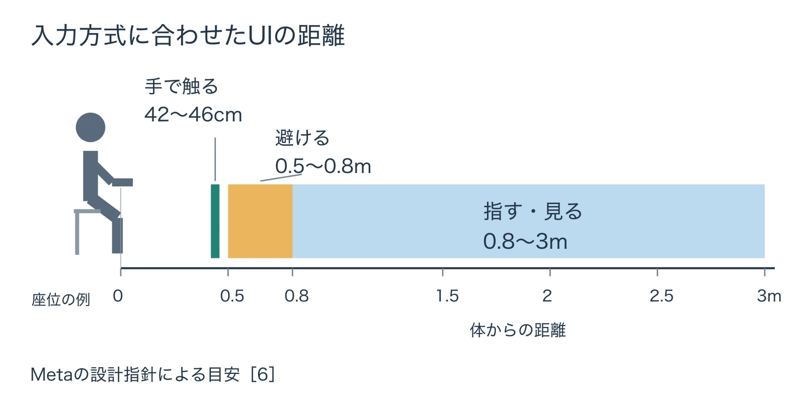

# その操作は、その部屋とその身体で続けられるか――VR・XRの入力と空間を考える

「VR・XRを企画することになったら」第4回

## 1. 座って運転する体験から、入力を考える

[第2回「身体と酔い」](vr-xr-body-motion-sickness-predictable-movement.md)で紹介した『グランツーリスモ7』では、編者は座った姿勢で、手元のDualSenseを傾けて運転していた。現実の姿勢と、ゲーム内で車を操る動きがかみ合い、運転に入り込めた。

VRの入力を決めるときも、この組み合わせが出発点になる。何を押すかに加えて、どんな姿勢で、どこへ手を伸ばし、その動きを何度繰り返すかを考える。今回の判断軸は、 **その操作は、その部屋とその身体で続けられるか** である。

一方、視線で対象を選ぶUIは、編者が試した範囲ではうまく動作しないことが多かった。[第3回「見え方と読みやすさ」](vr-xr-vision-legibility-different-eyes.md)で触れた視力補正が関係するのかは分からない。この体験から原因や特定の製品の問題を決めつけることはできないが、人によって入力の通り方が違う、という問いは残る。

自分が一度操作できたことを出発点に、部屋や姿勢、使う手が変わっても遊び続けられる条件を企画書へ書いていこう。

***

## 2. コントローラー、手、視線には、それぞれ得意な仕事がある

**ハンドトラッキング** は、機器のカメラなどで手の位置や動きを追跡し、入力に使う仕組みである。 **レイ** は、手やコントローラーから伸びる光線のような目印で、離れた対象を指す方式だ。

PS VR2 Senseコントローラーは指のおおよその位置を検出し、 **ハプティックフィードバック** 、つまり振動による手応えと、引き具合の抵抗が変わるアダプティブトリガーを備える。[[1](#ref-1)] Metaは、手による「つかむ・指す・身振り」と、コントローラーによるスクロールなどの向き不向きを整理している。[[2](#ref-2)] AppleのvisionOSには、対象を見て選び、指でタップして決定する間接ジェスチャーと、仮想の物に直接触れる直接ジェスチャーがある。[[3](#ref-3)]

次の表は、これらの公式情報を企画上の選び方として整理したものだ。製品の順位ではなく、操作に割り当てる仕事を比べている。

| 入力 | 得意なこと | 苦手なこと・注意 | 疲れやすさ・フィードバック |
| --- | --- | --- | --- |
| コントローラー | ボタンやスティックで繰り返す入力、スクロールなど。PS VR2 Senseでは指のおおよその位置も検出できる | 機器を握って操作する条件が加わる。ボタンでできる操作を、そのまま手のジェスチャーへ置き換えても使いやすさは保てない | PS VR2 Senseは振動とトリガーの抵抗で手応えを返せる。腕をどこで支えるかは別に考える。[[1](#ref-1)][[2](#ref-2)] |
| ハンドトラッキング | 近くの物をつかむ、触る、指す、身振りをする | カメラの追跡範囲、手の隠れ、照明に左右される。直射日光は精度を下げる。遠くの対象にはレイなどを組み合わせる | 腕を上げ続けたり、伸ばし続けたりすると疲れやすい。仮想の物には触った感触がないため、見た目と音で結果を返す。[[2](#ref-2)] |
| 視線で選んで指でタップ | visionOSでは、離れた対象も少ない手の動きで選択できる | 視線で狙いやすい配置と間隔が必要。編者のように、操作がうまく通らない体験も点検対象になる | Appleは、腕を長く上げる直接操作より、ボタンなどには間接操作を優先するよう勧める。狙っている対象が分かる見た目も大切である。[[3](#ref-3)][[4](#ref-4)] |

「手を使うから直感的」と決める前に、つかむ楽しさが中心なのか、メニューを手早く選ぶことが中心なのかを分けたい。触る操作を遊びの見せ場に残し、設定の変更には腕を休められる操作を用意する、といった組み合わせが考えられる。

***

## 3. 腕は思ったより早く疲れる

### 触る楽しさと、繰り返す負担を分ける

Metaは、心臓より上に手を保つ操作や、過度に手を伸ばす操作を避けるよう勧めている。腕を体の横で休められる配置を考えたい。Appleも、腕を上げ続ける直接ジェスチャーは低頻度の利用に向き、ボタンなどのUIには間接ジェスチャーを優先するとしている。[[2](#ref-2)][[3](#ref-3)]

例えば、装置の大きなレバーを一度引く場面と、持ち物を開くたびに空中の小さなボタンへ手を伸ばす場面では、同じ腕の動きでも頻度が違う。企画書には「触れる」だけでなく、いつ、何回使い、合間に腕を下ろせるかまで書く。

手入力を中心にするなら、時間制限や反射神経に頼る場面を避け、自分のペースで進められるようにする。Metaの指針も、休憩を設け、時間をかけたり休んだりしても不利にならない設計を勧めている。[[2](#ref-2)]

### 独自ジェスチャーは、少なく、見せて教える

Metaは、ごく少数の単純なポーズとジェスチャーに絞り、動きを視覚で教えるよう勧めている。対象の近くでだけ有効にする、指が対象に重なっている状態でだけ受け付ける、といった条件を加え、意図しない作動も繰り返し試す。文化によって不適切になりうる身振りにも注意が必要だ。[[5](#ref-5)]

Appleは、独自ジェスチャーを必要な場合に限り、重要な操作の唯一の手段にしないよう求めている。[[3](#ref-3)] 例えば、特別な手の形でメニューを開けるようにしても、通常のボタンからも開けるようにする。成功したときだけでなく、会話中に手を動かしたときや、腕を休めようとしたときに誤作動しないかを試したい。

***

## 4. UIの距離と大きさを、入力と一緒に決める

### 手で触る場所と、指す・見る場所を分ける

Metaの手入力向けUI指針では、直接触るUIを体から42〜46cm、レイや視線で選ぶ間接操作を約0.8〜3mに置くことを目安としている。間接操作のUIは0.8mより近くに置かず、直接・間接の切り替えが曖昧になりやすい0.5〜0.8mの中間帯も、できるだけ避ける。[[6](#ref-6)]

Metaの設計指針による目安。46cmから0.5mまでの間は空け、0.8mを間接操作の帯との境界として示している。[[6](#ref-6)]

例えば、触ってほしいボタンを少し遠くへ置くと、プレイヤーは身を乗り出すかもしれない。間接操作を期待するなら、その方式が見た目でも分かるようにする。距離を変えられるパネルでは、操作方式が変わったことも伝える必要がある。[[6](#ref-6)]

### 見えるボタンと、押せる範囲を分ける

Metaが示すヒット領域、つまり入力を受け付ける範囲の最小値は48dpである。 **dp** は、ここではパネル上の大きさを指定する単位で、推奨される手で触る距離では約22mmに相当する。見えるボタンの絵そのものを48dpにするという意味ではない。角度で見た判定範囲の目安は約2.5〜3°、隣り合う操作対象との間隔は最小12mm、ボタンの押し込みの深さの既定値は7mmである。よく使う項目はパネルの下半分に置き、動く手首へメニューを固定しないことも勧めている。[[6](#ref-6)] Appleも、手のまわりをシステムの表示に使うため空けておき、できれば内容を手や手首に固定しないよう求めており、両社の指針は同じ方向を向いている。[[3](#ref-3)]

Appleは、読む内容や長く関わる内容を少なくとも1m先に置くよう勧める。視線で選ぶ項目は、境界の周囲に16pt以上の余白を取るか、中心同士を60pt以上離す。目は一点を見ているつもりでも小さく素早く動くため、項目が詰まっていると隣の項目へ視線が移りやすい、というのがその理由である。 **pt** は、AppleのUIで使う大きさの単位「ポイント」である。Metaのdpと同じ物差しとして数値だけを比べず、各環境の配置として扱う。[[4](#ref-4)]

これらは各社の設計指針であり、全員に当てはまる保証ではない。まず配置を決める目安にし、腕の届き方や狙いやすさの違う人に試してもらう。

### 触れた感触の代わりに、結果を返す

空中のボタンには、現実のスイッチを押し切ったときの感触がない。指が近づいたとき、押したとき、選択が成功したときを見た目で区別し、成功時には短く区別できる音を返す。Metaは、このような視覚と音のフィードバックを重視している。[[6](#ref-6)]

「押せたか分からないので、もう一度押す」という状態は、二重操作につながる。企画書には入力方法と対にして、何が変われば成功と分かるかを書く。コントローラーの振動を使う場合の詳しい考え方は、[振動とハプティックフィードバックの設計ガイド](controller-haptics-design-guide.md)を参照してほしい。

***

## 5. 遊ぶ空間を企画書に書く

### 座る、立つ、動き回るでは条件が違う

PS VR2の公式案内では、プレイスタイルごとに次の広さが必要となる。座る場合も立つ場合も、Senseコントローラーを自由に動かせる空間が必要である。ゲームが対応するプレイスタイルは、ダウンロード版の詳細画面や、ディスク版のパッケージで確認できる。[[7](#ref-7)]

| プレイスタイル | PS VR2で必要なプレイエリア |
| --- | --- |
| シーテッド（座って遊ぶ） | 1m×1m以上。コントローラーを自由に動かせる空間も確保する |
| スタンディング（立って遊ぶ） | 1m×1m以上。コントローラーを自由に動かせる空間も確保する |
| ルームスケール（動き回って遊ぶ） | 2m×2m以上 |

PS VR2では、プレイエリアの端へ近づくと境界線が表示され、外へ出るとゲームが一時停止して周囲の様子が映る。シネマティックモードでは、このプレイエリアは機能しない。[[7](#ref-7)] また、 **シースルービュー** はヘッドセットを被ったまま周囲を確認する機能で、スコープ底面のファンクションボタンか、コントロールセンターのクイック設定でゲーム画面と切り替えられる。[[8](#ref-8)]

Meta Questのルームスケールにも、安全で障害物のない2m×2m以上の空間が必要である。[[9](#ref-9)] こうした境界の機能を前提にしつつ、遊び自体が頻繁に境界の外へ手や身体を誘導しない配置を考えたい。

### 住宅全体の広さから、遊べる床面は決められない

日本の住宅事情を考える手がかりとして、総務省統計局の2023年の住宅・土地統計調査を見よう。居住専用に建てられた「専用住宅」の1住宅当たりの値は、次のとおりである。[[10](#ref-10)]

| 建て方 | 延べ面積 | 居住室の畳数 |
| --- | ---: | ---: |
| 総数 | 90.86㎡ | 32.49畳 |
| 一戸建 | 126.32㎡ | 42.91畳 |
| 共同住宅 | 50.31㎡ | 20.60畳 |

延べ面積は、居住室に玄関、トイレ、台所などを加えた住宅全体の床面積の合計である。居住室の畳数も、住宅全体の居住室を合計した値であり、一部屋の広さではない。どちらも家具を置いた状態で残る空き床面を表す値ではなく、家具の占有分を差し引いた統計でもない。[[10](#ref-10)]

したがって、この表からルームスケールで遊べる家庭の割合は求められない。企画への読み取りは、 **動き回る前提だと遊べる家庭が限られうる** 、というところまでである。想定するプレイヤーの部屋で、連続した空間を確保できるかを別に確かめたい。

企画書には、座る・立つのどちらで成立するか、必要な床面と腕を動かす空間、床や背後へ手を伸ばす場面の有無を書く。例えば、床へ落ちた道具を手元へ呼び戻す、背後のメニューを正面へ戻す、身体を回さず操作で向き直せるようにする、といった代替も決めておく。ここでは向き直す方式の詳論より、どの姿勢でも必要な操作に戻れることが大切である。

***

## 6. 身体の違いに合わせて、入力の通り道を増やす

Appleは、障害、空間の制約、環境などによって誰もが特定の身体動作や姿勢を取れるわけではないため、それを入力の必須条件にしないよう求めている。両手や特定の手を必要とするジェスチャーも避け、動きの少ない代替を用意する方針である。[[3](#ref-3)]

企画では、例えば「両手を同時に上げる」を開始条件にする代わりに、片手の選択操作でも開始できるようにする。立って手を伸ばす位置にしか決定ボタンを置かずに済むよう、パネルの位置を調整できるようにする。コントローラーの操作の割り当ても変更できるようにし、どちらの手で何を担うかを固定しすぎない。

代わりの入力には、同じ目的を達成できることが必要である。メニューを開けても、その後の決定に両手が必要なら途中で止まる。開始、設定、遊び、休憩、終了までを一続きで試す考え方は、[ゲームのアクセシビリティ設計](game-accessibility-design-guide.md)にもつながる。

また、途中で入力を持ち替えるなら、今選んでいる項目や操作案内がどう引き継がれるかを決めたい。[複数入力方式の切り替えUX設計](multi-input-switching-ux-design.md)を手がかりに、手からコントローラーへ切り替えた後も、同じ作業を続けられるかを点検する。

***

## 7. 企画書を、部屋と身体から点検する

最後に、操作の仕様を次の六つの問いで読み直してみよう。

- その遊びは、座る・立つのどちらで成立し、どれだけの床面と腕の空間を必要とするか。
- 繰り返す操作の合間に腕を下ろし、自分のペースで休めるか。
- UIの距離、大きさ、間隔は入力方式に合い、位置や届き方の違いを調整できるか。
- 狙っている状態と成功した状態が分かり、意図しないジェスチャーでは作動しないか。
- 床や背後へ手を伸ばしたり、何度も身体を回したりせずに、必要な操作へ戻れるか。
- 片手や別の操作の割り当てでも、開始から終了まで進められるか。

その操作は、その部屋とその身体で続けられるか。続けられる条件が整って初めて、触る、つかむ、空間の中で選ぶ楽しさがプレイヤーへ届く。そのうえで、シリーズ全体の問いである **その体験は、ヘッドセットを被る理由になるか** に戻りたい。操作の負担を引き受けても味わいたい体験があり、その楽しさへ届く入力を選べているだろうか。

次回の第5回「ゲームではない場所——ソーシャルVR」では、人が集まって過ごす場所としてのVRを考える。

## References

1. [ソニー・インタラクティブエンタテインメント「PlayStation VR2 Launches Globally with Dozens of Stunning Virtual Reality Games Available」][1] — Sony Interactive Entertainment、2023年2月22日。英語資料の説明は本稿による日本語の大意。

[1]: https://sonyinteractive.com/en/press-releases/2023/playstation-vr2-launches-globally-with-dozens-of-stunning-virtual-reality-games-available/

2. [Meta「Best Practices」][2] — Meta Horizon OS Developers、2026年9月14日更新。Handsの設計指針。英語資料の説明は本稿による日本語の大意。

[2]: https://developers.meta.com/horizon/design/hands-best-practices/

3. [Apple「Gestures」][3] — Apple Human Interface Guidelines。visionOSの直接・間接ジェスチャー、負担と代替入力。英語資料の説明は本稿による日本語の大意。

[3]: https://developer.apple.com/design/human-interface-guidelines/gestures

4. [Apple「Eyes」][4] — Apple Human Interface Guidelines。内容の距離、操作対象の余白と間隔。英語資料の説明は本稿による日本語の大意。

[4]: https://developer.apple.com/design/human-interface-guidelines/eyes

5. [Meta「Gesture Design」][5] — Meta Horizon OS Developers、2026年9月14日更新。英語資料の説明は本稿による日本語の大意。

[5]: https://developers.meta.com/horizon/design/hands-gesture-design/

6. [Meta「Hands UI best practices」][6] — Meta Horizon OS Developers、2026年9月24日更新。距離、判定範囲、間隔、押し込み、フィードバック。英語資料の説明は本稿による日本語の大意。

[6]: https://developers.meta.com/horizon/design/hands-ui-best-practices/

7. [PlayStation「PS5でPlayStation VR2のプレイエリアを変更する方法」][7] — PlayStationサポート。プレイスタイル別の広さ、境界と一時停止、対応スタイルの確認方法。

[7]: https://www.playstation.com/ja-jp/support/hardware/ps-vr2-play-area/

8. [PlayStation「PlayStation VR2 特長を詳しく解説」][8] — PlayStation。「シースルービュー」の説明。

[8]: https://www.playstation.com/ja-jp/ps-vr2/ps-vr2-features/

9. [Meta「Recommended space required to use Roomscale on Meta Quest」][9] — Quest Help。英語資料の説明は本稿による日本語の大意。

[9]: https://www.meta.com/help/quest/1190192431422476/

10. [総務省統計局「令和5年住宅・土地統計調査 住宅及び世帯に関する基本集計（確報集計）結果」][10] — 総務省統計局、2024年9月25日。9ページ「6 住宅の規模」、表6の2023年の値。

[10]: https://www.stat.go.jp/data/jyutaku/2023/pdf/kihon_gaiyou.pdf

----

この文書は、Perplexity、Claude、OpenAI Codex の3つのAIの支援を受けて著述されたものです。引用画像を除き、MIT License にて提供されています。
