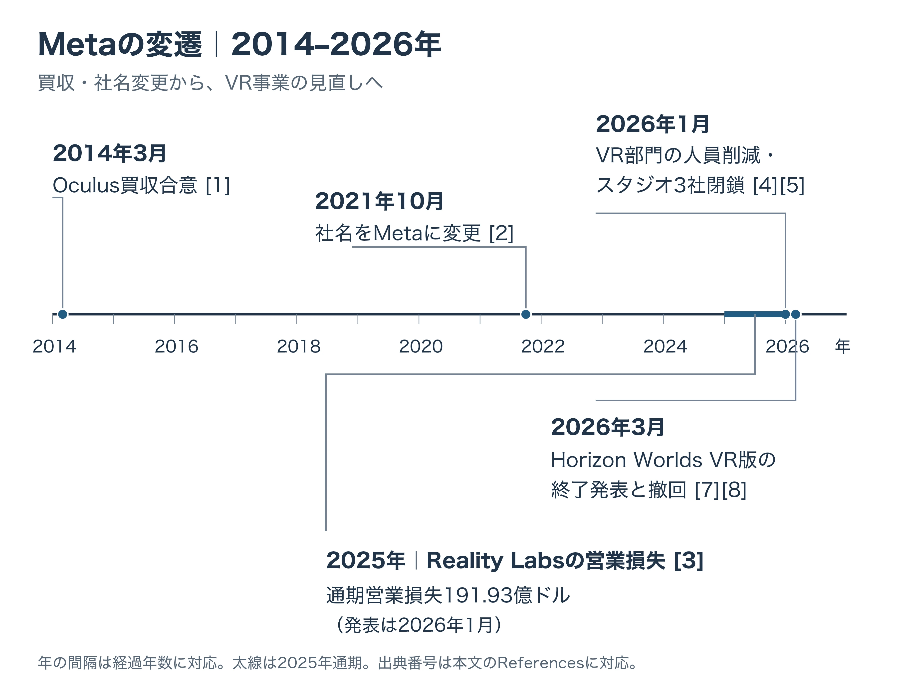

# その体験は、ヘッドセットを被る理由になるか――Metaの12年と市場の現在地から、VR・XRの企画を始める

「VR・XRを企画することになったら」第1回

## 1. 企画の出発点に置きたい問い

巨大な生き物を見上げる。手を伸ばして道具をつかむ。振り返ると、さっきまで正面にいた相手が背後にいる。VRでは、PC・コンソール・スマホの画面で遊ぶときとは違う、自分の身体を基準にした体験を作れる。

その可能性を、多くの人が日常的に使う機器へ育てる道のりは長い。VRに大きく投資してきたMetaも、2014年のOculus買収から12年を経て、事業の重点を組み替えている。市場の出荷動向も、従来のヘッドセットとメガネ型の機器で分かれている。

初めてVR・XRの企画を任されたとき、最初に置きたい問いは、 **その体験は、ヘッドセットを被る理由になるか** 、である。

VRは仮想の空間に入り込む体験、ARは現実の見え方に情報を重ねる体験を指す。XRは、これらや、現実と仮想を組み合わせるMRなどをまとめて呼ぶ言葉である。本シリーズでは主に、頭や顔に装着する機器の体験を扱う。スマホを持って現実の街を歩く遊びは、[位置情報ゲームの記事](location-based-games-market-history-and-design-guide.md)を参照してほしい。

今回は2026年10月20日時点の資料をもとに、Metaの変遷と市場を見たうえで、企画の判断軸を考える。身体と酔い、見え方、入力、ソーシャルVRの具体的な設計は、次回以降に扱う。

***

## 2. VRに賭けた12年――Metaの変遷

### 2014年：Oculusを約20億ドルで買収すると発表

2014年3月25日、当時のFacebookはOculus VRの買収合意を発表した。対価は現金4億ドルと自社株2,310万株で、発表時点の評価額は合計約20億ドル。別途、目標達成に応じて最大3億ドルを支払う条件も付いていた。[[1](#ref-1)]

FacebookのCEO、マーク・ザッカーバーグ氏は、現在の基盤であるモバイルに続く、将来の基盤への準備を進めていると説明した。Oculusには、人々の仕事、遊び、コミュニケーションを変える、極めて社会的なプラットフォームになる機会があるという発言である。発表文もVRを、次のソーシャル・コミュニケーションの基盤として浮上する有力候補に位置づけていた。[[1](#ref-1)]

### 2021年：社名をMetaへ変更

2021年10月28日、Facebookは新たな社名・ブランドとしてMetaを発表した。メタバースを実現し、人々のつながりやコミュニティ、事業の成長を支えることを重点に掲げた。同時に、2021年第4四半期から財務報告をFamily of AppsとReality Labsの2部門に分ける方針を示した。[[2](#ref-2)]

### 2025年度：売上は微増、営業損失は拡大

2026年1月28日に発表された通期決算では、Reality Labsの2025年売上高は22.07億ドル、営業損失は191.93億ドルだった。2024年は売上高21.46億ドル、営業損失177.29億ドルであり、売上がわずかに増える一方、損失も拡大した。[[3](#ref-3)]

Reality LabsはVR・ARのハードウェア、ソフトウェア、コンテンツなどを含む部門である。この損失額には複数の開発や研究が含まれ、VRゲームだけの採算を示す数字とは区別する必要がある。[[3](#ref-3)]

### 2026年1月：人員削減とゲームスタジオ3社の閉鎖

1月13日のCNBC報道によると、Reality Labsでは約10％、1,000人超に及ぶ人員削減が進められ、Armature Studio、Twisted Pixel、Sanzaruの3スタジオと、Oculus Studios Central Technologyという技術部門も閉鎖の対象となった。2023年に4億ドルで買収したフィットネスアプリSupernaturalは、新しいコンテンツを出さない保守運用に移った。削減の規模はNew York Timesの報道をCNBCが確認したもので、閉鎖の対象などは関係者への取材に基づく。CNBCはまた、2020年末以降のReality Labsの累積損失が700億ドルを超えると伝えている。[[4](#ref-4)]

翌14日のAUTOMATONも、Bloombergが報じた社内メモをもとに3社の閉鎖を伝えた。[[5](#ref-5)] CNBCによれば、Metaは前年12月にReality Labsの予算の配分をVRからAIグラスやウェアラブル機器へ移す方針を示しており、広報担当者は今回の動きをその一環とし、浮いた費用を今年のウェアラブル事業の成長に再投資すると説明した。[[4](#ref-4)]

AIへの大型投資と人事の変更は、前年から進んでいた。CNBCは、2025年6月にMetaがScale AIへ143億ドルを投じ、創業者のAlexandr Wang氏を迎え入れたこと、同年10月にメタバースを率いていたVishal Shah氏がAIプロダクト担当の副社長になったことを伝えている。[[4](#ref-4)] この143億ドルは、議決権のない49％の株式を取得する出資であり、個人の採用費用ではない。[[6](#ref-6)]

同じ1月の決算発表でも、Metaは2026年の設備投資を1,150億〜1,350億ドルと見込み、AI研究組織Meta Superintelligence Labsと基幹事業への投資拡大を理由に挙げた。これは会社全体の設備投資計画である。[[3](#ref-3)]

### 2026年3月：Horizon WorldsのVR版終了を発表し、翌日に撤回

Horizon Worldsは、利用者が仮想空間を作り、他の利用者と交流できるMetaのサービスである。3月18日のAUTOMATON報道では、MetaはVR版を6月15日に終了し、モバイル版へ一本化する方針を示した。[[7](#ref-7)]

この方針には前段がある。CNBCによれば、Horizon Worldsの月間利用者は数十万人を超えたことがなく、2025年にはMetaのCTO、Andrew Bosworth氏がスマホアプリとしての成功を目指すよう指示していた。[[4](#ref-4)]

発表翌日の3月19日、方針は修正された。Bosworth氏がInstagramの動画で、ファンの声を受けて、VR版アプリと既存のワールドを「当面の間」利用できるようにすると説明した。モバイルを重視する方向は維持された。継続の表明には期限の確約がなく、以前と同じ開発方針へ戻ったことを意味するものでもない。[[8](#ref-8)]

### 2026年9月：軽い装着形態を掲げる新機器も発表

9月23日、Metaはメガネ型の「Meta VR Glasses」を発表した。顔に掛ける部分は約100グラムで、演算やバッテリーなどを担う別体の機器と光学式のケーブル（テザー）でつなぐ構成である。発売は2027年春を予定しており、米国での価格は1,299.99ドルである。Metaは、映画鑑賞、スポーツ観戦、作業、ゲームを用途に掲げた。2026年10月時点では発売前の製品である。[[9](#ref-9)]

### この変遷から、企画へ持ち帰ること

ここまでの経緯から読み取れるのは、資金と人材を持つ企業でも、12年かけて「日常的に被りたい」と広く思われる体験を定着させることには苦労している、という点である。これは、個々のVR作品の価値とは別の問題である。

Meta自身の動きには、ウェアラブルへの投資配分の変更、Horizon Worldsのモバイル重視、装着部分を軽くする新機器という、複数の方向がある。そこから得たい教訓は、 **技術へ投資することと、その技術を毎回使いたくなる理由を作ることは、別々の課題である** 、ということだ。

プランナーが担うのは、担当作品で誰のどんな時間を変えるかを具体化する仕事である。大きな市場構想から、一人のプレイヤーが機器を手に取る場面まで、問いを戻す必要がある。

***

## 3. 市場の現在地――ヘッドセットとメガネ型で分かれる動き

### VRの出荷減少と、Metaへの集中

Counterpoint Researchによると、2026年第2四半期の世界のVRヘッドセット出荷台数は、前年同期比18％減、前期比16％減だった。同じ資料のARを含むXRヘッドセット市場の表では、Metaのシェアは54％で、半分を超えている。[[10](#ref-10)]

IDCの調査を紹介したTechNodeも、同四半期のVR・MRヘッドセット出荷を前年同期比23.3％減の54.8万台と報じている。調査会社によって対象の区分が異なるため、減少率を一続きの系列として扱うことはできない。どちらの調査も、直近の四半期にヘッドセット出荷が縮小したことを示す。[[11](#ref-11)]

また、出荷台数は、その期間に市場へ送り出された機器の数である。購入後に使い続けている人の数や、ゲームを買う人の数とは異なる。プランナーは、対象機種の利用者がどれだけいて、どんな作品に時間を使っているかを、企画ごとに見積もる必要がある。

### Apple Vision Proも、発売時の注目と普及には隔たりがある

Apple Vision Proは、日本では2024年6月28日に発売された。発売時の価格は599,800円（税込）からである。[[12](#ref-12)]

The RegisterはIDCのFrancisco Jeronimo氏への取材に基づき、Vision Proの2025年の出荷を4.5万台、2024年を39万台と報じた。Appleの公式販売台数ではなく、調査会社の推計である。大きな注目を集める製品でも、継続的に機器が広がるかどうかは別の課題になる。[[13](#ref-13)]

### 伸びているのは、顔に掛ける機器

対照的に、Counterpointの2026年第2四半期のAR機器出荷は前年同期比138％増だった。TechNodeが紹介したIDCの調査では、VR・MRなども含むスマートアイウェア全体が35.3％増で、画面を持たない音声・カメラ系のメガネが全体の70.3％を占めた。[[10](#ref-10)] [[11](#ref-11)]

この伸びには、仮想空間を表示しないスマートグラスも大きく寄与している。「XRが伸びた」という言葉から、VRゲームの遊び手が同じ割合で増えたと考えるのは早い。

ここからは企画上の読み取りである。成長が目立つのは、従来のヘッドセットのように頭を覆って被る代わりに、顔へ掛ける形で使う機器だ。装着の手間、顔や頭にかかる重さ、購入価格、周囲との断絶は、体験へ入るまでの負担になる。ただし、この市場データだけで、どの負担が減少や成長の原因かまでは決められない。

企画に引き寄せるなら、 **面白さに加えて、そこへ入る負担まで含めて選ばれるか** 、という問いになる。軽量化で負担が変わる余地もあるため、対象機種と利用場面を決めて考えたい。

***

## 4. 被る理由とは何か――ここからは設計上の考察

### 増える体験と、失いやすい気軽さを並べる

VRの利点は、自分が空間の中にいる感覚や、身体の動きと遊びの結びつきにある。その利点を得るために、プレイヤーが差し出す時間や手間もある。以下は、主に視界を覆うVRヘッドセットを、画面で遊ぶ場合と比べた設計上の整理である。機種や遊び方によって程度は変わる。

| 観点 | ヘッドセットで増えるもの | 失うもの・制約が増えるもの |
| --- | --- | --- |
| 視界 | 画面の枠を意識しにくくなり、その場にいる感覚を作れる | 現実の周囲をひと目で確認する気軽さが減る |
| 頭と手 | 頭を向ける、手を伸ばすといった動きを、そのまま入力にできる | 小さなボタン操作で済んだ行為にも身体の動きが必要になる |
| 空間の大きさ | 相手や道具を等身大の距離関係で扱える | 遊ぶ場所や姿勢の条件が増える |
| 始め方 | 機器を被る行為が、体験へ気持ちを切り替えるきっかけになる | 機器を取り出し、装着や調整をする手間が増える |
| 1回の遊び | 短い時間でも、周囲から離れて集中する構成を狙える | 装着の負担や電池などに合わせ、遊び続ける時間を考える必要がある |
| 一緒にいる人 | 離れた相手と同じ空間にいる感覚を作れる | 同じ部屋の人と画面や表情を共有する気軽さが減る |

「没入できる」だけでは、企画の違いが見えにくい。何に没入すると、どの場面の判断や感情が変わるのかまで書くと、試作で確かめる対象が決まる。

### 架空の企画例：灯台の修理工房

架空のゲーム企画として、『灯台の修理工房』を考える。プレイヤーは古い灯台の装置を修理し、最後に光をともす。

最初の案は、部品を集め、正しい順に組み合わせるパズルである。これなら、画面上で部品を選ぶ形でも成立する。VRにする価値を探るには、次の問いが役立つ。

- **画面版でも成立するか**：楽しさの中心が部品の組み合わせを考えることなら、マウスやタッチ操作で、より気軽に遊べる可能性がある。
- **被ることで何が変わるか**：大きな歯車の陰をのぞき込み、両手で軸の位置を合わせ、最後に自分の頭上で巨大なレンズが回り始める。その大きさや、自分の手で直した感覚を楽しさの中心に据えられるか。

試作では、同じ修理の一場面を画面版とVR版で比べる。プレイヤーが「自分で直した感じがした」「レンズが動き出す瞬間をもう一度見たい」と話すなら、被る価値の手がかりになる。一方、装着や操作の手間ばかりが印象に残るなら、体験の中心を見直す材料になる。

VRで増えた価値を確認できなければ、画面版へ企画を変更する判断も正しい結論の一つである。反対に、対象の人が「この作業をするためなら被りたい」と思うなら、広い市場すべてを狙わなくても、その人に届く設計を詰める意味がある。

企画書には、「VRだからできる」という説明から一歩進めて、 **誰が、何を味わうために、どの負担を引き受けるのか** 、と書きたい。

***

## 5. 次回からの予定と、企画書の点検表

本シリーズでは、この問いを軸に、次の題目を扱う予定である。

| 回 | 題目（予定） |
| --- | --- |
| 第2回 | 身体と酔い |
| 第3回 | 見え方と読みやすさ |
| 第4回 | 入力と空間 |
| 第5回 | ゲームではない場所——ソーシャルVR |
| 第6回 | 出口の設計 |

企画書の最初の見直しには、次の6つの問いを使える。

- [ ] 誰が、どこで、どんな時間に機器を装着する企画か。
- [ ] プレイヤーが「これをするために被りたい」と思う場面を、一つ具体的に説明できるか。
- [ ] 同じ遊びを画面版にしたとき、どんな価値が減るか。
- [ ] 装着の手間、重さ、価格、遊ぶ場所の条件に見合う価値を、その人へ渡せるか。
- [ ] 短く遊びたいときや、周囲の人に呼ばれたときにも、体験を区切れるか。
- [ ] 被る価値を試作で確かめる方法と、画面版へ変更する判断の条件を決めているか。

VR・XRの企画は、新しい機器にどんな遊びを載せるかを考える仕事であると同時に、その機器を使う時間をプレイヤーに選んでもらう仕事でもある。シリーズを通じて、何度も同じ出発点へ戻りたい。 **その体験は、ヘッドセットを被る理由になるか。**

## References

1. [Facebook「Facebook to Acquire Oculus」][1] — Meta Newsroom、2014年3月25日。買収合意の条件と発表時の構想。発言の日本語による大意は本稿による。

[1]: https://about.fb.com/news/2014/03/facebook-to-acquire-oculus/

2. [Meta「Introducing Meta: A Social Technology Company」][2] — Meta Newsroom、2021年10月28日。社名・ブランドと財務報告の変更。

[2]: https://about.fb.com/news/2021/10/facebook-company-is-now-meta/

3. [Meta「Meta Reports Fourth Quarter and Full Year 2025 Results」][3] — Meta Investor Relations、2026年1月28日。部門別業績と2026年の設備投資見通し。金額表の単位は百万ドル。

[3]: https://investor.atmeta.com/investor-news/press-release-details/2026/Meta-Reports-Fourth-Quarter-and-Full-Year-2025-Results/default.aspx

4. [Jonathan Vanian「Meta lays off VR employees, underscoring Zuckerberg’s pivot to AI」][4] — CNBC、2026年1月13日。関係者への取材に基づく人員削減・スタジオ閉鎖の報道と、AI投資・人事の経緯。

[4]: https://www.cnbc.com/2026/01/13/meta-lays-off-vr-employees-underscoring-zuckerbergs-pivot-to-ai.html

5. [Kosuke Takenaka「Meta社、傘下のゲームスタジオ3社をまとめて閉鎖へ。VR/メタバース部門の「1000人以上」大規模スリム化施策の一環として」][5] — AUTOMATON、2026年1月14日。

[5]: https://automaton-media.com/articles/newsjp/meta-20260114-406071/

6. [Jonathan Vanian「Scale AI founder Wang announces exit for Meta part of $14 billion deal」][6] — CNBC、2025年6月12日。Scale AI広報による出資額・株式比率・議決権の説明。

[6]: https://www.cnbc.com/2025/06/12/scale-ai-founder-wang-announces-exit-for-meta-part-of-14-billion-deal.html

7. [Kousetsu Taguchi「Metaが『Horizon Worlds』VR版のサービスを終了へ。“ザッカーバーグ氏の自撮り”でお馴染みメタバース、モバイル版に一本化」][7] — AUTOMATON、2026年3月18日。終了予定の発表を扱う報道。

[7]: https://automaton-media.com/articles/newsjp/20260318-430118/

8. [Kousetsu Taguchi「Meta、VR版『Horizon Worlds』終了をスピード撤回。ファンの声に応えるために、「当面の間」はサービス続行へ軌道修正」][8] — AUTOMATON、2026年3月20日。CTOのInstagramでの発言を報じたもの。

[8]: https://automaton-media.com/articles/newsjp/horizon-worlds-20260320-430772/

9. [Meta「Introducing Meta VR Glasses: A Cinema, Courtside Seat, and Workspace in Just 100 Grams」][9] — Meta Newsroom、2026年9月23日。約100グラムは顔に装着する部分の重量。発売時期と価格は発表時の予定。

[9]: https://about.fb.com/news/2026/09/introducing-meta-vr-glasses-3d-movies-immersive-live-sports-100-grams/

10. [Counterpoint Research「Global XR (AR & VR Headsets) Market Share: Quarterly」][10] — Counterpoint Research、2026年9月9日。2026年第2四半期の出荷動向とシェア表。シェアはARを含むXR市場の値。四半期更新資料、2026年10月20日参照。

[10]: https://www.counterpointresearch.com/en/insights/global-xr-ar-vr-headsets-market-share-quarterly

11. [TechNode Feed「Global smart eyewear shipments grow 35.3% in Q2 as China posts first decline」][11] — TechNode、2026年9月17日。IDCの四半期調査を紹介した報道。

[11]: https://technode.com/2026/09/17/global-smart-eyewear-shipments-q2-2026/

12. [Apple「Apple Vision Pro、6月28日（日本時間）より新しい国と地域で販売開始」][12] — Apple Newsroom（日本）、2024年6月10日。日本での発売日と発売時の価格。

[12]: https://www.apple.com/jp/newsroom/2024/06/apple-vision-pro-arrives-in-new-countries-and-regions-beginning-june-28/

13. [O’Ryan Johnson「Headset hype meets harsh reality as Apple and Meta VR shipments fizzle in 2025」][13] — The Register、2026年1月2日。IDCのFrancisco Jeronimo氏への取材に基づく出荷推計。

[13]: https://www.theregister.com/2026/01/02/apple_vision_pro_meta_quest_sales_drop/

----

この文書は、Perplexity、Claude、OpenAI Codex の3つのAIの支援を受けて著述されたものです。引用画像を除き、MIT License にて提供されています。
