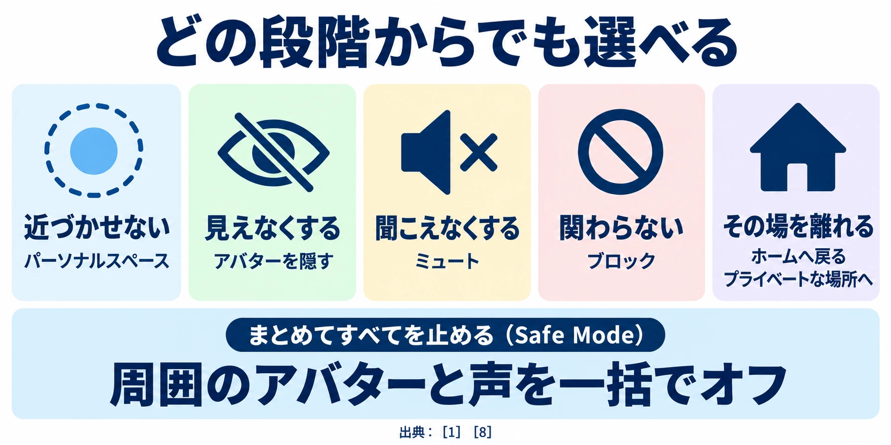

# その場所は、目的がなくても安心して居られるか――ゲームではない場所、ソーシャルVRを考える

「VR・XRを企画することになったら」第5回

## 1. 何もしない時間にも、居場所は要る

友人と話す。景色を眺める。同じ場所に集まり、それぞれの時間を過ごす。VRChatなどのソーシャルVRは、仮想空間で人と居合わせるための場所である。中にはゲームもあるが、サービス全体に共通するクリアや勝ち負けを目指さずに過ごすこともできる。今回の判断軸は、 **その場所は、目的がなくても安心して居られるか** である。

編者は、VRChatを体験していない。[第3回「見え方と読みやすさ」](vr-xr-vision-legibility-different-eyes.md)で書いた視力補正の難しさと、[第4回「入力と空間」](vr-xr-input-space-room-and-body.md)で考えた機材・操作・身体の条件が、編者にとってはソーシャルVRをVRとして体験する入口も閉ざしている。

VRChat自体は通常のPCでも利用できる。ヘッドセットを用意できることと、サービスへ参加できることは分けて考える必要がある。[[1](#ref-1)] 本稿は編者の体験談ではなく、公式資料と研究から、そこで人が安心して過ごすための条件を考える記事である。

新人プランナーにとって、ここで考える仕事は「次の目標を用意する」ことに加え、話しかけられたくないとき、距離を取りたいとき、帰りたいときにも、本人の意思が通る場所を用意することである。

***

## 2. 目的がなくても、人が集まる

### 数字が示すのは、人が居合わせる規模である

2026年5月に報じられたVRChatの公式発表では、過去最高の同時接続者数は158,192人、大晦日のピーク同時接続は148,876人、日次平均の同時接続は100,000人だった。グループは20万以上あり、クリエイター向けの収益化の仕組みでは収益の50％をクリエイターへ還元すると紹介されている。[[2](#ref-2)]

同時接続は、同じ時点でサービスに接続している人数である。「日次平均の同時接続100,000人」を、1日に利用した重複のない人数と読み替えることはできない。また、PCなどからの参加もあるため、これらはヘッドセット利用者だけの数でもない。[[1](#ref-1)][[3](#ref-3)]

日本のユーザー数は **公式発表では3.9倍。比較期間は示されていない** 。何年から何年までの増加か、どの利用者を数えた値かが分からないまま、年成長率などへ換算することはできない。Road to VRも、この値に比較のための追加データが伴っていない点を指摘している。[[2](#ref-2)][[3](#ref-3)]

### 利用者が、集まる理由と場所を作る

VRChatでいう **ワールド** は訪れる仮想空間、 **アバター** はそこで自分の姿となる仮想の身体である。利用者はワールドやアバターを作り、共有できる。[[1](#ref-1)][[4](#ref-4)] このように利用者が制作するコンテンツを **UGC（User-Generated Content）** と呼ぶ。仕組み全体については[UGCを扱った既存記事](ugc-in-games-fortnite-roblox-genshin.md)も参照してほしい。

さらに、同じワールドでも、実際に人が集まる部屋を分けられる。この部屋の単位が **インスタンス** である。誰でも入りやすいパブリックインスタンスと、入れる相手を限るプライベートインスタンスなどがある。[[5](#ref-5)]

ここから企画への示唆を引き出すなら、運営が一つの目標を配る以外にも、人が集まる理由は生まれるということだ。利用者が場所や姿を作り、仲間と集まる単位を作る。それが、決まった課題をこなさずに過ごせる場所を支えていると考えられる。先の利用統計だけでUGCの効果を証明できるわけではないが、企画する対象が「遊ぶ内容」から「一緒に居る条件」へ広がることは見えてくる。

***

## 3. 身体があるから、嫌なことも近くなる

### 言葉、身体、環境の三つを考える

当時Oculus VRに所属していたLindsay Blackwellらは、米国のソーシャルVR利用者25人に、経験を掘り下げる半構造化インタビューを行った。2019年の論文では、ハラスメントを、言葉によるもの、アバターの身体を介するもの、共有環境を介するものの三つに整理している。[[6](#ref-6)]

言葉には侮辱などが含まれる。身体を介するものには、触れるふりや取り囲む行動がある。環境を介するものには、共有画面に不快な内容を映す、物を投げて場を妨げるといった行動がある。対策を発言内容の監視だけに絞ると、距離や動き、周囲の表示から生じる不快さを取りこぼす。[[6](#ref-6)]

### 声と身体が、相手の存在を強くする

研究では、その場に自分の身体がある感覚と、相手が目の前にいる感覚によって、ハラスメントが強く感じられることが語られた。声も、文字より相手の存在を近く感じさせる。声やなまり、性別を推測させる見た目、アバターの身長などが属性の手がかりとなり、女性や子どもが標的になりやすいという語りもあった。これは属性別の被害率を測った結果ではなく、参加者の経験や認識である。[[6](#ref-6)]

さらに、声や身振りはその場で消え、記録が残らず通報しにくい。アプリごとに対処の操作が異なり、ヘッドセットを外して逃れる人もいた。安心を考えるときは、不快さの強さと、対処の操作を探せる余裕を一緒に考える必要がある。[[6](#ref-6)]

この研究は小規模で、参加者は男性23人・女性2人と男性に偏り、全員が米国在住だった。著者全員がOculus VRに所属する1社内の研究であり、2019年当時の調査である。現在のVRChatや日本の利用者全体へ、そのまま一般化はできない。ここでは被害の規模を示す統計ではなく、設計で見落としやすい問題を見つける手がかりとして読む。[[6](#ref-6)]

***

## 4. 距離と表示を、本人が決められるようにする

### 近づくことと、見聞きすることを分ける

MetaがHorizon WorldsとVenuesへ導入したPersonal Boundaryは、アバター同士の接近を制限する仕組みである。VRChatには距離に関わるPersonal Spaceに加え、声やアバターの表示を選ぶ安全機能がある。[[7](#ref-7)][[1](#ref-1)][[8](#ref-8)]

**ミュート** は相手の声を聞こえなくする操作、 **ブロック** は特定の相手との関わりを遮断する操作である。アバターを隠す操作は、声を消す操作と別に用意されている。[[8](#ref-8)] 次の表は、Metaの2022〜2023年の導入・更新記録とVRChatの公式案内を、守る対象の違いとして並べたものだ。

| 仕組み | 何を防ぐか | 利用者の操作 | 注意 |
| --- | --- | --- | --- |
| Meta：Personal Boundary | アバター同士の過度な接近や望まない接触 | Horizon Worldsでは、知らない人にオン／全員にオン／オフを設定 | 2022年3月以降の既定値は「知らない人にオン」。相手と設定が違うときは、厳しい側が適用される。[[7](#ref-7)] |
| VRChat：Personal Space | 他の利用者が近づきすぎる状況 | Personal Spaceを利用する | 距離に関する保護であり、声や表示の選択は別に考える。[[1](#ref-1)] |
| VRChat：Shield Level | アバターの強い視覚効果や音など、受け取りたくない表現 | 信頼ランクごとに声、アバター、効果音、光などを設定 | Maximum／Normal／None／Customがあり、公式は多くの利用者にNormalを推奨する。[[8](#ref-8)] |
| VRChat：Hide Avatar／ミュート | 特定の相手のアバター表現／声 | 相手ごとにアバターを隠す、または声を消す | 声とアバターは別項目。隠す操作では代替アバターが表示される。[[8](#ref-8)] |
| VRChat：ブロック | 特定の相手との接触 | 相手をブロックする | 公式ヘルプでは、相手はこちらを見ることも話しかけることもできなくなると説明する。[[1](#ref-1)] |
| VRChat：Safe Mode | 周囲のアバター表現と声をまとめて受け取る状況 | 一括の安全操作を使う | 周囲全員のアバターを隠し、声を消す。通報や移動とは別の操作である。[[8](#ref-8)] |
| VRChat：Go Home／プライベートインスタンス | 不快な場に居続ける状況 | ホームへ戻る、入室できる相手を限った部屋を作る | 私的な部屋でも規約は適用される。[[1](#ref-1)][[5](#ref-5)] |

VRChatの **Trust（信頼）** は、利用者の振る舞いなど複数の要素から信頼度を扱い、コンテンツをアップロードできるかにも関わる仕組みである。問題を起こした利用者向けの「Nuisance」というランクもある。Shield Levelは、このランクごとに何を見聞きするかを本人が決める仕組みだ。ランクを、人の安全性を保証する印として扱わず、個別の対処もすぐ使えるようにしておく必要がある。[[8](#ref-8)]

### 既定値も、運用で見直す

Personal Boundaryは2022年2月の導入時、常にオンで、アバター間に約4フィート（約1.2m）の距離を設けるものだった。同年3月、Horizon Worldsでは既定値を「知らない人にオン」へ変え、設定を選べるようにした。ここでいう知らない人は、公式説明では自分がフォローを返していない相手を指す。[[7](#ref-7)]

2023年12月には、近づいた相手のアバターがより速く薄れるようにし、物理的な壁も調整した。数フィートの距離を保ちながら、ハイタッチなどの好ましい身振りをしやすくする変更だった。保護の強さと交流のしやすさを、利用者の反応を受けて見直した例である。Horizon Worldsの事業の経緯は[第1回](vr-xr-planning-reason-to-wear-a-headset.md)に譲り、ここでは既定値を運用で育てる点に注目したい。[[7](#ref-7)]

### 対処は、どこから選んでもよい

不快なときに、まず注意し、それでも駄目ならミュートする、と順番を踏ませる必要はない。本人はすぐブロックしても、その場を離れてもよい。VRChatの公式ヘルプも、不快な状況からはすぐ離れ、「Go Home」でホームへ戻れると案内している。[[1](#ref-1)]

出典：VRChat公式ヘルプ・ドキュメント。[[1](#ref-1)][[8](#ref-8)]

Safe Modeの公式案内では、PCはShift＋Esc、VRコントローラーは両方のトリガーと両方のメニューボタンの同時押しとなっている。機能が存在するだけでなく、初めての人が慌てた状態でも実行できるかを点検したい。第4回で扱った見つけやすさ、手の使い方、姿勢の問題が、ここでは身を守る操作につながる。[[8](#ref-8)]

***

## 5. 年齢とルールも、居場所を支える

VRChatの2026年2月9日発効の利用規約では、利用は13歳以上である。13〜17歳は、保護者が規約を読んだうえで同意した場合に限り利用できる。18歳以上は、自ら規約へ同意する能力があることを表明する。年齢や生年月日を偽ることも禁止されている。[[4](#ref-4)]

規約には、Age Verification（年齢確認）の手続きに参加する機会も記されている。指定された第三者のパートナーへ政府発行の身分証を提出し、手数料がかかる場合があり、確認に失敗しても返金されない。利用の最低年齢や保護者の同意と、身分証を使った年齢確認は、それぞれ別の条件・手続きとして案内する必要がある。[[4](#ref-4)]

2025年9月24日更新のコミュニティガイドラインは、人を動揺させる、困らせる、邪魔する行動を避け、パブリックインスタンスでは他人の活動や遊びを妨げないよう求める。繰り返し・継続的・深刻な否定的発言は、ハラスメントになりうる。利用者や運営スタッフへのなりすましも禁じる。[[5](#ref-5)]

保護のルールとして、同意のない性的行為、未成年との性的なやり取り、未成年がいる場での成人向けの内容・行為を禁止している。プライベートインスタンスでは、その場の全員の同意を条件に一部の振る舞いが許されるが、有害・違法な行為は同意があっても許されない。[[5](#ref-5)]

執行はケースごとに判断され、プライベートインスタンスからの通報もパブリックと同様に扱われる。重大な一部の違反には即時・恒久・取り消し不能のBANを定め、アカウントへの執行に対する異議申し立ての窓口も設けている。[[5](#ref-5)] 通報、制裁、誤BAN、理由開示の詳しい設計は[オンラインゲームのハラスメント対策の記事](online-game-harassment-moderation-design.md)を参照してほしい。

***

## 6. 企画へ持ち帰る——操作と、人の支えを用意する

### 身を守る操作を、最初に使えるようにする

企画書には、入室や会話の始め方と同じ具体さで、離れる・隠す・消す操作を書きたい。例えば、初回の案内でホームへ戻る操作を一度使い、アバターを隠す操作と声を消す操作の違いを示す。これは公式機能を踏まえた企画上の提案である。操作名を知っているかではなく、不快になったその場で使えるかが完成条件になる。

既定値についても、「知らない相手のどの表現が最初から届くか」を書く。自由に設定できるとしても、初めて入った人は設定変更の場所を知らない。その人を守る初期状態と、交流を広げたい人が自分で変えられる範囲を、両方用意したい。

### 新人への案内と、悪意への対応を分ける

Blackwellらは、慣れていない新人と、意図的に害を与える利用者を区別する参加者の語りを踏まえ、段階的な制裁や、案内役のボランティアなどによるコミュニティの関わりを提案している。アプリをまたいで対処の操作や規範を一貫させることも、設計への示唆に挙げている。[[6](#ref-6)]

企画では、距離感や操作をまだ知らない人へ、短い説明や練習の機会を渡せる。意図的な妨害や重大な違反には、その人への案内とは別の対応が必要になる。段階的な対応は、被害を受けた人に我慢する段階を課すことではない。

案内役を置くなら、担当時間、対応できる範囲、運営へ引き継ぐ窓口も必要だ。人の善意を頼りにする仕組みには、支える側が抱え込まないための設計も含まれる。

### 記録と相談を、本人だけの仕事にしない

研究が示した「その場で消える」問題を踏まえ、通報に必要な情報と、それを残せる手段を企画書へ書く。記録を設ける場合は、取得範囲、保存期間、閲覧できる人の説明も併せて考える。安心して会話できる場所と、問題を調べられる仕組みを両立させるためである。

VRChatの公式ヘルプは、本名、所在地、連絡先などをプロフィールや他サービスで明かさないこと、不快なときは離れること、18歳未満なら保護者に相談することを案内する。保護者が通報を手伝うこともできる。[[1](#ref-1)] 初回案内には、交流の楽しみ方と一緒に、自分の情報を守る方法と相談先を置きたい。

***

## 7. 企画書の点検項目

次の6問を、初めて入った人が過ごす場面に沿って確かめたい。

- [ ] 目標や会話に参加せず過ごす人にも、居場所があるか。
- [ ] 距離を取る、表示や声を消す、ブロックする、帰る操作を、どこからでもすぐ選べるか。
- [ ] 知らない人との距離と表示の既定値は、誰を守る設定か。初めての人が変更せず入った場合を説明できるか。
- [ ] 慣れていない新人への案内と悪意ある行動への対応を分け、案内役から運営へ引き継げるか。
- [ ] 記録・通報・相談の手段があり、必要な情報と記録の扱いを利用者へ説明できるか。
- [ ] 年齢条件と保護者の関わりを示し、本名や居場所を出さない案内をしているか。

目的がなくても、人と同じ場所に居たい時間はある。その時間を支えるのは、話しかける自由に加え、話さない自由、近づかせない自由、いつでも帰れる自由である。

**その場所は、目的がなくても安心して居られるか。** この問いを通して、シリーズ全体の **その体験は、ヘッドセットを被る理由になるか** を考え直せる。誰かに会えることと、自分で関わり方を選べることがそろって、また訪れたい場所になりうる。

次回、第6回は「出口の設計」を扱う。体験を終えるときまで含めて、ヘッドセットを被る理由を考えていく。

## References

1. [VRChat「Safety Resources: For Players」][1] — VRChat Help Center、2025年5月28日更新。英語資料の説明は本稿による日本語の大意。

[1]: https://help.vrchat.com/hc/en-us/articles/33302819755539-Safety-Resources-For-Players

2. [MoguLive「VRChat アクセス数データの一部を公開、日本ユーザー数は3.9倍増加」][2] — Mogura VR News、2026年5月7日。VRChat公式発表を紹介した報道。日本の3.9倍の比較期間・基準は示されていない。

[2]: https://www.moguravr.com/vrchat-concurrent-users-record-2026/

3. [Scott Hayden「’VRChat’ Reveals Key Stats, Claiming Significant Growth in Japanese Usership」][3] — Road to VR、2026年5月7日。公式発表の数値と、日本の成長率に比較用データが伴わない点を参照。英語資料の説明は本稿による日本語の大意。

[3]: https://roadtovr.com/vrchat-key-stats-japan-growth-concurrents/

4. [VRChat「Terms of Service」][4] — VRChat、2026年2月9日発効。第1〜3節、年齢・生年月日の虚偽申告を禁じる規定を参照。

[4]: https://hello.vrchat.com/legal

5. [VRChat「Community Guidelines」][5] — VRChat、2025年9月24日更新。General Guidelines、Instance Behavior、Zero-Tolerance Policy、Appealを参照。英語資料の説明は本稿による日本語の大意。

[5]: https://hello.vrchat.com/community-guidelines

6. [Lindsay Blackwell・Nicole Ellison・Natasha Elliott-Deflo・Raz Schwartz「Harassment in Social Virtual Reality: Challenges for Platform Governance」][6] — Proceedings of the ACM on Human-Computer Interaction、Vol. 3、CSCW、Article 100、2019年11月。DOI: 10.1145/3359202。米国の利用者25人へのインタビュー研究。英語論文の説明は本稿による日本語の大意。

[6]: https://research.facebook.com/file/1275333846220369/Harassment-in-Social-Virtual-Reality-Challenges-for-Platform-Governance.pdf

7. [Vivek Sharma「Introducing a Personal Boundary for Horizon Worlds and Venues」][7] — Meta、2022年2月4日公開、2022年3月15日・2023年12月13日更新。導入時と各更新時の仕様を参照。

[7]: https://about.fb.com/news/2022/02/personal-boundary-horizon/

8. [VRChat「VRChat Safety and Trust System」][8] — VRChat Docs、2025年11月13日更新。Trust、Shield Level、個別設定、Safe Modeを参照。英語資料の説明は本稿による日本語の大意。

[8]: https://docs.vrchat.com/docs/vrchat-safety-and-trust-system

----

この文書は、Perplexity、Claude、ChatGPT の3つのAIの支援を受けて著述されたものです。引用画像を除き、MIT License にて提供されています。
