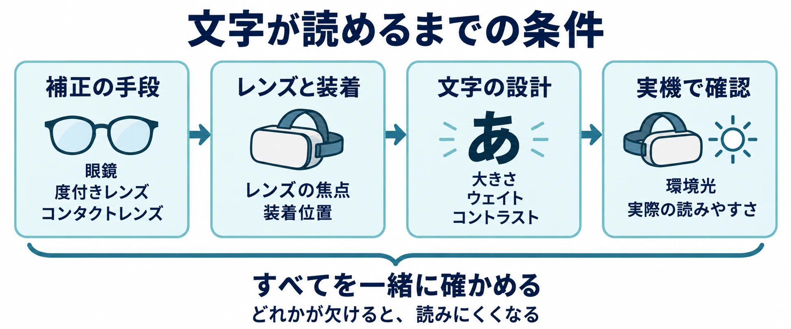

# その情報は、見え方の違うプレイヤーにも届くか――VR・XRの見え方と読みやすさを考える

「VR・XRを企画することになったら」第3回

## 1. 良かった体験にも、見えるための条件があった

編者は、視力がそれほど良くない。眼鏡を外してヘッドセットを被ると、中のオブジェクトを判別できない。コンタクトレンズを使っても、乱視などのために補正しきれない見え方がある。

[第2回「身体と酔い」](vr-xr-body-motion-sickness-predictable-movement.md)で紹介した『グランツーリスモ7』の良い体験は、コンタクトレンズで視力を補正していたときのものだった。運転に入り込めたという感想には、まず中の景色を見られるという条件があったのである。

この見え方の問題は、編者が現在のVR・XRに積極的になりきれない理由の一端である。補正しても見え方に限界がある人には、VR体験そのものが届きにくい。編者はそこに、企画の入口に関わる問題を感じている。

[第1回](vr-xr-planning-reason-to-wear-a-headset.md)では、 **その体験は、ヘッドセットを被る理由になるか** をシリーズの出発点に置いた。今回は、 **その情報は、見え方の違うプレイヤーにも届くか** と問う。

新人プランナーが最初にできるのは、自分の目で読めたことを完成条件にせず、誰が、どの補正方法で、どの表示を受け取れるかを企画書に書くことである。統計、機器側の対応、文字とUIの設計を順に見ていこう。

***

## 2. 「平均的な目」でプレイヤーを想定できるか

### 世界の乱視の推計には、軽いものも含まれる

Hashemiらが1990〜2016年の研究を統合したメタ分析では、成人の乱視の推定有病率は40.4％だった。ただし、研究によって乱視の基準が異なるため、この推計は最も多く使われていた基準に合う研究で統合した値であり、軽い乱視も含む。 **40.4％は「補正が必要な人の割合」ではない。** また、現在の日本のVR利用者を直接調べた数字でもない。[[1](#ref-1)]

この値から、試遊者の何人がどの補正を必要とするかは決められない。一方で、見え方の違いを少数の例外として片づける企画には、見直す余地がある。

### 日本の学校統計は「裸眼」の値である

文部科学省の令和7年度学校保健統計では、裸眼視力1.0未満の者の割合は次のとおりである。[[2](#ref-2)]

| 学校段階 | 裸眼視力1.0未満の割合 |
| --- | ---: |
| 幼稚園 | 23.90％ |
| 小学校 | 36.07％ |
| 中学校 | 59.35％ |
| 高等学校 | 71.51％ |

学校段階が上がるほど割合が高い。ただし、これは **眼鏡やコンタクトレンズで補正する前の裸眼の値** であり、普段は補正している人も含む。同じ子どもを追跡した結果や、VR内で読めない人の割合として読むこともできない。[[2](#ref-2)]

世界のメタ分析と日本の学校統計は、対象も測り方も異なるため足し合わせられない。企画への読み取りは、「平均的な目」を一つ置いて済ませず、補正方法や見え方の異なる人に試してもらう、ということである。

***

## 3. 補正の手段と、ヘッドセット側の条件を分ける

普段使う眼鏡がヘッドセット内でも使えるか。自分用の度付きレンズを取り付ける必要があるか。体験会で初めて気づくと、遊び始める前に困ってしまう。

次の表は、各社の公式条件を補正手段ごとに並べたものである。寸法のmmはミリメートルで、眼鏡フレームの実際の大きさを表す。Metaの眼鏡寸法とPS VR2の装着条件は各社の案内、度付きレンズの条件はMetaとAppleの案内に基づく。[[3](#ref-3)][[4](#ref-4)][[5](#ref-5)][[6](#ref-6)]

| 補正の手段 | 使い方 | 公式の条件 | 限界・注意 |
| --- | --- | --- | --- |
| 眼鏡をかけたまま | 普段の眼鏡をかけてヘッドセットを装着する | Metaは眼鏡スペーサーを案内し、フレームは幅142mm以下、高さ50mm以下としている。PS VR2は眼鏡をかけた状態でも装着できると明記している | Metaはフレームが大きい場合に他社製スペーサーや度付き挿入用レンズも案内する。実際に使う機種の装着・調整方法を確かめる |
| ヘッドセットに差し込む度付きレンズ | 対応する度付きレンズを本体に取り付ける | MetaのZenni製は有効な処方箋が必要。対応度数は球面度数（SPH）−10.00〜+6.00、乱視度数（CYL）−6.00〜+6.00。Quest 3用とQuest 3S／Quest 2用がある。Apple Vision ProのZEISS Optical Insertsは、度付きの場合、期限が切れていない総合処方箋が必要 | 機種と利用者に合うものを用意する必要がある。Appleは処方箋によって対応できない場合があると明記する。装着だけでなく、機器側の設定も必要になる |
| コンタクトレンズ | 編者は装用した状態でVRを体験した | ここではメーカー共通の対応数値を示さず、編者の体験の範囲で扱う | 編者の場合、補正しても判別しにくい見え方が残る。ほかの利用者にも同じ結果になるとは限らない |

Metaは視覚体験と快適さのために度付き挿入用レンズを勧めている。Apple Vision ProではZEISS Optical Insertsの取り付け後にペアリングして使い、別の人の本体を使う場合には、初めてゲストユーザセッションを開始するときに処方箋情報をスキャンして取り込む仕組みがある。共用機の運営では、こうした設定も体験開始までの手順に含めたい。[[5](#ref-5)][[7](#ref-7)]

Appleは補正の限界について、次のように記している。

> 処方箋の内容によっては、ZEISS Optical Insertsで視力矯正の必要性が満たされない場合があります。[[6](#ref-6)]

企画では、補正の手段が用意されていることと、その人が必要な情報を受け取れることを、別々に確かめる必要がある。

***

## 4. 文字とUIは、大きさ・太さ・背景を一緒に決める

### 最小サイズは、設計の出発点にする

UIとは、メニューやボタンなど、利用者が情報を受け取り操作するための表示や仕組みである。文字サイズのpxはピクセルを基準にする単位、ptはポイントというUI上の大きさの単位である。ここでのptを印刷物の寸法へそのまま置き換えることはできない。どちらも、それだけで目に映る文字の大きさが決まるわけではなく、表示面の配置などと合わせて考える。

Metaは最低限の判読性には14px以上、快適に読むには18px以上を勧める。Appleの指針では、visionOSの既定の文字サイズは17pt、最小は12ptである。これらは各社の設計環境の指針であり、14pxと12ptを比べて製品の読みやすさを判定する数字ではない。[[8](#ref-8)][[9](#ref-9)]

最小値を守るだけで、全員が読めると判断してしまうと、冒頭の問題へ戻ってしまう。企画書には標準サイズに加え、利用者が大きくできる範囲と、拡大後の表示も書きたい。Appleは、利用者が文字サイズを調整できる **Dynamic Type** への対応を勧めている。[[9](#ref-9)]

### 細さや装飾より、字の形が残ることを優先する

ウェイトとは、文字の線の太さである。MetaはBlack・Bold・Mediumなどの太いウェイトがLight・Thinより読みやすく、細いものを使うなら文字を大きくするよう示す。また、線の端の飾りが少ないサンセリフ書体を勧め、小文字の背が高く、字の内側の空間が広いものを挙げている。斜体も没入環境ではうまく描画されないため避けるとしている。[[8](#ref-8)]

AppleもUltralight・Thin・Lightのような細いウェイトを避けるよう勧める。visionOSのDynamic Typeでは、本文とタイトルのスタイルが太めになっている。日本語では、実際の説明文に含まれる漢字まで使って、線や字の内側がつぶれないかを確かめたい。[[9](#ref-9)]

### 明るい壁の前と、暗い部屋で試す

Metaは、現実の空間に情報を重ねるMRで、明るい壁や強い環境光によって薄い文字が見えにくくなること、暗い環境では明るい文字が強すぎることを挙げる。開発用モニターでの確認に加え、実機で文字を試すよう求めている。[[8](#ref-8)]

たとえば、淡い文字を壁の前に浮かべる演出なら、背景の壁が変わっても読めるかを試す。必要なら文字の背後に面を置く、高コントラスト表示へ切り替えるなど、背景と文字をまとめて設計する。コントラストとは、文字と背景の明るさや色の差である。

### 考察：PS VR2の「約2m」から、UIの置き場所を考える

焦点距離は、ここではヘッドセット内の映像に目のピントを合わせる距離の目安を指す。PlayStationはPS VR2について約2mと案内する。また、レンズ調整ダイヤルで左右のレンズ間の距離を調整し、［映像の見え方を調整］で装着位置などを合わせる手順を示している。[[4](#ref-4)]

ここからは企画上の考察である。仮想空間で手元に見える説明板でも、実物の紙を手に持つ場合と同じ条件で読めるとは限らない。UIをどの距離に置くかは、文字サイズや表示面の大きさと組み合わせ、実機で比較する課題になる。

約2mは、公式が示した機器の焦点距離である。 **UIを約2mに置くことを勧める値としては扱わない。** 企画書では「机上の説明板」「目の前に出すメニュー」などの候補ごとに、必要な情報を無理なく読めるかを検証する。

***

## 5. 文字を拡大でき、その先の情報にも届くようにする

W3Cの「XR Accessibility User Requirements」は、XRで生じるアクセシビリティ上の利用者ニーズを整理したWorking Group Noteである。最低限満たせばよい要件の一覧ではなく、一部はプラットフォーム側で満たされる場合もある。企画では、自分たちのゲームで誰が何を担当するかを決めるために使える。[[10](#ref-10)]

文書にある要求を企画の言葉へ置き換えると、次のようになる。[[10](#ref-10)]

| 文書の観点 | 企画書に書くことの例 |
| --- | --- |
| 拡大中の文脈とフォーカスの確認・リセット（REQ 7a） | 拡大していても今どこを見ているか分かり、全体の表示へ戻れるようにする |
| メニューの拡大と組み直し（REQ 7b） | 文字を大きくしたら項目を縦に並べ直し、選択肢や戻るボタンが欠けないようにする |
| 字幕・文章の組み直し（REQ 19b） | 大きさに合わせて改行や配置を変え、文章の続きを読めるようにする |
| 押せる範囲と周囲の間隔（REQ 4b） | ボタンの見た目に加え、実際に押せる領域を広くし、隣の項目との間隔を取る |
| 高コントラストの外観（REQ 6a） | 背景との区別がつく表示を選べるようにする |
| 視野の個人調整（REQ 13b） | 没入環境で見える範囲を個人に合わせて調整できるかを検討する |

重要な警告を、今読んでいる場所から視線や選択位置を移さず支援技術へ伝える観点もある（REQ 8a）。表示を大きくする仕様には、拡大中でも警告が届くかという確認を組み合わせたい。[[10](#ref-10)]

さらに、ゲームの大事な情報には、文字と別の手がかりを重ねる方法がある。たとえば扉が開いたことを、文章、扉の形の変化、開く音で伝える。目的地は、色に加えて形の異なる目印と位置関係で示す。細かい表示を読み取ることだけが、進行の条件にならないようにするのである。

音だけ、色だけでも受け取りにくい人はいる。必要な情報を複数の方法で受け取れ、不要な手がかりは調整できる設計を考えたい。こうした情報の伝達経路と選択肢の考え方は、[ゲームのアクセシビリティ設計の記事](game-accessibility-design-guide.md)でも扱っている。

***

## 6. 企画書を点検する6つの問い

試遊では「読めましたか」だけでなく、何の情報を読み取り、何を選べたかまで確かめる。見え方について無理に理由を説明してもらうより、困った表示や場面を記録し、設計へ戻せるようにする。

- [ ] **試遊者の補正方法は偏っていないか。** 眼鏡を使う人、度付き挿入用レンズを使う人、コンタクトレンズを使う人などを含め、装着の調整後にも違いが残るかを見ているか。
- [ ] **体験前に使える条件を案内しているか。** 店頭や体験会で、眼鏡をかけたまま使えるか、フレームの条件や事前の準備があるかを知らせているか。
- [ ] **文字を大きくしても最後まで読めるか。** 初回説明、字幕、設定画面を含め、改行やメニューの組み直し、戻る操作まで確かめたか。
- [ ] **実機と異なる背景で試したか。** UIの距離、文字の太さ、明るい壁や環境光を変え、重要な表示を読み取れるか確かめたか。
- [ ] **拡大中にも周囲と警告を把握できるか。** 全体へ戻る方法、見ている場所の確認、押せる範囲や間隔、個人調整を仕様に含めたか。
- [ ] **文字以外でも必要な情報へ届くか。** 音・色・形・位置の手がかりを組み合わせ、どれか一つを受け取りにくくても目標や結果が分かるか。

***

## 7. 届いて初めて、「被る理由」になる

編者の『グランツーリスモ7』の体験には、視力を補正したうえで、その空間を見られるという条件があった。同じヘッドセットを被っても、全員が同じ情報を受け取れるとは限らない。

補正方法と装着を確かめ、文字を読みやすくし、利用者が表示を変えられるようにする。そのうえで、文字以外にも手がかりを用意する。企画でできることは、この条件を一段ずつつなぐことである。

**その情報は、見え方の違うプレイヤーにも届くか。** この問いを通して初めて、シリーズ全体の **その体験は、ヘッドセットを被る理由になるか** を、より多くのプレイヤーについて問い直せる。

次回、第4回「入力と空間」では、手やコントローラーを使う操作と、遊ぶ場所の条件を考える。

## References

1. [Hashemi Hほか「Global and regional estimates of prevalence of refractive errors: Systematic review and meta-analysis」][1] — Journal of Current Ophthalmology、2018年、30(1):3–22。1990〜2016年を検索対象とするメタ分析。成人の乱視の推計と、研究ごとに異なる基準のうち最も多い基準に合う研究で統合した点を参照。

[1]: https://pubmed.ncbi.nlm.nih.gov/29564404/

2. [文部科学省「令和7年度学校保健統計（学校保健統計調査の結果）」][2] — 文部科学省、2026年2月13日。裸眼視力1.0未満の者の割合を参照。

[2]: https://www.mext.go.jp/content/20260213-mxt_chousa01-000046876_1.pdf

3. [Meta「眼鏡をかけたままMeta Questを使用する方法」][3] — Meta Questヘルプ、2026年10月20日参照。眼鏡スペーサーとフレーム寸法の条件。

[3]: https://www.meta.com/help/quest/3920738394639999/

4. [PlayStation「PlayStation VR2ヘッドセットの装着／調整方法」][4] — PlayStationサポート、2026年10月20日参照。眼鏡での装着、焦点距離、レンズ間隔と装着位置の調整。

[4]: https://www.playstation.com/ja-jp/support/hardware/adjust-ps-vr2-headset/

5. [Meta「Meta Quest 用Zenni VR度付きレンズ」][5] — Meta Questヘルプ、2026年10月20日参照。対応機種、処方箋と対応度数の条件。数値はメーカーの記載であり、個人の利用可否の判断を示すものではない。

[5]: https://www.meta.com/help/quest/1050152622641152/

6. [Apple「ZEISS Optical Insertsを注文または交換する必要がある場合」][6] — Appleサポート、2025年3月6日。処方箋の条件と、矯正の必要性を満たせない場合があるという説明。

[6]: https://support.apple.com/ja-jp/118478

7. [Apple「Apple Vision Proで視力矯正にZEISS Optical Insertsを使用する」][7] — Apple Vision Proユーザガイド、2026年10月20日参照。取り付け後のペアリングとゲストユーザでの利用。

[7]: https://support.apple.com/ja-jp/guide/apple-vision-pro/dev875c7f937/visionos

8. [Meta「Typography」][8] — Meta Horizon OS Developers、2026年4月19日更新。文字サイズ、書体、ウェイト、環境光、実機確認の指針。英語資料の大意は本稿で日本語にした。

[8]: https://developers.meta.com/horizon/design/styles_typography/

9. [Apple「Typography」][9] — Apple Human Interface Guidelines、2026年10月20日参照。visionOSの文字サイズ、ウェイトとDynamic Typeの指針。英語資料の大意は本稿で日本語にした。

[9]: https://developer.apple.com/design/human-interface-guidelines/typography

10. [W3C「XR Accessibility User Requirements」][10] — W3C Working Group Note、2021年8月25日。REQ 4b、6a、7a、7b、8a、13b、19bおよび文書の適用範囲を参照。英語資料の大意は本稿で日本語にした。表の仕様例は、本稿による企画への置き換えである。

[10]: https://www.w3.org/TR/xaur/

----

この文書は、Perplexity、Claude、OpenAI Codex の3つのAIの支援を受けて著述されたものです。引用画像を除き、MIT License にて提供されています。
