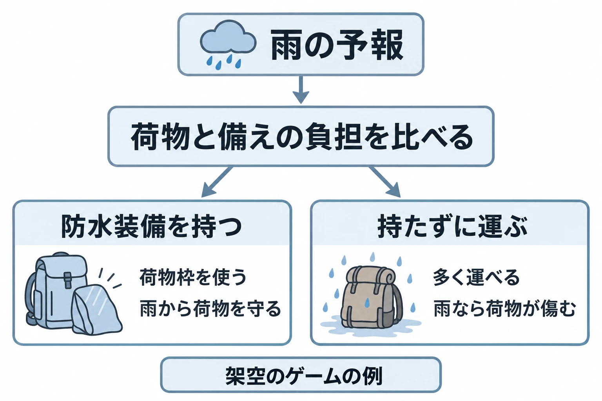
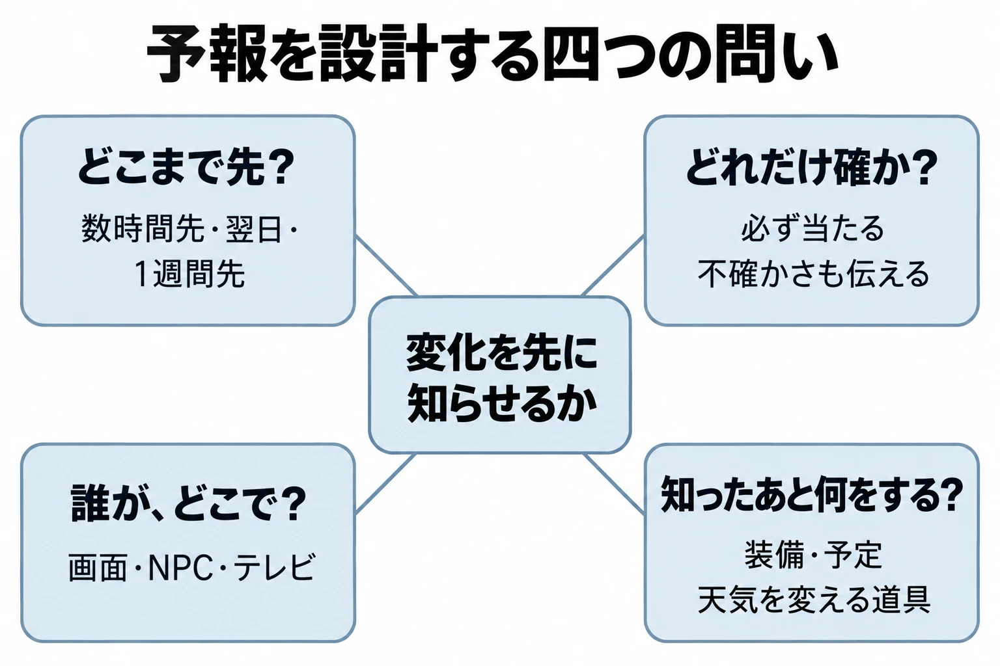

# その変化は、先に知らせるか――天気予報の信頼度と「備える判断」から、ゲームの予報を設計する

夕方、村の掲示板に「明日は雨」と出ている。山道を通って荷物を運ぶつもりだったプレイヤーは、今日のうちに出発するか、明日は村で道具を直すかを考える。これは架空のゲームの場面である。

雨が降る前に知らせれば、プレイヤーは予定を組み替えられる。さらに「雨の可能性はあるが、まだ見通しは不確か」と添えれば、今から備えるか、もう少し待つかという判断も生まれる。同じ雨でも、予報の出し方によって、今日することが変わるのである。

「天気と季節から時間をつくる」第6回は、予報を扱う。[前回「季節が変わると、何が戻り、何が去るか」](weather-season-time-seasons-what-returns-what-leaves.md)では、「去る前の予告」に軽く触れた。今回はその続きとして、変化を知らせる仕組みそのものを考える。判断軸は **「変化を先に知らせるか」** である。

***

## 予報は、どこまで先を、どれだけ確かに伝えるか

### 知らせる先の長さを分ける

現実の予報には、どこまで先を扱うかによる区分がある。気象庁の「予報の名称に関する用語」では、短期・中期・長期予報を次のように説明している。[[1](#ref-1)]

| 用語 | 説明（原文） |
| --- | --- |
| 短期予報 | 「天気予報」と同じ意味としても用いる。予報を行う時点から３時間先を超え、２日間以内の予報。 |
| 中期予報 | 予報を行う時点から２日間先を超え、７日間先以内の予報。 |
| 長期予報 | 予報を行う時点から７日間先を超え、６か月先以内の予報。 |

目前の外出に使う情報と、先の予定を立てる情報では、必要な先の長さが違う。ゲームでも、出発前に装備を替えるなら数時間先、翌日の仕事を選ぶなら明日、大きな遠征を組むならもっと先、と考えられる。

現実では、一般に先の予報ほど不確かさが増す。気象庁は、数値予報モデルで将来の天候を計算する一方、長期間の予測では出発点に含まれるわずかな誤差が大きくなると説明している。そのため季節予報では、複数の予測結果をまとめ、不確かさを考慮している。[[2](#ref-2)] 先の予定を考える材料は出せても、遠い日の天気を細部まで確定できるわけではないのである。

### 降水確率は、雨の強さとは別の情報である

気象庁の「はれるんランド」は、降水確率を次のように説明する。[[3](#ref-3)]

> 降水確率予報とは、「ある決まった時間帯に1ミリ以上の雨や雪が降る可能性」を示したものです。

同じページには、30％の意味も書かれている。[[3](#ref-3)]

> 降水確率予報３０％というのは、３０％という予報を１００回発表したとき、そのうちのおよそ３０回で１ミリ以上の雨や雪が降るという意味です。

これは雨の強さや、対象の時間のうち何割で雨が降るかを示す数字ではない。「今の天気予報の技術では、雨や雪が降ることを確実に当てることはできません。」という前提で、降る可能性を伝えている。[[3](#ref-3)]

ゲームへ取り入れるなら、「雨になりそうだ」と「強い雨になりそうだ」は分けて書きたい。プレイヤーが雨の装備を持つか考えるためには、何の可能性を示した数字なのかが伝わる必要がある。

### 信頼度は、予報の当たりやすさと変わりにくさを伝える

週間天気予報には、降水確率に加えて「信頼度」がある。気象庁の説明は次のとおりである。[[4](#ref-4)]

> ３日目以降の降水の有無の予報について「予報が適中しやすい」ことと「予報が変わりにくい」ことを表す情報で、Ａ、Ｂ、Ｃの3段階で表します。

同ページに掲載された検証結果を、階級ごとに並べる。 **2014年12月までの５年間のデータによる結果** であり、現在の予報の適中率として示したものではない。[[4](#ref-4)]

| 信頼度 | 内容 | 降水有無の適中率 | 翌日に降水の有無の予報が変わる割合 |
| --- | --- | --- | --- |
| A | 確度が高い予報 | 平均88％ | 平均1％ |
| B | 確度がやや高い予報 | 平均73％ | 平均6％ |
| C | 確度がやや低い予報 | 平均58％ | 平均16％ |

「予報が変わる」は、同じ対象日の見通しが翌日の発表で変わるという意味である。雨と予報された日の実際の天気が雨だったか、という適中率とは別に測っている。

たとえば、数日先の外出を今決めたい人には、明日また見通しが変わりそうかも役立つ。ゲームでも、遠征の準備を今始めるか、次の予報を待つかを考えさせられる。予報を設計する対象は、 **何を知らせるかと、どれだけ確かな情報として渡すか** の両方なのである。

***

## 予報が、備えるかどうかの判断を生む

雨の可能性が同じでも、傘を持つ人と、持たずに出る人がいる。荷物が増える負担と、濡れて困る程度が違うからである。

この関係を考える手がかりに、コストロスモデルがある。気象庁は次のように説明している。[[5](#ref-5)]

> コストロスモデルとは、損失を防ぐために対策を施した場合にかかる費用（コスト）と、何も対策を施さなかった場合に出る損失（ロス）をあらかじめ把握しておくことで、確率値に応じて最適な対応をとることができる、というものです。

平たく言えば、「備えに何を払うか」と「備えずに困ると何を失うか」を比べる考え方である。同ページは、掲載例の内容と数値が架空であると断ったうえで、次の点も注記している。[[5](#ref-5)]

> 確率を利用することの有意性は、多数の例に適用した結果として得られるものであり、個々の事例では最適な結果がいつも得られるわけではありません。

備えて晴れた一回だけを見て、判断が間違いだったとは言い切れない。何度も同じような判断をする中で、備えに払うものと、避けられる損失を考えるのである。

ここからは、この考え方をゲームへ置き換えた考察である。冒頭の架空の配達ゲームで、防水装備が荷物枠を使うとしよう。装備を持てば雨から荷物を守れるが、その分だけ運べる品物が減る。備えのコストは荷物枠であり、備えず雨に遭ったときのロスは荷物の損傷である。

高価な荷物を運ぶ日なら、低めの降水確率でも防水装備を選ぶ理由がある。濡れても困らない荷物なら、同じ予報でも装備を置いていける。予報の数字が同じでも、運ぶものによって判断が変わる。

反対に、防水装備が無料で、荷物枠も使わず、着替える手間もなく、ほかの不利益もないなら、常に装備しておけばよい。 **備えに何の負担もなければ、「備えるかどうか」を予報で迷う余地はなくなる。** 予報は雰囲気や予定の確認には役立つが、この選択のための情報ではなくなる。

ゲームでは、備えのコストを時間・資源・装備の切り替えなどとして決められる。さらに、備えなかった場合の損失も決められる。予報の精度だけを調整する前に、その両側に何を置いたかを見たい。

***

## 予報を、世界の中の人に語らせる――『ファイナルファンタジーXIV』

『ファイナルファンタジーXIV』では、世界の中にいる人物から予報を聞ける。2014年8月19日の公式2.35パッチノートは、「各地に天気予報を行うNPC“天気予報士”が配置されます。」と告知している。[[6](#ref-6)] NPCとは、プレイヤーが操作する以外の登場人物である。

伝える範囲も具体的に書かれている。[[6](#ref-6)]

> NPC“天気予報士”に話しかけると、各エリアの現在の天気とエオルゼア時間8時間後／16時間後／24時間後の天気予報を教えてくれます。

8・16・24時間後は、ゲーム内の **エオルゼア時間** である。当時の配置先には、リムサ・ロミンサ：下甲板層、グリダニア：新市街、ウルダハ：ナル回廊、クルザス：キャンプ・ドラゴンヘッド、モードゥナ：レヴナンツトールが挙げられている。[[6](#ref-6)]

GAME Watchの中村聖司氏による同日の記事は、「特定のコンテンツ攻略の助けになる「天気予報士」の追加」と紹介した。[[7](#ref-7)] 天候が遊びの条件になる例として、4Gamerのヌシ釣りの紹介では、釣るための条件に天候や時間が設定されていることが説明されている。[[8](#ref-8)]

設計上の注目点は、予報を知ることが、世界の中での行為になっている点である。このNPCから聞くには、その場所へ行き、話しかける。予報の機能を開くだけでなく、「出かける前に予報士に聞く」という行動として組み込める。

また、知らせる先を8・16・24時間後と区切っている。ここから企画を考えるなら、連続した未来のすべてを見せるか、準備に使えるいくつかの区切りを見せるか、という選択が浮かぶ。誰が伝えるかと、どこまで先を伝えるかを一緒に設計した作例として読める。

***

## 予報で、明日の段取りを決めさせる――『Stardew Valley』

『Stardew Valley』では、家のテレビが翌日の予定を考える窓口になる。公式Wikiの「Weather」には、次のようにある。[[9](#ref-9)]

> The weather for the next day can be checked by viewing the TV screen and selecting "Weather Report".

テレビで「Weather Report」を選ぶと、翌日の天気を確認できるという意味である。雨の予報文の一例は「It's going to rain all day tomorrow.」。明日は一日中雨が降る、と伝えている。[[9](#ref-9)]

この情報は、今日のうちにジョウロを強化に出すかという判断につながる。「Watering Cans」には、「Crops planted outside do not need to be watered on days in which it rains.」とある。屋外に植えた作物は、雨の日には水やりが不要だという説明である。[[10](#ref-10)]

同ページは、予報を使う段取りも示している。[[10](#ref-10)]

> If it's going to be rainy or stormy, make sure that all crops are irrigated and give the watering can to Clint the same day.

翌日が雨か嵐の予報なら、その日の水やりを済ませ、同じ日にクリントへジョウロを渡す、という手順である。翌日は雨が屋外の作物に水を与え、その次の日には強化したジョウロを受け取れる。店の休業日などには注意が要るが、雨を見越して道具が手元にない期間を作るのである。[[10](#ref-10)]

雨が降ってから知る場合と比べると、違いが分かりやすい。翌日の予報があるからこそ、今日の水やりのあとに道具を預ける段取りを組める。予報が、その日に失敗を避けるための注意だけでなく、道具をよくする機会を見つける情報になる。

天気は、釣れる魚の種類や、住民の会話・行動にも影響する。[[9](#ref-9)] 予報を見て「明日は何をするか」を考える先は、農作業だけに限られない。

嵐には備えの面もある。「Weather」には、「During a storm, lightning strikes can destroy random tiles on the farm. This includes crops and trees.」とある。嵐の落雷は、作物や木を含む農場内のマスを壊すことがあるという意味である。同ページによれば、避雷針は、すでに落雷をバッテリーパックへ加工している最中でなければ、農場内の配置場所によらず落雷を受け止める可能性がある。[[9](#ref-9)] 嵐の予報は、避雷針を用意できるか考える理由になる。ただし、一本置けばすべての落雷を防げると約束する仕組みではない。

さらに、天気そのものへ働きかける道具もある。「Watering Cans」は「A Rain Totem can be used to set the weather of the next day to rainy.」と案内する。Rain Totemで翌日を雨にできるという意味である。[[10](#ref-10)] 専用ページでは、使うと消費され、使用した地域の天気を変えること、ペリカンタウンでは祭りの日や季節の初日を雨にできないことも説明されている。[[11](#ref-11)]

ここからは考察である。Rain Totemがあれば、予報を見たあとに「この天気に合わせるか、道具を使って変えるか」を選べる。予報は、来る天気を受け入れて備えるための情報に加えて、道具を消費する価値があるかを決める情報にもなる。

***

## ゲームへの置き換え――考察

ここからは、現実の予報と二つの作品を手がかりにした企画上の考察である。どのゲームにも予報を置くべきだという結論にはならない。プレイヤーに、変化へどう関わってほしいかから決める。

### 先に知らせる時間を、備えに必要な時間へ合わせる

予報を出すなら、知らせてから変化が起きるまでに、準備が間に合う長さが要る。翌日の移動先を選ぶゲームなら、翌日予報が役立つ。装備の製作に数日かかるゲームなら、その前に見通しを渡す必要がある。

一方、先まで細かく知らせるほど、長い予定を組みやすくなる。予定を立てる楽しさを重視するか、その場で見つけて対応する楽しさを重視するかで、知らせる範囲は変わる。先に知らせない設計を選ぶなら、変化を知ったあとにも取れる行動や、やり直せる余地を用意したい。

### 確実な予定と、不確かな見通しを使い分ける

必ず当たる予報は、予定を組み立てる土台に向く。雨の日に道具を預けるような段取りを、安心して試せる。現実の不確かさを、そのまま再現する必要はない。

外れる予報にするなら、不確かさを判断する手がかりも考えたい。たとえば架空の予報士が「明日は雨になりそうだが、まだ確かではない」と話し、出発前にもう一度聞けるようにする。数字を見せる方法も、言葉で段階を分ける方法もある。

そのうえで、外れた場合の損失を確かめる。準備に使った時間を少し失う場合と、大切な品物を取り戻せなくなる場合では、同じ不確かさでも受け止め方が違う。予報の外れ方と失うものを組にして、試遊で確かめたい。

### 伝える相手と場所を、行動の流れに置く

画面に常時表示すれば、予報へすぐ目を向けられる。NPCに聞くなら、その人に会う行為を含めて予報になる。テレビなら、家で一日を始める流れに組み込める。

たとえば、出発前の準備が大切なゲームなら、装備を整える場所の近くに予報の窓口を置ける。毎回遠くへ聞きに行く設計なら、その移動自体も情報を得るコストになる。誰の口から伝えるかだけでなく、予定を変えられる段階で届くかを見たい。

### 知ったあとに、予定を変えられるようにする

予報を判断材料にするには、知ったあとに選べる行動が要る。装備を替える、仕事の順番を変える、出発を遅らせる、といった選択である。そこに時間や資源の負担があれば、何を優先するかも問える。

天気を変える道具を置く場合は、予報を見てから使えるかも決めたい。予報を聞き、今の天気の見通しを受け入れるか、手持ちの道具を消費するかを選ぶ。この順番なら、予報と道具が一続きの判断になる。

***

## 企画書を見直すための点検表

- 変化を先に知らせる目的は、予定を立てることか、危険へ備えることか、機会を待つことか。
- 数時間先、翌日、1週間先のうち、どこまで知れば必要な準備が間に合うか。
- 予報は必ず当たるか。外れるなら、その不確かさを判断する手がかりがあるか。
- 確率を見せるなら、何が起きる可能性なのかが伝わるか。
- 予報を誰が、どこで伝えるか。プレイヤーは予定を変えられる段階で知れるか。
- 知ったあとに取れる備えは何か。時間・資源・装備など、何をコストとして払うか。
- 備えなかった場合のロスと、備えたのに予報が外れた場合の負担は、それぞれどの程度か。
- 天気を変える道具があるなら、予報を見てから使えるか。使う範囲や制限は伝わるか。
- 先に知らせない場合、変化を知ってから対応できる余地があるか。

未来の天気を知らせると、プレイヤーは今の行動を選び直せる。どこまで先を、どれだけ確かに、誰から伝えるか。その情報で何を変えられるようにするかまで含めて、 **「変化を先に知らせるか」** を決めたい。

## References

1. [気象庁「予報の名称に関する用語」][1] — 気象庁、日付記載なし。2026年10月16日確認。長期予報の定義は句点直前の空白を省略。

[1]: https://www.jma.go.jp/jma/kishou/know/yougo_hp/yoho.html

2. [気象庁「予測手法と予測に伴う誤差」][2] — 気象庁、日付記載なし。2026年10月16日確認。

[2]: https://www.jma.go.jp/jma/kishou/know/kisetsu_riyou/method/index.html

3. [気象庁「降水確率予報って何ですか？ どのように利用したらよいのですか？」][3] — はれるんランド、日付記載なし。2026年10月16日確認。

[3]: https://www.jma.go.jp/jma/kids/kids/faq/a5_46.html

4. [気象庁「週間天気予報」][4] — 気象庁、日付記載なし。「信頼度」「信頼度の各階級の内容」を参照。検証結果は2014年12月までの５年間のデータによる。2026年10月16日確認。

[4]: https://www.jma.go.jp/jma/kishou/know/kurashi/shukan.html

5. [気象庁「確率予報の利用方法（コストロスモデル）」][5] — 気象庁、日付記載なし。モデルの説明と利用上の注記を参照。2026年10月16日確認。

[5]: https://www.jma.go.jp/jma/kishou/know/kisetsu_riyou/explain/cost_loss.html

6. [スクウェア・エニックス「2.35パッチノート 公開！ (2014/08/19)」][6] — FINAL FANTASY XIV, The Lodestone、2014年8月19日。天気予報士の導入時の仕様と配置先を参照。

[6]: https://jp.finalfantasyxiv.com/lodestone/topics/detail/aabc1b510904e99d86bc76d7750908992e391b12

7. [中村聖司「『新生FFXIV』、『パッチ2.35』アップデートを実施」][7] — GAME Watch、2014年8月19日。

[7]: https://game.watch.impress.co.jp/docs/news/20140819_662589.html

8. [鼬「『ファイナルファンタジーXIV』の深淵を覗いてみないか？　8年以上続くMMORPGに存在するアチーブメントを紹介」][8] — 4Gamer.net、2021年12月29日。ヌシ釣りの天候・時間条件に関する説明を参照。

[8]: https://www.4gamer.net/games/199/G019924/20211203037/

9. [Stardew Valley Wiki contributors「Weather」][9] — Stardew Valley Wiki、随時更新。予報、天気の影響、Storm節を参照。2026年10月16日確認。公式サイトからリンクされ、トップページで公式Wikiと明記されている。

[9]: https://stardewvalleywiki.com/Weather

10. [Stardew Valley Wiki contributors「Watering Cans」][10] — Stardew Valley Wiki、随時更新。雨天の水やりと強化の段取りを参照。Watering_Canから転送される現行ページ。2026年10月16日確認。

[10]: https://stardewvalleywiki.com/Watering_Can

11. [Stardew Valley Wiki contributors「Rain Totem」][11] — Stardew Valley Wiki、随時更新。消費、効果の範囲、Caveats節を参照。2026年10月16日確認。

[11]: https://stardewvalleywiki.com/Rain_Totem

----

この文書は、Perplexity、Claude、OpenAI Codex の3つのAIの支援を受けて著述されたものです。引用画像を除き、MIT License にて提供されています。
