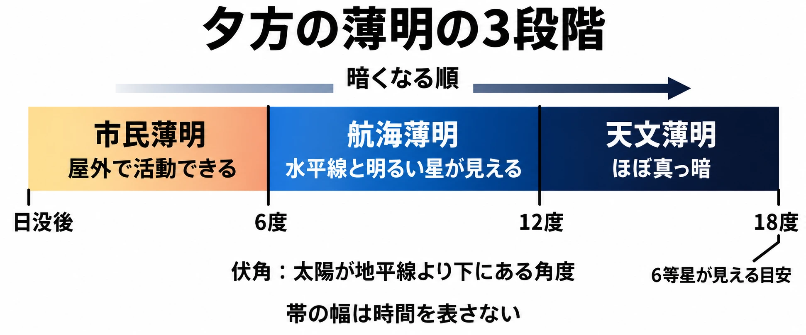

# 夜になると、何が増え、何が減るか――薄明と夜の住人から、昼と夜の遊びを分ける

夕方の村で、店主が軒先の商品を片づけはじめる。広場から人影が減り、村の外では昼と違う生き物の声がする。プレイヤーは帰るか、もう少し外にいるかを決める。これは架空の村の場面である。

帰れば安心して休める。外に残れば、夜にしか会えない生き物を探せるかもしれない。店じまいも、近づく暗さも、その選択を促す合図になる。

「天気と季節から時間をつくる」第2回は、昼と夜の遊びの違いを扱う。周期の速さについては、[第1回「その変化は、遊びの何を変えるか」](weather-season-time-cycles-real-or-compressed.md)を参照してほしい。今回の判断軸は **「夜になると、何が増え、何が減るか」** である。

夜は暗くなる時間であり、別の住人が来る時間でもある。危険や出会いが増え、視界や開いている場所が減る。その組み合わせによって、同じ村でも選ぶ行動が変わる。

***

## 昼から夜へ、段階を経て移り変わる――薄明

薄明とは、日の出前や日没後に残る薄明かりのことである。『デジタル大辞泉』は、太陽が地平線の下にある角度によって、薄明を段階に分けている。この下向きの角度を伏角という。[[1](#ref-1)]

| 区分 | 太陽の伏角の目安 | 見えるもの・できること |
| --- | --- | --- |
| 市民薄明 | 日没後、6度まで | 灯火なしで屋外の活動ができる |
| 航海薄明 | 6〜12度 | 水平線を見分けられ、明るい1〜2等星が見える |
| 天文薄明 | 12〜18度 | 空はほぼ暗くなり、暗い6等星まで見えるようになる |

等星は、星の見かけの明るさを表す区分である。数字が小さいほど明るい。表は夕方に暗くなっていく順に、『デジタル大辞泉』の説明を整理したものだ。『ブリタニカ国際大百科事典 小項目事典』は、市民薄明の明るさを、屋外で新聞を読めるほどと説明している。[[1](#ref-1)]

国立天文台の暦Wikiも、日の出や日の入りをまたいで明るさが連続的に変わると説明する。実際の明るさは地形や天候、月明かりでも変わる。そのため、薄明の区分には太陽の伏角を使う。天文薄明の境界である18度は、肉眼で6等星が見えるかどうかの目安である。[[2](#ref-2)]

市民薄明は、昔の明け六つ・暮れ六つという、夜明けと日暮れの区切りに相当する。現在の薄明の区分は、1937年の英国暦に由来する。日常の活動や航海、天体観測に役立つ明るさの違いが、区分に表れている。[[2](#ref-2)]

薄明が続く長さには土地による違いもある。『日本大百科全書（ニッポニカ）』によると、赤道に近い低緯度では短く、極に近い高緯度では長い。『改訂新版 世界大百科事典』は、同じ場所でも季節によって変わり、高緯度では夏に白夜になると説明する。白夜とは、夜も明るさが残る現象である。[[1](#ref-1)]

設計上の考察として、夕方や夜明けを、段階のある **「移り変わりの時間」** として扱える。夕方なら、まだ周囲が見えるうちに夜の訪れを知らせ、備える行動を選べる時間にできる。

『デジタル大辞泉』と国立天文台の説明をもとに作成。[[1](#ref-1)][[2](#ref-2)]

***

## 夜に減るもの――視界と安全（Minecraft）

暗くなると、周囲を見渡しにくくなる。そこに危険の変化も結びつけると、明かりを確保する行動に意味が生まれる。

Minecraft公式の初夜ガイドは、敵対モブ、つまりプレイヤーを襲う生き物は暗い場所でのみ出現すると説明する。その対策として、周囲に松明を置き、光源で明るくする方法を挙げている。[[3](#ref-3)]

この説明を設計の観点で読むと、暗さは「見えにくい」と「敵が現れうる」を結びつけている。減るのは見通しと安全であり、増えるのは危険への警戒である。松明を置く行動は、その危険を自分で減らす手段になる。

同じガイドでは、ベッドで眠って夜を飛ばすことも紹介している。[[3](#ref-3)] 設計上は、夜に向き合うか、夜を避けるかという選択がある。夜の危険を決めるときは、それを避ける手段も一緒に考えられる。

***

## 夜に増えるもの、閉まるもの――『どうぶつの森』

『どうぶつの森』の開発を振り返る「社長が訊く」では、時間帯によって捕れるムシや釣れるサカナが違うと語られている。夜にだけ釣れる、すごいサカナもいるという。[[4](#ref-4)]

野上氏は、夜遅く遊ぶとたぬきちの店が閉まっていて寂しい一方、すごいサカナを釣れば子どもから尊敬されるのではないか、と語っている。[[4](#ref-4)]

ここからは設計上の考察である。夜に減るのは、買い物のできる場所である。増えるのは、夜ならではの生き物に出会う機会だ。夜の住人を変えることで、店が閉まったあとにも外へ出る目的をつくれる。

その報酬は、手に入れたサカナに加え、誰かに見せて話したくなる体験にもなる。夜の出会いに価値を持たせるなら、「何を手に入れるか」と「そのあと何をしたくなるか」を並べて考えるとよい。

***

## 昼は狩る側、夜は狩られる側――『Dying Light』

『Dying Light』は、昼夜で立場が変わる例である。GamesBeatの発売前インタビューでは、Techlandのinternational brand managerであるBlazej Krakowiak氏が、その狙いを説明している。[[5](#ref-5)]

発売前の説明では、昼は特に通常のゾンビに対してプレイヤーが有利で、自分に都合のよい形で戦いやすい。夜には通常のゾンビが速く、攻撃的で、危険になり、特殊な種類も現れるとされていた。[[5](#ref-5)]

夜への備えとして挙げられたのは、物資の収集、武器づくり、隠れ家が無事かどうかの確認などである。Krakowiak氏は、夜の部分に少しの本物の恐怖を持ち込みたいとも語った。人間に対し、感染で生まれた怪物は夜行性、つまり夜に活動する性質を持つという理屈づけも示している。[[5](#ref-5)]

設計上の考察として、ここで増えるのは敵の脅威と緊張であり、減るのはプレイヤーの優位である。同じ場所を歩くにも、昼と夜では身構え方が変わる。夜に現れる相手と、昼からいる相手の変化を組み合わせると、夜の訪れが立場の交代になる。

***

## ゲームへの置き換え――増減から行動を決める（考察）

ここからは、これまでの資料をもとにした設計上の考察である。前回の広場を含む架空の村を使って、昼夜の違いを企画書に落とし込む。

### 昼と夜を同じ表に書く

まず、何が増え、何が減るかを並べる。次の表は架空の設計例であり、実在するゲームの仕様ではない。

| 観点 | 昼 | 夜 |
| --- | --- | --- |
| 危険 | 村の外を落ち着いて探索できる | 夜行性の獣が現れ、警戒が必要になる |
| 出会い | 広場の商人に会える | 川辺に夜だけの生き物が現れる |
| 報酬 | 店で探索用品を買える | 夜の生き物を観察し、記録を持ち帰れる |
| 視界 | 遠くの道や目印を見渡せる | 遠方が見えにくくなり、道を選ぶ判断が難しくなる |
| 開いている場所 | 広場の店を利用できる | 店が閉まり、買い物の機会が減る |
| 安全 | 村の外でも探索を続けやすい | 安心して過ごせる範囲が村の中に狭まる |

出会いや報酬は、種類を書き分けると狙いが明確になる。この例で増やすのは、夜だけの観察機会である。昼の商人との出会いも残しておけば、どちらの時間にも訪れる理由ができる。

次に、表からプレイヤーの行動を書く。夜の観察に向かうなら、店が開いているうちに必要な物をそろえる。見通しの悪くなる帰路も先に確かめる。危険と報酬を結びつけると、「もう少し外にいる」という選択の中身が具体的になる。

### 夕方を、備えるための予告にする

薄明の段階を参考に、夜の変化が始まる前に予告を置く。この村なら、まず空の色が変わり、次に店主が品物を片づけ、やがて外から夜の生き物の声が聞こえる。景色、暮らし、気配が順に変わる構成である。

合図には、そのあと選べる行動を対応させる。店じまいが見えた時点なら、まだ買い物に戻れる。夜の生き物の声が聞こえたら、探索を続けるか帰るかを決められる。 **予告を理解してから備えられること** が、夕方を設ける意味になる。

天文学の区分は、移り変わりを考える手がかりになる。ゲームでは、それぞれの合図と、店が閉まる時点や危険が増す時点との関係を決める。プレイヤーが何を見て、何に備えるのかまで書くと、夕方に役目が生まれる。

### 夜を避ける人と、挑む人の道を用意する

眠って朝へ進めるようにするか、隠れ家で夜を過ごせるようにするかを決める。隠れ家で待つ場合は、その場で時間が流れるのか、朝までまとめて進められるのかも明記する。

夜を避けたい人には、落ち着いて戻れる場所と、次に進む方法が必要になる。夜に挑みたい人には、残って探す価値のある出会いが必要になる。架空の村なら、宿で朝を迎える道と、川辺で観察を続ける道を用意できる。

夜限定の報酬を必須の進行条件にすると、夜を避ける選択はしにくくなる。任意の観察記録などにすれば、安心を選ぶ余地を残しやすい。夜に増やす報酬の役割まで決めることが、避ける自由と挑む楽しさの調整になる。

***

## 企画書を見直すための点検表

夜の遊びは、危険、出会い、視界、利用できる場所の組み合わせで変わる。企画書を見直すときは、次の点を確かめたい。

- 夜に増えるものを具体的に書いたか。危険、夜だけの出会い、報酬、緊張のうち、何を体験してほしいのか。
- 夜に減るものを具体的に書いたか。視界、開いている場所、安全の変化が、どの行動に影響するのか。
- 夜の住人を決めたか。昼と違う相手が現れるのか、同じ相手の振る舞いが変わるのか。
- 夕方の合図から備える行動につながるか。空の色、店じまい、音に気づいてから、何を選べるのか。
- 夜を避ける手段と、夜に挑む理由があるか。夜限定の報酬が、避けたい人に挑戦を強いる条件になっていないか。

夕方の村で帰るか、外に残るか。その選択をつくるために、夜の住人と、失われる便利さを一緒に考える。判断軸は **「夜になると、何が増え、何が減るか」** である。

次回は雨を取り上げ、降りはじめると遊びの何が変わるかを考える。

## References

1. [「薄明」各辞典の解説][1] — コトバンク、2026年10月15日閲覧。『デジタル大辞泉』『ブリタニカ国際大百科事典 小項目事典』『日本大百科全書（ニッポニカ）』（執筆：渡辺敏夫）『改訂新版 世界大百科事典』（執筆：森巧）を参照。

[1]: https://kotobank.jp/word/%E8%96%84%E6%98%8E-113871

2. [国立天文台 暦計算室「暦Wiki 薄明」][2] — 国立天文台、2020年5月27日更新、2026年10月15日閲覧。

[2]: https://eco.mtk.nao.ac.jp/koyomi/wiki/C7F6CCC0.html

3. [Per Landin「How to survive your first night in Minecraft」][3] — Minecraft公式、2023年6月5日、2026年10月15日閲覧。

[3]: https://www.minecraft.net/en-us/article/how-survive-your-first-night-minecraft

4. [任天堂「社長が訊く ゲームセミナー2008〜『どうぶつの森』ができるまで〜 3. ４本足で歩いていたどうぶつたち」][4] — 任天堂、2008年12月5日実施、2026年10月15日閲覧。

[4]: https://www.nintendo.co.jp/etc/seminar2008/doubutsu/03.html

5. [Dean Takahashi「Dying Light developer explains how to roam an open world full of hungry zombies (interview)」][5] — GamesBeat、2013年5月23日、2026年10月15日閲覧。TechlandのBlazej Krakowiak氏（international brand manager）への発売前インタビュー。

[5]: https://gamesbeat.com/dying-light-developer-explains-how-to-roam-an-open-world-with-being-eaten-by-zombies-interview/

----

この文書は、Perplexity、Claude、ChatGPT の3つのAIの支援を受けて著述されたものです。引用画像を除き、MIT License にて提供されています。
